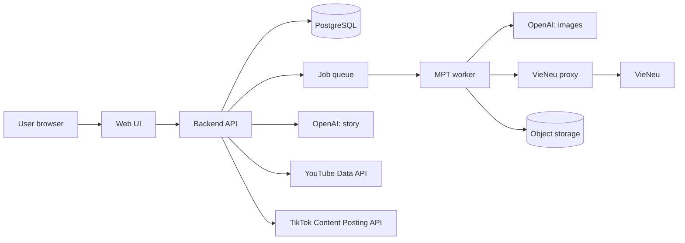

# Night Tales Studio — Consolidated Decisions (post-review)

> Decided: 2026-09-23. Status: **nothing installed yet**. This file is the input for per-part plans (see section 9).
> Legend: ✅ = read from an official source or the source code; ⚠️ = **unverified**, check before relying on it.
> Overviews: `WORKFLOW.md` (project workflow) and `DIAGRAMS.md` (diagrams, SVG in `docs/diagrams/`).
> Product: **personal-only, fully automatic** — one owner account + autopilot publishing to the owner's own YouTube and TikTok channels (official APIs only). The public SaaS phase was dropped by the owner on 2026-10-21 (§10.14); nothing is sold, viewers watch free.
> Plan level: the plans in `plans/00`–`13` are **high-level and not final**. Every feature will be reviewed again and get its own detailed plan (`plans/features/`, process and template in `plans/00-overview.md` §10.1), reviewed before implementation.

---

## 1. Goal

An automated pipeline for **faceless** YouTube (and TikTok) videos that the owner publishes to their **own** channels from one studio (section 10; personal-only since DEC 10.14, §10.14):

**write story → generate images → voiceover → assemble video + subtitles → auto-post**

- Topics: ghost stories, spiritual stories, real-world true-crime cases.
- Languages: **Vietnamese** and **English** (content languages).
- Monetization target: YouTube Partner Program (YPP) for the owner's own channel. The product must never promise monetization.

## 2. Constraints

| Constraint | Detail |
|---|---|
| Software | Prefer open source, run locally. **Only exception: OpenAI API** (story writing + image generation), reached through the owner's OpenAI-compatible relay `https://api.aixingialaire.shop/v1` (01 DEC-9, 2026-09-25) |
| License | Every model/tool must **allow commercial use** (monetized channel) |
| Hardware | Mac M4, **16 GB RAM** = development and the local phase only (one model at a time). Publishing to the internet needs a separate GPU node (section 10.4, plan 11) |
| Secrets | API keys live only in the macOS Keychain and one rendered, git-ignored `config.toml` (0600, outside the repo), **never committed**, never pasted into chat. Hard spend limits per OpenAI project (plan 01 D3, D5, D7) |
| Posting | **Official APIs only** (YouTube/TikTok), no browser automation |
| Human review | **Fiction autopilot:** automated gates + a veto window; **true-crime keeps human approval** (fact sheet and story) (§10.12) |

## 3. Chosen stack

| Stage | Tool | Runs on | License | Notes |
|---|---|---|---|---|
| Pipeline framework | **MoneyPrinterTurbo** (MPT) | Local | MIT ✅ | **Configure only**, no fork |
| Story writing | OpenAI **gpt-6-luna** (en) / **gpt-6-sol** (vi); written by the backend via the Responses API with strict `story.v1` output, not by MPT (02 CR-10) | OpenAI | — | Decided by 02.1.3 (D15, owner-approved 2026-09-28; 36 stories, blind, 2 AI raters/lang per 02 T106, not native-human evidence): en luna mean 3.083 vs sol 3.111 (ceiling sol × 0.9 = 2.800) → luna kept, no rule fired; vi luna mean 3.111 vs sol 3.167 (ceiling 2.850), (b) vi natural_language 3.389 < floor 3.5 → gpt-6-sol. Evidence: trial/ab/r1/REPORT.md, trial/ab/handoff.json. Prompt release 2026.10.1 (02 T109). The M0 harness calls OpenAI directly; MPT receives `video_script`/`video_terms` ✅ |
| Story similarity thresholds (02.5.6-T2, 02 CR-10) | `Similarity:N` vi/en, `WarnAbove`, `BlockAbove`, fact threshold, `Similarity:Perf:BudgetMs`, set by the task's deterministic decision rules 1–6 from a committed sweep (rule 3 amended by the owner 2026-10-17) | In-process (Domain `SimilarityScorer`) | — | **Calibrated 2026-10-17 (02.5.6-T2, PR #221); the owner approved the amended rule 3 (Q1 = B) and the fact-key decision (Q2 = C) on 2026-10-17.** Sample set: 80 samples = 10 classes × 4 per language × vi/en (`prompts/fixtures/similarity/sample-set.v1.json`; M1 stories S01–S36 for original / shared collocation / quoted / verbatim paragraph, every other text synthetic with fictional names); sweep `n` ∈ {6, 8, 10, 12, 14}. Evidence: `tests/NightTales.Domain.UnitTests/Stories/Similarity/Calibration/similarity-calibration-report.json`. Old → new: `n` vi/en 10/8 → **14/14**; `WarnAbove` 0.05 → **0.02** (floor; the max of the four non-copy classes is ≤ 0.0113 at n = 14); `BlockAbove` 0.15 → **0.45** (amended rule 3, owner 2026-10-17: midpoint of A = 0.011299, the max over the four non-copy classes + `heavy_paraphrase`, and B = 0.974545, the min `verbatim_full`, both languages at n = 14; 0.4929 rounded down to the next 0.05; must stay ≥ `WarnAbove` + 0.05, else 0.15 + a warning); fact threshold (`Similarity:FactOverlapBlock` and `Research:FactSheet:CopiedFactThreshold`) 0.15 (live key default; the dead key held 0.5) → **0.05** (midpoint of max `fact_paraphrased` 0 and min `fact_copied` 0.071 at n = 14, rounded up); `Similarity:Perf:BudgetMs` 500 → **163** (= `ceil(2 × 81.375 ms)`; 81.375 ms is the median of the p95 values of 10 independent runs of `SimilarityPerfTests` at n = 14 on an Apple M4 Mac with sibling lanes also loading it; p95 71.6–296 ms, quiet runs 72–76 ms). **Live behaviour change (Q2 = C, owner 2026-10-17):** production reads only `Similarity:FactOverlapBlock`; the fact-sheet verbatim-copy rule now drops a fact whose statement scores above 0.05 (was 0.15) at n = 14 (was vi 10 / en 8) against its cited sources, and facts shorter than 14 tokens score 0 by design and are never dropped as copies. Residuals, stated as owner-visible: (1) the rule "largest `n` with minimal max" is monotone and has no recall term: n = 14 lowers en `fact_copied` min to 0.071 and a copied run shorter than 14 tokens is invisible, so a verbatim-copied fact under 14 tokens is not flagged (CAL-S50-6); (2) partial copying scoring between `WarnAbove` 0.02 and `BlockAbove` 0.45 only warns, > 0.45 blocks (the old default blocked above 0.15; CAL-S50-1); (3) `verbatim_paragraph` (one copied paragraph in an original story) scores 0.058–0.134 vi / 0.090–0.111 en: it warns, never blocks (dilution is a diagnostic; the D22 per-segment shares flag the segment in the UI); (4) `translated_copy` scores 0 in both directions: cross-language copying (F18) is not detected, mitigated by facts-only writer input (02.5.5); (5) the set is small and mostly synthetic: a first calibration, rerun triggers are in the report (`rerunTriggers`); (6) `PerfBudgetMs` is machine-load sensitive; (7) `Research:FactSheet:CopiedFactThreshold` has no code consumer (CAL-S50-2). The in-code `SimilaritySettings` defaults are unchanged; config wins at run time |
| Images | OpenAI **gpt-image-2**, `medium` quality (advisory on the relay — it ignores requested size/quality/model, codex#28723; quality value per §4 CR-3) | OpenAI (relay, 01 DEC-9) | — | MPT has an `openai_image` material source ✅. **Owner amendment 2026-09-25 (01 DEC-11):** supersedes `gpt-image-2.5-flare`; images go through the relay's Responses API `image_generation` tool (host `gpt-6-luna`), not `/images/generations` (broken relay-side); per-image cost ✅ **184 VND/image** flat (owner 2026-09-28, 02 CR-27, §4) (CRV-0928-5) |
| Voice | **VieNeu-TTS v3 Turbo** (vi + en, 48 kHz; preset voice count: **25** in SDK 3.8.3 (default "Hải Đăng") ✅, 23 on the older HF card (SDK 3.7.1); the pinned server's `GET /v1/voices` is authoritative (`plans/features/01-environment-setup/` README §1 V5) | Local | Apache-2.0 ✅, FAQ allows monetized use ✅ | Needs a small proxy (section 5.3). **Do not use v4** (proprietary). Fact note: all 25 presets are Vietnamese regional speakers with no language field (`features/04-voice-proxy/README.md` V8); English narration quality is ⚠️ unverified; rule (04 O2, accepted 2026-09-24): if no en voice passes the 04.2.1 audition, launch en with the best-rated voice when its mean naturalness ≥ 3.0, otherwise postpone the en channel; this decision stays locked (04 CR-15) |
| Subtitles | faster-whisper `large-v3-turbo` | Local | — | Configured inside MPT ✅ |
| Background music | CC0 / YouTube Audio Library tracks | — | Per track | **Delete MPT's bundled music** (section 5.5) |
| Source text extraction (story research, 02.5.2) | **SmartReader 0.11.1** (+ AngleSharp 1.8.2), in-process in the fetcher; robots.txt by an in-house RFC 9309 subset parser | Fetcher host | Apache-2.0 ✅ / MIT ✅ (nuget.org, 2026-09-28) | Spike 02.5.2-T0 (`plans/features/02-story-writing/02.5.1-sources-fetcher/spike-report.md` §1.5): diacritics 20/20, recall 19/20, boilerplate ≤ 0.25 %; `Fetcher:MinTextChars` = 1,275 (02 T104). trafilatura 2.2.0 passed too but needs a Python sidecar (F19) |
| Posting | Custom code: YouTube Data API + TikTok Content Posting API | Local | — | Do not use MPT's Upload-Post integration |

**Removed from the plan:** Ollama/Qwen3 (replaced by OpenAI), mflux/Z-Image/FLUX (replaced by GPT Image).

## 4. Cost estimate

Prices from the [OpenAI pricing page](https://developers.openai.com/api/docs/pricing) and the [image generation guide](https://developers.openai.com/api/docs/guides/image-generation) ✅:

| Item | Official price | Estimate |
|---|---|---|
| gpt-6-luna | $0.10 / 1M input tokens, $0.50 / 1M output tokens | < $0.01 per 2,500-word story (inference) |
| gpt-6-sol (fallback) | $2 / 1M input, $10 / 1M output | ~$0.05 per story (inference) |
| GPT Image (gpt-image-2) | **184 VND/image** flat on the relay account (owner, 2026-09-28, 02 CR-27; ≈ $0.0072 at the SBV 25,641 VND/USD of 2026-09-25; `trial/prices.json` `unit: per_image`). Official-API reference only: `gpt-image-2.5-flare` $30 / 1M image output tokens (superseded model, 01 DEC-11) | Official-API flare reference — 1024×1024: low ~$0.006 · **medium ~$0.013** · high ~$0.053 per image. Relay: ~60 images ≈ 11,040 VND ≈ $0.43 per long video (CRV-0928-5) |
| One long video (~60 images) | | **Relay (the trial's price, 02 CR-27):** 60 × 184 VND = 11,040 VND ÷ 25,641 VND/USD ≈ **$0.43** + < $0.01 story = **~$0.44** · official-API `gpt-image-2.5-flare` reference at medium: 60 × ~$0.013 + story ≈ ~$0.79 (CRV-0928-5) |
| **~13 long videos / month** (3/week) | | **Relay:** 13 × ~$0.44 ≈ **~$6 / month** · official-API flare reference: ~$10–11 (CRV-0928-5) |

⚠️ These are **floor** prices. With `openai_image_size = ""`, MPT picks **1536x1024** (landscape) or **1024x1536** (portrait) per video aspect (`config.example.toml:199-204`), which costs more tokens than 1024×1024 — **not measured yet**. Measure via the response `usage` field in phase 1.

⚠️ **Quality is not selectable through MPT** ✅: its `openai_image` request body is only `{model, prompt, n: 1, size}`, so the API default `quality = auto` applies (`plans/features/01-environment-setup/` README §1 M4, O6). The "medium ~$0.013" figure above is therefore an assumption, not what the trial pays; plan 03 CR-3 decides how quality is set — **decided 2026-09-24 (03 D9, owner O1/O3):** the node image relay injects `quality`; the value and the measured cost per image per aspect are recorded here by 03.3.1-T2 after the M0 contact sheet (03 CR-12). **Rate limit:** Tier 1 allows **5 images/min** for `gpt-image-2.5-flare` ✅ (O8 — superseded by `gpt-image-2`, 01 DEC-11; rate re-check [OPEN]), and MPT skips a keyword silently after 3 retries on 429 (M4) — see plan 03 G7.
- [DECISION] **No price to anyone (DEC 10.14, owner 2026-10-21):** there is no credit, package or payment price. The only money tracked is the owner's own OpenAI spend, metered per generation (`usage_records`, §10.5). Spend caps and runway alerts (§10.5) still protect the owner's OpenAI balance.

## 5. Integration details per stage

### 5.1 Story writing (MPT `config.toml`) ✅

```toml
llm_provider = "openai"
openai_api_key = ""          # fill in locally
openai_base_url = ""         # empty = api.openai.com
openai_model_name = "gpt-6-luna"
```

### 5.2 Images (MPT `openai_image` material source) ✅

- **Activation switch:** set `video_source = "openai_image"` (`config.example.toml:78`, default `"pexels"`). Without it every `openai_image_*` key is ignored and MPT silently uses Pexels stock footage. The API request body can also set `video_source` per job (`app/models/schema.py:118`).
- MPT calls `/images/generations`, **one image per script keyword**.
- Config keys: `openai_image_base_url`, `openai_image_api_keys`, `openai_image_model`, `openai_image_size`, `openai_image_prompt_template` (`config.example.toml:192-208`).
- Leave `openai_image_size = ""`: MPT then sends an OpenAI-valid size per aspect (1536x1024 / 1024x1536 / 1024x1024). Arbitrary sizes like `1080x1920` are only for local gateways.
- Use `openai_image_prompt_template` to **lock the visual style** for a whole video (dark, foggy, cinematic, no gore).
- OpenAI moderation ✅: `moderation` parameter = `auto` (default) or `low`. Blocked requests return `error.code = "moderation_blocked"`; **do not auto-retry the same prompt** — log it and rewrite the prompt. ✅ MPT itself does not fail the task on a blocked image: it skips that keyword, uses the next one and loops clips (`plans/features/03-image-generation/` README I6–I9). The node image relay records the code per scene and the backend applies 03 D7 (video kept with ≤ 10 % skipped scenes, else `image_moderated`, never auto-retried) (03 CR-12).
- Characters may look different across scenes (each image is an independent call). MPT only calls `images/generations` (no reference-image or Edits path in `app/services/material.py`), so keep consistency through the shared style template and silhouettes/scenery. A fixed recurring character via the **Edits** endpoint would need our own image step outside MPT (backend, section 10) — not in scope for phase 1.

### 5.3 Voice: VieNeu ↔ MPT (source code of both sides read) ✅

**Problem:** MPT cannot talk to VieNeu directly.

| Side | Fact (file:line) |
|---|---|
| MPT, `kokoro`/`chatterbox` slots | Shared `_openai_compatible_tts` **always sends `"response_format": "mp3"`** (`app/services/voice.py:2169`), not configurable |
| MPT, `voxcpm` slot | Sends `"response_format": "wav"`, `"stream": true`, **requires an `api_key`**; parses SSE `{"type":"speech.audio.delta","audio":"<base64>"}` … `speech.audio.done` (`voice.py:2629-2713`); only **one voice per config** (`voice_id`, `voice.py:324-337`) |
| VieNeu `apps/openai_speech.py` | `POST /v1/audio/speech` accepts only `pcm`/`wav` (mp3 → **400**); `model` accepts any string; `speed` is ignored; unknown voice → 400; SSE is enabled by the body field **`stream_format: "sse"`** (default `"audio"`); voice list is at `GET /v1/voices` (MPT calls `/audio/voices`) |

**Two options — both need a local proxy.** Option A's proxy streams VieNeu PCM → ffmpeg → MP3 to MPT as the audio arrives (`features/04-voice-proxy/README.md` D3, D4), ≈ 400 lines of Python plus tests (04 README F21 estimate), not a small buffering relay (04 CR-15):

| | A. `kokoro` slot (**chosen**) | B. `voxcpm` slot (fallback) |
|---|---|---|
| What the proxy does | Requests `response_format: "pcm"` (48 kHz) from VieNeu and **streams PCM → real MP3 through ffmpeg** while it arrives; 200 is sent after the first MP3 bytes, a later failure aborts the connection (04 README D4) (04 CR-15) | Only rewrites the JSON body: add `stream_format: "sse"`, drop `stream` |
| Voice selection | Multiple voices in the UI via `[kokoro] voices = ["kokoro:<voice name>", …]` (superseded by plan 04 F2: the proxy serves `GET /v1/audio/voices` in MPT's shape, so `[kokoro] voices = []` and MPT fetches the list) | One fixed voice in config; switching vi/en voice requires a config edit |
| Pros | Easy vi/en voice switching | No ffmpeg in the proxy; key-based auth built in |
| Remaining risk | A no longer uses WAV (PCM has no header). The unknown-length WAV header (`0xFFFFFFFF`, `openai_speech.py:197`) decodes with ffmpeg (exit 0, warnings; 04 README X1, re-confirmed at the pin by 04.1.1-T1) (04 CR-15) | ⚠️ pydub decode of that header still unverified (04 CR-15) |

- In option A, **never** return WAV bytes labelled as mp3: that file flows straight into MPT's mixer (`os.replace(temporary_audio, voice_file)`), and downstream readers were not checked → always transcode for real.
- Run VieNeu with **`HOST=127.0.0.1`** (default `0.0.0.0` exposes it to the whole network) and set `VIENEU_API_KEY`.
- `VIENEU_WATERMARK=1` is on by default → **keep it** (⚠️ watermark nature not read in detail; presumed to be an inaudible AI-voice marker). Owner 2026-09-25 (01 DEC-7): keep it as an **AI-provenance mark**. ✅ It is the same mark for every Perth user and carries no owner ID: `resemble-perth` 1.0.1 `perth_net_implicit/perth_watermarker.py:25` is `apply_watermark(self, signal, sample_rate, **_)` with no payload, and `get_watermark` returns presence only. So it **cannot prove NightTales ownership**; ownership/copyright proof is a **signed per-render hash manifest** (owner 2026-09-25, 01 DEC-8, CR-14). It is **required in production** (the plan 11 node: `--extra cuda --extra watermark`, fail closed unless `Audio watermarking initialized (Perth)` is logged). The Mac M0 trial runs **without** it: the pinned `[watermark]` extra lacks torch, so it stays off (01 CR-13), and M0 audio is never published.
- Install VieNeu on CPU/Apple Silicon via ONNX: `uv sync`.

### 5.4 Subtitles ✅

```toml
subtitle_provider = "whisper"   # sample config default is "edge" → must change

[whisper]
model_size = "large-v3-turbo"
```

Whisper is required because the kokoro/voxcpm slots **return no word-level timestamps**.

In sentence mode `subtitle.correct()` replaces every cue's text with the matching script chunk, so whisper supplies the **timing only**; the default font `STHeitiMedium.ttc` misses 92 Vietnamese letters (of 178 tested) and every job therefore sends `font_name = BeVietnamPro-Bold.ttf` (OFL-1.1, bundled); whisper is called with **no `language`** and `initial_prompt` stays unset (05 CR-10; `plans/features/05-video-assembly-subtitles/README.md` C15, C16, X1).

### 5.5 Video assembly (MPT) ✅

- WebUI, API and CLI. Batch up to 100 tasks: `uv run python cli.py --batch-file ./tasks.json --stop-at video`.
- **Delete all of MPT's default music**: the README says it was taken from YouTube videos ("如有侵权，请删除" = "if infringing, please delete") → copyright risk.
- **Do not use** `app/services/upload_post.py` (sends videos through the third-party service `api.upload-post.com`).
- MPT does **no loudness normalisation** (the mix applies `voice_volume`/`bgm_volume` only), so the node normalises every render to −15 LUFS / −1.5 dBTP and then measures it (`render_check.py`, 05 D9) (05 CR-10; C17, X3).
- Music only via `bgm_type = custom` + `bgm_file` from the licensed catalog — **never** the schema default `random`, which picks any file from `storage/bgm` or `resource/songs` (05 CR-10; C18, 05 D8).
- Catalog sources: **YouTube Audio Library first, CC0 second**, CC-BY with a description credit; `youtube`-scope tracks are never used off YouTube or for other users (owner O2, 2026-09-24) (05 CR-10).

### 5.6 Posting (custom code) ✅

**YouTube Data API `videos.insert`:**
- API projects created after 2020-07-28 are **locked to private** until audited: [audit form](https://support.google.com/youtube/contact/yt_api_form). **File early.**
- Quota: Video Uploads bucket of 100 per day, 1 unit per call.
- Always set `status.containsSyntheticMedia = true`. Schedule with `publishAt`.

**TikTok Content Posting API** ([Content Sharing Guidelines](https://developers.tiktok.com/doc/content-sharing-guidelines)):
- Unaudited apps can only post **private** content. Audit at developers.tiktok.com/application/content-posting-api.
- **Intended use:** "A utility tool to help upload contents to the account(s) you or your team manages" is listed as **not acceptable** ✅, so a private single-owner uploader would fail the audit. The public multi-user platform that would have been an accepted use was dropped (DEC 10.14) → the owner's TikTok lane continues on the pessimistic assumption that Direct Post stays **private-only** and low-volume until TikTok's audit posture is proven otherwise ⚠️ (plan 07 keeps the audit tasks). "An app that copies arbitrary contents from other platforms" is also not acceptable.
- Caps for all clients: a 24-hour active-creator cap per API client (based on the audit estimate), and about **15 posts per day per creator account**, shared across every app.
- **Content transfer, scope and tokens (07 CR-12):** video content transfers to TikTok via `PULL_FROM_URL` (a presigned https URL from our storage, under a domain/URL prefix verified in the app), never `FILE_UPLOAD`, for server-side content; the OAuth scope requested is `video.publish` only; rate limits are 6/20/30 requests per minute (endpoint-dependent); access tokens last 24 h and refresh tokens 365 days, both rotated on refresh; there is **no scheduling parameter** on Direct Post — every post is immediate, with a per-post privacy choice by the creator.

## 6. Platform rules to follow ✅

- **YPP eligibility:** 1,000 subscribers + (4,000 watch hours in 12 months **or** 10M Shorts views in 90 days). Review takes ~1 month. Vietnam is a supported country.
- Channels with **no uploads for 6 months** may lose monetization.
- The "inauthentic content" policy (renamed 2025-07-15): **mass-produced content is not monetizable** → every video must have its own value (unique script, no templated duplicates). Personal studio (the only phase since DEC 10.14): the owner's fiction autopilot replaces human review with automated gates, a variety guard, a daily cap and a veto window; the owner knowingly carries this monetization risk (§10.12).
- Design consequence: no "generate 100 videos in one click" feature exists. Fiction is auto-approved by gates, **true-crime keeps human approval** (fact sheet and story) (§10.12).

## 7. Reviewed and rejected

| Tool | Reason |
|---|---|
| flowkit | Drives a signed-in Google Flow session through an extension that mints reCAPTCHA → account-ban risk |
| Hypit | Depends on paid Seedance/GPT Image (~$1.09/video); "clone viral video" focus conflicts with reused/inauthentic content policies |
| OpenCreator (full stack) | Image/video/TTS use paid clouds; Edge TTS is an unofficial endpoint |
| VoiceStudio | AGPL-3.0; default engine OmniVoice is **CC-BY-NC** (non-commercial); no VieNeu |
| F5-TTS-Vietnamese-ViVoice | Weights are **CC-BY-NC-SA-4.0** (non-commercial) |
| Edge TTS | Unofficial endpoint |
| FLUX.1-dev / FLUX.2 | Non-commercial / requires paid BFL tiers |
| TikTokAutoUploader, RedditVideoMakerBot, … | Browser automation / not a fit |
| Upload-Post (inside MPT) | Unnecessary third-party service |
| trafilatura 2.2.0 (sidecar extractor) | Passed the 02.5.2-T0 quality thresholds, but a Python sidecar adds a second runtime, health check and CVE stream to the minimal-surface fetcher (F19); SmartReader chosen on deployment cost |
| TurnerSoftware.RobotsExclusionTools 0.9.1 | Last release 2022-08-09, predates RFC 9309 (no longest-match/`Allow` guarantee), unmaintained (02 E4) |
| MediatR 14.x | License is RPL-1.5 or paid commercial; RPL covers hosted use → rejected. Use Mediator.SourceGenerator (MIT) |
| InkOS (Narcooo/inkos) — code and prompt text | AGPL-3.0 ✅. Ideas only; our prompts are written from scratch (§10.10) |
| Aggregating/transcribing other channels' videos into stories | Breaks YouTube Terms ✅ (§10.10) and copies other narrators' expression |
| jev-ultrafast for uploading/posting | YouTube Terms forbid automated access ✅; its README lists uploads as outside the MVP ✅; official APIs exist (§5.6) |

## 8. Unverified items / open risks ⚠️

1. Whether YouTube allows **full ads** on ghost/true-crime content (ad-suitability guidelines).
2. OpenAI terms on **images of real people** (true crime) — for now use illustration, silhouettes, scenery only; never depict real victims/suspects realistically.
3. Whether TikTok Creator Rewards is available in Vietnam → check in the app (Creator Tools).
4. Real speed on M4 16 GB (VieNeu on CPU, whisper large-v3-turbo).
5. Image token cost at 16:9 / 9:16.
6. VieNeu's unknown-length WAV header (`0xFFFFFFFF`): ffmpeg decodes it (exit 0 with warnings, duration +29 ms on a pipe; `features/04-voice-proxy/README.md` X1, 2026-09-24; re-confirmed at the pin by 04.1.1-T1). Option A uses PCM anyway (04 D4). pydub (option B) is still unverified ⚠️ (04 CR-15).
7. Whether Google requires **OAuth app verification** for the `youtube.upload` scope, and how long it takes.
8. Monthly cost of a GPU worker server, and throughput per server.
9. ~~A payment provider that works for a Vietnam-based business (for credits/subscriptions)~~ — closed by DEC 10.14 (owner 2026-10-21): nothing is sold, so no payment provider is needed.
10. ~~`faster-whisper` license~~ — closed: **MIT** ✅ (SYSTRAN/faster-whisper `LICENSE`; checked 2026-09-23, `plans/features/01-environment-setup/` README §1 W1).
11. ~~Path handling of MPT's `/stream/{file_path:path}` and `/download/{file_path:path}` endpoints~~ — closed: both resolve the path with `realpath` + `commonpath` inside `storage/tasks` and require a regular file, so there is no traversal outside the task dir, but there is **no per-task scoping** (any file of any task is readable with the one key); MPT binds loopback and only the adapter calls it (05 CR-10; `plans/features/05-video-assembly-subtitles/README.md` C12).

## 9. Parts to plan

Detailed plans now exist in `plans/` — start with `plans/00-overview.md` (BA review, milestones, shared contracts, estimate roll-up). One file per part:

| File | Part | Depends on |
|---|---|---|
| `plans/01-environment-setup.md` | Install MPT, VieNeu (`uv sync`), ffmpeg, faster-whisper | — |
| `plans/02-story-writing.md` | Story prompts for the 3 topic lines, review checkpoint #1 | 01 |
| `plans/03-image-generation.md` | Style prompt templates, `moderation_blocked` handling, token measurement | 01 |
| `plans/04-voice-proxy.md` | VieNeu proxy (option A), vi/en voice list | 01 |
| `plans/05-video-assembly-subtitles.md` | MPT config, whisper, CC0 music, remove bundled music | 02–04 |
| `plans/06-youtube-posting.md` | OAuth, `videos.insert`, `publishAt`, `containsSyntheticMedia`, file audit | 05 |
| `plans/07-tiktok-posting.md` | Content Posting API, file audit | 05 |
| `plans/08-90-day-operations.md` | 3 videos/week, one topic line first, track cost + metrics | 06–07 |
| `plans/09-backend-api.md` | ASP.NET Core API, PostgreSQL, job queue, story step, MPT job orchestration, metering | 01–05 |
| `plans/10-web-ui.md` | Dashboard: story editor (checkpoint #1), video preview (checkpoint #2), channel connect, TikTok required post UI | 09 |
| `plans/11-worker-deployment.md` | GPU server with MPT + VieNeu + proxy + whisper on a private network, object storage | 01–05 |
| `plans/13-compliance.md` | Privacy policy, terms of service, YouTube and TikTok audits, data deletion | 06, 07, 09 |

Plan numbering is stable except **plan 12 (billing/credits) which is removed** (DEC 10.14); its former slot stays empty so no other plan is renumbered.

Plans 06 and 07 post through the **owner's own OAuth connections** for the owner's own channels (personal-only product, DEC 10.14).

**Phase 1 (trial, ~2 days):** produce one 5-minute video; record time per stage, token/cost for the story and each image, and the number of `moderation_blocked` errors.

## 10. Web UI + backend

> **Status after DEC 10.14 (owner 2026-10-21): the product is personal-only.** Much of this section was written for the public platform the document originally planned (accounts for strangers, credits, payments, an admin surface, compliance for third-party data). Those parts are **superseded** — kept as the record of why the system is shaped the way it is. Still in force, restated for the one-owner studio: nobody else ever calls MPT (§10.2), the architecture and network zones (§10.3–§10.4, including the deferred hosting proposal), the owner's own OpenAI spend metering (§10.5), the platform rules every YouTube/TikTok API client must follow (§10.6), the content/liability limits (§10.7), the security baseline (§10.8) and the licences (§10.9). Superseded: the public-tenant parts of §10.1, the credit-sales and payment-provider items of §10.5, the user-facing wording of §10.6–§10.7, the admin/owner-governance and credit items of §10.11, and the phase split of §10.12.

### 10.1 What changes when the system became public (superseded by DEC 10.14)

| Before (single owner) | After (public platform — no longer the plan) |
|---|---|
| Runs on the Mac | Mac = development only; workers on a server |
| Owner's OpenAI key, ~$10/month | Platform pays OpenAI per job → credits, quotas and metering were designed for this; only the owner's spend metering survives |
| Posts to the owner's channel | Was: posts to **each user's** channel. Now: still the owner's own channels |
| MPT WebUI is enough | Own Web UI + backend; MPT becomes a hidden render worker |
| No legal pages | Privacy policy, terms, data deletion still apply to the owner's API client; the multi-user audit surface does not |

### 10.2 MPT cannot face users directly ✅

Read from MPT source:
- One shared API key for every caller: `app.api_key` (`config.example.toml:26`), checked in `verify_token` (`app/controllers/base.py:58`). Empty key = authentication **disabled** (`app/asgi.py:26-29`).
- `GET /tasks` returns **all** tasks (`app/controllers/v1/video.py:240`) → no per-user isolation.
- Default `listen_host = "0.0.0.0"` (`config.example.toml:11`), `max_concurrent_tasks = 5` (`:464`), `enable_redis = false` (`:457`).
- Provider API keys are global in `config.toml`, but each job request carries its own `video_script`, `video_terms`, `video_source`, `video_aspect`, `voice_name` (`app/models/schema.py:106-128`).
- **Task state lives in memory**: an MPT restart loses it and the same task then answers **404** (05 CR-10; C9).
- Tasks beyond `max_concurrent_tasks` **queue silently**: a queued task looks exactly like a running one (`state 4`, `progress 0`), and on our nodes `max_queued_tasks = 0` rejects every task that finds all slots busy instead of queueing it (05 CR-10; C10).
- **There is no cancel**: `DELETE /api/v1/tasks/{id}` refuses a running task with 409 `task is still running` (05 CR-10; C11).
- Validation errors are HTTP **400** with the fixed message `field required` (not 422) whatever the cause, and unknown body fields are **ignored** (05 CR-10; C5).

**Decision:** MPT runs on a private network with `app.api_key` set; **our backend is its only caller**. The backend writes the story itself, the user edits and approves it, and the backend sends the approved text as `video_script`. This puts checkpoint #1 in our UI and keeps MPT unmodified.

### 10.3 Architecture



| Component | Proposal | Why |
|---|---|---|
| Web UI | **Angular 22** (decided), Clean Architecture per feature (`plans/00-overview.md` §5.3) | Dashboard for the owner (vi + en); no public landing/pricing pages (DEC 10.14) |
| Backend API | **C# on ASP.NET Core / .NET 10 LTS** (decided; latest stable 10.0.12, §10.13), **Clean Architecture + CQRS** (`plans/00-overview.md` §5.2), **PostgreSQL** (decided), background jobs (Hangfire on PostgreSQL: LGPL-3.0 or commercial — fine for a hosted service; use unmodified from NuGet and never patch or fork it; Hangfire.PostgreSql license ⚠️ confirm) | Boring, proven; matches the team's stack |
| Render worker | MPT + VieNeu + proxy + faster-whisper, private network only | Unmodified open-source stack |
| Storage | S3-compatible object storage with signed, expiring links; self-hosted SeaweedFS in every env (11 CR-15) | Videos are large; delete after a retention period; no managed object storage or AWS account (owner O7 2026-09-27) |

**Backend responsibilities:** the owner account and login; story step (call OpenAI, save draft, owner edits/approves or the autopilot gates approve = checkpoint #1); render jobs to MPT with the approved script; poll job status; store output; preview and approve = checkpoint #2; publish to the owner's connected YouTube/TikTok; record OpenAI `usage` per job (metering only, no charging — DEC 10.14); spend-cap and runway alerts; log `moderation_blocked` errors.

### 10.4 Capacity ✅ / ⚠️

- VieNeu serves **1 stream on CPU (fp32) or 2 (int8)**, and up to **16 on GPU** (`VIENEU_MAX_STREAMS`, `openai_speech.py:35-37`) ✅. Extra requests queue, then get 429.
- MPT runs at most `max_concurrent_tasks` jobs (default 5) per instance ✅.
- **Publishing ceiling:** the YouTube `videos.insert` default quota is 100 calls/day **per API project** ✅. One owner channel at the default daily cap (1 video/day) stays far below it; no quota extension is needed for the personal studio.
- The Mac runs the local studio (phase 1) only; publishing to the internet needs one GPU node. Cost and videos per hour per server ⚠️ **not measured**; measure in phase 1 and on the first server.
- **GPU node stack (11 CR-8, verified 2026-09-24):** MPT's own GPU image is CUDA 12.1 + cuDNN 8, but its lock pins ctranslate2 4.7.1, which needs cuDNN 9 (faster-whisper README ✅) → the node installs cuBLAS 12 + cuDNN 9 as locked wheels for MPT's whisper; VieNeu's `cuda` extra is torch 2.8.0 cu128 → NVIDIA driver ≥ 570.26 ✅. MPT keeps one whisper model per process; VieNeu uses ≈ 1.1 GB VRAM at 16 streams ✅; a node needs ≥ 16 GB VRAM (24 GB preferred) [INFERENCE until measured in 11.6.3]. Details: `plans/features/11-worker-deployment/README.md` D9.

#### 10.4.1 Hosting decision (11 11.2.1-T1) — PROPOSED, deferred to phase 2 (owner 2026-09-30), 2026-09-29

**Deferred (owner 2026-09-30):** phase 1 runs everything locally on the owner's Mac (§10.13 native stack); nothing is deployed to the internet until phase 2, so this proposal is neither accepted nor rejected. Re-validate the captures (prices, SKUs) before signing it at phase 2 — they date from 2026-09-29.

**Status: proposed.** Evidence: `infra/scoring/captures/{aws,azure,gcp}-2026-09-29.json` (every value carries `source_url`, `captured_on` 2026-09-29, a `unit` and a quoted line), `infra/scoring/README.md`, `infra/scoring/latency.md`. Every number below is the output of `python3 infra/scoring/score.py infra/scoring/captures/*.json` (10 hard gates, weights sum 1.0, declared noise tolerance 0.0100) — this record quotes the script, it does not override it.

**Decision: Azure, region `southeastasia` (Singapore), one GPU node `Standard_NC8as_T4_v3` = 1 x NVIDIA Tesla T4 16 GiB − 8 vCPU / 56 GiB RAM.** Runner-up and the only other non-excluded finalist: **GCP `asia-southeast1` + `g2-standard-8`** (1 x NVIDIA L4 24 GiB) — **ineligible today** because it leaves the PostgreSQL 17 PITR hard gate unknown (no fetchable page states the base-backup + continuous-WAL mechanism). **AWS is scored for the record but never eligible:** `DECISIONS.md` §3 and 11 README D21 (owner O7, 2026-09-27) lock the storage engine and state that no AWS account is used; the harness encodes that as the `owner_locked_eligible` hard gate, not as prose.

| rank | provider | total | eligible | gate |
|---|---|---|---|---|
| 1 | azure | 0.8400 | **yes** | − |
| 2 | aws | 0.7540 | no | `owner_locked_eligible` (locked owner decision) + `block_volume_two_zones` unknown ⚠️ |
| 3 | gcp | 0.4646 | no | `pg17_pitr` unknown ⚠️ |

`winner (top eligible): azure (total 0.8400)`. Each provider is in its own noise band (0.8400 / 0.7540 / 0.4646), so the declared tie-break (latency → GPU price → egress) was **not** triggered; it exists in `criteria.json` and is applied by the script whenever two totals fall inside the band. **Known artefact, stated so it is not read as evidence:** min/max normalisation turns the 0.1 % GPU-price spread ($1.052 vs $1.053116/hour) into the whole 0.20 weight, which is why GCP's total sits far below two providers whose prices are within 1 %; the criterion ranks *relative* price and the gap is not a quality difference.

| item | answer (Azure `southeastasia`, 2026-09-29) |
|---|---|
| GPU / VRAM | `Standard_NC8as_T4_v3`, 1 x NVIDIA Tesla T4 **16 GiB** (the 24 GB preference is not offered on a single-GPU size in that series) |
| GPU price | **USD 1.052 per node-hour**, pay-as-you-go Linux (Azure Retail Prices API) |
| Billing granularity / stop-start | **per-second** ("Pay for compute capacity by the second"); a `Stopped` VM is still billed, so the node must be **deallocated** to stop the compute charge |
| Monthly at the duty cycle | 1.052 x 6 h/day x 30.4375 d = **USD 192.12/month**, derived by `score.py` from `gpu_price_per_hour` (`cost/video = GPU price/h x node hours / videos per hour`; the denominator is 11.6.3-T1's) |
| Latency to VN / OpenAI / YouTube | ⚠️ **not measured** — `latency.md` carries the exact commands as the mandatory pre-apply check for 11.2.2-T1 step 1; the decision is provisional on that check alone, and both latency criteria score neutral meanwhile |
| Managed PostgreSQL 17 + PITR | ✅ Azure Database for PostgreSQL Flexible Server, PG **17.11** (Microsoft), with **snapshot base backup + continuous WAL archiving** quoted (retention 7 d default, 35 d max). General Purpose Ddsv5 2 vCore **USD 0.244/h = 178.12/month**, storage **0.138/GiB-month** |
| Block volume | ✅ Standard SSD managed disk **USD 0.075/GiB-month** (E10 LRS: 128 GiB = $9.60/month; ZRS 0.1125), server-side encryption at rest |
| Snapshot price | ✅ **USD 0.132/GiB-month** — the snapshot tier follows the volume tier; the $0.05 tier is Standard HDD and does not apply to an SSD volume |
| Two zones for `storage-backup-<env>` | ✅ `Southeast Asia` has **3** availability zones (regions list quoted); the backup VM gets its own zonal disk in another zone. [T74 ⚠️ the live orderability proof is 11.2.2-T1's] |
| `media.<domain>` internet egress | ✅ published **USD 0.110/GB** for the first 10 TB/month (first 100 GB/month free; then 0.075 / 0.07 / 0.06) |
| Private CA for `storage-<env>.internal` | ⚠️ Azure publishes **no managed private-CA service** (Key Vault certificates come from DigiCert/GlobalSign or a self-signed policy) → the **T81 offline-root fallback** applies: an owner-generated root issues `storage-<env>.internal` and `storage-backup-<env>.internal`, installed in every host/node trust store; **no client pins a certificate** |
| FQDN egress (F14) | **yes, but optional** — outbound FQDN filtering is an **Azure Firewall** (Standard/Premium) feature, not an Application Gateway one; if it is ever enabled it needs a `nts-<env>-fw` firewall plus a route table steering the subnet's egress through it. D11's per-unit nftables IP/port allow-list stays the design, so no IaC depends on it |
| VPN / bastion | ✅ VPN Gateway (`VpnGw1` **USD 0.19/hour**) + Azure Bastion |
| Secret manager | ✅ Azure **Key Vault** `nts-<env>-kv` (secrets; standard operations $0.03 per 10,000). **Naming constraint:** a Key Vault secret name accepts only `[0-9A-Za-z-]`, so the D15 logical path `nts/<env>/<scope>/<NAME>` cannot be the physical name. Physical name = `nts-<env>-<scope>-<name>` (lowercased, `/` and `_` → `-`, scope ∈ `api`/`worker`/`fetcher`/`shared`/`storage`, and `nts-<env>-node-<nodename>-<name>` for node keys), with the D15 logical path kept **in the secret's tags** (`nts:logical-path`). Recorded as **11 CR-17** against D15 (see `plans/features/11-worker-deployment/README.md` §4) |
| Container registry | ✅ Azure Container Registry, **USD 0.10/GiB-month** storage (Basic tier $0.1666/day) |
| Telemetry backend (O6, consumed by 11.6.2-T1) | **Azure Monitor** (logs + metrics, Log Analytics workspaces). **No self-hosted AGPL anywhere** (E12/F16) |
| Private networking / data terms | ✅ Virtual Network with subnets and NSGs; GDPR commitments + the Microsoft DPA are published. ⚠️ Vietnam Decree 53/2022 data-localisation is **not settled** for a private studio — owner/TL item (revisit trigger) |
| Payment from Vietnam | ✅ Microsoft's supported-payment-methods table lists Vietnam (credit and debit cards) |
| Node policy | no Kubernetes, one host per role, containers on a plain OS image; `staging` GPU count 0 (F08) |

**Provider-native resource names for 11.2.2-T1 to paste into `infra/modules/platform`** (`<env>` = `staging`|`prod`; Azure):

| role | name |
|---|---|
| Network / subnet | VNet `nts-<env>-vnet`; subnets `nts-<env>-{app,render,fetcher,storage}`; route table `nts-<env>-rt` |
| Security groups | NSGs `nts-<env>-{api,worker,fetcher,render,storage,storage-backup,lb}-nsg` |
| Managed PostgreSQL 17 | Flexible Server `nts-<env>-pg` (PG 17, PITR on), private DNS zone `nts-<env>.private.postgres.database.azure.com`; created by `infra/bootstrap` (T83), referenced by the module |
| Storage VMs | `nts-<env>-storage` (zone 1) and `nts-<env>-storage-backup` (zone 2) |
| Block volumes | managed disks `nts-<env>-storage-data` and `nts-<env>-storage-backup-data` (Standard SSD LRS, `prevent_destroy`) |
| Snapshot policy | Azure Backup policy `nts-<env>-daily-7d` on the **primary volume only** (T87) |
| Internal CA (T81) | offline root `nts-<env>-internal-root.pem` (owner-held) + an issuing script; Azure has no managed-CA product to subscribe to. Names covered: `storage-<env>.internal`, `storage-backup-<env>.internal` |
| Registry | ACR `nts<env>acr`, repositories `nts/<env>-{api,worker,fetcher,web,mock-mpt,nts-migrate}` |
| Secret manager | Key Vault `nts-<env>-kv`; **physical** secret names `nts-<env>-<scope>-<name>` (scope ∈ `api`/`worker`/`fetcher`/`shared`/`storage`; node keys `nts-<env>-node-<node>-<name>`), each tagged `nts:logical-path = nts/<env>/<scope>/<NAME>` (11 CR-17 — Key Vault names allow only `[0-9A-Za-z-]`) |
| Load balancer / cert | Application Gateway `nts-<env>-agw` with listeners for `app.<domain>`, `staging.<domain>`, `media.<domain>`, `media.staging.<domain>`; Key Vault certificate `nts-<env>-cert` (FQDN rules, if ever needed, come from Azure Firewall — see below — not from this gateway) |
| DNS | public zone `<domain>`; records `app.<domain>`, `staging.<domain>`, `media.<domain>`, `media.staging.<domain>`; private zone records `storage-<env>.internal`, `storage-backup-<env>.internal` |
| VPN / bastion | VPN Gateway `nts-<env>-vpn`, Azure Bastion `nts-<env>-bastion` |
| Render node | `infra/modules/render-node` → VM `nts-<env>-render-<i>` (name feeds D13 `RenderNodes:Nodes[i].Name`) |

AWS is excluded, so its resource names are deliberately **not** listed. If the latency check overturns the order, the only other non-excluded finalist is GCP (`asia-southeast1`: VPC `nts-<env>-vpc`, subnets `nts-<env>-{app,render,fetcher,storage}`, Cloud SQL `nts-<env>-pg`, VMs `nts-<env>-storage`/`-storage-backup`, Persistent Disks `nts-<env>-storage-data`/`-storage-backup-data`, snapshot schedule `nts-<env>-daily-7d`, Artifact Registry `nts-<env>-ar`, Secret Manager paths `nts/<env>/…`, global load balancer `nts-<env>-lb`, Cloud DNS zone `<domain>`) — but its PostgreSQL PITR gate must be evidenced first.

**Revisit triggers.** (1) A GPU, disk, snapshot or egress price change on the captured pages — a new capture plus a re-run is the whole cost. (2) The 11.2.2-T1 latency check exceeding `latency_threshold_ms` = 350 ms, or showing the other finalist clearly better. (3) T74's two-zone/location volume or snapshot support failing at provisioning (11.2.2-T1). (4) A hard gate failing only after real provisioning (e.g. driver or VRAM behaviour worse than advertised, 11.3.1-T1): the affected tasks do not start and the next eligible provider is applied. (5) FQDN egress turning out to be needed *and* unavailable → 11.3.2-T1 keeps the IP/port allow-list (already the design). (6) No account or payment method for the finalist → recorded as a §5.6 failure with the reason, and the next provider is applied. (7) The Vietnam data-rule question (Decree 53/2022) resolving against Singapore. (8) GCP publishing the Cloud SQL base-backup + WAL-archive mechanism, which would make the rollback provider eligible.

### 10.5 Money: the owner's own OpenAI spend (metering only — no billing, DEC 10.14)

- The owner pays OpenAI for every generation. Image cost per video is **above** the ~$0.43–0.44 relay figure (section 4; CRV-0928-5 — ~$0.79 was the official-API flare reference) → budget from measured `usage`, not from the estimate.
- **Metering stays, charging does not:** `usage_records` (cost per job/operation), `provider_balance_snapshots` and `provider_topups` (runway), spend caps, the per-generation worst-case reservation and the circuit breaker that pauses processing when the balance is exhausted. `ICreditLedger` keeps its **metering-only** implementation (it has no other one since DEC 10.14) and money columns stay `numeric(12,6)`.
- A hard OpenAI spending limit per project so a runaway autopilot cannot drain the account.
- **Removed with the SaaS phase:** credit pricing, credit lots with expiry, packages, promo codes, checkout, payment webhooks, receipts, refunds, the admin funding/margin views and the FX/consumer-law rules that existed only to sell credits.
- OpenAI API billing facts ✅ ([prepaid billing help article](https://help.openai.com/en/articles/8264644-setting-up-and-managing-prepaid-api-billing)) — these now bind the owner's own account: credits are bought in advance (minimum $5); usage stops with error `credit_balance_exhausted` when the balance is empty, and a short negative balance can occur, so the balance is not an instant cutoff; purchased credits **expire after 1 year** and are **non-refundable** except in listed cases; auto-reload has a threshold, a restore-to amount and an optional monthly limit; the trust tier caps the maximum balance.
- Consequences [DECISION]: top up by runway (≥ 14 days of burn, ≤ ~60 days), enable auto-reload with a monthly limit, pause autopilot on `credit_balance_exhausted` and alert the owner, and keep separate OpenAI organizations/projects for production and staging.

### 10.6 Platform rules that bind the owner's own API clients ✅

**YouTube API Services Developer Policies:**
- Publish a privacy policy covering what the app accesses, stores, shares and deletes.
- Tell the owner they can revoke access at https://security.google.com/settings/security/permissions, and give a contact for privacy questions.
- Offer a clear, easy in-app way to revoke consent. When the owner revokes **in our app**, revoke the token with Google **right away** and delete the related data **within 7 calendar days**. Owner-requested deletion and account deletion: **within 7 calendar days**. Revocation through the Google security page (detected when a token refresh fails): delete within **30 calendar days**. Stored Authorized Data: keep **at most 30 calendar days**, then delete or refresh it.
- "You must not automate or trigger … uploads … without the user's prior specific and express consent" → every upload has its **own consent record**: given by the owner, or for autopilot series derived from the owner's versioned series authorization after a veto window in which the owner is notified and can edit or cancel (§10.12). Whether YouTube accepts this as "specific and express" is unverified ⚠️.
- Never ask for or store YouTube passwords (OAuth only).
- Video Uploads quota (100/day) belongs to **the whole API project** ✅. One owner channel at the default daily cap stays inside it; a quota extension is not planned (DEC 10.14).

**TikTok Content Sharing Guidelines — required post screen:**
- Fetch `creator_info` when the post page opens; show the creator's **nickname**; stop if the creator cannot post now; respect `max_video_post_duration_sec`.
- User enters the title and picks privacy from `privacy_level_options` returned by the API, with **no default value**.
- Interaction settings (Allow Comment, Duet, Stitch): none checked by default; grey out any the creator has disabled.
- Commercial content disclosure toggle (off by default), with "Your brand" / "Branded content" options and their labels.
- Before the publish button: "By posting, you agree to TikTok's Music Usage Confirmation".

### 10.7 Content and liability

- The owner's channels fall under YouTube's inauthentic/mass-produced content policy. There is no "generate 100 videos in one click" feature; the autopilot uses automated gates, a variety guard, a daily cap (default 1 video/day) and a veto window (§10.12), and the owner carries the monetization risk.
- Terms of service and the content policy must forbid realistic depictions of real victims/suspects and copyrighted material; provide a takedown/report contact (still required by the platform policies, even for one owner).
- Keep OpenAI moderation on (`moderation = "auto"`); log blocked prompts per generation to spot drift.
- **TikTok while unaudited (07 CR-12):** Direct Post from an unaudited client stays private-only; the client serves at most 5 active creators per 24 h until the audit is filed/approved, matching `TikTokOptions.MonthlyActiveCreators` (one owner account fits); the per-creator post cap and the client-wide active-creator cap come from the audit estimate (§5.6).

### 10.8 Security

- OpenAI and other provider keys live only on the backend/worker, never in the browser.
- Encrypt the owner's OAuth refresh tokens at rest; delete them on disconnect or account deletion.
- MPT, VieNeu (`HOST=127.0.0.1` or private network) and the proxy are never reachable from the internet.

### 10.9 Licences

- MPT (MIT) and VieNeu v3 Turbo (Apache-2.0) are permissive, with no network-use copyleft → OK for a monetized, self-hosted studio ✅ (license types from section 3).
- AGPL tools (e.g. VoiceStudio, already rejected) would require publishing source to network users — keep avoiding them.
- `faster-whisper` is MIT ✅ (W1). ⚠️ Fonts shipped in rendered videos: check before launch (candidate `BeVietnamPro`, plan 05 F6).
- **Infrastructure tools (11 CR-8, licences read 2026-09-24):** accepted — OpenTofu (MPL-2.0), SeaweedFS (Apache-2.0; local S3 emulator and, 11 CR-15 / owner O7 2026-09-27, the self-hosted object store in staging and prod), Mailpit (MIT), OpenTelemetry Collector, Prometheus, Alertmanager, Jaeger (Apache-2.0), cosign, syft (Apache-2.0), Microsoft.Data.Sqlite (MIT) with SQLitePCLRaw (Apache-2.0), Dependabot (GitHub-native). Rejected as AGPL-3.0 — MinIO (community edition is also source-only now), Garage, self-hosted Grafana, Renovate. `mpt-adapter` and mock-mpt are .NET 10 on shared `NightTales.RenderNode.*` projects. GitHub environments with required reviewers on a private repo need GitHub Pro (user) or Team (org) ✅ → the repo uses GitHub Pro (owner standing approval 2026-09-24; price not asserted).
- Hangfire.Core/AspNetCore 1.8.25 and Hangfire.PostgreSql 1.21.1: LGPL-3.0, used unmodified from NuGet (no fork). Accepted by the owner on 2026-09-24 (`plans/features/09-backend-api/README.md` O1). Backend CI runs on GitHub Actions (O2). PostgreSQL 17 is used for dev, CI and production (O3).

### 10.10 Story research, reference projects and browser agents

- **Research input = text sources the user supplies.** The backend fetches them safely, extracts main text, builds a fact sheet the user approves, and the writer uses only those facts (`plans/02-story-writing.md` Epic 02.5). The model never writes source URLs.
- **No content from YouTube/TikTok or other video/social platforms.** YouTube Terms of Service (effective 2023-12-15), "Permissions and Restrictions" ✅: users may not "access, reproduce, download, distribute, transmit, broadcast, display, sell, license, alter, modify or otherwise use any part of the Service or any Content except: (a) as expressly authorized by the Service; or (b) with prior written permission from YouTube and, if applicable, the respective rights holders"; may not "access the Service using any automated means (such as robots, botnets or scrapers)" except public search engines per robots.txt; and may not use it "to view or listen to Content other than for personal, non-commercial use". This rules out yt-dlp, transcript scraping and bot uploads.
- **InkOS** (AGPL-3.0 ✅) is a reference for ideas only: write → self-review → at most one revision → human; series memory ("bible"); length ranges; functional naturalness questions. Never copy or translate its prompt text; record borrowed ideas in `prompts/REFERENCES.md`. Its `anti-detect` rewrite mode is **not** adopted: it conflicts with our AI disclosure (`containsSyntheticMedia`, `is_aigc`).
- **jev-ultrafast** (MIT ✅, needs a TypeSafe API key ✅) is allowed only for: (1) "Find sources" and autopilot research in the personal phase, returning links from allow-listed sites whose terms permit automated access (02.7, spike first); (2) back-office tasks on provider portals without an API, on our own accounts (08). Never for Google/YouTube/TikTok, never with users' sessions. TypeSafe would be a second paid provider besides OpenAI → explicit exception, decided after the 02.7.1 spike (cost and commercial terms ⚠️). Verified 2026-09-23 (02 CR-10): jev-ultrafast is Python, MIT, self-described "MVP"; it drives an **existing Chrome over remote debugging** and shares its profile; needs `TYPESAFE_API_KEY` + an OpenAI-compatible text-model key; no headless/container instructions ⚠️; TypeSafe Jev costs $0.042 / 1M input tokens (output free), legal terms not read ⚠️. 02.7.1 therefore first compares **option A** — OpenAI Responses `web_search` with `filters.allowed_domains` (≤ 100 domains), links taken only from `url_citation` annotations — against jev-ultrafast (B); A is preferred unless B wins by more than 1 of 10 cases (02 README D18). Using B also needs a written exception to §10.13 (C# only).

### 10.11 Architecture and security review outcomes (plan level)

- **`mpt-adapter`:** a thin service beside MPT on each GPU node owns the stable render contract; the backend never calls MPT directly. The 05.4 spike (L) is a hard gate before the render client and mock are built.
- **Node image key:** MPT's OpenAI image key lives in a **separate OpenAI project** (image models only, own hard budget), is node-managed deploy config, and is never editable from the web UI.
- ~~**Admin configuration**~~ — superseded by DEC 10.14: there is no admin surface and no second operator, so integration keys and base URLs stay in the runtime secret manager / `config.toml`; critical-setting approvals and time-locks are not built.
- ~~**Separation of duties**~~ (credit minting caps, owner-on-owner actions, promotion time-locks, disputes) — superseded by DEC 10.14: the studio has one owner account and no credits to grant. Break-glass reduces to `nts owner restore` for the single owner.
- **Cancel links and sessions (second security pass)** — the public cancel-link route is **not built (DEC 10.14):** one single-use cancel token per recipient, token in the URL fragment, ~~public `POST /security/cancel-links/{kind}/{id}` with one uniform error and a 7-day token-path cutoff after a token cancel~~ (the S governance/approval cancel is gone; the token mechanics now serve only the autopilot veto — `POST /publications/cancel-by-link` behind the public `/publications/cancel` page, plan 06, 10.7.4-T2 — and §8 of `plans/00-overview.md` no longer lists the `/security/cancel-links` route); security stamp checked on every authenticated route; credential events revoke refresh families; MFA login step bound to a pre-auth cookie (IP change logged, not rejected), ~~an account-wide failure detector (e-mail, alert, CAPTCHA; trusted devices never delayed, bound to their refresh family), a 50-per-24 h hard ceiling for untrusted devices~~ **not built (DEC 10.14)** — the detector, the CAPTCHA gate, the `mfa_locked_untrusted` ceiling and trusted devices were the multi-user login defence (09.3.3-T2/T3, 09.3-auth plan D9), and brute-force protection is now the global auth rate limit plus the per-user wrong-code window (09.3.5, 09.3.2); TOTP replay block, a re-auth failure limit and a `sid` claim so a revoked session fails at once; ~~`/me/activity` returns a whitelisted projection~~ **not built (DEC 10.14)** — `GET /me/activity`, `GET /episodes/{id}/activity` and the 10 `/account/activity` screen are phase S (09.3.4 plan §Out of scope, G11), so `audit_logs` is written but has no user-facing projection; audit retention is per row class (12/24 months).
- **Isolation (kept as a code fact, no public tenants — DEC 10.14):** `user_id` on every user-owned table + `SystemContext` for Worker jobs, so the one owner account and every future row stay isolated by the same filter; source fetching runs in a separate container with internet-only egress (30 fetches/day, 4 concurrent); render nodes have an egress allow-list and never connect into the app network.
- **Backups:** retained 30 days; deleted data ages out within that window.
- **Schedule honesty:** the total is the **personal-only** scope after DEC 10.14 (the SaaS column and plan 12 are gone). The roll-up in `plans/00-overview.md` §13 is now recomputed from the plan §11 totals after the phase-S task files were deleted — **208.0 raw / 249.6 buffered person-days ≈ 12.5 months** for one developer at ~20 productive days/month. External waits (GPU account, lawyer, Google verification, YouTube audit, TikTok audit) run in a separate lane (`plans/00-overview.md` §13) and the Channel phase's ≥ 12 publishing weeks are not in the figure.

### 10.12 Fully automatic personal delivery [DECISION] (its ordering is superseded by §10.14)

- **Order — superseded by §10.14:** this bullet used to say "the owner's channel first, the public SaaS only after a go decision (Gate 2)". The owner reopened that decision on 2026-10-21 and closed it the other way: the SaaS phase is dropped, so there is no SaaS go/no-go Gate 2 and no second phase — the personal studio is the product (the Channel-phase criteria document of 08.5.1-T1 survives, §10.14).
- **Fully automatic personal studio (P):** autopilot picks ideas, writes, renders and publishes (`plans/02-story-writing.md` Epic 02.8, `plans/10-web-ui.md` 10.4.3); one seeded owner account with TOTP MFA; configuration from the environment/secret manager; one GPU node. The multi-tenant-ready architecture stays as a **code fact** (CQRS, outbox, `user_id` + tenant filters, `mpt-adapter`, fetcher isolation) without any public tenant.
- **Human approval only for true-crime:** fiction (`ghost`, `spiritual`) is auto-approved by gates (self-review score, moderation, similarity, length; video quality checks); true-crime fact sheets and stories always wait for the owner. This replaces the mandatory human checkpoints (§6) — there are no other users to apply a different rule to (DEC 10.14). A variety guard, a per-channel daily cap (default 1 video/day) and a veto window (default 12 h, owner may edit/cancel, no action required) limit the mass-produced content risk (§6). The veto notice goes by e-mail as well as in-app; if it cannot be delivered, no consent is written and the series pauses. Fiction drafts with a real-person/real-event signal and any moderation flag go to the owner; `topic` is locked while autopilot is on. **Risk owner:** the owner accepts that YouTube may refuse monetization for this channel.
- **Per-video consent kept:** the owner accepts a versioned series authorization once; the scheduler writes `consent_at` + `consent_text_version` + `consent_source = autopilot` for each publication after the veto window (`plans/06-youtube-posting.md` 06.2.2-T3), so the Publication contract (00 §7) and the audit record are unchanged. YouTube requires that users "have final control over the data that will be published" (Developer Policies III.C.3 ✅); whether the audit accepts series-level authorization is unverified ⚠️ — fallback: one-tap per-video approval.
- **Official APIs only ✅:** YouTube's Terms forbid accessing the Service "using any automated means (such as robots, botnets or scrapers)" without prior written permission ([YouTube Terms of Service](https://www.youtube.com/t/terms), Permissions and Restrictions, item 3). No browser automation on YouTube or TikTok; jev-ultrafast only for research on allow-listed sites that permit it (§10.10, 02.7).
- **YouTube:** `videos.insert` uploads from an unaudited API project created after 28 July 2020 are restricted to private viewing ✅ ([Videos: insert](https://developers.google.com/youtube/v3/docs/videos/insert); lifted only by the [API compliance audit](https://support.google.com/youtube/contact/yt_api_form), §5.5) → 06 is built in the personal phase and the YouTube API audit is filed as soon as upload works and the policy pages are public (M1 phase 2, owner 2026-09-30); public autopilot waits for it (unknown duration ⚠️; approval for a single-owner tool unverified ⚠️). The OAuth app runs **In production, unverified** because Testing status caps test users at 100 and expires every authorization and refresh token after 7 days ✅ ([Manage App Audience](https://support.google.com/cloud/answer/15549945)); the owner accepts the unverified-app warning once. **Two separate gates:** OAuth verification (unverified-app screen, 100-user cap) is not the YouTube audit; In production fixes the 7-day expiry but not the private lock. Options: (a) API + early audit — **chosen**; (b) API without audit — private forever; (c) browser automation — rejected (Terms). The client must have its own terms and privacy policy (Developer Policies III.A.1–2 ✅, [Developer Policies](https://developers.google.com/youtube/terms/developer-policies)) → 13.1.1-T1, 13.1.2-T1, the 10.3.1-T1 pages, 13.2.1-T1 acceptance and the 13.3.1-T1 / 06.4.3-T1 deletion jobs (III.D.2) are P.
- **TikTok is phase P and kept (DEC 10.14) ⚠️:** unaudited Direct Post is private-only ([Direct Post](https://developers.tiktok.com/doc/content-posting-api-get-started)); a tool for uploading to your own or your team's accounts is not an acceptable audit use (§5.6), so the owner's TikTok lane assumes **private-only, low-volume** posting until TikTok's audit posture changes; the inbox-upload path only creates a draft the creator must post in the TikTok app ([Upload](https://developers.tiktok.com/doc/content-posting-api-get-started-upload-content)). Plan 07 and the web TikTok post screen stay, retagged **P**.
- **Estimates:** **208.0 raw / 249.6 buffered person-days ≈ 12.5 months for one developer** — the sum of the twelve remaining plan §11 totals (`plans/00-overview.md` §4.1, §13), each itself the sum of its remaining task files. The pre-drop figure for the personal studio was ≈ 197.25 raw / 236.7 buffered person-days, an upper bound that counted S items inside mixed plans and predates the wave-1/2 detailed re-estimates; the former S column (≈ 87.5 / 105.0) no longer exists.
- **Gate 2 as a business go/no-go is removed** (DEC 10.14): there is no second phase, so nothing is decided about building the SaaS. What stays is the Channel-phase measurement document: `08.5.1-T1` still drafts `docs/ops/gate-2.md` with the owner's cost/quality/uptime criteria and the week-4/8/12 checkpoint questions (08.5), whose only outcomes are continue / adjust settings / stop.

### 10.13 Backend language and runtime [DECISION]

- **C# everywhere on the backend:** API, Worker and all background jobs (autopilot, story, render orchestration, publishing, deletion, outbox, e-mail) are C# in one .NET solution sharing Domain/Application code (`plans/00-overview.md` §5.1–5.2). No Go (jobs are I/O-bound; a third language adds cost for one developer). Python only inside the GPU node's open-source tools (MPT, VieNeu, faster-whisper) and the thin VieNeu proxy, with no business logic.
- **Runtime:** .NET 10 LTS — the latest stable release, runtime 10.0.12 / SDK 10.0.401, active support until 2028-11-14 ✅ ([.NET releases index](https://dotnetcli.blob.core.windows.net/dotnet/release-metadata/releases-index.json), checked 2026-09-08). `global.json` pins SDK 10.0.4xx with `rollForward: latestPatch`; container images `mcr.microsoft.com/dotnet/aspnet:10.0` and `sdk:10.0`; patch releases applied monthly.
- **.NET 11** is RC1, an STS release (same source) → not used. Upgrade to the next LTS release when it ships and before 10.0 support ends [INFERENCE: next LTS expected November 2027 ⚠️].
- **Phase 1 is local only [DECISION, owner 2026-09-30]:** every service runs on the owner's Mac; deploy to the internet (hosting sign-off 10.4.1, plan 11 cloud tasks) and the legal operator identity (13 OI-1) move to phase 2.
- **Local development is native, no Docker [DECISION, owner 2026-09-28]:** on the owner's Mac (M4, 16 GB) every dev service runs natively — Homebrew `postgresql@17` 17.x (bind `127.0.0.1`), `seaweedfs` (Apache-2.0), `mailpit` (MIT), .NET SDK 10.0.401, Node 26.10.0 (Angular 22 supports `^22.22.3 || ^24.15.0 || ^26.0.0` ✅ [angular.dev/reference/versions](https://angular.dev/reference/versions), checked 2026-09-28) — so nothing is installed twice and no VM holds RAM (keeps the D11 swap gate reachable). Integration tests use a real PostgreSQL 17 through `NTS_TEST_PG` (local server in dev, GitHub Actions `postgres:17` service in CI); Testcontainers is dropped. Docker is used only for deploy images (CI build + smoke, staging, production). ⚠️ Risk: dev is macOS, production is Linux containers; mitigated by building and smoke-testing the images in CI on every PR (`plans/00-overview.md` §5.1).

### 10.14 Personal-only product: phase S dropped, TikTok kept [DECISION] (owner 2026-10-21)

- **Decision:** the public SaaS phase is **dropped**. The product is the owner's personal studio: **one owner account + autopilot**, publishing to the owner's own YouTube and TikTok channels. Nobody pays and nothing is sold, so there is no billing, no credit system, no payments surface and no public web platform.
- **Owner's words (2026-10-21):** "không muốn tính phí nữa, miễn phí cho mọi người sau khi xong" — the owner will not charge anyone and gives the videos away free once the studio works.
- **Removed with the SaaS phase:** public sign-up and multi-tenant user operations, the admin surface for other users, owner governance/critical-setting approvals, SaaS checkpoints and their go/no-go gate, data-rights flows for public users, the public landing/pricing pages, and **plan 12 in full** (credit lots, packages, promo codes, payments, webhooks, refunds, receipts, funding and margin views). The phase-S plan files are **deleted, not archived in place**; `git history` keeps every removed file, and this decision plus §11 are the record of why.
- **Kept:** TikTok publishing (plan 07 and the web TikTok post screen) moves from phase S to **phase P** — the studio publishes to both of the owner's channels through the official APIs (§5.6, §10.12). The TikTok audit caveat stands: unaudited Direct Post is private-only and a single-owner uploader is not an accepted audit use (§5.6), so TikTok runs private-only until proven otherwise ⚠️.
- **Money metering is not billing and stays:** the owner still pays OpenAI, so per-generation cost metering stays — `usage_records`, `provider_balance_snapshots`, `provider_topups`, spend caps and runway alerts (§10.5), the **metering-only** `ICreditLedger` (now its only implementation), and money columns in `numeric(12,6)`. What disappears is charging: no credit lots, packages, checkout, webhooks, refunds or receipts.
- **Supersedes:** the ordering of §10.12 (personal first, SaaS after Gate 2 — the owner reopened it and closed it the other way), the phase split of `plans/00-overview.md` §4.1 (there is one phase, P), the credit/payment items of §10.5 and §10.11, the credit-pricing decision of §4, and the plan 12 row of §9.
- **Consequences for the docs:** every task is phase **P**; plan numbers stay stable with **12 removed** (no renumbering); new work is planned only for the personal studio.

## 11. Sources opened

- OpenAI pricing: https://developers.openai.com/api/docs/pricing
- OpenAI image generation: https://developers.openai.com/api/docs/guides/image-generation
- MoneyPrinterTurbo: https://github.com/harry0703/MoneyPrinterTurbo (`app/services/voice.py`, `config.example.toml`)
- VieNeu-TTS: https://github.com/pnnbao97/VieNeu-TTS (`apps/openai_speech.py`)
- YouTube API audit: https://support.google.com/youtube/contact/yt_api_form
- TikTok Content Posting API: https://developers.tiktok.com/application/content-posting-api
- TikTok Content Sharing Guidelines: https://developers.tiktok.com/doc/content-sharing-guidelines
- YouTube API Services Developer Policies: https://developers.google.com/youtube/terms/developer-policies
- MoneyPrinterTurbo API: `app/controllers/v1/video.py`, `app/controllers/base.py`, `app/asgi.py`, `app/models/schema.py`
- YouTube Terms of Service: https://www.youtube.com/static?template=terms ("Permissions and Restrictions")
- InkOS: https://github.com/Narcooo/inkos (`LICENSE`, `README.md`, `packages/core/skills/*`)
- jev-ultrafast: https://github.com/browser-use/jev-ultrafast (`README.md`, `LICENSE`)

