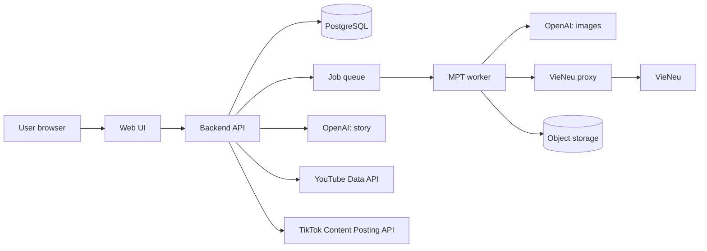

# Night Tales Studio — Consolidated Decisions (post-review)

> Decided: 2026-09-23. Status: **nothing installed yet**. This file is the input for per-part plans (see section 9).
> Legend: ✅ = read from an official source or the source code; ⚠️ = **unverified**, check before relying on it.
> Overviews: `WORKFLOW.md` (project workflow) and `DIAGRAMS.md` (diagrams, SVG in `docs/diagrams/`).
> Delivery order: **personal-first, fully automatic** — the owner's own autopilot studio and channel first (official APIs only), the public SaaS after a go decision (§10.12).
> Plan level: the plans in `plans/00`–`13` are **high-level and not final**. Every feature will be reviewed again and get its own detailed plan (`plans/features/`, process and template in `plans/00-overview.md` §10.1), reviewed before implementation.

---

## 1. Goal

An automated pipeline for **faceless** YouTube (and TikTok) videos, published as a **public web platform** where users generate videos and post them to their own channels (section 10):

**write story → generate images → voiceover → assemble video + subtitles → auto-post**

- Topics: ghost stories, spiritual stories, real-world true-crime cases.
- Languages: **Vietnamese** and **English** (content languages).
- Users' monetization target: YouTube Partner Program (YPP). The platform must never promise monetization.

## 2. Constraints

| Constraint | Detail |
|---|---|
| Software | Prefer open source, run locally. **Only exception: OpenAI API** (story writing + image generation), reached in phase P through the owner's OpenAI-compatible relay `https://api.aixingialaire.shop/v1` (01 DEC-9, 2026-09-25; phase S [OPEN]) |
| License | Every model/tool must **allow commercial use** (monetized channel) |
| Hardware | Mac M4, **16 GB RAM** = development and phase-1 trial only (one model at a time). Public traffic needs a separate worker server (section 10.4) |
| Secrets | API keys live only in the macOS Keychain and one rendered, git-ignored `config.toml` (0600, outside the repo), **never committed**, never pasted into chat. Hard spend limits per OpenAI project (plan 01 D3, D5, D7) |
| Posting | **Official APIs only** (YouTube/TikTok), no browser automation |
| Human review | **Two mandatory review checkpoints** for SaaS users: after story writing, and before posting. Owner's fiction autopilot: automated gates + veto window; true-crime keeps human approval (§10.12) |

## 3. Chosen stack

| Stage | Tool | Runs on | License | Notes |
|---|---|---|---|---|
| Pipeline framework | **MoneyPrinterTurbo** (MPT) | Local | MIT ✅ | **Configure only**, no fork |
| Story writing | OpenAI **gpt-6-luna** (upgrade to gpt-6-sol if quality is insufficient); written by the backend via the Responses API with strict `story.v1` output, not by MPT (02 CR-10). Default writer/review model per language decided by 02.1.3 per `plans/features/02-story-writing/README.md` D15 — pending | OpenAI | — | M0 harness calls OpenAI directly; MPT receives `video_script`/`video_terms` ✅ |
| Images | OpenAI **gpt-image-2**, `medium` quality (advisory on the relay — it ignores requested size/quality/model, codex#28723; quality value per §4 CR-3) | OpenAI (relay, 01 DEC-9) | — | MPT has an `openai_image` material source ✅. **Owner amendment 2026-09-25 (01 DEC-11):** supersedes `gpt-image-2.5-flare`; images go through the relay's Responses API `image_generation` tool (host `gpt-6-luna`), not `/images/generations` (broken relay-side); per-image cost ✅ **184 VND/image** flat (owner 2026-09-28, 02 CR-27, §4) (CRV-0928-5) |
| Voice | **VieNeu-TTS v3 Turbo** (vi + en, 48 kHz; preset voice count: **25** in SDK 3.8.3 (default "Hải Đăng") ✅, 23 on the older HF card (SDK 3.7.1); the pinned server's `GET /v1/voices` is authoritative (`plans/features/01-environment-setup/` README §1 V5) | Local | Apache-2.0 ✅, FAQ allows monetized use ✅ | Needs a small proxy (section 5.3). **Do not use v4** (proprietary). Fact note: all 25 presets are Vietnamese regional speakers with no language field (`features/04-voice-proxy/README.md` V8); English narration quality is ⚠️ unverified; rule (04 O2, accepted 2026-09-24): if no en voice passes the 04.2.1 audition, launch en with the best-rated voice when its mean naturalness ≥ 3.0, otherwise postpone the en channel; this decision stays locked (04 CR-15) |
| Subtitles | faster-whisper `large-v3-turbo` | Local | — | Configured inside MPT ✅ |
| Background music | CC0 / YouTube Audio Library tracks | — | Per track | **Delete MPT's bundled music** (section 5.5) |
| Source text extraction (story research, 02.5.2) | **SmartReader 0.11.1** (+ AngleSharp 1.8.2), in-process in the fetcher; robots.txt by an in-house RFC 9309 subset parser | Fetcher host | Apache-2.0 ✅ / MIT ✅ (nuget.org, 2026-09-28) | Spike 02.5.2-T0 (`plans/features/02-story-writing/02.5.1-sources-fetcher/spike-report.md` §1.5): diacritics 20/20, recall 19/20, boilerplate ≤ 0.25 %; `Fetcher:MinTextChars` = 1,275 (02 T104). trafilatura 2.2.0 passed too but needs a Python sidecar (F19) |
| Posting | Custom code: YouTube Data API + TikTok Content Posting API | Local | — | Do not use MPT's Upload-Post integration |

**Removed from the plan:** Ollama/Qwen3 (replaced by OpenAI), mflux/Z-Image/FLUX (replaced by GPT Image).

## 4. Cost estimate

Prices from the [OpenAI pricing page](https://developers.openai.com/api/docs/pricing) and the [image generation guide](https://developers.openai.com/api/docs/guides/image-generation) ✅:

| Item | Official price | Estimate |
|---|---|---|
| gpt-6-luna | $0.10 / 1M input tokens, $0.50 / 1M output tokens | < $0.01 per 2,500-word story (inference) |
| gpt-6-sol (fallback) | $2 / 1M input, $10 / 1M output | ~$0.05 per story (inference) |
| GPT Image (gpt-image-2) | **184 VND/image** flat on the relay account (owner, 2026-09-28, 02 CR-27; ≈ $0.0072 at the SBV 25,641 VND/USD of 2026-09-25; `trial/prices.json` `unit: per_image`). Official-API reference only: `gpt-image-2.5-flare` $30 / 1M image output tokens (superseded model, 01 DEC-11) | Official-API flare reference — 1024×1024: low ~$0.006 · **medium ~$0.013** · high ~$0.053 per image. Relay: ~60 images ≈ 11,040 VND ≈ $0.43 per long video (CRV-0928-5) |
| One long video (~60 images) | | **Relay (the trial's price, 02 CR-27):** 60 × 184 VND = 11,040 VND ÷ 25,641 VND/USD ≈ **$0.43** + < $0.01 story = **~$0.44** · official-API `gpt-image-2.5-flare` reference at medium: 60 × ~$0.013 + story ≈ ~$0.79 (CRV-0928-5) |
| **~13 long videos / month** (3/week) | | **Relay:** 13 × ~$0.44 ≈ **~$6 / month** · official-API flare reference: ~$10–11 (CRV-0928-5) |

⚠️ These are **floor** prices. With `openai_image_size = ""`, MPT picks **1536x1024** (landscape) or **1024x1536** (portrait) per video aspect (`config.example.toml:199-204`), which costs more tokens than 1024×1024 — **not measured yet**. Measure via the response `usage` field in phase 1.

⚠️ **Quality is not selectable through MPT** ✅: its `openai_image` request body is only `{model, prompt, n: 1, size}`, so the API default `quality = auto` applies (`plans/features/01-environment-setup/` README §1 M4, O6). The "medium ~$0.013" figure above is therefore an assumption, not what the trial pays; plan 03 CR-3 decides how quality is set — **decided 2026-09-24 (03 D9, owner O1/O3):** the node image relay injects `quality`; the value and the measured cost per image per aspect are recorded here by 03.3.1-T2 after the M0 contact sheet (03 CR-12). **Rate limit:** Tier 1 allows **5 images/min** for `gpt-image-2.5-flare` ✅ (O8 — superseded by `gpt-image-2`, 01 DEC-11; rate re-check [OPEN]), and MPT skips a keyword silently after 3 retries on 429 (M4) — see plan 03 G7.
- [DECISION] **Credit pricing:** 1 credit = US$0.01 of price; see §10.5 for the payment provider, FX rule and funding model (12 CR-10).

## 5. Integration details per stage

### 5.1 Story writing (MPT `config.toml`) ✅

```toml
llm_provider = "openai"
openai_api_key = ""          # fill in locally
openai_base_url = ""         # empty = api.openai.com
openai_model_name = "gpt-6-luna"
```

### 5.2 Images (MPT `openai_image` material source) ✅

- **Activation switch:** set `video_source = "openai_image"` (`config.example.toml:78`, default `"pexels"`). Without it every `openai_image_*` key is ignored and MPT silently uses Pexels stock footage. The API request body can also set `video_source` per job (`app/models/schema.py:118`).
- MPT calls `/images/generations`, **one image per script keyword**.
- Config keys: `openai_image_base_url`, `openai_image_api_keys`, `openai_image_model`, `openai_image_size`, `openai_image_prompt_template` (`config.example.toml:192-208`).
- Leave `openai_image_size = ""`: MPT then sends an OpenAI-valid size per aspect (1536x1024 / 1024x1536 / 1024x1024). Arbitrary sizes like `1080x1920` are only for local gateways.
- Use `openai_image_prompt_template` to **lock the visual style** for a whole video (dark, foggy, cinematic, no gore).
- OpenAI moderation ✅: `moderation` parameter = `auto` (default) or `low`. Blocked requests return `error.code = "moderation_blocked"`; **do not auto-retry the same prompt** — log it and rewrite the prompt. ✅ MPT itself does not fail the task on a blocked image: it skips that keyword, uses the next one and loops clips (`plans/features/03-image-generation/` README I6–I9). The node image relay records the code per scene and the backend applies 03 D7 (video kept with ≤ 10 % skipped scenes, else `image_moderated`, never auto-retried) (03 CR-12).
- Characters may look different across scenes (each image is an independent call). MPT only calls `images/generations` (no reference-image or Edits path in `app/services/material.py`), so keep consistency through the shared style template and silhouettes/scenery. A fixed recurring character via the **Edits** endpoint would need our own image step outside MPT (backend, section 10) — not in scope for phase 1.

### 5.3 Voice: VieNeu ↔ MPT (source code of both sides read) ✅

**Problem:** MPT cannot talk to VieNeu directly.

| Side | Fact (file:line) |
|---|---|
| MPT, `kokoro`/`chatterbox` slots | Shared `_openai_compatible_tts` **always sends `"response_format": "mp3"`** (`app/services/voice.py:2169`), not configurable |
| MPT, `voxcpm` slot | Sends `"response_format": "wav"`, `"stream": true`, **requires an `api_key`**; parses SSE `{"type":"speech.audio.delta","audio":"<base64>"}` … `speech.audio.done` (`voice.py:2629-2713`); only **one voice per config** (`voice_id`, `voice.py:324-337`) |
| VieNeu `apps/openai_speech.py` | `POST /v1/audio/speech` accepts only `pcm`/`wav` (mp3 → **400**); `model` accepts any string; `speed` is ignored; unknown voice → 400; SSE is enabled by the body field **`stream_format: "sse"`** (default `"audio"`); voice list is at `GET /v1/voices` (MPT calls `/audio/voices`) |

**Two options — both need a local proxy.** Option A's proxy streams VieNeu PCM → ffmpeg → MP3 to MPT as the audio arrives (`features/04-voice-proxy/README.md` D3, D4), ≈ 400 lines of Python plus tests (04 README F21 estimate), not a small buffering relay (04 CR-15):

| | A. `kokoro` slot (**chosen**) | B. `voxcpm` slot (fallback) |
|---|---|---|
| What the proxy does | Requests `response_format: "pcm"` (48 kHz) from VieNeu and **streams PCM → real MP3 through ffmpeg** while it arrives; 200 is sent after the first MP3 bytes, a later failure aborts the connection (04 README D4) (04 CR-15) | Only rewrites the JSON body: add `stream_format: "sse"`, drop `stream` |
| Voice selection | Multiple voices in the UI via `[kokoro] voices = ["kokoro:<voice name>", …]` (superseded by plan 04 F2: the proxy serves `GET /v1/audio/voices` in MPT's shape, so `[kokoro] voices = []` and MPT fetches the list) | One fixed voice in config; switching vi/en voice requires a config edit |
| Pros | Easy vi/en voice switching | No ffmpeg in the proxy; key-based auth built in |
| Remaining risk | A no longer uses WAV (PCM has no header). The unknown-length WAV header (`0xFFFFFFFF`, `openai_speech.py:197`) decodes with ffmpeg (exit 0, warnings; 04 README X1, re-confirmed at the pin by 04.1.1-T1) (04 CR-15) | ⚠️ pydub decode of that header still unverified (04 CR-15) |

- In option A, **never** return WAV bytes labelled as mp3: that file flows straight into MPT's mixer (`os.replace(temporary_audio, voice_file)`), and downstream readers were not checked → always transcode for real.
- Run VieNeu with **`HOST=127.0.0.1`** (default `0.0.0.0` exposes it to the whole network) and set `VIENEU_API_KEY`.
- `VIENEU_WATERMARK=1` is on by default → **keep it** (⚠️ watermark nature not read in detail; presumed to be an inaudible AI-voice marker). Owner 2026-09-25 (01 DEC-7): keep it as an **AI-provenance mark**. ✅ It is the same mark for every Perth user and carries no owner ID: `resemble-perth` 1.0.1 `perth_net_implicit/perth_watermarker.py:25` is `apply_watermark(self, signal, sample_rate, **_)` with no payload, and `get_watermark` returns presence only. So it **cannot prove NightTales ownership**; ownership/copyright proof is a **signed per-render hash manifest** (owner 2026-09-25, 01 DEC-8, CR-14). It is **required in production** (the plan 11 node: `--extra cuda --extra watermark`, fail closed unless `Audio watermarking initialized (Perth)` is logged). The Mac M0 trial runs **without** it: the pinned `[watermark]` extra lacks torch, so it stays off (01 CR-13), and M0 audio is never published.
- Install VieNeu on CPU/Apple Silicon via ONNX: `uv sync`.

### 5.4 Subtitles ✅

```toml
subtitle_provider = "whisper"   # sample config default is "edge" → must change

[whisper]
model_size = "large-v3-turbo"
```

Whisper is required because the kokoro/voxcpm slots **return no word-level timestamps**.

In sentence mode `subtitle.correct()` replaces every cue's text with the matching script chunk, so whisper supplies the **timing only**; the default font `STHeitiMedium.ttc` misses 92 Vietnamese letters (of 178 tested) and every job therefore sends `font_name = BeVietnamPro-Bold.ttf` (OFL-1.1, bundled); whisper is called with **no `language`** and `initial_prompt` stays unset (05 CR-10; `plans/features/05-video-assembly-subtitles/README.md` C15, C16, X1).

### 5.5 Video assembly (MPT) ✅

- WebUI, API and CLI. Batch up to 100 tasks: `uv run python cli.py --batch-file ./tasks.json --stop-at video`.
- **Delete all of MPT's default music**: the README says it was taken from YouTube videos ("如有侵权，请删除" = "if infringing, please delete") → copyright risk.
- **Do not use** `app/services/upload_post.py` (sends videos through the third-party service `api.upload-post.com`).
- MPT does **no loudness normalisation** (the mix applies `voice_volume`/`bgm_volume` only), so the node normalises every render to −15 LUFS / −1.5 dBTP and then measures it (`render_check.py`, 05 D9) (05 CR-10; C17, X3).
- Music only via `bgm_type = custom` + `bgm_file` from the licensed catalog — **never** the schema default `random`, which picks any file from `storage/bgm` or `resource/songs` (05 CR-10; C18, 05 D8).
- Catalog sources: **YouTube Audio Library first, CC0 second**, CC-BY with a description credit; `youtube`-scope tracks are never used off YouTube or for other users (owner O2, 2026-09-24) (05 CR-10).

### 5.6 Posting (custom code) ✅

**YouTube Data API `videos.insert`:**
- API projects created after 2020-07-28 are **locked to private** until audited: [audit form](https://support.google.com/youtube/contact/yt_api_form). **File early.**
- Quota: Video Uploads bucket of 100 per day, 1 unit per call.
- Always set `status.containsSyntheticMedia = true`. Schedule with `publishAt`.

**TikTok Content Posting API** ([Content Sharing Guidelines](https://developers.tiktok.com/doc/content-sharing-guidelines)):
- Unaudited apps can only post **private** content. Audit at developers.tiktok.com/application/content-posting-api.
- **Intended use:** "A utility tool to help upload contents to the account(s) you or your team manages" is listed as **not acceptable**, so a private single-owner uploader would fail the audit. The public platform (section 10) is the kind of app TikTok accepts. "An app that copies arbitrary contents from other platforms" is also not acceptable.
- Caps for all clients: a 24-hour active-creator cap per API client (based on the audit estimate), and about **15 posts per day per creator account**, shared across every app.
- **Content transfer, scope and tokens (07 CR-12):** video content transfers to TikTok via `PULL_FROM_URL` (a presigned https URL from our storage, under a domain/URL prefix verified in the app), never `FILE_UPLOAD`, for server-side content; the OAuth scope requested is `video.publish` only; rate limits are 6/20/30 requests per minute (endpoint-dependent); access tokens last 24 h and refresh tokens 365 days, both rotated on refresh; there is **no scheduling parameter** on Direct Post — every post is immediate, with a per-post privacy choice by the creator.

## 6. Platform rules to follow ✅

- **YPP eligibility:** 1,000 subscribers + (4,000 watch hours in 12 months **or** 10M Shorts views in 90 days). Review takes ~1 month. Vietnam is a supported country.
- Channels with **no uploads for 6 months** may lose monetization.
- The "inauthentic content" policy (renamed 2025-07-15): **mass-produced content is not monetizable** → every video must have its own value (unique script, human review, no templated duplicates). Personal phase: the owner's fiction autopilot replaces human review with automated gates, a variety guard, a daily cap and a veto window; the owner knowingly carries this monetization risk (§10.12).
- Design consequence: the two human review checkpoints are **mandatory**, not optional. Exception for the owner's own fiction series in the personal phase: automated gates replace them, true-crime keeps human approval (§10.12).

## 7. Reviewed and rejected

| Tool | Reason |
|---|---|
| flowkit | Drives a signed-in Google Flow session through an extension that mints reCAPTCHA → account-ban risk |
| Hypit | Depends on paid Seedance/GPT Image (~$1.09/video); "clone viral video" focus conflicts with reused/inauthentic content policies |
| OpenCreator (full stack) | Image/video/TTS use paid clouds; Edge TTS is an unofficial endpoint |
| VoiceStudio | AGPL-3.0; default engine OmniVoice is **CC-BY-NC** (non-commercial); no VieNeu |
| F5-TTS-Vietnamese-ViVoice | Weights are **CC-BY-NC-SA-4.0** (non-commercial) |
| Edge TTS | Unofficial endpoint |
| FLUX.1-dev / FLUX.2 | Non-commercial / requires paid BFL tiers |
| TikTokAutoUploader, RedditVideoMakerBot, … | Browser automation / not a fit |
| Upload-Post (inside MPT) | Unnecessary third-party service |
| trafilatura 2.2.0 (sidecar extractor) | Passed the 02.5.2-T0 quality thresholds, but a Python sidecar adds a second runtime, health check and CVE stream to the minimal-surface fetcher (F19); SmartReader chosen on deployment cost |
| TurnerSoftware.RobotsExclusionTools 0.9.1 | Last release 2022-08-09, predates RFC 9309 (no longest-match/`Allow` guarantee), unmaintained (02 E4) |
| MediatR 14.x | License is RPL-1.5 or paid commercial; RPL covers hosted use → rejected. Use Mediator.SourceGenerator (MIT) |
| InkOS (Narcooo/inkos) — code and prompt text | AGPL-3.0 ✅. Ideas only; our prompts are written from scratch (§10.10) |
| Aggregating/transcribing other channels' videos into stories | Breaks YouTube Terms ✅ (§10.10) and copies other narrators' expression |
| jev-ultrafast for uploading/posting | YouTube Terms forbid automated access ✅; its README lists uploads as outside the MVP ✅; official APIs exist (§5.6) |

## 8. Unverified items / open risks ⚠️

1. Whether YouTube allows **full ads** on ghost/true-crime content (ad-suitability guidelines).
2. OpenAI terms on **images of real people** (true crime) — for now use illustration, silhouettes, scenery only; never depict real victims/suspects realistically.
3. Whether TikTok Creator Rewards is available in Vietnam → check in the app (Creator Tools).
4. Real speed on M4 16 GB (VieNeu on CPU, whisper large-v3-turbo).
5. Image token cost at 16:9 / 9:16.
6. VieNeu's unknown-length WAV header (`0xFFFFFFFF`): ffmpeg decodes it (exit 0 with warnings, duration +29 ms on a pipe; `features/04-voice-proxy/README.md` X1, 2026-09-24; re-confirmed at the pin by 04.1.1-T1). Option A uses PCM anyway (04 D4). pydub (option B) is still unverified ⚠️ (04 CR-15).
7. Whether Google requires **OAuth app verification** for the `youtube.upload` scope, and how long it takes.
8. Monthly cost of a GPU worker server, and throughput per server.
9. A payment provider that works for a Vietnam-based business (for credits/subscriptions).
10. ~~`faster-whisper` license~~ — closed: **MIT** ✅ (SYSTRAN/faster-whisper `LICENSE`; checked 2026-09-23, `plans/features/01-environment-setup/` README §1 W1).
11. ~~Path handling of MPT's `/stream/{file_path:path}` and `/download/{file_path:path}` endpoints~~ — closed: both resolve the path with `realpath` + `commonpath` inside `storage/tasks` and require a regular file, so there is no traversal outside the task dir, but there is **no per-task scoping** (any file of any task is readable with the one key); MPT binds loopback and only the adapter calls it (05 CR-10; `plans/features/05-video-assembly-subtitles/README.md` C12).

## 9. Parts to plan

Detailed plans now exist in `plans/` — start with `plans/00-overview.md` (BA review, milestones, shared contracts, estimate roll-up). One file per part:

| File | Part | Depends on |
|---|---|---|
| `plans/01-environment-setup.md` | Install MPT, VieNeu (`uv sync`), ffmpeg, faster-whisper | — |
| `plans/02-story-writing.md` | Story prompts for the 3 topic lines, review checkpoint #1 | 01 |
| `plans/03-image-generation.md` | Style prompt templates, `moderation_blocked` handling, token measurement | 01 |
| `plans/04-voice-proxy.md` | VieNeu proxy (option A), vi/en voice list | 01 |
| `plans/05-video-assembly-subtitles.md` | MPT config, whisper, CC0 music, remove bundled music | 02–04 |
| `plans/06-youtube-posting.md` | OAuth, `videos.insert`, `publishAt`, `containsSyntheticMedia`, file audit | 05 |
| `plans/07-tiktok-posting.md` | Content Posting API, file audit | 05 |
| `plans/08-90-day-operations.md` | 3 videos/week, one topic line first, track cost + metrics | 06–07 |
| `plans/09-backend-api.md` | ASP.NET Core API, PostgreSQL, job queue, story step, MPT job orchestration, metering | 01–05 |
| `plans/10-web-ui.md` | Dashboard: story editor (checkpoint #1), video preview (checkpoint #2), channel connect, TikTok required post UI | 09 |
| `plans/11-worker-deployment.md` | GPU server with MPT + VieNeu + proxy + whisper on a private network, object storage | 01–05 |
| `plans/12-billing-credits.md` | Credit pricing from measured cost, per-user quotas, payment provider | 09 |
| `plans/13-compliance.md` | Privacy policy, terms of service, Google OAuth verification, YouTube and TikTok audits, data deletion | 06, 07, 09 |

Plans 06 and 07 now post with **each user's own OAuth connection**, not the owner's account.

**Phase 1 (trial, ~2 days):** produce one 5-minute video; record time per stage, token/cost for the story and each image, and the number of `moderation_blocked` errors.

## 10. Public platform: Web UI + backend

### 10.1 What changes when the system is public

| Before (single owner) | After (public platform) |
|---|---|
| Runs on the Mac | Mac = development only; workers on a server |
| Owner's OpenAI key, ~$10/month | Platform pays OpenAI per user job → needs credits, quotas and metering |
| Posts to the owner's channel | Posts to **each user's** channel through their own OAuth consent |
| MPT WebUI is enough | Own Web UI + backend; MPT becomes a hidden render worker |
| No legal pages | Privacy policy, terms, data deletion, platform audits are **required** |

### 10.2 MPT cannot face users directly ✅

Read from MPT source:
- One shared API key for every caller: `app.api_key` (`config.example.toml:26`), checked in `verify_token` (`app/controllers/base.py:58`). Empty key = authentication **disabled** (`app/asgi.py:26-29`).
- `GET /tasks` returns **all** tasks (`app/controllers/v1/video.py:240`) → no per-user isolation.
- Default `listen_host = "0.0.0.0"` (`config.example.toml:11`), `max_concurrent_tasks = 5` (`:464`), `enable_redis = false` (`:457`).
- Provider API keys are global in `config.toml`, but each job request carries its own `video_script`, `video_terms`, `video_source`, `video_aspect`, `voice_name` (`app/models/schema.py:106-128`).
- **Task state lives in memory**: an MPT restart loses it and the same task then answers **404** (05 CR-10; C9).
- Tasks beyond `max_concurrent_tasks` **queue silently**: a queued task looks exactly like a running one (`state 4`, `progress 0`), and on our nodes `max_queued_tasks = 0` rejects every task that finds all slots busy instead of queueing it (05 CR-10; C10).
- **There is no cancel**: `DELETE /api/v1/tasks/{id}` refuses a running task with 409 `task is still running` (05 CR-10; C11).
- Validation errors are HTTP **400** with the fixed message `field required` (not 422) whatever the cause, and unknown body fields are **ignored** (05 CR-10; C5).

**Decision:** MPT runs on a private network with `app.api_key` set; **our backend is its only caller**. The backend writes the story itself, the user edits and approves it, and the backend sends the approved text as `video_script`. This puts checkpoint #1 in our UI and keeps MPT unmodified.

### 10.3 Architecture



| Component | Proposal | Why |
|---|---|---|
| Web UI | **Angular 22** (decided), Clean Architecture per feature (`plans/00-overview.md` §5.3) | Dashboard + public landing page |
| Backend API | **C# on ASP.NET Core / .NET 10 LTS** (decided; latest stable 10.0.12, §10.13), **Clean Architecture + CQRS** (`plans/00-overview.md` §5.2), **PostgreSQL** (decided), background jobs (Hangfire on PostgreSQL: LGPL-3.0 or commercial — fine for a hosted service; use unmodified from NuGet and never patch or fork it; Hangfire.PostgreSql license ⚠️ confirm) | Boring, proven; matches the team's stack |
| Render worker | MPT + VieNeu + proxy + faster-whisper, private network only | Unmodified open-source stack |
| Storage | S3-compatible object storage with signed, expiring links; self-hosted SeaweedFS in every env (11 CR-15) | Videos are large; delete after a retention period; no managed object storage or AWS account (owner O7 2026-09-27) |

**Backend responsibilities:** user accounts and login; story step (call OpenAI, save draft, user edits/approves = checkpoint #1); render jobs to MPT with the approved script; poll job status; store output; preview and approve = checkpoint #2; publish to the user's connected YouTube/TikTok; record OpenAI `usage` per job; credits and quotas; log `moderation_blocked` errors; admin view.

### 10.4 Capacity ✅ / ⚠️

- VieNeu serves **1 stream on CPU (fp32) or 2 (int8)**, and up to **16 on GPU** (`VIENEU_MAX_STREAMS`, `openai_speech.py:35-37`) ✅. Extra requests queue, then get 429.
- MPT runs at most `max_concurrent_tasks` jobs (default 5) per instance ✅.
- **Publishing ceiling:** the YouTube `videos.insert` default quota is 100 calls/day **per API project**, shared by every customer → the whole product can publish ~100 YouTube videos/day until an API Compliance Audit grants an extension (the only way to raise it). Plans and pricing must not assume per-user headroom.
- The Mac cannot serve public traffic → rent a GPU server for workers. Cost and videos per hour per server ⚠️ **not measured**; measure in phase 1 and on the first server.
- **GPU node stack (11 CR-8, verified 2026-09-24):** MPT's own GPU image is CUDA 12.1 + cuDNN 8, but its lock pins ctranslate2 4.7.1, which needs cuDNN 9 (faster-whisper README ✅) → the node installs cuBLAS 12 + cuDNN 9 as locked wheels for MPT's whisper; VieNeu's `cuda` extra is torch 2.8.0 cu128 → NVIDIA driver ≥ 570.26 ✅. MPT keeps one whisper model per process; VieNeu uses ≈ 1.1 GB VRAM at 16 streams ✅; a node needs ≥ 16 GB VRAM (24 GB preferred) [INFERENCE until measured in 11.6.3]. Details: `plans/features/11-worker-deployment/README.md` D9.

### 10.5 Money

- The platform pays OpenAI for every user job. Image cost per video is **above** the ~$0.43–0.44 relay figure (section 4; CRV-0928-5 — ~$0.79 was the official-API flare reference) → set credit prices only after measuring real `usage`.
- Enforce per-user quotas and a hard OpenAI spending limit so one user cannot drain the account.
- **Users buy credits; sales fund the API** (`plans/12-billing-credits.md` Epics 12.3, 12.6–12.8): packages in VND, credit lots with expiry, promo codes, receipts, refund requests, and an admin funding view (OpenAI balance, burn, runway, set-aside per sale).
- OpenAI API billing facts ✅ ([prepaid billing help article](https://help.openai.com/en/articles/8264644-setting-up-and-managing-prepaid-api-billing)): credits are bought in advance (minimum $5); usage stops with error `credit_balance_exhausted` when the balance is empty, and a short negative balance can occur, so the balance is not an instant cutoff; purchased credits **expire after 1 year** and are **non-refundable** except in listed cases; auto-reload has a threshold, a restore-to amount and an optional monthly limit; the trust tier caps the maximum balance.
- Consequences [DECISION]: top up by runway (≥ 14 days of burn, ≤ ~60 days), enable auto-reload with a monthly limit, pause processing without charging users on `credit_balance_exhausted`, keep separate OpenAI organizations/projects for production and staging, and make user-purchased credits expire after 12 months (⚠️ consumer-law check).
- ~~Users bring their own OpenAI key~~ — **not reachable with an unmodified shared MPT**: provider keys exist only in MPT's global `config.toml` and `VideoParams` has no key field (`schema.py:106-160`). BYOK would need one MPT process/config per user or a fork. **Decision: platform-paid with credits.**
- [DECISION] **Credit unit, provider and FX (12 CR-10):** 1 credit = US$0.01 of price. **Payment provider:** the selected provider and its licence/webhook facts are recorded, with a date, in `plans/features/12-billing-credits/README.md` §1 (12.3.1-T1 output) once that task lands — this closes the payment-provider `[OPEN]` item (§1.3 above, §8 item 9) at that point, not before. **FX rule:** revenue and reporting use the latest `provider_topups.fx_rate`; the funding model itself is unchanged from the "top up by runway" rule above.

### 10.6 Platform rules for a public app ✅

**YouTube API Services Developer Policies:**
- Publish a privacy policy covering what the app accesses, stores, shares and deletes.
- Tell users they can revoke access at https://security.google.com/settings/security/permissions, and give a contact for privacy questions.
- Offer a clear, easy in-app way to revoke consent. When a user revokes **in our app**, revoke the token with Google **right away** and delete the related data **within 7 calendar days**. User-requested data deletion and account deletion: **within 7 calendar days**. Revocation through the Google security page (detected when a token refresh fails): delete within **30 calendar days**. Stored Authorized Data: keep **at most 30 calendar days**, then delete or refresh it.
- "You must not automate or trigger … uploads … without the user's prior specific and express consent" → every upload has its **own consent record**: given by the user, or for autopilot series derived from the owner's versioned series authorization after a veto window in which the owner is notified and can edit or cancel (§10.12). Whether YouTube accepts this as "specific and express" is unverified ⚠️.
- Never ask for or store YouTube passwords (OAuth only).
- Video Uploads quota (100/day) belongs to **the whole API project**, shared by all users → apply for a quota extension through the API Compliance Audit before launch.

**TikTok Content Sharing Guidelines — required post screen:**
- Fetch `creator_info` when the post page opens; show the creator's **nickname**; stop if the creator cannot post now; respect `max_video_post_duration_sec`.
- User enters the title and picks privacy from `privacy_level_options` returned by the API, with **no default value**.
- Interaction settings (Allow Comment, Duet, Stitch): none checked by default; grey out any the creator has disabled.
- Commercial content disclosure toggle (off by default), with "Your brand" / "Branded content" options and their labels.
- Before the publish button: "By posting, you agree to TikTok's Music Usage Confirmation".

### 10.7 Content and liability

- Users' channels fall under YouTube's inauthentic/mass-produced content policy. The SaaS product must **enforce** both review checkpoints for users (revisit at Gate 2, §10.12); no "generate 100 videos in one click" feature; the owner's personal autopilot uses automated gates, a variety guard and a daily cap instead.
- Terms of service must forbid realistic depictions of real victims/suspects and copyrighted material; provide a takedown/report contact.
- Keep OpenAI moderation on (`moderation = "auto"`); log blocked prompts per user to spot abuse.
- **TikTok while unaudited (07 CR-12):** Direct Post from an unaudited client stays private-only; the platform serves at most 5 posting users per 24 h until the audit is filed/approved, matching `TikTokOptions.MonthlyActiveCreators`; the per-creator post cap and the client-wide active-creator cap come from the audit estimate (§5.6).

### 10.8 Security

- OpenAI and other provider keys live only on the backend/worker, never in the browser.
- Encrypt users' OAuth refresh tokens at rest; delete them on disconnect or account deletion.
- MPT, VieNeu (`HOST=127.0.0.1` or private network) and the proxy are never reachable from the internet.

### 10.9 Licenses for a hosted service

- MPT (MIT) and VieNeu v3 Turbo (Apache-2.0) are permissive, with no network-use copyleft → OK to run as a paid hosted service ✅ (license types from section 3).
- AGPL tools (e.g. VoiceStudio, already rejected) would require publishing source to network users — keep avoiding them.
- `faster-whisper` is MIT ✅ (W1). ⚠️ Fonts shipped in rendered videos: check before launch (candidate `BeVietnamPro`, plan 05 F6).
- **Infrastructure tools (11 CR-8, licences read 2026-09-24):** accepted — OpenTofu (MPL-2.0), SeaweedFS (Apache-2.0; local S3 emulator and, 11 CR-15 / owner O7 2026-09-27, the self-hosted object store in staging and prod), Mailpit (MIT), OpenTelemetry Collector, Prometheus, Alertmanager, Jaeger (Apache-2.0), cosign, syft (Apache-2.0), Microsoft.Data.Sqlite (MIT) with SQLitePCLRaw (Apache-2.0), Dependabot (GitHub-native). Rejected as AGPL-3.0 — MinIO (community edition is also source-only now), Garage, self-hosted Grafana, Renovate. `mpt-adapter` and mock-mpt are .NET 10 on shared `NightTales.RenderNode.*` projects. GitHub environments with required reviewers on a private repo need GitHub Pro (user) or Team (org) ✅ → the repo uses GitHub Pro (owner standing approval 2026-09-24; price not asserted).
- Hangfire.Core/AspNetCore 1.8.25 and Hangfire.PostgreSql 1.21.1: LGPL-3.0, used unmodified from NuGet (no fork). Accepted by the owner on 2026-09-24 (`plans/features/09-backend-api/README.md` O1). Backend CI runs on GitHub Actions (O2). PostgreSQL 17 is used for dev, CI and production (O3).

### 10.10 Story research, reference projects and browser agents

- **Research input = text sources the user supplies.** The backend fetches them safely, extracts main text, builds a fact sheet the user approves, and the writer uses only those facts (`plans/02-story-writing.md` Epic 02.5). The model never writes source URLs.
- **No content from YouTube/TikTok or other video/social platforms.** YouTube Terms of Service (effective 2023-12-15), "Permissions and Restrictions" ✅: users may not "access, reproduce, download, distribute, transmit, broadcast, display, sell, license, alter, modify or otherwise use any part of the Service or any Content except: (a) as expressly authorized by the Service; or (b) with prior written permission from YouTube and, if applicable, the respective rights holders"; may not "access the Service using any automated means (such as robots, botnets or scrapers)" except public search engines per robots.txt; and may not use it "to view or listen to Content other than for personal, non-commercial use". This rules out yt-dlp, transcript scraping and bot uploads.
- **InkOS** (AGPL-3.0 ✅) is a reference for ideas only: write → self-review → at most one revision → human; series memory ("bible"); length ranges; functional naturalness questions. Never copy or translate its prompt text; record borrowed ideas in `prompts/REFERENCES.md`. Its `anti-detect` rewrite mode is **not** adopted: it conflicts with our AI disclosure (`containsSyntheticMedia`, `is_aigc`).
- **jev-ultrafast** (MIT ✅, needs a TypeSafe API key ✅) is allowed only for: (1) "Find sources" and autopilot research in the personal phase, returning links from allow-listed sites whose terms permit automated access (02.7, spike first); (2) back-office tasks on provider portals without an API, on our own accounts (08). Never for Google/YouTube/TikTok, never with users' sessions. TypeSafe would be a second paid provider besides OpenAI → explicit exception, decided after the 02.7.1 spike (cost and commercial terms ⚠️). Verified 2026-09-23 (02 CR-10): jev-ultrafast is Python, MIT, self-described "MVP"; it drives an **existing Chrome over remote debugging** and shares its profile; needs `TYPESAFE_API_KEY` + an OpenAI-compatible text-model key; no headless/container instructions ⚠️; TypeSafe Jev costs $0.042 / 1M input tokens (output free), legal terms not read ⚠️. 02.7.1 therefore first compares **option A** — OpenAI Responses `web_search` with `filters.allowed_domains` (≤ 100 domains), links taken only from `url_citation` annotations — against jev-ultrafast (B); A is preferred unless B wins by more than 1 of 10 cases (02 README D18). Using B also needs a written exception to §10.13 (C# only).

### 10.11 Architecture and security review outcomes (plan level)

- **`mpt-adapter`:** a thin service beside MPT on each GPU node owns the stable render contract; the backend never calls MPT directly. The 05.4 spike (L) is a hard gate before the render client and mock are built.
- **Node image key:** MPT's OpenAI image key lives in a **separate OpenAI project** (image models only, own hard budget), is node-managed deploy config, and is not editable in the admin UI.
- **Admin configuration:** integration keys and base URLs are editable by owners in the admin UI (encrypted, write-only); bootstrap secrets stay in the runtime secret manager. Payment and OAuth-client settings are *critical*: second-owner approval or a 24 h time-lock with a cancel link.
- **Separation of duties:** no self-grants of credits, per-admin 24 h minting cap (2,000 credits), owner approval above it; actor role must be higher than target role; owner-on-owner actions time-locked and never delete (demote first; a recently demoted or suspended owner is touched only by the host operator), the target has one cancel per (action, target) per 30 days (re-alerts all owners), a re-issued or counter request is `disputed` and applies only by a third owner or the host operator (`nts owner resolve`), never by time-lock; promotion to owner is a time-locked request and new owners cannot approve anything for 30 days; during a dispute critical setting changes wait for the operator; every MFA reset forces a password reset; apply-time re-checks; each owner may cancel the same (action, target) at most twice per 30 days; break-glass only through the one-shot `nts-admin` job (immediate only for a sole owner; `nts owner restore` cancels involved requests, freezes new ones for 30 days and resets the restored owner's credentials; operator identity from the platform audit log).
- **Cancel links and sessions (second security pass):** one single-use cancel token per recipient, token in the URL fragment, public `POST /security/cancel-links/{kind}/{id}` with one uniform error and a 7-day token-path cutoff after a token cancel; security stamp checked on every authenticated route; credential events revoke refresh families; MFA login step bound to a pre-auth cookie (IP change logged, not rejected), an account-wide failure detector (e-mail, alert, CAPTCHA; trusted devices never delayed, bound to their refresh family), a 50-per-24 h hard ceiling for untrusted devices, TOTP replay block, a re-auth failure limit and a `sid` claim so a revoked session fails at once; `/me/activity` returns a whitelisted projection; audit retention is per row class (12/24 months, payment-linked rows as long as the payment).
- **Isolation:** `user_id` on every user-owned table + `SystemContext` for Worker jobs; source fetching runs in a separate container with internet-only egress (30 fetches/user/day, 4 concurrent); render nodes have an egress allow-list and never connect into the app network.
- **Backups:** retained 30 days; deleted data ages out within that window.
- **Schedule honesty:** ≈ 341.7 buffered person-days in total; personal-first (§10.12): ≈ 236.7 person-days (11 CR-15: +1.2 buffered, self-hosted storage) ≈ 11.8 months (plan 02 re-estimated to 40.25 d, 02 CR-11; 09 wave 1 +3.25 d, 09 CR-8; plan 03 re-estimated to 7.0 d, 03 CR-11; 10 CR-31 design-first retrofit +6.5) for one developer to the autopilot studio, ≈ 104 more for the SaaS after Gate 2 (10 CR-22 + 13 CR-9 + 09 W3 CR-6); building everything at once: 1 developer ≈ 13–15 calendar months to M3 (≈ 16.4 without R2), 2 developers ≈ 8 months to M2 with a rebalanced split [INFERENCE]; external waits (GPU account, merchant onboarding, lawyer, Google verification, YouTube audit) run in a separate lane (`plans/00-overview.md` §13).

### 10.12 Personal-first, fully automatic delivery [DECISION]

- **Order:** the owner builds and runs their own channel with the studio first; the public SaaS is built only after a go decision (Gate 2) based on that channel's results, measured cost per video and time per episode (`plans/00-overview.md` §4, §4.1).
- **Fully automatic personal studio (P):** autopilot picks ideas, writes, renders and publishes (`plans/02-story-writing.md` Epic 02.8, `plans/10-web-ui.md` 10.4.3); one seeded owner account with TOTP MFA; configuration from the environment/secret manager; one GPU node. The SaaS-ready architecture is kept (CQRS, outbox, `user_id` + tenant filters, `mpt-adapter`, fetcher isolation).
- **Human approval only for true-crime:** fiction (`ghost`, `spiritual`) is auto-approved by gates (self-review score, moderation, similarity, length; video quality checks); true-crime fact sheets and stories always wait for the owner. This replaces the mandatory human checkpoints (§6) for the owner's own fiction series; the rule for SaaS users is decided at Gate 2 [OPEN]. A variety guard, a per-channel daily cap (default 1 video/day) and a veto window (default 12 h, owner may edit/cancel, no action required) limit the mass-produced content risk (§6). The veto notice goes by e-mail as well as in-app; if it cannot be delivered, no consent is written and the series pauses. Fiction drafts with a real-person/real-event signal and any moderation flag go to the owner; `topic` is locked while autopilot is on. **Risk owner:** the owner accepts that YouTube may refuse monetization for this channel.
- **Per-video consent kept:** the owner accepts a versioned series authorization once; the scheduler writes `consent_at` + `consent_text_version` + `consent_source = autopilot` for each publication after the veto window (`plans/06-youtube-posting.md` 06.2.2-T3), so the Publication contract (00 §7) and the audit record are unchanged. YouTube requires that users "have final control over the data that will be published" (Developer Policies III.C.3 ✅); whether the audit accepts series-level authorization is unverified ⚠️ — fallback: one-tap per-video approval.
- **Official APIs only ✅:** YouTube's Terms forbid accessing the Service "using any automated means (such as robots, botnets or scrapers)" without prior written permission ([YouTube Terms of Service](https://www.youtube.com/t/terms), Permissions and Restrictions, item 3). No browser automation on YouTube or TikTok; jev-ultrafast only for research on allow-listed sites that permit it (§10.10, 02.7).
- **YouTube:** `videos.insert` uploads from an unaudited API project created after 28 July 2020 are restricted to private viewing ✅ ([Videos: insert](https://developers.google.com/youtube/v3/docs/videos/insert); lifted only by the [API compliance audit](https://support.google.com/youtube/contact/yt_api_form), §5.5) → 06 is built in the personal phase and the YouTube API audit is filed as soon as upload works; public autopilot waits for it (unknown duration ⚠️; approval for a single-owner tool unverified ⚠️). The OAuth app runs **In production, unverified** because Testing status caps test users at 100 and expires every authorization and refresh token after 7 days ✅ ([Manage App Audience](https://support.google.com/cloud/answer/15549945)); the owner accepts the unverified-app warning once. **Two separate gates:** OAuth verification (unverified-app screen, 100-user cap) is not the YouTube audit; In production fixes the 7-day expiry but not the private lock. Options: (a) API + early audit — **chosen**; (b) API without audit — private forever; (c) browser automation — rejected (Terms). The client must have its own terms and privacy policy (Developer Policies III.A.1–2 ✅, [Developer Policies](https://developers.google.com/youtube/terms/developer-policies)) → 13.1.1-T1, 13.1.2-T1, the 10.3.1-T1 pages, 13.2.1-T1 acceptance and the 13.3.1-T1 / 06.4.3-T1 deletion jobs (III.D.2) are P.
- **TikTok stays SaaS/R2 ✅:** unaudited Direct Post is private-only ([Direct Post](https://developers.tiktok.com/doc/content-posting-api-get-started)); a tool for uploading to your own or your team's accounts is not an acceptable audit use (§5.6); the inbox-upload path only creates a draft the creator must post in the TikTok app ([Upload](https://developers.tiktok.com/doc/content-posting-api-get-started-upload-content)).
- **Estimates:** P ≈ 197.25 raw / 236.7 buffered person-days (≈ 11.8 months for one developer); S ≈ 87.5 / 105.0 (02 CR-11, 09 CR-8, 03 CR-11, 10 CR-31, 10 CR-22, 13 CR-9, 09 W3 CR-6, 10 CR-39/40, 11 CR-15) (`plans/00-overview.md` §4.1).
- [OPEN] Gate 2 criteria (for example subscribers, watch hours, monetization status, cost per video) — set by the owner before the Channel phase starts; drafted with proposed defaults in `docs/ops/gate-2.md` by 08.5.1-T1 and signed by the owner before public autopilot (08 CR-2).

### 10.13 Backend language and runtime [DECISION]

- **C# everywhere on the backend:** API, Worker and all background jobs (autopilot, story, render orchestration, publishing, deletion, outbox, e-mail) are C# in one .NET solution sharing Domain/Application code (`plans/00-overview.md` §5.1–5.2). No Go (jobs are I/O-bound; a third language adds cost for one developer). Python only inside the GPU node's open-source tools (MPT, VieNeu, faster-whisper) and the thin VieNeu proxy, with no business logic.
- **Runtime:** .NET 10 LTS — the latest stable release, runtime 10.0.12 / SDK 10.0.401, active support until 2028-11-14 ✅ ([.NET releases index](https://dotnetcli.blob.core.windows.net/dotnet/release-metadata/releases-index.json), checked 2026-09-08). `global.json` pins SDK 10.0.4xx with `rollForward: latestPatch`; container images `mcr.microsoft.com/dotnet/aspnet:10.0` and `sdk:10.0`; patch releases applied monthly.
- **.NET 11** is RC1, an STS release (same source) → not used. Upgrade to the next LTS release when it ships and before 10.0 support ends [INFERENCE: next LTS expected November 2027 ⚠️].

## 11. Sources opened

- OpenAI pricing: https://developers.openai.com/api/docs/pricing
- OpenAI image generation: https://developers.openai.com/api/docs/guides/image-generation
- MoneyPrinterTurbo: https://github.com/harry0703/MoneyPrinterTurbo (`app/services/voice.py`, `config.example.toml`)
- VieNeu-TTS: https://github.com/pnnbao97/VieNeu-TTS (`apps/openai_speech.py`)
- YouTube API audit: https://support.google.com/youtube/contact/yt_api_form
- TikTok Content Posting API: https://developers.tiktok.com/application/content-posting-api
- TikTok Content Sharing Guidelines: https://developers.tiktok.com/doc/content-sharing-guidelines
- YouTube API Services Developer Policies: https://developers.google.com/youtube/terms/developer-policies
- MoneyPrinterTurbo API: `app/controllers/v1/video.py`, `app/controllers/base.py`, `app/asgi.py`, `app/models/schema.py`
- YouTube Terms of Service: https://www.youtube.com/static?template=terms ("Permissions and Restrictions")
- InkOS: https://github.com/Narcooo/inkos (`LICENSE`, `README.md`, `packages/core/skills/*`)
- jev-ultrafast: https://github.com/browser-use/jev-ultrafast (`README.md`, `LICENSE`)

