# Night Tales Studio — Diagrams

> Visual companion to `WORKFLOW.md`. Every diagram summarises `DECISIONS.md` and `plans/00`–`13`; if one disagrees with them, the plans win — fix the diagram.
> Rendered copies: `docs/diagrams/*.svg` (regenerate after editing a block here).
> Phase tags: there is **one phase, P** (the owner's own channels and autopilot); phase S was dropped and plan 12 deleted by DEC 10.14.

Contents:
1. System context
2. Deployment and network zones
3. Backend Clean Architecture (C#, .NET 10)
4. Command flow: CQRS + outbox + real time
5. Angular feature architecture
6. Autopilot end to end (P)
7. Autopilot consent and veto window (P)
8. Render orchestration
9. Episode state machine
10. Publication state machine
11. RenderJob state machine
12. Core data model (P)
13. YouTube data deletion duties (P)
14. YouTube compliance path (P)
15. Credits, payments and admin settings — removed by DEC 10.14 (kept for history)
16. Milestones and the personal path
17. Planning process
18. CI/CD

---

## 1. System context

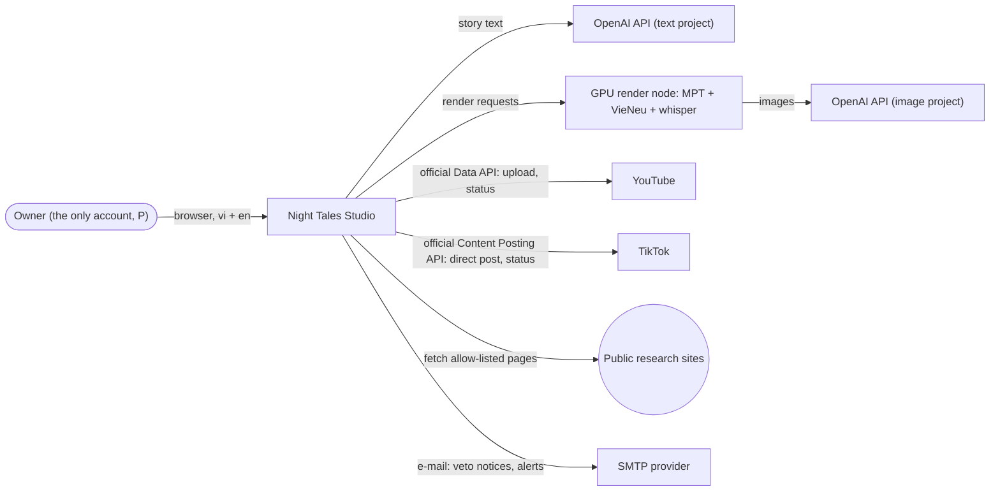

## 2. Deployment and network zones

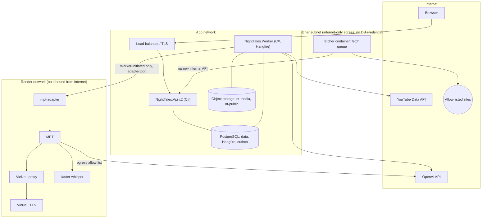

Rules: render nodes never open connections into the app network; the fetcher cannot reach the app or render networks, nor the metadata endpoint (`plans/00-overview.md` §5.2, `plans/11-worker-deployment.md` 11.2.2, 11.3.2).

## 3. Backend Clean Architecture (C#, .NET 10)

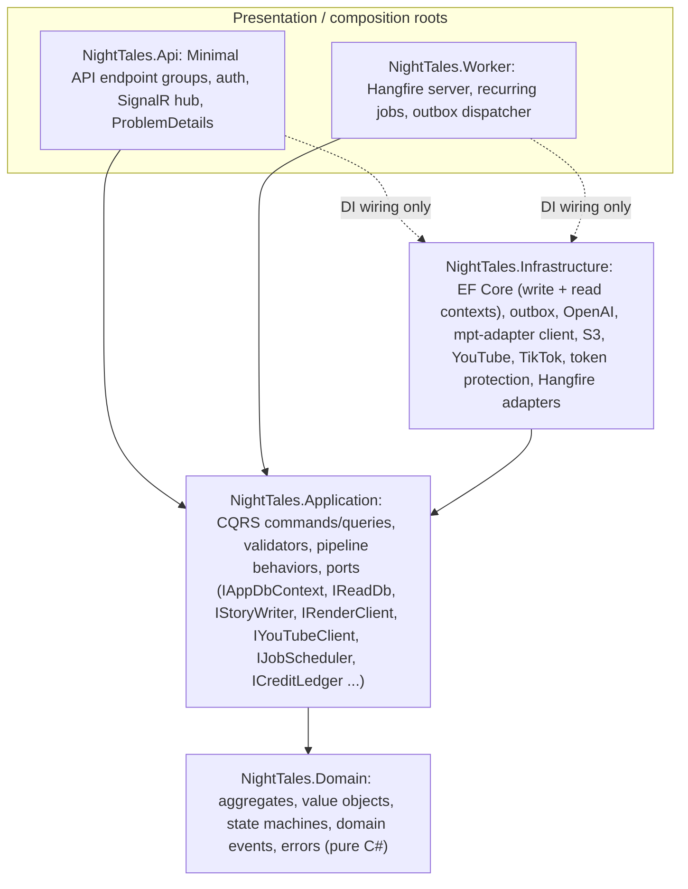

The dependency rule (`Domain` ← `Application` ← outer layers) is enforced by architecture tests. Pipeline order: Logging → Authorization → Validation → Idempotency → UnitOfWork (commands only).

## 4. Command flow: CQRS + outbox + real time

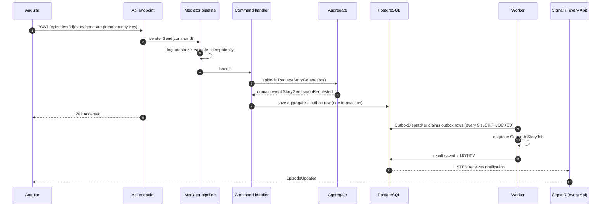

## 5. Angular feature architecture

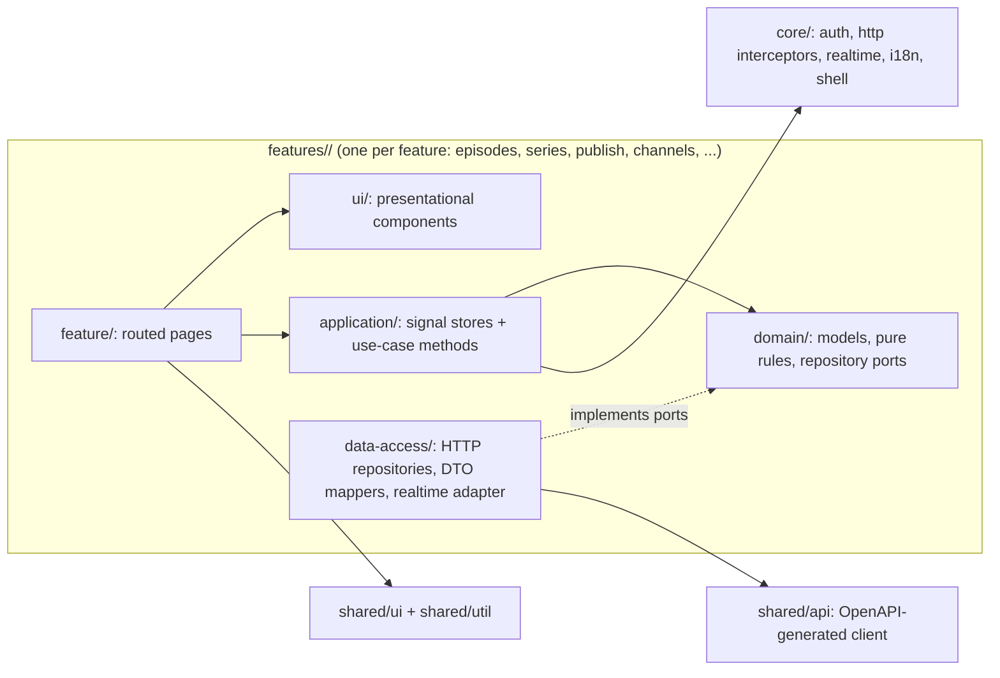

Features import each other only through `index.ts`; ESLint boundary rules enforce the layers (`plans/00-overview.md` §5.3).

## 6. Autopilot end to end (P)

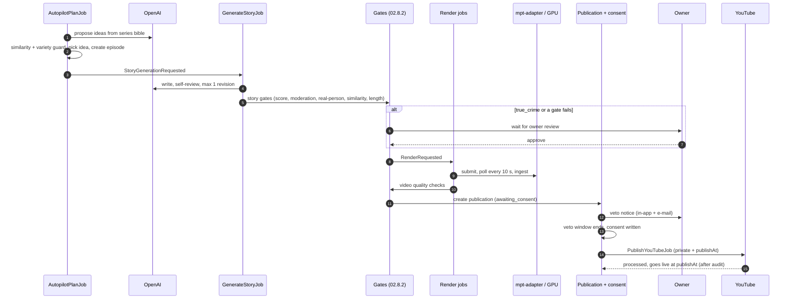

## 7. Autopilot consent and veto window (P)

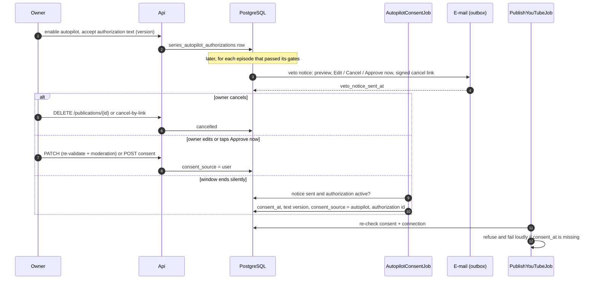

If the notice was not delivered, or the authorization was revoked, no consent is written: the series pauses and the publication waits (`plans/06-youtube-posting.md` 06.2.2).

## 8. Render orchestration

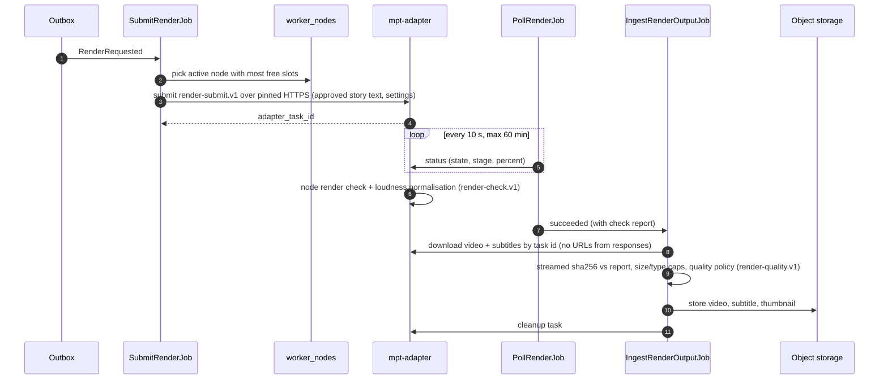

The node measures and normalises the output before `succeeded`; the Worker parses no media (05 CR-11; `features/05-video-assembly-subtitles/README.md` D9, D15).

## 9. Episode state machine

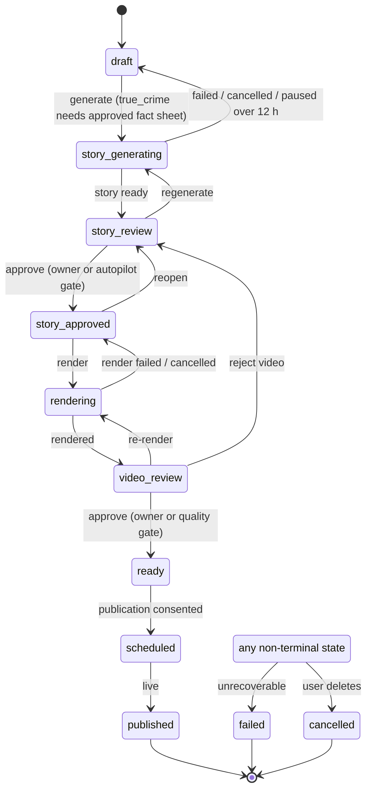

## 10. Publication state machine

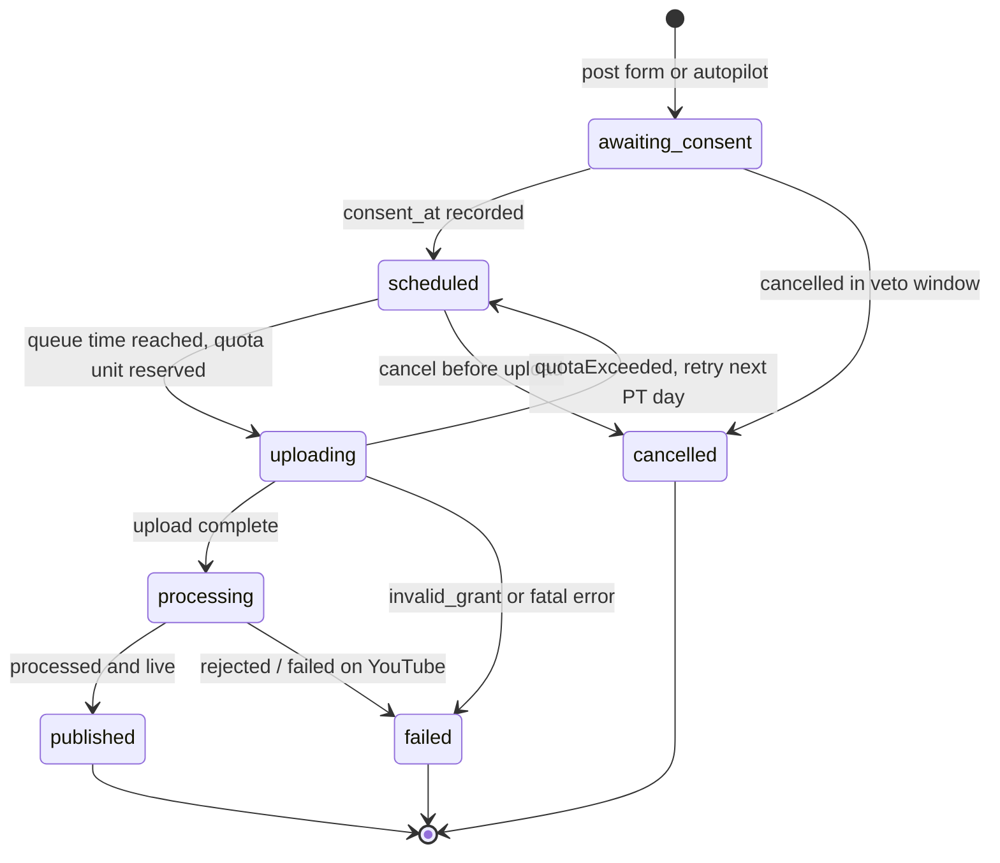

## 11. RenderJob state machine

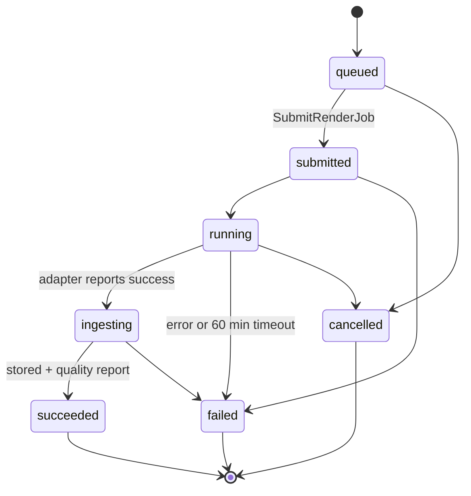

A job retries automatically at most twice, on transient errors only. `image_moderated` and `story_moderated` are never retried automatically.

## 12. Core data model (P)

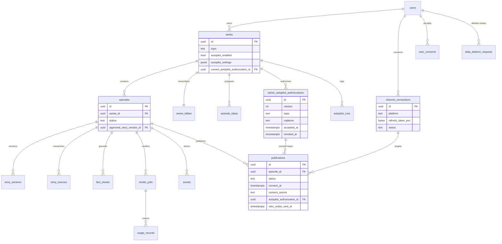

Every user-owned table carries `user_id` behind an EF global filter. All columns: `plans/00-overview.md` §6. The S-only tables (credits, payments, admin settings, owner actions) no longer exist (DEC 10.14).

## 13. YouTube data deletion duties (P)

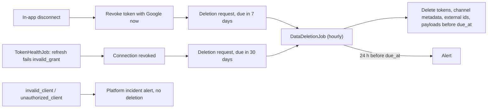

Sources: YouTube Developer Policies III.D.2 ✅; `plans/06-youtube-posting.md` 06.4; `plans/13-compliance.md` 13.3.1.

## 14. YouTube compliance path (P)

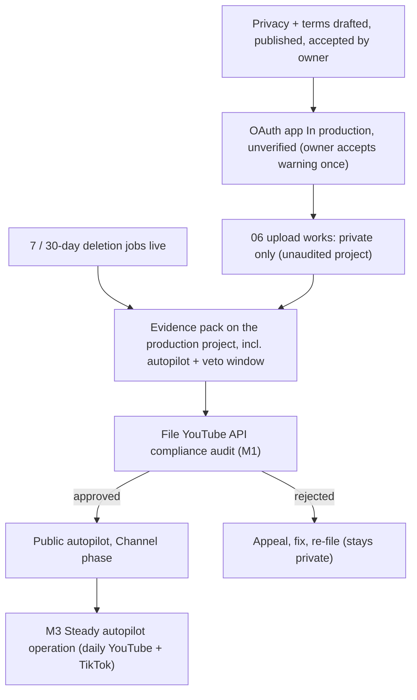

## 15. Credits, payments and admin settings — REMOVED

Sections 15 (credits/payments) and 16 (critical settings change for a multi-admin SaaS) existed only for public users. They are deleted with plan 12 by `DEC 10.14` (`DECISIONS.md` §10.14): nothing is sold, so there is no ledger, no payment provider and no owner-action approval flow. What stays is the **metering** path: every OpenAI image call or GPU render writes `usage_records` (per episode, per render, per provider request) and the autopilot auto-pauses on the owner's spend cap; `ICreditLedger` keeps working in metering-only mode (`usage_records`), with no balances to reserve or refund.

## 16. Milestones and the personal path

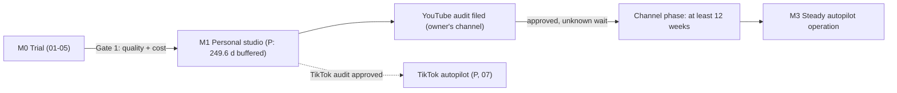

## 17. Planning process

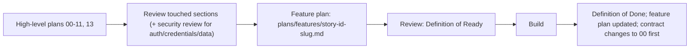

## 18. CI/CD

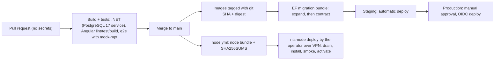

Node lane: GPU nodes are updated from a CI-built, hashed bundle by the operator over the VPN; CI never reaches the render network. Image signing and SBOM (`11.5.3-T2`, 11 CR-9) were **deleted with phase S** (DEC 10.14): images are tagged and digested, not cosign-signed, and no SBOM is published.
