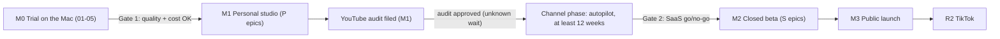
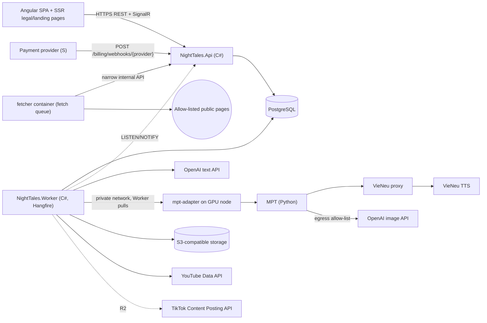
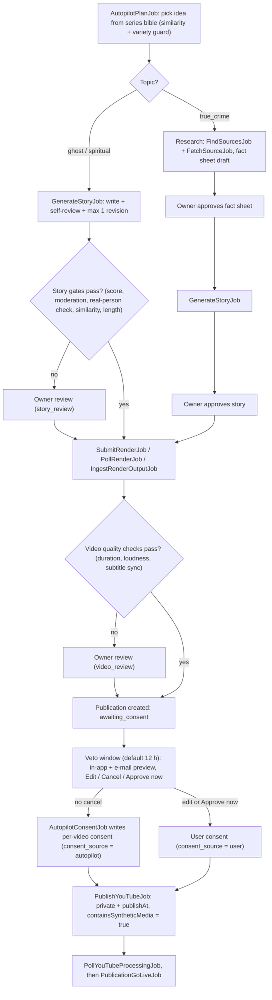
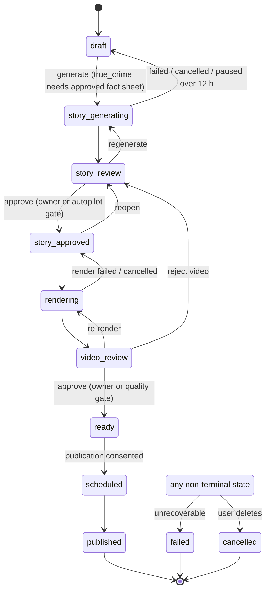
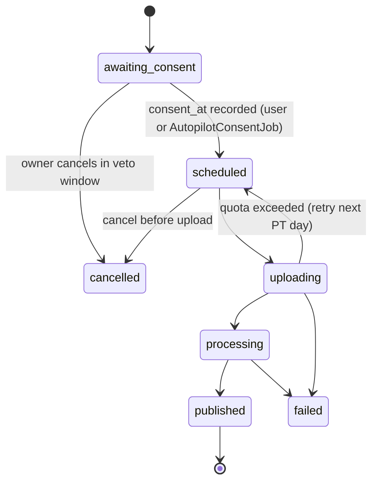
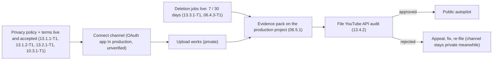
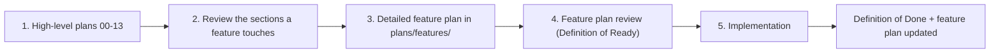
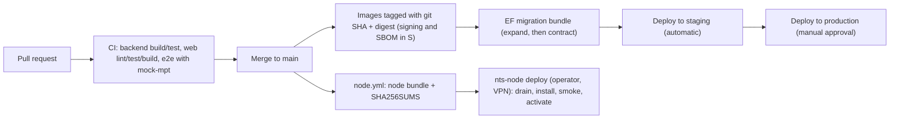

# Night Tales Studio — Project Workflow Overview

> One-page map of how the project works: phases, system, content pipeline, background jobs, compliance flow and the engineering workflow.
> This file **summarises**; it does not decide. Sources of truth: `DECISIONS.md` (product decisions), `plans/00-overview.md` (shared contracts, estimates), `plans/01`–`13` (high-level plans), `plans/features/` (detailed feature plans). If this file disagrees with them, they win — fix this file.
> Legend: ✅ verified from an official source · ⚠️ unverified · [DECISION] · [OPEN] needs the owner.
> Full diagram set (19 diagrams, with SVG exports in `docs/diagrams/`): `DIAGRAMS.md`.

---

## 1. The product in one paragraph

Night Tales Studio turns ghost, spiritual and true-crime story ideas into faceless narrated videos in Vietnamese and English and publishes them to YouTube (TikTok later). The owner first runs **their own channel fully automatically** (personal phase, P). A public SaaS for other creators (S) is built only if the channel proves the idea (Gate 2).

| Layer | Choice |
|---|---|
| Web | Angular 22, Clean Architecture per feature, vi + en |
| Backend | **C#** on ASP.NET Core / **.NET 10 LTS** (latest stable 10.0.12 ✅), Clean Architecture + CQRS, PostgreSQL |
| Background jobs | **C#** in `NightTales.Worker` (Hangfire on PostgreSQL ⚠️ license check) — no Go, no Python jobs |
| Render node (GPU) | MPT + VieNeu TTS + VieNeu proxy + faster-whisper — Python only because these tools are Python; no business logic |
| AI | OpenAI (only paid provider): story text from the backend, images from MPT on the node |

Details: `plans/00-overview.md` §5.1, `DECISIONS.md` §10.13.

## 2. Phases and gates

| Step | What happens | Exit / gate |
|---|---|---|
| **M0 Trial** | Prove the pipeline locally; measure time and cost per video; 05.4 worker-contract spike | **Gate 1:** quality acceptable and cost per video known, else stop or change approach |
| **M1 Personal studio** | Backend + web end to end, one owner account with MFA, autopilot, YouTube API publishing (private until audit), privacy/terms pages, deletion jobs | Autopilot publishes on its cadence with no manual step (true-crime after approval); **YouTube audit filed** |
| **Channel phase** | Run the flagship channel on autopilot ≥ 12 weeks after the audit allows public uploads; weekly KPI sheet | **Gate 2 [OPEN]:** owner decides from channel results, cost per video, time per episode |
| **M2 Closed beta** | Sign-up, account security, admin, credits and payments, multi-user publishing extensions, compliance, lawyer review | 10 beta users; OAuth verification filed; audit extended for SaaS |
| **M3 Launch** | Public sign-up once audit + quota extension are approved | Load test, runbooks |
| **R2** | TikTok publishing (needs a TikTok audit; an own-accounts tool is not an accepted use ✅) | TikTok audit approved |

Estimates (buffered person-days, one developer): **P 236.7 (≈ 11.8 months)**, **S 105.0 (≈ 5.3 months)**, total 341.7 (10 CR-31, 10 CR-22, 13 CR-9, 09 W3 CR-6, 10 CR-39/40, 11 CR-15) — `plans/00-overview.md` §4.1, §13. External waits (audits, lawyer, payment onboarding) are not included.

## 3. System map

Rules that shape the map [DECISION]:
- Render nodes are never reachable from the internet; only the Worker calls `mpt-adapter`, and nodes never open connections into the app network (11.3.2).
- The `fetcher` has internet-only egress, no database credentials and no route to app or render networks (02 §5.7, 11.2.2).
- Official APIs only. No browser automation on YouTube or TikTok (YouTube Terms item 3 forbids automated access ✅). The jev-ultrafast browser agent is used only for research on allow-listed sites that permit it (02.7).

## 4. Content pipeline (autopilot, personal phase)

Guardrails (02.8, 06.2.2, `DECISIONS.md` §10.12):
- **Fiction is auto-approved by gates; true-crime always waits for the owner** (fact sheet and story). A series' `topic` is locked while autopilot is on.
- **Daily cap:** 1 video per day per channel by default. A **variety guard** rotates settings, sub-genres, openings and scene styles, which limits the mass-produced content risk. The owner carries the monetization risk.
- **Auto-pause** stops new idea, story and render work, then e-mails the owner. Triggers: two gate failures in a row, spend cap reached, channel connection not active, OAuth client incident, quota or upload error, video rejected, veto e-mail not delivered.
- **Pre-audit mode:** until the YouTube audit passes, uploads stay private (default: keep the cadence; the video is marked `published_private_locked`).
- **Takedown:** a flagged or reported published video pauses the series. The owner makes it private or removes it in YouTube Studio within 24 h (08.4.4).

## 5. State machines (summary of `plans/00-overview.md` §7)

**Episode**

**Publication**

A publication **never** leaves `awaiting_consent` without a consent record for that video. The upload job refuses anything without `consent_at` (defence in depth).

## 6. Background jobs (all C#, `NightTales.Worker`)

| Area | Jobs | Trigger |
|---|---|---|
| Messaging | `OutboxDispatcher` (Worker `BackgroundService`, not a Hangfire job), `SendEmailJob` | every 5 s / outbox events |
| Autopilot | `AutopilotPlanJob`, `AutopilotConsentJob` | series cadence / every 1 min |
| Story | `GenerateStoryJob` | outbox `StoryGenerationRequested` |
| Research (fetch queue, `fetcher` container) | `FindSourcesJob`, `FetchSourceJob` | user or autopilot request |
| Render | `SubmitRenderJob`, `PollRenderJob`, `IngestRenderOutputJob` | outbox `RenderRequested` / every 10 s while active |
| YouTube | `PublishYouTubeJob`, `PollYouTubeProcessingJob`, `PublicationGoLiveJob`, `TokenHealthJob` | consent / after upload / publishAt / daily |
| Data duties | `DataDeletionJob` (7- and 30-day YouTube duties ✅), `RetentionSweepJob` | hourly / daily |
| Settings (S) | `SettingChangeApplyJob`, `OwnerActionApplyJob`, `SettingSecretPurgeJob` | every 1 min / daily |
| Billing (S) | `CreditReconciliationJob`, `PaymentStatusSyncJob`, `CreditExpiryJob`, `LowBalanceNotifierJob`, `FundingRunwayJob`, `PaymentAnomalyJob`, `CreditsMintedDigestJob` | see 12 §5.1 |
| TikTok (R2) | `PublishTikTokJob`, `PollTikTokStatusJob` | 07 |

Full table with retry and idempotency rules: `plans/09-backend-api.md` §5.3. In the personal phase, credit calls go through an `ICreditLedger` port with a metering-only implementation; the 12 ledger replaces it at M2.

## 7. YouTube compliance flow

Key facts (`DECISIONS.md` §5.5, §10.12):
- Uploads from unaudited API projects created after 28 July 2020 are **private only** ✅. Only the **API compliance audit** lifts this.
- **OAuth verification is a separate gate.** It controls the unverified-app screen and the 100-user cap; it is needed only for the SaaS. The owner's app runs "In production" without verification, because Testing status expires tokens after 7 days ✅.
- The client must have its own terms and privacy policy (Developer Policies III.A ✅). Users must keep "final control over the data that will be published" (III.C.3 ✅); the veto window supports this.
- [OPEN] If the audit rejects series-level authorization, the owner decides before filing: one-tap "Approve now" per video, or stay private-only.

## 8. Engineering workflow

### 8.1 From plan to code

- **No feature is built from a high-level plan alone.** Template and process: `plans/00-overview.md` §10.1 and `plans/features/README.md`.
- Security review is required for auth, admin, billing and data features.
- **Contract changes go to `plans/00-overview.md` first**: domain names, states, routes, tables. Product decisions go to `DECISIONS.md`.
- **Definition of Ready:** user value, Given/When/Then acceptance, dependencies known, estimate ≤ XL, reviewed feature plan, and for web/UI work an approved UI design linked.
- **Design first (owner rule, 2026-09-25):** every web/UI task or feature has an approved UI design before implementation starts — wireframes + hi-fi mockups (states loading/empty/error/success, breakpoints 360/768/1280, vi + en text, dark/light, focus order and a11y notes, built from the 10 D11 design-system tokens/components), linked from the feature `plan.md` §6 UI and approved by the owner. Each UI feature folder carries a design task `<story>-T0 — UI design` (Area `UX`) that every implementation task in the folder depends on.
- **Per-task QA and review before push (owner rule, 2026-09-25):** every task, one at a time, ends with (1) a separate QA agent that re-reads the plan, feature `plan.md` and task file and runs the acceptance checks plus negative/edge cases, then (2) a code review, (3) a performance review and (4) a security review by separate reviewer agents; QA runs first, never in parallel with the reviews (the three reviews may run in parallel; their fixes are re-tested). Findings are fixed and re-tested and both passes are recorded in `STATUS.md` **before** the commit is pushed. A task is not `done` until all four are closed.
- **Definition of Done:** code reviewed, **a separate QA agent (not the author) re-read the plan, feature and task files and ran every acceptance check plus negative and edge cases against the implementation, reporting pass/fail with command output** (owner rule 2026-09-25, `AGENTS.md` Testing & QA), CI green, unit tests for domain rules and use cases, integration test per endpoint (real PostgreSQL 17, `PostgresFixture`), strings in vi + en, logs and metrics for new jobs, OpenAPI/runbook updated.

### 8.2 Branch → production

Source: `plans/11-worker-deployment.md` 11.5.
- CI is GitHub Actions (owner decision 2026-09-24, `plans/features/09-backend-api/README.md` O2).
- Deploys authenticate with OIDC. Third-party actions are pinned by SHA.
- Runtime secrets come from the secret manager, never from CI.
- Local development is native on macOS, no Docker (owner 2026-09-28, `plans/00-overview.md` §5.1): Homebrew PostgreSQL 17, SeaweedFS, Mailpit, `dotnet run` with **mock-mpt**, so no GPU is needed; Docker only builds and smoke-tests the deploy images.
- GPU nodes are updated from a CI-built, hashed bundle by the operator (`nts-node deploy`); CI has no access to the render network (11 CR-9).

### 8.3 Conventions

- **IDs:** story `<plan>.<epic>.<story>` (for example `06.2.2`); task `<story>-T<n>`.
- **Sizes:** XS 0.25 · S 0.5 · M 1 · L 2 · XL 3 person-days, plus a 20 % buffer. Each plan's §11 epic rows equal the sum of its §6 tasks.
- **Phase tag:** every task is P or S (the S list is in `plans/00-overview.md` §4.1).
- **Evidence:** ✅ only with an opened official source; otherwise ⚠️, [INFERENCE] or [OPEN]. Never invent facts.
- **Licences:** commercial SaaS use required (no AGPL, RPL or non-commercial). OpenAI is the only paid provider.
- **Languages:** plan files are English; the UI is vi + en.

## 9. Open decisions (owner)

| # | Decision | Needed by |
|---|---|---|
| 1 | Audit fallback: one-tap approval per video vs private-only | Before filing 13.4.2 |
| 2 | Gate 2 criteria (subscribers, watch hours, monetization, cost per video) | Before the Channel phase |
| 3 | Hosting provider/region for API and GPU node | M0 → M1 (11.2.1) |
| 4 | ✅ Decided 2026-09-24: Hangfire LGPL-3.0 accepted, unmodified NuGet packages (09 README O1) | — |
| 5 | Payment provider; lawyer (credit expiry, refunds); accountant (VAT e-invoices) | Gate 2 |
| 6 | SaaS review rule for other users (checkpoints vs autopilot) | Gate 2 |

## 10. Where to find things

| Need | File |
|---|---|
| Why a decision was made, verified facts | `DECISIONS.md` |
| Contracts: tables, states, routes, estimates, phases | `plans/00-overview.md` |
| Environment and M0 trial | `plans/01`–`05` |
| Story writing, research, autopilot | `plans/02-story-writing.md` (Epics 02.5, 02.7, 02.8) |
| YouTube publishing and consent | `plans/06-youtube-posting.md` |
| TikTok (R2) | `plans/07-tiktok-posting.md` |
| Channel operation, runbooks | `plans/08-90-day-operations.md` |
| Backend skeleton, jobs, security, admin | `plans/09-backend-api.md` |
| Screens | `plans/10-web-ui.md` |
| GPU node, environments, CI/CD | `plans/11-worker-deployment.md` |
| Credits and payments (S) | `plans/12-billing-credits.md` |
| Legal pages, deletion, audits | `plans/13-compliance.md` |
| Detailed feature plans | `plans/features/` |
| Diagrams (architecture, flows, states, data model) | `DIAGRAMS.md`, `docs/diagrams/*.svg` |
