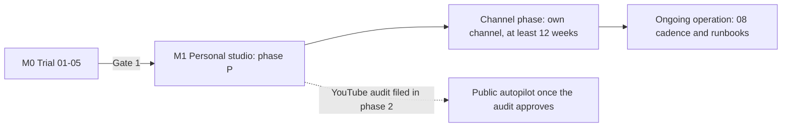

# 00 — Program Overview, BA Review and Shared Contracts

> Owner: BA + Tech Lead. Source of truth for product scope: `../DECISIONS.md`.
> Every plan file `01`–`13` (plan 12 removed by DEC 10.14) MUST follow the contracts in this file (domain names, states, API routes, IDs, estimates). If a plan needs a change here, change this file first.
> Legend: ✅ verified from source/docs · ⚠️ unverified · [DECISION] made in this file · [OPEN] needs the product owner.

> **Plan level: HIGH-LEVEL — this is not the end of planning.** Every feature will still be reviewed and get its own detailed plan before it is built (process in §10.1). Plans `00`–`13` define scope, shared contracts, key decisions, risks and order-of-magnitude estimates. They are **not** implementation specs. Before a feature is built, its detailed plan is written in `plans/features/<story-id>-<slug>.md` (template in §10.1) and refines — never silently contradicts — these plans; any contract change still goes to this file first. Field lists, endpoint shapes, sizes and thresholds here are starting points to be confirmed and made precise in the feature plan.

---

## 1. BA review of the high-level plan

### 1.1 What is good

- Clear pipeline, licenses already cleared for monetized use (the hosted-service parts are no longer needed — DEC 10.14).
- The expensive/risky integrations (VieNeu ↔ MPT, OpenAI images, YouTube/TikTok rules) were verified from source.
- Human review is scoped to the risk: the owner's fiction autopilot uses automated gates, a variety guard, a daily cap and a veto window; true-crime keeps human approval; the owner carries the monetization risk (§4.1).

### 1.2 Gaps found (and how this breakdown closes them)

| # | Gap in the high-level plan | Impact | Closed by |
|---|---|---|---|
| G1 | No personas, MVP scope or success metrics | Team builds everything at once | §2, §3 of this file |
| G2 | Plans 01–05 were written for one owner on a Mac; the platform needs them as a **worker service** | Rework later | 01–05 now end with a "worker contract" validated for plan 11 |
| G3 | Story writing moved from MPT to our backend (checkpoint #1 lives in our UI) but no plan owned it | Nobody builds the editor/approval | 02 (prompts) + 09 (API) + 10 (UI) |
| G4 | No user/account, series, episode concept | No way to keep a channel's style consistent | Domain model §6 |
| G5 | YouTube upload quota is **100/day for the whole API project** ✅ | A busy channel could hit it | 06 quota scheduler; one owner channel at the default daily cap 1/day (02.8.3) stays far below it — no fairness caps, no quota extension (DEC 10.14) |
| G6 | Audits (YouTube, TikTok) ⚠️ take unknown time | Publishing blocked by third parties | YouTube audit (13.4.2) filed in M1 with the P legal slice (13.1.1-T1, 13.1.2-T1, 13.2.1-T1, 13.3.1-T1); the TikTok audit stays with plan 07 (P). Google OAuth verification is not needed for the owner's single-account app |
| G7 | No cost metering | A runaway autopilot can drain the OpenAI budget | Metering + spend caps in 09 (`usage_records`, metering-only `ICreditLedger`); **no billing, credits or payment model exists** (DEC 10.14) |
| G8 | True-crime content has **defamation and privacy** risk (real, possibly living people) | Legal risk to the owner and the channel | 02 fact-source rules, 13 terms, UI warnings in 10 |
| G9 | No observability, backups or retention | Cannot operate the studio safely | 09 + 11 + 08 |
| G10 | No local dev path without a GPU | Frontend/backend blocked on hardware | **Mock MPT** service (11) used by 09/10 |
| G11 | No test strategy / definition of done | Quality drift | §10 of this file |
| G12 | UI language not decided | Rework of every screen | UI in **Vietnamese + English** from day one [DECISION] |
| G13 | Story content had no grounded input: model-written source URLs can be invented, and "aggregate other channels' videos" breaks YouTube's Terms ✅ | Invented facts, copyright and ToS risk | 02 Epic 02.5 (user links → safe fetch → fact sheet → similarity check), DECISIONS §10.10 |

### 1.3 Scope decisions

- [DECISION] **Personal-only product (DEC 10.14, owner 2026-10-21):** the studio serves the owner alone — one owner account, fully automatic autopilot (ideas → story → video → publish through the official YouTube and TikTok APIs; true-crime waits for the owner's approval). There is no public SaaS: no sign-up for other people, no credits or payments, no multi-user publishing, no admin surface for other users. Phase S was dropped and its plan files deleted; `../DECISIONS.md` §10.14 is the record.
- [DECISION] **Personal MVP = autopilot "idea → story → video → publish"** through the official YouTube API (§4.1); until the audit passes, uploads stay private. No MP4-download fallback is needed for other users.
- [DECISION] **TikTok publishing is part of phase P** (kept by DEC 10.14; heavier required UI, separate audit ⚠️, ~15 posts/day/creator cap). It stays pessimistic: unaudited Direct Post is private-only.
- [DECISION] **The owner pays OpenAI directly; no credits.** BYOK is irrelevant with one account (`DECISIONS.md` §10.5); per-generation metering and spend caps stay, charging does not.
- [DECISION] Roles stay `user`, `admin` and `owner` as a code fact, but only one `owner` account exists; tenant filters stay on every user-owned table with no public tenant.
- [OPEN] Hosting provider/region for the API and GPU node (plan 11).

## 2. Personas

| Persona | Description | Main goals |
|---|---|---|
| **P1 Owner** | The single user of the studio: runs the faceless storytelling channels (vi or en) and the operations. Not a developer, but reads logs and alerts. | Produce a good 5–15 min episode quickly, keep a consistent style, publish on cadence, stay monetizable, keep OpenAI spend predictable |
| **P2 Platform reviewer** | Google/TikTok audit reviewers | See compliant consent, privacy and required UI — must pass on first try |

There are no public users (DEC 10.14): no creator onboarding, no admin-for-others, no support queue.

## 3. Success metrics

- Time from "new episode" to a ready MP4 ≤ 30 min (median), of which owner effort ≤ 10 min.
- Render success rate ≥ 95 % (excluding owner-rejected stories).
- Measured OpenAI cost per episode recorded for every render (metering, not margin — nothing is sold).
- 0 critical security findings at deploy; the owner's OAuth tokens and external posts stay revocable within the YouTube deadlines.

## 4. Milestones

| Milestone | Content | Plans | Exit criteria |
|---|---|---|---|
| **M0 Trial (validation gate)** | Prove the pipeline on the Mac; measure time/cost; 05.4 spike | 01–05 | One 5-min vi video + one en video; cost/time sheet filled; worker contract confirmed. **Gate 1 (go/no-go):** quality acceptable and cost per video known, else stop or change the render approach |
| **M1 Personal studio** | The owner's own studio: backend + Angular end-to-end; single owner account with MFA; autopilot (02.8) + YouTube API publishing (06, private until the audit passes) + TikTok publishing (07); privacy/terms pages and acceptance, 7/30-day deletion jobs live (YouTube Developer Policies III.A, III.D.2). **Phase 1 (local, 11 CR-18):** all of it on the owner's Mac with the local render node and configuration from `.env`/Keychain. **Phase 2 (deploy):** the same stack on one cloud GPU node with a secret manager, the legal pages public, then the YouTube audit filed (13.4.2, needs public policy URLs) | 01–05, 02, 06, 07, 09, 10, 11, 13 (P: 13.1.1-T1, 13.1.2-T1, 13.2.1-T1, 13.3.1-T1, 13.4.2) | Phase 1: autopilot publishes (private) to the owner's channel on its cadence from the Mac without manual steps (true-crime after approval). Phase 2: the same from the deployed stack; audit filed |
| **Channel phase** | Run the flagship channel on autopilot for ≥ 12 weeks after the YouTube audit allows public uploads (08.4) | 08.4 | Channel KPI sheet filled weekly; the owner reviews cadence, quality and measured cost per episode. There is no go/no-go gate: the product is personal (DEC 10.14) |
| **Ops** | 90-day operating cadence and runbooks | 08 | Weekly KPI review running |



### 4.1 Delivery: one phase, personal and fully automatic [DECISION]

There is **one phase: P** (DEC 10.14). The owner's studio is the product; phase S was dropped and its plan files deleted. Every task is tagged P.

- **P — Personal studio (M0 → M1 → Channel phase → Ops):** fully automatic for the owner's channels: autopilot picks ideas, writes, renders and publishes through the **official YouTube Data API** and the **TikTok Content Posting API** (02.8, 06, 07). The multi-tenant-ready architecture stays as a code fact (Clean Architecture + CQRS, outbox, `user_id` + tenant filters, TOTP MFA, `mpt-adapter`, fetcher isolation, backups, CI) with no public tenant.
- **No S phase:** nothing is built because other people use the system (no sign-up, credits, payments, admin-for-others, public landing/pricing). TikTok is P, not a separate release.

**Automation rules [DECISION]:**
- **Official APIs only, no browser automation on YouTube or TikTok.** YouTube's Terms forbid accessing the Service "using any automated means (such as robots, botnets or scrapers)" without YouTube's prior written permission ✅ ([YouTube Terms of Service](https://www.youtube.com/t/terms)); breaking this risks the owner's own channel. jev-ultrafast (browser agent) is used only for research on allow-listed sites that permit automated access (02.7).
- **Fiction runs on autopilot; true-crime waits for the owner** at the fact sheet and story (02.8.2). This replaces the mandatory human checkpoints for the owner's own fiction series; there are no other users to apply a different rule to (DEC 10.14).
- **YouTube publishing and the audit:** uploads through `videos.insert` from an unaudited API project created after 28 July 2020 are restricted to private viewing ✅ ([Videos: insert](https://developers.google.com/youtube/v3/docs/videos/insert)). 06 is therefore built in the personal phase and the **YouTube API audit is filed as soon as upload works and the policy pages are public** (13.4.2; upload works privately in M1 phase 1, the filing lands in phase 2, 11 CR-18); until it passes, autopilot publishes as private and the channel cannot grow ⚠️ — this audit is the critical path. Whether an audit for a single-owner tool is approved is unverified ⚠️. YouTube Developer Policies require the client to have its own terms (with the YouTube Terms clause) and a privacy policy (III.A.1, III.A.2 ✅, [Developer Policies](https://developers.google.com/youtube/terms/developer-policies)), so 13.1.1-T1, 13.1.2-T1, the 10.3.1-T1 pages, 13.2.1-T1 acceptance and the 13.3.1-T1 / 06.4.3-T1 deletion jobs (III.D.2 7/30-day duties) are P and live before filing.
- **Two separate Google gates:** OAuth app verification (Cloud Console) controls the unverified-app screen and the 100-new-user cap; the YouTube API compliance audit ([form](https://support.google.com/youtube/contact/yt_api_form)) controls the private lock and quota. Setting the app to In production fixes the 7-day token expiry but does **not** unlock public uploads. Options were: (a) API + audit filed early — automatic and legal, public only after approval (**chosen**); (b) API without audit — automatic but private-only forever; (c) browser automation — public but against YouTube's Terms (rejected).
- **Per-video consent stays:** autopilot does not bypass the Publication consent (§7). The owner accepts a versioned series authorization once; for each autopilot publication the scheduler writes `consent_at`, `consent_text_version` and `consent_source = autopilot` after a veto window in which the owner may edit or cancel (06.2.2-T3, YouTube Developer Policies III.C.3 "final control").
- **OAuth app status:** a Google OAuth app in Testing status is limited to 100 test users and every authorization, including the refresh token, expires after 7 days ✅ ([Manage App Audience](https://support.google.com/cloud/answer/15549945)), which would stop autopilot weekly. The owner's app is therefore set to **In production** without verification: the owner accepts the "unverified app" warning once; the 100-new-user cap does not matter for one owner. [INFERENCE] refresh tokens then follow normal production rules; confirm in the 06.1 feature plan ⚠️.
- **TikTok is phase P and kept (DEC 10.14).** Direct Post from an unaudited client is private-only ✅ ([Content Posting API — Direct Post](https://developers.tiktok.com/doc/content-posting-api-get-started)), and TikTok lists "a utility tool to help upload contents to the account(s) you or your team manages" as not acceptable for the audit ✅ (07 K2). The inbox-upload path (`video.upload`) only creates a draft the creator must finish in the TikTok app ✅ ([Upload](https://developers.tiktok.com/doc/content-posting-api-get-started-upload-content)), so it is not automatic. Plan 07 and the web TikTok post screen are therefore built for the owner's own account, on the pessimistic assumption that posts stay **private-only and low-volume** until TikTok's audit posture changes ⚠️.

**Phase 1 local, phase 2 deploy [DECISION, owner 2026-09-30]:** within P, phase 1 runs everything on the owner's Mac (native dev stack, local render node, publishing from the local Worker); phase 2 publishes the studio to the internet: hosting choice, cloud environments, GPU host, storage hosts, secret manager, deploy/CI-CD, backups, telemetry and capacity test (11 CR-18 lists the tasks). The 13 OI-1 operator identity also moves to phase 2.

**Scope note:** every remaining task is **P** — the phase-S task files were deleted on 2026-10-21 (DEC 10.14), and `07` (TikTok) plus `10.7.3-tiktok-post` were retagged P. In the personal studio, integration keys and base URLs come from the environment/secret manager; a single owner account is seeded and there is no public sign-up.

| Plan | Raw (P only) | With buffer (P only) | Status after DEC 10.14 |
|---|---|---|---|
| 01 Environment | 10.0 | 12.0 | unchanged |
| 02 Story writing | 40.25 | 48.3 | unchanged |
| 03 Images | 7.0 | 8.4 | unchanged |
| 04 Voice proxy (04 CR-14: was 4.5 / 5.4) | 5.5 | 6.6 | unchanged |
| 05 Video/subtitles (05 CR-2: was 8.75 / 10.5) | 10.75 | 12.9 | unchanged |
| 06 YouTube | 15.25 | 18.3 | the four 06 S tasks (06.1.2-T3, 06.3.2-T1, 06.3.3-T1, 06.5.2-T1 = 1.25 d) were deleted; plan 06 §11 re-estimate |
| 07 TikTok | 7.75 | 9.3 | **moved from S to P** (DEC 10.14); §11 total unchanged |
| 08 Operations (08 CR-3) | 2.5 | 3.0 | the KPI/alerts/support S epics (08.1–08.3) and 08.5.1-T2 were deleted; 08.4 + 08.5 remain |
| 09 Backend (09 W2 CR-4) | 37.5 | 45.0 | 18.5 / 22.2 of S removed; equal to the sum of the 45 remaining task files |
| 10 Web UI (10 CR-5, 10 CR-14, 10 CR-31, 10 CR-39/40) | 43.5 | 52.2 | was 61.0 / 73.2 with the S 20.0 (signup, billing, admin, a11y/UX passes) removed; TikTok 2.5 moved in (P) |
| 11 Worker/CI/CD (11 CR-2, 11 CR-15) | 22.5 | 27.0 | was 24.5 / 29.4 with the S extras; `11.2.3-T1`, `11.5.3-T2`, `11.6.4-T1` deleted, `11.4.1-T2/T3` +1.0 |
| 13 Compliance (13 CR-4, 13 CR-9) | 5.5 | 6.6 | 8.0 / 9.6 of S removed; six task files remain |
| **Total** | **208.0** | **249.6** | the sum of the twelve plan §11 totals above (each itself the sum of its remaining task files) |

- **Personal studio (the only product):** **208.0 raw / 249.6 buffered person-days** ≈ **12.5 months** for one developer at ~20 productive days/month, not counting lawyer time, platform-review waits or the Channel phase's ≥ 12 publishing weeks. The pre-drop figure of ≈ 197.25 / 236.7 counted S rows inside plans 06/08/09/10/11/13 **and** predates the wave-1/2 detailed re-estimates of plans 02/09/10, so it is not comparable line by line; this table is the current roll-up. The M0 trial (01–05) is inside the figure.
- **No S column exists any more:** a plan's §11 must sum only its remaining task rows, and each feature plan (§10.1) re-estimates from there.

## 5. Architecture contract

```mermaid
flowchart LR
  B[Angular SPA (owner dashboard, vi + en)] -->|HTTPS REST + SignalR, hub ticket| API[NightTales.Api x2]
  API -->|"commands write outbox_messages; the Api never enqueues jobs (09 CR-14)"| PG[(PostgreSQL)]
  PG -->|"OutboxDispatcher claims rows"| HF[Hangfire jobs in NightTales.Worker]
  HF --> PG
  HF -.->|LISTEN/NOTIFY| API
  HF --> OAI[OpenAI API - text project]
  HF -->|"private link, Worker pulls"| AD[mpt-adapter on GPU node]
  AD --> MPT[MPT] --> VP[VieNeu proxy] --> VN[VieNeu]
  MPT -->|"egress allow-list"| OAI2[OpenAI API - node image project]
  HF --> S3[(S3-compatible storage)]
  HF --> YT[YouTube Data API]
  HF --> TT[TikTok Content Posting API]
  FT[fetcher container - internet-only egress, no DB/storage/OpenAI credentials] -->|"pulls tasks: lease / heartbeat / result, Api internal :8081 (02 CR-1)"| API
  FT --> WEB((Public article pages))
```

### 5.1 Tech stack [DECISION]

| Layer | Choice |
|---|---|
| Web UI | **Angular 22** (latest stable on npm: `@angular/core` 22.1.7, published 2026-09-16 ✅), Clean Architecture per feature (§5.3, §5.4), standalone components, signals, new control flow, OnPush, Angular Material, SSR/prerender limited to the four public legal routes (`vi`/`en` privacy and terms, 10.3.1-T1 — `@angular/ssr` + `app.routes.server.ts`, asserted by `web/e2e/legal.spec.ts`), no public marketing or pricing pages (DEC 10.14), `@microsoft/signalr`, runtime i18n vi/en (Transloco, MIT ✅) |
| Backend | **C# on ASP.NET Core / .NET 10 LTS** — latest stable runtime 10.0.12, SDK 10.0.401, support until 2028-11-14 ✅ ([.NET releases index](https://dotnetcli.blob.core.windows.net/dotnet/release-metadata/releases-index.json), 2026-09-08); `global.json` pins SDK 10.0.4xx with `rollForward: latestPatch`, images `mcr.microsoft.com/dotnet/aspnet:10.0` / `sdk:10.0`, monthly patch updates; .NET 11 (RC1, STS) not used [DECISION], **Clean Architecture + CQRS** (§5.2, §5.4), Minimal API endpoint groups, `Mediator` source generator (martinothamar/Mediator, MIT ✅, v3.0.2), FluentValidation (Apache-2.0 ✅), ErrorOr results (MIT ✅), Mapperly (Apache-2.0 ✅) or hand-written mapping, Serilog (Apache-2.0 ✅), OpenTelemetry, `Microsoft.Extensions.Http.Resilience` / Polly (BSD-3 ✅) |
| Jobs | **All background work in C#** in the separate `NightTales.Worker` process (.NET 10), sharing Domain/Application with the API — no Go, no Python jobs [DECISION]; scheduler Hangfire with PostgreSQL storage (LGPL-3.0 or commercial per vendor ✅; LGPL-3.0, unmodified NuGet packages, **accepted by the owner 2026-09-24**, 09 README O1) |
| Not used [DECISION] | **MediatR 14.x** — licensed RPL-1.5 or a commercial agreement ✅ (nuget.org license page); **AutoMapper** — same vendor moved to commercial terms ⚠️ (not re-checked). Both avoided to keep licensing simple |
| Database | **PostgreSQL 17** (dev, CI and production; owner decision 2026-09-24, 09 README O3; (09 CR-13)), EF Core + Npgsql, snake_case naming, migrations via EF |
| Storage | S3-compatible object storage, private bucket, pre-signed GET URLs (≤ 15 min); self-hosted SeaweedFS (Apache-2.0) in every env, no managed object storage (11 CR-15, owner O7 2026-09-27) |
| AI | Official OpenAI .NET SDK for story writing (backend); MPT calls OpenAI Images itself |
| Render | MPT + VieNeu + VieNeu proxy (Python, next to MPT) + faster-whisper, on a GPU node, private network — Python only because these open-source tools are Python; no business logic there, called over HTTP by the C# Worker |
| Local dev | **Native on macOS, no Docker [DECISION, owner 2026-09-28]:** Homebrew `postgresql@17` (bind `127.0.0.1`), `seaweedfs` (Apache-2.0), `mailpit` (MIT), .NET SDK 10.0.401 (`dotnet run` / `dotnet watch` for api, worker, **mock-mpt**), Node 26 (`ng serve`); VieNeu/MPT/whisper stay native (plan 01). Docker is used only to build and smoke-test deploy images (CI, staging, production); `docker-compose.yml` is optional (e2e / image smoke), never required for daily dev |

### 5.2 .NET solution layout — Clean Architecture [DECISION]

Dependency rule: `Domain` ← `Application` ← `Infrastructure`, `Api`, `Worker`. Inner layers never reference outer ones; enforced by architecture tests (§5.4).

```
src/
  NightTales.Domain/                 pure C#; no EF, no HTTP, no Mediator; only package: ErrorOr (09 CR-1)
    Common/                          Entity, AggregateRoot, ValueObject, IDomainEvent, DomainError
    Users/ Series/ Episodes/ Stories/ Rendering/ Assets/ Channels/ Publishing/ Compliance/   (no `Credits/` aggregate: metering only — `MeteringOnlyCreditLedger` is Infrastructure/`Money/`, DEC 10.14)
      <Aggregate>.cs, <Aggregate>Status.cs (state machine), value objects, domain events, errors
  NightTales.Application/            use cases (CQRS); depends on Domain + Mediator.Abstractions, FluentValidation, ErrorOr,
                                     Microsoft.EntityFrameworkCore core (no provider) (09 CR-1)
    Abstractions/                    ports: IAppDbContext (write), IReadDb (queries), IStoryWriter, IRenderClient,
                                     IBlobStore, IYouTubeClient, ITikTokClient, ITokenProtector, IClock, ICurrentUser,
                                     IIdempotencyStore, IRealtimeNotifier, IJobScheduler (IClock itself lives in Domain/Common, 09 README D3)
    Behaviors/                       pipeline: Logging → Authorization → Validation → UnitOfWork (commands; opens the transaction)
                                     → Idempotency → Audit (09 CR-2)
    Features/
      Stories/
        Commands/GenerateStory/      GenerateStoryCommand.cs, GenerateStoryHandler.cs, GenerateStoryValidator.cs
        Commands/EditStory/ Commands/ApproveStory/ Commands/ReopenStory/ ...
      Episodes/
        Queries/GetEpisode/          GetEpisodeQuery.cs, GetEpisodeHandler.cs, EpisodeDetailsDto.cs
        Queries/ListEpisodes/ ...
        Events/                      domain-event handlers (e.g. StoryApproved → nothing, VideoApproved → notify)
      Series/ Stories/ Rendering/ Channels/ Publishing/ Users/ Compliance/   (no `Admin/` or `Credits/` feature folders — no admin surface, metering only, DEC 10.14)
  NightTales.Infrastructure/         adapters for Application ports
    Persistence/                     AppDbContext (write model), ReadDbContext (no-tracking), configurations, migrations,
                                     outbox, interceptors (audit, domain events → outbox)
    OpenAI/ Render/ (mpt-adapter client) Storage/ (S3) YouTube/ TikTok/ Security/ (token protection) Jobs/ (Hangfire adapters)
  NightTales.Api/                    presentation: Minimal API endpoint groups per feature, auth, SignalR hub,
                                     ProblemDetails mapping from ErrorOr, rate limiting, OpenAPI
  NightTales.Worker/                 composition root for Hangfire server, recurring jobs, outbox dispatcher
  NightTales.Fetcher.Core/           references Domain only: SafeHttpSourceFetcher, address validation, robots, main-text extraction (02 CR-19, 02 T40)
  NightTales.Fetcher/                console host (BackgroundService) for the fetcher container; references Fetcher.Core only,
                                     never Infrastructure/Application (no EF, no OpenAI SDK, no Hangfire) — architecture test (02 T40)
  NightTales.RenderNode.Contract/    render-node.v1 wire DTOs (BCL only); referenced by Application, the adapter and the mock (11 CR-2)
  NightTales.RenderNode.Server/      shared render-node.v1 server core (routes, auth, limits, store seam); never Domain/Application/Infrastructure (11 CR-2)
  NightTales.MptAdapter/             `mpt-adapter` host on each GPU node: MPT backend, post-processing, health, image relay (11 CR-2)
tests/
  NightTales.Domain.UnitTests/  NightTales.Application.UnitTests/  NightTales.Architecture.Tests/
  NightTales.Api.IntegrationTests/ (WebApplicationFactory + real PostgreSQL 17 via `PostgresFixture` on the `NTS_TEST_PG` connection string: local Homebrew server in dev, GitHub Actions `postgres:17` service in CI; no Testcontainers, owner 2026-09-28)
tools/mock-mpt/                      fake render node for local dev and CI (`NightTales.MockMpt` on `NightTales.RenderNode.Server`, 11 CR-2)
web/                                 Angular workspace
worker-node/                         MPT config, VieNeu proxy, node host/systemd/network scripts, `nts-node` deploy tool (11 CR-2)
infra/                               OpenTofu module `platform` + `render-node`, envs `staging`, `prod` (11 CR-2)
```

**CQRS rules [DECISION]**
- One database, two paths: **commands** load aggregates through `IAppDbContext` (tracked EF Core) and change state only via aggregate methods; **queries** read through `IReadDb` (no-tracking EF projections straight to DTOs, or SQL views for heavy lists). No separate read store in MVP.
- A command returns `ErrorOr<TResult>` where `TResult` is at most an id, ETag or small acknowledgement — never a read model.
- A query never changes state, never enqueues jobs, and never calls external APIs — **one documented exception**: live, read-only lookups that a platform requires at render time of a screen (TikTok `creator_info`, 07.2.1) go through a dedicated `IExternalLookup` port, persist nothing, and are rate-limited.
- Side effects (enqueue jobs, SignalR, e-mail) happen from **domain events** written to an `outbox_messages` table in the same transaction and dispatched by the Worker → no lost jobs on crash.
- Every command/query is one file triple: request, handler, validator. Handlers ≤ ~80 lines; shared logic goes to the domain, not to "helper services".
- Endpoints are thin: bind → `sender.Send(...)` → map `ErrorOr` to HTTP (`200/201/202/204` or ProblemDetails).
- **Tenant isolation (a code fact, not a public-tenant feature — DEC 10.14):** every user-owned table carries `user_id` and its entity implements `IUserOwned` (EF global filter); an architecture test fails if an entity with an `episode_id`/`series_id` FK does not; Worker jobs run under `SystemContext(userId)` from the outbox payload with filters on; only named system jobs (retention, deletion, reconciliation) may bypass filters (09.2.3). A child row's FK to a user-owned parent is composite `(parent_id, user_id)` onto the parent's `(id, user_id)` alternate key, so the database rejects a child pointing at another user's parent; nullable `SET NULL` FKs use PostgreSQL's column-list `ON DELETE SET NULL (parent_id)` (09 W3 CR-46, W3-O7).
- **Real-time scale-out:** the Worker publishes notifications with PostgreSQL `NOTIFY`; every Api instance `LISTEN`s and forwards to its own SignalR connections; WebSockets only (09.8.1). No Redis.
- **Network zones:** app network (Api, Worker, PostgreSQL, storage); render network (GPU nodes, reachable only on the `mpt-adapter` port from the Worker, never connecting into the app network, egress allow-list); `fetcher` subnet with internet-only egress for source fetching (11 §5.1); the fetcher has **no Hangfire, no DB and no storage credentials** and reaches the app network only as a pull client of the Api internal listener `:8081` (lease → heartbeat → result, bearer `FETCHER_API_TOKEN`) (02 CR-1, 02 README D10).

### 5.3 Angular workspace layout — Clean Architecture per feature [DECISION]

Dependency rule inside each feature: `feature` → `ui`, `application` → `domain`; `data-access` implements ports declared in `domain`/`application`. Features never import another feature's internals, only its `index.ts` public API. Enforced by ESLint boundary rules (§5.4).

```
web/src/app/
  core/                    app-wide singletons: auth (session store, interceptor, guards, silent refresh),
                           http (base URL, ProblemDetails → AppError mapper, Idempotency-Key interceptor),
                           realtime (SignalR connection service), i18n, config, logging, layout shell
  shared/
    ui/                    presentational components (buttons, dialogs, empty/error states, status chips)
    util/                  pure functions, pipes, validators, type helpers
    api/                   OpenAPI-generated client (never imported by components directly)
  features/
    episodes/
      domain/              models (Episode, StoryVersion, RenderProgress), pure rules (canApprove, nextActions),
                           ports (EpisodesRepository abstract class / InjectionToken)
      data-access/         EpisodesHttpRepository (wraps generated client), DTO ↔ model mappers, realtime adapter
      application/         EpisodeDetailStore / EpisodeListStore (signal-based state + use-case methods:
                           generateStory(), saveStory(), approveStory(), render(), approveVideo())
      ui/                  story-editor, keyword-chips, version-diff, render-timeline, video-player (inputs/outputs only)
      feature/             routed container pages: episode-list.page, episode-detail.page, story-review.page, video-review.page
      episodes.routes.ts   lazy routes
      index.ts             public API (routes + types other features may use)
    auth/ dashboard/ series/ publish/ channels/ account/ autopilot/   (same five folders each)
```

### 5.4 Engineering standards (backend and web) [DECISION]

| Area | Backend (.NET 10) | Web (Angular 22) |
|---|---|---|
| Architecture enforcement | Architecture tests fail the build if Domain references EF/ASP.NET/Mediator, or Api references Infrastructure internals (library: ArchUnitNET or NetArchTest ⚠️ license check) | ESLint boundary rules (e.g. `eslint-plugin-boundaries` ⚠️ license check): `ui` cannot inject stores/repositories; `domain` cannot import `@angular/*`; no cross-feature deep imports |
| Language settings | `<Nullable>enable`, `<TreatWarningsAsErrors>true`, analyzers + `.editorconfig`, file-scoped namespaces | `strict: true`, `strictTemplates`, no `any` (lint error), `noUncheckedIndexedAccess` |
| Style | Primary constructors, `sealed` by default, records for commands/queries/DTOs, `CancellationToken` on every async path, no static mutable state | Standalone components only, `inject()`, signals + `computed`, `@if/@for` control flow, `ChangeDetectionStrategy.OnPush`, no logic in templates beyond simple bindings |
| Errors | Domain errors as typed `Error` codes → ErrorOr → ProblemDetails `code` (catalogue in 09); no exceptions for control flow | One `AppError` type; every ProblemDetails `code` has an i18n message key |
| State | Aggregates guard invariants; state transitions only through domain methods | Signal stores per feature; components read signals, call store methods; no subscriptions in components except via `toSignal`/async boundaries |
| Mapping | Mapperly or explicit static mappers; no reflection mappers | Explicit mapper functions DTO ↔ model in `data-access` |
| Testing | Domain: pure unit tests; Application: handler tests with fakes; Api: integration tests on real PostgreSQL; Architecture tests | Domain/util: unit tests; stores: unit tests with fake repositories; ui: component tests; e2e: Playwright |
| Size limits | Handler ≤ ~80 lines, class ≤ ~300 lines, method ≤ ~30 lines (review guideline, not a hard gate) | Component ≤ ~200 lines TS, template ≤ ~150 lines; split otherwise |
| Reviews | PR template checks: layer rule, tests, migration safety, secrets, i18n | Same + a11y and both languages |

## 6. Domain contract (PostgreSQL)

Table ownership (09 CR-5): the 09.2.2 `InitialCore` migration creates the core set; every other table is created by the migration of its owning feature. Tables that existed only for public users (phase S) are **not created** — DEC 10.14 — and are struck through or removed here as their owning plans drop those tasks (`features/09-backend-api/README.md` D9). All tables: `id uuid` (UUIDv7 generated in .NET), `created_at timestamptz`, `updated_at timestamptz` where mutable; optimistic concurrency on aggregates via PostgreSQL `xmin`. Money in `numeric(12,6)` USD. Soft delete only where retention rules need it.

| Table | Key columns | Notes |
|---|---|---|
| `users` | email (unique via Identity `normalized_email`, no citext; 09 CR-4), display_name, ui_locale (`vi`/`en`), role (`user`/`admin`/`owner`), status (`active`/`suspended`/`deleted`), two_factor_enabled, last_totp_step, security_stamp, last_login_at, email_verified_at timestamptz (08 CR-11) | ASP.NET Core Identity user; MFA mandatory for admin/owner; TOTP replay blocked by `last_totp_step`; stamp validated on every authenticated request (09.3.2, 09.10.4); verify/reset/cancel tokens stored hashed and single-use; `email_verified_at` is Identity metadata only — there is no verify-email flow (DEC 10.14, 09.3.1-T3 dropped); no admin user list, so no `(status, role, created_at DESC, id)` index (09 W3 CR-1 withdrawn with the admin surface) |
| `refresh_tokens` | user_id, family_id, token_hash, created_at, last_used_at, expires_at, revoked_at, revoked_reason, replaced_by_id, reauthenticated_at, reauth_attempts, reauth_last_attempt_at, ip, user_agent (09 W2 CR-1, CR-14) | Rotation, reuse detection; credential events revoke families; `reauthenticated_at` backs `/auth/reauth` (09.3.2, 09.10.4); index `(user_id, revoked_at, expires_at)` for the sessions list and family checks (09 W3 CR-1) |
| `user_action_tokens` | user_id, kind (`password_reset`/`publication_cancel` (06 CR-1)), subject_id (publication id for `publication_cancel`; invalidation per (user, kind, subject), 06 YR8), token_hash, created_at, expires_at, used_at (09 W2 CR-1) | Hashed single-use tokens (reset 60 min) (09.3.3; the `email_verify` kind, its 24 h lifetime and task 09.3.1-T3 were dropped by DEC 10.14) |
| `hub_tickets` | ticket_hash, user_id, created_at, expires_at, used_at (09 W2 CR-1) | 60 s single-use SignalR connect tickets (09.8.1-T2) |
| `email_messages` | user_id, template, locale, to_hash, params jsonb (allow-listed template keys, never tokens; nulled once sent), status (`queued`/`sent`/`failed`), attempts, provider_message_id, last_error_code, created_at, sent_at (09 W2 CR-1) | Delivery record for `SendEmailJob` (09.2.6-T3); addresses never stored in clear |
| `data_protection_keys` | friendly_name, xml (encrypted with the `DP_KEK` certificate) (09 W2 CR-1) | ASP.NET Core Data Protection key ring (09.9.4-T1) |
| `auth_challenges` | user_id, token_hash, preauth_cookie_hash, user_agent, ip (logged, not enforced), attempts, expires_at, used_at | MFA login step: short-lived `mfaToken` after a correct password, bound to a pre-auth cookie + user agent (09.3.2) |
| ~~`trusted_devices`~~ | — | **Not created** (DEC 10.14): trusted devices existed to skip the MFA step for returning devices across many users, and the `mfa_locked_untrusted` counter that exempted them was phase S (`features/09-backend-api/09.3-auth/plan.md` D9 — no P task creates this table). The one owner's device is never exempt from TOTP. |
| `user_consents` | user_id, document (`tos`/`privacy`/`age_18`), version, accepted_at, ip | Legal acceptance history (13 CR-7) |
| `series` | user_id, title, topic (`ghost`/`spiritual`/`true_crime`), language (`vi`/`en`), aspect (`landscape`/`portrait`), voice_id → `voices`, style_template_id → `style_templates`, story_preset, default_channel_id, archived_at, autopilot_enabled, autopilot_settings jsonb (cadence, publish time, time zone, daily cap, buffer, thresholds, veto_window_hours, privacy status, pre-audit mode), current_autopilot_authorization_id → `series_autopilot_authorizations`, autopilot_paused_at, autopilot_pause_reason; `topic` is immutable while autopilot is enabled | Keeps one channel's style consistent; archived series are hidden from `GET /series` but keep their episodes · 02 CR-4: `autopilot_settings` also holds `tone` and `banned_themes[]` (02.8.3-T1 schema). |
| `episode_ideas` | user_id, series_id, title, logline, hook, score, similarity, status (`proposed`/`picked`/`rejected`/`used`), episode_id, rejected_reason | Autopilot idea pool and de-duplication (02.8.1) · 02 CR-4: + `structure jsonb`, `novelty jsonb`. |
| `series_autopilot_authorizations` | user_id, series_id, version, text_version, text_hash, topic, channel_connection_id, cadence, privacy status, accepted_at, revoked_at | Versioned autopilot authorization history; each autopilot publication references the row it relied on (06.2.2-T3) · 02 CR-4: + `revoked_reason`. |
| `autopilot_runs` | user_id, series_id, started_at, idea_id, episode_id, outcome (`published`/`published_private_locked`/`waiting_owner`/`gate_failed`/`cancelled_by_owner`/`awaiting_authorization`/`paused`/`failed`), gate_results jsonb, pause_reason | Autopilot run log (02.8, 10.4.3) · 02 CR-4: + `slot_at` (unique with `series_id`), `state`, `step`, `start_at`, `publication_id`, `authorization_id`, `attempt`, `render_attempts`, `waiting_for`, `last_transition_at`, `finished_at` (02.8.3-T1). |
| `series_bibles` | user_id, series_id (unique), version, content jsonb (narrator, recurring_characters, places, rules, episode_summaries), proposed_content jsonb, proposed_from_episode_id | Series memory fed to the writer (02.6.3) |
| `episodes` | user_id, series_id, title, brief (≤ 1,000 chars), length_tier (`short`/`standard`/`long`), status (see §7), current_story_version_id, approved_story_version_id, approved_at timestamptz NULL (02 CR-32), final_video_asset_id, ready_at timestamptz NULL, video_reject_reason varchar(500) NULL (09 CR-48) | Central aggregate; `length_tier` drives story length (02) and the render cost estimate |
| `story_versions` | user_id, episode_id, version (int), source (`generated`/`revised`/`edited`), title, body, keywords text[], word_count, model, prompt_version, content jsonb (full structured output incl. backend-built fact_sources), audit_report jsonb, similarity_score numeric(5,4) | Immutable; edits add a version · 02 CR-4: + `parent_version_id`, `generation_run_id`, `fact_sheet_id`, `schema_version` (`story.v1`). |
| `story_sources` | user_id, episode_id, kind (`url`/`user_note`), url, final_url, title, status (`pending`/`fetched`/`failed`/`rejected`), error_code, http_status, content_sha256, extracted_text_key, fetched_at | User-supplied research inputs (02.5); deleted with the episode · 02 CR-4: + `normalized_url`, `registrable_domain`, `content_type`, `text_chars`, `note_text` (≤ 3,000 chars, `user_note` only); `extracted_text_key` = `research/{userId}/{episodeId}/{sourceId}/{sha256}.txt`. |
| `fact_sheets` | user_id, episode_id, version, status (`draft`/`approved`), facts jsonb (id, statement, source_ids, confidence), approved_at | Approved sheet is the only fact input for true crime (02.5) · 02 CR-4: + `prompt_version`, `generation_run_id`, `source_aliases jsonb`, `input_truncated bool`, `max_fact_id`; status + `superseded` (one approved sheet per episode). |
| `generation_runs` | user_id, series_id (NOT NULL), episode_id (NOT NULL for `story`/`fact_sheet`/`find_sources`, NULL for `ideas`/`bible_proposal`), kind, trigger (`user`/`autopilot`/`system`), idempotency_key, status (`queued`/`running`/`succeeded`/`failed`/`cancelled`), stage, previous_episode_status, pause_reason, reservation_id, counts_toward_limit, worst_case_usd, cost_usd, error_code, error_detail, result_story_version_id, result_fact_sheet_id, prompt_version, models jsonb, attempt, queued_at, started_at, finished_at | One row per paid generation; partial unique indexes: one active run per (episode, kind) and per (series, kind) for series-level kinds (02 CR-4, 02 README D2) |
| `fetch_tasks` | user_id, episode_id (NOT NULL), source_id (null for `find_sources`), generation_run_id (`find_sources`), kind (`fetch_source`/`find_sources`), url, registrable_domain, status (`queued`/`leased`/`done`/`failed`/`cancelled`), attempts, leased_at, lease_until, leased_by, not_before, finished_at | Work queue leased by the fetcher through the Api internal API; ≤ 4 leased platform-wide, 1 per domain (02 CR-4, 02 README D10) |
| `source_candidates` | user_id, episode_id, generation_run_id, url, normalized_url, registrable_domain, title, site_name, rank, status (`proposed`/`added`/`dismissed`), source_id; unique (episode_id, normalized_url) | Links proposed by the source finder; added only through `AddSourceCommand` (02 CR-4, 02.7) |
| `render_jobs` | user_id, episode_id, story_version_id, status (see §7), adapter_task_id, params jsonb = `render-params.v1` (05 CR-2; non-content settings only; script and keywords are read from `story_version_id`), attempt, error_code, error_message, worker_node_id, quality_report jsonb = `render-quality.v1` (05 CR-2; `images` owned by 03), started_at, finished_at, stage, percent, submitted_at, next_poll_at, cancel_requested_at, images_needed, reservation_id (09 W2 CR-1, CR-14); one active render per episode (partial unique index) | One per render attempt |
| `assets` | user_id, episode_id, kind (`video`/`thumbnail`/`audio`/`subtitle`/`image`; `subtitle` holds the render's SRT, 05 CR-2), storage_key, content_type, size_bytes, duration_sec, sha256, retention_until, deleted_at | Files live in object storage |
| `channel_connections` | user_id, platform (`youtube`/`tiktok`), external_account_id, display_name, scopes text[], access_token_enc bytea, refresh_token_enc bytea, token_expires_at, status (`active`/`revoked`/`expired`/`error`), oauth_client_id (pinned client, 06/07), last_verified_at, revoked_at | Tokens encrypted at rest (Data Protection purpose `tokens.v1/{connectionId}`) |
| `oauth_states` | user_id, platform, state_hash, browser_nonce_hash (06 YR10), code_verifier_protected, oauth_client_id, refresh_family_id, created_at, expires_at, used_at | Single-use 10-min OAuth `state` + PKCE verifier bound to the user's live session; authenticates the browser callback (06.1.2-T1, 06 CR-1) |
| `publications` | user_id, episode_id, channel_connection_id, platform, status (see §7), title, description, tags text[], privacy, publish_at, next_attempt_at, consent_at, consent_text_version, consent_source (`user`/`autopilot`), autopilot_authorization_id → `series_autopilot_authorizations`, veto_notice_sent_at, veto_ends_at (06 CR-1), contains_synthetic_media, self_declared_made_for_kids (always false, 06 CR-23), external_post_id, external_url, published_at (06 CR-23), platform_payload jsonb (upload session, TikTok settings), error_code | One per platform post |
| `platform_quota_usage` | platform, quota_day (date), units_used, units_limit | Global YouTube quota ledger |
| `platform_incidents` | platform, oauth_client_id, error_code, raised_at, cleared_at, cleared_by, note; partial unique (platform, oauth_client_id) while open | Broken OAuth client (`invalid_client`/`unauthorized_client`): holds publications and token refresh until an operator clears it (06.2.3-T3, 06 CR-1) |
| ~~`platform_user_quota_usage`~~ | — | **Not created** (DEC 10.14): per-user fairness counters existed to share the platform quota between users; 06.3.2 is deleted, G5 rules out fairness caps and the global `platform_quota_usage` ledger (above) is the only quota accounting. |
| ~~`platform_user_quota_limits`~~ | — | **Not created** (DEC 10.14): the per-user admin override needed an admin surface and multiple users; neither exists (06.3.2, D23, 06 CR-17 dropped). |
| `usage_records` | user_id, episode_id, render_job_id, reservation_id, provider, operation (`story`/`story_review`/`story_revision`/`fact_sheet`/`image`/`tts`/`render`), model, input_tokens, cached_input_tokens, output_tokens, image_count, gpu_seconds, estimated (bool), cost_usd, price_version, provider_request_id | **Metering only** (no charging — DEC 10.14): cost of the owner's own OpenAI/GPU spend, spend-cap and runway windows · 02 CR-4: `operation` + `bible_proposal`, `idea`, `source_find`, `moderation` · index `(created_at, operation)`; it also serves the global cost window, so 08 CR-11's separate `(created_at)` index is dropped (09 W3 CR-39). |
| ~~`credit_ledger`, `credit_lots`, `credit_accounts`, `credit_packages`, `promo_codes`, `promo_redemptions`, `payments`, `payment_events`, `refund_requests`, `credit_grant_requests`~~ | — | **Removed with plan 12** (DEC 10.14): nothing is sold, so there are no credits, lots, packages, promo codes, payments, webhooks, refunds or grant requests. The metering-only `ICreditLedger` writes `usage_records`, nothing else. |
| `provider_balance_snapshots` | provider (`openai`), balance_usd, recorded_at, recorded_by, note | Runway input for the owner's own OpenAI balance; index `ix_provider_snapshots (provider, recorded_at DESC)`. Metering contract kept by DEC 10.14; implementation to be re-planned (was 12.8.2-T1, task file deleted) |
| `provider_topups` | provider, amount_usd, amount_vnd, fx_rate, paid_at, reference, recorded_by | The owner's own top-ups, for runway reporting; index `ux_provider_topups (provider, reference)`. Metering contract kept by DEC 10.14; implementation to be re-planned (was 12.8.1-T1, task file deleted) |
| `moderation_events` | user_id, episode_id, source (`openai_image`/`openai_text`/`internal`), stage, categories text[], excerpt | Abuse tracking |
| `data_deletion_requests` | user_id, scope (`account`/`channel`/`episode`), target_id (connection/episode id; partial unique `(user_id, scope, target_id, reason) NULLS NOT DISTINCT` while open, no FK to users so evidence outlives the account; 13 CR-1, 06 YR13), reason (`user_request`/`in_app_revoke`/`google_revoke`/`account_delete`), requested_at, due_at, completed_at | 7-day / 30-day deadlines |
| `audit_logs` | actor_user_id, actor_type (`user`/`admin`/`system`), subject_user_id, action, category (`account_security`/`episodes`/`publishing`/`support`), visibility (`user`/`internal`), entity_type, entity_id, data jsonb (safe summary, never content or secrets), ip, user_agent, created_at; index (subject_user_id, created_at) | Security, operator (`support` = `nts-worker`/`actor_type = system` rows, e.g. `render_node.state_changed`, 09.3.6-T1, 11 README T5) and the owner's own action history (09.3.6; there is no `/me/activity` surface — phase S, DEC 10.14). The S support-inbox meaning of `support` is dropped (DEC 10.14). |
| `feature_flags` | key, enabled, rules jsonb | e.g. `youtube_publish`, `tiktok_publish`, `source_finder`, `autopilot` (all seed **false**); `rules` schema for `youtube_publish`: `{ rollout: off\|admins\|list\|percent, users?: string[], percentage?: number }` evaluated per-subject via `IFeatureFlags.IsEnabledForAsync` (06 CR-17, D28); `tiktok_publish` rules = the owner's user id only while `TikTokOptions.AuditStatus ≠ approved`, no percentage rollout (07 CR-6). The `billing_enabled` flag was removed with plan 12 (DEC 10.14). |
| ~~`auth_failure_counters`~~ | — | **Not created** (DEC 10.14): the CAPTCHA gate, the progressive delay and the account-wide failure detector were the multi-user login defence (09.3.3-T2/T3, deleted; the public `POST /security/cancel-links/{kind}/{id}` route goes with them). P brute-force protection is the global auth rate limit and the per-user wrong-code window (09.3.5, 09.3.2), which keep their state in the rate limiter, not in a table. |
| ~~`system_settings`, `system_setting_versions`, `system_setting_changes`~~ | — | **Not created** (DEC 10.14): there is no admin settings surface; node keys come from `RENDER_NODE_<NAME>_API_KEY` secrets (11) and the rest from configuration. Kept in this table only to record what was dropped. |
| ~~`owner_action_requests`~~ | action (`mfa_reset`/`demote`/`suspend`/`promote`), target_user_id, reason, requested_by (user or `system`), status (`pending`/`disputed`/`applied`/`cancelled`), apply_after, approved_by, cancelled_by, cancel_reason, cancelled_at timestamptz (09 W3 CR-24: set in `Cancel`; index `(target_user_id, action, cancelled_by, cancelled_at)` for the 30-day caps), applied_at | Owner-on-owner actions (no owner-on-owner delete): a third owner's approval or 24 h time-lock; the target has one cancel per (action, target) per 30 days; a re-issued or counter request is `disputed` and applies only by a third owner or `nts owner resolve`, never by time-lock; other owners' cancel cap 2 per (action, target) per 30 days; owners promoted < 30 days ago cannot approve; `system` requests are never owner-approvable; re-checked at apply time (09.10.4); partial index `(status, apply_after) WHERE status = 'pending'` (09 W3 CR-1) | **Not created** (DEC 10.14): owner governance/approvals were a multi-admin SaaS control; one owner needs no second approver
| ~~`approval_cancel_tokens`~~ | request_kind (`setting_change`/`owner_action`), request_id, recipient_user_id, token_hash, expires_at, used_at | One single-use token per e-mail recipient; the used token names the canceller (09.10.8) | **Not created** (DEC 10.14): owner governance/approvals were a multi-admin SaaS control; one owner needs no second approver
|
| `voices` | id (canonical VieNeu preset name, never an alias, NFC, text PK; D9 id rules: no `-Female`/`-Male`/`:`, no `-V2` suffix, no outer whitespace, 1–64 code points), display_name, language (one language per voice), gender, tags text[], preview_storage_key, active | Curated catalog (plan 04); source `seed/voices.v1.json`, `features/04-voice-proxy/README.md` D9 (04 CR-14) |
| `style_templates` | name, template (with `{term}`), preview_storage_key, topic_hint, active | Curated catalog (plan 03) |
| `outbox_messages` | type, payload jsonb, user_id (null only for platform events), occurred_at, next_attempt_at, processed_at, failed_at, attempts, error, trace_parent (09 CR-4) | Domain events → jobs/notifications (CQRS rule §5.2) |
| `idempotency_keys` | user_id, key, request_hash, response_type, response jsonb, created_at, expires_at (09 CR-4) | Replays of mutating POSTs |
| `price_versions` | version, active_from, rates jsonb (text per model per 1M in/cached/out; image per model/quality/aspect; GPU per second), limits jsonb (`max_output_tokens` per call type, images per minute) | **Model rates and limits used by metering** (cost of the owner's own spend), not a credit formula. The credit/margin/fee/FX columns were dropped with plan 12 (DEC 10.14). 02 CR-4: the P subset (`version`, `active_from`, `rates` incl. `web_search_call`, `limits` = `max_output_tokens` per step and tier) is created by 02.2.4-T1. |
| `worker_nodes` | name, base_url (the node's `mpt-adapter`), api_key_ciphertext, api_key_hint, capacity, state (`active`/`draining`/`down`), last_heartbeat_at (last successful Worker health pull, every 30 s), gpu_model, tls_cert_sha256 (pinned SHA-256 of the adapter's TLS certificate, D15 S1, 05 CR-2) | Render dispatch (11); active tasks derived from `render_jobs`; rows upserted from configuration by `WorkerNodeSeeder`, adapter key from the secret manager (`RENDER_NODE_<NAME>_API_KEY`), `api_key_ciphertext`/`api_key_hint` null (11 CR-2; there is no admin settings surface, DEC 10.14); node image key is node-managed and never stored here |
| `music_tracks` | track_id (unique), file_name, title, artist, source_url, license, attribution, moods text[], storage_key, platform_scope (`any`/`youtube`), bgm_volume numeric(4,3), duration_sec, loudness_lufs, sha256, catalog_revision, active | Licensed music catalog (05); global like `voices`/`style_templates`, not user-owned, no tenant filter (05 CR-2, 05 D8, 05 T22) |
| ~~`legal_documents`~~ | — | **Not created:** the legal texts are repo files with `manifest.json` versions (13 CR-1); the API serves the file matching the deployed environment and checks it against `manifest.json` at startup and in CI (13 CR-7, CR-12, CR-26). No database table (DEC 10.14 removed the versioned multi-user publication flow). |
| ~~`reports`~~ | — | **Not created** (DEC 10.14): the abuse-report form and the 13.3.4 takedown flow are dropped with phase S; `POST /reports` is not in the contract (§8) and `reports` is not created at all (`features/09-backend-api/README.md` D9, `plans/13-compliance.md` 13.3). |
| ~~`data_export_requests`~~ | — | **Not created** (DEC 10.14): self-service export was 13.3.3 and is dropped with phase S; `POST /me/export` / `GET /me/exports/{id}` do not exist (§8) and the owner's own deletion runs through the internal deletion jobs (13 CR-8). |

## 7. State machines (contract)

**Episode**

```
draft → story_generating → story_review → story_approved → rendering → video_review → ready
   (guard: a true_crime episode needs an approved fact sheet before draft → story_generating)
story_review → story_generating      (regenerate)
story_approved → story_review        (reopen for edits)
rendering → story_approved           (render failed or cancelled: owner can re-render or reopen)
story_generating → draft | story_review   (generation failed, cancelled, or paused > 12 h: back to the previous state)
video_review → story_review          (reject video, fix story)  |  video_review → rendering (re-render)
ready → scheduled → published        (via publications)
any non-terminal → failed            (unrecoverable only, e.g. account suspended) | cancelled (owner deletes)
```

**RenderJob:** `queued → submitted → running → ingesting → succeeded | failed | cancelled` (max 2 automatic retries on transient errors; never auto-retry `image_moderated` or `story_moderated`). An image moderated inside a render does not fail it by itself: MPT skips the scene, and the backend maps the relay's `images.v1` report with the 03 D7 table (video kept with ≤ 10 % skipped scenes, else `image_moderated` / `image_generation_failed`) (03 CR-5).

**Publication:** `awaiting_consent → scheduled → uploading → processing → published | failed | cancelled` (created in `awaiting_consent` when the post form is submitted). A publication cannot leave `awaiting_consent` without a recorded `consent_at` for **that** video — written by the user's consent command, or for autopilot by the scheduler from the owner's series authorization after the veto window (06.2.2-T3), with `consent_source`.

**Cost (not a state machine, DEC 10.14):** a generation records its estimated worst case before the call and its measured `usage_records` cost afterwards; there is no balance, reserve, settle or refund, because nothing is sold.

## 8. API contract

- Base path `/api/v1`, JSON, camelCase, UTC ISO-8601 timestamps, errors as RFC 9457 ProblemDetails with a stable `code`.
- Cursor pagination: `?cursor=&limit=` (max 100), response `{ items, nextCursor }`.
- Every POST that calls a platform or creates a job requires an `Idempotency-Key` header (nothing spends credits — DEC 10.14).
- Concurrency: `ETag` / `If-Match` on episode and story updates.
- Real-time: SignalR hub `/hubs/episodes` (connect with a 60-second single-use ticket from `POST /hubs/ticket`, never the JWT in the query string) pushes `EpisodeUpdated`, `RenderProgress { episodeId, renderJobId, stage, percent }` (`stage` guaranteed values `queued|running|ingesting`; finer values `voice|subtitles|images|assembling` reported by the adapter from MPT progress (05 CR-2, F09) plus the adapter-internal `checking`), `PublicationUpdated`.
- `GET /episodes/{id}` returns `nextActions` (computed by the domain from §7), the latest render job with its `stage`/`percent`, and `processingPaused` (null or a reason such as `spend_cap_reached` or `provider_funds_exhausted` from the autopilot auto-pause, 02.8); `EpisodeUpdated` carries the same field.

- **Dashboard data gaps (10 CR-56) [OPEN].** The approved dashboard design (`dashboard.html` of the UI-redesign project `nts-app-ui-redesign-20261021`; its source table is `review-tables.md` §Nguồn dữ liệu, L332–349) renders ten things this contract cannot supply. Owner decision 2026-10-22: record them, do not invent routes — the table below is unchanged, no payload or task is decided, and each item stays `[OPEN]` until plan 09 details it.
  - DASH-1 status-strip tile subtitles: per-tile trigger and timing (autopilot-driven, waiting longer than 24 h, scheduled in the next 7 days). Today only status counts come from `GET /episodes`.
  - DASH-2 list-level current step for every status other than `rendering`: `RenderProgress.stage` and the latest render job on `GET /episodes/{id}` cover render only.
  - DASH-3 list-level progress percent for those same non-render statuses (`RenderProgress` is render-only).
  - DASH-4 run ETA: no generation-run estimate exists; `GET /publishing/youtube/eta` returns a publishing slot, not a run.
  - DASH-5 run elapsed time: the contract carries no run start timestamp.
  - DASH-6 run started-by: autopilot versus owner.
  - DASH-7 "Needs you": list-level `nextActions` (`nextActions` exists only on `GET /episodes/{id}`) plus the time the item entered its current status — `updatedAt` exists on the list item but moves on any update, not on status entry (`EpisodeListItemDto`: id, seriesId, title, status, lengthTier, createdAt, updatedAt, etag, mirrored by `web/src/app/shared/api/models/episode-list-item-dto.ts`).
  - DASH-8 aggregated publication schedule across episodes ("Upcoming"): publications are per episode only (`GET /episodes/{id}/publications`); this generalises the series-scoped read already requested as `10.4-series-autopilot/plan.md` [OPEN-1].
  - DASH-9 activity history that survives a page load: the hub pushes `EpisodeUpdated`/`PublicationUpdated` live with no replay or cursor. This is **not** a revival of the user-facing activity feed dropped by DEC 10.14 (09.3.6-T2): 09.3.6 also states "There is no HTTP feed over this table" (`audit_logs`), so any read route here needs an explicit DEC 10.14 amendment from the owner before it can be detailed — the rows exist (`visibility = user`) and reading them for the dashboard is only one option [OPEN].
  - DASH-10 cancel a run during story generation: only `DELETE /render-jobs/{id}` exists, and `DELETE /episodes/{id}` answers 409 `episode_invalid_state` while `story_generating` (09.5.1 F14), so an in-flight generation has no stop command even though §7 already allows `story_generating → draft | story_review` on cancellation.
  - Option, not decided [OPEN]: one dashboard read-model route could close DASH-1–DASH-9 in a single call; extending the `GET /episodes` list item instead is equally open.

| Area | Endpoints |
|---|---|
| Auth | `POST /auth/login`, `/auth/login/mfa`, `/auth/refresh`, `/auth/logout`, `/auth/forgot-password`, `/auth/reset-password`, `/auth/reauth`, `POST /me/mfa/setup`, `POST /me/mfa/verify`, `POST /me/mfa/recovery-codes`, `DELETE /me/mfa` (no register/verify-email: the single owner account is seeded — DEC 10.14) |
| Me | `GET/PATCH /me`, `GET /me/legal`, `POST /me/legal/accept` (owner acceptance before YouTube connect / autopilot, 13.2.1-T1, 13 CR-1); deletion evidence for the owner's own channels is internal (deletion jobs, 13 CR-8), with no `/me` route |
| Series | `GET/POST /series`, `GET/PATCH/DELETE /series/{id}`, `GET/PUT /series/{id}/autopilot`, `POST /series/{id}/autopilot/pause`, `POST /series/{id}/autopilot/resume`, `GET /series/{id}/autopilot/runs`, `GET/PUT /series/{id}/bible`, `POST /series/{id}/bible/proposal/accept`, `POST /series/{id}/bible/proposal/dismiss`, `GET /voices` (active voices only, items `{ id, displayName, language, gender, tags, previewUrl }`, `previewUrl` null until uploaded, 04 D9) (04 CR-14), `GET /style-templates?topic=` (03 CR-2: a `true_crime` series may only use `true_crime` templates) · 02 CR-12: `POST /series/{id}/autopilot/authorization`, `DELETE /series/{id}/autopilot/authorization`. |
| Episodes | `POST /series/{id}/episodes`, `GET /episodes`, `GET/DELETE /episodes/{id}`, `GET/POST /episodes/{id}/sources`, `DELETE /episodes/{id}/sources/{sourceId}`, `GET /episodes/{id}/fact-sheet`, `POST /episodes/{id}/fact-sheet/generate`, `PUT /episodes/{id}/fact-sheet`, `POST /episodes/{id}/fact-sheet/approve`, `POST /episodes/{id}/story/generate`, `PUT /episodes/{id}/story`, `POST /episodes/{id}/story/approve`, `POST /episodes/{id}/story/reopen`, `GET /episodes/{id}/story/versions`, `POST /episodes/{id}/render`, `DELETE /render-jobs/{id}`, `POST /episodes/{id}/video/approve`, `POST /episodes/{id}/video/reject`, `GET /episodes/{id}/video-url` · 02 CR-12: `GET /episodes/{id}/story/versions/{versionId}`, `POST /episodes/{id}/sources/find`, `GET /episodes/{id}/sources/candidates`, `POST /episodes/{id}/sources/candidates/{candidateId}/add`, `POST /episodes/{id}/sources/candidates/{candidateId}/dismiss`. |
| Channels | `GET /channels`, `POST /channels/{platform}/connect` (returns OAuth URL), `GET /channels/{platform}/callback`, `DELETE /channels/{id}` (in-app revoke), `GET /channels/{id}/tiktok/creator-info`, `GET /publishing/youtube/eta` (next upload slot for the current user) |
| Publications | `GET /episodes/{id}/publications`, `POST /episodes/{id}/publications` (body gains an optional `tiktok` object — `disableComment`, `disableDuet`, `disableStitch`, `disclosureEnabled`, `brandOrganic`, `brandedContent`; `title` doubles as the TikTok caption ≤ 2200 UTF-16 runes; `description`/`tags`/`publishAt` are null for TikTok, 07 CR-2), `POST /publications/{id}/consent`, `GET /publications/consent-text?locale=&variant=music\|branded` (`{ version, text }` for that variant, 10 CR-17, 07 CR-2), `PATCH /publications/{id}` (If-Match; title/description/tags/privacy/publish_at, only in `awaiting_consent` or `scheduled` before upload; re-runs validation and moderation, 06.2.2-T3), `DELETE /publications/{id}`, `POST /publications/cancel-by-link` (body `{ publicationId, token }`; single-use `user_action_tokens` kind `publication_cancel` minted into the veto e-mail, cancel only, rate policy `auth`; 06 CR-1) |

**Removed from this contract by DEC 10.14:** `POST /auth/register` and `/auth/verify-email` (the single owner account is seeded — no public sign-up), the whole credits/billing group (`/credits/*`, `/billing/*` incl. webhooks), the public `POST /reports`, and every `/admin/*` group (platform, billing, settings, users, approvals) plus `POST /security/cancel-links/{kind}/{id}`. State of the code after DEC 10.14: `POST /auth/register` is still mapped (`AuthEndpoints`), but it answers `403 registration_closed` (documented in `Program.cs`); the `/credits/*`, `/billing/*`, `POST /reports` and `/admin/*` groups are not registered at all.

**Backend → render node contract** (details and verification in 05 and 11):
- The backend talks only to `mpt-adapter` [DECISION] (11.3.5), a thin service beside MPT on each GPU node that owns the stable contract `render-node.v1` (05 D4, 05 CR-2) over HTTPS with a pinned node certificate (D15 S1, 05 CR-2): submit (body `render-submit.v1`, maps to MPT `POST /api/v1/videos` with `VideoParams`: `video_subject`, `video_script`, `video_terms`, `video_source = "openai_image"`, `video_aspect`, `voice_name = "kokoro:<VieNeu voice>"`, `bgm_type`/`bgm_file`, subtitle settings), status (state + percent; for terminal tasks the `images.v1` image report, 03 D6), output download by task id via `/video` and `/subtitles`, cancel, health + active task count, cleanup; one `x-api-key` per node (05 CR-2). Every submit sets `video_terms` as a JSON array of styled scene prompts, `video_clip_duration` = 60 ÷ K (10 s), `video_concat_mode = "sequential"`, `match_materials_to_script = true`, plus the adapter-only `image_plan` (03 D4). MPT's image calls go through the **image relay** inside `mpt-adapter` (loopback, holds the node image key, sets `quality`, paces, meters per task; 03 D5) (03 CR-5).
- The Worker polls adapter status and health over the private network and downloads outputs from URLs built from the registered base URL + task id, never from response bodies. MPT's task-query and download routes behind the adapter are confirmed from source (C1/C6/C12) and re-checked at the pin by the 05.4 spike (hard gate before 09.6.2 and 11.1.2) (05 CR-2).

## 9. Estimation and ID conventions

- Story IDs: `<plan>.<epic>.<story>` — e.g. `09.3.2`. Task IDs: `<story>-T<n>` — e.g. `09.3.2-T1`.
- Estimates in **ideal person-days** for **one senior full-stack developer** (.NET + Angular). Sizes: XS 0.25 · S 0.5 · M 1 · L 2 · XL 3 (split anything bigger).
- Priority: MoSCoW (Must/Should/Could/Won't for MVP).
- Every plan ends with an estimate total and a risk buffer line (+20 %).

## 10. Definitions

**Definition of Ready (story):** user value stated, acceptance criteria in Given/When/Then, dependencies known, estimate ≤ XL, API contract linked, **for any web/UI story an approved UI design linked** (see *Design first* below), and a detailed feature plan (§10.1) reviewed by the Tech Lead.

**Design first (owner rule, 2026-09-25):** every web/UI task or feature has an approved UI design before implementation starts — wireframes + hi-fi mockups (states loading/empty/error/success, breakpoints 360/768/1280, vi + en text, dark/light, focus order and a11y notes, built from the 10 D11 design-system tokens/components), linked from the feature `plan.md` §6 UI and approved by the owner. Each UI feature folder carries a design task `<story>-T0 — UI design` (Area `UX`) that every implementation task in the folder depends on.

**Definition of Done (story):**
- **Per-task QA and tiered review before push (owner rules 2026-09-25, tiered 2026-09-30):** tier by risk, and T3 takes precedence over task size: **T3** (touches auth, tenant filter, migrations, secrets, external input, file/process or network handling, any size) separate code, performance and security reviews; **T2** (M or larger, no T3 area) code review + one perf+security review; **T1** (XS/S, no T3 area) one combined code/perf/security review; **T0** (docs/plans only, no code) one doc-consistency review and no QA agent. For implementation tasks (T1–T3), a separate QA agent first re-reads the plan, feature `plan.md` and task file and runs the acceptance checks plus negative/edge cases; QA runs first, never in parallel with the reviews. Reviewers work from one review packet (security lenses follow dataflow, not only the diff); findings are triaged once, fixed by one agent, re-checked once. Fixes are re-tested and recorded in `STATUS.md` **before** the commit is pushed. A task is not `done` until its tier's gates are closed (full rule: `~/.omp/agent/RULES.md` "Per-task gates, tiered by risk").
- Code reviewed; builds in CI; unit tests for domain rules and use cases; integration test for each new endpoint (real PostgreSQL 17 via `PostgresFixture`, §5.2).
- Angular: component tests for logic-heavy components; strings in both vi and en; accessible (keyboard, labels, contrast).
- ProblemDetails errors mapped to user-friendly messages in the UI.
- Logs/metrics added for new background jobs; no secrets in logs.
- Docs updated (API via OpenAPI; runbook if operational).
- Feature plan updated to match what was built; any contract change reflected in this file.

### 10.1 Detailed feature plan (written when the feature starts)

**Planning process [DECISION]:** (1) high-level plans `00`–`13` (this set) → (2) **review** of the high-level sections a feature touches (Tech Lead + security review for auth, provider credentials or data-flow features) → (3) **detailed feature plan** written from the template below → (4) review of the feature plan (Definition of Ready) → (5) implementation. A feature is not started from a high-level plan alone. Known items already deferred to feature plans: final estimates for 09.6 after the 05.4 gate, hosting provider details. Not built (DEC 10.14): owner management with its time-locked owner-action invariant (one owner account, no second approver, no time lock — §10.11) and anything to do with selling, billing or provider credentials in an admin surface.

File: `plans/features/<story-id>-<slug>.md` (one per story or small group of stories from one epic). Sections:

1. **Scope** — story ids covered, in/out of scope, links to the high-level plan sections it refines.
2. **Confirmed facts** — spikes, vendor docs and measurements done for this feature (✅/⚠️ with sources); open questions closed or escalated.
3. **Domain and data** — aggregates, invariants, exact tables/columns/indexes/constraints and the migration (expand → migrate → contract).
4. **Use cases** — each command/query with request/response DTOs, validation rules, authorization, idempotency, error codes (09 §5.4), audit/activity events (09.3.6).
5. **API and events** — exact routes, status codes, OpenAPI snippet, outbox/SignalR events.
6. **UI** — screens, states (loading/empty/error/paused), copy keys vi/en, accessibility notes.
7. **Jobs and integrations** — background jobs, retries, timeouts, external calls and their failure mapping.
8. **Security and privacy** — threats specific to the feature and their controls; data retention/deletion impact.
9. **Test plan** — the behaviours, boundaries and failure cases to cover (unit, integration, e2e).
10. **Tasks and re-estimate** — task list with sizes; the difference from the high-level estimate is reported in the weekly review (08.1.2).
11. **Rollout** — feature flag, migration order, monitoring and rollback.

## 11. Non-functional requirements (all plans)

| Area | Target |
|---|---|
| Security | OWASP ASVS level 2; bootstrap secrets only in the runtime secret manager, provider keys only in the runtime secret manager (never in the DB — the admin settings surface was dropped by DEC 10.14); MFA + security-stamp revocation for the account; strict CSP + Trusted Types on the SPA; rate limiting on auth and paid endpoints |
| Privacy | YouTube deletion windows (7 days in-app revoke/user request/account delete; 30 days Google-page revoke); retention jobs |
| Performance | API p95 < 300 ms for non-generation endpoints; story writer call p95 < 60 s and full generation job p95 < 120 s (02 NFR-02-1); UI first load < 3 s on 4G |
| Availability | 99.5 % API (beta), graceful degradation when the worker is down (queue, not error) |
| Observability | Structured logs (Serilog), traces and metrics (OpenTelemetry), job dashboard (Hangfire at `/internal/jobs`: MFA cookie auth, owner write, admin read-only, ids-only job args), alerts on failure rate, cost spikes, quota use and security events (08 §5.2) |
| Data | Daily PostgreSQL backups + point-in-time recovery, retained 30 days [DECISION] (deleted data ages out within that window, 13 §5.4); key-encryption key backed up separately; restore tested monthly |
| i18n / a11y | UI vi + en; WCAG 2.1 AA for core flows |

## 12. Plan index

| File | Scope | Milestone |
|---|---|---|
| 01-environment-setup | Mac trial environment, later reused by the worker image | M0 |
| 02-story-writing | Prompt design, source research + fact sheet, self-review, series bible, quality rubric, source finder, autopilot | M0 → M1 |
| 03-image-generation | Style templates, moderation handling, cost measurement | M0 |
| 04-voice-proxy | VieNeu proxy (option A), voices vi/en | M0 |
| 05-video-assembly-subtitles | MPT config, whisper, music, worker contract spike | M0 |
| 06-youtube-posting | OAuth, upload, quota scheduler, consent (incl. autopilot veto window), audit | M1 → M3 |
| 07-tiktok-posting | Content Posting API, required post screen, audit | M1–M2 (P, DEC 10.14) |
| 08-90-day-operations | Channel cadence, content calendar, runbooks | Channel phase (08.4–08.5) |
| 09-backend-api | .NET solution, auth, domain, jobs, render orchestration | M1 |
| 10-web-ui | Angular app, the owner's screens | M1 |
| 11-worker-deployment | GPU node, mock MPT, storage, environments, CI/CD | M1 |
| 13-compliance | Privacy/ToS, owner acceptance, deletion, YouTube and TikTok audits | M1 |

## 13. Estimate roll-up and staffing

Estimates are ideal person-days for one senior full-stack developer (§9), including the 20 % buffer from each plan.

| Plan | Raw | With buffer | Milestone |
|---|---|---|---|
| 01 Environment | 10.0 | 12.0 | M0 (re-estimated in the detailed feature plans, `features/01-environment-setup/` §9; accepted by the owner 2026-09-24) |
| 02 Story writing (incl. 02.8 autopilot) | 40.25 | 48.3 | P: M0 (presets) → M1 (re-estimated in `features/02-story-writing/` §9; accepted by the owner 2026-09-24, 02 CR-11) |
| 03 Images (incl. 03.4.3 image relay) | 7.0 | 8.4 | M0 → M1 (re-estimated in `features/03-image-generation/` §9; accepted by the owner 2026-09-24, 03 CR-11) |
| 04 Voice proxy | 5.5 | 6.6 | M0 (re-estimated in `features/04-voice-proxy/` §9; accepted by the owner 2026-09-24, 04 O3) (04 CR-14) |
| 05 Video/subtitles/contract (incl. 05.4 hard-gate spike) | 10.75 | 12.9 | M0 (05.1.1 reuses the 01 template, 01 CR-7) (05 CR-2: was 8.75 / 10.5) |
| 06 YouTube | 15.25 | 18.3 | M1 → M3 (API publishing, autopilot consent, deletion handler, audit evidence; re-estimated in `features/06-youtube-posting/` §9; the four phase-S tasks 06.1.2-T3, 06.3.2-T1, 06.3.3-T1, 06.5.2-T1 = 1.25 d were dropped by DEC 10.14) |
| 07 TikTok | 7.75 | 9.3 | M1–M2 (P — TikTok is kept, DEC 10.14) |
| 08 Operations | 2.5 | 3.0 | 08.4–08.5 in the Channel phase (the SaaS operating cadence 08.1–08.3 was dropped by DEC 10.14) |
| 09 Backend (auth, domain, jobs, render orchestration, security hardening) | 37.5 | 45.0 | M1 (incl. 02 CR-3; wave 1 re-estimated in `features/09-backend-api/` §9, 09 CR-8; wave 2 incl. 09.6 re-estimated in Part B §B9; 18.5 d of S removed and the §11 rows now sum the 45 remaining task files) |
| 10 Web UI | 43.5 | 52.2 | M1 (incl. privacy/terms pages, owner MFA screens; wave 1 re-estimated in `features/10-web-ui/` §9, 10 CR-5; the SaaS screens and billing/signup/admin task files were dropped by DEC 10.14 and TikTok 2.5 d moved in) |
| 11 Worker/CI/CD (incl. `mpt-adapter`, fetcher, supply chain, self-hosted storage) | 22.5 | 27.0 | M0–M1 (11 CR-15: +1.0 for 11.4.1-T2/T3; re-estimated in `features/11-worker-deployment/` §9; accepted 2026-09-24; the phase-S `nts-admin` image, separate prod account and signing/SBOM tasks were dropped by DEC 10.14) |
| 13 Compliance (personal slice) | 5.5 | 6.6 | M1: privacy/terms drafts, owner acceptance, deletion engine, YouTube audit filing (13 CR-4). The public-user compliance work (data rights, versioned consent for other users, evidence pack, calendar, OAuth verification) was dropped by DEC 10.14; TikTok audit evidence stays (07.4, 13.4.3-T1) |
| **Total** | **208.0** | **249.6** | one phase (P) only, §4.1 — the sum of the twelve plan §11 totals above, each itself the sum of its remaining task files (plan 12 is gone; the old phase-S split no longer exists) |

Plan §11 epic rows equal the sums of their §6 task rows (checked by script); feature plans (§10.1) re-estimate from there. Exception: plan 01, whose §11 now sums the 29 task files of `features/01-environment-setup/` (its §6 table is kept for history).

- **Personal-first (§4.1):** **249.6 buffered person-days ≈ 12.5 months** (208.0 raw ≈ 10.4 months) for one developer to reach M1 Personal studio in the P-only total of §4.1, followed by the Channel phase (≥ 12 weeks) for the real-world YouTube audit evidence. There is no later SaaS phase to wait for; the YouTube API audit itself is still external and its duration is unknown ⚠️ (13.4.2).
- **One developer, everything:** **208.0 raw / 249.6 buffered ≈ 12.5 months** at ~20 productive days/month (plans 01–11 and 13, the sum of §4.1), not counting the Channel phase; with external waits the build-to-M3 calendar time is still 13–15 months [INFERENCE]. The pre-drop 341.7 figure included the deleted phase-S rows.
- **Two developers:** a backend lane (01–07, 09) is **134.0 raw / 160.8 buffered ≈ 8.0 months**, the web/ops/compliance lane (10, 11, 13, 08) is **74.0 raw / 88.8 buffered ≈ 4.4 months** (ratio ≈ 1.8×). Balanced split [DECISION]: the second developer takes ~30 raw person-days of backend work (02 story writing and 05 contract) on top of the web/ops lane, which makes both lanes ≈ 104 raw / 124.8 buffered ≈ 6.2 months. Needs a developer comfortable with Python/ops on the worker side. There is no R2/SaaS tail to wait for (DEC 10.14).
- **Critical path:** M0 trial + 05.4 spike (Gate 1) → `mpt-adapter` + mock (11.3.5, 11.1.2) → 09.6 render orchestration → 06 API upload working + privacy/terms pages live → **YouTube API audit filed (against the owner's own channel)** → owner connects YouTube and autopilot publishes → Channel phase (≥ 12 weeks of real uploads) → M3. TikTok runs beside it once the TikTok audit approves the app (07.4, 13.4.3). There is no public launch and no SaaS go/no-go Gate 2 (DEC 10.14); the Channel phase's Gate 2 criteria document stays and is signed before public autopilot (08.5.1-T1).

**External-dependency lane** (start early; waits are not in the day counts):

| Dependency | Start | Needed by | Wait |
|---|---|---|---|
| GPU hosting account + first node (11.2.1) | M0 start | M1 Personal studio | ⚠️ provider-dependent |
| Lawyer review of privacy/ToS/content policy (13.1, 13.6) | before the first real upload | legal pages live + YouTube audit filing | ⚠️ |
| YouTube API audit + quota (13.4.2) | M1 phase 2, as soon as 06 upload works and the policy URLs are public (11 CR-18) | autopilot publishing on the owner's channel (Channel phase) | unknown ⚠️ |
| TikTok audit (13.4.3) | M1, before the first real TikTok post | direct post to the owner's TikTok account (07.4) | unknown ⚠️ |

- **Not in these numbers:** lawyer time, platform review waiting time, content production for the flagship channel after setup.
