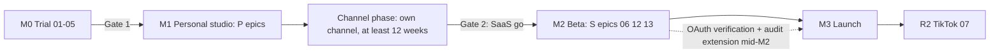
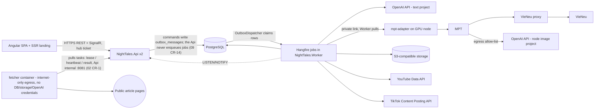

# 00 — Program Overview, BA Review and Shared Contracts

> Owner: BA + Tech Lead. Source of truth for product scope: `../DECISIONS.md`.
> Every plan file `01`–`13` MUST follow the contracts in this file (domain names, states, API routes, IDs, estimates). If a plan needs a change here, change this file first.
> Legend: ✅ verified from source/docs · ⚠️ unverified · [DECISION] made in this file · [OPEN] needs the product owner.

> **Plan level: HIGH-LEVEL — this is not the end of planning.** Every feature will still be reviewed and get its own detailed plan before it is built (process in §10.1). Plans `00`–`13` define scope, shared contracts, key decisions, risks and order-of-magnitude estimates. They are **not** implementation specs. Before a feature is built, its detailed plan is written in `plans/features/<story-id>-<slug>.md` (template in §10.1) and refines — never silently contradicts — these plans; any contract change still goes to this file first. Field lists, endpoint shapes, sizes and thresholds here are starting points to be confirmed and made precise in the feature plan.

---

## 1. BA review of the high-level plan

### 1.1 What is good

- Clear pipeline, licenses already cleared for commercial and hosted use.
- The expensive/risky integrations (VieNeu ↔ MPT, OpenAI images, YouTube/TikTok rules) were verified from source.
- Human review checkpoints are mandatory for SaaS users (revisited at Gate 2), which protects users' monetization. The owner's personal fiction autopilot replaces them with automated gates, a variety guard, a daily cap and a veto window; the owner carries that monetization risk (§4.1).

### 1.2 Gaps found (and how this breakdown closes them)

| # | Gap in the high-level plan | Impact | Closed by |
|---|---|---|---|
| G1 | No personas, MVP scope or success metrics | Team builds everything at once | §2, §3 of this file |
| G2 | Plans 01–05 were written for one owner on a Mac; the platform needs them as a **worker service** | Rework later | 01–05 now end with a "worker contract" validated for plan 11 |
| G3 | Story writing moved from MPT to our backend (checkpoint #1 lives in our UI) but no plan owned it | Nobody builds the editor/approval | 02 (prompts) + 09 (API) + 10 (UI) |
| G4 | No user/account, series, episode concept | No way to keep a channel's style consistent | Domain model §6 |
| G5 | YouTube upload quota is **100/day for the whole product** ✅ | Publishing collapses at scale | 06 quota scheduler; personal phase: one channel, daily cap 1/day (02.8.3); SaaS: fairness caps (06.3.2) and MP4 download as a fallback [DECISION] |
| G6 | Audits (YouTube, TikTok) and Google OAuth verification ⚠️ take unknown time | Launch blocked by third parties | YouTube audit (13.4.2) filed in M1 with the P legal slice (13.1.1-T1, 13.1.2-T1, 13.2.1-T1, 13.3.1-T1); the rest of 13, OAuth verification and the TikTok audit at Gate 2 (M2, §4.1) |
| G7 | No money model, no cost metering | One user can drain the OpenAI budget | 12 (credits: reserve → settle → refund) |
| G8 | True-crime content has **defamation and privacy** risk (real, possibly living people) | Legal risk to users and platform | 02 fact-source rules, 13 terms, UI warnings in 10 |
| G9 | No observability, backups, retention, admin tools | Cannot operate a public service | 09 + 11 + 08 |
| G10 | No local dev path without a GPU | Frontend/backend blocked on hardware | **Mock MPT** service (11) used by 09/10 |
| G11 | No test strategy / definition of done | Quality drift | §10 of this file |
| G12 | UI language not decided | Rework of every screen | UI in **Vietnamese + English** from day one [DECISION] |
| G13 | Story content had no grounded input: model-written source URLs can be invented, and "aggregate other channels' videos" breaks YouTube's Terms ✅ | Invented facts, copyright and ToS risk | 02 Epic 02.5 (user links → safe fetch → fact sheet → similarity check), DECISIONS §10.10 |

### 1.3 Scope decisions

- [DECISION] **Personal-first delivery (§4.1):** the owner first builds and runs their own channel with the studio (personal phase, one owner account, fully automatic: autopilot ideas → story → video → publish through the official YouTube API; true-crime waits for the owner's approval); the public SaaS (sign-up, credits and payments, multi-user publishing, TikTok, web admin, compliance) is built only after a go decision based on that channel's results.
- [DECISION] **Personal MVP = autopilot "idea → story → video → publish"** through the official YouTube API (§4.1); until the audit passes, uploads stay private. For SaaS users (M2) the MP4 download stays as a fallback so the product is useful before their publishing is enabled and does not depend on the 100/day quota.
- [DECISION] **TikTok publishing is Release 2** (heavier required UI, separate audit, ~15 posts/day/creator cap).
- [DECISION] **Platform-paid OpenAI with credits.** BYOK is not reachable with an unmodified shared MPT (see DECISIONS.md §10.5).
- [DECISION] One user = one workspace in MVP (no teams); platform roles are `user`, `admin` and `owner` (settings, roles, funding; 09.10.4).
- [OPEN] Payment provider for a Vietnam-based business (plan 12).
- [OPEN] Hosting provider/region for API and GPU workers (plan 11).

## 2. Personas

| Persona | Description | Main goals |
|---|---|---|
| **P1 Creator** | Non-technical person running a faceless storytelling channel (vi or en). Not a developer. | Produce a good 5–15 min episode quickly, keep a consistent style, post on schedule, stay monetizable |
| **P2 Operator/Admin** | You (platform owner) | Watch costs, jobs, abuse, quotas; support users; grant credits |
| **P3 Platform reviewer** | Google/TikTok audit reviewers | See compliant consent, privacy, required UI — must pass on first try |

## 3. Success metrics (MVP)

- Time from "new episode" to downloadable MP4 ≤ 30 min (median), of which user effort ≤ 10 min.
- Render success rate ≥ 95 % (excluding user-rejected stories).
- Gross margin per episode ≥ 60 % after measured OpenAI + GPU cost.
- 0 critical security findings at launch; 100 % of deletion requests completed within 7 days.

## 4. Milestones

| Milestone | Content | Plans | Exit criteria |
|---|---|---|---|
| **M0 Trial (validation gate)** | Prove the pipeline on the Mac; measure time/cost; 05.4 spike | 01–05 | One 5-min vi video + one en video; cost/time sheet filled; worker contract confirmed. **Gate 1 (go/no-go):** quality acceptable and cost per video known, else stop or change the render approach |
| **M1 Personal studio** | The owner's own studio: backend + Angular end-to-end (P epics, §4.1) on one GPU node; single owner account with MFA; configuration by environment/secret manager; autopilot (02.8) + YouTube API publishing (06, private until the audit passes); privacy/terms pages live and accepted, 7/30-day deletion jobs live (YouTube Developer Policies III.A, III.D.2); YouTube audit filed as soon as upload works (13.4.2) | 01–05, 02, 06 (P), 09 (P), 10 (P), 11 (P), 13 (P: 13.1.1-T1, 13.1.2-T1, 13.2.1-T1, 13.3.1-T1, 13.4.2) | Autopilot publishes to the owner's channel on its cadence without manual steps (true-crime after approval); audit filed |
| **Channel phase** | Run the flagship channel on autopilot for ≥ 12 weeks after the YouTube audit allows public uploads (08.4) | 08.4 | Channel KPI sheet filled weekly. **Gate 2 (SaaS go/no-go) [OPEN]:** the owner decides on channel results, measured cost per video and time per episode whether to build the SaaS |
| ~~M1 Alpha (internal)~~ | Replaced by M1 Personal studio + Channel phase; its SaaS items (12 ledger, 06 staging publish, legal drafts) moved to M2 | — | — |
| **M2 Closed beta (SaaS phase starts)** | S epics (§4.1): sign-up and account security, web admin and settings, credits and payments, multi-user YouTube publishing extensions (06 S items: connect e-mail/pinning, fairness, admin quota, rollout), compliance; invite-only users | 06, 09 (S), 10 (S), 11 (S), 12, 13 | 10 beta users, deletion flow tested, privacy/ToS lawyer-reviewed; OAuth verification **filed** at mid-M2 and the YouTube audit re-filed/extended for the SaaS use case (13) |
| **M3 Public launch** | YouTube audit + quota extension approved; public sign-up | 06, 13, 08 | Audit approved; load test passed; runbooks done |
| **R2** | TikTok publishing | 07 | TikTok audit approved |
| **Ops** | 90-day operating plan | 08 | Weekly KPI review running |



### 4.1 Delivery phases: personal-first, fully automatic [DECISION]

The owner builds their own channel first; the public SaaS comes later. Every §6 task belongs to one phase:

- **P — Personal studio (M0 → M1 → Channel phase):** fully automatic for the owner's channel: autopilot picks ideas, writes, renders and publishes through the **official YouTube Data API** (02.8, 06). Kept from the SaaS design so nothing is rebuilt later: Clean Architecture + CQRS, outbox, `user_id` + tenant filters, TOTP MFA, `mpt-adapter`, fetcher isolation, backups, CI.
- **S — SaaS (M2 → M3, after Gate 2):** everything that exists only because other people use the system.

**Automation rules [DECISION]:**
- **Official APIs only, no browser automation on YouTube or TikTok.** YouTube's Terms forbid accessing the Service "using any automated means (such as robots, botnets or scrapers)" without YouTube's prior written permission ✅ ([YouTube Terms of Service](https://www.youtube.com/t/terms)); breaking this risks the owner's own channel. jev-ultrafast (browser agent) is used only for research on allow-listed sites that permit automated access (02.7).
- **Fiction runs on autopilot; true-crime waits for the owner** at the fact sheet and story (02.8.2). This replaces the mandatory human checkpoints for the owner's own fiction series; the SaaS rule for other users is decided at Gate 2 [OPEN].
- **YouTube publishing and the audit:** uploads through `videos.insert` from an unaudited API project created after 28 July 2020 are restricted to private viewing ✅ ([Videos: insert](https://developers.google.com/youtube/v3/docs/videos/insert)). 06 is therefore built in the personal phase and the **YouTube API audit is filed as soon as upload works** (13.4.2); until it passes, autopilot publishes as private and the channel cannot grow ⚠️ — this audit is the critical path. Whether an audit for a single-owner tool is approved is unverified ⚠️. YouTube Developer Policies require the client to have its own terms (with the YouTube Terms clause) and a privacy policy (III.A.1, III.A.2 ✅, [Developer Policies](https://developers.google.com/youtube/terms/developer-policies)), so 13.1.1-T1, 13.1.2-T1, the 10.3.1-T1 pages, 13.2.1-T1 acceptance and the 13.3.1-T1 / 06.4.3-T1 deletion jobs (III.D.2 7/30-day duties) are P and live before filing.
- **Two separate Google gates:** OAuth app verification (Cloud Console) controls the unverified-app screen and the 100-new-user cap; the YouTube API compliance audit ([form](https://support.google.com/youtube/contact/yt_api_form)) controls the private lock and quota. Setting the app to In production fixes the 7-day token expiry but does **not** unlock public uploads. Options were: (a) API + audit filed early — automatic and legal, public only after approval (**chosen**); (b) API without audit — automatic but private-only forever; (c) browser automation — public but against YouTube's Terms (rejected).
- **Per-video consent stays:** autopilot does not bypass the Publication consent (§7). The owner accepts a versioned series authorization once; for each autopilot publication the scheduler writes `consent_at`, `consent_text_version` and `consent_source = autopilot` after a veto window in which the owner may edit or cancel (06.2.2-T3, YouTube Developer Policies III.C.3 "final control").
- **OAuth app status:** a Google OAuth app in Testing status is limited to 100 test users and every authorization, including the refresh token, expires after 7 days ✅ ([Manage App Audience](https://support.google.com/cloud/answer/15549945)), which would stop autopilot weekly. The owner's app is therefore set to **In production** without verification: the owner accepts the "unverified app" warning once; the 100-new-user cap does not matter for one owner. [INFERENCE] refresh tokens then follow normal production rules; confirm in the 06.1 feature plan ⚠️.
- **TikTok stays in S (R2).** Direct Post from an unaudited client is private-only ✅ ([Content Posting API — Direct Post](https://developers.tiktok.com/doc/content-posting-api-get-started)), and TikTok lists "a utility tool to help upload contents to the account(s) you or your team manages" as not acceptable for the audit ✅ (07 K2). The inbox-upload path (`video.upload`) only creates a draft the creator must finish in the TikTok app ✅ ([Upload](https://developers.tiktok.com/doc/content-posting-api-get-started-upload-content)), so it is not automatic.

**S (SaaS) scope:** all of 07, 12; 13 except 13.1.1-T1 / 13.1.2-T1 (privacy and terms drafts), 13.2.1-T1 (policy acceptance), 13.3.1-T1 (deletion engine) and 13.4.2 (YouTube audit), which are P; in 06: 06.1.2-T3 client pinning and connect e-mail, 06.3.2 fairness queue, 06.3.3 admin quota view, 06.5.2 flag rollout; 08.1–08.3 platform KPIs, alerts/runbooks, support; in 09: 09.2.3-T2 cross-tenant test table, 09.3.1-T2 breached-password/registration hardening, 09.3.2-T2 security stamp, 09.3.3-T2/T3 CAPTCHA and MFA detector/trusted devices/re-auth limit, 09.3.6-T2 activity feed (`GET /me/activity`, `GET /episodes/{id}/activity`; 09.3.6-T1 `audit_logs` + `AuditBehavior` + `[Audited]` arch test is P, 02 CR-3), 09.3.7 sessions list, 09.9.1 admin endpoints, 09.9.2 feature flags, and all of 09.10 except 09.10.4-T1 (TOTP enrolment + recovery codes, P); in 10: 10.3.1-T2 landing/pricing, 10.3.2 register, 10.3.3-T2 CAPTCHA, 10.7.3 TikTok, 10.8, 10.9.1–10.9.4, 10.10.1 accessibility pass; in 11: 11.2.3 separate prod accounts, 11.5.3-T2 signing/SBOM. **Everything else is P.** In the personal phase, integration keys and base URLs come from the environment/secret manager (09.10 web settings are S); a single owner account is seeded and there is no public sign-up.

Where a plan names M1 for an S item (for example 12 ledger, legal drafts), read M2.

| Plan | P raw | P with buffer | S raw | S with buffer |
|---|---|---|---|---|
| 01 Environment | 10.0 | 12.0 | 0 | 0.0 |
| 02 Story writing | 40.25 | 48.3 | 0 | 0.0 |
| 03 Images | 7.0 | 8.4 | 0 | 0.0 |
| 04 Voice proxy (04 CR-14: was 4.5 / 5.4) | 5.5 | 6.6 | 0 | 0.0 |
| 05 Video/subtitles (05 CR-2: was 8.75 / 10.5) | 10.75 | 12.9 | 0 | 0.0 |
| 06 YouTube (06 CR-7: was 13.25 / 15.9, S 1.75 / 2.1) | 15.25 | 18.3 | 1.25 | 1.5 |
| 07 TikTok | 0 | 0.0 | 7.75 | 9.3 |
| 08 Operations (08 CR-3: S was 4.25 / 5.1) | 2.5 | 3.0 | 4.5 | 5.4 |
| 09 Backend (09 W2 CR-4: was 35.5 / 42.6, S 17.5 / 21.0) | 37.5 | 45.0 | 18.5 | 22.2 |
| 10 Web UI (10 CR-5: was 30 / 36.0, S 15.25 / 18.3; 10 CR-14: P 33.5 → 35.0; 10 CR-31: P +6.5 design-first retrofit → 41.0; 10 CR-22: S +3.75 design tasks, S 15.0 typo corrected → 18.75; 10 CR-39/40: P 41.5 → 41.0 arithmetic fix, S +1.25 → 20.0) | 41.0 | 49.2 | 20.0 | 24.0 |
| 11 Worker/CI/CD (11 CR-2: was 16.25 / 19.5; 09 W3 CR-6: S +0.5, 11.6.4-T1; 11 CR-15: P +1.0, 11.4.1-T2 hosts + 11.4.1-T3 backup/restore) | 22.5 | 27.0 | 2.0 | 2.4 |
| 12 Billing | 0 | 0.0 | 25 | 30.0 |
| 13 Compliance (13 CR-4: was 4.5 / 5.4, S 7 / 8.4; 13 CR-9: S 7.25 → 8.5) | 5.0 | 6.0 | 8.5 | 10.2 |
| **Total** (04 CR-14: P was 172.5 / 207.0; 05 CR-2: plan 05 re-estimated 8.75 → 10.75 d, P total 173.5 / 208.2 → 175.5 / 210.6; 11 CR-2: plan 11 re-estimated P 16.25 → 21.5 d, P total 175.5 / 210.6 → 180.75 / 216.9; 09 W2 CR-4: 09 wave 2 P +2.0, S +1.0 → P 182.75 / 219.3, S 80.0 / 96.0; 10 CR-5: plan 10 wave 1 re-estimated P +3.5, S −0.25 → P 186.25 / 223.5, S 79.75 / 95.7; 06 CR-7 + 13 CR-4: P +2.5, S −0.25 → P 188.75 / 226.5, S 79.5 / 95.4; 10 CR-14: P +1.5 → 190.25 / 228.3; 08 CR-3: S +0.25 → 79.75 / 95.7; 12 CR-4: S +1.0 → 80.75 / 96.9; 10 CR-31: P +6.5 (design-first retrofit) → 196.75 / 236.1; 10 CR-22: S +3.75 (design tasks) → 84.5 / 101.4; 13 CR-9: S +1.25 → 85.75 / 102.9; 09 W3 CR-6: S +0.5 (11.6.4-T1) → 86.25 / 103.5; 10 CR-39/40: P −0.5, S +1.25 → 196.25 / 235.5, 87.5 / 105.0; 11 CR-15: P +1.0 (self-hosted SeaweedFS) → 197.25 / 236.7) | **197.25** | **236.7** | **87.5** | **105.0** |

- **Personal phase:** ≈ 236.7 person-days ≈ 11.8 months (02 CR-11: plan 02 re-estimated 25.25 → 40.25 d; 09.3.6-T1 moved to P; 09 CR-8: 09 wave 1 re-estimated +3.25 d; 03 CR-11: plan 03 re-estimated 5.0 → 7.0 d, image relay; 04 CR-14: plan 04 re-estimated 4.5 → 5.5 d, P total 172.5 / 207.0 → 173.5 / 208.2; 05 CR-2: plan 05 re-estimated 8.75 → 10.75 d, P total 173.5 / 208.2 → 175.5 / 210.6; 11 CR-2: plan 11 re-estimated 16.25 → 21.5 d P, P total → 180.75 / 216.9; 09 W2 CR-4: P total → 182.75 / 219.3; 10 CR-5: P total → 186.25 / 223.5; 06 CR-7 + 13 CR-4: → 188.75 / 226.5; 10 CR-14: → 190.25 / 228.3; 10 CR-31: P +6.5 design-first retrofit → 196.75 / 236.1; 10 CR-39: P arithmetic fix → 196.25 / 235.5; 11 CR-15: → 197.25 / 236.7) of work for one developer to M1 [INFERENCE], then the Channel phase (≥ 12 weeks of autopilot publishing, no build estimate). The M0 trial (01–05) is inside this figure.
- **SaaS phase:** ≈ 105 person-days more (105.0, ≈ 5.3 months for one developer; 09 W2 CR-4: was 94.8; 10 CR-5 / 06 CR-7 / 13 CR-4 / 08 CR-3: 96.0 → 95.7; 12 CR-4: 95.7 → 96.9; 10 CR-31 is P-only, no S effect; 10 CR-22 + 13 CR-9: 96.9 → 102.9; 09 W3 CR-6: 102.9 → 103.5; 10 CR-40: 103.5 → 105.0) plus the external waits (§13), started only after Gate 2.
- The split is by task at high level; each feature plan (§10.1) confirms it.

## 5. Architecture contract



### 5.1 Tech stack [DECISION]

| Layer | Choice |
|---|---|
| Web UI | **Angular 22** (latest stable on npm: `@angular/core` 22.1.7, published 2026-09-16 ✅), Clean Architecture per feature (§5.3, §5.4), standalone components, signals, new control flow, OnPush, Angular Material, `@angular/ssr` prerender for public pages only, `@microsoft/signalr`, runtime i18n vi/en (Transloco, MIT ✅) |
| Backend | **C# on ASP.NET Core / .NET 10 LTS** — latest stable runtime 10.0.12, SDK 10.0.401, support until 2028-11-14 ✅ ([.NET releases index](https://dotnetcli.blob.core.windows.net/dotnet/release-metadata/releases-index.json), 2026-09-08); `global.json` pins SDK 10.0.4xx with `rollForward: latestPatch`, images `mcr.microsoft.com/dotnet/aspnet:10.0` / `sdk:10.0`, monthly patch updates; .NET 11 (RC1, STS) not used [DECISION], **Clean Architecture + CQRS** (§5.2, §5.4), Minimal API endpoint groups, `Mediator` source generator (martinothamar/Mediator, MIT ✅, v3.0.2), FluentValidation (Apache-2.0 ✅), ErrorOr results (MIT ✅), Mapperly (Apache-2.0 ✅) or hand-written mapping, Serilog (Apache-2.0 ✅), OpenTelemetry, `Microsoft.Extensions.Http.Resilience` / Polly (BSD-3 ✅) |
| Jobs | **All background work in C#** in the separate `NightTales.Worker` process (.NET 10), sharing Domain/Application with the API — no Go, no Python jobs [DECISION]; scheduler Hangfire with PostgreSQL storage (LGPL-3.0 or commercial per vendor ✅; LGPL-3.0, unmodified NuGet packages, **accepted by the owner 2026-09-24**, 09 README O1) |
| Not used [DECISION] | **MediatR 14.x** — licensed RPL-1.5 or a commercial agreement ✅ (nuget.org license page); **AutoMapper** — same vendor moved to commercial terms ⚠️ (not re-checked). Both avoided to keep licensing simple for a paid SaaS |
| Database | **PostgreSQL 17** (dev, CI and production; owner decision 2026-09-24, 09 README O3; (09 CR-13)), EF Core + Npgsql, snake_case naming, migrations via EF |
| Storage | S3-compatible object storage, private bucket, pre-signed GET URLs (≤ 15 min); self-hosted SeaweedFS (Apache-2.0) in every env, no managed object storage (11 CR-15, owner O7 2026-09-27) |
| AI | Official OpenAI .NET SDK for story writing (backend); MPT calls OpenAI Images itself |
| Render | MPT + VieNeu + VieNeu proxy (Python, next to MPT) + faster-whisper, on a GPU node, private network — Python only because these open-source tools are Python; no business logic there, called over HTTP by the C# Worker |
| Local dev | **Native on macOS, no Docker [DECISION, owner 2026-09-28]:** Homebrew `postgresql@17` (bind `127.0.0.1`), `seaweedfs` (Apache-2.0), `mailpit` (MIT), .NET SDK 10.0.401 (`dotnet run` / `dotnet watch` for api, worker, **mock-mpt**), Node 26 (`ng serve`); VieNeu/MPT/whisper stay native (plan 01). Docker is used only to build and smoke-test deploy images (CI, staging, production); `docker-compose.yml` is optional (e2e / image smoke), never required for daily dev |

### 5.2 .NET solution layout — Clean Architecture [DECISION]

Dependency rule: `Domain` ← `Application` ← `Infrastructure`, `Api`, `Worker`. Inner layers never reference outer ones; enforced by architecture tests (§5.4).

```
src/
  NightTales.Domain/                 pure C#; no EF, no HTTP, no Mediator; only package: ErrorOr (09 CR-1)
    Common/                          Entity, AggregateRoot, ValueObject, IDomainEvent, DomainError
    Users/ Series/ Episodes/ Stories/ Rendering/ Assets/ Channels/ Publishing/ Credits/ Compliance/
      <Aggregate>.cs, <Aggregate>Status.cs (state machine), value objects, domain events, errors
  NightTales.Application/            use cases (CQRS); depends on Domain + Mediator.Abstractions, FluentValidation, ErrorOr,
                                     Microsoft.EntityFrameworkCore core (no provider) (09 CR-1)
    Abstractions/                    ports: IAppDbContext (write), IReadDb (queries), IStoryWriter, IRenderClient,
                                     IBlobStore, IYouTubeClient, ITikTokClient, ITokenProtector, IClock, ICurrentUser,
                                     IIdempotencyStore, IRealtimeNotifier, IJobScheduler (IClock itself lives in Domain/Common, 09 README D3)
    Behaviors/                       pipeline: Logging → Authorization → Validation → UnitOfWork (commands; opens the transaction)
                                     → Idempotency → Audit (09 CR-2)
    Features/
      Stories/
        Commands/GenerateStory/      GenerateStoryCommand.cs, GenerateStoryHandler.cs, GenerateStoryValidator.cs
        Commands/EditStory/ Commands/ApproveStory/ Commands/ReopenStory/ ...
      Episodes/
        Queries/GetEpisode/          GetEpisodeQuery.cs, GetEpisodeHandler.cs, EpisodeDetailsDto.cs
        Queries/ListEpisodes/ ...
        Events/                      domain-event handlers (e.g. StoryApproved → nothing, VideoApproved → notify)
      Series/ Stories/ Rendering/ Channels/ Publishing/ Credits/ Users/ Admin/ Compliance/
  NightTales.Infrastructure/         adapters for Application ports
    Persistence/                     AppDbContext (write model), ReadDbContext (no-tracking), configurations, migrations,
                                     outbox, interceptors (audit, domain events → outbox)
    OpenAI/ Render/ (mpt-adapter client) Storage/ (S3) YouTube/ TikTok/ Security/ (token protection) Jobs/ (Hangfire adapters)
  NightTales.Api/                    presentation: Minimal API endpoint groups per feature, auth, SignalR hub,
                                     ProblemDetails mapping from ErrorOr, rate limiting, OpenAPI
  NightTales.Worker/                 composition root for Hangfire server, recurring jobs, outbox dispatcher
  NightTales.Fetcher.Core/           references Domain only: SafeHttpSourceFetcher, address validation, robots, main-text extraction (02 CR-19)
  NightTales.Fetcher/                console host (BackgroundService) for the fetcher container; references Fetcher.Core only,
                                     never Infrastructure/Application (no EF, no OpenAI SDK, no Hangfire) — architecture test
  NightTales.RenderNode.Contract/    render-node.v1 wire DTOs (BCL only); referenced by Application, the adapter and the mock (11 CR-2)
  NightTales.RenderNode.Server/      shared render-node.v1 server core (routes, auth, limits, store seam); never Domain/Application/Infrastructure (11 CR-2)
  NightTales.MptAdapter/             `mpt-adapter` host on each GPU node: MPT backend, post-processing, health, image relay (11 CR-2)
tests/
  NightTales.Domain.UnitTests/  NightTales.Application.UnitTests/  NightTales.Architecture.Tests/
  NightTales.Api.IntegrationTests/ (WebApplicationFactory + real PostgreSQL 17 via `PostgresFixture` on the `NTS_TEST_PG` connection string: local Homebrew server in dev, GitHub Actions `postgres:17` service in CI; no Testcontainers, owner 2026-09-28)
tools/mock-mpt/                      fake render node for local dev and CI (`NightTales.MockMpt` on `NightTales.RenderNode.Server`, 11 CR-2)
web/                                 Angular workspace
worker-node/                         MPT config, VieNeu proxy, node host/systemd/network scripts, `nts-node` deploy tool (11 CR-2)
infra/                               OpenTofu module `platform` + `render-node`, envs `staging`, `prod` (11 CR-2)
```

**CQRS rules [DECISION]**
- One database, two paths: **commands** load aggregates through `IAppDbContext` (tracked EF Core) and change state only via aggregate methods; **queries** read through `IReadDb` (no-tracking EF projections straight to DTOs, or SQL views for heavy lists). No separate read store in MVP.
- A command returns `ErrorOr<TResult>` where `TResult` is at most an id, ETag or small acknowledgement — never a read model.
- A query never changes state, never enqueues jobs, and never calls external APIs — **one documented exception**: live, read-only lookups that a platform requires at render time of a screen (TikTok `creator_info`, 07.2.1) go through a dedicated `IExternalLookup` port, persist nothing, and are rate-limited.
- Side effects (enqueue jobs, SignalR, e-mail) happen from **domain events** written to an `outbox_messages` table in the same transaction and dispatched by the Worker → no lost jobs on crash.
- Every command/query is one file triple: request, handler, validator. Handlers ≤ ~80 lines; shared logic goes to the domain, not to "helper services".
- Endpoints are thin: bind → `sender.Send(...)` → map `ErrorOr` to HTTP (`200/201/202/204` or ProblemDetails).
- **Tenant isolation:** every user-owned table carries `user_id` and its entity implements `IUserOwned` (EF global filter); an architecture test fails if an entity with an `episode_id`/`series_id` FK does not; Worker jobs run under `SystemContext(userId)` from the outbox payload with filters on; only named system jobs (retention, deletion, reconciliation) may bypass filters (09.2.3).
- **Real-time scale-out:** the Worker publishes notifications with PostgreSQL `NOTIFY`; every Api instance `LISTEN`s and forwards to its own SignalR connections; WebSockets only (09.8.1). No Redis.
- **Network zones:** app network (Api, Worker, PostgreSQL, storage); render network (GPU nodes, reachable only on the `mpt-adapter` port from the Worker, never connecting into the app network, egress allow-list); `fetcher` subnet with internet-only egress for source fetching (11 §5.1); the fetcher has **no Hangfire, no DB and no storage credentials** and reaches the app network only as a pull client of the Api internal listener `:8081` (lease → heartbeat → result, bearer `FETCHER_API_TOKEN`) (02 CR-1, 02 README D10).

### 5.3 Angular workspace layout — Clean Architecture per feature [DECISION]

Dependency rule inside each feature: `feature` → `ui`, `application` → `domain`; `data-access` implements ports declared in `domain`/`application`. Features never import another feature's internals, only its `index.ts` public API. Enforced by ESLint boundary rules (§5.4).

```
web/src/app/
  core/                    app-wide singletons: auth (session store, interceptor, guards, silent refresh),
                           http (base URL, ProblemDetails → AppError mapper, Idempotency-Key interceptor),
                           realtime (SignalR connection service), i18n, config, logging, layout shell
  shared/
    ui/                    presentational components (buttons, dialogs, empty/error states, status chips)
    util/                  pure functions, pipes, validators, type helpers
    api/                   OpenAPI-generated client (never imported by components directly)
  features/
    episodes/
      domain/              models (Episode, StoryVersion, RenderProgress), pure rules (canApprove, nextActions),
                           ports (EpisodesRepository abstract class / InjectionToken)
      data-access/         EpisodesHttpRepository (wraps generated client), DTO ↔ model mappers, realtime adapter
      application/         EpisodeDetailStore / EpisodeListStore (signal-based state + use-case methods:
                           generateStory(), saveStory(), approveStory(), render(), approveVideo())
      ui/                  story-editor, keyword-chips, version-diff, render-timeline, video-player (inputs/outputs only)
      feature/             routed container pages: episode-list.page, episode-detail.page, story-review.page, video-review.page
      episodes.routes.ts   lazy routes
      index.ts             public API (routes + types other features may use)
    public/ auth/ dashboard/ series/ publish/ channels/ billing/ account/ admin/   (same five folders each)
```

### 5.4 Engineering standards (backend and web) [DECISION]

| Area | Backend (.NET 10) | Web (Angular 22) |
|---|---|---|
| Architecture enforcement | Architecture tests fail the build if Domain references EF/ASP.NET/Mediator, or Api references Infrastructure internals (library: ArchUnitNET or NetArchTest ⚠️ license check) | ESLint boundary rules (e.g. `eslint-plugin-boundaries` ⚠️ license check): `ui` cannot inject stores/repositories; `domain` cannot import `@angular/*`; no cross-feature deep imports |
| Language settings | `<Nullable>enable`, `<TreatWarningsAsErrors>true`, analyzers + `.editorconfig`, file-scoped namespaces | `strict: true`, `strictTemplates`, no `any` (lint error), `noUncheckedIndexedAccess` |
| Style | Primary constructors, `sealed` by default, records for commands/queries/DTOs, `CancellationToken` on every async path, no static mutable state | Standalone components only, `inject()`, signals + `computed`, `@if/@for` control flow, `ChangeDetectionStrategy.OnPush`, no logic in templates beyond simple bindings |
| Errors | Domain errors as typed `Error` codes → ErrorOr → ProblemDetails `code` (catalogue in 09); no exceptions for control flow | One `AppError` type; every ProblemDetails `code` has an i18n message key |
| State | Aggregates guard invariants; state transitions only through domain methods | Signal stores per feature; components read signals, call store methods; no subscriptions in components except via `toSignal`/async boundaries |
| Mapping | Mapperly or explicit static mappers; no reflection mappers | Explicit mapper functions DTO ↔ model in `data-access` |
| Testing | Domain: pure unit tests; Application: handler tests with fakes; Api: integration tests on real PostgreSQL; Architecture tests | Domain/util: unit tests; stores: unit tests with fake repositories; ui: component tests; e2e: Playwright |
| Size limits | Handler ≤ ~80 lines, class ≤ ~300 lines, method ≤ ~30 lines (review guideline, not a hard gate) | Component ≤ ~200 lines TS, template ≤ ~150 lines; split otherwise |
| Reviews | PR template checks: layer rule, tests, migration safety, secrets, i18n | Same + a11y and both languages |

## 6. Domain contract (PostgreSQL)

Table ownership in P (09 CR-5): the 09.2.2 `InitialCore` migration creates the P core set; every other table is created by the migration of its owning feature, and S-only tables are not created in P (`features/09-backend-api/README.md` D9). All tables: `id uuid` (UUIDv7 generated in .NET), `created_at timestamptz`, `updated_at timestamptz` where mutable; optimistic concurrency on aggregates via PostgreSQL `xmin`. Money in `numeric(12,6)` USD; credits in `bigint`. Soft delete only where retention rules need it.

| Table | Key columns | Notes |
|---|---|---|
| `users` | email (unique via Identity `normalized_email`, no citext; 09 CR-4), display_name, ui_locale (`vi`/`en`), role (`user`/`admin`/`owner`), status (`active`/`suspended`/`deleted`), two_factor_enabled, last_totp_step, security_stamp, owner_dispute_freeze_until, last_login_at, email_verified_at timestamptz (08 CR-11) | ASP.NET Core Identity user; MFA mandatory for admin/owner; TOTP replay blocked by `last_totp_step`; stamp validated on every authenticated request (09.3.2, 09.10.4); verify/reset/cancel tokens stored hashed and single-use; `email_verified_at` required by 08.1.1-T1 (F10) and 12.4.2-T1's trial grant, M2 (08 CR-11); index `(status, role, created_at DESC, id)` for the admin user list (09 W3 CR-1) |
| `refresh_tokens` | user_id, family_id, token_hash, created_at, last_used_at, expires_at, revoked_at, revoked_reason, replaced_by_id, reauthenticated_at, reauth_attempts, reauth_last_attempt_at, ip, user_agent (09 W2 CR-1, CR-14) | Rotation, reuse detection; credential events revoke families; `reauthenticated_at` backs `/auth/reauth` (09.3.2, 09.10.4); index `(user_id, revoked_at, expires_at)` for the sessions list and family checks (09 W3 CR-1) |
| `user_action_tokens` | user_id, kind (`password_reset`/`email_verify`/`publication_cancel` (06 CR-1)), subject_id (publication id for `publication_cancel`; invalidation per (user, kind, subject), 06 YR8), token_hash, created_at, expires_at, used_at (09 W2 CR-1) | Hashed single-use tokens (reset 60 min, verify 24 h) (09.3.3, 09.3.1-T3) |
| `hub_tickets` | ticket_hash, user_id, created_at, expires_at, used_at (09 W2 CR-1) | 60 s single-use SignalR connect tickets (09.8.1-T2) |
| `email_messages` | user_id, template, locale, to_hash, params jsonb (allow-listed template keys, never tokens; nulled once sent), status (`queued`/`sent`/`failed`), attempts, provider_message_id, last_error_code, created_at, sent_at (09 W2 CR-1) | Delivery record for `SendEmailJob` (09.2.6-T3); addresses never stored in clear |
| `data_protection_keys` | friendly_name, xml (encrypted with the `DP_KEK` certificate) (09 W2 CR-1) | ASP.NET Core Data Protection key ring (09.9.4-T1) |
| `auth_challenges` | user_id, token_hash, preauth_cookie_hash, user_agent, ip (logged, not enforced), attempts, expires_at, used_at | MFA login step: short-lived `mfaToken` after a correct password, bound to a pre-auth cookie + user agent (09.3.2) |
| `trusted_devices` | user_id, refresh_family_id, token_hash, user_agent, created_at, last_used_at, expires_at, revoked_at | Device that passed MFA (30 days, `__Host-` cookie); never delayed by the MFA failure detector or the 24 h ceiling, never skips TOTP; revoked with its refresh family, by every credential event, suspend, restore and "sign out everywhere else" (09.3.2); index `(user_id, expires_at)` (09 W3 CR-1) |
| `user_consents` | user_id, document (`tos`/`privacy`/`age_18`), version, accepted_at, ip | Legal acceptance history (13 CR-7) |
| `series` | user_id, title, topic (`ghost`/`spiritual`/`true_crime`), language (`vi`/`en`), aspect (`landscape`/`portrait`), voice_id → `voices`, style_template_id → `style_templates`, story_preset, default_channel_id, archived_at, autopilot_enabled, autopilot_settings jsonb (cadence, publish time, time zone, daily cap, buffer, thresholds, veto_window_hours, privacy status, pre-audit mode), current_autopilot_authorization_id → `series_autopilot_authorizations`, autopilot_paused_at, autopilot_pause_reason; `topic` is immutable while autopilot is enabled | Keeps one channel's style consistent; archived series are hidden from `GET /series` but keep their episodes · 02 CR-4: `autopilot_settings` also holds `tone` and `banned_themes[]` (02.8.3-T1 schema). |
| `episode_ideas` | user_id, series_id, title, logline, hook, score, similarity, status (`proposed`/`picked`/`rejected`/`used`), episode_id, rejected_reason | Autopilot idea pool and de-duplication (02.8.1) · 02 CR-4: + `structure jsonb`, `novelty jsonb`. |
| `series_autopilot_authorizations` | user_id, series_id, version, text_version, text_hash, topic, channel_connection_id, cadence, privacy status, accepted_at, revoked_at | Versioned autopilot authorization history; each autopilot publication references the row it relied on (06.2.2-T3) · 02 CR-4: + `revoked_reason`. |
| `autopilot_runs` | user_id, series_id, started_at, idea_id, episode_id, outcome (`published`/`published_private_locked`/`waiting_owner`/`gate_failed`/`cancelled_by_owner`/`awaiting_authorization`/`paused`/`failed`), gate_results jsonb, pause_reason | Autopilot run log (02.8, 10.4.3) · 02 CR-4: + `slot_at` (unique with `series_id`), `state`, `step`, `start_at`, `publication_id`, `authorization_id`, `attempt`, `render_attempts`, `waiting_for`, `last_transition_at`, `finished_at` (02.8.3-T1). |
| `series_bibles` | user_id, series_id (unique), version, content jsonb (narrator, recurring_characters, places, rules, episode_summaries), proposed_content jsonb, proposed_from_episode_id | Series memory fed to the writer (02.6.3) |
| `episodes` | user_id, series_id, title, brief (≤ 1,000 chars), length_tier (`short`/`standard`/`long`), status (see §7), current_story_version_id, approved_story_version_id, final_video_asset_id | Central aggregate; `length_tier` drives story length (02) and price tier (12) |
| `story_versions` | user_id, episode_id, version (int), source (`generated`/`revised`/`edited`), title, body, keywords text[], word_count, model, prompt_version, content jsonb (full structured output incl. backend-built fact_sources), audit_report jsonb, similarity_score numeric(5,4) | Immutable; edits add a version · 02 CR-4: + `parent_version_id`, `generation_run_id`, `fact_sheet_id`, `schema_version` (`story.v1`). |
| `story_sources` | user_id, episode_id, kind (`url`/`user_note`), url, final_url, title, status (`pending`/`fetched`/`failed`/`rejected`), error_code, http_status, content_sha256, extracted_text_key, fetched_at | User-supplied research inputs (02.5); deleted with the episode · 02 CR-4: + `normalized_url`, `registrable_domain`, `content_type`, `text_chars`, `note_text` (≤ 3,000 chars, `user_note` only); `extracted_text_key` = `research/{userId}/{episodeId}/{sourceId}/{sha256}.txt`. |
| `fact_sheets` | user_id, episode_id, version, status (`draft`/`approved`), facts jsonb (id, statement, source_ids, confidence), approved_at | Approved sheet is the only fact input for true crime (02.5) · 02 CR-4: + `prompt_version`, `generation_run_id`, `source_aliases jsonb`, `input_truncated bool`, `max_fact_id`; status + `superseded` (one approved sheet per episode). |
| `generation_runs` | user_id, series_id (NOT NULL), episode_id (NOT NULL for `story`/`fact_sheet`/`find_sources`, NULL for `ideas`/`bible_proposal`), kind, trigger (`user`/`autopilot`/`system`), idempotency_key, status (`queued`/`running`/`succeeded`/`failed`/`cancelled`), stage, previous_episode_status, pause_reason, reservation_id, counts_toward_limit, worst_case_usd, cost_usd, error_code, error_detail, result_story_version_id, result_fact_sheet_id, prompt_version, models jsonb, attempt, queued_at, started_at, finished_at | One row per paid generation; partial unique indexes: one active run per (episode, kind) and per (series, kind) for series-level kinds (02 CR-4, 02 README D2) |
| `fetch_tasks` | user_id, episode_id (NOT NULL), source_id (null for `find_sources`), generation_run_id (`find_sources`), kind (`fetch_source`/`find_sources`), url, registrable_domain, status (`queued`/`leased`/`done`/`failed`/`cancelled`), attempts, leased_at, lease_until, leased_by, not_before, finished_at | Work queue leased by the fetcher through the Api internal API; ≤ 4 leased platform-wide, 1 per domain (02 CR-4, 02 README D10) |
| `source_candidates` | user_id, episode_id, generation_run_id, url, normalized_url, registrable_domain, title, site_name, rank, status (`proposed`/`added`/`dismissed`), source_id; unique (episode_id, normalized_url) | Links proposed by the source finder; added only through `AddSourceCommand` (02 CR-4, 02.7) |
| `render_jobs` | user_id, episode_id, story_version_id, status (see §7), adapter_task_id, params jsonb = `render-params.v1` (05 CR-2; non-content settings only; script and keywords are read from `story_version_id`), attempt, error_code, error_message, worker_node_id, quality_report jsonb = `render-quality.v1` (05 CR-2; `images` owned by 03), started_at, finished_at, stage, percent, submitted_at, next_poll_at, cancel_requested_at, images_needed, reservation_id (09 W2 CR-1, CR-14); one active render per episode (partial unique index) | One per render attempt |
| `assets` | user_id, episode_id, kind (`video`/`thumbnail`/`audio`/`subtitle`/`image`; `subtitle` holds the render's SRT, 05 CR-2), storage_key, content_type, size_bytes, duration_sec, sha256, retention_until, deleted_at | Files live in object storage |
| `channel_connections` | user_id, platform (`youtube`/`tiktok`), external_account_id, display_name, scopes text[], access_token_enc bytea, refresh_token_enc bytea, token_expires_at, status (`active`/`revoked`/`expired`/`error`), oauth_client_id (pinned client, 06/07), last_verified_at, revoked_at | Tokens encrypted at rest (Data Protection purpose `tokens.v1/{connectionId}`) |
| `oauth_states` | user_id, platform, state_hash, browser_nonce_hash (06 YR10), code_verifier_protected, oauth_client_id, refresh_family_id, created_at, expires_at, used_at | Single-use 10-min OAuth `state` + PKCE verifier bound to the user's live session; authenticates the browser callback (06.1.2-T1, 06 CR-1) |
| `publications` | user_id, episode_id, channel_connection_id, platform, status (see §7), title, description, tags text[], privacy, publish_at, next_attempt_at, consent_at, consent_text_version, consent_source (`user`/`autopilot`), autopilot_authorization_id → `series_autopilot_authorizations`, veto_notice_sent_at, veto_ends_at (06 CR-1), contains_synthetic_media, external_post_id, platform_payload jsonb (upload session, TikTok settings), error_code | One per platform post |
| `platform_quota_usage` | platform, quota_day (date), units_used, units_limit | Global YouTube quota ledger |
| `platform_incidents` | platform, oauth_client_id, error_code, raised_at, cleared_at, cleared_by, note; partial unique (platform, oauth_client_id) while open | Broken OAuth client (`invalid_client`/`unauthorized_client`): holds publications and token refresh until an operator clears it (06.2.3-T3, 06 CR-1) |
| `platform_user_quota_usage` | platform (`youtube`), user_id, quota_day (date), uploads_used, uploads_limit, units_used, updated_at; PK (platform, user_id, quota_day) | Per-user fairness counters, platform-wide, no `IUserOwned` (06.3.2, D23, 06 CR-17) |
| `platform_user_quota_limits` | user_id (PK), uploads_per_day, reason, updated_by, updated_at | Per-user admin override, permanent until removed (06.3.2, D23, 06 CR-17) |
| `usage_records` | user_id, episode_id, render_job_id, reservation_id, provider, operation (`story`/`story_review`/`story_revision`/`fact_sheet`/`image`/`tts`/`render`), model, input_tokens, cached_input_tokens, output_tokens, image_count, gpu_seconds, estimated (bool), cost_usd, price_version, provider_request_id | Metering source for charging (12 §5.7) and margin · 02 CR-4: `operation` + `bible_proposal`, `idea`, `source_find`, `moderation` · index `(created_at, operation)` (12.5.2-T1, shared with 08.1.1-T1, 12 CR-13); it also serves the global cost window, so 08 CR-11's separate `(created_at)` index is dropped (09 W3 CR-39). |
| `credit_ledger` | user_id, lot_id → `credit_lots`, kind (`grant`/`bonus`/`purchase`/`reserve`/`settle`/`release`/`refund`/`adjust`/`expire`), amount (signed bigint), price_version (reserve rows), reference_type, reference_id, idempotency_key (unique), created_by | Append-only; balance = SUM; index `(created_by, created_at) WHERE created_by IS NOT NULL` (12.5.1-T1, 12 CR-13) |
| `credit_lots` | user_id, source (`trial`/`bonus`/`promo`/`purchase`/`adjust`), amount, remaining, expires_at, payment_id, voided_at, voided_reason | Spend order, expiry and voiding on refund/chargeback (12.6, 12.3.4); `CHECK (remaining >= 0 AND remaining <= amount)` (12 CR-2b); index `(expires_at, id) WHERE voided_at IS NULL` (12.6.2-T1, 12 CR-13) |
| `credit_packages` | code (unique), name_vi, name_en, credits, bonus_credits, price_vnd, price_usd, active, sort_order | Admin-managed offers (12.7.1) |
| `promo_codes` | code (unique, citext), kind (`bonus_percent`/`fixed_credits`), value, valid_from, valid_to, max_redemptions, per_user_limit, min_package_id, active, created_by | 12.7.2 (12 CR-15) |
| `promo_redemptions` | promo_code_id, user_id, payment_id (nullable for fixed-credit codes), credits_granted, redeemed_at; unique (payment_id) where not null | Global and per-user limits enforced under row locks (12.7.2) |
| `payments` | user_id, provider, provider_payment_id (unique), method (`card`/`wallet`/`bank_qr`), amount (**bigint**, VND integer — no subunits; `numeric(12,6)` overflows ≥ 1,000,000 ₫, 12 CR-21), currency, status (`pending`/`paid`/`failed`/`needs_review`/`pending_approval`/`refunded`/`partially_refunded`), package_id, credits, bonus_credits, price_version, promo_code_id, order_code (unique), expires_at timestamptz, paid_at timestamptz, fx_usd_vnd numeric(12,6), resolve_requested_by, invoice_info jsonb, raw jsonb | Snapshot of what was bought (12); large or self resolves wait for an owner (12.3.5); `expires_at` = checkout + 30 min (12.3.3, F13, 12 CR-1); `paid_at` = the verified payment time (12 CR-1); `fx_usd_vnd` = the rate actually paid, revenue computed at the payment's own rate (BR8/BR31, 12 CR-15) |
| `payment_events` | provider, provider_event_id (unique), payment_id (nullable — a signature-valid event matching no `payments` row is still recorded, F11/F13/D9, 12 CR-18/BR34), type, signature_valid, payload jsonb, processed_at, error | Raw webhook log, idempotency (12.3.3) |
| `refund_requests` | payment_id, user_id, credits, amount, reason, status (`pending`/`approved`/`rejected`/`completed`), decided_by, decided_at, provider_refund_id, bank_reference | 12.7.5; `bank_reference` nullable, ⚠️[OPEN] until a provider without a refund API is chosen (12 CR-15) |
| `provider_balance_snapshots` | provider (`openai`), balance_usd, recorded_at, recorded_by, note | Runway input (12.8.1); index `ix_provider_snapshots (provider, recorded_at DESC)` (12.8.1-T1, 12 CR-13) |
| `provider_topups` | provider, amount_usd, amount_vnd, fx_rate, paid_at, reference, recorded_by | Set-aside report, FX (12.8.2); index `ux_provider_topups (provider, reference)` (12.8.2-T1, 12 CR-13) |
| `moderation_events` | user_id, episode_id, source (`openai_image`/`openai_text`/`internal`), stage, categories text[], excerpt | Abuse tracking |
| `data_deletion_requests` | user_id, scope (`account`/`channel`/`episode`), target_id (connection/episode id; partial unique `(user_id, scope, target_id, reason) NULLS NOT DISTINCT` while open, no FK to users so evidence outlives the account; 13 CR-1, 06 YR13), reason (`user_request`/`in_app_revoke`/`google_revoke`/`account_delete`), requested_at, due_at, completed_at | 7-day / 30-day deadlines |
| `audit_logs` | actor_user_id, actor_type (`user`/`admin`/`system`), subject_user_id, action, category (`account_security`/`episodes`/`publishing`/`billing`/`support`), visibility (`user`/`internal`), entity_type, entity_id, data jsonb (safe summary, never content or secrets), ip, user_agent, created_at; index (subject_user_id, created_at) | Admin, security **and** user-visible activity history (09.3.6) |
| `feature_flags` | key, enabled, rules jsonb | e.g. `youtube_publish`, `tiktok_publish`, `billing_enabled` (default **false**, gates payment creation only — `POST /billing/checkout`, `POST /billing/promo/redeem` — never webhooks, reads or refund-request, 12 CR-3); `rules` schema for `youtube_publish`: `{ rollout: off\|admins\|list\|percent, users?: string[], percentage?: number }` evaluated per-subject via `IFeatureFlags.IsEnabledForAsync` (06 CR-17, D28); `tiktok_publish` rules = owner user ids only while `TikTokOptions.AuditStatus ≠ approved`, no percentage rollout (07 CR-6) |
| `auth_failure_counters` | scope (`account_ip`/`account_device`), key_hash (HMAC-SHA256 of `accountKey + '\|' + fingerprint` with `Auth:CounterPepper`), failures, window_started_at, last_failure_at, delay_until, captcha_required_at, user_id, updated_at; unique (scope, key_hash) | One row per (account, IP) or (account, device) pair — never an independent per-account/per-IP/per-device counter — for the CAPTCHA gate and the progressive delay (09 W3 CR-1) |
| `system_settings` | integration, key, value jsonb (non-secret), secret_ciphertext (bytea), secret_hint (last 4), is_secret, version, updated_by, updated_at; unique (integration, key) | Admin-managed integration config; secrets write-only (09.10) |
| `system_setting_versions` | setting_id, version, value jsonb, secret_ciphertext, secret_hint, changed_by, changed_at, reason | History + rollback (09.10.2) |
| `system_setting_changes` | integration, requested_by, requested_at, reason, status (`pending`/`applied`/`cancelled`), apply_after, approved_by, cancelled_by, applied_at, payload_ciphertext, hints jsonb | Critical settings (payment, YouTube/TikTok OAuth clients): second-owner approval or 24 h time-lock with per-recipient cancel links (09.10.2, 09.10.8); partial index `(integration, status) WHERE status = 'pending'` (09 W3 CR-1) |
| `owner_action_requests` | action (`mfa_reset`/`demote`/`suspend`/`promote`), target_user_id, reason, requested_by (user or `system`), status (`pending`/`disputed`/`applied`/`cancelled`), apply_after, approved_by, cancelled_by, cancel_reason, cancelled_at timestamptz (09 W3 CR-24: set in `Cancel`; index `(target_user_id, action, cancelled_by, cancelled_at)` for the 30-day caps), applied_at | Owner-on-owner actions (no owner-on-owner delete): a third owner's approval or 24 h time-lock; the target has one cancel per (action, target) per 30 days; a re-issued or counter request is `disputed` and applies only by a third owner or `nts owner resolve`, never by time-lock; other owners' cancel cap 2 per (action, target) per 30 days; owners promoted < 30 days ago cannot approve; `system` requests are never owner-approvable; re-checked at apply time (09.10.4); partial index `(status, apply_after) WHERE status = 'pending'` (09 W3 CR-1) |
| `approval_cancel_tokens` | request_kind (`setting_change`/`owner_action`), request_id, recipient_user_id, token_hash, expires_at, used_at | One single-use token per e-mail recipient; the used token names the canceller (09.10.8) |
| `credit_grant_requests` | target_user_id, amount, reason, source (`admin_grant`/`promo_code`), promo_code_id, target_payment_id, requested_by, status (`pending`/`approved`/`rejected`/`expired`), decided_by, decided_at, decision_note, activates_at | Grants above the per-admin 24 h cap wait for an owner (12.5.1); `target_payment_id` nullable, set for the `promo_code` and resolve sources (12 CR-15) |
| `voices` | id (canonical VieNeu preset name, never an alias, NFC, text PK; D9 id rules: no `-Female`/`-Male`/`:`, no `-V2` suffix, no outer whitespace, 1–64 code points), display_name, language (one language per voice), gender, tags text[], preview_storage_key, active | Curated catalog (plan 04); source `seed/voices.v1.json`, `features/04-voice-proxy/README.md` D9 (04 CR-14) |
| `style_templates` | name, template (with `{term}`), preview_storage_key, topic_hint, active | Curated catalog (plan 03) |
| `outbox_messages` | type, payload jsonb, user_id (null only for platform events), occurred_at, next_attempt_at, processed_at, failed_at, attempts, error, trace_parent (09 CR-4) | Domain events → jobs/notifications (CQRS rule §5.2) |
| `idempotency_keys` | user_id, key, request_hash, response_type, response jsonb, created_at, expires_at (09 CR-4) | Replays of paid POSTs |
| `credit_accounts` | user_id (PK), updated_at, review_required_at timestamptz NULL, review_note text NULL, low_balance_opt_out boolean NOT NULL DEFAULT false | Lock row for concurrency-safe reserves (12); review columns set on an under-review payment (F23), cleared by `POST /admin/users/{id}/review/clear` (12 CR-14); `low_balance_opt_out` toggled by `PATCH /credits/preferences` (12 CR-15/CR-16, BR23) |
| `price_versions` | version, active_from, credit_usd, margin, fee_rate, fx_buffer, gpu_s_per_video_min, rates jsonb (text per model per 1M in/cached/out; image per model/quality/aspect; GPU per second), limits jsonb (`max_output_tokens` per call type, images per minute), floors jsonb (per operation × tier) | Versioned inputs of the credit formula (12 §5.7); render GPU is charged per minute of output, never wall time · 02 CR-4: P subset (`version`, `active_from`, `rates` incl. `web_search_call`, `limits` = `max_output_tokens` per step and tier) is created in P by 02.2.4-T1; the credit columns arrive with 12.1.2 (M2). |
| `worker_nodes` | name, base_url (the node's `mpt-adapter`), api_key_ciphertext, api_key_hint, capacity, state (`active`/`draining`/`down`), last_heartbeat_at (last successful Worker health pull, every 30 s), gpu_model, tls_cert_sha256 (pinned SHA-256 of the adapter's TLS certificate, D15 S1, 05 CR-2) | Render dispatch (11); active tasks derived from `render_jobs`; P: rows upserted from configuration by `WorkerNodeSeeder`, adapter key from the secret manager (`RENDER_NODE_<NAME>_API_KEY`), `api_key_ciphertext`/`api_key_hint` null (11 CR-2); S: adapter key edited in admin settings (09.10); node image key is node-managed and never stored here |
| `music_tracks` | track_id (unique), file_name, title, artist, source_url, license, attribution, moods text[], storage_key, platform_scope (`any`/`youtube`), bgm_volume numeric(4,3), duration_sec, loudness_lufs, sha256, catalog_revision, active | Licensed music catalog (05); global like `voices`/`style_templates`, not user-owned, no tenant filter (05 CR-2, 05 D8, 05 T22) |
| `legal_documents` | kind (`tos`/`privacy`/`content_policy`/`age_gate`), version, locale, effective_at, content_url, published_by uuid, checksum text (sha256 of the served file) | Versioned legal texts (13); **S only** — in P the texts are repo files with `manifest.json` versions and the table is not created (13 CR-1); the API's source of truth is the max row per (kind, locale) for the deployed environment, checked against `manifest.json` at API startup and in CI (13 CR-7, CR-12, CR-26) |
| `reports` | reporter_email, target_type, target_id, reason, status, resolved_at, created_at timestamptz NOT NULL DEFAULT now(), ip_hash bytea, handled_by uuid, resolution_note text | Takedown/abuse reports (13); index `(status, created_at)` (13 CR-7) |
| `data_export_requests` | id uuid PK (UUIDv7), user_id, status (`queued`/`running`/`ready`/`failed`/`expired`), requested_at, claimed_at, completed_at, expires_at, deleted_at, storage_key, error_code, attempts, last_attempt_at; indexes `(user_id, requested_at DESC)`, `(status, expires_at)`; `IUserOwned` | State machine backing `POST /me/export` / `GET /me/exports/{id}`; outbox event `export_requested.v1` (13 CR-19) |

## 7. State machines (contract)

**Episode**

```
draft → story_generating → story_review → story_approved → rendering → video_review → ready
   (guard: a true_crime episode needs an approved fact sheet before draft → story_generating)
story_review → story_generating      (regenerate)
story_approved → story_review        (reopen for edits)
rendering → story_approved           (render failed or cancelled: user can re-render or reopen; credits refunded)
story_generating → draft | story_review   (generation failed, cancelled, or paused > 12 h: back to the previous state; credits refunded)
video_review → story_review          (reject video, fix story)  |  video_review → rendering (re-render)
ready → scheduled → published        (via publications)
any non-terminal → failed            (unrecoverable only, e.g. account suspended) | cancelled (user deletes)
```

**RenderJob:** `queued → submitted → running → ingesting → succeeded | failed | cancelled` (max 2 automatic retries on transient errors; never auto-retry `image_moderated` or `story_moderated`). An image moderated inside a render does not fail it by itself: MPT skips the scene, and the backend maps the relay's `images.v1` report with the 03 D7 table (video kept with ≤ 10 % skipped scenes, else `image_moderated` / `image_generation_failed`) (03 CR-5).

**Publication:** `awaiting_consent → scheduled → uploading → processing → published | failed | cancelled` (created in `awaiting_consent` when the post form is submitted). A publication cannot leave `awaiting_consent` without a recorded `consent_at` for **that** video — written by the user's consent command, or for autopilot by the scheduler from the owner's series authorization after the veto window (06.2.2-T3), with `consent_source`.

**Credits:** on paid action → `reserve` (estimated max) → on success `settle` (actual) + `release` (difference) → on failure `refund` of the reserve. Never let balance go below zero.

## 8. API contract

- Base path `/api/v1`, JSON, camelCase, UTC ISO-8601 timestamps, errors as RFC 9457 ProblemDetails with a stable `code`.
- Cursor pagination: `?cursor=&limit=` (max 100), response `{ items, nextCursor }`.
- Every POST that spends credits or calls a platform requires an `Idempotency-Key` header.
- Concurrency: `ETag` / `If-Match` on episode and story updates.
- Real-time: SignalR hub `/hubs/episodes` (connect with a 60-second single-use ticket from `POST /hubs/ticket`, never the JWT in the query string) pushes `EpisodeUpdated`, `RenderProgress { episodeId, renderJobId, stage, percent }` (`stage` guaranteed values `queued|running|ingesting`; finer values `voice|subtitles|images|assembling` reported by the adapter from MPT progress (05 CR-2, F09) plus the adapter-internal `checking`), `PublicationUpdated`, `CreditBalanceChanged`.
- `GET /episodes/{id}` returns `nextActions` (computed by the domain from §7), the latest render job with its `stage`/`percent`, and `processingPaused` (null or a reason such as `provider_funds_exhausted`, 12.8.3); `EpisodeUpdated` carries the same field.

| Area | Endpoints |
|---|---|
| Auth | `POST /auth/register`, `/auth/login`, `/auth/login/mfa`, `/auth/refresh`, `/auth/logout`, `/auth/verify-email`, `/auth/forgot-password`, `/auth/reset-password`, `/auth/reauth`, `POST /me/mfa/setup`, `POST /me/mfa/verify`, `POST /me/mfa/recovery-codes`, `DELETE /me/mfa` (not allowed for admin/owner) |
| Me | `GET/PATCH /me`, `GET /me/legal`, `POST /me/legal/accept` (P: owner acceptance before YouTube connect / autopilot, 13.2.1-T1, 13 CR-1), `GET /me/activity`, `GET /me/sessions`, `DELETE /me/sessions/{id}`, `POST /me/sessions/revoke-all`, `POST /me/export`, `GET /me/exports/{id}` (fresh short-lived media links; backed by `data_export_requests`, 13 CR-19), `POST /me/delete`, `GET /me/deletion-requests` (13 CR-8); episode history `GET /episodes/{id}/activity` |
| Series | `GET/POST /series`, `GET/PATCH/DELETE /series/{id}`, `GET/PUT /series/{id}/autopilot`, `POST /series/{id}/autopilot/pause`, `POST /series/{id}/autopilot/resume`, `GET /series/{id}/autopilot/runs`, `GET/PUT /series/{id}/bible`, `POST /series/{id}/bible/proposal/accept`, `POST /series/{id}/bible/proposal/dismiss`, `GET /voices` (active voices only, items `{ id, displayName, language, gender, tags, previewUrl }`, `previewUrl` null until uploaded, 04 D9) (04 CR-14), `GET /style-templates?topic=` (03 CR-2: a `true_crime` series may only use `true_crime` templates) · 02 CR-12: `POST /series/{id}/autopilot/authorization`, `DELETE /series/{id}/autopilot/authorization`. |
| Episodes | `POST /series/{id}/episodes`, `GET /episodes`, `GET/DELETE /episodes/{id}`, `GET/POST /episodes/{id}/sources`, `DELETE /episodes/{id}/sources/{sourceId}`, `GET /episodes/{id}/fact-sheet`, `POST /episodes/{id}/fact-sheet/generate`, `PUT /episodes/{id}/fact-sheet`, `POST /episodes/{id}/fact-sheet/approve`, `POST /episodes/{id}/story/generate`, `PUT /episodes/{id}/story`, `POST /episodes/{id}/story/approve`, `POST /episodes/{id}/story/reopen`, `GET /episodes/{id}/story/versions`, `POST /episodes/{id}/render`, `DELETE /render-jobs/{id}`, `POST /episodes/{id}/video/approve`, `POST /episodes/{id}/video/reject`, `GET /episodes/{id}/video-url` · 02 CR-12: `GET /episodes/{id}/story/versions/{versionId}`, `POST /episodes/{id}/sources/find`, `GET /episodes/{id}/sources/candidates`, `POST /episodes/{id}/sources/candidates/{candidateId}/add`, `POST /episodes/{id}/sources/candidates/{candidateId}/dismiss`. |
| Channels | `GET /channels`, `POST /channels/{platform}/connect` (returns OAuth URL), `GET /channels/{platform}/callback`, `DELETE /channels/{id}` (in-app revoke), `GET /channels/{id}/tiktok/creator-info`, `GET /publishing/youtube/eta` (next upload slot for the current user) |
| Publications | `GET /episodes/{id}/publications`, `POST /episodes/{id}/publications` (body gains an optional `tiktok` object — `disableComment`, `disableDuet`, `disableStitch`, `disclosureEnabled`, `brandOrganic`, `brandedContent`; `title` doubles as the TikTok caption ≤ 2200 UTF-16 runes; `description`/`tags`/`publishAt` are null for TikTok, 07 CR-2), `POST /publications/{id}/consent`, `GET /publications/consent-text?locale=&variant=music\|branded` (`{ version, text }` for that variant, 10 CR-17, 07 CR-2), `PATCH /publications/{id}` (If-Match; title/description/tags/privacy/publish_at, only in `awaiting_consent` or `scheduled` before upload; re-runs validation and moderation, 06.2.2-T3), `DELETE /publications/{id}`, `POST /publications/cancel-by-link` (body `{ publicationId, token }`; single-use `user_action_tokens` kind `publication_cancel` minted into the veto e-mail, cancel only, rate policy `auth`; 06 CR-1) |
| Credits/Billing | `GET /credits/balance` (total, free vs purchased, next expiry), `GET /credits/ledger`, `PATCH /credits/preferences` (body `{ lowBalanceOptOut }`, always on, never behind `billing_enabled`, 12 CR-16), `GET /billing/quote`, `GET /billing/packages`, `POST /billing/checkout` (package id, optional promoCode), `POST /billing/promo/redeem`, `GET /billing/payments`, `GET /billing/payments/{id}`, `GET /billing/payments/{id}/receipt` (`text/html; charset=utf-8`, `Content-Disposition: inline`; the user prints to PDF — no server-side PDF library, 12 CR-2/F19), `POST /billing/payments/{id}/refund-request`, `POST /billing/webhooks/{provider}` |
| Reports | `POST /reports` (public, CAPTCHA 09.3.3-T2, `anon` rate policy 09.3.5-T1, always 202, 13 CR-8) |
| Admin — platform (09.9.1-T1; kpis = 08.1.1-T1; flags = 09.9.2-T1) | `GET /admin/render-jobs`, `POST /admin/render-jobs/{id}/retry`, `POST /admin/render-jobs/{id}/cancel`, `GET /admin/usage`, `GET /admin/moderation`, `GET /admin/quota` (06.3.3-T1 view, 06 CR-17), `GET /admin/youtube/clients`, `PUT\|DELETE /admin/users/{id}/quota-limit` (06 CR-17), `GET /admin/reports`, `PATCH /admin/reports/{id}`, `GET /admin/deletion-requests`, `GET /admin/kpis?window=7\|30`, `GET /admin/feature-flags`, `PATCH /admin/feature-flags/{key}` (09 W3 CR-5) |
| Admin — billing (12) | `POST /admin/users/{id}/credits`, `GET/POST /admin/credit-packages`, `PATCH /admin/credit-packages/{id}`, `GET/POST /admin/promo-codes`, `PATCH /admin/promo-codes/{id}`, `GET /admin/payments?status=needs_review`, `POST /admin/payments/{id}/resolve` (four-eyes: `resolve/approve`, `resolve/reject` in the approvals row, 12 CR-22), `GET /admin/refund-requests`, `POST /admin/refund-requests/{id}/approve`, `POST /admin/refund-requests/{id}/reject`, `POST /admin/refund-requests/{id}/confirm` (body `{ bankReference }`, 12 CR-16, BR28), `POST /admin/users/{id}/review/clear` (body `{ note }`, re-auth, `[Audited] billing.review_cleared`, 12 CR-14), `GET /admin/funding`, `POST /admin/funding/balance-snapshots`, `POST /admin/funding/topups`, `POST /admin/funding/resume` (09 W3 CR-5) |
| Admin — settings (owner) | `GET /admin/settings`, `PUT /admin/settings/{integration}`, `POST /admin/settings/{integration}/test`, `GET /admin/settings/{integration}/versions`, `POST /admin/settings/{integration}/rollback/{version}`, `GET/POST /admin/worker-nodes`, `PATCH /admin/worker-nodes/{id}` (drain/activate/key) |
| Admin — users | `GET /admin/users?query=&status=&role=&verified=&hasPayments=&cursor=`, `GET /admin/users/{id}`, `POST /admin/users/{id}/suspend`, `POST /admin/users/{id}/unsuspend`, `POST /admin/users/{id}/sessions/revoke`, `POST /admin/users/{id}/resend-verification`, `POST /admin/users/{id}/force-password-reset`, `POST /admin/users/{id}/mfa/reset` (owner), `PATCH /admin/users/{id}/role` (owner; promotion to owner or owner-on-owner change → 202 time-locked owner action, 09.10.4), `POST /admin/users/{id}/delete` (09 W3 CR-5, CR-5b) |
| Admin — approvals | `GET /admin/settings/changes`, `POST /admin/settings/changes/{id}/approve`, `POST /admin/settings/changes/{id}/cancel` (owner, re-auth), `GET /admin/owner-actions?status=pending`, `POST /admin/owner-actions/{id}/approve`, `POST /admin/owner-actions/{id}/cancel` (owner, re-auth; the target: one cancel per (action, target) per 30 days; `disputed` requests: no party cancel; a non-target cancel of a `system` request → 202 `objection_recorded`, 09.10.4), `GET /admin/credit-grant-requests?status=pending`, `POST /admin/credit-grant-requests/{id}/approve`, `POST /admin/credit-grant-requests/{id}/reject`, `POST /admin/payments/{id}/resolve/approve`, `POST /admin/payments/{id}/resolve/reject`; public (no login, outside `/admin`, rate-limited per IP): `POST /security/cancel-links/{kind}/{id}` with the recipient's token in the body (09.10.8). Critical settings PUT/rollback, owner-on-owner actions, promotion to owner (`PATCH /admin/users/{id}/role`) and grants above the cap return **202** with `setting_change_pending`, `owner_action_pending` or `grant_requires_approval`. Every user-management action requires actor role > target role (else 404); promo create/edit is owner-only; break-glass is the one-shot `nts-admin` job only (`nts owner recover` / `nts owner restore`, 09.10.7). |

**Backend → render node contract** (details and verification in 05 and 11):
- The backend talks only to `mpt-adapter` [DECISION] (11.3.5), a thin service beside MPT on each GPU node that owns the stable contract `render-node.v1` (05 D4, 05 CR-2) over HTTPS with a pinned node certificate (D15 S1, 05 CR-2): submit (body `render-submit.v1`, maps to MPT `POST /api/v1/videos` with `VideoParams`: `video_subject`, `video_script`, `video_terms`, `video_source = "openai_image"`, `video_aspect`, `voice_name = "kokoro:<VieNeu voice>"`, `bgm_type`/`bgm_file`, subtitle settings), status (state + percent; for terminal tasks the `images.v1` image report, 03 D6), output download by task id via `/video` and `/subtitles`, cancel, health + active task count, cleanup; one `x-api-key` per node (05 CR-2). Every submit sets `video_terms` as a JSON array of styled scene prompts, `video_clip_duration` = 60 ÷ K (10 s), `video_concat_mode = "sequential"`, `match_materials_to_script = true`, plus the adapter-only `image_plan` (03 D4). MPT's image calls go through the **image relay** inside `mpt-adapter` (loopback, holds the node image key, sets `quality`, paces, meters per task; 03 D5) (03 CR-5).
- The Worker polls adapter status and health over the private network and downloads outputs from URLs built from the registered base URL + task id, never from response bodies. MPT's task-query and download routes behind the adapter are confirmed from source (C1/C6/C12) and re-checked at the pin by the 05.4 spike (hard gate before 09.6.2 and 11.1.2) (05 CR-2).

## 9. Estimation and ID conventions

- Story IDs: `<plan>.<epic>.<story>` — e.g. `09.3.2`. Task IDs: `<story>-T<n>` — e.g. `09.3.2-T1`.
- Estimates in **ideal person-days** for **one senior full-stack developer** (.NET + Angular). Sizes: XS 0.25 · S 0.5 · M 1 · L 2 · XL 3 (split anything bigger).
- Priority: MoSCoW (Must/Should/Could/Won't for MVP).
- Every plan ends with an estimate total and a risk buffer line (+20 %).

## 10. Definitions

**Definition of Ready (story):** user value stated, acceptance criteria in Given/When/Then, dependencies known, estimate ≤ XL, API contract linked, **for any web/UI story an approved UI design linked** (see *Design first* below), and a detailed feature plan (§10.1) reviewed by the Tech Lead.

**Design first (owner rule, 2026-09-25):** every web/UI task or feature has an approved UI design before implementation starts — wireframes + hi-fi mockups (states loading/empty/error/success, breakpoints 360/768/1280, vi + en text, dark/light, focus order and a11y notes, built from the 10 D11 design-system tokens/components), linked from the feature `plan.md` §6 UI and approved by the owner. Each UI feature folder carries a design task `<story>-T0 — UI design` (Area `UX`) that every implementation task in the folder depends on.

**Definition of Done (story):**
- **Per-task QA and review before push (owner rule, 2026-09-25):** every task, one at a time, ends with (1) a separate QA agent that re-reads the plan, feature `plan.md` and task file and runs the acceptance checks plus negative/edge cases, then (2) a code review, (3) a performance review and (4) a security review by separate reviewer agents; QA runs first, never in parallel with the reviews (the three reviews may run in parallel; their fixes are re-tested). Findings are fixed and re-tested and both passes are recorded in `STATUS.md` **before** the commit is pushed. A task is not `done` until all four are closed.
- Code reviewed; builds in CI; unit tests for domain rules and use cases; integration test for each new endpoint (real PostgreSQL 17 via `PostgresFixture`, §5.2).
- Angular: component tests for logic-heavy components; strings in both vi and en; accessible (keyboard, labels, contrast).
- ProblemDetails errors mapped to user-friendly messages in the UI.
- Logs/metrics added for new background jobs; no secrets in logs.
- Docs updated (API via OpenAPI; runbook if operational).
- Feature plan updated to match what was built; any contract change reflected in this file.

### 10.1 Detailed feature plan (written when the feature starts)

**Planning process [DECISION]:** (1) high-level plans `00`–`13` (this set) → (2) **review** of the high-level sections a feature touches (Tech Lead + security review for auth, admin, billing or data features) → (3) **detailed feature plan** written from the template below → (4) review of the feature plan (Definition of Ready) → (5) implementation. A feature is not started from a high-level plan alone. Known items already deferred to feature plans: owner management (consider simplifying to one owner + admins with host-operator recovery; evaluate the invariant "every change to the owner set is a time-locked owner action, and an approver/canceller counts only if its owner role predates the request", 09.10.4), final estimates for 09.6 after the 05.4 gate, payment and hosting provider details.

File: `plans/features/<story-id>-<slug>.md` (one per story or small group of stories from one epic). Sections:

1. **Scope** — story ids covered, in/out of scope, links to the high-level plan sections it refines.
2. **Confirmed facts** — spikes, vendor docs and measurements done for this feature (✅/⚠️ with sources); open questions closed or escalated.
3. **Domain and data** — aggregates, invariants, exact tables/columns/indexes/constraints and the migration (expand → migrate → contract).
4. **Use cases** — each command/query with request/response DTOs, validation rules, authorization, idempotency, error codes (09 §5.4), audit/activity events (09.3.6).
5. **API and events** — exact routes, status codes, OpenAPI snippet, outbox/SignalR events.
6. **UI** — screens, states (loading/empty/error/paused), copy keys vi/en, accessibility notes.
7. **Jobs and integrations** — background jobs, retries, timeouts, external calls and their failure mapping.
8. **Security and privacy** — threats specific to the feature and their controls; data retention/deletion impact.
9. **Test plan** — the behaviours, boundaries and failure cases to cover (unit, integration, e2e).
10. **Tasks and re-estimate** — task list with sizes; the difference from the high-level estimate is reported in the weekly review (08.1.2).
11. **Rollout** — feature flag, migration order, monitoring and rollback.

## 11. Non-functional requirements (all plans)

| Area | Target |
|---|---|
| Security | OWASP ASVS level 2; bootstrap secrets only in the runtime secret manager, integration secrets encrypted in DB (ASP.NET Data Protection, configured algorithm, purpose per row) and write-only (09.10); critical settings time-locked; MFA + security-stamp revocation for admin/owner; strict CSP + Trusted Types on the SPA; rate limiting on auth and paid endpoints |
| Privacy | YouTube deletion windows (7 days in-app revoke/user request/account delete; 30 days Google-page revoke); retention jobs |
| Performance | API p95 < 300 ms for non-generation endpoints; story writer call p95 < 60 s and full generation job p95 < 120 s (02 NFR-02-1); UI first load < 3 s on 4G |
| Availability | 99.5 % API (beta), graceful degradation when the worker is down (queue, not error) |
| Observability | Structured logs (Serilog), traces and metrics (OpenTelemetry), job dashboard (Hangfire at `/internal/jobs`: MFA cookie auth, owner write, admin read-only, ids-only job args), alerts on failure rate, cost spikes, quota use and security events (08 §5.2) |
| Data | Daily PostgreSQL backups + point-in-time recovery, retained 30 days [DECISION] (deleted data ages out within that window, 13 §5.4); key-encryption key backed up separately; restore tested monthly |
| i18n / a11y | UI vi + en; WCAG 2.1 AA for core flows |

## 12. Plan index

| File | Scope | Milestone |
|---|---|---|
| 01-environment-setup | Mac trial environment, later reused by the worker image | M0 |
| 02-story-writing | Prompt design, source research + fact sheet, self-review, series bible, quality rubric, source finder, autopilot | M0 → M1 |
| 03-image-generation | Style templates, moderation handling, cost measurement | M0 |
| 04-voice-proxy | VieNeu proxy (option A), voices vi/en | M0 |
| 05-video-assembly-subtitles | MPT config, whisper, music, worker contract spike | M0 |
| 06-youtube-posting | OAuth, upload, quota scheduler, consent (incl. autopilot veto window), audit | M1 (P) → M2 (S items) → M3 |
| 07-tiktok-posting | Content Posting API, required post screen, audit | R2 |
| 08-90-day-operations | Operating cadence, KPIs, runbooks, support | Channel phase (08.4–08.5) → M3+ (08.1–08.3) |
| 09-backend-api | .NET solution, auth, domain, jobs, admin | M1 |
| 10-web-ui | Angular app, all screens | M1–M2 |
| 11-worker-deployment | GPU node, mock MPT, storage, environments, CI/CD | M1 |
| 12-billing-credits | Credits, pricing, payments | M2 (S) |
| 13-compliance | Privacy/ToS, deletion, OAuth verification, audits | M1 (P slice + YouTube audit) → M2–M3 |

## 13. Estimate roll-up and staffing

Estimates are ideal person-days for one senior full-stack developer (§9), including the 20 % buffer from each plan.

| Plan | Raw | With buffer | Milestone |
|---|---|---|---|
| 01 Environment | 10.0 | 12.0 | M0 (re-estimated in the detailed feature plans, `features/01-environment-setup/` §9; accepted by the owner 2026-09-24) |
| 02 Story writing (incl. 02.8 autopilot) | 40.25 | 48.3 | P: M0 (presets) → M1 (re-estimated in `features/02-story-writing/` §9; accepted by the owner 2026-09-24, 02 CR-11) |
| 03 Images (incl. 03.4.3 image relay) | 7.0 | 8.4 | M0 → M1 (re-estimated in `features/03-image-generation/` §9; accepted by the owner 2026-09-24, 03 CR-11) |
| 04 Voice proxy | 5.5 | 6.6 | M0 (re-estimated in `features/04-voice-proxy/` §9; accepted by the owner 2026-09-24, 04 O3) (04 CR-14) |
| 05 Video/subtitles/contract (incl. 05.4 hard-gate spike) | 10.75 | 12.9 | M0 (05.1.1 reuses the 01 template, 01 CR-7) (05 CR-2: was 8.75 / 10.5) |
| 06 YouTube | 16.5 | 19.8 | P 15.25: M1 (API publishing, autopilot consent, deletion handler, audit evidence; re-estimated in `features/06-youtube-posting/` §9, 06 CR-7: was 15.0 / 18.0, P 13.25); S 1.25: M2 |
| 07 TikTok | 7.75 | 9.3 | R2 |
| 08 Operations | 7.0 | 8.4 | P: 08.4–08.5 in the Channel phase; S: 08.1–08.3 M3+ |
| 09 Backend (incl. 09.10 admin config, user management, security hardening) | 56.0 | 67.2 | P 37.5: M1 (incl. 09.3.6-T1 audit, 02 CR-3; wave 1 re-estimated in `features/09-backend-api/` §9, 09 CR-8; wave 2 incl. 09.6 re-estimated in Part B §B9, 09 W2 CR-4); S 18.5: M2 |
| 10 Web UI | 61.0 | 73.2 | P 41.0 (10 CR-14: wave 2 +1.5; 10 CR-31: design-first retrofit +6.5; 10 CR-39: 41.5 → 41.0 arithmetic fix): M1 (incl. privacy/terms pages, owner MFA screens; wave 1 re-estimated in `features/10-web-ui/` §9, 10 CR-5: was 45.25 / 54.3, P 30.0); S 20.0 (10 CR-22: +3.75 design tasks, S 15.0 typo corrected; 10 CR-40: +10.9.5-T1, +10.10.2-T2): M2 (2.0 / 2.4 in R2) |
| 11 Worker/CI/CD (incl. `mpt-adapter`, fetcher, supply chain, self-hosted storage) | 24.5 | 29.4 | P 22.5: M0–M1 (11 CR-15: +1.0); S 2.0: M2 (09 W3 CR-6: +0.5 S, 11.6.4-T1 `nts-admin` image; re-estimated in `features/11-worker-deployment/` §9; accepted 2026-09-24, 11 CR-2: was 17.75 / 21.3, P 16.25) |
| 12 Billing + provider funding | 25.0 | 30.0 | S: M2 (12 CR-4) |
| 13 Compliance | 13.5 | 16.2 | P 5.0: privacy/terms drafts, acceptance, deletion engine, YouTube audit filing in M1 (13 CR-4: was 11.5 / 13.8, P 4.5); S 8.5 (13 CR-9: was 7.25 / 8.7): M2–M3 (+ lawyer); 0.5 / 0.6 in R2 |
| **Total** | **284.75** | **341.7** | P 197.25 / 236.7 · S 87.5 / 105.0 (§4.1) (11 CR-15: was 283.75 / 340.5; 10 CR-39/40: was 283.0 / 339.6; 09 W3 CR-6: was 282.5 / 339.0; 04 CR-14: was 251.5 / 301.8, P 172.5 / 207.0; 05 CR-2: P 173.5 / 208.2 → 175.5 / 210.6; 11 CR-2: was 254.5 / 305.4, P 175.5 / 210.6; 09 W2 CR-4: was 259.75 / 311.7; 10 CR-5: was 262.75 / 315.3, P 182.75 / 219.3; 06 CR-7 + 13 CR-4: was 266.0 / 319.2; 10 CR-14: was 268.25 / 321.9; 08 CR-3: was 269.75 / 323.7; 12 CR-4: was 270.0 / 324.0 → 271.0 / 325.2; 10 CR-31: P +6.5 → 277.5 / 333.0; 10 CR-22: S +3.75 → 281.25 / 337.5; 13 CR-9: S +1.25 → 282.5 / 339.0) |

Plan §11 epic rows equal the sums of their §6 task rows (checked by script); feature plans (§10.1) re-estimate from there. Exception: plan 01, whose §11 now sums the 29 task files of `features/01-environment-setup/` (its §6 table is kept for history).

- **Personal-first (§4.1):** one developer reaches M1 Personal studio in ≈ 236.7 person-days ≈ 11.8 months of work [INFERENCE, 11 CR-15: 235.5 → 236.7; 04 CR-14: was ≈ 207; 05 CR-2: P total 208.2 → 210.6; 11 CR-2: 210.6 → 216.9; 09 W2 CR-4: → 219.3; 10 CR-5: → 223.5; 06 CR-7 + 13 CR-4: → 226.5; 10 CR-14: → 228.3; 10 CR-31: → 236.1; 10 CR-39: → 235.5]; public autopilot publishing then waits for the YouTube audit (unknown ⚠️); the Channel phase follows (≥ 12 weeks); the SaaS phase adds ≈ 103 person-days ≈ 5.1 months (12 CR-4: was ≈ 95 / ≈ 4.7; 10 CR-22 + 13 CR-9: → ≈ 103 / ≈ 5.1) plus external waits, only after Gate 2.
- **One developer, everything:** ≈ 341.7 person-days ≈ 17.1 months of work (11 CR-15: was ≈ 340.5 / 17.0; 04 CR-14: was ≈ 302 / 15.1; 05 CR-2: was ≈ 303 / 15.2; 11 CR-2: was ≈ 305 / 15.3; 09 W2 CR-4: was ≈ 312 / 15.6; 10 CR-5: was ≈ 315 / 15.8; 06 CR-7 + 13 CR-4: was ≈ 319 / 16.0; 10 CR-14: was ≈ 322 / 16.1; 12 CR-4: was ≈ 324 / 16.2; 10 CR-31 + 10 CR-22 + 13 CR-9: was ≈ 324 / 16.2 → ≈ 339 / 17.0; 09 W3 CR-6: → ≈ 340 / 17.0) at ~20 productive days/month (without R2 — TikTok 12.3: 07 9.3 + post screen 2.4 + audit 0.6 — ≈ 16.4 months), not counting the Channel phase; with external waits ≈ 13–15 calendar months of build to M3 [INFERENCE].
- **Two developers:** the backend lane (01–07, 09, 12 ≈ 205.5 d; incl. 05 at 10.75 after 05 CR-2: 207.5; 09 W2 CR-4: 210.5; 06 CR-7: 212.3; 12 CR-4: 213.3) is ≈ 1.7× the frontend lane (10, 11, 13, 08 ≈ 103 d after 11 CR-2; ≈ 108 d after 10 CR-5; ≈ 109 d after 13 CR-4; ≈ 111 d after 10 CR-14; ≈ 124.5 d after 10 CR-31 + 10 CR-22 + 13 CR-9). Balanced split [DECISION]: the FE developer also owns the M0 worker plans 01, 03, 04, 05 and ops (11, 08, 13) → ≈ 163 / 160 d per lane without R2 ≈ 8 / 8 months of work [INFERENCE, 02 CR-11, 09 CR-8, 03 CR-11; 04 CR-14: backend lane 204 → 205.5, FE-with-worker lane 130 → 132; 05 CR-2: FE-with-worker lane 132 → 134; 11 CR-2: 134 → 139.25; 10 CR-5: 139.25 → 143.15; 06 CR-7 backend lane +1.8; 13 CR-4 +0.9 → 144.05; 10 CR-14 +1.8 → 145.85; 10 CR-31 + 10 CR-22 + 13 CR-9: FE-with-worker lane +13.8 → 159.65]; M2 feature-complete ≈ 8 calendar months, M3 gated by the YouTube audit [INFERENCE]. Needs a developer comfortable with Python/ops on the worker side.
- **Critical path:** M0 trial + 05.4 spike (Gate 1) → `mpt-adapter` + mock (11.3.5, 11.1.2) → 09.6 render orchestration → 06 API upload working + privacy/terms pages live → **YouTube audit filed (M1)** → audit approved (external, unknown duration ⚠️) → public autopilot → Channel phase (≥ 12 weeks) → Gate 2 → legal drafts and pages, Google OAuth verification (M2) → M3.

**External-dependency lane** (start early; waits are not in the day counts):

| Dependency | Start | Needed by | Wait |
|---|---|---|---|
| GPU hosting account + first node (11.2.1) | M0 start | M1 Personal studio | ⚠️ provider-dependent |
| Payment merchant onboarding (12.3.1) | Gate 2 | M2 sandbox checkout | weeks ⚠️ |
| Lawyer review of privacy/ToS/content policy, expiry/refund rules (13.1, 13.6) | drafts early M2 | M2 legal pages live | ⚠️ |
| Accountant: VAT e-invoice, retention of payment records | Gate 2 | M2 paid launch | ⚠️ |
| Google OAuth verification (13.4.1) | mid-M2 (SaaS only; the owner's app runs unverified in production) | public YouTube connect for other users | unknown ⚠️ |
| YouTube API audit + quota (13.4.2) | M1, as soon as 06 upload works | public autopilot publishing (Channel phase); re-filed/extended for the SaaS at M2 ⚠️ | unknown ⚠️ |
| TikTok audit (13.4.3) | R2 | R2 | unknown ⚠️ |

- **Not in these numbers:** lawyer and accountant time, platform review waiting time, content production for the flagship channel after setup.
