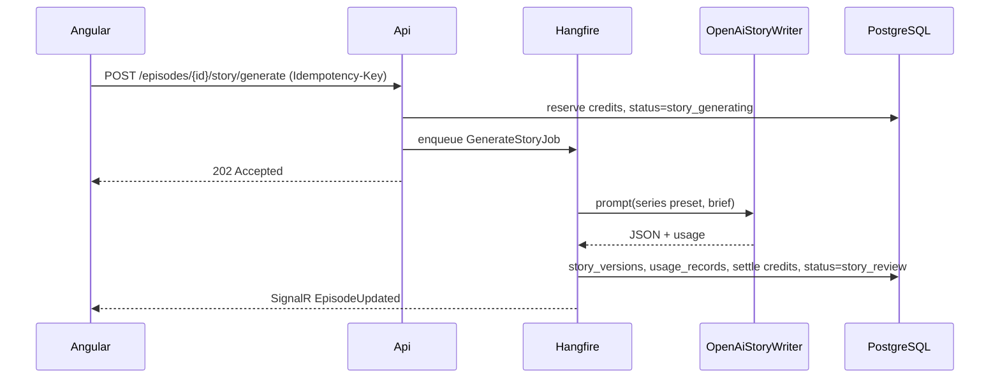
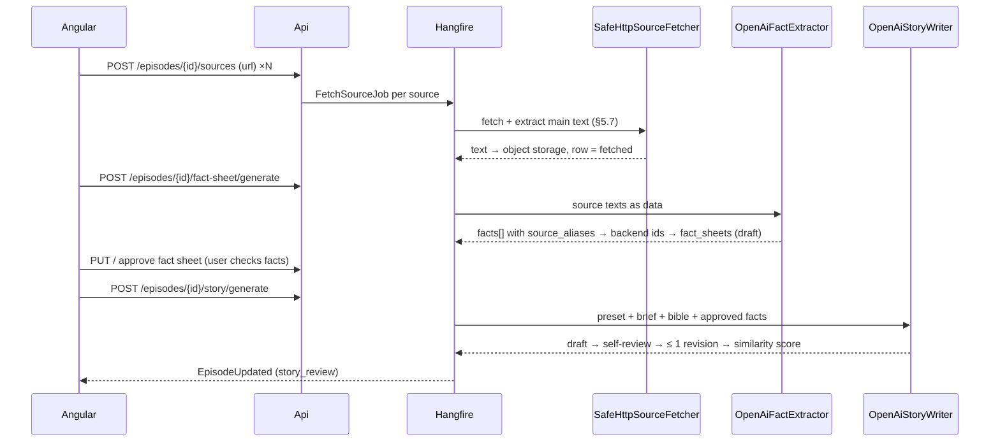

# 02 — Story Writing (M0 → M1)

> Contracts: `00-overview.md` (§6 `series`, `series_bibles`, `episodes`, `story_sources`, `fact_sheets`, `story_versions`, `usage_records`, `moderation_events`; §7 Episode states; §8 story, source, fact-sheet and bible routes). Shared endpoint plumbing (auth, idempotency, ETag, job infrastructure, error catalogue) lives in `09-backend-api.md`; screens in `10-web-ui.md`. The feature slices of this plan, including their endpoints, are estimated **here**. This plan owns **prompts, output schema, quality rules, source research, self-review and the review checkpoint #1 behaviour**.
> Level: **high-level plan — not the final plan.** It fixes scope, contracts, key decisions, risks and rough estimates only. Every feature in it will still get (1) a review of the relevant sections and (2) its own **detailed feature plan** in `plans/features/`, reviewed again before implementation (process and template: `00-overview.md` §10.1). Details and estimates here may change in that step.
> **Detailed plans:** `features/02-story-writing/` (README D1–D22, §10 T1–T60, owner-approved 2026-09-24) supersede this file where they differ. Examples: the fetcher is a pull client of an internal Api listener (no `fetch` Hangfire queue); `episode_invalid_state` replaces `story_not_in_review`; the M0 presets are tested through a direct OpenAI harness, not through MPT; the model returns fact aliases and never ids or URLs; the estimate is 40.25 d (48.3 with buffer).
> Delivery phase (personal-first, `00-overview.md` §4.1): all P, including 02.7 source finder and 02.8 autopilot. Where this plan says M1 for an S item, read M2.

## 1. Purpose and scope

**Goal:** turn a user's idea into a publish-quality script (vi or en) that the user reviews and approves before any image/voice money is spent.

**In scope:**
- M0: prompt presets tested through MPT's `llm_provider = "openai"`, to compare quality.
- M1: the same presets moved into the backend as `IStoryWriter`, with structured output, versioning, approval and metering.
- M1: source research (user-supplied links → safe fetch → fact sheet), one self-review and auto-revision pass, series bible.
- M1 (personal phase): "Find sources for me" assistant (Epic 02.7) and autopilot idea → story → video → publish (Epic 02.8).

**Out of scope:** image prompts (03), voice (04), UI layout (10), billing rules (12).

## 2. BA review of this part

| # | Finding | Action |
|---|---|---|
| G1 | Moving story writing out of MPT means we also own **keyword generation** (MPT `video_terms`) | The output schema includes `keywords` per paragraph (§5.2) |
| G2 | Length targets were never measured | Rates measured per language from the VieNeu baselines (02 T103: vi 260 syl/min, en 200 wpm); `words_per_minute_measured` from plan 01 (01.3.1-T4) re-measures them; length stays a range, not a promise |
| G3 | True crime involves real people → defamation, privacy, victims' dignity | Fact-source rules + mandatory user attestation (02.3) |
| G4 | "Mass-produced" policy risk if every episode sounds the same | Presets vary structure; the rubric checks originality; variety guard + gates for the owner's fiction autopilot (02.8.4); human approval for SaaS users and true-crime (DECISIONS §6, §10.12) |
| G5 | Model may refuse or be moderated on horror/violence | Record `moderation_events`; tone rules avoid gore; the UI explains what to change |
| G6 | Cost abuse via endless regeneration | Regeneration limits + credits (plan 12) |
| A1 | gpt-6-luna is good enough for Vietnamese | ⚠️ Assumption — M0 A/B test against gpt-6-sol decides (02.1.3) |
| G7 | Model-written `fact_sources` URLs can be invented, so "≥ 2 URLs" proves nothing | Sources are supplied by the user and fetched by the backend; the model only cites fact ids (Epic 02.5) |
| G8 | "Aggregate other channels' videos into a story" was proposed | Rejected: YouTube Terms ✅ forbid downloading/reproducing Content and automated access (DECISIONS §10.10); the expression of other narrators is copyrighted. Text sources + fact sheet + similarity check instead |
| G9 | Every episode is written in isolation, so a series drifts (narrator, recurring places, repeated plots) | Series bible (02.6.3) |
| G10 | No second look before the user sees the draft | One self-review pass + at most one automatic revision (02.6.1–02.6.2), idea borrowed from InkOS (ideas only, DECISIONS §10.10) |

## 3. Requirements

- **FR-02-1** Presets exist for every `topic × language` pair (6 presets).
- **FR-02-2** Output is structured JSON validated against a schema; invalid output is retried once, then fails with `story_invalid_output`.
- **FR-02-3** Each generation or edit creates an immutable `story_versions` row; approval locks `approved_story_version_id`.
- **FR-02-4** True-crime stories are written only from an **approved fact sheet** built from ≥ 2 sources the backend fetched successfully (Epic 02.5); the user must confirm an attestation before approval.
- **FR-02-5** Every OpenAI call writes a `usage_records` row (tokens, model, cost, request id).
- **FR-02-6** Moderation or refusal is recorded in `moderation_events` and shown as a clear, actionable message.
- **FR-02-7** Max 5 generations per episode per day ([DECISION], configurable).
- **FR-02-8** Source fetching is server-side, SSRF-safe, limited in size, time and volume (per-user daily cap, global concurrency), runs in an isolated `fetcher` container with internet-only egress (11 §5.1), and never fetches social or video platforms (§5.7).
- **FR-02-9** Every generated draft gets one automatic self-review; blocking objective issues trigger at most one automatic revision; the rest are shown to the user as hints.
- **FR-02-10** A story whose word overlap with any source text exceeds the threshold cannot be approved (§5.9).
- **FR-02-11** Prompts are original work of this project; external projects inspire ideas only and are listed in `prompts/REFERENCES.md` (02.1.4).
- **NFR-02-1** Writer call p95 < 60 s; the whole `GenerateStoryJob` (local checks + model review + ≤ 1 revision) p95 < 120 s ⚠️ measure in M1; runs as a background job with progress events. Cost: the `story_generate` price (12.1.1) covers the worst case (writer + review + one revision); the reserve is taken at the worst case and settled at the actual cost.
- **NFR-02-2** Prompts are versioned files (`prompt_version` saved on each story version) so quality changes are traceable.

## 4. Epics and user stories

### Epic 02.1 — Prompt presets (M0)

**02.1.1 Write six presets** — *As the owner I want topic- and language-specific prompts so that stories fit the channel's genre.* Must · L
- Given the three topics and two languages, When presets are written, Then each defines: narrator persona, structure (hook ≤ 20 s, build-up, twist/reveal, ending line, call to action), tone rules (atmospheric, no gore, no sexual content, no detail of minors in danger: nobody under eighteen is shown in a scene of harm or threat, only a brief aftermath the narrator did not see (02 CR-28; 02 T73)), and length range.
- Given a Vietnamese preset, When output is produced, Then it is natural spoken Vietnamese (not translated English), with correct diacritics.

**02.1.2 Keywords for images** — *As the pipeline I want 1 keyword phrase per scene so that MPT generates one matching image per keyword ✅.* Must · S
- Given a story, When generated, Then each paragraph has 1–2 English keyword phrases (image prompts work best in English ⚠️ verify in M0) describing a visual scene, never a real person's likeness.

**02.1.3 Model A/B test** — *As the Tech Lead I want luna vs sol compared so that the default model is chosen on evidence.* Must · M
- Given 6 prompts × 2 models = 12 stories, When scored blind with the rubric (§5.4), Then the default model is the cheapest one within 10 % of the best average score; the result is written into DECISIONS.md.

**02.1.4 Prompt provenance** — *As the owner I want our prompts to be clean original work so that no copyleft or copyright claim reaches the product.* Must · XS
- Given any preset or system prompt, When it is added or changed, Then it is written from scratch in our own words; no text is copied or translated from InkOS (AGPL-3.0 ✅) or any other project.
- Given an idea taken from elsewhere, Then `prompts/REFERENCES.md` records the principle in one line and its source (e.g. "self-review → one revision → human", InkOS README); the PR template has a provenance checkbox.

**02.1.5 Written for the ear** — *As a listener I want natural narration so that the video does not sound machine-written.* Must · S
- Given each preset, Then it contains our own per-language rules: short spoken sentences, no brackets/lists/footnotes, numbers and dates written the way they are read aloud, one idea per sentence in tense moments, and a per-language list of overused phrases to avoid.
- Given the naturalness check, Then it asks functional questions (does this sentence move fear, clue, choice or consequence; is an emotion explained that the scene already shows) rather than deleting flagged words mechanically.

### Epic 02.2 — Backend story writer (M1)

**02.2.1 Structured output** — *As the backend I want schema-valid JSON so that downstream steps never parse prose.* Must · M
- Given a request, When OpenAI returns, Then the JSON matches the schema in §5.2 (structured outputs ⚠️ confirm feature availability for gpt-6-luna in the official .NET SDK).
- Given invalid JSON, When validation fails, Then one retry runs; a second failure sets the episode to `story_review` with error `story_invalid_output` and releases the reserved credits.

**02.2.2 Generate story job** — *As a creator I want to click "Generate" and see progress so that I know it is working.* Must · M
- Given an episode in `draft` or `story_review`, When `POST /episodes/{id}/story/generate` is called with an `Idempotency-Key`, Then the status becomes `story_generating`, credits are reserved (12), and a `GenerateStoryJob` is queued.
- Given the job succeeds, When it finishes, Then a `story_versions` row (`source = generated`) is saved, the episode moves to `story_review`, and SignalR sends `EpisodeUpdated`.
- Given the same `Idempotency-Key` is reused, When called again, Then no second job is queued and the original response is returned.

**02.2.3 Inputs from series** — *As a creator I want my series settings applied so that every episode keeps the channel's style.* Must · S
- Given a series (topic, language, `story_preset`), When generating, Then the preset, language and the user's idea/brief (≤ 1,000 chars) are combined; the brief is treated as data, not instructions (prompt-injection guard in the system prompt).

**02.2.4 Metering** — *As the operator I want every call metered so that margin is known.* Must · S
- Given any OpenAI call, When it returns (success or error), Then `usage_records` stores `operation = story`, `reservation_id`, model, input/cached/output tokens, `cost_usd` computed with the job's `price_versions` rates (12 §5.7), `provider_request_id`; every call sends a `max_output_tokens` limit from the same price version.

### Epic 02.3 — Review checkpoint #1

**02.3.1 Edit creates a version** — *As a creator I want to edit the script so that it sounds like me.* Must · S
- Given `story_review`, When `PUT /episodes/{id}/story` is sent with `If-Match`, Then a new `story_versions` row (`source = edited`) is created and becomes current.
- Given a stale ETag, When saving, Then 412 `story_version_conflict` is returned and nothing is overwritten.

**02.3.2 Approve locks the script** — *As a creator I want to approve the final script so that the render uses exactly this text.* Must · S
- Given `story_review`, When `POST /episodes/{id}/story/approve` is called, Then `approved_story_version_id` is set, status becomes `story_approved`, and later edits require "reopen" (back to `story_review`).
- Given an approved story, When rendering, Then MPT receives `video_script` = the approved body and `video_terms` = its keywords (00 §8).

**02.3.3 True-crime attestation** — *As the platform I want the user to confirm facts so that liability sits with a checked script.* Must · S
- Given a `true_crime` series, When approving, Then the user must tick: "Facts are supported by the listed sources; no private person is accused of something not established by the sources; victims are treated respectfully." The tick is stored in `audit_logs` with the story version id.
- Given a `true_crime` episode without an approved fact sheet containing ≥ 2 `fetched` sources, When approving, Then approval is blocked with `story_sources_required`.

**02.3.4 Quality hints** — *As a creator I want warnings before approving so that I fix weak scripts cheaply.* Should · M
- Given a story, When shown for review, Then automatic checks flag: length outside the target range for the episode's `length_tier`, missing hook, repeated sentences, any paragraph with 0 or more than 2 keywords, possible real-name mentions (true crime).

### Epic 02.4 — Safety

**02.4.1 Moderation handling** — *As the operator I want refusals recorded so that abuse and prompt problems are visible.* Must · S
- Given OpenAI refuses or returns a moderation error, When the job ends, Then a `moderation_events` row is saved, reserved credits are refunded, and the UI message says what to change (e.g. "reduce graphic violence").

**02.4.2 Regeneration limit** — *As the operator I want a daily cap so that one user cannot loop generations.* Must · XS
- Given 5 generations today for an episode, When another is requested, Then 429 `story_generation_limit` is returned.

### Epic 02.5 — Sources and fact sheet (M1; mandatory for true crime, optional for other topics)

**02.5.1 Add sources** — *As a creator I want to paste the links I researched so that my story is built on them.* Must · S
- Given an episode in `draft` or `story_review`, When `POST /episodes/{id}/sources` is sent with 1 URL (max 10 per episode), Then a `story_sources` row is created in `pending` and a `FetchSourceJob` is queued.
- Given a URL on a blocked domain (§5.7: YouTube, TikTok, Facebook, Instagram, X, and other video/social platforms), Then 400 `source_domain_not_allowed` with the message "Paste an article or record page; video and social platforms cannot be used as sources."
- Given the user has notes of their own (e.g. what they watched), Then they can add a `user_note` source (≤ 3,000 chars of text, no URL); notes never count toward the true-crime minimum of 2 fetched sources.

**02.5.2 Safe fetch and main-text extraction** — *As the platform I want to read only the article text safely so that research cannot be abused.* Must · M (+ spike S, isolation S)
- Given `FetchSourceJob`, Then the fetcher applies every rule in §5.7 (HTTPS/HTTP only, DNS resolved and re-validated at connect time and after each redirect, private/link-local/metadata and special ranges blocked incl. IPv4-mapped/compatible IPv6, no proxy, ≤ 3 redirects, ≤ 2 MB, ≤ 10 s, `text/html` or `text/plain` only, robots.txt respected).
- Given the job, Then it runs on the separate `fetch` Hangfire queue in the `fetcher` container (11.2.2): internet-only egress, no route to app/render networks, no metadata endpoint, no DB credentials; results are written through a narrow internal API (source id + extracted text + metadata only) [DECISION].
- Given a user has queued 30 fetches in the last 24 h [DECISION], When another source is added, Then 429 `source_fetch_limit_reached`; at most 4 fetches run at once platform-wide [DECISION], extra jobs wait in the queue.
- Given a successful fetch, Then the main article text is extracted, stored in object storage (`extracted_text_key`, `content_sha256`, `title`, `final_url`, `fetched_at`), and the row becomes `fetched`; otherwise `failed` with `error_code` (`source_unreachable`, `source_too_large`, `source_blocked_by_robots`, `source_unsupported_type`, `source_no_text`).
- Given spike 02.5.2-T0, Then a main-text extraction library is chosen with a commercial-safe license and recent maintenance (candidates: a .NET Readability port such as SmartReader, or trafilatura in a sidecar ⚠️ licenses unverified); decision recorded in DECISIONS.md.

**02.5.3 Build the fact sheet** — *As a creator I want the key facts pulled out with their sources so that I check them quickly.* Must · M
- Given ≥ 1 `fetched` source, When `POST /episodes/{id}/fact-sheet/generate` (Idempotency-Key, credits reserved), Then `gpt-6-luna` receives the extracted texts as delimited data and returns `facts[] { statement, source_aliases[], confidence }` (§5.8); the backend assigns fact ids `f1…` and maps aliases `s1…` to `story_sources.id` (02 CR-21); statements are paraphrased in the target language, never copied sentences.
- Given a fact without a valid `source_id`, Then it is dropped by the validator (never shown as sourced).
- Given the result, Then a `fact_sheets` row (`status = draft`, `version` n) is saved and SignalR `EpisodeUpdated` fires.

**02.5.4 Review and approve the fact sheet** — *As a creator I want to correct the facts before the story is written so that mistakes are cheap.* Must · S
- Given a draft fact sheet, When `PUT /episodes/{id}/fact-sheet` with `If-Match`, Then a new version is saved; the user can edit, delete, or add a fact; an added fact must point to a source (a `user_note` source is allowed and is labelled "your note").
- Given `POST /episodes/{id}/fact-sheet/approve`, Then the sheet is locked (`status = approved`); editing later creates a new draft version and the episode's approved story (if any) must be reopened.

**02.5.5 Write from the approved facts** — *As a creator I want the story to use only my approved facts so that it stays defensible.* Must · S
- Given a true-crime episode, When `POST /episodes/{id}/story/generate`, Then it requires an approved fact sheet (else 409 `fact_sheet_required`); the writer receives the facts (not the raw source texts) plus the preset and brief.
- Given the output, Then each paragraph lists the `fact_refs` it relies on; `fact_sources` in `story_versions.content` is built **by the backend** from `story_sources` (title, final URL) — the model never writes URLs.
- Given a `fact_ref` that is not in the approved sheet, Then the draft is flagged by the self-review as a blocking objective issue.

**02.5.6 Similarity check** — *As the platform I want to catch copied text so that stories stay original.* Must · S
- Given a new story version and the episode's source texts, Then the backend computes word-shingle overlap (§5.9) and stores `similarity_score` on `story_versions`.
- Given a score above the warning threshold, Then a quality hint marks the overlapping paragraphs; above the block threshold, approval returns 409 `story_too_similar_to_source`.

### Epic 02.6 — Self-review, auto-revision and series bible (M1)

**02.6.1 Self-review pass** — *As a creator I want the draft checked before I see it so that I spend my time on taste, not on errors.* Must · M
- Given a generated draft, When the writer finishes, Then `StoryQualityChecker` (local, free: length, hook, repetition, keyword counts, fact-ref validity) runs first, then **one** model call with our own review prompt returns `issues[] { severity: blocking|advisory, kind: objective|taste, paragraph_index, evidence, impact, repair_direction }` (§5.8) and a rubric score per §5.4 dimension; both results are merged into `story_versions.audit_report`. [DECISION] The review call uses the cheapest model that passes the M1 quality check.
- Given the review checks, Then they cover: preset structure (hook, build-up, reveal, ending), setup before every twist (clues visible earlier), continuity with the series bible, fact refs valid (true crime), tone rules (no gore/sexual content, no detail of minors in danger (02 CR-28; 02 T73)), written-for-the-ear rules (02.1.5), length range.

**02.6.2 One automatic revision** — *As the platform I want to fix clear errors automatically, but only once, so that cost and drift stay bounded.* Must · S
- Given ≥ 1 `blocking` + `objective` issue, Then exactly one revision call fixes those issues only, a new `story_versions` row (`source = revised`) becomes current, and the review runs once more for the hints; remaining issues are never auto-revised again.
- Given `taste` issues, Then they are shown as hints only (the user decides).
- Given self-review and revision calls, Then they are metered in `usage_records` (`operation = story_review`/`story_revision`) and priced inside the story generation credit price (12), not counted toward the daily generation limit.

**02.6.3 Series bible** — *As a creator I want my series to remember its narrator, places and past plots so that episodes feel like one channel.* Should · M
- Given a series, Then `series_bibles` holds `content jsonb { narrator, recurring_characters[], places[], rules[], episode_summaries[] }` editable via `GET/PUT /series/{id}/bible` (`If-Match`).
- Given a story is approved, Then a background call proposes a bible update (new summary line, new recurring elements) saved as `proposed_content`; the user accepts or dismisses it with `POST /series/{id}/bible/proposal/accept|dismiss`.
- Given generation, Then the writer receives the bible and must not repeat a plot listed in `episode_summaries`; the self-review checks continuity against it.

### Epic 02.7 — Source finder assistant (personal phase for autopilot research, behind flag `source_finder`)

**02.7.1 Spike: jev-ultrafast as a link finder** — *As the Tech Lead I want evidence before adopting a browser agent so that autopilot research is not built on assumptions.* Must (P) · M
- Given jev-ultrafast (MIT ✅, requires a TypeSafe API key ✅ and a text model) on an allow-listed public search site, Then the spike answers: runs headless in a container ⚠️, works with an OpenAI text model instead of OpenRouter ⚠️, cost per search, TypeSafe commercial terms ⚠️, and success rate on 10 sample cases. Result recorded in DECISIONS.md; go/no-go.

**02.7.2 Find sources for me** — *As a creator I want help finding sources so that research is faster.* Should (P; used by autopilot 02.8) · L
- Given flag `source_finder` and a go from 02.7.1, When the user clicks "Find sources", Then a `FindSourcesJob` runs on the same isolated `fetch` queue and `fetcher` container (§5.7) with the agent in an isolated, signed-out browser per job, only on allow-listed sites whose terms permit automated access, and returns candidate **links only**; the user picks which ones to add (02.5.1), and the normal fetcher (02.5.2) reads them.
- Given any agent run, Then it never logs in, never posts, and never visits blocked domains (§5.7).

### Epic 02.8 — Autopilot: idea → story → video → publish (personal phase, 00 §4.1)

**02.8.1 Idea generator** — *As the channel owner I want the system to come up with and pick episode ideas so that I do not have to.* Must (P) · M
- Given a series with autopilot on (topic, language, tone, series bible, banned themes), When `AutopilotPlanJob` runs (daily), Then the text model proposes N ideas (title, logline, hook, setting) from the series bible, the story presets and optional research notes (02.7); each idea is checked against past episodes and pending ideas (similarity below a threshold set in the feature plan ⚠️) and against the content policy (02.4); the best-scoring idea fills the next free slot of the cadence and is stored in `episode_ideas`.
- Trend or topic research never scrapes YouTube or TikTok (YouTube Terms forbid automated access ✅, DECISIONS §10.10); it uses only official APIs (quota-costed, optional) or allow-listed research sites through 02.7.

**02.8.2 Auto-approval gates** — *As the channel owner I want safe episodes to go through on their own so that the pipeline never waits for me without reason.* Must (P) · M
- Given a **fiction** episode (`ghost`, `spiritual`), Then checkpoint #1 is auto-approved when self-review (02.6) passes the score threshold after at most one revision, moderation passes (OpenAI moderation endpoint over the final narration, generated title/description/tags and scene prompts; thresholds in the feature plan; any flag → owner review), no real-person/real-event signal (named private individuals, "true story"/"based on real events", dated real incidents → owner review), similarity to past episodes and sources is below the threshold and length is in range; otherwise the episode stays in `story_review` and the owner is notified.
- Given a **true-crime** episode, Then autopilot researches (02.7 source finder → 02.5 fetch → fact-sheet draft) and writes, but the fact sheet and the story always wait for the owner's approval [DECISION] (real people, defamation risk). A series' `topic` cannot change while autopilot is on (turn autopilot off first, which revokes the authorization); the topic is part of the authorization text.
- Given a rendered video, Then checkpoint #2 is auto-approved when the 05.5 quality checks pass (duration, loudness, subtitle sync, no failed scene); otherwise it stays in `video_review`.
- Every auto-approval writes `audit_logs` and the episode History ("approved by autopilot" with the gate scores).
- Given a published autopilot video is reported or later flagged, Then the series pauses and the owner runbook (08.4) removes or privates it in YouTube Studio within 24 h [DECISION] (we do not delete videos through the API in MVP, 06.2.6).

**02.8.3 Cadence and publishing** — *As the channel owner I want episodes published on a schedule so that the channel grows without me.* Must (P) · M
- Given the series cadence (days, publish time, time zone), a per-channel daily cap ([DECISION] default 1 video per day) and a buffer of ready episodes, Then the orchestrator starts generation early enough for the publish time (render time estimate) and creates the publication with `publishAt` through 06 (`containsSyntheticMedia = true` always).
- Given the owner turns autopilot on for a series, Then the owner accepts a versioned series authorization ("upload each autopilot episode of this series to channel X on this cadence with the generated metadata, unless I edit or cancel it during the veto window"); 06.2.2-T3 writes a per-publication consent from it after the veto window. Turning autopilot off or changing the text revokes it until re-accepted.
- Given any of: two gate failures in a row; the daily/monthly spend cap from `usage_records` reached (personal phase; 12.8 low funds in the SaaS); the channel connection not `active` (revoked/expired, 06.4); an OAuth client incident (06.2.3); a YouTube quota error, upload failure or rejected video; a veto notice that could not be delivered — Then autopilot pauses the series (no new idea/story/render jobs), records `autopilot_pause_reason` and e-mails the owner through the outbox (the "autopilot alert channel"), listing videos already scheduled on YouTube with a Studio link (they go live unless changed there). The owner can pause/resume and cancel any publication, but no action is needed for fiction episodes.
- Given the audit has not passed (project setting `youtube_audit_status = pending`), Then the owner's **pre-audit mode** applies ([DECISION] default: keep the cadence and upload as private; runs end as `published_private_locked` and skip the go-live check of 06.2.5; alternative: pause after N private videos) — this also provides real-use evidence for the audit.
- The authorization text names the series, topic, channel, cadence, daily cap, privacy status on publish (public/unlisted/private, chosen by the owner, Developer Policies III.E.3.f) and the veto window; accepting it creates a `series_autopilot_authorizations` row (00 §6).

**02.8.4 Variety guard** — *As the channel owner I want episodes that do not look mass-produced so that the channel stays monetizable.* Must (P) · S
- Given the inauthentic/mass-produced content policy (DECISIONS §6), Then autopilot rotates settings, sub-genres, openings and scene styles, and blocks an idea whose structure repeats a recent episode's template.

## 5. Technical design

### 5.1 Components (backend, plan 09 layout)

- `NightTales.Application/Features/Stories/`: `GenerateStoryCommand`, `EditStoryCommand`, `ApproveStoryCommand`, `ReopenStoryCommand` (00 §5.2 slice layout), port `IStoryWriter` (write, review, revise), `StoryDraft` DTO, `StoryQualityChecker` and `SimilarityScorer` (pure, live in Domain).
- `NightTales.Application/Features/Research/`: `AddSourceCommand`, `RemoveSourceCommand`, `GenerateFactSheetCommand`, `EditFactSheetCommand`, `ApproveFactSheetCommand`; ports `ISourceFetcher`, `IMainTextExtractor`, `IFactExtractor`.
- `NightTales.Application/Features/SeriesBible/`: `UpdateBibleCommand`, `AcceptBibleProposalCommand`, `DismissBibleProposalCommand`, `GetBibleQuery`.
- `NightTales.Infrastructure/OpenAI/OpenAiStoryWriter` and `OpenAiFactExtractor` using the official OpenAI .NET SDK; prompts in `prompts/story/{topic}.{language}.v{n}.md`, `prompts/review/v{n}.md`, `prompts/facts/v{n}.md`, loaded at startup; `prompts/REFERENCES.md` for idea provenance.
- `NightTales.Fetcher.Core/Research/SafeHttpSourceFetcher` (rules §5.7) behind `ISourceFetcher`; hosted only in the `fetcher` container (`NightTales.Fetcher`), which posts results to an internal Api endpoint (02 T40: the fetcher classes moved out of `NightTales.Infrastructure/Research` into the Domain-only `NightTales.Fetcher.Core` library).
- Pricing: text rates (`gpt-6-luna`: $0.10 in / $0.50 out per 1M ✅; `gpt-6-sol`: $2 / $10 ✅) live in `price_versions.rates` (12 §5.7), seeded from config — data, not code.

### 5.2 Output schema (JSON)

```json
{
  "title": "string ≤ 100 chars",
  "hook": "string, first 1–3 sentences",
  "paragraphs": [
    { "text": "narration in target language", "keywords": ["english visual scene phrase"], "fact_refs": ["f1", "f3"] }
  ],
  "ending": "string",
  "description": "platform description ≤ 1,000 chars",
  "tags": ["string"],
  "content_warnings": ["violence", "death", "..."]
}
```

`story_versions.body` stores the concatenated narration; `keywords` flattens paragraph keywords in order; the full structured JSON is stored in `story_versions.content` (00 §6), where the backend adds `fact_sources: [{ source_id, title, url }]` built from `story_sources` for every `fact_ref` used. The model never outputs URLs. `fact_refs` is empty for non-true-crime stories without a fact sheet.

### 5.3 Generate sequence



Self-review and the optional single revision run inside the same `GenerateStoryJob` after the writer call (02.6); the episode reaches `story_review` only after the review report is saved.

### 5.4 Quality rubric (1–5 each, used in 02.1.3 and beta reviews)

Hook strength · Pacing · Atmosphere without gore · Natural language (native speaker) · Originality (not a known story retold verbatim) · Factual care (true crime) · Fits target length.

### 5.5 Error codes (ProblemDetails `code`)

`story_invalid_output`, `story_moderated`, `story_generation_limit`, `story_version_conflict`, `story_sources_required`, `story_not_in_review`, `story_too_similar_to_source`, `fact_sheet_required`, `fact_sheet_conflict`, `source_domain_not_allowed`, `source_limit_reached`, `source_unreachable`, `source_too_large`, `source_blocked_by_robots`, `source_unsupported_type`, `source_no_text`, `insufficient_credits`.

### 5.6 Research sequence (true crime)



### 5.7 Fetcher safety rules

- Schemes `https` and `http` only; ports 80/443 only; no credentials in URLs.
- Resolve DNS before connecting and connect to the resolved IP; the IP is re-validated at connect time in `SocketsHttpHandler.ConnectCallback` (defeats DNS rebinding); `UseProxy = false`; IPv4-mapped and IPv4-compatible IPv6 addresses are normalized to IPv4 before the check.
- Always block: loopback, private (RFC 1918), link-local (incl. `169.254.169.254` metadata), CGNAT, multicast, `0.0.0.0/8`, IPv6 ULA/link-local, `64:ff9b::/96`, `2002::/16`, `fec0::/10`; repeat the check on every redirect (max 3).
- Response limits: 2 MB body, 10 s total, `text/html` or `text/plain`; no JavaScript execution.
- Identify as `NightTalesStudioBot/<version> (+contact URL)`; respect robots.txt; per-domain rate limit 1 request/s.
- Blocked domains (config list): youtube.com, youtu.be, tiktok.com, facebook.com, instagram.com, x.com, twitter.com, and other video/social platforms; their content is not a source (DECISIONS §10.10).
- Extracted text is **data**: delimited in prompts, never followed as instructions; retained with the episode and deleted with it (13).
- Volume: per-user daily cap 30 fetches (rolling 24 h) [DECISION] → `source_fetch_limit_reached`; global concurrency 4 [DECISION] (Hangfire `fetch` queue worker count).
- Isolation: `FetchSourceJob` and `FindSourcesJob` (02.7) run on the separate `fetch` Hangfire queue, served only by the `fetcher` container in its own subnet with internet-only egress (no route to app/render networks, no metadata endpoint, no DB credentials); results go through a narrow internal API (11 §5.1, 11.2.2) [DECISION].

### 5.8 Fact sheet and review schemas (JSON)

```json
{ "facts": [ { "statement": "string (target language, paraphrased)", "source_aliases": ["s1"], "confidence": "high|medium|low" } ] }
```

```json
{
  "scores": { "hook": 1, "pacing": 1, "atmosphere": 1, "natural_language": 1, "originality": 1, "factual_care": 1, "length_fit": 1 },
  "issues": [ { "severity": "blocking|advisory", "kind": "objective|taste", "paragraph_index": 0, "evidence": "string", "impact": "string", "repair_direction": "string" } ]
}
```

### 5.9 Similarity check

Normalise text (lowercase, strip punctuation, keep Vietnamese diacritics), build 8-word shingles, and compute the share of story shingles found in any source text. [DECISION] warning at > 5 %, block at > 15 % ⚠️ calibrate on the M1 sample stories. Only true-crime and sourced episodes are checked.

## 6. Task breakdown

| Task ID | Task | Area | Size | Depends on |
|---|---|---|---|---|
| 02.1.1-T1 | Draft ghost vi/en presets | BA | S | — |
| 02.1.1-T2 | Draft spiritual vi/en presets | BA | S | — |
| 02.1.1-T3 | Draft true-crime vi/en presets incl. fact rules | BA | M | — |
| 02.1.2-T1 | Keyword rules + examples in presets | BA | S | 02.1.1 |
| 02.1.3-T1 | Generate 12 stories via MPT/OpenAI; blind score | BA | S | 01, 02.1.1 |
| 02.1.3-T2 | Record decision in DECISIONS.md | BA | XS | 02.1.3-T1 |
| 02.2.1-T1 | JSON schema + validator + retry | BE | M | 09 skeleton |
| 02.2.2-T1 | `GenerateStoryCommand` + job + state transitions | BE | M | 09 episodes |
| 02.2.3-T1 | Prompt assembly from series + injection guard | BE | S | 02.2.1 |
| 02.2.4-T1 | Pricing options + usage_records writer | BE | S | 09 persistence |
| 02.3.1-T1 | Edit command with ETag/If-Match | BE | S | 02.2.2 |
| 02.3.2-T1 | Approve/reopen commands | BE | S | 02.3.1 |
| 02.3.3-T1 | Attestation + sources validation | BE | S | 02.3.2 |
| 02.3.4-T1 | `StoryQualityChecker` rules | BE | M | 02.2.1 |
| 02.4.1-T1 | Moderation/refusal mapping + refund | BE | S | 09.5.2-T1 (`ICreditLedger` port; personal phase: metering-only, 12 ledger at M2) |
| 02.4.2-T1 | Daily generation limit | BE | XS | 02.2.2 |
| 02.1.4-T1 | `prompts/REFERENCES.md` + PR provenance checkbox | TL | XS | — |
| 02.1.5-T1 | Written-for-the-ear rules + overused-phrase lists (vi, en) | BA | S | 02.1.1 |
| 02.5.1-T1 | `story_sources` entity, add/remove commands, domain blocklist | BE | S | 09 episodes |
| 02.5.2-T0 | Spike: main-text extraction library + license check | BE | S | — |
| 02.5.2-T1 | `SafeHttpSourceFetcher` (§5.7 incl. ConnectCallback re-check, IPv6 normalization, UseProxy=false) + `FetchSourceJob` | BE | M | 02.5.2-T0 |
| 02.5.2-T2 | `fetch` queue in `fetcher` container, internal write API, per-user daily cap + global concurrency | BE | S | 02.5.2-T1, 11.2.2-T2 |
| 02.5.3-T1 | Fact prompt + `GenerateFactSheetCommand` + validator | BE | M | 02.5.2 |
| 02.5.4-T1 | Edit/approve fact sheet with ETag | BE | S | 02.5.3 |
| 02.5.5-T1 | Writer uses facts; backend builds `fact_sources` | BE | S | 02.5.4, 02.2.1 |
| 02.5.6-T1 | `SimilarityScorer` + thresholds + approval guard | BE | S | 02.5.2 |
| 02.6.1-T1 | Review prompt + review step in `GenerateStoryJob` | BE | M | 02.2.2 |
| 02.6.2-T1 | Single auto-revision + metering | BE | S | 02.6.1 |
| 02.6.3-T1 | `series_bibles` + proposal job + bible in writer input | BE | M | 02.3.2 |
| 02.7.1-T1 | jev-ultrafast spike | BE | M | 02.5 |
| 02.7.2-T1 | `FindSourcesJob` + allow-list | BE | L | 02.7.1 |
| 02.8.1-T1 | Idea generator prompt + `AutopilotPlanJob` + `episode_ideas` + similarity check | BE | M | 02.6.3, 02.4 |
| 02.8.2-T1 | Auto-approval gates (story, video) + audit/History records + true-crime hold | BE | M | 02.6.2, 05.5 |
| 02.8.2-T2 | Content gate: OpenAI moderation over final narration, generated metadata and scene prompts, real-person/real-event detector, thresholds, owner routing | BE | S | 02.8.2-T1, 02.4.1-T1 |
| 02.8.3-T1 | Cadence orchestrator (`AutopilotPlanJob` schedule), ready buffer, `publishAt` hand-off to 06, pre-audit mode, auto-pause triggers + outbox alerts | BE | M | 02.8.2-T1, 06.2.4 |
| 02.8.3-T2 | Autopilot endpoints (`/series/{id}/autopilot*` settings, authorization accept/revoke, pause/resume, runs) + cross-tenant rows | BE | S | 02.8.3-T1, 09.4 |
| 02.8.4-T1 | Variety guard (rotation, template-repeat check) | BE | S | 02.8.1-T1 |

## 7. Test plan

- **Unit:** schema validation (valid, missing fields, wrong types); state transitions (generate from `story_approved` rejected); quality checker rules; cost calculation from tokens; fact validator drops facts without valid sources; similarity scorer on fixed texts (identical, paraphrased, unrelated); revision runs at most once.
- **Integration (real PostgreSQL 17, `PostgresFixture` + fake `IStoryWriter`/`IFactExtractor` + local HTTP test server):** idempotent generate; ETag conflict; approve blocked without an approved fact sheet for true crime; refund on moderation; fetcher refuses private IPs, IPv4-mapped IPv6 private IPs, `0.0.0.0`, DNS rebinding (resolver returns a public then a private IP → blocked at connect), redirect-to-private, oversize, wrong type, blocked domains, robots.txt disallow; 31st fetch in 24 h → `source_fetch_limit_reached`.
- **Contract test (manual, M1):** one real OpenAI call per preset; JSON validates.
- **Quality:** rubric scoring of 12 M0 stories; native vi and en speaker review.

## 8. Risks and mitigations

| Risk | Mitigation |
|---|---|
| Vietnamese quality weak on the cheap model | A/B test (02.1.3); allow per-series model override (admin only) |
| Prompt injection in the brief | Brief in a delimited data block; system prompt forbids following brief instructions; output schema limits damage |
| Defamation in true crime | Sources + approved fact sheet + attestation + ToS (13); admin takedown |
| Fetcher abused for SSRF | §5.7 rules incl. connect-time IP re-check; `fetcher` container on its own subnet with internet-only egress and no DB credentials (11 §5.1, 11.2.2); integration tests with redirect-to-private and DNS rebinding |
| Copied text from sources | Paraphrase rule in the fact prompt, facts (not texts) passed to the writer, similarity block |
| Self-review adds cost and latency | One review + max one revision; measured in M1; review can use the cheapest model |
| Copyleft leak from reference projects | 02.1.4 provenance rule; ideas only |
| Model/price changes | Pricing and model IDs in config; `prompt_version` stored |

## 9. Exit criteria

- **M0:** 12 scored stories; default model decided; presets v1 frozen.
- **M1:** generate → edit → approve works end-to-end through the API with metering and idempotency; true-crime path works from sources → fact sheet → story with backend-built `fact_sources`; self-review + single revision run on every draft; all tests in §7 pass.
- **M1 autopilot:** 02.7.1 go/no-go recorded; if go, "Find sources" returns links only from allow-listed sites; a fiction series on autopilot produces and schedules episodes on its cadence with no manual step, a true-crime series stops for approval, gate failures pause the series with an alert.

## 10. Open questions and contract change requests

- [OPEN] Should users pick the model (quality tier) with different credit prices? Proposed: no in MVP.
- ⚠️ Whether English keyword phrases give better images than Vietnamese — test in M0.
- **Contract changes (applied to 00):** `story_versions.content jsonb`, `prompt_version`, `audit_report jsonb`, `similarity_score numeric(5,4)`, `source` value `revised`; new tables `story_sources`, `fact_sheets`, `series_bibles`; source, fact-sheet and bible routes in 00 §8; `usage_records.operation` values `story_review`, `story_revision`, `fact_sheet`.
- ⚠️ Main-text extraction library and license (02.5.2-T0).
- ⚠️ jev-ultrafast headless support, OpenAI text model support, TypeSafe cost and commercial terms (02.7.1).

## 11. Estimate summary

| Epic | Days |
|---|---|
| 02.1 Presets (M0) | 4.0 |
| 02.2 Backend writer | 3.0 |
| 02.3 Checkpoint #1 | 2.5 |
| 02.4 Safety | 0.75 |
| 02.5 Sources + fact sheet | 5.0 |
| 02.6 Self-review + bible | 2.5 |
| 02.7 Source finder | 3.0 |
| 02.8 Autopilot | 4.5 |
| **Total** | **25.25** → with 20 % buffer **30.3** person-days (high-level) |
| **Detailed re-estimate** | **40.25** → with 20 % buffer **48.3** person-days (`features/02-story-writing/` §9, owner-approved 2026-09-24, 02 CR-11) |
