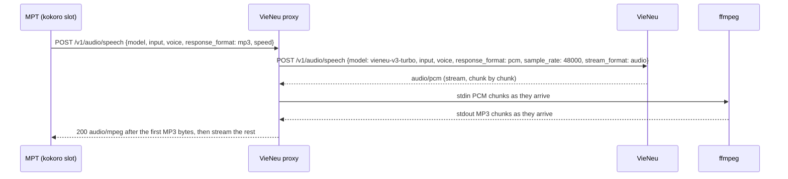

# 04 — Voice Proxy and Voice Catalog (M0)
> **Detailed plan wins:** `features/04-voice-proxy/README.md` is the source of truth where it differs from this high-level plan (04 CR-1).
> **Status:** detailed plan ready for implementation, with conditions; DoR and owner sign-off 2026-09-24 (`features/04-voice-proxy/README.md` §11).

> Contracts: `00-overview.md`. Facts: `../DECISIONS.md` §5.3 (all file:line evidence there). Option A (MPT `kokoro` slot) is chosen; option B (`voxcpm` slot) is the documented fallback.
> Level: **high-level plan — not the final plan.** It fixes scope, contracts, key decisions, risks and rough estimates only. Every feature in it will still get (1) a review of the relevant sections and (2) its own **detailed feature plan** in `plans/features/`, reviewed again before implementation (process and template: `00-overview.md` §10.1). Details and estimates here may change in that step.
> Delivery phase (personal-first, `00-overview.md` §4.1): all P. Where this plan says M1 for an S item, read M2.

## 1. Purpose and scope

**Goal:** MPT's kokoro slot gets real MP3 speech from VieNeu v3 Turbo, and the platform exposes a curated vi/en voice list.

**In scope:** a small Python proxy next to MPT; voice list mapping; voice catalog for the backend (`GET /api/v1/voices`); preview samples; the WAV-header spike.

**Out of scope:** changing MPT or VieNeu code; VieNeu v4 (proprietary); voice cloning of real people (not offered — consent/likeness risk).

## 2. BA review of this part

| # | Finding | Action |
|---|---|---|
| F1 | MPT kokoro slot always requests `response_format: "mp3"` (`voice.py:2169`) ✅; VieNeu returns only `pcm`/`wav` (mp3 → 400) ✅ | Proxy requests **pcm** from VieNeu (not wav) and streams it through ffmpeg to MP3 as bytes arrive; `200` commits only after the first MP3 bytes exist (04 README D3, D4) (04 CR-1) |
| F2 | MPT lists kokoro voices from `{base_url}/audio/voices` and accepts a list of strings or `{ "voices": [...] }` with objects carrying `id` (`voice.py:258-289`) ✅; VieNeu serves `GET /v1/voices` → `{ "object": "list", "data": [...] }` ✅ | Proxy serves `GET /v1/audio/voices` in MPT's shape → no manual voice list |
| F3 | VieNeu WAV header uses unknown length `0xFFFFFFFF` (`openai_speech.py:197`) ✅; ffmpeg decodes it (X1) but warns on every file, and raw PCM has no header at all with the exact sample count | Proxy uses **pcm** as the primary format, decoded with `-f s16le -ar 48000 -ac 1`; `X-Sample-Rate` must equal 48000 (04 README D4, F12). 04.1.1-T1 still records the WAV result for DECISIONS §8 item 6 and option B (04 CR-1) |
| F4 | VieNeu ignores `speed` ✅ and MPT's `voice_rate` maps to `speed` ✅ | Speaking rate is not adjustable in MVP; hide the rate control in the UI |
| F5 | MPT strips `kokoro:` and removes **every** `-Female`/`-Male` substring anywhere in the name, and routes any name ending `-V2` to Azure before the kokoro branch (`voice.py:371-383,597-704`) ✅ | `VoiceCatalogRules` rejects ids containing `-Female`, `-Male` or `:`, ending in `-V2`, or with leading/trailing whitespace (04 README D9, F06) (04 CR-1) |
| F6 | VieNeu CPU handles 1–2 streams; GPU up to 16 ✅; extra requests queue then 429 ✅; MPT retries any non-200 **3× immediately**, ignoring `Retry-After` (`voice.py:2177`) ✅ | Proxy absorbs upstream 429s before its commit: retries upstream for up to `ADMISSION_WAIT_S` (60 s) and only then returns 429 `upstream_busy`; 60 s + first audio < 90 s commit deadline < MPT's 120 s idle timeout (04 README D5, F03) (04 CR-1) |
| A1 | Proxy language: **Python** [DECISION] — same host and runtime as MPT, FastAPI + httpx + ffmpeg subprocess; ≈ 400 lines with streaming, admission and health (04 F21), not ~50 (04 CR-1) | Team is .NET-first; the file is small and fully tested |

## 3. Requirements

- **FR-04-1** `POST /v1/audio/speech`: accept an OpenAI-style body; forward `input`, `voice` to VieNeu with `response_format: "pcm"`, `sample_rate: 48000`, `stream_format: "audio"` (never `model`/`speed`, D3); stream PCM → ffmpeg stdin → ffmpeg stdout → response as bytes arrive (streaming transcode, D4); commit `200 audio/mpeg` only after the first MP3 bytes exist; a later failure aborts the connection rather than sending a truncated body (04 README D3, D4) (04 CR-1).
- **FR-04-2** `GET /v1/audio/voices`: return `{ "voices": [ { "id", "name", "language", "gender" } ] }` for the **active** catalog entries that exist in VieNeu `GET /v1/voices` (cached); the speech allow-list is every catalog id, active or not (04 README D9) (04 CR-1).
- **FR-04-3** `GET /health`: `proxy-health.v1` contract (D8) — 200 with `status: "ok"`, `reasons: []` when VieNeu, ffmpeg and the catalog are all healthy; otherwise 503 with `status: "error"` and ≥ 1 reason from a fixed set (`vieneu_unreachable`, `vieneu_unhealthy`, `vieneu_auth_failed`, `ffmpeg_missing`, `libmp3lame_missing`, `catalog_voice_missing`) (04 README D8) (04 CR-1).
- **FR-04-4** Auth: require `Authorization: Bearer <PROXY_API_KEY>` from MPT; call VieNeu with `Bearer <VIENEU_API_KEY>`.
- **FR-04-5** Error mapping: node-internal error codes only (D6), never a platform passthrough — e.g. `voice_not_in_catalog`/`unsupported_format` → 400, `upstream_busy`/`proxy_busy` → 429 `Retry-After: 5`, `upstream_unavailable`/`upstream_bad_format`/`transcode_failed` → 502/500, `upstream_first_audio_timeout` → 504; the full table is 04 README D6 (04 CR-1).
- **NFR-04-1** Bind `127.0.0.1:8001` on the Mac **and** on the node; the config loader refuses any other host (exit 2, D1). Never public, never a private-LAN interface (04 README D1, F22) (04 CR-1).
- **NFR-04-2** MPT's `timeout=120` is an **idle** timeout, not a request-length limit (R1). Budget against it: admission ≤ 60 s, first audio (commit) ≤ 90 s from arrival, then read gaps ≤ 60 s (D4); max body 20,000 chars (VieNeu limit ✅ `max_length=20_000`) (04 README D4) (04 CR-1).
- **NFR-04-3** Transcode adds < 5 % to TTS wall time (measure).
- **NFR-04-4** Structured JSON logs without the input text (privacy): one line per request with `ts` (ISO-8601 UTC), `route`, `voice`, `chars` (input length), `audio_seconds`, `vieneu_ms`, `ffmpeg_ms`, `status`; written to stdout and tee'd by the start script to `$NTS_HOME/logs/proxy-<YYYYmmdd-HHMMSS>.log` (01 CR-1: the 01.3.1-T3 collector reads it for `tts_seconds_audio` / `tts_wall_seconds`).
- **FR-04-6** Route allow-list (01 CR-2): the proxy exposes only `POST /v1/audio/speech`, `GET /v1/audio/voices` and `GET /health`, and calls only VieNeu `POST /v1/audio/speech`, `GET /v1/voices` and `GET /health`. It never forwards VieNeu `POST /v1/voices` (voice-clone upload) or any other route; unknown routes → 404, other methods → 405.

## 4. Epics and user stories

### Epic 04.1 — Proxy

**04.1.1 Spike: decode VieNeu WAV** — *As the Tech Lead I want proof that ffmpeg reads VieNeu's streaming WAV so that option A is safe.* Must · XS
- Given VieNeu at the pin, When PCM (`-f s16le -ar 48000 -ac 1`, the main path) and WAV (option B) are piped through the D4 ffmpeg command, Then both decode and the MP3 duration matches the sample count ÷ 48,000; also recorded: a post-commit abort is seen by MPT's `requests` as an error, and when VieNeu frees the stream slot after a client disconnect (`worker-node/proxy/SPIKE.md`, 04 README §7) (04 CR-1).

**04.1.2 Speech endpoint** — *As MPT I want to call one OpenAI-compatible endpoint so that the kokoro slot works unchanged.* Must · M
- Given a valid request with a known voice, When posted, Then the response is `200 audio/mpeg`, decodable by MoviePy `AudioFileClip` (the check MPT runs ✅ `voice.py:2202`).
- Given an unknown voice, When posted, Then 400 is returned and MPT logs it (no retry storm: MPT retries 3× ✅).
- Given VieNeu is busy (429), When posted, Then the proxy retries upstream within `ADMISSION_WAIT_S` (60 s) and only then returns 429 `upstream_busy` with `Retry-After: 5` (MPT ignores it and retries at once, D5) (04 CR-1).

**04.1.3 Voices endpoint** — *As MPT I want the voice list so that the WebUI and API accept `kokoro:<name>`.* Must · S
- Given VieNeu presets, When `GET /v1/audio/voices` is called, Then only active catalog voices that exist upstream appear, in MPT's accepted shape ✅ (04 README D9) (04 CR-1).

**04.1.4 Health and ops** — *As the operator I want a health check so that the worker registry (11) knows the node is ready.* Must · XS
- Given ffmpeg missing or VieNeu down, When `/health` is called, Then 503 with a reason.

**04.1.5 Packaging** — *As the operator I want one start command so that Mac and GPU worker run the same proxy.* Must · S
- Given `worker-node/proxy/`, When started with env vars (§5.2), Then the service runs under `uv run`; a systemd unit/container spec is provided for plan 11.

### Epic 04.2 — Voice catalog

**04.2.1 Curate voices** — *As the owner I want a short list of good narrators so that users do not face 20+ options.* Must · S
- Given the 25 VieNeu presets (✅ at c1390abb, all Vietnamese regional speakers; `Adam bựa` excluded, O4), When each is rated per the D11 protocol (blind, vi and en raters), Then 3–4 voices per language are selected with display names, gender, tone tags from the D9 closed list; no en candidate passing → O2 rule (04 CR-1).

**04.2.2 Catalog in backend** — *As a creator I want to pick a voice by name and hear it so that I choose well.* Must · S
- Given the catalog (config/seed), When `GET /api/v1/voices?language=vi` is called, Then it returns `{ id, displayName, language, gender, tags, previewUrl }`; `id` is sent to MPT as `voice_name = "kokoro:<id>"`.

**04.2.3 Preview samples** — *As a creator I want 10-second previews so that I do not spend credits to test voices.* Should · S
- Given the catalog, When the operator runs the preview script once, Then each voice has a static MP3 in object storage; no per-user generation.

### Epic 04.3 — Fallback (documented only)

**04.3.1 Option B note** — *As the Tech Lead I want the voxcpm fallback written down so that we can switch quickly.* Could · XS
- Given option A fails, Then the note describes: point MPT `[voxcpm] base_url` at the proxy; proxy rewrites JSON (`stream_format: "sse"`, drop `stream`); one voice per config ✅; api_key required ✅.

## 5. Technical design

### 5.1 Request flow

Streaming transcode end to end (D4): no buffering of the whole audio; `200` is committed only after ffmpeg produced its first MP3 bytes, bytes keep flowing under MPT's 120 s idle timeout, and a failure after the commit aborts the connection instead of ending a truncated MP3 cleanly (04 README D4, F01, F02) (04 CR-1).

### 5.2 Configuration (env)

Env vars, defaults and rules: `features/04-voice-proxy/README.md` D13 (`VIENEU_BASE_URL`, `VOICE_CATALOG_FILE`, `FIRST_AUDIO_DEADLINE_S`, `UPSTREAM_READ_GAP_S`, `ADMISSION_WAIT_S`, `REQUEST_MAX_S`, `PROXY_MAX_CONCURRENT`, …); the old `VIENEU_URL`, `VOICE_ALLOW_LIST` and `REQUEST_TIMEOUT_S` are gone (allow-list = catalog file, D9) (04 CR-1).

MPT side: `[kokoro] base_url = "http://127.0.0.1:8001/v1"`, `api_key = PROXY_API_KEY`, `model_id = "vieneu-v3-turbo"`, `voices = []` (README D10; MPT's API never reads the voice list, F15) (04 CR-1).

### 5.3 Files

Source tree, package `nts_vieneu_proxy` and entry point `python -m nts_vieneu_proxy`: `features/04-voice-proxy/README.md` D1 (`worker-node/proxy/{pyproject.toml,uv.lock,.python-version,src/nts_vieneu_proxy/…,tests/,tools/,systemd/vieneu-proxy.service,README.md}`) (04 CR-1).

## 6. Task breakdown

**Superseded (04 CR-1):** the task list is now `features/04-voice-proxy/README.md` §8 (3 feature folders, 12 task files; `04.1.x-T9` dropped). The table below is kept for history only.

| Task ID | Task | Area | Size | Depends on |
|---|---|---|---|---|
| 04.1.1-T1 | Capture VieNeu WAV sample; ffmpeg/ffprobe decode check | Worker | XS | 01.2.1 |
| 04.1.2-T1 | FastAPI app: speech endpoint, httpx client, ffmpeg subprocess | Worker | S | 04.1.1 |
| 04.1.2-T2 | Error mapping + timeouts + body limit | Worker | S | 04.1.2-T1 |
| 04.1.3-T1 | Voices endpoint + allow-list | Worker | XS | 04.1.2-T1 |
| 04.1.4-T1 | Health endpoint | Worker | XS | 04.1.2-T1 |
| 04.1.5-T1 | Start script + systemd unit + README | Worker | S | 04.1.2 |
| 04.1.x-T9 | Pytest: fake VieNeu (respx), real ffmpeg, MoviePy decode | Worker | S | 04.1.2 |
| 04.2.1-T1 | Listen test of all presets vi/en; pick 3–4 each | BA | S | 04.1.2 |
| 04.2.2-T1 | Voice catalog seed + `GET /api/v1/voices` | BE | S | 09 series |
| 04.2.3-T1 | Preview generation script; upload to storage | Worker | S | 04.2.1, 11 storage |
| 04.3.1-T1 | Write option B note | BA | XS | — |

## 7. Test plan

- **Unit/integration (pytest):** superseded by README D14 (04 CR-1): fake VieNeu via `httpx.MockTransport`, real ffmpeg, wire tests under uvicorn with `requests` (abort semantics), MPT decode check; mp3 request → VieNeu receives `pcm`; `/docs`, `/redoc`, `/openapi.json` → 404; `POST /v1/voices` and any unlisted route → 404/405 and no upstream call (FR-04-6); one D7 log line per request without the input text; upstream 429 absorbed within `ADMISSION_WAIT_S` (D5); auth missing → 401; input > 20,000 chars → 413.
- **End-to-end (manual, M0):** MPT kokoro voice `kokoro:<vi voice>` renders the trial video with audible, correct Vietnamese.
- **Performance:** transcode time vs TTS time on a 2,500-word story.

## 8. Risks and mitigations

| Risk | Mitigation |
|---|---|
| ffmpeg rejects unknown-length WAV | Not on the main path: the proxy requests PCM (D4, F12); 04.1.1-T1 records the WAV result for option B (04 CR-1) |
| Long stories hit timeout on CPU | Withdrawn (04 CR-1): MPT's 120 s is an idle timeout (R1) and the proxy streams (D4), so there is no length limit and no chunking; the 01.2.1-T4 RTF gate is informational, the pass/fail check is 04.1.2-T3 `ttfb_ms` < 30 s and `max_gap_ms` < 60 s (04 README F01, CR-2, O1) |
| Voice list changes in a VieNeu update | Pin commit; allow-list |

## 9. Exit criteria (M0)

- Superseded by the gates `04-M0` / `04-M1` in `features/04-voice-proxy/README.md` §7 (04 CR-1).

## 10. Open questions and contract change requests

- ✅ Closed (04 CR-1): VieNeu voice object shape = `{ id, name, description, gender, featured, aliases }` in `{ "object": "list", "data": [...] }`, `id` = `name` (04 README V7, D9).
- ✅ Closed (04 CR-1): story length vs MPT's 120 s — it is an idle timeout (R1); the streaming proxy (D4) has no length limit, so MPT-side chunking is not needed (04 README F01).
- **From plan 01 (applied 2026-09-24):** CR-1 log fields (NFR-04-4), CR-2 route allow-list (FR-04-6); the 01.2.1-T4 120 s gate result is informational (capacity input) and no longer decides chunking (04 CR-1). The proxy runs on `127.0.0.1:8001` with `PROXY_API_KEY` from Keychain item `nts.proxy.api_key` on the Mac (01 D3, D4).
- **Contract changes (applied to 00):** `voices` catalog (id, display_name, language, gender, tags, preview_storage_key, active) in 00 §6; `series.voice_id` references `voices.id`; `voice_name = "kokoro:<voices.id>"` is only the MPT request field.
- **Hand-over from plan 03 (2026-09-24, read before detailing this plan).** Plan 03 is owner-signed and its task files already name the task ids below. Keep those ids, or update the `Depends on` / `Blocks` cells in plan 03 when they change. Contract: `features/03-image-generation/README.md` D1–D14.
  - [x] 04.1.2 (proxy): 03.4.1-T1 (MPT image-failure spike) wants a real TTS track. If 04.1.2 is late, the spike uses a short text with any working voice. There is no hard dependency.

## 11. Estimate summary

| Epic | Days |
|---|---|
| 04.1 Proxy (incl. tests) | 2.75 → 3.5 (04 CR-14) |
| 04.2 Voice catalog | 1.5 → 1.75 (04 CR-14) |
| 04.3 Fallback note | 0.25 |
| **Total** | **4.5 → 5.5** → with 20 % buffer **5.4 → 6.6** person-days (owner-accepted 2026-09-24, 04 O3; breakdown `features/04-voice-proxy/README.md` §9) (04 CR-14) |
