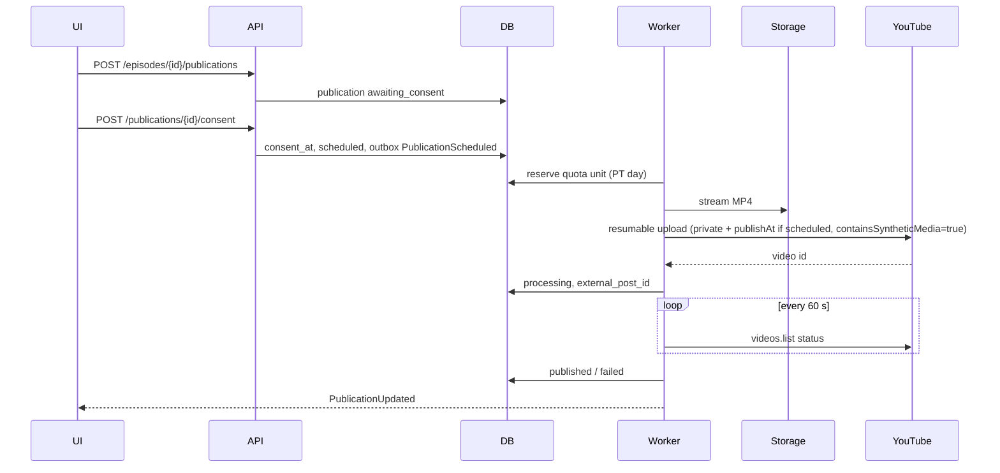

# 06 — YouTube Publishing (personal phase M1 → audit → M3)

> Contracts: `00-overview.md` §6 (`channel_connections`, `publications`, `platform_quota_usage`, `data_deletion_requests`), §7 Publication states, §8 routes. Backend skeleton: 09. Screens: 10.7. Compliance filings: 13. Facts: `../DECISIONS.md` §5.6, §10.4, §10.6.
> Level: **high-level plan — not the final plan.** It fixes scope, contracts, key decisions, risks and rough estimates only. Every feature in it will still get (1) a review of the relevant sections and (2) its own **detailed feature plan** in `plans/features/`, reviewed again before implementation (process and template: `00-overview.md` §10.1). Details and estimates here may change in that step.
> Delivery phase (personal-first, `00-overview.md` §4.1): P (built in the personal phase so autopilot publishes through the official API and the audit can be filed early) except S items 06.1.2-T3, 06.3.2, 06.3.3, 06.5.2. Where this plan says M1 for an S item, read M2.

## 1. Purpose and scope

**Goal:** a creator connects their own YouTube channel, and approved videos are uploaded or scheduled only with a per-video consent record (given by the user, or derived for autopilot from the owner's series authorization after a veto window), within the project-wide quota, in a way that passes YouTube's API compliance audit.

**In scope:** Google Cloud project + OAuth consent; connect/disconnect; token storage and health; upload (resumable) with metadata; scheduling; processing-status polling; global quota scheduler; revocation and deletion windows; audit + quota extension filing (with 13); feature flag.

**Out of scope:** analytics/statistics dashboards (would add stored-data duties); comments/community features; thumbnail upload (Could, later — costs quota ⚠️).

## 2. BA review of this part

| # | Finding (✅ = verified in official docs) | Consequence |
|---|---|---|
| Y1 | Default quota: 100 `videos.insert` calls/day per project, 1 unit each; daily quotas reset at **midnight Pacific Time** ✅ ([quota page](https://developers.google.com/youtube/v3/determine_quota_cost)) | Whole product ≈ 100 uploads/day until extension; scheduler counts in PT days |
| Y2 | Projects created after 2020-07-28: uploads locked to **private** until audited ✅ | Autopilot uploads (personal phase) and beta uploads stay private until the audit passes; UI must say so |
| Y3 | `status.publishAt` can be set **only if the privacy status is private** ✅ ([videos resource](https://developers.google.com/youtube/v3/docs/videos)) | Scheduled posts: upload `private` + `publishAt` |
| Y4 | `status.containsSyntheticMedia` exists ✅ | Always `true` |
| Y5 | Must not automate uploads without the user's prior specific and express consent ✅ (the rule; the autopilot mitigation below is ⚠️ [INFERENCE]) | Consent record per video (Publication cannot leave `awaiting_consent` without `consent_at`): given by the user, or written for autopilot by the scheduler from the owner's versioned series authorization after a veto window (06.2.2-T3) |
| Y6 | In-app revoke → revoke token right away + delete data within **7 days**; Google-page revoke → **30 days**; stored Authorized Data max 30 days then refresh/delete ✅ ([developer policies](https://developers.google.com/youtube/terms/developer-policies)) | Jobs in §5.4 |
| Y7 | Quota extension only via API Compliance Audit ✅ | File in M1 as soon as upload works and the privacy/terms pages are live (00 §4, 13.4.2) |
| Y8 | Google OAuth app verification requirements for `youtube.upload` ⚠️ — separate from the audit: verification removes the unverified-app screen and the 100-new-user cap; it does **not** lift the private lock (only the audit does, Y2) | Personal phase: app In production, unverified (00 §4.1); verification only for the SaaS (13.4.1, M2) |
| Y9 | API clients must link YouTube's Terms, have their own terms stating users agree to them, and require agreement to a privacy policy (III.A.1, III.A.2) ✅ ([developer policies](https://developers.google.com/youtube/terms/developer-policies)) | 13.1.1-T1, 13.1.2-T1 drafts and 10.3.1-T1 pages are P and live before the audit is filed |
| Y10 | Write operations: "users must have final control over the data that will be published" (III.C.3) ✅ ([developer policies](https://developers.google.com/youtube/terms/developer-policies)) | Autopilot shows each upcoming publication (title, description, tags, time) during the veto window with edit/cancel; whether the audit accepts series-level authorization is unverified ⚠️ — fallback: one-tap per-video approval from the notification |
| A1 | Minimal scopes: `https://www.googleapis.com/auth/youtube.upload` + a read scope to show the channel name ⚠️ (confirm the least-privileged scope for `channels.list?mine=true`) | Fewer scopes = easier verification |

## 3. Requirements

- **FR-06-1** Connect via server-side OAuth 2.0 authorization code flow with `state` + PKCE and offline access (refresh token).
- **FR-06-2** Store tokens encrypted (`ITokenProtector`); never expose them to the browser.
- **FR-06-3** Upload with the resumable protocol; metadata: title, description, tags, `privacyStatus`, optional `publishAt` (only with private ✅), `containsSyntheticMedia = true` ✅, `selfDeclaredMadeForKids = false` ([DECISION] horror/true crime is not for kids).
- **FR-06-4** Per-video consent record: `consent_at`, `consent_text_version`, `consent_source` (`user`/`autopilot`; for autopilot also the series authorization it came from), channel, schedule — shown in the UI and kept for the audit.
- **FR-06-5** Global quota ledger per PT day; reservation before upload; FIFO queue with per-user fairness cap.
- **FR-06-6** Poll processing status after upload until processed/failed/rejected; notify the user.
- **FR-06-7** Revocation flows and deletion windows per Y6; 30-day re-verification of stored data.
- **FR-06-8** All behind flag `youtube_publish`.
- **NFR-06-1** No upload without consent — enforced in the domain, not only in the UI.
- **NFR-06-2** Uploads survive network errors (resume from the last byte) and worker restarts.

## 4. Epics and user stories

### Epic 06.1 — Google project and OAuth setup

**06.1.1 Cloud project** — *As the operator I want one production Google Cloud project so that quota and audit belong to the product.* Must · S
- Given separate projects for staging and production, Then YouTube Data API v3 is enabled and the OAuth consent screen has app name, logo, support e-mail, privacy policy URL, terms URL, authorised domains, and only the scopes in A1.
- Given staging, Then test users are listed (unverified-app limits apply ⚠️).

**06.1.2 Connect channel** — *As a creator I want to connect my channel so that I can publish from Night Tales.* Must · M
- Given `POST /channels/youtube/connect`, When the user has no re-auth ≤ 5 min old (`POST /auth/reauth`: password, plus TOTP if enrolled, 09.3), Then 401 `reauth_required` and the UI opens the re-auth dialog; otherwise the API returns the Google authorization URL for the **currently active** YouTube OAuth client with `state` (bound to the user session and that client id, single use, 10 min) and a PKCE challenge.
- Given `GET /channels/youtube/callback?code&state`, When valid, Then tokens are exchanged with the client bound to `state`, channel id/title fetched, a `channel_connections` row saved (`active`, scopes, `oauth_client_id` = that client, `last_verified_at`), audit logged, the user e-mailed "YouTube channel {title} was connected" (time, IP/device, "This wasn't me" link to `/account/security`, 09.3.7), and the user redirected to `/channels?connected=youtube`.
- Given the owner configures a new YouTube OAuth client (a critical setting: second-owner approval or 24 h time-lock, 09.10), Then existing connections keep their pinned `oauth_client_id`: refresh, upload and revoke always use the client whose id matches the connection; only new connects use the new client; a client cannot be removed from settings while any `active` or `expired` connection references it, and the admin view shows connection counts per client so the old one can be retired after users reconnect.
- Given the user denies consent or `state` mismatches, Then no row is created and the UI shows the reason.
- Given the same channel is already connected by another user, Then 409 `channel_already_connected` [DECISION: one owner per channel].

### Epic 06.2 — Publishing

**06.2.1 Create publication** — *As a creator I want to fill in the post details so that the video is ready to publish.* Must · S
- Given a `ready` episode and an active YouTube connection, When `POST /episodes/{id}/publications`, Then a publication in `awaiting_consent` is created with title/description/tags/privacy/publish_at, validated against YouTube limits (title ≤ 100 chars, description ≤ 5,000 ⚠️ confirm current limits); the description gets the render's music attribution from `render_jobs.params.music.attribution` when present (a `CC-BY-4.0` track, 05 D8/T9) (05 CR-8), and a `youtube`-scope track (`platformScope = youtube`, 05 D8) blocks publication to any other platform (07) (05 CR-8).

**06.2.2 Consent** — *As a creator I want every upload to rest on my consent (per video, or my autopilot authorization with a veto window) so that nothing is posted without me.* Must · S
- Given `awaiting_consent`, When `POST /publications/{id}/consent` with the consent text version shown, Then `consent_at` is recorded and the publication moves to `scheduled` (queue time = now, or `publish_at − lead time`).
- Given a consent is recorded, Then the user is e-mailed (outbox, 09.3) "You approved a YouTube upload": channel title, video title, privacy, scheduled time, and a link to the publication page where it can be cancelled before upload (06.2.6); the e-mail is sent for every consent, so a stolen session cannot publish silently.
- Given an autopilot publication (02.8.3), Then it is created in `awaiting_consent` at least the veto window ([DECISION] default 12 h) before `publish_at − lead time`, and the owner gets an in-app notification **and an e-mail through the outbox** (06.2.2-T2) with the preview (title, description, tags, privacy, time) and edit/cancel links (the cancel link is a signed single-use token that can only cancel). If the e-mail was not delivered (`veto_notice_sent_at` empty), no consent is written and the series pauses (02.8.3). While the series is paused (`autopilot_paused_at` set), `AutopilotConsentJob` writes no consent for its publications (02 CR-14). When the window ends without a cancel, the scheduler writes `consent_at`, `consent_text_version` (the version the owner accepted when enabling autopilot), `consent_source = autopilot` and `autopilot_authorization_id` (00 §6) for **that** publication and moves it to `scheduled`; no owner action is needed. If the authorization was revoked (autopilot off, or a new consent text not yet re-accepted), no consent is written and the publication waits.
- Given an owner edit during the window (`PATCH /publications/{id}`), Then metadata validation (06.2.1) and the moderation gate (02.8.2) re-run; if they pass, the edit counts as the owner's own consent (`consent_source = user`, `consent_at` = edit time); if the owner reopens the episode's story or video, the pending publication is cancelled.
- Given the owner taps "Approve now" in the notification, Then `POST /publications/{id}/consent` records user consent immediately — this is also the fallback if the audit does not accept series-level authorization [OPEN — owner decides before 13.4.2 filing: accept one tap per video, or stay private-only].
- Given any code path, When a publication without `consent_at` reaches the upload job, Then the domain refuses and the job fails loudly (defence in depth).

**06.2.3 Upload job** — *As a creator I want reliable uploads so that big videos succeed on slow networks.* Must · L
- Given `PublishYouTubeJob`, When it runs, Then it re-checks consent + connection; reserves 1 quota unit (06.3); refreshes the access token if needed; streams the MP4 from object storage using the resumable upload API (official Google .NET client ⚠️ license check); sets `containsSyntheticMedia = true`; stores `external_post_id`; status → `processing`.
- Given a network error mid-upload, Then the job resumes the same upload session (session URI persisted in `platform_payload`).
- Given `quotaExceeded`, Then the unit is released, the publication returns to `scheduled` with `next_attempt_at` = next PT midnight, and the user is told.
- Given 401/`invalid_grant`, Then the connection → `expired` and the publication → `failed` with `channel_reauth_required`.
- Given Google answers `invalid_client` or `unauthorized_client` (our pinned OAuth client is broken, deleted or misconfigured, not the user's grant), Then the connection status is **unchanged**, the unit is released, the publication returns to `scheduled` with `next_attempt_at` held until an operator clears the incident, the user sees "YouTube publishing is temporarily unavailable" (no reconnect prompt), and a P1 platform incident alert (11.6.2) names the `oauth_client_id`.

**06.2.4 Scheduling** — *As a creator I want to schedule a publish time so that my channel posts regularly.* Must · S
- Given `publish_at` in the future, Then the upload happens early (lead time [DECISION] 2 h, or immediately if quota allows) as `private` with `publishAt` ✅; the UI shows "Scheduled on YouTube for …". 02 CR-14: while `youtube.audit_status ≠ approved` (pre-audit mode, 02.8.3-T3) the upload **omits `publishAt`** and stays private, because an unaudited project cannot go public and a stored `publishAt` would try to publish later.

**06.2.5 Processing status** — *As a creator I want to know when my video is live so that I can share it.* Must · S
- Given `PollYouTubeProcessingJob` (every 60 s, max 2 h), Then `uploadStatus`/`failureReason`/`rejectionReason` ✅ (fields of the videos resource) map to: processed → `published` (or stays `scheduled` if `publishAt` is in the future), rejected/failed → `failed` with reason; SignalR `PublicationUpdated`.
- Given a processed video that is still `scheduled`, Then a `PublicationGoLiveJob` is scheduled at `publish_at + 5 min`; it checks `status.privacyStatus` via `videos.list` and moves the publication to `published` (retry every 15 min for 2 h, then flag for admin review).

**06.2.6 Cancel** — *As a creator I want to cancel a scheduled post so that I can change my mind.* Should · S
- Given `scheduled` before upload, When `DELETE /publications/{id}`, Then → `cancelled` and any reserved quota is released. After upload, the UI links to YouTube Studio (we do not delete videos on the user's channel in MVP).

### Epic 06.3 — Global quota scheduler

**06.3.1 Quota ledger** — *As the operator I want to never exceed the project quota so that uploads do not fail randomly.* Must · M
- Given `platform_quota_usage(platform='youtube', quota_day=PT date)`, When an upload is about to start, Then a unit is reserved with an atomic `UPDATE … SET units_used = units_used + 1 WHERE units_used < units_limit`; no row updated → wait for the next PT day.
- Given `units_limit`, Then it is configurable (100 default ✅) and updated after an extension.

**06.3.2 Fairness** — *As a creator I want a fair share so that one heavy user cannot block everyone.* Must · S
- Given the queue, Then at most N uploads per user per PT day ([DECISION] 3 in beta), FIFO by `consent_at`; admins can override.

**06.3.3 Quota visibility** — *As the operator and users I want to see quota status so that expectations are clear.* Should · S
- Given `GET /admin/quota`, Then used/limit/queue length today and forecast; the publish form shows the estimated upload time when the queue is long.

### Epic 06.4 — Revocation, token health and data duties

**06.4.1 In-app disconnect** — *As a creator I want to disconnect easily so that I stay in control.* Must · S
- Given `DELETE /channels/{id}`, Then the token is revoked with Google **right away** ✅, the connection → `revoked`, pending publications → `cancelled`, and a `data_deletion_requests` row (`reason = in_app_revoke`, `due_at = now + 7 days` ✅) is created.

**06.4.2 Token health job** — *As the platform I want to detect revoked access so that we meet the 30-day duty.* Must · M
- Given `TokenHealthJob` (daily), When a refresh fails with `invalid_grant` (e.g. revoked on the Google security page), Then the connection → `revoked` and a deletion request (`reason = google_revoke`, `due_at = now + 30 days` ✅) is created.
- Given a refresh fails with `invalid_client` or `unauthorized_client`, Then it is a **platform incident**, never a user revoke: no connection changes status, no deletion request is created, the job stops refreshing connections of that `oauth_client_id` for this run, and one P1 alert (11.6.2) per client is raised with the count of affected connections; when the incident is cleared, the next run refreshes them normally.
- Given stored Authorized Data (channel title/id, video ids/status) older than 30 days ✅, Then it is refreshed via the API or deleted.

**06.4.3 Deletion execution** — *As the platform I want deletions done on time so that we stay compliant.* Must · S
- Given `DataDeletionJob` (13), Then YouTube-derived data (tokens, channel metadata, `external_post_id`, platform payloads) is deleted/anonymised before `due_at`; completion is logged; an alert fires if any request is within 24 h of `due_at`.

### Epic 06.5 — Audit and launch

**06.5.1 Audit evidence pack** — *As the operator I want a complete audit submission so that the extension is approved on the first try.* Must · M
- Given the **production** API project (the one being audited) and the owner's channel, Then the pack contains: screencast of policy acceptance → connect → publish form → consent → upload → disconnect, **and** autopilot on → series authorization text (version) → veto-window notice with edit/cancel/approve-now → scheduler consent row → upload; privacy policy and ToS URLs; data-flow diagram; data-retention and deletion table (7/30-day jobs live); quota justification (M1: the owner's cadence and daily cap; M2 re-filing: beta data); the synthetic-media flag; description of the consent model with the III.C.3 justification and the one-tap fallback. Filed via https://support.google.com/youtube/contact/yt_api_form ✅.

**06.5.2 Launch switch** — *As the operator I want a gradual rollout so that problems are contained.* Must · XS
- Given `youtube_publish` rules (`jsonb`), Then it can be enabled for admins → beta users → everyone.

## 5. Technical design

### 5.1 Components (Clean Architecture, 00 §5.2)

- Domain: `ChannelConnection` (connect, markVerified, revoke, expire; `OAuthClientId` fixed at connect), `Publication` (create, consent, schedule, startUpload, markProcessing, markPublished, fail, cancel) enforcing 00 §7.
- Application: `ConnectChannelCommand` (requires recent re-auth), `CompleteChannelOAuthCommand`, `DisconnectChannelCommand`, `CreatePublicationCommand`, `ConsentPublicationCommand`, `CancelPublicationCommand`, `GetChannelsQuery`, `GetPublicationsQuery`; port `IYouTubeClient`; `IOAuthClientResolver` returns the client credentials for a connection's `oauth_client_id` (shared with 07); `OAuthErrorClassifier` maps `invalid_grant` → user revoke/expiry and `invalid_client`/`unauthorized_client` → platform incident.
- Infrastructure: `GoogleYouTubeClient` (OAuth exchange, revoke, channels, resumable upload, videos.list status; credentials always from `IOAuthClientResolver`), `YouTubeQuotaLedger`.
- Jobs: `PublishYouTubeJob`, `PollYouTubeProcessingJob`, `TokenHealthJob`, `DataDeletionJob` (shared with 13). E-mails `ChannelConnected` and `PublicationConsented` go through the outbox.

### 5.2 Publish sequence

### 5.3 Error codes

`channel_already_connected`, `channel_reauth_required`, `oauth_state_invalid`, `publication_consent_required`, `youtube_quota_exhausted`, `youtube_upload_failed`, `youtube_rejected`, `feature_disabled`, `reauth_required` (401, shared with 09, on connect). A broken OAuth client (`invalid_client`/`unauthorized_client`) is **not** a user-facing error code: it is a platform incident and the publication waits in `scheduled`.

### 5.4 Data duty timers (✅ developer policies)

| Trigger | Action | Deadline |
|---|---|---|
| In-app disconnect | Revoke token now; delete YouTube data | 7 calendar days |
| User data deletion / account deletion | Delete | 7 calendar days |
| Refresh fails (Google-page revoke) | Delete | 30 calendar days |
| Stored Authorized Data age | Refresh or delete | every 30 calendar days |

## 6. Task breakdown

| Task ID | Task | Area | Size | Depends on |
|---|---|---|---|---|
| 06.1.1-T1 | Create staging/prod Google projects, consent screens (staging stays in Testing with 7-day re-auth and never uploads real content) | Ops | S | 10.3.1-T1 (privacy/terms URLs) |
| 06.1.2-T1 | Connect/callback commands + PKCE/state store | BE | M | 09.3 |
| 06.1.2-T2 | Channel info fetch + connection aggregate + pinned client resolver + connect e-mail (P half of the former 06.1.2-T3; 06 CR-7) | BE | M | 06.1.2-T1 |
| 06.1.2-T3 | Multi-client settings source (09.10) + client removal guard + admin connection counts (S; re-auth, pinning and connect e-mail moved to 06.1.2-T1/T2 in P, 06 CR-7) | BE | XS | 06.1.2-T1, 09.3, 09.10 |
| 06.2.1-T1 | Publication aggregate + create command + validation + `pu-` ETag + attribution + episode summary block (06 CR-7) | BE | M | 09.2 |
| 06.2.2-T1 | Consent command + domain guard | BE | S | 06.2.1 |
| 06.2.2-T2 | Consent e-mail per publication + veto-window notice with preview and signed cancel link (outbox) | BE | S | 06.2.2-T1 |
| 06.2.2-T3 | Autopilot consent (`AutopilotConsentJob`): veto window, per-publication consent row from `series_autopilot_authorizations`, revocation check, skip (no consent) while the series is paused (`autopilot_paused_at` set, 02 CR-14), `PATCH /publications/{id}` with re-validation | BE | M | 06.2.2-T2, 02.8.3-T1 |
| 06.2.2-T4 | "Approve now" one-tap consent from the notification (fallback path) | BE/FE | XS | 06.2.2-T3 |
| 06.2.3-T1 | Resumable upload client + session persistence | BE | L | 06.1.2 |
| 06.2.3-T2 | PublishYouTubeJob with error mapping | BE | M | 06.2.3-T1, 06.3.1 |
| 06.2.3-T3 | `OAuthErrorClassifier`: `invalid_client`/`unauthorized_client` → platform incident, publication held in `scheduled` | BE | XS | 06.2.3-T2, 11.6.2 |
| 06.2.4-T1 | Scheduling lead time + publishAt; omit `publishAt` in pre-audit mode (02 CR-14) | BE | S | 06.2.3 |
| 06.2.5-T1 | Processing poll job + go-live job + episode status (06 CR-7) | BE | M | 06.2.3 |
| 06.2.6-T1 | Cancel command | BE | S | 06.2.2 |
| 06.3.1-T1 | Quota ledger with PT day + atomic reserve/release | BE | M | 09.2 |
| 06.3.2-T1 | Fairness queue | BE | S | 06.3.1 |
| 06.3.3-T1 | Admin quota query (the publish ETA moved to 06.3.1-T1 in P, 06 CR-7) | BE | XS | 06.3.1 |
| 06.4.1-T1 | Disconnect + Google revoke + deletion request | BE | S | 06.1.2 |
| 06.4.2-T1 | Token health job + 30-day refresh | BE | M | 06.4.1 |
| 06.4.2-T2 | Token health incident path per `oauth_client_id` (no revoke, no deletion request) | BE | XS | 06.4.2-T1, 06.2.3-T3 |
| 06.4.3-T1 | YouTube data deletion handler + alert | BE | S | 13.3.1-T1 |
| 06.5.1-T1 | Evidence pack (filing is 13.4.2-T1) | BA | M | 10.7.1, 10.7.2, 10.7.4, 10.4.3, 06.2.2-T3, 06.4.3-T1, 13.1.1-T1, 13.1.2-T1, 13.2.1-T1, 10.3.1-T1 |
| 06.5.2-T1 | Flag rollout rules | BE | XS | 09.9.2 |

## 7. Test plan

- **Domain:** a Publication cannot reach `uploading` without consent; allowed transitions only; quota reservation never exceeds the limit under concurrency (integration test with parallel reservations).
- **Integration:** OAuth callback with forged `state` rejected; connect without a recent re-auth → 401 `reauth_required`; callback stores the client id bound to `state`, and after the active client changes an old connection still refreshes and uploads with its pinned client; removing a client still referenced by a connection is rejected; upload job against a fake YouTube server (resume after injected disconnect, `quotaExceeded`, `invalid_grant` → `expired`); `invalid_client` and `unauthorized_client` from upload and from `TokenHealthJob` → P1 alert, connection still `active`, no `data_deletion_requests` row, publication back in `scheduled`; one e-mail per connect and per consent; PT-day boundary maths across DST.
- **Manual (staging):** real upload to a test channel as private; scheduled publish; disconnect, then confirm the app disappears from the Google permissions page.

## 8. Risks and mitigations

| Risk | Mitigation |
|---|---|
| Audit takes months or is rejected | Owner/BA files in M1 as soon as upload works (13.4.2); until approval autopilot runs in pre-audit mode (private); if rejected: appeal (https://support.google.com/youtube/contact/yt_api_appeals), fix, re-file. Residual risk: the channel stays private and Gate 2 cannot be evaluated |
| 100/day ceiling blocks growth | Fairness caps, clear ETA, pricing aware of the ceiling; extension sized from beta data at the M2 re-filing |
| Upload failures on large files | Resumable protocol, persisted session URI, retries |
| Policy change | Watch developer policy updates (08); isolate behind `IYouTubeClient` |
| A broken or rotated OAuth client is read as mass user revocation and triggers deletion of every connection | `invalid_client`/`unauthorized_client` mapped to a platform incident, never to revoke/deletion; connections pinned to `oauth_client_id`; client changes are critical settings (09.10) |
| Stolen session connects an attacker's channel or publishes silently | Re-auth on connect; e-mail on every connect and every consent with a cancel path |

## 9. Exit criteria

- **M1:** connect, private publish and per-video consent work on staging with a test channel (evidence can be recorded; legal drafts ready).
- **M2:** beta users publish (private until audit) with consent and the quota ledger; disconnect + deletion timers tested.
- **M3:** audit approved and quota extension (if requested) granted; `youtube_publish` on for everyone.

## 10. Open questions and contract changes

- ⚠️ Least-privileged scope for reading the connected channel's title.
- ⚠️ Whether Google OAuth verification (sensitive/restricted scope review) applies to `youtube.upload`, and its timeline.
- **Contract changes (applied to 00):** `publications.next_attempt_at`; upload session URI in `platform_payload`; `channel_connections.oauth_client_id` (pinned client; replaces the former `oauth_project`).
- **Contract notes (no 00 change needed):** re-auth on `POST /channels/{platform}/connect` for every user is specified in 09.3.2 (401 `reauth_required`); e-mail templates `channel_connected` and `publication_consented` are plan-local (outbox e-mails); YouTube/TikTok client settings are keyed by `oauth_client_id` (09 §5.6) so retired clients stay resolvable.

## 11. Estimate summary

| Epic | Days |
|---|---|
| 06.1 Setup + connect | 2.75 |
| 06.2 Publishing | 8.5 |
| 06.3 Quota scheduler | 1.75 |
| 06.4 Revocation + data duties | 2.25 |
| 06.5 Audit + launch | 1.25 |
| **Total** | **16.5** → with 20 % buffer **19.8** person-days (P 15.25, S 1.25; 06 CR-7: was 15.0 / 18.0 — P re-estimated in `features/06-youtube-posting/README.md` §9) |
