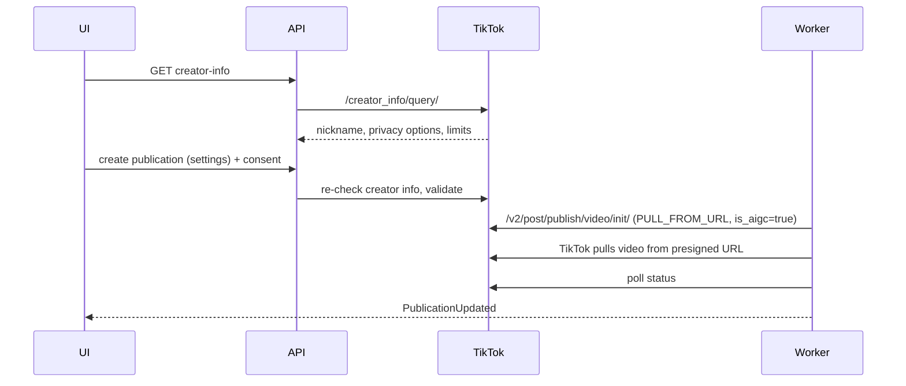

# 07 — TikTok Publishing (personal phase)

> Contracts: `00-overview.md` §6–§8. Screen: `10-web-ui.md` 10.7.3. Compliance: 13. Facts: `../DECISIONS.md` §5.6, §10.6 and the official pages cited below (✅ = read on that page).
> Level: **high-level plan — not the final plan.** It fixes scope, contracts, key decisions, risks and rough estimates only. Every feature in it will still get (1) a review of the relevant sections and (2) its own **detailed feature plan** in `plans/features/`, reviewed again before implementation (process and template: `00-overview.md` §10.1). Details and estimates here may change in that step.
> Delivery phase (personal-only, `00-overview.md` §4.1, DEC 10.14): all P (TikTok is kept in the personal product; the former phase-S tag is retagged P).

Sources: [Content Sharing Guidelines](https://developers.tiktok.com/doc/content-sharing-guidelines) · [Direct Post API reference](https://developers.tiktok.com/doc/content-posting-api-reference-direct-post).

## 1. Purpose and scope

**Goal:** the owner posts approved videos to their own TikTok account through the official Content Posting API (Direct Post), with TikTok's mandatory post screen, and passes TikTok's audit so that posts can be public.

**In scope:** TikTok developer app; OAuth (Login Kit) connect/disconnect; `creator_info` query; Direct Post init + upload; status polling; caps; audit.

**Out of scope:** photo posts; "upload to inbox/draft" mode (Could, later); TikTok analytics.

## 2. BA review of this part

| # | Finding | Consequence |
|---|---|---|
| K1 | Unaudited clients: all content restricted to **private** viewing ✅ | Posts stay `SELF_ONLY` until the audit passes; audit needed before public posting |
| K2 | Intended use: "A utility tool to help upload contents to the account(s) you or your team manages" is **not acceptable** ✅; clients must serve a wide audience ✅ | The audit is still required for public posts (K1). The personal product cannot claim a wide audience, so the submission states the single-owner use honestly ⚠️ and, if that is refused, posts stay `SELF_ONLY` (see §10) |
| K3 | Init endpoint `POST /v2/post/publish/video/init/`, scope `video.publish` ✅; each user access token limited to **6 requests per minute** ✅ | Client-side rate limiter per token |
| K4 | `post_info.privacy_level` must match `privacy_level_options` from `/creator_info/query/` ✅; values `PUBLIC_TO_EVERYONE`, `MUTUAL_FOLLOW_FRIENDS`, `FOLLOWER_OF_CREATOR`, `SELF_ONLY` ✅ | Screen built from the API response, no default |
| K5 | Fields `disable_comment`, `disable_duet`, `disable_stitch`, `brand_content_toggle`, `brand_organic_toggle`, `is_aigc` ✅ | Map from the required UI; `is_aigc = true` always [DECISION] |
| K6 | `source_info.source` = `PULL_FROM_URL` with a ≥ 2 h presigned https URL from our storage under a domain/URL prefix verified in the app ✅ | Do not use `FILE_UPLOAD` for server-side content [DECISION, 07 README D2] (07 CR-1) |
| K7 | Caps: 24-hour active-creator cap per client (from the audit estimate) and ~15 posts/day per creator, shared across apps ✅ | Show remaining posts; handle cap errors gracefully |
| K8 | Required UX items (nickname, privacy with no default, interaction settings, commercial disclosure, music usage confirmation, max duration) ✅ | Enforced in the UI **and** validated in the backend |
| A1 | Token lifetimes, refresh flow, revoke endpoint, status fetch endpoint ⚠️ (not read yet) | Read Login Kit and status docs in 07.1.1 |

## 3. Requirements

- **FR-07-1** Connect TikTok via OAuth with `state` + PKCE; scopes: `video.publish` ✅ + the minimum needed for `creator_info` and user identity ⚠️.
- **FR-07-2** Post-screen data from `/creator_info/query/` fetched fresh every time the page opens ✅.
- **FR-07-3** Backend validates: privacy value ∈ returned options; interaction flags do not enable what the creator disabled; video duration ≤ `max_video_post_duration_sec` ✅; consent recorded with the music usage confirmation text version ✅.
- **FR-07-4** Upload via `PULL_FROM_URL` with a ≥ 2 h presigned https URL from our storage (07 CR-1); poll status until published/failed.
- **FR-07-5** Respect 6 requests/min per token ✅ and the per-creator daily cap ✅.
- **FR-07-6** Disconnect revokes access (⚠️ endpoint) and deletes TikTok data per our privacy policy (13).
- **FR-07-7** Behind flag `tiktok_publish`.

## 4. Epics and user stories

### Epic 07.1 — App and connect

**07.1.1 Developer app + docs read** — *As the operator I want the TikTok app configured so that we can test.* Must · S
- Given developers.tiktok.com, Then the app has Login Kit + Content Posting API, redirect URIs for staging/prod, privacy/ToS URLs; the team reads and records (✅ with URLs) token lifetimes, refresh, revoke, status fetch, error codes and the domain-verification steps for `PULL_FROM_URL` (07 CR-1).

**07.1.2 Connect/disconnect** — *As a creator I want to connect my TikTok account so that I can post from Night Tales.* Must · M
- Given `POST /channels/tiktok/connect`, When the user has no re-auth ≤ 5 min old (`POST /auth/reauth`, same rule as 06.1.2), Then 401 `reauth_required`; otherwise the authorization URL for the **currently active** TikTok client is returned with `state` bound to the session and that client key.
- Given the callback, Then a `channel_connections` row (`platform = tiktok`, `oauth_client_id` = the client bound to `state`) is stored with encrypted tokens and display name, and the user is e-mailed "TikTok account {nickname} was connected" (time, IP/device, "This wasn't me" link to the static `/account/security` path, same as 06.1.2-T2; the former sessions story 09.3.7 is deleted by DEC 10.14).
- Given the owner configures a new TikTok client (configuration, no admin settings surface in the personal product, DEC 10.14), Then existing connections keep their pinned `oauth_client_id` for refresh, posting and revoke (resolved through the shared `IOAuthClientResolver`, 06 §5.1); only new connects use the new client; the app refuses to start with a client map that drops an id referenced by any `active` or `expired` connection.
- Given `DELETE /channels/{id}`, Then tokens are revoked with the connection's pinned client (⚠️ endpoint), pending publications cancelled, and a deletion request created (13 timers).
- Given a TikTok OAuth error meaning our client is invalid or unauthorized (`invalid_client`/`unauthorized_client` ⚠️ exact TikTok error names recorded in 07.1.1), from refresh, `TokenHealthJob` or posting, Then it is a **platform incident**: no connection status change, no deletion request, the publication is held in `scheduled`, the user sees "TikTok publishing is temporarily unavailable", and a P1 alert (11.6.2) per `oauth_client_id` is raised; only a user-grant error (revoked/expired refresh token ⚠️) marks the connection `expired`/`revoked` with `tiktok_reauth_required`.

### Epic 07.2 — Required post screen (backend side)

**07.2.1 Creator info endpoint** — *As the post screen I want current creator info so that options are correct.* Must · S
- Given `GET /channels/{id}/tiktok/creator-info`, Then the API calls `/creator_info/query/` ✅ and returns nickname, avatar, `privacy_level_options`, interaction availability, `max_video_post_duration_sec`, and whether the creator can post now; never cached beyond the page view.

**07.2.2 Validate and consent** — *As the platform I want server-side checks so that a modified client cannot bypass TikTok rules.* Must · M
- Given `POST /episodes/{id}/publications` for TikTok, Then the body must include privacy (no default), interaction flags, commercial disclosure choices, and a title ≤ 2,200 UTF-16 runes ✅; the backend re-queries creator info and rejects invalid combinations with `tiktok_invalid_post_settings`.
- Given `POST /publications/{id}/consent`, Then the consent text includes "By posting, you agree to TikTok's Music Usage Confirmation" ✅ (plus the branded-content wording when selected ⚠️ exact text from the guidelines) and its version is stored.
- Given a consent is recorded, Then the user is e-mailed "You approved a TikTok post" (account nickname, title, privacy level, link to cancel before upload), once per consent, through the shared `PublicationConsented` outbox e-mail (06.2.2).

### Epic 07.3 — Posting

**07.3.1 Init + presigned-URL pull (07 CR-1)** — *As a creator I want my video posted reliably so that it appears on TikTok.* Must · L
- Given `PublishTikTokJob`, Then it calls `/v2/post/publish/video/init/` ✅ with `post_info` (privacy_level, title, disable_* flags, brand toggles, `is_aigc = true` ✅) and `source_info` (`PULL_FROM_URL`, a ≥ 2 h presigned https URL from our storage under a verified domain/URL prefix ✅, 07 CR-1), then TikTok pulls the video directly — no client-side chunk upload.
- Given the per-token limit, Then calls are throttled to ≤ 6/min per token ✅.

**07.3.2 Status polling** — *As a creator I want to know when it is live so that I can share it.* Must · S
- Given the publish id, Then a poll job (⚠️ status endpoint) moves the publication `processing` → `published` / `failed` with reason; SignalR notifies.

**07.3.3 Caps and errors** — *As a creator I want clear messages when TikTok limits me so that I retry at the right time.* Must · S
- Given cap / "cannot post now" responses, Then the publication fails with `tiktok_creator_cap` or `tiktok_cannot_post_now` and the UI explains; no automatic retry loops.

### Epic 07.4 — Audit

**07.4.1 Audit submission** — *As the operator I want the audit approved so that posts can be public.* Must · M
- Given the staging app, Then the submission includes: description of the intended use for the owner's own channel (honest single-owner scope, K2), screencast of the required post screen with every item, consent text, data-handling summary, expected creator volume for that channel (sets the active-creator cap ✅).

## 5. Technical design

- Domain reuses `ChannelConnection` and `Publication`; TikTok settings live in `publications.platform_payload` (`privacy_level`, `disable_comment`, `disable_duet`, `disable_stitch`, `brand_content_toggle`, `brand_organic_toggle`, `is_aigc`, `publish_id`).
- Application: `GetTikTokCreatorInfoQuery` (the one documented CQRS exception in 00 §5.2: live read-only lookup through the `IExternalLookup` port, nothing persisted, rate-limited), `CreateTikTokPublicationCommand` (validator re-checks creator info), shared `ConsentPublicationCommand`; port `ITikTokClient`.
- Infrastructure: `TikTokClient` (OAuth, creator info, init with `PULL_FROM_URL`, status) with a per-token rate limiter (token bucket 6/min ✅) (07 CR-1).
- Jobs: `PublishTikTokJob`, `PollTikTokStatusJob`, `TokenHealthJob` (shared, incl. the 06.4.2 incident rule per `oauth_client_id`); the shared `OAuthErrorClassifier` (06 §5.1) gets a TikTok mapping.

Error codes: `tiktok_invalid_post_settings`, `tiktok_cannot_post_now`, `tiktok_creator_cap`, `tiktok_video_too_long`, `tiktok_reauth_required`, `tiktok_upload_failed`; `reauth_required` (401, shared with 09) on connect. A broken TikTok client is a platform incident, not a user error code.

## 6. Task breakdown

| Task ID | Task | Area | Size | Depends on |
|---|---|---|---|---|
| 07.1.1-T1 | Create app; read + record Login Kit/status/revoke docs | Ops/BA | S | 13.1.1-T1, 13.1.2-T1 (URLs) |
| 07.1.2-T1 | OAuth connect/callback/disconnect | BE | M | 06.1.2 patterns |
| 07.1.2-T2 | Re-auth on connect, `oauth_client_id` pinning via `IOAuthClientResolver`, connect e-mail, TikTok mapping in `OAuthErrorClassifier` (client error → incident) | BE | S | 07.1.2-T1, 06.1.2-T2, 06.2.3-T3 |
| 07.2.1-T1 | Creator info query endpoint | BE | S | 07.1.2 |
| 07.2.2-T1 | Server-side validation + consent text versions | BE | M | 07.2.1 |
| 07.2.2-T2 | Consent e-mail per TikTok publication | BE | XS | 07.2.2-T1, 06.2.2-T2 |
| 07.3.1-T1 | Init + presigned-URL pull + rate limiter (07 CR-1: L→M) | BE | M | 07.2.2 |
| 07.3.2-T1 | Status poll job (07 CR-1: S→M) | BE | M | 07.3.1 |
| 07.3.3-T1 | Cap/error mapping | BE | S | 07.3.1 |
| 07.4.1-T1 | Audit evidence + submission | BA | M | 10.7.3-T1, 10.7.3-T2 (10 CR-27) |
| 07.4.1-T2 | Post-approval enablement for the owner's account: public posting switched on after approval + U1–U13 re-run (07 CR-1) | BA/Ops | S | 07.4.1-T1 |

## 7. Test plan

- **Unit:** validation matrix (privacy not in options, interaction enabled while creator disabled, duration over max, missing consent).
- **Integration:** fake TikTok server — init, presigned-URL pull with retry (07 CR-1), 429 on the 7th request in a minute, cap error; connect without recent re-auth → 401; old connection keeps posting with its pinned client after the active client changes; client-invalid error → P1 alert, connection still `active`, no deletion request, publication back in `scheduled`; revoked user grant → `tiktok_reauth_required`; one e-mail per connect and per consent.
- **Manual (staging):** post to a test account (private while unaudited ✅); verify the AI-generated label appears.

## 8. Risks and mitigations

| Risk | Mitigation |
|---|---|
| Audit rejection over UX details | Checklist from the guidelines; screenshots reviewed item by item before filing |
| Unverified API details (status/revoke) | 07.1.1 reads docs first; client isolated behind `ITikTokClient` |
| A broken or rotated TikTok client is read as mass revocation and deletes every connection | Client errors → platform incident, never revoke/deletion; connections pinned to `oauth_client_id` (shared rule with 06) |
| Low daily caps | Show remaining posts in the UI; no volume commitment — the owner posts at their own cadence |

## 9. Exit criteria (personal phase)

- Posts succeed from staging with every required UX item (private/`SELF_ONLY` until the audit passes); validation tests green; audit filed → approved → public posting enabled; flag enabled for the owner's account.

## 10. Open questions and contract changes

- ⚠️ Minimum scopes beyond `video.publish`; token lifetimes; revoke and status endpoints; exact OAuth error names for an invalid client vs a revoked user grant.
- ⚠️ K2: TikTok requires clients to serve a wide audience, so the audit may refuse a single-owner intended use; if it does, the TikTok channel stays `SELF_ONLY` (private) and only the YouTube path goes public (DEC 10.14).
- ⚠️ Whether TikTok Creator Rewards is available in Vietnam (DECISIONS §8) — affects marketing, not the build.
- **Contract changes (applied to 00):** `channel_connections.oauth_client_id` (pinned client, shared with 06); settings in `platform_payload`.
- **Contract notes (no 00 change needed):** same as 06 §10 (re-auth on connect in 09.3.2; `channel_connected`/`publication_consented` e-mails are plan-local).

## 11. Estimate summary

| Epic | Days |
|---|---|
| 07.1 App + connect | 2.0 |
| 07.2 Post screen (backend) | 1.75 |
| 07.3 Posting (07 CR-1: 3.0→2.5) | 2.5 |
| 07.4 Audit (07 CR-1: 1.0→1.5) | 1.5 |
| **Total** | **7.75** → with 20 % buffer **9.3** person-days (all P) |
