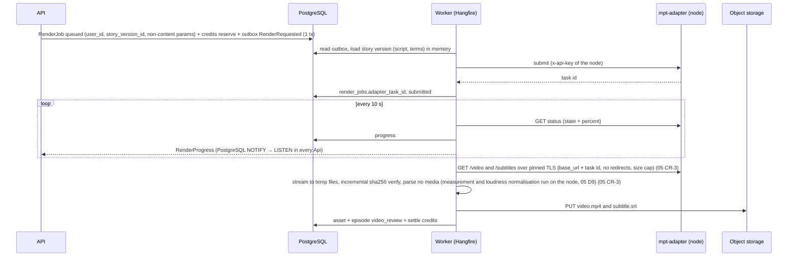

# 09 — Backend API (.NET 10, Clean Architecture + CQRS) (M1)

> Contracts: `00-overview.md` §5.1–5.4 (stack, layers, CQRS rules, standards), §6 tables, §7 state machines, §8 routes. Feature rules live in 02 (story), 03 (images), 05 (render contract), 06/07 (publishing), 12 (credits), 13 (compliance). This plan owns **the backend skeleton, cross-cutting concerns and every command/query handler**.
> Level: **high-level plan — not the final plan.** It fixes scope, contracts, key decisions, risks and rough estimates only. Every feature in it will still get (1) a review of the relevant sections and (2) its own **detailed feature plan** in `plans/features/`, reviewed again before implementation (process and template: `00-overview.md` §10.1). Details and estimates here may change in that step.
> Delivery phase (personal-first, `00-overview.md` §4.1): P except the S items listed in `00-overview.md` §4.1 (registration/account-security extras, activity feed 09.3.6-T2 (09.3.6-T1 audit infrastructure is P, 02 CR-3), sessions list, admin endpoints, feature flags, and 09.10 except TOTP enrolment). Where this plan says M1 for an S item, read M2.

## 1. Purpose and scope

**Goal:** a secure, testable ASP.NET Core 10 backend that runs the episode journey (story → approve → render → review → download/publish) for many users, built with Clean Architecture and CQRS.

**In scope:** solution skeleton and architecture tests; persistence; auth; users; series; episodes/story/render handlers; assets and signed URLs; outbox + Hangfire jobs; SignalR; admin; feature flags; observability; security hardening; OpenAPI + client generation.

**Out of scope:** platform-specific publishing logic (06/07), pricing rules (12), legal texts (13), Angular (10), worker node (11).

## 2. BA and Tech Lead review of this part

| # | Finding | Decision |
|---|---|---|
| T1 | CQRS can turn into ceremony for a small team | "CQRS light": one DB, separate command/query paths, no event sourcing, no separate read store (00 §5.2) |
| T2 | Jobs enqueued inside a request can be lost if the transaction rolls back (or vice versa) | Transactional **outbox**: domain events saved with the aggregate; Worker dispatches → Hangfire |
| T3 | MediatR 14 is RPL-1.5 or commercial ✅ | Use `Mediator` (MIT ✅) — same `IRequest`/`ISender` style, source-generated, no reflection |
| T4 | Paid actions + retries = double charges | `Idempotency-Key` behaviour + `idempotency_keys` table; credit ledger `idempotency_key` unique |
| T5 | Long work (OpenAI, MPT, uploads) must never run inside HTTP requests | Commands return `202 Accepted`; jobs do the work; SignalR reports progress |
| T6 | Multi-tenant data leaks are the #1 SaaS risk | Every user-derived table carries `user_id` and implements `IUserOwned`; EF global query filters + an authorization behaviour; Worker jobs run under `SystemContext(userId)` with filters on; the cross-tenant test table is generated from `openapi.json` (09.2.3) |
| T7 | Refresh tokens in `localStorage` are an XSS risk | Access token (short, in memory) + refresh token in `HttpOnly; Secure; SameSite=Strict` cookie, rotation + reuse detection |
| T8 | Hangfire license not confirmed ⚠️ | Hide behind `IJobScheduler` port so it can be swapped (e.g. Quartz.NET ⚠️ license check) |
| A1 | Single region, single PostgreSQL primary for beta | OK for ≤ 1,000 users [INFERENCE]; revisit in 08 |

## 3. Requirements

**Functional**
- **FR-09-1** Registration with e-mail verification, login, logout, refresh, forgot/reset password; brute-force protection per (account, IP/device) with progressive delay and CAPTCHA after 3 failures (no global account lock); breached-password check (09.3).
- **FR-09-2** Profile: display name, UI locale (`vi`/`en`); data export; deletion request (13).
- **FR-09-3** Series CRUD with topic, language, aspect, voice, style template, default channel.
- **FR-09-4** Episode lifecycle per 00 §7 through commands only; illegal transitions return `409 episode_invalid_state`.
- **FR-09-5** Story commands (generate/edit/approve/reopen) per plan 02.
- **FR-09-6** Render commands and jobs per plan 05 contract (submit, poll, ingest, retry, cancel).
- **FR-09-7** Video review: approve/reject; signed download URL (≤ 15 min).
- **FR-09-8** Real-time updates over SignalR for episode, render, publication, credit balance.
- **FR-09-9** Admin: users (search, detail, suspend/unsuspend, sessions, verification, password/MFA reset, roles, grant credits, deletion), render jobs, usage/cost, moderation events, quota, feature flags.
- **FR-09-10** Retention: delete assets past `retention_until`; honour deletion requests within SLA (13).
- **FR-09-11** System configuration: the owner edits provider API keys, base URLs and runtime options of every integration in the admin UI without redeploying; secrets are write-only and encrypted at rest (Epic 09.10).
- **FR-09-12** Users can see their own activity history (account and security events, episode actions, publishing, credits and payments, and actions support staff took on their account) and their active sessions (09.3.6, 09.3.7).

**Non-functional**
- **NFR-09-1** p95 < 300 ms for non-generation endpoints at 50 RPS on one API instance [target].
- **NFR-09-2** Zero cross-tenant reads/writes (tested).
- **NFR-09-3** Bootstrap secrets (DB, Data Protection key-encryption key, JWT signing key, storage credentials, public URLs/OAuth redirect URIs, URL allow-lists) only from environment/secret store; integration secrets edited in the admin UI are encrypted at rest and never returned by any API (09.10.1); OAuth tokens encrypted at rest.
- **NFR-09-4** Structured logs + traces with correlation id from HTTP → outbox → job → external call.
- **NFR-09-5** Build fails on architecture-rule violation, analyzer warning, or failing test.
- **NFR-09-6** Migrations are backward compatible for one release (expand → migrate → contract).

## 4. Epics and user stories

### Epic 09.1 — Solution skeleton and architecture guardrails

**09.1.1 Create solution** — *As the Tech Lead I want the Clean Architecture solution so that every feature has one obvious place.* Must · M
- Given an empty repo, When the solution is created, Then projects and references match 00 §5.2 exactly (Domain references only `ErrorOr`; Application references Domain + Mediator.Abstractions + FluentValidation + ErrorOr + `Microsoft.EntityFrameworkCore` core (09 CR-1); Infrastructure/Api/Worker reference Application).
- Given `Directory.Build.props`, When building, Then `Nullable`, `TreatWarningsAsErrors`, analyzers, `LangVersion` latest, central package management (`Directory.Packages.props`) apply to all projects.

**09.1.2 Architecture tests** — *As the Tech Lead I want the layer rules tested so that they cannot erode.* Must · S
- Given `NightTales.Architecture.Tests`, When Domain references `Microsoft.EntityFrameworkCore` or `Microsoft.AspNetCore`, Then the test fails.
- Given a handler, When it is not `sealed` or not in `Features/*/Commands|Queries/*`, Then the test fails.
- Given Api, When it references `NightTales.Infrastructure.Persistence` types other than in `Program.cs`/DI extensions, Then the test fails.

**09.1.3 Mediator pipeline** — *As a developer I want cross-cutting behaviours in one place so that handlers stay small.* Must · M
- Given any request, When sent, Then behaviours run in order: `LoggingBehavior` → `AuthorizationBehavior` → `ValidationBehavior` → `UnitOfWorkBehavior` (only `ICommand`; opens the transaction before the handler) → `IdempotencyBehavior` (only `IIdempotentCommand`; claims the key inside that transaction) → `AuditBehavior` (09.3.6-T1) (09 CR-2).
- Given a validator failure, When sent, Then no handler runs and `ErrorOr` returns `Validation` errors mapped to 400 with field errors.
- Given a query, When sent, Then `UnitOfWorkBehavior` does not run and no `SaveChanges` happens.

**09.1.4 Result → HTTP mapping** — *As the Angular client I want consistent errors so that one mapper handles them.* Must · S
- Given `ErrorOr` errors, When returned from an endpoint, Then each error code maps to the HTTP status in the catalogue (§5.4): `Validation`→400, `Unauthorized`→401, `insufficient_credits`→402, `Forbidden`→403, `NotFound`→404, `Conflict`→409, `story_version_conflict`/`fact_sheet_conflict`/`setting_conflict`→412, `idempotency_key_reused`→422, limits→429 (the mapper sets `Retry-After` from `retryAfterSeconds` on every 429 that carries it, 02 CR-20), `render_worker_unavailable`/provider outages→503/502, unexpected→500; every response is ProblemDetails with `code`, `traceId`, and `errors` for validation. Accepted-but-pending outcomes (`setting_change_pending`, `owner_action_pending`, `grant_requires_approval`) are 202 bodies, not ProblemDetails.
- Given a code not in the catalogue, When returned, Then an architecture/unit test fails (the catalogue is a closed `static class ErrorCodes` + mapping table).

**09.1.5 CI pipeline** — *As the team I want CI on every PR so that main is always releasable.* Must · S
- Given a PR, When CI runs, Then restore, build, unit, architecture, integration (real PostgreSQL 17 via `PostgresFixture`, `NTS_TEST_PG` — 09 W3 CR-35) tests and `dotnet format --verify-no-changes` pass; an OpenAPI document artifact is produced.

### Epic 09.2 — Persistence

**09.2.1 DbContexts** — *As a developer I want a write model and a read path so that CQRS rules are easy to follow.* Must · M
- Given `AppDbContext` (tracked) implementing `IAppDbContext`, and `ReadDbContext` (`QueryTrackingBehavior.NoTracking`) implementing `IReadDb`, When configured, Then both use Npgsql, snake_case naming, UTC `timestamptz`, and `xmin` concurrency tokens on aggregates.
- Given `ReadDbContext`, When `SaveChanges` is called, Then it throws (read-only by design).

**09.2.2 Entity configurations and migrations** — *As a developer I want all 00 §6 tables so that features can be built.* Must · XL
- Given the domain model, When the initial migration is generated, Then every table/column/index of the P core set exists (09 CR-5; other tables come with their owning features, `features/09-backend-api/README.md` D9), including unique indexes (`users.email`, `credit_ledger.idempotency_key`, `payments.provider_payment_id`, `idempotency_keys(user_id,key)`), FK indexes, and enum columns stored as text with check constraints.
- Given a migration, When it runs in CI against an empty DB and against the previous schema with seed data, Then both succeed.

**09.2.3 Tenant filter and `SystemContext`** — *As the platform I want every user-owned row filtered by owner, in the API and in the Worker, so that tenants cannot see each other.* Must · L
- Given `render_jobs`, `publications`, `story_versions`, `story_sources`, `fact_sheets` and `series_bibles`, Then each has a denormalized `user_id` (set from the parent episode/series at insert, never from the request body) and implements `IUserOwned`, like every other user-owned table (00 §6).
- Given entities implementing `IUserOwned`, When queried without an admin context, Then an EF global query filter `UserId == currentUser.Id` applies.
- Given user A, When requesting user B's episode, render job, publication, source, fact sheet or bible by id, Then the API returns 404 (not 403, to avoid id probing).
- Given `NightTales.Architecture.Tests`, When an entity has an `episode_id` or `series_id` foreign key and does not implement `IUserOwned`, Then the test fails.
- Given a Worker job started from an outbox message, Then it runs under `SystemContext(userId)` taken from the outbox payload: `ICurrentUser.Id = userId`, filters stay **on**, and a missing `userId` in the payload fails the job instead of running unfiltered.
- Given `IgnoreQueryFilters`, Then it is allowed only in `Features/Admin` (09.9.1) and in the named system jobs on the architecture-test allow-list (`RetentionSweepJob`, `DataDeletionJob`, `CreditReconciliationJob`); any other call site fails the test. Recurring sweeps that must find work across users (e.g. `CreditExpiryJob`, `TokenHealthJob`) read only `(id, user_id)` pairs through one allow-listed system query and process each item under `SystemContext(userId)` [DECISION].
- Given CI, Then the cross-tenant integration test table is **generated from `openapi.json`** (every route with an `{id}`-style path parameter, every verb): user B's resource ids are seeded, user A calls each route, and anything other than 404 fails; a route missing from the generated table fails the build.

**09.2.4 Outbox** — *As the platform I want domain events stored with state changes so that jobs are never lost or duplicated.* Must · M
- Given an aggregate raising `StoryGenerationRequested`, When the command commits, Then the event row is in `outbox_messages` in the same transaction.
- Given the Worker's `OutboxDispatcher` hosted service (every 5 s, 09 CR-3), When it runs, Then unprocessed messages are handled at-least-once, marked `processed_at`, retried with backoff up to 10 attempts, and handlers are idempotent (keyed by message id).

**09.2.5 Seed data** — *As a developer I want catalogs seeded so that local dev works immediately.* Must · S (split: T1 catalogs + flags, T2 owner seed after 09.3.1-T1; 09 CR-11)
- Given a fresh DB, When the app starts in Development, Then `voices`, `style_templates`, `feature_flags` (all publishing off), and one `owner` user (from env; MFA enrolment forced at first login, 09.10.4) are seeded idempotently.

**09.2.6 Worker host + Hangfire (PostgreSQL storage) + `IJobScheduler` + recurring jobs + dashboard auth** (split: T1 host, T2 dashboard after 09.10.4-T1; 09 CR-11) — *As the platform I want one Worker composition root with a job scheduler so that the outbox, render and billing jobs have somewhere to run.* Must · M
- Given `NightTales.Worker`, When it starts, Then Hangfire server runs on PostgreSQL storage (same database, own schema), with named queues (`default`, `render`, `publish`, `email`). There is **no** `fetch` queue: the fetcher container is a pull client of the Api internal listener `:8081` (lease → heartbeat → result) and has no DB or Hangfire access (02 CR-1, 02 README D10) and worker counts from configuration.
- Given the `IJobScheduler` port (Application), Then handlers and outbox handlers enqueue and schedule through it only; Hangfire types appear only in Infrastructure and the Worker/Api composition roots (architecture test).
- Given the recurring jobs in §5.3, Then they are registered idempotently at Worker start (`AddOrUpdate` by stable id) and removed jobs are deleted.
- Given any Hangfire job, Then its arguments carry ids only (episode id, render job id, message id, user id), never story text, keywords, prompts, tokens or secrets; an architecture test fails when a job method takes a `string` parameter not on an allow-list of id/enum names.
- Given the Hangfire dashboard, Then it is hosted in the Api at `/internal/jobs` with its own cookie authentication issued only after password + TOTP (09.10.4); owners get write actions (retry, delete, trigger), admins read-only, everyone else 404; antiforgery is on for every dashboard POST; access writes `audit_logs`; IP-restricted where the host allows it.

### Epic 09.3 — Authentication and users

**09.3.1 Register and verify e-mail** — *As a visitor I want to create an account so that I can use the platform.* Must · L (09 W2 CR-3: in P only Identity setup, closed registration and consents — 09.3.1-T1; register + verify are S — 09.3.1-T3)
- Given a new e-mail and a password meeting policy (≥ 12 chars), When `POST /auth/register` with accepted ToS/Privacy versions, Then the user is created `active` but `email_confirmed = false`, `user_consents` rows are written, and a verification e-mail is sent via outbox.
- Given an e-mail that already has an account, When `POST /auth/register`, Then the response is identical to a new registration (same status, body and timing budget) and the existing owner gets an "someone tried to register with your e-mail" message instead of a verification link (no user enumeration).
- Given a password on register, reset or change, When it appears in a breached-password source (k-anonymity range API ⚠️ provider and terms to confirm, or a bundled top-N list as fallback [DECISION]), Then 400 `breached_password`; only the first 5 hex characters of the SHA-1 hash ever leave the server.
- Given a verification token, Then it is single-use, valid ≤ 24 h and stored hashed; a used or expired token returns 400 `validation_failed` with a "send again" option.
- Given an unverified user, When calling paid endpoints, Then 403 `email_not_verified`.

**09.3.2 Login, refresh, logout, security stamp** — *As a user I want to stay signed in safely so that I do not re-enter my password constantly.* Must · L
- Given valid credentials, When `POST /auth/login`, Then a JWT access token (15 min; admin/owner 5 min, 09.10.4) carrying a `security_stamp` claim is returned in the body and a refresh token (14 days, rotating) is set as an `HttpOnly; Secure; SameSite=Strict; Path=/api/v1/auth` cookie.
- Given valid credentials for a user with MFA enrolled, When `POST /auth/login`, Then no tokens are issued: 401 `mfa_required` with an `mfaToken` (opaque, stored hashed in `auth_challenges`, single use, 5 min, bound to the user and to a pre-auth `HttpOnly; Secure; SameSite=Strict` cookie set by `POST /auth/login`, plus the user agent; an IP change between the two steps (Wi-Fi→mobile, CGNAT) does not reject the code but writes an `account_security` audit row and, for admin/owner, a D9 security event); `POST /auth/login/mfa` with `mfaToken` + TOTP code or one recovery code issues the tokens above. A wrong code → 401 `invalid_mfa_code` and counts as a login failure for the CAPTCHA rule of 09.3.3; after 5 wrong codes the `mfaToken` is revoked and login restarts; an expired/used/unknown token → 401 `mfa_token_invalid`. An **account-wide** MFA failure counter (all IPs and tokens) is a detector, not a lock: after 10 failures in 1 h it e-mails the user "someone knows your password — change it", raises a D9 security event for admin/owner and requires a CAPTCHA on each further MFA attempt; progressive delay (429 `rate_limited` with `Retry-After`) applies only per (account, pre-auth cookie) and per IP; a device holding a valid `trusted_device` cookie (set after a successful MFA login; `__Host-` prefix, `HttpOnly; Secure; SameSite=Strict`, 30 days, stored hashed in `trusted_devices`, bound to the user id and to the refresh family it created, so revoking that session revokes the device; revoked by every credential event, suspend and restore, 09.3.2; shown as a "trusted" badge per session in `/account/security`) is never delayed, so a stranger with the password cannot lock the real user out (09.3.3). A trusted device never skips the TOTP step. **Hard ceiling:** after 50 failed MFA codes in 24 h for the account, the MFA step is refused (429 `mfa_locked_untrusted`) from every device without a valid trusted-device cookie until the user completes an e-mailed password reset or 24 h pass; trusted devices keep working. The pre-auth cookie also uses the `__Host-` prefix. The last accepted TOTP time-step is stored per user (`users.last_totp_step`) and a code for that step or an earlier one is rejected (no replay). A used recovery code is consumed, audited (`account_security`, user-visible), revokes every other refresh family and e-mails the user; for admin/owner every owner also gets a D9 security event.
- Given a refresh token that was already used, When presented again, Then the whole token family is revoked and 401 `refresh_token_reused` is returned (theft detection).
- Given `POST /auth/logout`, Then the current refresh token is revoked and the cookie cleared.
- Given any authenticated request (every route, including `/me/*`, `/auth/reauth`, `/hubs/ticket`, `/channels/*`, video-URL and export routes), Then the `security_stamp` claim is compared with the user's current stamp, and the `sid` claim (refresh family id) with the set of revoked families, from a cache (one lookup per request; entry lifetime ≤ 30 s, evicted by the outbox event `UserSecurityChanged`, which is also written when a single family is revoked); on mismatch, a revoked `sid` or a non-`active` status the API returns 401 `session_revoked` and the client must refresh (refresh re-issues the token with the current role and stamp, or fails if the family was revoked). When an Api instance's `LISTEN` connection reconnects, it clears its whole stamp cache so a missed eviction cannot linger.
- Given suspend, unsuspend, role change, MFA reset/enrol/disable, password change or reset, force password reset or revoke-all, Then the user's stamp rotates in the same transaction, `UserSecurityChanged` is written to the outbox, and every live SignalR connection of that user is aborted (09.8.1). **Credential events** also revoke refresh families: password change, MFA disable, recovery-code use and "this wasn't me" revoke every family except the one making the request; password reset, force password reset, MFA reset by an owner, suspend and break-glass recovery revoke all families. **Every MFA reset** (owner-initiated, time-locked or `system`) also forces a password reset through the e-mailed link, so a person holding only the old password cannot enrol a new authenticator. Every credential event, suspend and `nts owner restore` also revoke the user's trusted devices. **Authorization events** (role change, unsuspend) keep families; the next refresh re-issues the token with the new role and stamp.
- Given `POST /me/mfa/setup` when MFA is already enrolled, `DELETE /me/mfa` or `POST /me/mfa/recovery-codes`, Then `POST /auth/reauth` (password + TOTP) within the last 5 min is required, otherwise 401 `reauth_required`.
- Given a user connects a channel (06.1.2), Then `POST /auth/reauth` (password; plus TOTP when enrolled) within the last 5 min is required and the user gets an e-mail about the new connection; every publication consent (06.2.2) also e-mails the user.

**09.3.3 Password reset and brute-force protection** — *As a user I want to recover access, and not be locked out by strangers, so that I do not lose my channel work.* Must · M
- Given `POST /auth/forgot-password`, When the e-mail exists or not, Then the response is identical (no user enumeration).
- Given a reset token, Then it is single-use, valid ≤ 60 min and stored hashed; a successful `POST /auth/reset-password` revokes **all** refresh-token families, rotates the security stamp and e-mails the user that the password changed.
- Given failed logins, Then counting is per (account, IP/device fingerprint), not per account: after 3 failures the login returns 400 `captcha_required` until a CAPTCHA (provider ⚠️ license/privacy check, 10.3.3) is solved, and each further failure adds a progressive delay (429 `rate_limited` with `Retry-After`); failures and CAPTCHA challenges write `audit_logs`.
- Given a stranger failing logins for a known e-mail from other IPs, Then the owner can still sign in from their own device; an admin/owner with MFA enrolled is never hard-locked (the TOTP step is the second barrier).

**09.3.4 Me endpoints** — *As a user I want to manage my profile so that the UI uses my language.* Must · S
- Given `PATCH /me` with `uiLocale = "vi"`, Then it is saved and returned; e-mails use that locale.

**09.3.5 Rate limiting** — *As the platform I want abuse limits so that brute force and cost abuse are blocked.* Must · S
- Given ASP.NET Core rate limiting, When auth endpoints exceed 10/min per IP or paid endpoints exceed 30/min per user, Then 429 with `Retry-After`.

**09.3.6 User activity log** — *As a user I want to see what I and the platform did on my account so that I can track my work and spot anything I did not do.* Must · M (02 CR-3: split — **09.3.6-T1** `audit_logs` + `AuditBehavior` + `[Audited]/[NotAudited]` arch test + system-event writers is **P** because plan 02 attestation and autopilot approvals need it; **09.3.6-T2** `GET /me/activity`, `GET /episodes/{id}/activity` stays **S**)
- Given any state-changing command, Then the Mediator `AuditBehavior` writes one `audit_logs` row in the **same transaction** as the change (UnitOfWork), from the command's `[Audited("episode.story_approved", Category.Episodes, Visibility.User)]` attribute, where visibility is a **required** argument; an architecture test fails if a command has neither `[Audited]` (with explicit visibility) nor `[NotAudited(reason)]`. Auth events (login success/failure, CAPTCHA challenge, progressive delay, logout, password change/reset, MFA on/off, refresh-token reuse, session revoked by security stamp) are written by the auth handlers; job outcomes (story generated/failed, render done/failed, publication published/failed, credits expired, refunds) by outbox handlers with `actor_type = system`; any row written without an explicit visibility by an admin or system actor defaults to `internal`.
- Given `audit_logs`, Then each row has `subject_user_id` (whose account it concerns), `actor_type` (`user`/`admin`/`system`), `category` (`account_security`/`episodes`/`publishing`/`billing`/`support`), `visibility` (`user`/`internal`), `ip` and `user_agent` (security events only); `data jsonb` holds a safe summary (ids, titles, old → new status, credits) and never story text, tokens or secrets.
- Given `GET /me/activity?category=&from=&to=&cursor=`, Then the user gets rows with `subject_user_id = me` and `visibility = user`, newest first, as a **whitelisted projection** `ActivityItemDto(occurredAt, category, messageKey, params, targetType, targetId, actorLabel, reason, ip, device)`: `params` are copied only from the per-`messageKey` allow-list, the raw `data jsonb` is never returned, `ip`/`device` are filled only for the user's own security events (never a staff actor's IP, admin id or internal ids); a link goes to the target (episode, payment, channel); actions by staff show `actorLabel = "Support team"` with the reason the admin typed (the admin dialog says the reason is visible to the user); `content_viewed` and other staff-investigation rows are `internal`. A contract test fails if the DTO gains a field not in this list.
- Given `GET /episodes/{id}/activity`, Then the same feed filtered to that episode (tenant filter applies).
- Given the retention job (09.7.3), Then retention is an ordered rule list per row, first match wins (not one number per table): (1) rows linked to a payment, refund or chargeback → kept as long as the payment record (12, accountant ⚠️); (2) `account_security` rows → 24 months [DECISION] ⚠️; (3) `actor_type = admin` or `visibility = internal` rows → 24 months [DECISION] ⚠️; (4) every other `visibility = user` row (user and system actors) → 12 months [DECISION] ⚠️ (lawyer, 13.6). Account deletion follows 13 §5.4 (security and staff rows kept with the user id hashed).

**09.3.7 Sessions and "this wasn't me"** — *As a user I want to see where I am signed in so that I can cut off a stolen session.* Must · S
- Given `GET /me/sessions`, Then active refresh-token families are listed (created, last used, IP, device from user agent, "this device"); `DELETE /me/sessions/{id}` revokes one; `POST /me/sessions/revoke-all` revokes all except the current one.
- Given a login from a device/IP not seen in the last 90 days, Then the user gets an e-mail with a "This wasn't me" link that opens the security page (revoke all + change password).

### Epic 09.4 — Series and catalogs

**09.4.1 Series CRUD** — *As a creator I want a series per channel idea so that episodes share settings.* Must · M
- Given `POST /series` with topic, language, aspect, voiceId, styleTemplateId, Then the voice language must match the series language (else 400 `voice_language_mismatch`).
- Given a series with episodes, When `DELETE /series/{id}`, Then `archived_at` is set (00 §6), the series disappears from `GET /series`, and its episodes stay accessible.

**09.4.2 Catalog queries** — *As a creator I want voices and styles listed so that I can pick them.* Must · S
- Given `GET /voices?language=en` and `GET /style-templates?topic=`, Then only `active` items return with preview URLs (signed or public CDN); with `topic`, the list follows `StyleTopicPolicy` (`true_crime` → only `true_crime` templates; other topics → none of them) (03 CR-2).
- `GET /voices` item shape: `{ id, displayName, language, gender, tags, previewUrl }` (04 D9); `previewUrl` = public URL of `previewStorageKey` in `nt-public-<env>` or `null` (04 CR-10).

### Epic 09.5 — Episodes and story (handlers for plan 02)

**09.5.1 Create/list/get/delete episode** — *As a creator I want to manage episodes so that I can work on several at once.* Must · M
- Given `POST /series/{id}/episodes` with a brief ≤ 1,000 chars and a `lengthTier` (`short`/`standard`/`long`), Then an episode in `draft` is created with both stored (00 §6) (201 + Location + ETag).
- Given `GET /episodes?status=story_review&cursor=…`, Then results are cursor-paginated (created_at, id) and filtered by owner.
- Given `DELETE /episodes/{id}` while `rendering`, Then 409; otherwise assets are scheduled for deletion.

**09.5.2 Story commands** — *As a creator I want generate/edit/approve/reopen so that checkpoint #1 works.* Must · L (09 W2 CR-3: implemented by plan 02 — 02.2.2, 02.3.x; 09.5.2-T1 withdrawn)
- Given the rules in plan 02 §4, When each command runs, Then state, versions, idempotency, ETag and credit reserve/settle/refund behave as specified there.
- Given `GET /episodes/{id}/story/versions`, Then all versions return newest first with `source`, `createdAt`, word count.

**09.5.3 Episode detail query** — *As the UI I want one call for the episode page so that it loads fast.* Must · S
- Given `GET /episodes/{id}`, Then the DTO contains status, allowed next actions (computed by the domain), current story, latest render job progress, final video asset metadata, publications summary, and an `ETag`. 02 CR-7: it also carries `generation { kind, status, stage, errorCode, startedAt, processingPaused }` for the active or last run, and `currentStory { versionId, version, source, etag, content, qualityHints, auditReport, similarityScore, factSheetId, attestation }`; `EpisodeUpdated` is sent on every generation stage change.

### Epic 09.6 — Render orchestration (contract from plan 05, via `mpt-adapter`)

> **Contingency [DECISION]:** 09.6 is sized on the assumption that the 05.4.1 spike (L, **05.4.1-T2**, hard gate before 09.6.2-T1) (05 CR-3) confirms the `mpt-adapter` contract as written in 00 §8. When the spike closes, 09.6 is re-estimated and any change is carried to §11 and 00 §9 before 09.6.2-T1 starts.

**09.6.1 Render command** — *As a creator I want to render my approved story so that I get a video.* Must · M
- Given `story_approved` and enough credits, When `POST /episodes/{id}/render` with `Idempotency-Key`, Then a `render_jobs` row (`queued`, with `user_id` from the episode, 09.2.3) is created, the image plan is computed and its worst case checked by `IBudgetGuard` (`IImageCostEstimator.WorstCase`, 03 D3/D8; also before each automatic retry) and credits reserved (12, S) (03 CR-4), episode → `rendering`, event `RenderRequested` in the outbox; response 202.
- Given `render_jobs.params`, Then it stores `story_version_id` plus non-content settings only (aspect, voice id, style template id, bgm, subtitle options); `video_subject`, `video_script` and `video_terms` are read from the story version when the adapter request is built and never persisted in `render_jobs`, Hangfire arguments or logs; admin render-job DTOs exclude them. They are read through `IStoryRenderInputProvider.GetAsync(approved_story_version_id)` (02 CR-18), never from `current_story_version_id`. `render_jobs.params` is exactly `render-params.v1`, built by `RenderSubmitMapper.BuildParams` (05.1.2-T1) (05 CR-3).
- Given a `video_script` longer than 20,000 code points, When the render command is prepared, Then it is rejected with `validation_failed` on field `script` (05 CR-3).

**09.6.2 Render client (`mpt-adapter`)** — *As the platform I want a resilient render client so that worker hiccups do not fail jobs.* Must · M
- Given `IRenderClient` implemented by `MptRenderClient` (typed `HttpClient` to the node's `mpt-adapter` over HTTPS and speaking `render-node.v1`, one `x-api-key` per node from `worker_nodes`, TLS validated against that node's pinned certificate `worker_nodes.tls_cert_sha256`, D15 S1) (05 CR-3) — built on `RenderNodeConnectionFactory` (11.3.3-T1) with the DTOs of `NightTales.RenderNode.Contract` read through `RenderNodeJson.Tolerant` (11 D4/D13; 11 CR-3) — When the adapter returns 5xx/timeout, Then a custom resilience pipeline retries idempotent calls (3× exponential, jitter; attempt 10 s, total 30 s) and a circuit breaker opens after 5 consecutive failures (`MinimumThroughput 5`, `FailureRatio 1.0`); downloads use a separate streamed client without the standard handler's 30 s total timeout (09 W2 CR-3, Part B BD6).
- Given the submit body, Then it is `render-submit.v1` built by `RenderSubmitMapper.BuildSubmit` (05.1.2-T1) and maps exactly to the fields confirmed in the 05.4.1 spike (`video_subject`, `video_script`, `video_terms`, `video_source = "openai_image"`, `video_aspect`, `voice_name = "kokoro:<id>"`, bgm, subtitle options), built in memory from the story version (05 CR-3).
- Given its contract tests, Then they deserialize the D14 golden fixtures for `render-node.v1` and `render-submit.v1`; the hard gate before this task is **05.4.1-T2** (05 CR-3).

**09.6.3 Render jobs** — *As the platform I want render work split into small idempotent jobs so that restarts are safe.* Must · L
- `SubmitRenderJob`: picks a worker node with free capacity through `INodeSelector.PickAsync` (11.3.3-T2; none → `render_worker_unavailable`: the job stays `queued` and `SubmitRenderJob` reschedules itself after `RenderNodes:HealthPollSeconds`, outside the outbox retry budget, with an ops alert after `Render:QueueAlertMinutes` = 360, 11 D20 H14) (11 CR-3), calls the adapter submit, stores `adapter_task_id`, status `submitted`.
- `PollRenderJob` (every 10 s per active job, max 60 min; driven by the Worker `RenderPollingService`, because Hangfire's 15 s scheduler poll cannot hold 10 s — 09 W2 CR-3): updates `stage`/`percent` by mapping the adapter's `stage` including the finer `render-node.v1` stages (05 CR-3), pushes `RenderProgress` (00 §8 payload); on adapter failure maps error codes (03, 05) → render job `failed`, episode `rendering → story_approved` (00 §7), credits refunded.
- Given a failure code, Then the retry policy auto-retries only transient codes (max 2, 00 §7) and **never** auto-retries `image_moderated` or `story_moderated`; those fail the job at once and write `moderation_events`.
- Given a terminal adapter status, Then `PollRenderJob` first writes image `usage_records` from the `images.v1` report (every terminal state, idempotent), then classifies it with the 03 D7 table (video kept with ≤ 10 % skipped scenes → ingest with `quality_report.images`; otherwise `image_moderated` / `image_generation_failed`), and requests adapter cleanup only after both committed (03.4.2-T1, 03 CR-5).
- `IngestRenderOutputJob`: downloads `/video` and `/subtitles` from a URL built from the node's registered `base_url` + `adapter_task_id` (never a URL from a response body), redirects disabled, streaming each to a temp file with incremental sha256 and verifying it against `output.video.sha256` plus size and content-type caps (`render_output_invalid` on mismatch), stores the SRT as an `assets` row with `kind = subtitle`, uploads the video to object storage, creates its `assets` row, calls `RenderQualityEvaluator.Evaluate` (05.5.1-T2) on the adapter's `check` block and writes `quality_report` (`render-quality.v1`) with `images` from 03.4.2-T1, sets `final_video_asset_id`, episode → `video_review` (05 CR-3); measurement and loudness normalisation run on the node (05 D9, owner O3), so the Worker parses no media, and raises domain event `RenderSucceeded { EpisodeId, RenderJobId }` (02 CR-23; consumed by the 02.8.3 autopilot run).
- Given the Worker restarts mid-job, When it resumes, Then no duplicate adapter task is created (guard by `adapter_task_id` present) and no duplicate asset (guard by sha256 + render_job_id).

**09.6.4 Cancel and retry** — *As a creator I want to cancel a stuck render so that credits are returned.* Should · S
- Given `rendering`, When `DELETE /render-jobs/{id}`, Then the job → `cancelled`, episode → `story_approved`, reserved credits released; the adapter is called at `POST /v1/renders/{task_id}/cancel` (image spend stops; GPU work finishes; the output is discarded), job state `cancelled` (owner O6) (05 CR-3).

### Epic 09.7 — Video review and assets

**09.7.1 Approve/reject video** — *As a creator I want checkpoint #2 so that nothing is published unreviewed.* Must · S
- Given `video_review`, When `POST /episodes/{id}/video/approve`, Then → `ready`; reject with reason → `story_review` or re-render per 00 §7; reason stored.

**09.7.2 Signed URL** — *As a creator I want to watch and download my video so that I can review or upload it myself.* Must · S
- Given `GET /episodes/{id}/video-url`, Then a pre-signed GET URL valid ≤ 15 min with `Content-Disposition` filename is returned; access is logged.

**09.7.3 Retention sweep** — *As the platform I want old files deleted so that storage cost and privacy risk stay low.* Must · S
- Given `RetentionSweepJob` (daily), When `retention_until < now`, Then objects are deleted from storage, `assets.deleted_at` set; default retention 30 days after `ready` [DECISION, tune in 12].

### Epic 09.8 — Real-time

**09.8.1 SignalR hub** — *As a creator I want live progress so that I do not refresh the page.* Must · M
- Given `POST /hubs/ticket` (authenticated with the access token), Then the API returns a random ticket valid 60 s and usable once (stored hashed with user id and security stamp); the client connects to `/hubs/episodes?ticket=…`; a missing, expired, reused or stamp-mismatched ticket → 401 `hub_ticket_invalid`; the JWT never travels in a query string.
- Given a connected user, Then the connection joins group `user:{id}` only; events `EpisodeUpdated`, `RenderProgress`, `PublicationUpdated`, `CreditBalanceChanged` are sent via `IRealtimeNotifier` from outbox handlers.
- Given the Worker process, When it notifies, Then it writes the notification with PostgreSQL `NOTIFY` (channel `realtime`, payload = user id + event name + ids only, ≤ 8 KB); every Api instance runs a background `LISTEN` service and forwards the event to its **local** connections of that user, so it reaches the instance that holds the socket; on listener reconnect the client re-fetches state (10.2.4) [DECISION].
- Given two Api instances behind the load balancer (11.2.2), Then the hub accepts WebSockets only (client `skipNegotiation`), so no sticky sessions are needed; if a load balancer cannot carry WebSockets, sticky sessions are configured instead.
- Given `UserSecurityChanged` (09.3.2), Then the Worker/Api sends `NOTIFY` on a separate channel `security` (payload = user id only) and every Api instance aborts that user's live connections; as a backstop each instance re-validates every connection's stamp and status from the ≤ 30 s cache every 60 s and closes a connection when its access token's lifetime ends (the client fetches a new ticket and reconnects, 10.2.4).

### Epic 09.9 — Admin, flags, observability, security

**09.9.1 Admin endpoints** — *As the operator I want admin tools so that I can support users and control cost.* Must · L
- Given role `admin`, When calling `/admin/*` routes (00 §8), Then lists are paginated, every mutation writes `audit_logs`, and non-admins get 404.
- Given `POST /admin/render-jobs/{id}/retry` or `/cancel`, Then admin handlers bypass the tenant filter explicitly (`IgnoreQueryFilters` only inside `Features/Admin` and the allow-listed system jobs, 09.2.3, enforced by an architecture test) and reuse the same domain methods as the user commands.

**09.9.2 Feature flags** — *As the operator I want switches so that publishing launches gradually.* Must · S
- Given flag `youtube_publish` off, When a user calls publication endpoints, Then 404 `feature_disabled`; flags are cached 30 s.

**09.9.3 Observability** — *As the operator I want logs, traces and metrics so that incidents are diagnosable.* Must · M
- Given Serilog JSON + OpenTelemetry (ASP.NET Core, HttpClient, Npgsql instrumentation; the EF Core instrumentation package has no stable release and is not used, 09 W2 CR-3), Then each request/job carries `traceId`, `userId` (hashed), `episodeId`; secrets and story text are never logged.
- Given request logs, OTel `url.query`/`url.full` attributes and load-balancer access logs, Then `access_token`, `ticket`, `token` (reset/verify/cancel links) and `code`/`state` (OAuth callbacks) query values are redacted by an enricher/processor before export; an integration test asserts a hub connect and a reset link leave no raw value in captured logs or spans.
- Given the Hangfire dashboard (09.2.6), Then it is reachable only at `/internal/jobs` with the MFA-issued cookie (owner write, admin read-only, antiforgery on); its access is logged; job arguments shown there are ids only.
- Given `/health/live` and `/health/ready` (DB, storage, `mpt-adapter` registry state from the last health pull), Then orchestrators can probe them.
- Custom metrics: `render_jobs_active`, `render_duration_seconds`, `openai_cost_usd_total`, `youtube_quota_used`, `outbox_lag_seconds`.

**09.9.4 Security hardening** — *As the platform I want safe defaults so that common attacks fail.* Must · M
- HTTPS only + HSTS; security headers (CSP for API docs, `X-Content-Type-Options`, `Referrer-Policy`); CORS allow-list = web origin only; request size limits; `ITokenProtector` using ASP.NET Core Data Protection (configured algorithm) with purpose `tokens.v1/{connectionId}` per channel connection, keys persisted in PostgreSQL and protected by a KMS/secret key; dependency vulnerability scan in CI.

**09.9.5 OpenAPI + client** — *As the Angular team I want a typed client so that contracts never drift.* Must · S
- Given `Microsoft.AspNetCore.OpenApi`, When CI builds, Then `openapi.json` is published and the Angular client is regenerated (tool chosen in 10, e.g. `openapi-generator` ⚠️ license check); a contract diff fails the PR if a breaking change is not versioned.

### Epic 09.10 — System configuration and user management

**09.10.1 Settings store and secret encryption** — *As the owner I want provider keys and base URLs stored safely in the system so that I can change providers without redeploying.* Must · M
- Given the settings catalog (§5.6), Then `system_settings` holds one row per `(integration, key)`: non-secret values in `value jsonb`; secrets only in `secret_ciphertext` (ASP.NET Core Data Protection (configured algorithm), purpose chain `settings.v1/{integration}/{key}` and `settings.v1/mpt/api_key/{nodeId}` for worker nodes, key ring protected by the env key-encryption key, 09.9.4) with `secret_hint` = last 4 characters; every change appends a `system_setting_versions` row.
- Given a ciphertext copied from one row to another (DB write access), When it is read, Then decryption fails because the purpose chain binds it to its integration, key and node.
- Given any API response, log line, trace, audit entry, data export or exception, Then a secret value never appears: the API is write-only for secrets, secret values are a `SecretString` type masked by the Serilog destructuring policy, and an integration test scans the captured logs of the whole suite for the seeded test secrets.
- Given `system_setting_versions` rows older than 7 days, Then the daily `SettingSecretPurgeJob` sets their `secret_ciphertext` to null and keeps `secret_hint`, so a rotated key cannot be revived from history (backups age out per the 30-day backup retention, 11.6.1).
- Given a bootstrap secret (NFR-09-3), Then it is env/secret-store only (11.5.2) and not in the catalog; MPT's own image key is node-managed deploy config (11.3, §5.6) and not in the catalog either.

**09.10.2 Settings admin API** — *As the owner I want to change and test integrations safely so that a typo or a stolen session cannot break or leak them.* Must · L
- Given role `owner` with MFA and a re-auth ≤ 5 min old (09.10.4), When `PUT /admin/settings/{integration}` with `If-Match`, Then values are validated per catalog (https only, host in the env allow-list for that integration; `mpt` hosts must be inside the env **render subnet** CIDR only; timeouts in range; model names from a known list), a new version is written, `audit_logs` stores changed keys and hints (never values), and a D9 security event is raised (below). The `vieneu_proxy` integration is removed (04 CR-8): proxy health is not a settings-catalog entry.
- Given any base URL, Then loopback, link-local (incl. `169.254.169.254` metadata), `0.0.0.0/8` and IPv4-mapped/compatible IPv6 (normalized before checking) are always blocked, also inside an allow-listed name; the resolved IP is re-validated **at connect time for every call** in `SocketsHttpHandler.ConnectCallback` (same IP checked and dialled, `UseProxy = false`), not only on `PUT`, so DNS rebinding cannot move a saved host.
- Given a changed `base_url`, When the request does not also carry the secret, Then 400 `setting_secret_required` (an attacker cannot point an existing key at another host).
- Given `POST /admin/settings/{integration}/test`, Then the backend makes one harmless call (§5.6) with a 5 s timeout and redirects disabled and returns only `ok` or an error code with the HTTP status, never the remote body; when the request carries an unsaved `base_url`, the stored secret is **never** sent to it (the test uses only a secret typed in the same request, else 400 `setting_secret_required`).
- Given `GET /admin/settings`, Then each key shows its value (non-secret) or `secretHint`, `version`, `updatedBy/At`, `critical`, any pending change, and `lockedByEnvironment` per **integration** (an env value for any key of an integration locks the whole integration; env wins; read-only in the UI; used as break-glass); the node-managed MPT image key is listed read-only as "node-managed, rotate via runbook".
- Given `GET /admin/settings/{integration}/versions` and `POST /admin/settings/{integration}/rollback/{version}`, Then the owner restores the **non-secret** values of an earlier version under the same rules (re-auth, audit, security event); for secret-bearing keys the secret is not restored: the response lists the keys whose secret must be re-entered with the hint that was active in that version, and a rollback that changes a `base_url` without a newly entered secret → 400 `setting_secret_required`.
- Given a **critical** setting (`payment.*`, `youtube` and `tiktok` client settings, §5.6), When `PUT` or rollback succeeds validation, Then nothing is applied yet: a `system_setting_changes` row is written (`pending`, `requested_by`, encrypted payload, hints, `apply_after`), the API returns 202 with body code `setting_change_pending` and the change id, and every owner gets a D9 security event with **their own** cancel link (one `approval_cancel_tokens` row per recipient); a second pending change for the same integration → 409 `setting_change_pending`.
- Given a pending critical change, When a **different** owner not promoted in the last 30 days calls `POST /admin/settings/changes/{id}/approve` (re-auth), Then it is applied at once (`applied`, `approved_by`); With one active owner, Then `apply_after = requested_at + 24 h` and `SettingChangeApplyJob` (every minute) applies it after the time-lock unless cancelled; `POST /admin/settings/changes/{id}/cancel` by any owner (re-auth), or the public `POST /security/cancel-links/setting_change/{id}` with a recipient's token (09.10.8), sets `cancelled` and `cancelled_by` (the token's recipient); `GET /admin/settings/changes?status=pending` lists them; env break-glass is the only immediate path for critical settings. During an owner dispute or after a time-locked owner action (09.10.4 containment) the time-lock path is suspended: the change applies only by `nts owner resolve --change <id>`.
- Given an OAuth client change, Then existing `channel_connections` keep the client in their `oauth_client_id` (06/07); only new connections use the new client, and `TokenHealthJob` maps `invalid_client`/`unauthorized_client` to a platform incident alert, never to a user revoke or deletion request.
- Given an applied `payment.*` change, Then the paid-volume anomaly alert (12.3.3) is armed for 24 h.
- Given role `admin` (not owner), Then settings routes return 404.

**09.10.3 Hot reload** — *As the owner I want changes to apply without restart so that rotating a key causes no downtime.* Must · S
- Given a settings change, Then `DbSettingsProvider` (an `IOptionsMonitor` source) reloads in the Api within 30 s and in the Worker via outbox `SettingsChanged`; typed HTTP clients (OpenAI text, `mpt-adapter`, payment, SMTP) read the current options per request; running jobs finish with the values they started with. There is no VieNeu typed client (04 CR-8): the Worker never talks to the voice proxy.
- Given a secret that cannot be decrypted (missing or wrong key-encryption key), Then the app starts degraded: paid dispatch pauses as in 12.8.3 and an alert fires; it never runs with an empty key.

**09.10.4 Admin roles, hierarchy, MFA, re-auth and security alerts** — *As the owner I want strong admin access so that one stolen password or one rogue admin cannot take over the platform.* Must · L
- Roles: `user`; `admin` (users, render jobs, moderation, billing operations); `owner` (everything, plus settings, roles, MFA resets, funding). The last active owner cannot be demoted, suspended or deleted (409 `last_owner`).
- Given any user-management action (suspend/unsuspend, revoke sessions, resend verification, force password reset, MFA reset, role change, account deletion), When the actor's role is not **higher** than the target's role, Then the action is refused with 404 `not_found` (same as 09.9.1; admins act only on `user` accounts; owners act on admins and users; owner-on-owner actions follow the next rule). Credit grants/adjustments follow 12.5.1 and keep its codes: no self-grants (403 `self_grant_forbidden`), admins never grant to admin/owner accounts (403 `grant_target_forbidden`), per-actor rolling 24 h cap [DECISION] 2,000 credits; above the cap the API returns 202 with body code `grant_requires_approval` and a `credit_grant_requests` id that an owner (a different person where possible) approves.
- Given an owner acting on another owner (MFA reset, demotion, suspend) or promoting any user to owner (`promote`), Then the action is not applied at once: an `owner_action_requests` row (`pending`, action, target, reason, `requested_by`, `apply_after`) is created and the API returns 202 with body code `owner_action_pending`; a third owner's approval (`POST /admin/owner-actions/{id}/approve`, re-auth) applies it, else it applies after a 24 h time-lock unless cancelled. Who may cancel: any owner other than the target (logged in with re-auth via `POST /admin/owner-actions/{id}/cancel`, or by their own link via `POST /security/cancel-links/owner_action/{id}`, 09.10.8), at most 2 times per (action, target) per 30 days per owner. The target, for every action including `mfa_reset`, has **one** cancel per (action, target) per 30 days, logged in with re-auth, never by link; that cancel re-alerts every owner. **Disputed requests:** a request re-issued for the same (action, target) after the target's cancel in that window, and both requests when the target files a counter-request against its requester while that request is pending, get status `disputed` (202 body code `owner_action_disputed`): a disputed request **never applies by time-lock**; it is applied or rejected only by an owner who is neither requester nor target (re-auth) or by the host operator (`nts owner resolve`, 09.10.7); a party's cancel → 409 `owner_action_disputed`; no cancel link is issued for it. There is **no owner-on-owner delete**: an owner is demoted first, and for 30 days after a demotion, and while an owner is suspended, **every** user-management action on that account (suspend, delete, further demotion, MFA reset, force password reset, session revoke, credit adjustment) is done only by the host operator (API → 404 `not_found`; the UI hides the buttons and shows "Only the host operator can change this account"). **Promotion:** `promote` follows the same request rules (24 h time-lock, cancellable by every owner); an owner promoted in the last 30 days cannot approve owner actions, critical setting changes or grant requests and never counts as the approving third owner. **Containment:** while any `disputed` request is open, and for 30 days after an owner action applied by time-lock without an approval, critical setting changes and `promote` requests never apply by time-lock (only by the operator, `nts owner resolve`), and the demoted or suspended ex-owner keeps a logged-in cancel right over critical setting changes. A `requested_by = system` request (09.10.7) is never approvable by an owner; it applies only by time-lock or by the operator and can be cancelled only by its target (single cancel) or the operator; another owner's cancel call records and alerts an objection and returns 202 body code `objection_recorded`. `GET /admin/owner-actions?status=pending` lists them (with `disputed`).
- Given an approval or `OwnerActionApplyJob` applying an owner action, Then it runs in one serializable transaction that locks every owner row and re-checks that the requester is still an active owner (or `system`), the target is still an owner (or, for `promote`, still active) and not frozen by a restore (09.10.7), and `last_owner` holds against the post-apply owner count; a failed check cancels the request with the reason recorded. When a user loses the owner role or is suspended, every pending request it filed is cancelled and its unused cancel tokens are revoked.
- Given role admin or owner, Then TOTP MFA (ASP.NET Core Identity authenticator + 10 one-time recovery codes) is mandatory; until enrolled, login lands on the enrolment page and `/admin/*` returns 404.
- Given a sensitive action — settings change, approve or cancel of a pending change, role change, MFA reset, credit grant above [DECISION] 1,000 credits, approval of a pending grant, account deletion, suspend or delete of a user with payments, PII or bulk exports (user lists, payments, audit logs), feature-flag changes, `POST /admin/funding/resume` — Then `POST /auth/reauth` (password + TOTP) within the last 5 min is required, otherwise 401 `reauth_required`. Re-auth (every role, also 09.3.2 and 06.1.2) has its own limit: 5 wrong attempts per session revoke that session's refresh family (sign in again, 401 `session_revoked`); `last_totp_step` replay protection applies; for admin/owner the first failure raises a D9 security event; re-auth failures do not feed the account-wide MFA counter.
- Admin/owner sessions: access token **5 min** (security stamp checked per request, 09.3.2), refresh token 12 h absolute (not 14 days), idle timeout 30 min.
- Given a security event — settings change, pending critical change created/approved/cancelled/applied, rollback, env-lock change detected at startup, role change, MFA enrol/reset/disable, recovery-code use, owner login from a new IP, grant above the cap, pending owner action, break-glass recovery (09.10.7) — Then `ISecurityAlerter` sends it to the 11.6.2 alert pipeline (not configurable from the app) **and** e-mails every owner using the e-mail configuration that was active **before** the change (an `email` integration change notifies through both the old and the new configuration); a failed security e-mail raises a P1 alert.

**09.10.5 User management** — *As an admin I want full user support tools so that I can help users and stop abuse.* Must · M
- Given `GET /admin/users?query=&status=&role=&verified=&hasPayments=&cursor=`, Then a paginated list (e-mail, name, role, status, verified, MFA, created, last login, balance).
- Given `GET /admin/users/{id}`, Then profile, verification, MFA on/off, last login, active sessions (count, last IP and user agent), connected channels (platform and status, never tokens), series/episode counts, balance and recent ledger, payments, refunds, moderation events, reports, and the admin audit trail for that user.
- Given an action — suspend (revokes all refresh tokens, rotates the security stamp and aborts SignalR connections, cancels queued jobs with refund, pauses scheduled publications) / unsuspend, revoke sessions, resend verification, force password reset (revokes sessions, rotates the stamp, sends a reset link), reset MFA (owner), change role (owner), grant/adjust credits (12.5.1), start account deletion (13.3.2) — When the role hierarchy (09.10.4) allows it, Then a reason is required, `audit_logs` is written and the user is e-mailed where relevant.
- No impersonation [DECISION]. Story text, sources and videos are visible to admins only from a moderation event or a report case; each view writes `audit_logs` (`content_viewed`); render-job and Hangfire views never contain content (09.6.1, 09.2.6).

**09.10.6 Registration settings** — *As the owner I want to control sign-ups so that I can open the beta gradually.* Should · S
- Given non-secret settings `registration.mode` (`open`/`closed`), `registration.disposable_domains` and `trial.credits`, Then `POST /auth/register` honours them (closed → 403 `registration_closed`); the owner edits them on the settings screen.

**09.10.7 Break-glass account recovery** — *As the sole owner I want an audited recovery path so that losing my TOTP device and recovery codes does not lock me out of the platform.* Must · M
- Given the one-shot `nts-admin` job image (not a command in the long-running Worker; started as a platform job with the production env from the secret manager), When `nts owner recover --email <owner e-mail>` runs and the target is the **only** active owner, Then it resets that owner's MFA, forces a password reset (revokes all refresh families, rotates the security stamp, sends a reset link), writes `audit_logs` (`actor_type = system`, `category = account_security`) and raises a D9 security event that e-mails **all** owners; When other active owners exist, Then it only creates an `owner_action_requests` row (`mfa_reset`, `requested_by = system`) under the normal 24 h time-lock; no owner can approve it and only its target or the operator can cancel it (09.10.4); when it applies it also forces a password reset as above.
- Given a `disputed` owner action (09.10.4), When `nts owner resolve --request <id>|--change <id> --apply|--reject` runs, Then the owner action or held critical setting change is applied (with the apply-time checks of 09.10.4) or cancelled; this is also the only way a `system` request is applied before its time-lock ends.
- Given an owner dispute, When `nts owner restore --email <e-mail> [--demote <other e-mail>]` runs, Then an owner demoted or suspended in the last 30 days is re-activated as owner at once; every pending owner action involving it is cancelled; its target-cancel budget is reset; a 30-day freeze starts in which any new owner action against it is refused with 409 `owner_dispute_frozen` (if the operator restored the wrong party, it re-runs restore for the other party with `--demote` for this one); its MFA and password are reset as in `recover` (the attacker may hold them); the optional `--demote` demotes the other party at once, and every owner promoted in the last 30 days is demoted too. Each step writes the same audit and all-owner alert; the host operator is the final authority for owner disputes.
- Given any `nts-admin` run, Then the operator identity comes from the platform's job/exec audit log (not a string the CLI writes), and the 11.6.2 alert pipeline alerts on that platform event itself, independent of the CLI; a daily check raises an alert when an owner's MFA state or role changed without a matching `audit_logs` row.
- Given the command is run for an e-mail that is not an active owner (recover), not a recently demoted/suspended owner (restore) or not a `disputed` request (resolve), Then it exits non-zero and changes nothing; there is no HTTP route for it.
- Given the 08 runbook, Then it says: keep ≥ 2 owners, or store the first owner's recovery codes sealed offline; the CLI is the last resort.

**09.10.8 Public cancel links** — *As an owner I want to stop a pending change from my phone so that a stolen session cannot slip one through, without the link itself becoming a weapon.* Must · S
- Given a pending setting change or owner action, Then one `approval_cancel_tokens` row per recipient (`request_kind`, `request_id`, `recipient_user_id`, `token_hash`, `expires_at` = `apply_after`, `used_at`) is created; the e-mail link is `/security/cancel-change#kind=…&id=…&token=…` (token in the URL **fragment**, never sent to a server in a URL or `Referer`).
- Given `POST /security/cancel-links/{kind}/{id}` (public, outside `/admin`, token in the JSON body, rate-limited per IP), Then the token is validated before any status lookup; an unknown id or a missing, used, expired or mismatched token → the same 400 `cancel_token_invalid`; a valid token cancels as its recipient (`cancelled_by` = recipient) under the 09.10.4 rules. No `approval_cancel_tokens` row is ever created for the target of an owner action, for a `disputed` request or for a `system` request; when the recipient has used its cancel cap, the token route returns the same 400 `cancel_token_invalid`.
- Given a token cancel of a setting change for an integration (or of an owner action for a target) in the last 7 days, Then the token path is disabled for that integration (or target) for 7 days: further cancels need login + re-auth, and a token call returns 400 `cancel_token_invalid`; the D9 alert for every token cancel names the recipient and says "If you did not cancel this, your mailbox may be compromised".
- Given the `/security/cancel-change` page, Then it is served with `Referrer-Policy: no-referrer` and loads no third-party assets.

## 5. Technical design

### 5.1 Example feature slice (GenerateStory)

```csharp
// Application/Features/Stories/Commands/GenerateStory/GenerateStoryCommand.cs  (02 CR-16: no If-Match; 02 CR-2: ICreditLedger)
public sealed record GenerateStoryCommand(Guid EpisodeId, GenerationTrigger Trigger, string? IdempotencyKey)
    : ICommand<ErrorOr<GenerateStoryAccepted>>, IIdempotentCommand;

// Handler (full order in features/02-story-writing/02.2.2-generate-story-job/02.2.2-T2):
// state → fact-sheet guard → daily limit → active run → IBudgetGuard → ICreditLedger.ReserveAsync → generation_runs row → domain method
public sealed class GenerateStoryHandler(IAppDbContext db, IFactSheetGuard facts, IGenerationLimit limit,
        IBudgetGuard budget, ICreditLedger credits, IStoryCostEstimator cost, IClock clock)
    : ICommandHandler<GenerateStoryCommand, ErrorOr<GenerateStoryAccepted>>
{
    public async ValueTask<ErrorOr<GenerateStoryAccepted>> Handle(GenerateStoryCommand cmd, CancellationToken ct)
    {
        var episode = await db.Episodes.FindAsync([cmd.EpisodeId], ct);
        if (episode is null) return Errors.Episode.NotFound;
        // … guards (episode_invalid_state, fact_sheet_required, story_generation_limit, story_generation_in_progress)
        var bound = await cost.WorstCaseAsync(episode.LengthTier, episode.Language, ct);
        if (await budget.CheckAsync(bound.Cost, ct) is { IsError: true } denied) return denied.Errors;  // 429 spend_cap_reached
        var reservation = await credits.ReserveAsync(episode.UserId, CreditOperation.StoryGenerate, episode.Id, bound, ct);
        if (reservation.IsError) return reservation.Errors;
        return episode.RequestStoryGeneration(runId: Guid.CreateVersion7(), cmd.Trigger, clock.UtcNow); // StoryGenerationRequested → outbox
    }
}
```

```csharp
// Api/Endpoints/StoryEndpoints.cs
group.MapPost("/episodes/{id:guid}/story/generate", async (Guid id, ISender sender, HttpContext http, CancellationToken ct) =>
    (await sender.Send(new GenerateStoryCommand(id, GenerationTrigger.User, http.Request.Headers["Idempotency-Key"]), ct)).ToAcceptedResult(http)); // D7 rename (features/09-backend-api README D7)
```

### 5.2 Domain model sketch

- `Episode` (aggregate root): `Status`, `CurrentStoryVersionId`, `ApprovedStoryVersionId`, methods `RequestStoryGeneration`, `AddStoryVersion`, `ApproveStory`, `ReopenStory`, `RequestRender`, `MarkRendered`, `ApproveVideo`, `RejectVideo`, `Fail`, `Cancel`; each validates the transition table (00 §7) and raises events.
- `RenderJob` (aggregate): attempts, status transitions, error mapping.
- `ChannelConnection`, `Publication` (06/07), `CreditAccount` (12 — ledger rows, not balance field).
- Value objects: `Language`, `Topic`, `Aspect`, `VoiceId` (id rules per 04 D9: NFC, own `strip()`, 1–64 code points, first/other chars checked with `System.Text.Rune` per TL ruling T7 since Python `str` `\w` semantics are normative and differ from .NET `\w`; no `-Female`/`-Male`/`:`; no `-V2` suffix; 04 CR-10), `Keyword`, `Money`, `Credits`, `EmailAddress`.

### 5.3 Jobs (Hangfire behind `IJobScheduler`)

| Job | Trigger | Retry | Idempotency guard |
|---|---|---|---|
| `OutboxDispatcher` (Worker `BackgroundService`, not Hangfire; 09 CR-3) | 5 s poll, `FOR UPDATE SKIP LOCKED` | per message, 10× backoff, then dead letter | message id |
| `GenerateStoryJob` | outbox `StoryGenerationRequested` | **0** — crash recovery by `StaleGenerationSweeperJob` (02 CR-16) | `generationRunId` (ids-only argument) |
| `StaleGenerationSweeperJob` | recurring 5 min | next run | fails `running` runs past the job timeout + 60 s and `queued` runs older than 12 h, every `generation_runs.kind` (02 T21) |
| `GenerateFactSheetJob`, `ProposeBibleUpdateJob`, `FindSourcesJob` | outbox events of plan 02 | 0 (sweeper) | `generationRunId` |
| `FetchLeaseSweeperJob` | recurring 1 min | next run | requeues `fetch_tasks` whose lease expired; fails after 2 attempts (02 CR-1) |
| `SubmitRenderJob` | outbox `RenderRequested` | 3× | `adapter_task_id` present → skip |
| `PollRenderJob` | scheduled 10 s while active | until 60 min timeout | status terminal → stop |
| `IngestRenderOutputJob` | poll sees success | 5× | render_job_id + sha256 |
| `SendEmailJob` | outbox e-mail events | 5× | message id |
| `RetentionSweepJob` | daily 03:00 UTC | next day | deleted_at |
| `DataDeletionJob` | hourly | until done | request id (13) |
| `TokenHealthJob` | daily | next day | connection id (06/07); `invalid_client`/`unauthorized_client` → platform incident alert, never a user revoke (09.10.2) |
| `AutopilotPlanJob` | recurring **15 min**, one tick for all enabled series (02 CR-15, 02 README D17) | next run | `autopilot_runs` unique `(series_id, slot_at)`; step key `autopilot:{seriesId}:{slotAt:O}:{step}` |
| `AutopilotConsentJob` | recurring 1 min (06.2.2-T3) | next run | publication id + status `awaiting_consent` and veto window ended |
| `PublishYouTubeJob`, `PollYouTubeProcessingJob`, `PublicationGoLiveJob` | 06 | 06 | 06 |
| `CreditReconciliationJob` | daily | next day | reservation id (12) |
| `PaymentStatusSyncJob`, `CreditExpiryJob`, `LowBalanceNotifierJob`, `FundingRunwayJob` | 12 §5.1 | 12 | payment id / lot id / user+week / hour |
| `PublishTikTokJob`, `PollTikTokStatusJob` | 07 | 07 | 07 |
| `SettingChangeApplyJob` | recurring 1 min | next run | change id + status `pending` and `apply_after ≤ now` (09.10.2) |
| `OwnerActionApplyJob` | recurring 1 min | next run | request id + status `pending` and `apply_after ≤ now` (09.10.4) |
| `SettingSecretPurgeJob` | daily | next day | version id with `secret_ciphertext` not null and older than 7 days (09.10.1) |

### 5.4 Error code catalogue (ProblemDetails `code`)

| Code | HTTP | Meaning |
|---|---|---|
| `validation_failed` | 400 | Field errors in `errors` |
| `email_not_verified` | 403 | Verify e-mail first |
| `invalid_credentials` | 401 | Login failed (no global account lock, 09.3.3) |
| `mfa_required` | 401 | Password ok, MFA code needed; body carries `mfaToken` (09.3.2) |
| `invalid_mfa_code`, `mfa_token_invalid` | 401 | Wrong TOTP/recovery code; MFA login token expired, used or revoked (09.3.2) |
| `captcha_required` | 400 | 3 failures for this (account, IP/device); solve the CAPTCHA and retry (09.3.3) |
| `captcha_invalid` | 400 | Turnstile token wrong, expired, replayed (`timeout-or-duplicate`) or missing (09.3.3, 09 W3 CR-3) |
| `captcha_unavailable` | 503 | Siteverify unreachable on a flow that cannot fail open (`/auth/register`, 09.3.3, 09 W3 CR-3) |
| `setting_test_failed` | 502 | `POST /admin/settings/{integration}/test` reached the host but the harmless call failed (09.10.2, 09 W3 CR-3) |
| `breached_password` | 400 | Password found in a breached-password source (09.3.1) |
| `session_revoked` | 401 | Security stamp changed, refresh family (`sid`) revoked or account not active; refresh or sign in again (09.3.2) |
| `hub_ticket_invalid` | 401 | Hub ticket missing, expired, reused or stamp-mismatched (09.8.1) |
| `refresh_token_reused` | 401 | Token family revoked |
| `not_found` | 404 | Also used for other users' resources |
| `episode_invalid_state` | 409 | Transition not allowed |
| `voice_language_mismatch` | 400 | Series voice language differs from the series language (09.4.1) |
| `forbidden` | 403 | Role not allowed for this action where 404 is not used (e.g. an admin creating or editing promo codes, 12.7.2) |
| `idempotency_key_reused` | 422 | Same key, different body |
| `concurrency_conflict` | 409 | Lost update detected by `xmin` after the `If-Match` check; retry (09 CR-7) |
| `series_archived`, `series_topic_locked` | 409 | Episode create on an archived series; topic change while autopilot is enabled (09 CR-7) |
| `episode_conflict` | 412 | Stale `If-Match` on `DELETE /episodes/{id}` (09 CR-7) |
| `service_unavailable` | 503 | Transient database failure (09 CR-7) |
| `insufficient_credits` | 402 | Buy credits |
| `spend_cap_reached`, `payment_*`, `webhook_signature_invalid`, `package_*`, `promo_*`, `refund_not_eligible`, `account_under_review` | 400/401/403/404/409/429/502 | Plan 12 (full list in 12 §5.3) |
| `payment_expired`, `payment_invalid_state`, `grant_in_progress`, `payment_already_resolved` | 409 | Payment/grant state conflicts (12.3.3, 12 CR-7) |
| `payment_method_unavailable` | 400 | Bank QR not supported by the active provider, fail-closed (12 CR-7) |
| `refund_request_not_pending` | 409 | Refund request already resolved — distinct from `refund_not_eligible` (BR28, 12 CR-7) |
| `self_grant_forbidden`, `grant_target_forbidden` | 403 | Grant to own account; admin granting to an admin/owner account (12.5.1, 09.10.4) |
| `grant_request_not_pending` | 409 | Approve/reject of a grant request that is no longer pending (12.5.1) |
| `grant_requires_approval` | — | Not an error response: 202 body code of `POST /admin/users/{id}/credits` above the 24 h cap, with the `credit_grant_requests` id (12.5.1) |
| `provider_funds_exhausted` | — | Not an error response: `processingPaused` reason on episodes/jobs; paid commands still return 202 and hold a reserve (12.8.3) |
| `story_version_conflict`, `fact_sheet_conflict`, `bible_conflict`, `series_conflict` | 412 | Stale `If-Match` (02 README D9) |
| `if_match_required` | 428 | A D9 route called without `If-Match` |
| `payload_too_large` | 413 | Public API request body exceeds its byte limit; ProblemDetails for declared-length and streamed refusals (02.3.2-T1 follow-up, #159) |
| `idempotency_key_required` | 400 | Paid/platform POST without `Idempotency-Key` |
| `story_generation_in_progress`, `fact_sheet_generation_in_progress`, `find_sources_in_progress` | 409 | One active generation run per episode and kind |
| `story_generation_limit`, `source_fetch_limit_reached` | 429 + `Retry-After` | 5 story generations / rolling 24 h per episode; 30 url sources / rolling 24 h per user |
| `fact_sheet_required`, `story_sources_required`, `story_fact_sheet_outdated`, `story_too_similar_to_source`, `story_moderated`, `fact_sheet_sources_insufficient`, `source_duplicate`, `source_limit_reached`, `source_candidate_not_proposed`, `bible_proposal_not_pending`, `autopilot_authorization_required`, `autopilot_topic_locked`, `autopilot_pause_reason_active`, `idea_invalid_state` | 409 | Plan 02 guards (02 CR-8; full list and job-outcome codes in `features/02-story-writing/README.md` D8; `story_not_in_review` is retired → `episode_invalid_state`) |
| `story_attestation_required`, `story_invalid_content`, `fact_sheet_invalid_content`, `bible_invalid_content`, `source_url_invalid`, `source_domain_not_allowed`, `autopilot_settings_invalid` | 400 | Plan 02 validation |
| `keywords_flagged` (with `errors[] { segment, index, rule }`) | 409 | Plan 03 D10: render keyword linter at approve and render (03 CR-9) |
| `image_moderated`, `image_generation_failed` | job outcome (`render_jobs.error_code`), never an HTTP response | Plan 03 D7/D10 (03 CR-9); `keyword_limit_exceeded` is withdrawn |
| `tts_failed` | job outcome (`render_jobs.error_code`), never an HTTP response | MPT `failed_stage = audio` after 3 immediate upstream attempts (04 D6); auto-retried ≤ 2 as a transient error before the job fails (00 §7) (04 CR-10) |
| `render_quality_failed` | job outcome (`render_jobs.error_code`), never an HTTP response | Output failed automated checks (05.5.1); no auto-retry (05 D5) (05 CR-3) |
| `render_node_error`, `render_assembly_failed` | job outcome (`render_jobs.error_code`), never an HTTP response | Node/adapter error and assembly-failure stages (05 D5); auto-retried ≤ 2 as a transient error before the job fails (00 §7) (05 CR-3) |
| `render_lost`, `render_timeout` | job outcome (`render_jobs.error_code`), never an HTTP response | Adapter lost the task, or the poll exceeded 60 min and the job is never re-submitted (05 D5, D15); auto-retried ≤ 2 as a transient error before the job fails (00 §7) (05 CR-3) |
| `render_output_invalid` | job outcome (`render_jobs.error_code`), never an HTTP response | Downloaded output failed sha256/size/type verification (09.6.3-T2 ingest, 09 W2 CR-12); auto-retried ≤ 2 as a transient error before the job fails (00 §7) (05 CR-3) |
| `render_node_misconfigured`, `render_node_tls_failure`, `render_task_mismatch`, `render_task_id_invalid`, `render_download_cap_invalid`, `render_output_content_type_mismatch`, `render_output_too_large`, `render_output_sha256_mismatch` | **detail** of a job outcome (`RenderClientFailure.Detail`), never an `error_code` and never an HTTP response | Adapter-side detail codes (09.6.2-T1 Delivery note 12, H4; catalogued by 09.6.1-T1). With outcome `render_node_error`, terminal, ops alert: `render_node_misconfigured` (node client cannot be built: missing pin/key, non-https), `render_node_tls_failure` (pinned certificate no longer matches), `render_task_mismatch` (the node answered for another task id), `render_task_id_invalid` on a status call (unsafe task id). With outcome `render_output_invalid`, terminal for the call, no alert: `render_task_id_invalid` on a download, `render_download_cap_invalid` (invalid size cap), `render_output_content_type_mismatch`, `render_output_too_large`, `render_output_sha256_mismatch`. They are never stored in `render_jobs.error_code` (`RenderJob.Fail` accepts only the ten D5 codes); logs and alerts only (09.6.2-T1 H4) |
| `render_cancelled` | job state (`render_jobs.status = cancelled`), never an error response | Creator cancel at `DELETE /render-jobs/{id}` (09.6.4-T1) (05 CR-3) |
| `render_worker_unavailable` | — (Worker-internal) | No node with a free slot: `SubmitRenderJob` reschedules itself and the job stays `queued`; never an HTTP response (09 W2 CR-11) |
| `mfa_enrolment_required` | 401 | Owner/admin without MFA: only the enrolment routes answer until TOTP is verified (09.10.4-T1, 09 W2 CR-11) |
| `channel_already_connected`, `oauth_state_invalid` | 409 / 400 | Channel connect (06/07); TikTok callback also returns `oauth_denied`, `oauth_exchange_failed`, `tiktok_scope_missing`, `channel_already_connected` as **302-only** redirect query values, never JSON (07 CR-3) |
| `channel_reauth_required` | 409 | User must reconnect (10 CR-29: split from `tiktok_reauth_required`, which is a **publication** `error_code` copy key below, not an HTTP error) |
| `publication_consent_required` | 409 | Consent missing (06.2.2) |
| `youtube_quota_exhausted` | 429 | Next slot via `GET /publishing/youtube/eta` |
| `youtube_upload_failed`, `youtube_rejected`, `tiktok_upload_failed` | 502 / 409 / 502 | Platform errors |
| `tiktok_invalid_post_settings`, `tiktok_video_too_long` | 400 | Post screen validation (07.2.2) |
| `tiktok_cannot_post_now` | 409 | Cannot post now — TikTok creator-info gate (07.3.3) (07 CR-3: was 429) |
| `tiktok_creator_cap`, `tiktok_rate_limited` | 429 | Daily creator cap; per-token rate limit (07.3.3) (07 CR-3) |
| `tiktok_active_user_cap`, `tiktok_creator_banned`, `tiktok_content_rejected`, `tiktok_video_invalid`, `tiktok_poll_timeout`, `tiktok_reauth_required`, `platform_incident` | job outcome (`publications.error_code`), never an HTTP response | TikTok publish-time failures (07 README D10) (07 CR-3, 10 CR-29) |
| `feature_disabled` | 404 | Flag off |
| `rate_limited` | 429 | With `Retry-After` |
| `reauth_required` | 401 | Sensitive admin action needs password + TOTP within 5 min (09.10.4); channel connect needs password (+ TOTP when enrolled) within 5 min (09.3.2) |
| `setting_invalid`, `setting_secret_required` | 400 | Settings validation; URL changed, rollback of a secret-bearing key or test against an unsaved URL without a newly entered secret (09.10.2) |
| `setting_conflict` | 412 | Stale `If-Match` on settings |
| `setting_change_pending` | 202 body / 409 | 202 body code when a critical change is saved as pending (not an error); 409 when a pending change already exists for that integration (09.10.2) |
| `setting_change_not_pending`, `owner_action_not_pending` | 409 | Approve/cancel of a change or owner action that is already applied or cancelled |
| `owner_action_pending` | — | Not an error response: 202 body code of an owner-on-owner action saved as pending, with the `owner_action_requests` id (09.10.4) |
| `cancel_token_invalid` | 400 | Cancel link token missing, used, expired, not matching, token path disabled, or unknown id — one uniform error (09.10.8) |
| `cancel_limit_reached` | 409 | The caller already cancelled this (action, target) 2 times in 30 days, or the caller is the target and already used its single cancel (09.10.4) |
| `objection_recorded` | — | Not an error response: 202 body code when an owner who is not the target calls cancel on a `system` request; the objection is audited and alerted, the request stays pending (09.10.4) |
| `owner_dispute_frozen` | 409 | The target was restored by the host operator in the last 30 days; only the operator can act on it (09.10.7) |
| `mfa_locked_untrusted` | 429 | 50 failed MFA codes in 24 h: MFA from untrusted devices waits for an e-mailed password reset or 24 h (09.3.2) |
| `owner_action_disputed` | 202 body / 409 | 202: not an error — the new owner action is `disputed` and waits for a third owner or the host operator; 409: a party tried to cancel a disputed request (09.10.4) |
| `last_owner` | 409 | The last active owner cannot be demoted, suspended or deleted |
| `registration_closed` | 403 | Sign-ups closed by the owner (09.10.6) |
| `legal_acceptance_required`, `legal_version_outdated` | 409 / 409 | Current ToS + Privacy not accepted / accepted version is not current (13.2.1-T1; 13 CR-3) |
| `age_attestation_required` | 400 | 18+ attestation missing at registration (13.2.1-T2, 13 CR-10/CR-29) |
| `legal_content_missing` | 409 | Requested legal document/locale has no published row (13.2.2-T1, 13 CR-10) |
| `report_target_invalid` | 400 | `POST /reports` target reference does not resolve (13.3.4-T1, 13 CR-10) |
| `publication_invalid_state` / `publication_privacy_locked` / `channel_not_active` | 409 / 409 / 409 | Publication command in the wrong state (or a second active publication); privacy change on a pre-audit row; connection not `active` (06 CR-9) |
| `publication_conflict` | 412 | Stale `pu-` ETag on consent/PATCH/cancel (06 CR-9) |
| `consent_text_outdated` | 400 | Publication consent sent with an old `pc.v1` version (06.2.2-T1); an invalid veto cancel link reuses `cancel_token_invalid` (06.2.2-T2) (06 CR-1) |

### 5.5 Render sequence



### 5.6 Settings catalog (09.10)

| Integration | Non-secret keys | Secret keys | Base URL rule | Test call | Critical |
|---|---|---|---|---|---|
| `openai` (backend text calls: story, fact sheet, 02) | base_url, organization_id, project_id, text_model, timeout_s | api_key | host allow-list (default `api.openai.com`) | list models | no |
| `mpt node image key` | — (read-only row: "node-managed, rotate via runbook") | — (lives in the node's MPT deploy config, separate OpenAI project limited to image models with its own hard budget, 03, 11.3) | — | 12.8.3 resume probe sends a 1-image probe through one node | — |
| `mpt` (per row in `worker_nodes`; `base_url` = the node's `mpt-adapter`, 11.3.5) | base_url, capacity, state | api_key (`x-api-key` of the adapter) | render subnet CIDR only | adapter `GET /v1/health` returning `render-node-health.v1` (05 D15) (05 CR-3) | no |
| `payment` | provider, mode (`sandbox`/`live`), merchant_id, base_url | secret_key, webhook_secret | provider allow-list (12.3.1) | provider status call ⚠️ | **yes** |
| `email` | smtp_host, smtp_port, from_address, from_name | smtp_password | host allow-list (prevents redirecting password-reset mail) | SMTP `NOOP` | no (security events use the pre-change config, 09.10.4) |
| `youtube` | client_id, `audit_status` (`pending`/`approved`/`rejected`, default `pending`; drives 02.8.3 pre-audit mode, 02 CR-13) | client_secret | redirect URI env-only | format check only | **yes** |
| `tiktok` (R2) | client_key | client_secret | redirect URI env-only | format check only | **yes** |
| `registration` | mode, disposable_domains, trial.credits | — | — | — | no |
| `captcha` | provider (`turnstile`), site_key | secret_key | host allow-list (`challenges.cloudflare.com` only) | `siteverify` with a deliberately invalid token; expect `success: false` | no (09 W3 CR-2) |

Every base URL: always block loopback, link-local/metadata, `0.0.0.0/8` and IPv4-mapped/compatible IPv6; resolved IPs re-validated at connect time (`SocketsHttpHandler.ConnectCallback`) on every call (09.10.2). Critical = pending change with second-owner approval or 24 h time-lock (09.10.2). There is no `vieneu_proxy` settings integration: proxy health reaches the backend only through the node's `mpt-adapter` health, which embeds `tts_proxy = proxy-health.v1` (04 D8, CR-8).

**Env-only, never in the catalog:** DB connection string, Data Protection key-encryption key, JWT signing key, object-storage endpoint and credentials, public app URL and OAuth redirect URIs, the allow-lists and render subnet CIDR themselves. An env value for any key locks its whole integration (09.10.2). Database backups therefore contain only ciphertext (secret history purged after 7 days, 09.10.1); the key-encryption key is stored and backed up separately (11.5.2).

**Adapter key rotation:** the backend sends exactly one `x-api-key` per node to its `mpt-adapter` (MPT itself returns 401 on a duplicated `x-api-key` header ✅). The adapter accepts `ADAPTER_API_KEY` and, during a rotation window, `ADAPTER_API_KEY_NEXT` (05 D15 S3), so no drain is needed: set NEXT on the node → restart the adapter → change the Worker's key (P: secret `RENDER_NODE_<NAME>_API_KEY`; S: the settings UI) → restart/reload → make NEXT the current key and clear NEXT (steps in `docs/runbooks/secrets-rotation.md` and the "suspected key leak" runbook, 08 §5.3) (11 CR-3). The node image key is rotated only through that runbook on the node, never in the app.

## 6. Task breakdown

| Task ID | Task | Area | Size | Depends on |
|---|---|---|---|---|
| 09.1.1-T1 | Create solution, projects, references, Directory.Build/Packages.props | BE | S | — |
| 09.1.1-T2 | Native dev database (Homebrew `postgresql@17` + idempotent `tools/dev/db-init.sh`); optional compose `postgres` service; 11.1.1-T1 extends the compose file (09 CR-6, 09 W3 CR-35) | BE | XS | 09.1.1-T1 |
| 09.1.2-T1 | Architecture tests (layers, package allow-lists, naming, sealed handlers, Hangfire confinement, `[OutboxEvent]`, ids-only jobs) (09 CR-8) | BE | M | 09.1.1 |
| 09.1.3-T1 | Mediator setup + Logging/Validation behaviours | BE | S | 09.1.1 |
| 09.1.3-T2 | Authorization + UnitOfWork (explicit transaction) + Idempotency (in-transaction) behaviours, `concurrency_conflict`, key cleanup (09 CR-2, CR-8) | BE | M | 09.2.1, 09.2.2-T2 |
| 09.1.4-T1 | ErrorOr → ProblemDetails mapper + tests | BE | S | 09.1.3 |
| 09.1.5-T1 | CI workflow (build, tests, format, OpenAPI artifact) | Ops | S | 09.1.2 |
| 09.2.1-T1 | AppDbContext + ReadDbContext + naming + xmin | BE | M | 09.1.1 |
| 09.2.1-T2 | Integration-test harness: `PostgresFixture` template DB (`NTS_TEST_PG`; 09 W3 CR-35), `ApiFactory`, `TestAuthHandler`, `WorkerHost`, `FakeClock` (09 CR-8) | BE | S | 09.2.1-T1 |
| 09.2.2-T1 | Entity configurations for the P core set (09 CR-5; other tables by their owners) | BE | L | 09.2.1 |
| 09.2.2-T2 | Initial migration + migration CI check (empty DB + previous schema) | BE | M | 09.2.2-T1 |
| 09.2.3-T1 | Denormalized `user_id` on child tables + tenant query filters + `SystemContext(userId)` for outbox jobs | BE | M | 09.2.2 |
| 09.2.3-T2 | Architecture tests (`IUserOwned` on every episode/series FK entity, `IgnoreQueryFilters` allow-list) + cross-tenant test table generated from `openapi.json` | BE | M | 09.2.3-T1, 09.9.5-T1 |
| 09.2.4-T1 | Outbox interceptor + `OutboxDispatcher` Worker hosted service (lease, backoff, dead letter, trace) (09 CR-3, CR-8) | BE | L | 09.2.1, 09.2.3-T1, 09.2.6-T1 |
| 09.2.5-T1 | Seeders (voices, styles, flags) | BE | S | 09.2.2 |
| 09.2.5-T2 | Owner seed from env (09 CR-11) | BE | XS | 09.3.1-T1 |
| 09.2.6-T1 | Worker host + Hangfire (PostgreSQL storage, named queues) + `IJobScheduler` + `[JobPolicy]` + recurring registration (09 CR-11) | BE | M | 09.2.1 |
| 09.2.6-T2 | `/internal/jobs` dashboard auth (MFA cookie, owner write/admin read, antiforgery) (09 CR-11) | BE | S | 09.2.6-T1, 09.10.4-T1, 09.3.6-T1 |
| 09.2.6-T3 | E-mail pipeline: `IEmailSender`, `SendEmailJob`, templates, `email_messages` (09 W2 CR-3) | BE | M | 09.2.6-T1, 09.2.4 |
| 09.3.1-T1 | (P) Identity setup, password policy, closed registration, consents (09 W2 CR-3) | BE | S | 09.2.2 |
| 09.3.1-T3 | (S) Register + verify e-mail (non-enumerating) (09 W2 CR-3) | BE | M | 09.3.1-T1, 09.2.6-T3 |
| 09.3.1-T2 | Breached-password check (HIBP range API `Add-Padding`, bundled fallback, fail-open) + registration hardening (disposable domains, `email_not_verified` gate, CAPTCHA and rate-limit wiring); the register/verify flow itself is 09.3.1-T3 (09 W3 CR-4) | BE | S | 09.3.1-T1, 09.3.1-T3 |
| 09.3.2-T1 | JWT + rotating refresh cookie + reuse detection | BE | M | 09.3.1 |
| 09.3.2-T2 | `security_stamp` claim + per-request check on every authenticated route (≤ 30 s cache, `UserSecurityChanged` eviction, cache clear on `LISTEN` reconnect) + stamp rotation on security changes + channel-connect re-auth/e-mail | BE | M | 09.3.2-T1, 09.2.4-T1 |
| 09.3.2-T3 | MFA login step: `auth_challenges` (pre-auth cookie + UA binding), `POST /auth/login/mfa`, TOTP replay block, recovery-code handling, IP-change audit | BE | M | 09.3.2-T1, 09.10.4-T1 |
| 09.3.3-T1 | Forgot/reset (hashed single-use token ≤ 60 min, revoke all families, e-mail) + audit | BE | S | 09.3.1 |
| 09.3.3-T2 | Per-(account, IP/device) failure counting, CAPTCHA verification (provider ⚠️), progressive delay | BE | S | 09.3.3-T1 |
| 09.3.3-T3 | MFA failure detector (e-mail, D9, CAPTCHA), per-cookie/IP delay, 24 h hard ceiling, `trusted_devices` (family-bound, revocation), re-auth failure limit, `sid` revocation check | BE | M | 09.3.2-T3 |
| 09.3.4-T1 | Me endpoints | BE | S | 09.3.2 |
| 09.3.5-T1 | Rate limiting policies | BE | S | 09.3.2 |
| 09.3.6-T1 | (P) `audit_logs` + `AuditBehavior` + `[Audited]/[NotAudited]` attributes + arch test + system-event writers (02 CR-3) | BE | M (09 W2 CR-3) | 09.1.3, 09.2.4 |
| 09.3.6-T2 | (S) `GET /me/activity`, `GET /episodes/{id}/activity` projections (02 CR-3) | BE | S | 09.3.6-T1 |
| 09.3.7-T1 | Sessions list/revoke + new-device e-mail | BE | S | 09.3.2 |
| 09.4.1-T1 | Series aggregate + commands/queries + endpoints | BE | M | 09.2 |
| 09.4.2-T1 | Voices/style queries | BE | S | 09.2.5 |
| 09.5.1-T1 | Episode commands/queries + cursor pagination | BE | M | 09.4.1 |
| ~~09.5.2-T1~~ | Withdrawn (09 W2 CR-3): story commands are plan 02's; `ICreditLedger` + `MeteringOnlyCreditLedger` are 02.2.2's | BE | 0 | — |
| 09.5.3-T1 | Episode detail query + next-actions | BE | S | 09.5.1 |
| 09.6.1-T1 | `render_jobs` + `RenderJob` + render command (linter, planner, estimator, budget guard, mapper, music) (09 W2 CR-3) | BE | L | 09.5.1, 05.1.2-T1 (05 CR-3), 03.2, 05.3.2-T3, 02.3.2-T1 |
| 09.6.2-T1 | MptRenderClient (`mpt-adapter`) + resilience + contract tests vs mock-mpt | BE | M | 05.4.1-T2 (hard gate), 05.1.2-T1, 11.1.2-T1 (05 CR-3), 11.3.3-T1 (`RenderNodeConnectionFactory`), 11.3.5-T1 (Contract DTOs) (11 CR-3) |
| 09.6.3-T1 | `SubmitRenderJob` + `RenderPollingService`/`PollRenderJob` + retry policy (09 W2 CR-3) | BE | L | 09.6.1, 09.6.2, 11.3.3-T2 (`INodeSelector`) (11 CR-3), 09.8.1-T1 |
| 09.6.3-T2 | `IngestRenderOutputJob` + cleanup + `RenderSucceeded` (09 W2 CR-3) | BE | M | 09.6.3-T1, 05.5.1-T2 (05 CR-3), 09.7.2-T1 |
| 09.6.4-T1 | Cancel/retry | BE | S | 09.6.3 |
| 09.7.1-T1 | Approve/reject video | BE | S | 09.6.3 |
| 09.7.2-T1 | `IBlobStore` + S3 implementation + signed video URL + access log (09 W2 CR-3) | BE | M | 09.2.1, 11.1.1-T2 |
| 09.7.3-T1 | Retention sweep job | BE | S | 09.7.2 |
| 09.8.1-T1 | Hub + `IRealtimeNotifier` via PostgreSQL `NOTIFY` + `LISTEN` forwarder in every Api instance, WebSockets only | BE | M | 09.2.4 |
| 09.8.1-T2 | `POST /hubs/ticket` (60 s, single-use, hashed, stamp-bound) + abort connections on `UserSecurityChanged` | BE | S | 09.8.1-T1 (stamp binding activates with 09.3.2-T2 at M2; P: ticket without stamp) |
| 09.9.1-T1 | Admin platform surface: `/admin` group + policy + cursor pagination + audit, tenant-bypass allow-list, render-job retry/cancel, usage, moderation, quota, reports (+`PATCH /admin/reports/{id}`), deletion-requests (read-only); user management is 09.10.5-T1; billing admin routes belong to 12 (09 W3 CR-4b) | BE | L | 09.3–09.7, 09.10.4-T1 |
| 09.9.2-T1 | Feature-flag write side: `GET /admin/feature-flags` (10 CR-32), `PATCH /admin/feature-flags/{key}` (`If-Match`), audit + `feature_flags_changed.v1` + cache eviction over the 09.9.2-T2 read service (09 W3 CR-4c) | BE | S | 09.9.2-T2 |
| 09.9.2-T2 | (P) Feature-flag read service + `RequireFeature` + `nts-worker flags` (09 W2 CR-3) | BE | S | 09.2.5 |
| 09.9.3-T1 | Serilog + OpenTelemetry (Npgsql instrumentation, no EF instrumentation) + health + custom metrics (09 W2 CR-3) | BE | M | 09.1 |
| 09.9.3-T2 | Query-string redaction (`access_token`, `ticket`, `token`, `code`, `state`) in logs/spans + capture test | BE | S | 09.9.3-T1 |
| 09.9.4-T1 | Security headers, CORS, Data Protection keys, vuln scan | BE | M | 09.3 |
| 09.9.5-T1 | OpenAPI doc + contract diff check | BE | S | 09.1.5 |
| 09.10.1-T1 | `system_settings` + versions, Data Protection `settings.v1`, `SecretString` log masking + log-scan test | BE | M | 09.9.4 |
| 09.10.1-T2 | Purpose chain per integration/key/node + `SettingSecretPurgeJob` (7 days, hint kept) | BE | S | 09.10.1-T1, 09.2.6-T1 |
| 09.10.2-T1 | Settings API: catalog validation, allow-lists, secret-required-on-URL-change, test call, per-integration env lock | BE | M | 09.10.1 |
| 09.10.2-T2 | Critical settings: `system_setting_changes`, approve/cancel routes, `SettingChangeApplyJob` 24 h time-lock, OAuth client pinning hand-off (06/07) | BE | M | 09.10.2-T1, 09.10.4-T3 |
| 09.10.2-T3 | Connect-time IP re-validation (`ConnectCallback`, blocked ranges, render subnet CIDR), unsaved-URL test rule, non-secret-only rollback | BE | S | 09.10.2-T1 |
| 09.10.8-T1 | `approval_cancel_tokens` per recipient, public `POST /security/cancel-links/{kind}/{id}`, token-path cutoff, cancel caps, uniform errors | BE | S | 09.10.2-T2, 09.10.4-T2 |
| 09.10.3-T1 | `DbSettingsProvider` + Worker `SettingsChanged` + degraded start | BE | S | 09.10.1, 09.2.4 |
| 09.10.4-T1 | Roles owner/admin, mandatory TOTP + recovery codes, re-auth (incl. exports, flags, funding resume, users with payments), admin session limits (5 min access token) | BE | M | 09.3.2 |
| 09.10.4-T2 | Role hierarchy check for every user-management action + `owner_action_requests` (approve/cancel, cancel link, `OwnerActionApplyJob`) | BE | M | 09.10.4-T1 |
| 09.10.4-T3 | `ISecurityAlerter`: 11.6.2 pipeline + owner e-mail with pre-change e-mail config, P1 on send failure | BE | S | 09.10.4-T1, 11.6.2-T1 |
| 09.10.4-T4 | Owner disputes: `disputed` state, single target cancel, no owner-on-owner delete, 30-day post-demotion protection, `promote` requests + 30-day approver exclusion, containment of critical changes, serializable apply-time re-checks, auto-cancel on role loss/suspend, `system` request rules, MFA reset forces password reset | BE | M | 09.10.4-T2 |
| 09.10.5-T1 | User management queries + actions | BE | M | 09.9.1, 09.10.4 |
| 09.10.6-T1 | Registration settings | BE | S | 09.10.2 |
| 09.10.7-T1 | `nts-admin` one-shot job image: `owner recover` (sole-owner immediate, else time-locked request), `owner restore` (cancel involved requests, reset cancel budget, 30-day freeze, credential reset, `--demote`, demote recent promotions), `owner resolve` (requests and held setting changes), platform-audit alert, daily MFA/role vs audit check | BE | M | 09.10.4-T3, 09.3.3-T1, 11.6.4-T1 (09 W3 CR-6) |

## 7. Test plan

- **Domain unit tests:** every allowed and forbidden transition of `Episode`, `RenderJob`, `Publication`; value object validation.
- **Application unit tests:** each handler with in-memory fakes of ports (not EF InMemory); pipeline behaviour order; idempotency replay returns stored response.
- **Architecture tests:** 09.1.2; every entity with an `episode_id`/`series_id` FK implements `IUserOwned`; `IgnoreQueryFilters` only in `Features/Admin` and allow-listed system jobs; Hangfire types only in Infrastructure/composition roots; job methods take ids only (09.2.3, 09.2.6).
- **Integration tests (`WebApplicationFactory` + real PostgreSQL 17 on `NTS_TEST_PG` via `PostgresFixture`; 09 W3 CR-35):** auth flows incl. refresh reuse; cross-tenant 404 for every `{id}` route in a table **generated from `openapi.json`** (a new route missing from the table fails the build); an outbox job for user A under `SystemContext(A)` cannot read B's rows and a payload without `userId` fails the job; user A never sees B's activity or `internal` rows; a rolled-back command leaves no activity row; ETag conflict; outbox at-least-once with a crash simulation; render flow against mock-mpt incl. failure injection; `image_moderated`/`story_moderated` are never auto-retried; `render_jobs.params` and Hangfire args contain no script or terms; notification from the Worker reaches a hub client connected to the other of two Api instances (LISTEN/NOTIFY).
- **Load test (k6 ⚠️ license check):** episode list/detail at 50 RPS, p95 < 300 ms.
- **Auth security:** 3 failures from one IP → `captcha_required` while the same account still signs in from another device; breached password → 400; register with an existing e-mail is indistinguishable from a new one; reset and verify tokens are single-use and expire (60 min / 24 h); a successful reset revokes every refresh family.
- **Revocation window:** after suspend, role change, MFA reset or password reset, the old access token is rejected on **every** authenticated route (incl. `/me/*`, `/auth/reauth`, `/hubs/ticket`, `/channels/*`) within ≤ 30 s (immediately on the instance that processed `UserSecurityChanged`) with 401 `session_revoked`, and the user's SignalR connections are aborted; a password change or recovery-code use makes other refresh families fail; a role change keeps them; admin access tokens expire after 5 min.
- **Hub ticket:** a ticket works once; the second use, a ticket older than 60 s and a ticket issued before a stamp change → 401 `hub_ticket_invalid`; a connection whose stamp changed is closed within 60 s even if the `security` NOTIFY was missed; captured logs and spans contain no raw `ticket`, `access_token` or reset `token` value.
- **MFA login:** `mfa_required` then `POST /auth/login/mfa` issues tokens; an `mfaToken` without its pre-auth cookie → `mfa_token_invalid`; the same TOTP code twice → `invalid_mfa_code`; 10 failures in 1 h across IPs → e-mail, D9 and CAPTCHA on the MFA step while the user's trusted device still signs in without delay; delay only per pre-auth cookie and IP; a used recovery code cannot be reused; the 6th wrong `/auth/reauth` attempt in a session revokes that session and its access token fails at once (`sid`); after 50 failed MFA codes in 24 h an untrusted device → 429 `mfa_locked_untrusted` while a trusted device still signs in; revoking a session revokes its trusted device.
- **Role hierarchy and time-locks:** admin acting on an admin or owner → 404; owner on owner → 202 `owner_action_pending`, applied by a third owner's approval or after 24 h (fake clock); the target cancels a demotion or its own `mfa_reset` once (logged in; no link exists), all owners are re-alerted; the re-issued request is `disputed` (202 `owner_action_disputed`), does not apply after 30 days on the fake clock, a party's cancel → 409 `owner_action_disputed`, and it applies only by a third owner or `nts owner resolve`; a counter-request by the target makes both requests `disputed`; delete of an owner, and suspend/delete of an owner demoted in the last 30 days → 404; a requester demoted while its request is pending → the request is cancelled and never applies; opposing requests never leave zero active owners; after `nts owner restore` a new request against the restored owner → 409 `owner_dispute_frozen`, owners promoted in the last 30 days are demoted and the restored owner's MFA/password are reset; another owner's cancel of a `system` recover request → 202 `objection_recorded` and approval → 404; `promote` → 202 `owner_action_pending`, and an owner promoted less than 30 days ago cannot approve an owner action, setting change or grant (404); during an open dispute a one-owner critical setting change does not apply after 24 h; MFA reset, force password reset and session revoke on an owner demoted in the last 30 days → 404; every MFA reset sends a password-reset link and the old password alone cannot enrol a new authenticator; an IP change between password and MFA step still logs in and writes a security event; a third cancel by the same owner of the same (action, target) in 30 days → 409 `cancel_limit_reached`; critical setting with two owners → pending until the other owner approves (self-approval → 404); with one owner → applied after 24 h unless cancelled; a used, expired or foreign cancel token and an unknown id give the same 400 `cancel_token_invalid`; after one token cancel the token path for that integration is disabled for 7 days; second pending change → 409 `setting_change_pending`; break-glass `recover` is immediate only for a sole owner (otherwise a time-locked request), `restore` re-activates a recently demoted owner, both alert all owners; security events reach the alert pipeline and a failed security e-mail raises P1.
- **Security:** OWASP ZAP baseline scan ⚠️ against staging; dependency scan in CI; settings: no secret in any response or captured log, base-URL change without secret → 400, test against an unsaved URL never sends the stored secret, host outside allow-list/render subnet → 400, a host that later resolves to loopback/metadata/IPv4-mapped IPv6 is refused at connect time, admin (non-owner) → 404, missing MFA → 404, stale re-auth → 401, last owner cannot be demoted, rollback restores **non-secret** values only and lists the secrets to re-enter, secret ciphertext in versions older than 7 days is purged (hint kept), a ciphertext copied to another key/node fails to decrypt, env value locks the whole integration, wrong key-encryption key → degraded start.

## 8. Risks and mitigations

| Risk | Mitigation |
|---|---|
| Over-engineering slows delivery | CQRS light, one DB; skip abstractions that have one implementation unless they are external ports |
| Outbox lag makes UI feel slow | Dispatcher every 5 s; metric `outbox_lag_seconds` with alert > 30 s |
| Hangfire license/fit | `IJobScheduler` port; swap cost ≈ 2 days |
| Token encryption key loss = all channels disconnected and all admin-entered secrets unreadable | Data Protection key ring stored in PostgreSQL (encrypted) and the key-encryption key stored and backed up separately (11.5.2); env break-glass values; key rotation documented |
| Stolen owner session changes keys or redirects traffic | Mandatory MFA, 5-min re-auth, 5-min admin access token + security stamp, secret required on URL change and for tests against unsaved URLs, connect-time IP checks, env allow-lists, critical settings behind second-owner approval or 24 h time-lock, security alerts through the pipeline and pre-change e-mail, non-secret rollback (09.10) |
| Rogue or compromised admin mints credits or locks out owners | Role hierarchy (actor above target), 12.5.1 grant caps and owner approval, owner-on-owner actions time-locked, target has one cancel, a re-issued or counter request becomes `disputed` (never applies by time-lock; third owner or host operator decides), no owner-on-owner delete, `promote` time-locked and new owners cannot approve for 30 days, critical changes held during disputes, apply-time re-checks, cancel caps, per-recipient cancel links with token-path cutoff, `nts owner restore` for disputes, daily minted-credits digest (09.10.4, 09.10.8, 12.5.1) |
| Sole owner loses TOTP and recovery codes | Break-glass one-shot job (09.10.7) with platform-audited operator identity; with other owners present it only files a time-locked request; runbook: ≥ 2 owners or sealed offline recovery codes (08) |
| Worker job reads another tenant's rows | `SystemContext(userId)` with filters on, `IgnoreQueryFilters` allow-list enforced by the architecture test (09.2.3) |
| Security stamp cache delays revocation | Stamp checked on every authenticated route; cache ≤ 30 s plus eviction by `UserSecurityChanged` and a full cache clear on `LISTEN` reconnect; credential events revoke refresh families; admin access token 5 min; SignalR abort plus 60 s re-validation (09.3.2, 09.8.1) |
| MPT contract changes on upgrade | Pin MPT commit; the backend depends only on the `mpt-adapter` contract (11.3.5); contract tests against mock-mpt and a staging worker; 09.6 re-estimated after the 05.4.1 gate |

## 9. Exit criteria (M1)

- Full journey works via API against mock-mpt and against one real worker: register → series → episode → generate → edit → approve → render → review → download.
- All tests in §7 green in CI; architecture tests enforced; zero cross-tenant failures.
- OpenAPI published; Angular client generated from it.

## 10. Open questions and contract change requests

- [CLOSED → 09.8.1] Worker → SignalR path: PostgreSQL `LISTEN/NOTIFY` (Worker notifies, every Api instance forwards to its local connections), WebSockets only (sticky sessions only as fallback, 11.2.2), hub auth by 60 s single-use ticket [DECISION]. No Redis backplane.
- [OPEN] Breached-password source: k-anonymity range API ⚠️ (provider, terms and availability to confirm) or bundled top-N list only.
- [OPEN] CAPTCHA provider ⚠️ license/privacy check (shared with 10.3.3).
- **Contract changes (applied to 00):** add `DELETE /render-jobs/{id}`, `GET /style-templates`, `POST /episodes/{id}/story/reopen`; role `owner`; tables `system_settings`, `system_setting_versions`, `system_setting_changes`; `worker_nodes.api_key_ciphertext`, `api_key_hint`; MFA/re-auth routes; `POST /hubs/ticket`; admin settings, worker-node and user-management routes; denormalized `user_id` on child tables.
- **Contract changes (applied to 00):** `users.security_stamp`, `users.last_totp_step`; `auth_challenges`; `approval_cancel_tokens` (per recipient; replaces `cancel_token_hash` on `system_setting_changes` and `owner_action_requests`); `system_setting_changes` columns `requested_at`, `applied_at`, `reason`; `owner_action_requests`; hashed single-use verify/reset/cancel tokens; approval routes (00 §8 "Admin — approvals") and public `POST /security/cancel-links/{kind}/{id}`; role hierarchy, time-locks, cancel caps, `disputed` owner actions, `promote` requests, no owner-on-owner delete and break-glass (`nts-admin` recover/restore/resolve) rules; `users.owner_dispute_freeze_until`; `trusted_devices`; `auth_challenges.preauth_cookie_hash`; `sid` access-token claim; LISTEN/NOTIFY (`realtime` + `security` channels), WebSockets-only and `IUserOwned`/`SystemContext` standards (00 §5.2). Outbox events `UserSecurityChanged` and `SettingsChanged` are plan-local (09).
- **Hand-over from plan 03 (2026-09-24, read before detailing this plan).** Plan 03 is owner-signed and its task files already name the task ids below. Keep those ids, or update the `Depends on` / `Blocks` cells in plan 03 when they change. Contract: `features/03-image-generation/README.md` D1–D14.
  - [ ] 09.6.1-T1 `RenderEpisodeCommand`:
    - Order of steps: `RenderKeywordLinter` (409 `keywords_flagged`, 03.2.2-T2) → `RenderImagePlanner.Plan` → `IImageCostEstimator.WorstCase` → `IBudgetGuard.CheckAsync` → store only counts, hashes and hints in `render_jobs.params.image_plan`, never keywords (03.2.1-T1, D3, D8, CR-4).
    - The budget check runs again before each auto-retry.
  - [ ] 09.6.2-T1 submit mapper: build the D4 fields in memory from the plan (`ScenePromptBuilder.Build(...).Text` per term), send `image_plan` to the adapter, and never persist the prompts. A terminal status without `images` maps to D7 row 8 / estimated usage.
  - [ ] 09.6.3-T1 Poll/Ingest: add the hooks of 03.4.2-T1.
    - Order: fill `images.needed` → `RecordImageUsage`, in its own transaction and idempotent per render job → classify (D7, precedence 7 before 6) → fail or ingest → request cleanup after usage is committed.
    - Never auto-retry `image_moderated`. Retry `image_generation_failed` at most 2 times, each as a new `render_jobs` row that reuses the same `image_plan`.
  - [ ] 09.5.3 episode read model: `latestRenderJob.images { needed, succeeded, skipped[] { segment, reason } }`.
  - [ ] 09.4.2 `GET /style-templates?topic=` filtered by `StyleTopicPolicy`. `previewUrl` = public bucket base + `preview_storage_key`. Labels come from i18n, not the DB (D2).
  - [ ] 09.9 admin moderation view: `moderation_events` of `source = openai_image` hold only the keyword as `excerpt`. Viewing is audited (`content_viewed`).
  - [ ] 09 wave 2 estimate: 03.2.2-T2, 03.4.2-T1 and 03.4.3-T2 are estimated in plan 03. Do not count them again in 09.6.

## 11. Estimate summary

| Epic | Days |
|---|---|
| 09.1 Skeleton + guardrails (re-estimated in `features/09-backend-api/` §9, 09 CR-8) | 4.25 |
| 09.2 Persistence (incl. tenant architecture tests, Worker host + Hangfire; re-estimated, 09 CR-8; + 09.2.6-T3 e-mail, 09 W2 CR-3) | 11.75 |
| 09.3 Auth + users (incl. activity log, sessions, security stamp, auth hardening, MFA login step; P/S split of 09.3.1, audit M, 09 W2 CR-3) | 10.0 |
| 09.4 Series + catalogs | 1.5 |
| 09.5 Episodes + story (09.5.2-T1 withdrawn, 09 W2 CR-3) | 1.5 |
| 09.6 Render orchestration (re-estimated after the 05.4.1 gate, Part B §B9, 09 W2 CR-3) | 6.5 |
| 09.7 Review + assets (+ `IBlobStore`, 09 W2 CR-3) | 2.0 |
| 09.8 Real-time (LISTEN/NOTIFY, hub ticket) | 1.5 |
| 09.9 Admin, flags, observability, security (+ 09.9.2-T2 flag read side, 09 W2 CR-3) | 6.0 |
| 09.10 System configuration + user management (incl. critical settings, hierarchy, security alerts, break-glass, public cancel links, owner disputes) | 11.0 |
| **Total** | **56.0** → with 20 % buffer **67.2** person-days (09 CR-8: +3.25 raw from wave 1 detailed plans; 09 W2 CR-3: +3.0 raw from wave 2, P 37.5 / S 18.5) |
