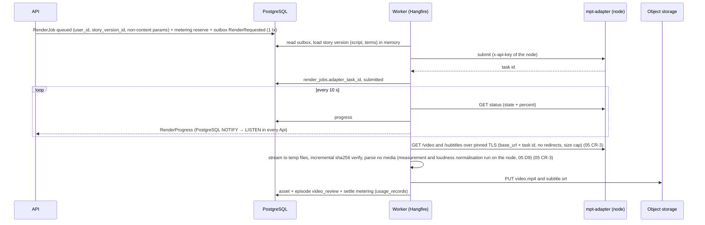

# 09 — Backend API (.NET 10, Clean Architecture + CQRS) (M1)

> Contracts: `00-overview.md` §5.1–5.4 (stack, layers, CQRS rules, standards), §6 tables, §7 state machines, §8 routes. Feature rules live in 02 (story), 03 (images), 05 (render contract), 06/07 (publishing), 13 (compliance). This plan owns **the backend skeleton, cross-cutting concerns and every command/query handler**.
> Level: **high-level plan — not the final plan.** It fixes scope, contracts, key decisions, risks and rough estimates only. Every feature in it will still get (1) a review of the relevant sections and (2) its own **detailed feature plan** in `plans/features/`, reviewed again before implementation (process and template: `00-overview.md` §10.1). Details and estimates here may change in that step.
> Delivery phase (personal-only, `00-overview.md` §4.1, DEC 10.14): all P. The former S items are dropped: registration/account-security extras (09.3.1-T2/T3, 09.3.3-T2/T3), the activity feed (09.3.6-T2; 09.3.6-T1 audit infrastructure stays P, 02 CR-3), the sessions list (09.3.7), the generated cross-scope route table (the S part of 09.2.3-T2; its architecture tests stay P), admin endpoints (09.9.1), the feature-flag write path (09.9.2), and all of 09.10 except 09.10.4-T1 (delivered, kept: TOTP MFA, re-auth, owner session limits, security alerts). The settings store, settings admin API, hot reload, user management, registration settings and public cancel links are gone, so provider settings are environment values (§5.6) and owner recovery is a runbook step (08 §6).

## 1. Purpose and scope

**Goal:** a secure, testable ASP.NET Core 10 backend that runs the episode journey (story → approve → render → review → download/publish) for the owner's channel, built with Clean Architecture and CQRS.

**In scope:** solution skeleton and architecture tests; persistence; auth; users; series; episodes/story/render handlers; assets and signed URLs; outbox + Hangfire jobs; SignalR; observability; security hardening; OpenAPI + client generation.

**Out of scope:** platform-specific publishing logic (06/07), billing (dropped, DEC 10.14), legal texts (13), Angular (10), worker node (11).

## 2. BA and Tech Lead review of this part

| # | Finding | Decision |
|---|---|---|
| T1 | CQRS can turn into ceremony for a small team | "CQRS light": one DB, separate command/query paths, no event sourcing, no separate read store (00 §5.2) |
| T2 | Jobs enqueued inside a request can be lost if the transaction rolls back (or vice versa) | Transactional **outbox**: domain events saved with the aggregate; Worker dispatches → Hangfire |
| T3 | MediatR 14 is RPL-1.5 or commercial ✅ | Use `Mediator` (MIT ✅) — same `IRequest`/`ISender` style, source-generated, no reflection |
| T4 | Paid actions + retries = double charges | `Idempotency-Key` behaviour + `idempotency_keys` table; the metering ledger `idempotency_key` unique |
| T5 | Long work (OpenAI, MPT, uploads) must never run inside HTTP requests | Commands return `202 Accepted`; jobs do the work; SignalR reports progress |
| T6 | Rows leaking across user scopes is the top data-integrity risk even with one owner (seeded data, imports, a future second user) | Every user-derived table carries `user_id` and implements `IUserOwned`; EF global query filters + an authorization behaviour; Worker jobs run under `SystemContext(userId)` with filters on (09.2.3) |
| T7 | Refresh tokens in `localStorage` are an XSS risk | Access token (short, in memory) + refresh token in `HttpOnly; Secure; SameSite=Strict` cookie, rotation + reuse detection |
| T8 | Hangfire license not confirmed ⚠️ | Hide behind `IJobScheduler` port so it can be swapped (e.g. Quartz.NET ⚠️ license check) |
| A1 | Single region, single PostgreSQL primary | OK for one owner and one flagship channel [INFERENCE]; revisit in 08 |

## 3. Requirements

**Functional**
- **FR-09-1** Sign-in for the seeded owner account: login, logout, refresh, forgot/reset password, TOTP MFA. Sign-up is closed (single owner, DEC 10.14) but the route stays mapped: `POST /auth/register` answers 403 `registration_closed` through the closed `IRegistrationFlow` and writes nothing. Brute-force cover is the global auth rate limit (09.3.5) plus a per-user wrong-code window (10 wrong MFA codes in 15 min → 429 `rate_limited` with `Retry-After: 900`); there is no global account lock and no CAPTCHA (dropped by DEC 10.14).
- **FR-09-2** Profile: display name, UI locale (`vi`/`en`); deletion request (13).
- **FR-09-3** Series CRUD with topic, language, aspect, voice, style template, default channel.
- **FR-09-4** Episode lifecycle per 00 §7 through commands only; illegal transitions return `409 episode_invalid_state`.
- **FR-09-5** Story commands (generate/edit/approve/reopen) per plan 02.
- **FR-09-6** Render commands and jobs per plan 05 contract (submit, poll, ingest, retry, cancel).
- **FR-09-7** Video review: approve/reject; signed download URL (≤ 15 min).
- **FR-09-8** Real-time updates over SignalR for episode, render and publication.
- **FR-09-10** Retention: delete assets past `retention_until`; honour deletion requests within SLA (13).
- **FR-09-11** Integration settings (provider base URLs, host allow-lists, model names, timeouts) come from configuration/environment, validated at startup; there is no admin settings surface (dropped with 09.10, DEC 10.14).
- **FR-09-12** Feature flags (`youtube_publish`, `tiktok_publish`, `source_finder`) are read from seeded/config values; there is no flag write path (dropped with 09.9.2, DEC 10.14).

**Non-functional**
- **NFR-09-1** p95 < 300 ms for non-generation endpoints at 50 RPS on one API instance [target].
- **NFR-09-2** Zero cross-user reads/writes (tested).
- **NFR-09-3** All secrets (DB, Data Protection key-encryption key, JWT signing key, storage credentials, public URLs/OAuth redirect URIs, URL allow-lists, provider keys) come only from environment/secret store (11.5.2); OAuth tokens are encrypted at rest.
- **NFR-09-4** Structured logs + traces with correlation id from HTTP → outbox → job → external call.
- **NFR-09-5** Build fails on architecture-rule violation, analyzer warning, or failing test.
- **NFR-09-6** Migrations are backward compatible for one release (expand → migrate → contract).

## 4. Epics and user stories

### Epic 09.1 — Solution skeleton and architecture guardrails

**09.1.1 Create solution** — *As the Tech Lead I want the Clean Architecture solution so that every feature has one obvious place.* Must · M
- Given an empty repo, When the solution is created, Then projects and references match 00 §5.2 exactly (Domain references only `ErrorOr`; Application references Domain + Mediator.Abstractions + FluentValidation + ErrorOr + `Microsoft.EntityFrameworkCore` core (09 CR-1); Infrastructure/Api/Worker reference Application).
- Given `Directory.Build.props`, When building, Then `Nullable`, `TreatWarningsAsErrors`, analyzers, `LangVersion` latest, central package management (`Directory.Packages.props`) apply to all projects.

**09.1.2 Architecture tests** — *As the Tech Lead I want the layer rules tested so that they cannot erode.* Must · S
- Given `NightTales.Architecture.Tests`, When Domain references `Microsoft.EntityFrameworkCore` or `Microsoft.AspNetCore`, Then the test fails.
- Given a handler, When it is not `sealed` or not in `Features/*/Commands|Queries/*`, Then the test fails.
- Given Api, When it references `NightTales.Infrastructure.Persistence` types other than in `Program.cs`/DI extensions, Then the test fails.

**09.1.3 Mediator pipeline** — *As a developer I want cross-cutting behaviours in one place so that handlers stay small.* Must · M
- Given any request, When sent, Then behaviours run in order: `LoggingBehavior` → `AuthorizationBehavior` → `ValidationBehavior` → `UnitOfWorkBehavior` (only `ICommand`; opens the transaction before the handler) → `IdempotencyBehavior` (only `IIdempotentCommand`; claims the key inside that transaction) → `AuditBehavior` (09.3.6-T1) (09 CR-2).
- Given a validator failure, When sent, Then no handler runs and `ErrorOr` returns `Validation` errors mapped to 400 with field errors.
- Given a query, When sent, Then `UnitOfWorkBehavior` does not run and no `SaveChanges` happens.

**09.1.4 Result → HTTP mapping** — *As the Angular client I want consistent errors so that one mapper handles them.* Must · S
- Given `ErrorOr` errors, When returned from an endpoint, Then each error code maps to the HTTP status in the catalogue (§5.4): `Validation`→400, `Unauthorized`→401, `Forbidden`→403, `NotFound`→404, `Conflict`→409, `story_version_conflict`/`fact_sheet_conflict`→412, `idempotency_key_reused`→422, limits→429 (the mapper sets `Retry-After` from `retryAfterSeconds` on every 429 that carries it, 02 CR-20), `render_worker_unavailable`/provider outages→503/502, unexpected→500; every response is ProblemDetails with `code`, `traceId`, and `errors` for validation.
- Given a code not in the catalogue, When returned, Then an architecture/unit test fails (the catalogue is a closed `static class ErrorCodes` + mapping table).

**09.1.5 CI pipeline** — *As the team I want CI on every PR so that main is always releasable.* Must · S
- Given a PR, When CI runs, Then restore, build, unit, architecture, integration (real PostgreSQL 17 via `PostgresFixture`, `NTS_TEST_PG` — 09 W3 CR-35) tests and `dotnet format --verify-no-changes` pass; an OpenAPI document artifact is produced.

### Epic 09.2 — Persistence

**09.2.1 DbContexts** — *As a developer I want a write model and a read path so that CQRS rules are easy to follow.* Must · M
- Given `AppDbContext` (tracked) implementing `IAppDbContext`, and `ReadDbContext` (`QueryTrackingBehavior.NoTracking`) implementing `IReadDb`, When configured, Then both use Npgsql, snake_case naming, UTC `timestamptz`, and `xmin` concurrency tokens on aggregates.
- Given `ReadDbContext`, When `SaveChanges` is called, Then it throws (read-only by design).

**09.2.2 Entity configurations and migrations** — *As a developer I want all 00 §6 tables so that features can be built.* Must · XL
- Given the domain model, When the initial migration is generated, Then every table/column/index of the P core set exists (09 CR-5; other tables come with their owning features, `features/09-backend-api/README.md` D9), including unique indexes (`users.email`, `credit_ledger.idempotency_key` — metering ledger only, `idempotency_keys(user_id,key)`), FK indexes, and enum columns stored as text with check constraints.
- Given a migration, When it runs in CI against an empty DB and against the previous schema with seed data, Then both succeed.

**09.2.3 User-scope filter and `SystemContext`** — *As the platform I want every user-owned row filtered by owner, in the API and in the Worker, so that one account's rows can never leak into another's scope.* Must · L
- Given `render_jobs`, `publications`, `story_versions`, `story_sources`, `fact_sheets` and `series_bibles`, Then each has a denormalized `user_id` (set from the parent episode/series at insert, never from the request body) and implements `IUserOwned`, like every other user-owned table (00 §6).
- Given entities implementing `IUserOwned`, When queried without a system context, Then an EF global query filter `UserId == currentUser.Id` applies.
- Given user A, When requesting user B's episode, render job, publication, source, fact sheet or bible by id, Then the API returns 404 (not 403, to avoid id probing).
- Given `NightTales.Architecture.Tests`, When an entity has an `episode_id` or `series_id` foreign key and does not implement `IUserOwned`, Then the test fails.
- Given a Worker job started from an outbox message, Then it runs under `SystemContext(userId)` taken from the outbox payload: `ICurrentUser.Id = userId`, filters stay **on**, and a missing `userId` in the payload fails the job instead of running unfiltered.
- Given `IgnoreQueryFilters`, Then it is allowed only in the named system jobs on the architecture-test allow-list (`RetentionSweepJob`, `DataDeletionJob`, `TokenHealthJob`); any other call site fails the test. Recurring sweeps that must find work across users read only `(id, user_id)` pairs through one allow-listed system query and process each item under `SystemContext(userId)` [DECISION].
- Given CI, Then a cross-scope integration test walks every route with an `{id}`-style path parameter: user B's resource ids are seeded, user A calls each route, and anything other than 404 fails; a new route without a test case fails the build (the list is checked against `openapi.json` by a test, not generated from it at runtime).

**09.2.4 Outbox** — *As the platform I want domain events stored with state changes so that jobs are never lost or duplicated.* Must · M
- Given an aggregate raising `StoryGenerationRequested`, When the command commits, Then the event row is in `outbox_messages` in the same transaction.
- Given the Worker's `OutboxDispatcher` hosted service (every 5 s, 09 CR-3), When it runs, Then unprocessed messages are handled at-least-once, marked `processed_at`, retried with backoff up to 10 attempts, and handlers are idempotent (keyed by message id).

**09.2.5 Seed data** — *As a developer I want catalogs seeded so that local dev works immediately.* Must · S (split: T1 catalogs + flags, T2 owner seed after 09.3.1-T1; 09 CR-11)
- Given a fresh DB, When the app starts in Development, Then `voices`, `style_templates`, `feature_flags` (all publishing off), and one `owner` user (from env; MFA enrolment forced at first login, 09.10.4) are seeded idempotently.

**09.2.6 Worker host + Hangfire (PostgreSQL storage) + `IJobScheduler` + recurring jobs + dashboard auth** (split: T1 host, T2 dashboard after 09.10.4-T1; 09 CR-11) — *As the platform I want one Worker composition root with a job scheduler so that the outbox, render and publishing jobs have somewhere to run.* Must · M
- Given `NightTales.Worker`, When it starts, Then Hangfire server runs on PostgreSQL storage (same database, own schema), with named queues (`default`, `render`, `publish`, `email`). There is **no** `fetch` queue: the fetcher container is a pull client of the Api internal listener `:8081` (lease → heartbeat → result) and has no DB or Hangfire access (02 CR-1, 02 README D10) and worker counts from configuration.
- Given the `IJobScheduler` port (Application), Then handlers and outbox handlers enqueue and schedule through it only; Hangfire types appear only in Infrastructure and the Worker/Api composition roots (architecture test).
- Given the recurring jobs in §5.3, Then they are registered idempotently at Worker start (`AddOrUpdate` by stable id) and removed jobs are deleted.
- Given any Hangfire job, Then its arguments carry ids only (episode id, render job id, message id, user id), never story text, keywords, prompts, tokens or secrets; an architecture test fails when a job method takes a `string` parameter not on an allow-list of id/enum names.
- Given the Hangfire dashboard, Then it is hosted in the Api at `/internal/jobs` with its own cookie authentication issued only after password + TOTP (09.10.4); the owner gets write actions (retry, delete, trigger), every other caller 404s; antiforgery is on for every dashboard POST; access writes `audit_logs`; IP-restricted where the host allows it.

### Epic 09.3 — Authentication and users

**09.3.1 Identity setup and consents** — *As the owner I want one securely provisioned account so that nobody else can sign up.* Must · S (09 W2 CR-3)
- Given an empty `users` table, When the app starts, Then exactly one account is seeded from the environment (09.2.5-T2): `active`, `email_confirmed = true`, password from the secret store, `user_consents` rows for the current ToS/Privacy versions (13) and MFA enrolment forced at first login (09.10.4).
- Given any `POST /auth/register` request, Then the route stays mapped and answers 403 `registration_closed` through the closed `IRegistrationFlow` (single owner, DEC 10.14): nothing is written, no verification mail goes out, and there is no disposable-domain list, breached-password lookup or enumeration budget to handle.
- Given a password on reset or change, Then it meets the policy (≥ 12 chars) and the same checks apply as at login.

**09.3.2 Login, refresh, logout, security stamp** — *As the owner I want to stay signed in safely so that I do not re-enter my password constantly.* Must · L
- Given valid credentials, When `POST /auth/login`, Then a JWT access token (15 min; owner 5 min, 09.10.4) carrying a `security_stamp` claim is returned in the body and a refresh token (14 days, rotating) is set as an `HttpOnly; Secure; SameSite=Strict; Path=/api/v1/auth` cookie.
- Given valid credentials for the owner with MFA enrolled, When `POST /auth/login`, Then no tokens are issued: 401 `mfa_required` with an `mfaToken` (opaque, stored hashed in `auth_challenges`, single use, 5 min, bound to the user and to a pre-auth `HttpOnly; Secure; SameSite=Strict` cookie set by `POST /auth/login`, plus the user agent; an IP change between the two steps (Wi-Fi→mobile, CGNAT) does not reject the code but writes an `account_security` audit row and a D9 security event); `POST /auth/login/mfa` with `mfaToken` + TOTP code or one recovery code issues the tokens above. A wrong code → 401 `invalid_mfa_code` and counts toward the per-user wrong-code window of 09.3.3; after 5 wrong codes the `mfaToken` is revoked and login restarts; an expired/used/unknown token → 401 `mfa_token_invalid`. The wrong-code window counts every wrong TOTP/recovery code per user across challenges and re-authentications: after 10 wrong codes in 15 min `/auth/login` and `/auth/login/mfa` answer 429 `rate_limited` with `Retry-After: 900`; it is held in the Api process's memory (no table, so per instance and forgotten on restart), refuses a wrong code while saturated but never a correct one, and the first path that both observes the window and can commit writes one `account_security` row. The durable untrusted-device lock (`trusted_devices`, 429 `mfa_locked_untrusted`) was phase-S work (09.3.3-T3) and is dropped by DEC 10.14. The pre-auth cookie uses the `__Host-` prefix. The last accepted TOTP time-step is stored per user (`users.last_totp_step`) and a code for that step or an earlier one is rejected (no replay). A used recovery code is consumed, audited (`account_security`), revokes every other refresh family and e-mails the owner.
- Given a refresh token that was already used, When presented again, Then the whole token family is revoked and 401 `refresh_token_reused` is returned (theft detection).
- Given `POST /auth/logout`, Then the current refresh token is revoked and the cookie cleared.
- Given any authenticated request (every route, including `/me/*`, `/auth/reauth`, `/hubs/ticket`, `/channels/*`, video-URL and export routes), Then the `security_stamp` claim is compared with the user's current stamp, and the `sid` claim (refresh family id) with the set of revoked families, from a cache (one lookup per request; entry lifetime ≤ 30 s, evicted by the outbox event `UserSecurityChanged`, which is also written when a single family is revoked); on mismatch, a revoked `sid` or a non-`active` status the API returns 401 `session_revoked` and the client must refresh (refresh re-issues the token with the current role and stamp, or fails if the family was revoked). When an Api instance's `LISTEN` connection reconnects, it clears its whole stamp cache so a missed eviction cannot linger.
- Given MFA enrol/disable/reset, password change or reset, or revoke-all, Then the user's stamp rotates in the same transaction, `UserSecurityChanged` is written to the outbox, and every live SignalR connection of that user is aborted (09.8.1). **Credential events** also revoke refresh families: password change, MFA disable and recovery-code use revoke every family except the one making the request; password reset and MFA reset revoke all families. **Every MFA reset** also forces a password reset through the e-mailed link, so a person holding only the old password cannot enrol a new authenticator.
- Given `POST /me/mfa/setup` when MFA is already enrolled, `DELETE /me/mfa` or `POST /me/mfa/recovery-codes`, Then `POST /auth/reauth` (password + TOTP) within the last 5 min is required, otherwise 401 `reauth_required`.
- Given a user connects a channel (06.1.2), Then `POST /auth/reauth` (password; plus TOTP when enrolled) within the last 5 min is required and the user gets an e-mail about the new connection; every publication consent (06.2.2) also e-mails the user.

**09.3.3 Password reset and brute-force protection** — *As the owner I want to recover access, and not be locked out by strangers, so that I do not lose my channel work.* Must · M
- Given `POST /auth/forgot-password`, When the e-mail exists or not, Then the response is identical (no user enumeration).
- Given a reset token, Then it is single-use, valid ≤ 60 min and stored hashed; a successful `POST /auth/reset-password` revokes **all** refresh-token families, rotates the security stamp and e-mails the owner that the password changed.
- Given failed logins, Then the global auth rate limit of 09.3.5 answers 429 `rate_limited` with `Retry-After`, and MFA attempts are counted per user in the wrong-code window (10 in 15 min → 429 `rate_limited`, `Retry-After: 900`); failures write `audit_logs`. There is no per-(account, IP/device) progressive delay, no CAPTCHA provider and no global account lock (all dropped with 09.3.1-T2/09.3.3-T2, DEC 10.14).
- Given a stranger failing logins for the known owner e-mail from other IPs, Then the owner can still sign in from their own device; the mandatory TOTP step (09.10.4) is the second barrier.

**09.3.4 Me endpoints** — *As a user I want to manage my profile so that the UI uses my language.* Must · S
- Given `PATCH /me` with `uiLocale = "vi"`, Then it is saved and returned; e-mails use that locale.

**09.3.5 Rate limiting** — *As the platform I want abuse limits so that brute force and cost abuse are blocked.* Must · S
- Given ASP.NET Core rate limiting, When auth endpoints exceed 10/min per IP or metered endpoints (generation, render, publish) exceed 30/min per user, Then 429 with `Retry-After`.

**09.3.6 Audit log** — *As the owner I want an auditable record of what the system did on my account so that incidents can be reconstructed.* Must · M (09 W2 CR-3: the append-only log lives in the database and the alerts mail it; the user-facing activity feed was dropped by DEC 10.14)
- Given any state-changing command, Then the Mediator `AuditBehavior` writes one `audit_logs` row in the **same transaction** as the change (UnitOfWork), from the command's `[Audited("episode.story_approved", Category.Episodes, Visibility.User)]` attribute, where visibility is a **required** argument; an architecture test fails if a command has neither `[Audited]` (with explicit visibility) nor `[NotAudited(reason)]`. Auth events (login success/failure, wrong-code window trip, logout, password change/reset, MFA on/off, refresh-token reuse, session revoked by security stamp) are written by the auth handlers; job outcomes (story generated/failed, render done/failed, publication published/failed) by outbox handlers with `actor_type = system`.
- Given `audit_logs`, Then each row has `subject_user_id`, `actor_type` (`user`/`system`), `category` (`account_security`/`episodes`/`publishing`/`support`), `visibility` (`user`/`internal`), `ip` and `user_agent` (security events only); `data jsonb` holds a safe summary (ids, titles, old → new status, cost) and never story text, tokens or secrets. There is no HTTP feed over this table.
- Given the retention job (09.7.3), Then retention is an ordered rule list per row, first match wins (not one number per table): (1) `account_security` rows → 24 months [DECISION] ⚠️; (2) `visibility = internal` rows → 24 months [DECISION] ⚠️; (3) every other `visibility = user` row → 12 months [DECISION] ⚠️ (lawyer, 13.6). Account deletion follows 13 §5.4.

### Epic 09.4 — Series and catalogs

**09.4.1 Series CRUD** — *As a creator I want a series per channel idea so that episodes share settings.* Must · M
- Given `POST /series` with topic, language, aspect, voiceId, styleTemplateId, Then the voice language must match the series language (else 400 `voice_language_mismatch`).
- Given a series with episodes, When `DELETE /series/{id}`, Then `archived_at` is set (00 §6), the series disappears from `GET /series`, and its episodes stay accessible.

**09.4.2 Catalog queries** — *As a creator I want voices and styles listed so that I can pick them.* Must · S
- Given `GET /voices?language=en` and `GET /style-templates?topic=`, Then only `active` items return with preview URLs (signed or public CDN); with `topic`, the list follows `StyleTopicPolicy` (`true_crime` → only `true_crime` templates; other topics → none of them) (03 CR-2).
- `GET /voices` item shape: `{ id, displayName, language, gender, tags, previewUrl }` (04 D9); `previewUrl` = public URL of `previewStorageKey` in `nt-public-<env>` or `null` (04 CR-10).

### Epic 09.5 — Episodes and story (handlers for plan 02)

**09.5.1 Create/list/get/delete episode** — *As a creator I want to manage episodes so that I can work on several at once.* Must · M
- Given `POST /series/{id}/episodes` with a brief ≤ 1,000 chars and a `lengthTier` (`short`/`standard`/`long`), Then an episode in `draft` is created with both stored (00 §6) (201 + Location + ETag).
- Given `GET /episodes?status=story_review&cursor=…`, Then results are cursor-paginated (created_at, id) and filtered by owner.
- Given `DELETE /episodes/{id}` while `rendering`, Then 409; otherwise assets are scheduled for deletion.

**09.5.2 Story commands** — *As a creator I want generate/edit/approve/reopen so that checkpoint #1 works.* Must · L (09 W2 CR-3: implemented by plan 02 — 02.2.2, 02.3.x; 09.5.2-T1 withdrawn)
- Given the rules in plan 02 §4, When each command runs, Then state, versions, idempotency, ETag and metering reserve/settle/release behave as specified there (metering of the owner's own OpenAI spend; there is no billing, DEC 10.14).
- Given `GET /episodes/{id}/story/versions`, Then all versions return newest first with `source`, `createdAt`, word count.

**09.5.3 Episode detail query** — *As the UI I want one call for the episode page so that it loads fast.* Must · S
- Given `GET /episodes/{id}`, Then the DTO contains status, allowed next actions (computed by the domain), current story, latest render job progress, final video asset metadata, publications summary, and an `ETag`. 02 CR-7: it also carries `generation { kind, status, stage, errorCode, startedAt, processingPaused }` for the active or last run, and `currentStory { versionId, version, source, etag, content, qualityHints, auditReport, similarityScore, factSheetId, attestation }`; `EpisodeUpdated` is sent on every generation stage change.

### Epic 09.6 — Render orchestration (contract from plan 05, via `mpt-adapter`)

> **Contingency [DECISION]:** 09.6 is sized on the assumption that the 05.4.1 spike (L, **05.4.1-T2**, hard gate before 09.6.2-T1) (05 CR-3) confirms the `mpt-adapter` contract as written in 00 §8. When the spike closes, 09.6 is re-estimated and any change is carried to §11 and 00 §9 before 09.6.2-T1 starts.

**09.6.1 Render command** — *As a creator I want to render my approved story so that I get a video.* Must · M
- Given `story_approved` and headroom under the spend cap, When `POST /episodes/{id}/render` with `Idempotency-Key`, Then a `render_jobs` row (`queued`, with `user_id` from the episode, 09.2.3) is created, the image plan is computed and its worst case checked by `IBudgetGuard` (`IImageCostEstimator.WorstCase`, 03 D3/D8; also before each automatic retry) and the metering reservation taken, episode → `rendering`, event `RenderRequested` in the outbox; response 202.
- Given `render_jobs.params`, Then it stores `story_version_id` plus non-content settings only (aspect, voice id, style template id, bgm, subtitle options); `video_subject`, `video_script` and `video_terms` are read from the story version when the adapter request is built and never persisted in `render_jobs`, Hangfire arguments or logs; render-job response DTOs exclude them. They are read through `IStoryRenderInputProvider.GetAsync(approved_story_version_id)` (02 CR-18), never from `current_story_version_id`. `render_jobs.params` is exactly `render-params.v1`, built by `RenderSubmitMapper.BuildParams` (05.1.2-T1) (05 CR-3).
- Given a `video_script` longer than 20,000 code points, When the render command is prepared, Then it is rejected with `validation_failed` on field `script` (05 CR-3).

**09.6.2 Render client (`mpt-adapter`)** — *As the platform I want a resilient render client so that worker hiccups do not fail jobs.* Must · M
- Given `IRenderClient` implemented by `MptRenderClient` (typed `HttpClient` to the node's `mpt-adapter` over HTTPS and speaking `render-node.v1`, one `x-api-key` per node from `worker_nodes`, TLS validated against that node's pinned certificate `worker_nodes.tls_cert_sha256`, D15 S1) (05 CR-3) — built on `RenderNodeConnectionFactory` (11.3.3-T1) with the DTOs of `NightTales.RenderNode.Contract` read through `RenderNodeJson.Tolerant` (11 D4/D13; 11 CR-3) — When the adapter returns 5xx/timeout, Then a custom resilience pipeline retries idempotent calls (3× exponential, jitter; attempt 10 s, total 30 s) and a circuit breaker opens after 5 consecutive failures (`MinimumThroughput 5`, `FailureRatio 1.0`); downloads use a separate streamed client without the standard handler's 30 s total timeout (09 W2 CR-3, Part B BD6).
- Given the submit body, Then it is `render-submit.v1` built by `RenderSubmitMapper.BuildSubmit` (05.1.2-T1) and maps exactly to the fields confirmed in the 05.4.1 spike (`video_subject`, `video_script`, `video_terms`, `video_source = "openai_image"`, `video_aspect`, `voice_name = "kokoro:<id>"`, bgm, subtitle options), built in memory from the story version (05 CR-3).
- Given its contract tests, Then they deserialize the D14 golden fixtures for `render-node.v1` and `render-submit.v1`; the hard gate before this task is **05.4.1-T2** (05 CR-3).

**09.6.3 Render jobs** — *As the platform I want render work split into small idempotent jobs so that restarts are safe.* Must · L
- `SubmitRenderJob`: picks a worker node with free capacity through `INodeSelector.PickAsync` (11.3.3-T2; none → `render_worker_unavailable`: the job stays `queued` and `SubmitRenderJob` reschedules itself after `RenderNodes:HealthPollSeconds`, outside the outbox retry budget, with an ops alert after `Render:QueueAlertMinutes` = 360, 11 D20 H14) (11 CR-3), calls the adapter submit, stores `adapter_task_id`, status `submitted`.
- `PollRenderJob` (every 10 s per active job, max 60 min; driven by the Worker `RenderPollingService`, because Hangfire's 15 s scheduler poll cannot hold 10 s — 09 W2 CR-3): updates `stage`/`percent` by mapping the adapter's `stage` including the finer `render-node.v1` stages (05 CR-3), pushes `RenderProgress` (00 §8 payload); on adapter failure maps error codes (03, 05) → render job `failed`, episode `rendering → story_approved` (00 §7), metering reservation released.
- Given a failure code, Then the retry policy auto-retries only transient codes (max 2, 00 §7) and **never** auto-retries `image_moderated` or `story_moderated`; those fail the job at once and write `moderation_events`.
- Given a terminal adapter status, Then `PollRenderJob` first writes image `usage_records` from the `images.v1` report (every terminal state, idempotent), then classifies it with the 03 D7 table (video kept with ≤ 10 % skipped scenes → ingest with `quality_report.images`; otherwise `image_moderated` / `image_generation_failed`), and requests adapter cleanup only after both committed (03.4.2-T1, 03 CR-5).
- `IngestRenderOutputJob`: downloads `/video` and `/subtitles` from a URL built from the node's registered `base_url` + `adapter_task_id` (never a URL from a response body), redirects disabled, streaming each to a temp file with incremental sha256 and verifying it against `output.video.sha256` plus size and content-type caps (`render_output_invalid` on mismatch), stores the SRT as an `assets` row with `kind = subtitle`, uploads the video to object storage, creates its `assets` row, calls `RenderQualityEvaluator.Evaluate` (05.5.1-T2) on the adapter's `check` block and writes `quality_report` (`render-quality.v1`) with `images` from 03.4.2-T1, sets `final_video_asset_id`, episode → `video_review` (05 CR-3); measurement and loudness normalisation run on the node (05 D9, owner O3), so the Worker parses no media, and raises domain event `RenderSucceeded { EpisodeId, RenderJobId }` (02 CR-23; consumed by the 02.8.3 autopilot run).
- Given the Worker restarts mid-job, When it resumes, Then no duplicate adapter task is created (guard by `adapter_task_id` present) and no duplicate asset (guard by sha256 + render_job_id).

**09.6.4 Cancel and retry** — *As the owner I want to cancel a stuck render so that GPU spend stops and the episode is editable again.* Should · S
- Given `rendering`, When `DELETE /render-jobs/{id}`, Then the job → `cancelled`, episode → `story_approved`, the metering reservation released; the adapter is called at `POST /v1/renders/{task_id}/cancel` (image spend stops; GPU work finishes; the output is discarded), job state `cancelled` (owner O6) (05 CR-3).

### Epic 09.7 — Video review and assets

**09.7.1 Approve/reject video** — *As a creator I want checkpoint #2 so that nothing is published unreviewed.* Must · S
- Given `video_review`, When `POST /episodes/{id}/video/approve`, Then → `ready`; reject with reason → `story_review` or re-render per 00 §7; reason stored.

**09.7.2 Signed URL** — *As a creator I want to watch and download my video so that I can review or upload it myself.* Must · S
- Given `GET /episodes/{id}/video-url`, Then a pre-signed GET URL valid ≤ 15 min with `Content-Disposition` filename is returned; access is logged.

**09.7.3 Retention sweep** — *As the platform I want old files deleted so that storage cost and privacy risk stay low.* Must · S
- Given `RetentionSweepJob` (daily), When `retention_until < now`, Then objects are deleted from storage, `assets.deleted_at` set; default retention 30 days after `ready` [DECISION, tune in 08].

### Epic 09.8 — Real-time

**09.8.1 SignalR hub** — *As a creator I want live progress so that I do not refresh the page.* Must · M
- Given `POST /hubs/ticket` (authenticated with the access token), Then the API returns a random ticket valid 60 s and usable once (stored hashed with user id and security stamp); the client connects to `/hubs/episodes?ticket=…`; a missing, expired, reused or stamp-mismatched ticket → 401 `hub_ticket_invalid`; the JWT never travels in a query string.
- Given a connected user, Then the connection joins group `user:{id}` only; events `EpisodeUpdated`, `RenderProgress`, `PublicationUpdated` are sent via `IRealtimeNotifier` from outbox handlers.
- Given the Worker process, When it notifies, Then it writes the notification with PostgreSQL `NOTIFY` (channel `realtime`, payload = user id + event name + ids only, ≤ 8 KB); every Api instance runs a background `LISTEN` service and forwards the event to its **local** connections of that user, so it reaches the instance that holds the socket; on listener reconnect the client re-fetches state (10.2.4) [DECISION].
- Given two Api instances behind the load balancer (11.2.2), Then the hub accepts WebSockets only (client `skipNegotiation`), so no sticky sessions are needed; if a load balancer cannot carry WebSockets, sticky sessions are configured instead.
- Given `UserSecurityChanged` (09.3.2), Then the Worker/Api sends `NOTIFY` on a separate channel `security` (payload = user id only) and every Api instance aborts that user's live connections; as a backstop each instance re-validates every connection's stamp and status from the ≤ 30 s cache every 60 s and closes a connection when its access token's lifetime ends (the client fetches a new ticket and reconnects, 10.2.4).

### Epic 09.9 — Observability, security, client contract

**09.9.1 Admin endpoints** and the **09.9.2 feature-flag write path** are dropped (DEC 10.14: single owner, no admin surface). Flags stay seeded/config values (09.2.5-T1) read through a cached provider (09.9.2-T2); `youtube_publish`/`tiktok_publish` off makes publication endpoints return 404 `feature_disabled`.

**09.9.2 Feature-flag read path** — *As the platform I want flags read from seed/config so that a publication stays off until the owner turns it on.* Must (P) · S
- Given the `flags` table seeded by 09.2.5-T1 and the configuration override in §5.6, Then `IFeatureFlags` serves the effective values from a 30 s cache, `RequireFeature("<name>")` answers 404 `feature_disabled` when a flag is off, and `nts-worker flags list` prints them; the only write path is the audited CLI verb `nts-worker flags set <key> on|off` (one `audit_logs` row per change, `NOTIFY feature_flags_changed` evicting the cache) — there is no HTTP or admin flag-write route and no flag screen (dropped, DEC 10.14; 09.9.2-T2).

**09.9.3 Observability** — *As the owner I want logs, traces and metrics so that incidents are diagnosable.* Must · M
- Given Serilog JSON + OpenTelemetry (ASP.NET Core, HttpClient, Npgsql instrumentation; the EF Core instrumentation package has no stable release and is not used, 09 W2 CR-3), Then each request/job carries `traceId`, `userId` (hashed), `episodeId`; secrets and story text are never logged.
- Given request logs, OTel `url.query`/`url.full` attributes and load-balancer access logs, Then `access_token`, `ticket`, `token` (reset/verify/cancel links) and `code`/`state` (OAuth callbacks) query values are redacted by an enricher/processor before export; an integration test asserts a hub connect and a reset link leave no raw value in captured logs or spans.
- Given the Hangfire dashboard (09.2.6), Then it is reachable only at `/internal/jobs` with the MFA-issued cookie (owner write actions, antiforgery on); its access is logged; job arguments shown there are ids only.
- Given `/health/live` and `/health/ready` (DB, storage, `mpt-adapter` registry state from the last health pull), Then orchestrators can probe them.
- Custom metrics: `render_jobs_active`, `render_duration_seconds`, `openai_cost_usd_total`, `youtube_quota_used`, `outbox_lag_seconds`.

**09.9.4 Security hardening** — *As the platform I want safe defaults so that common attacks fail.* Must · M
- HTTPS only + HSTS; security headers (CSP for API docs, `X-Content-Type-Options`, `Referrer-Policy`); CORS allow-list = web origin only; request size limits; `ITokenProtector` using ASP.NET Core Data Protection (configured algorithm) with purpose `tokens.v1/{connectionId}` per channel connection, keys persisted in PostgreSQL and protected by a KMS/secret key; dependency vulnerability scan in CI.

**09.9.5 OpenAPI + client** — *As the Angular team I want a typed client so that contracts never drift.* Must · S
- Given `Microsoft.AspNetCore.OpenApi`, When CI builds, Then `openapi.json` is published and the Angular client is regenerated (tool chosen in 10, e.g. `openapi-generator` ⚠️ license check); a contract diff fails the PR if a breaking change is not versioned.

### Epic 09.10 — System configuration and owner security

**09.10.1 Settings store and secret encryption**, **09.10.2 settings admin API**, **09.10.3 hot reload**, **09.10.5 user management**, **09.10.6 registration settings**, **09.10.7 break-glass recovery** and **09.10.8 public cancel links** are dropped (DEC 10.14: single owner, no admin surface, no multi-owner approval machinery). Provider settings are configuration (§5.6) read from the environment/secret store at startup; changes need a redeploy (11.5.2), so there is no `system_settings` store, no pending-change time-lock and no cancel links. Owner account recovery is a documented runbook step (08 §6, 11.5.2): a direct, audited DB/secret-store operation on the single owner row, because there is no multi-owner approval machinery to protect. The only P part of this epic is 09.10.4-T1 (delivered, kept): TOTP MFA, re-auth and security alerts for the owner account, below.

**09.10.4 Owner MFA, re-auth and security alerts** — *As the owner I want strong access to my own account so that one stolen password cannot take over the channel.* Must · L (delivered as 09.10.4-T1, kept after DEC 10.14)
- **Single owner, no roles.** There is exactly one account and it is the owner of everything this product does; `users.role` stays a column so the schema and the existing auth code keep working, but no route grants or checks a platform role, and there is no user-management or credit-grant surface (both dropped, DEC 10.14).
- TOTP MFA (ASP.NET Core Identity authenticator + 10 one-time recovery codes) is **mandatory** for the owner account; until enrolled, login lands on the enrolment page and every authenticated route except `/auth/*` and the enrolment endpoints returns 404 (09 W2 CR-3). Recovery codes are shown once and are the documented fallback (08 §6).
- Given a **sensitive action** — channel connect/disconnect, publication cancel, account deletion, MFA enrol/reset, password change — Then `POST /auth/reauth` (password + TOTP) within the last 5 min is required, otherwise 401 `reauth_required`. Re-auth (also 09.3.2, 06.1.2) has its own limit: 5 wrong attempts per session revoke that session's refresh family (sign in again, 401 `session_revoked`); `last_totp_step` replay protection applies; the first failure raises a D9 security event; re-auth failures do not feed the account-wide MFA counter.
- Owner sessions: access token **5 min** (security stamp checked per request, 09.3.2), refresh token 12 h absolute (not 14 days), idle timeout 30 min; `sessions` rows stay (09.3.6-T1 audit infrastructure) even though the user-facing sessions list is dropped.
- Given a security event — MFA enrol/reset/disable, recovery-code use, owner login from a new IP or device, re-auth failure, password change, channel connected/disconnected, OAuth refresh-token revoke detected — Then `ISecurityAlerter` sends it to the 11.6.2 alert pipeline (not configurable from the app) **and** e-mails the owner; a failed security e-mail raises a P1 alert. These events also write `audit_logs` (09.3.6-T1).

## 5. Technical design

### 5.1 Example feature slice (GenerateStory)

```csharp
// Application/Features/Stories/Commands/GenerateStory/GenerateStoryCommand.cs  (02 CR-16: no If-Match; 02 CR-2: ICreditLedger — metering only, DEC 10.14)
public sealed record GenerateStoryCommand(Guid EpisodeId, GenerationTrigger Trigger, string? IdempotencyKey)
    : ICommand<ErrorOr<GenerateStoryAccepted>>, IIdempotentCommand;

// Handler (full order in features/02-story-writing/02.2.2-generate-story-job/02.2.2-T2):
// state → fact-sheet guard → daily limit → active run → IBudgetGuard → ICreditLedger.ReserveAsync → generation_runs row → domain method
public sealed class GenerateStoryHandler(IAppDbContext db, IFactSheetGuard facts, IGenerationLimit limit,
        IBudgetGuard budget, ICreditLedger credits, IStoryCostEstimator cost, IClock clock)
    : ICommandHandler<GenerateStoryCommand, ErrorOr<GenerateStoryAccepted>>
{
    public async ValueTask<ErrorOr<GenerateStoryAccepted>> Handle(GenerateStoryCommand cmd, CancellationToken ct)
    {
        var episode = await db.Episodes.FindAsync([cmd.EpisodeId], ct);
        if (episode is null) return Errors.Episode.NotFound;
        // … guards (episode_invalid_state, fact_sheet_required, story_generation_limit, story_generation_in_progress)
        var bound = await cost.WorstCaseAsync(episode.LengthTier, episode.Language, ct);
        if (await budget.CheckAsync(bound.Cost, ct) is { IsError: true } denied) return denied.Errors;  // 429 spend_cap_reached
        var reservation = await credits.ReserveAsync(episode.UserId, CreditOperation.StoryGenerate, episode.Id, bound, ct);
        if (reservation.IsError) return reservation.Errors;
        return episode.RequestStoryGeneration(runId: Guid.CreateVersion7(), cmd.Trigger, clock.UtcNow); // StoryGenerationRequested → outbox
    }
}
```

```csharp
// Api/Endpoints/StoryEndpoints.cs
group.MapPost("/episodes/{id:guid}/story/generate", async (Guid id, ISender sender, HttpContext http, CancellationToken ct) =>
    (await sender.Send(new GenerateStoryCommand(id, GenerationTrigger.User, http.Request.Headers["Idempotency-Key"]), ct)).ToAcceptedResult(http)); // D7 rename (features/09-backend-api README D7)
```

### 5.2 Domain model sketch

- `Episode` (aggregate root): `Status`, `CurrentStoryVersionId`, `ApprovedStoryVersionId`, methods `RequestStoryGeneration`, `AddStoryVersion`, `ApproveStory`, `ReopenStory`, `RequestRender`, `MarkRendered`, `ApproveVideo`, `RejectVideo`, `Fail`, `Cancel`; each validates the transition table (00 §7) and raises events.
- `RenderJob` (aggregate): attempts, status transitions, error mapping.
- `ChannelConnection`, `Publication` (06/07), `UsageRecord` (metering of the owner's own OpenAI/GPU spend — ledger rows, no balance field, not billing: DEC 10.14).
- Value objects: `Language`, `Topic`, `Aspect`, `VoiceId` (id rules per 04 D9: NFC, own `strip()`, 1–64 code points, first/other chars checked with `System.Text.Rune` per TL ruling T7 since Python `str` `\w` semantics are normative and differ from .NET `\w`; no `-Female`/`-Male`/`:`; no `-V2` suffix; 04 CR-10), `Keyword`, `Money`, `Credits`, `EmailAddress`. `Money` and `Credits` are metering values only — the owner's own OpenAI/GPU spend, never a price or a balance (DEC 10.14).

### 5.3 Jobs (Hangfire behind `IJobScheduler`)

| Job | Trigger | Retry | Idempotency guard |
|---|---|---|---|
| `OutboxDispatcher` (Worker `BackgroundService`, not Hangfire; 09 CR-3) | 5 s poll, `FOR UPDATE SKIP LOCKED` | per message, 10× backoff, then dead letter | message id |
| `GenerateStoryJob` | outbox `StoryGenerationRequested` | **0** — crash recovery by `StaleGenerationSweeperJob` (02 CR-16) | `generationRunId` (ids-only argument) |
| `StaleGenerationSweeperJob` | recurring 5 min | next run | fails `running` runs past the job timeout + 60 s and `queued` runs older than 12 h, every `generation_runs.kind` (02 T21) |
| `GenerateFactSheetJob`, `ProposeBibleUpdateJob`, `FindSourcesJob` | outbox events of plan 02 | 0 (sweeper) | `generationRunId` |
| `FetchLeaseSweeperJob` | recurring 1 min | next run | requeues `fetch_tasks` whose lease expired; fails after 2 attempts (02 CR-1) |
| `SubmitRenderJob` | outbox `RenderRequested` | 3× | `adapter_task_id` present → skip |
| `PollRenderJob` | scheduled 10 s while active | until 60 min timeout | status terminal → stop |
| `IngestRenderOutputJob` | poll sees success | 5× | render_job_id + sha256 |
| `SendEmailJob` | outbox e-mail events | 5× | message id |
| `RetentionSweepJob` | daily 03:00 UTC | next day | deleted_at |
| `DataDeletionJob` | hourly | until done | request id (13) |
| `TokenHealthJob` | daily | next day | connection id (06/07); `invalid_client`/`unauthorized_client` → platform incident alert, never a user revoke (06/07 OAuth client pinning) |
| `AutopilotPlanJob` | recurring **15 min**, one tick for all enabled series (02 CR-15, 02 README D17) | next run | `autopilot_runs` unique `(series_id, slot_at)`; step key `autopilot:{seriesId}:{slotAt:O}:{step}` |
| `AutopilotConsentJob` | recurring 1 min (06.2.2-T3) | next run | publication id + status `awaiting_consent` and veto window ended |
| `PublishYouTubeJob`, `PollYouTubeProcessingJob`, `PublicationGoLiveJob` | 06 | 06 | 06 |
| `PublishTikTokJob`, `PollTikTokStatusJob` | 07 | 07 | 07 |

### 5.4 Error code catalogue (ProblemDetails `code`)

| Code | HTTP | Meaning |
|---|---|---|
| `validation_failed` | 400 | Field errors in `errors` |
| `email_not_verified` | 403 | Verify e-mail first |
| `invalid_credentials` | 401 | Login failed (no global account lock, 09.3.3) |
| `mfa_required` | 401 | Password ok, MFA code needed; body carries `mfaToken` (09.3.2) |
| `invalid_mfa_code`, `mfa_token_invalid` | 401 | Wrong TOTP/recovery code; MFA login token expired, used or revoked (09.3.2) |
| `session_revoked` | 401 | Security stamp changed, refresh family (`sid`) revoked or account not active; refresh or sign in again (09.3.2) |
| `hub_ticket_invalid` | 401 | Hub ticket missing, expired, reused or stamp-mismatched (09.8.1) |
| `refresh_token_reused` | 401 | Token family revoked |
| `not_found` | 404 | Also used for other users' resources |
| `episode_invalid_state` | 409 | Transition not allowed |
| `voice_language_mismatch` | 400 | Series voice language differs from the series language (09.4.1) |
| `forbidden` | 403 | Authenticated caller not allowed for this action where 404 is not used (e.g. autopilot acting outside its authorisation, 02) |
| `idempotency_key_reused` | 422 | Same key, different body |
| `concurrency_conflict` | 409 | Lost update detected by `xmin` after the `If-Match` check; retry (09 CR-7) |
| `series_archived`, `series_topic_locked` | 409 | Episode create on an archived series; topic change while autopilot is enabled (09 CR-7) |
| `episode_conflict` | 412 | Stale `If-Match` on `DELETE /episodes/{id}` (09 CR-7) |
| `service_unavailable` | 503 | Transient database failure (09 CR-7) |
| `spend_cap_reached` | 429 | The owner's own monthly OpenAI/GPU spend cap is reached; generation commands return 429 with `Retry-After` until the cap resets (metering only, DEC 10.14) |
| `story_version_conflict`, `fact_sheet_conflict`, `bible_conflict`, `series_conflict` | 412 | Stale `If-Match` (02 README D9) |
| `if_match_required` | 428 | A D9 route called without `If-Match` |
| `payload_too_large` | 413 | API request body exceeds its byte limit; ProblemDetails for declared-length and streamed refusals (02.3.2-T1 follow-up, #159) |
| `idempotency_key_required` | 400 | Metered/platform POST without `Idempotency-Key` |
| `story_generation_in_progress`, `fact_sheet_generation_in_progress`, `find_sources_in_progress` | 409 | One active generation run per episode and kind |
| `story_generation_limit`, `source_fetch_limit_reached` | 429 + `Retry-After` | 5 story generations / rolling 24 h per episode; 30 url sources / rolling 24 h per user |
| `fact_sheet_required`, `story_sources_required`, `story_fact_sheet_outdated`, `story_too_similar_to_source`, `story_moderated`, `fact_sheet_sources_insufficient`, `source_duplicate`, `source_limit_reached`, `source_candidate_not_proposed`, `bible_proposal_not_pending`, `autopilot_authorization_required`, `autopilot_topic_locked`, `autopilot_pause_reason_active`, `idea_invalid_state` | 409 | Plan 02 guards (02 CR-8; full list and job-outcome codes in `features/02-story-writing/README.md` D8; `story_not_in_review` is retired → `episode_invalid_state`) |
| `story_attestation_required`, `story_invalid_content`, `fact_sheet_invalid_content`, `bible_invalid_content`, `source_url_invalid`, `source_domain_not_allowed`, `autopilot_settings_invalid` | 400 | Plan 02 validation |
| `keywords_flagged` (with `errors[] { segment, index, rule }`) | 409 | Plan 03 D10: render keyword linter at approve and render (03 CR-9) |
| `image_moderated`, `image_generation_failed` | job outcome (`render_jobs.error_code`), never an HTTP response | Plan 03 D7/D10 (03 CR-9); `keyword_limit_exceeded` is withdrawn |
| `tts_failed` | job outcome (`render_jobs.error_code`), never an HTTP response | MPT `failed_stage = audio` after 3 immediate upstream attempts (04 D6); auto-retried ≤ 2 as a transient error before the job fails (00 §7) (04 CR-10) |
| `render_quality_failed` | job outcome (`render_jobs.error_code`), never an HTTP response | Output failed automated checks (05.5.1); no auto-retry (05 D5) (05 CR-3) |
| `render_node_error`, `render_assembly_failed` | job outcome (`render_jobs.error_code`), never an HTTP response | Node/adapter error and assembly-failure stages (05 D5); auto-retried ≤ 2 as a transient error before the job fails (00 §7) (05 CR-3) |
| `render_lost`, `render_timeout` | job outcome (`render_jobs.error_code`), never an HTTP response | Adapter lost the task, or the poll exceeded 60 min and the job is never re-submitted (05 D5, D15); auto-retried ≤ 2 as a transient error before the job fails (00 §7) (05 CR-3) |
| `render_output_invalid` | job outcome (`render_jobs.error_code`), never an HTTP response | Downloaded output failed sha256/size/type verification (09.6.3-T2 ingest, 09 W2 CR-12); auto-retried ≤ 2 as a transient error before the job fails (00 §7) (05 CR-3) |
| `render_node_misconfigured`, `render_node_tls_failure`, `render_task_mismatch`, `render_task_id_invalid`, `render_download_cap_invalid`, `render_output_content_type_mismatch`, `render_output_too_large`, `render_output_sha256_mismatch` | **detail** of a job outcome (`RenderClientFailure.Detail`), never an `error_code` and never an HTTP response | Adapter-side detail codes (09.6.2-T1 Delivery note 12, H4; catalogued by 09.6.1-T1). With outcome `render_node_error`, terminal, ops alert: `render_node_misconfigured` (node client cannot be built: missing pin/key, non-https), `render_node_tls_failure` (pinned certificate no longer matches), `render_task_mismatch` (the node answered for another task id), `render_task_id_invalid` on a status call (unsafe task id). With outcome `render_output_invalid`, terminal for the call, no alert: `render_task_id_invalid` on a download, `render_download_cap_invalid` (invalid size cap), `render_output_content_type_mismatch`, `render_output_too_large`, `render_output_sha256_mismatch`. They are never stored in `render_jobs.error_code` (`RenderJob.Fail` accepts only the ten D5 codes); logs and alerts only (09.6.2-T1 H4) |
| `render_cancelled` | job state (`render_jobs.status = cancelled`), never an error response | Creator cancel at `DELETE /render-jobs/{id}` (09.6.4-T1) (05 CR-3) |
| `render_worker_unavailable` | — (Worker-internal) | No node with a free slot: `SubmitRenderJob` reschedules itself and the job stays `queued`; never an HTTP response (09 W2 CR-11) |
| `mfa_enrolment_required` | 401 | Owner without MFA: only the enrolment routes answer until TOTP is verified (09.10.4-T1, 09 W2 CR-11) |
| `channel_already_connected`, `oauth_state_invalid` | 409 / 400 | Channel connect (06/07); TikTok callback also returns `oauth_denied`, `oauth_exchange_failed`, `tiktok_scope_missing`, `channel_already_connected` as **302-only** redirect query values, never JSON (07 CR-3) |
| `channel_reauth_required` | 409 | User must reconnect (10 CR-29: split from `tiktok_reauth_required`, which is a **publication** `error_code` copy key below, not an HTTP error) |
| `publication_consent_required` | 409 | Consent missing (06.2.2) |
| `youtube_quota_exhausted` | 429 | Next slot via `GET /publishing/youtube/eta` |
| `youtube_upload_failed`, `youtube_rejected`, `tiktok_upload_failed` | 502 / 409 / 502 | Platform errors |
| `tiktok_invalid_post_settings`, `tiktok_video_too_long` | 400 | Post screen validation (07.2.2) |
| `tiktok_cannot_post_now` | 409 | Cannot post now — TikTok creator-info gate (07.3.3) (07 CR-3: was 429) |
| `tiktok_creator_cap`, `tiktok_rate_limited` | 429 | Daily creator cap; per-token rate limit (07.3.3) (07 CR-3) |
| `tiktok_active_user_cap`, `tiktok_creator_banned`, `tiktok_content_rejected`, `tiktok_video_invalid`, `tiktok_poll_timeout`, `tiktok_reauth_required`, `platform_incident` | job outcome (`publications.error_code`), never an HTTP response | TikTok publish-time failures (07 README D10) (07 CR-3, 10 CR-29) |
| `feature_disabled` | 404 | Flag off |
| `rate_limited` | 429 | With `Retry-After` |
| `reauth_required` | 401 | Sensitive action needs password + TOTP within 5 min (09.10.4); channel connect needs password (+ TOTP when enrolled) within 5 min (09.3.2) |
| `registration_closed` | 403 | Sign-up is closed: `POST /auth/register` stays mapped and always answers this, writing nothing (single owner, DEC 10.14; 09.3.1-T1) |
| `publication_invalid_state` / `publication_privacy_locked` / `channel_not_active` | 409 / 409 / 409 | Publication command in the wrong state (or a second active publication); privacy change on a pre-audit row; connection not `active` (06 CR-9) |
| `publication_conflict` | 412 | Stale `pu-` ETag on consent/PATCH/cancel (06 CR-9) |
| `consent_text_outdated` | 400 | Publication consent sent with an old `pc.v1` version (06.2.2-T1); an invalid veto cancel link reuses `cancel_token_invalid` (06.2.2-T2) (06 CR-1) |

### 5.5 Render sequence



### 5.6 Configuration catalog (no admin settings surface, DEC 10.14)

Every integration is configured through the environment/secret store (11.5.2) and validated at startup; changing a value needs a redeploy. There is no `system_settings` catalog, no pending-change time-lock and no secret-history purge (those belonged to the dropped Epic 09.10).

| Integration | Non-secret config | Secret config | Base URL rule |
|---|---|---|---|
| `openai` (backend text calls: story, fact sheet, 02) | `OPENAI_BASE_URL`, `OPENAI_ORGANIZATION_ID`, `OPENAI_PROJECT_ID`, `OPENAI_TEXT_MODEL`, `OPENAI_TIMEOUT_S` | `OPENAI_API_KEY` | host allow-list (default `api.openai.com`) |
| `mpt node image key` | — (lives in the node's MPT deploy config: a separate OpenAI project limited to image models with its own hard budget, 03, 11.3) | node-managed | — |
| `mpt` (per row in `worker_nodes`; `base_url` = the node's `mpt-adapter`, 11.3.5) | `RENDER_NODE_<NAME>_BASE_URL`, capacity, state | `RENDER_NODE_<NAME>_API_KEY` (`x-api-key` of the adapter) | render subnet CIDR only |
| `email` | `SMTP_HOST`, `SMTP_PORT`, `MAIL_FROM_ADDRESS`, `MAIL_FROM_NAME` | `SMTP_PASSWORD` | host allow-list (prevents redirecting password-reset mail) |
| `youtube` | `YOUTUBE_CLIENT_ID`, `YOUTUBE_AUDIT_STATUS` (`pending`/`approved`/`rejected`, default `pending`; drives 02.8.3 pre-audit mode, 02 CR-13) | `YOUTUBE_CLIENT_SECRET` | redirect URI env-only |
| `tiktok` | `TIKTOK_CLIENT_KEY` | `TIKTOK_CLIENT_SECRET` | redirect URI env-only |

Every base URL: always block loopback, link-local/metadata, `0.0.0.0/8` and IPv4-mapped/compatible IPv6; resolved IPs re-validated at connect time (`SocketsHttpHandler.ConnectCallback`) on every call. There is no `vieneu_proxy` settings integration: proxy health reaches the backend only through the node's `mpt-adapter` health, which embeds `tts_proxy = proxy-health.v1` (04 D8, CR-8).

**Env-only, never in the database:** DB connection string, Data Protection key-encryption key, JWT signing key, object-storage endpoint and credentials, public app URL and OAuth redirect URIs, the allow-lists and render subnet CIDR themselves.

**Adapter key rotation:** the backend sends exactly one `x-api-key` per node to its `mpt-adapter` (MPT itself returns 401 on a duplicated `x-api-key` header ✅). The adapter accepts `ADAPTER_API_KEY` and, during a rotation window, `ADAPTER_API_KEY_NEXT` (05 D15 S3), so no drain is needed: set NEXT on the node → restart the adapter → change the Worker's `RENDER_NODE_<NAME>_API_KEY` and redeploy → make NEXT the current key and clear NEXT (steps in `docs/runbooks/secrets-rotation.md` and the "suspected key leak" runbook, 08 §5.3) (11 CR-3). The node image key is rotated only through that runbook on the node, never in the app.

## 6. Task breakdown

| Task ID | Task | Area | Size | Depends on |
|---|---|---|---|---|
| 09.1.1-T1 | Create solution, projects, references, Directory.Build/Packages.props | BE | S | — |
| 09.1.1-T2 | Native dev database (Homebrew `postgresql@17` + idempotent `tools/dev/db-init.sh`); optional compose `postgres` service; 11.1.1-T1 extends the compose file (09 CR-6, 09 W3 CR-35) | BE | XS | 09.1.1-T1 |
| 09.1.2-T1 | Architecture tests (layers, package allow-lists, naming, sealed handlers, Hangfire confinement, `[OutboxEvent]`, ids-only jobs) (09 CR-8) | BE | M | 09.1.1 |
| 09.1.3-T1 | Mediator setup + Logging/Validation behaviours | BE | S | 09.1.1 |
| 09.1.3-T2 | Authorization + UnitOfWork (explicit transaction) + Idempotency (in-transaction) behaviours, `concurrency_conflict`, key cleanup (09 CR-2, CR-8) | BE | M | 09.2.1, 09.2.2-T2 |
| 09.1.4-T1 | ErrorOr → ProblemDetails mapper + tests | BE | S | 09.1.3 |
| 09.1.5-T1 | CI workflow (build, tests, format, OpenAPI artifact) | Ops | S | 09.1.2 |
| 09.2.1-T1 | AppDbContext + ReadDbContext + naming + xmin | BE | M | 09.1.1 |
| 09.2.1-T2 | Integration-test harness: `PostgresFixture` template DB (`NTS_TEST_PG`; 09 W3 CR-35), `ApiFactory`, `TestAuthHandler`, `WorkerHost`, `FakeClock` (09 CR-8) | BE | S | 09.2.1-T1 |
| 09.2.2-T1 | Entity configurations for the P core set (09 CR-5; other tables by their owners) | BE | L | 09.2.1 |
| 09.2.2-T2 | Initial migration + migration CI check (empty DB + previous schema) | BE | M | 09.2.2-T1 |
| 09.2.3-T1 | Denormalized `user_id` on child tables + user-scope query filters + `SystemContext(userId)` for outbox jobs | BE | M | 09.2.2 |
| ~~09.2.3-T2~~ | Deleted by DEC 10.14 (S phase: the generated cross-tenant route table); the `IUserOwned`/`IgnoreQueryFilters` architecture tests stay P and are `09.1.2-T1`'s | BE | 0 | — |
| 09.2.4-T1 | Outbox interceptor + `OutboxDispatcher` Worker hosted service (lease, backoff, dead letter, trace) (09 CR-3, CR-8) | BE | L | 09.2.1, 09.2.3-T1, 09.2.6-T1 |
| 09.2.5-T1 | Seeders (voices, styles, flags) | BE | S | 09.2.2 |
| 09.2.5-T2 | Owner seed from env (09 CR-11) | BE | XS | 09.3.1-T1 |
| 09.2.6-T1 | Worker host + Hangfire (PostgreSQL storage, named queues) + `IJobScheduler` + `[JobPolicy]` + recurring registration (09 CR-11) | BE | M | 09.2.1 |
| 09.2.6-T2 | `/internal/jobs` dashboard auth (MFA cookie, owner write actions, antiforgery) (09 CR-11) | BE | S | 09.2.6-T1, 09.10.4-T1, 09.3.6-T1 |
| 09.2.6-T3 | E-mail pipeline: `IEmailSender`, `SendEmailJob`, templates, `email_messages` (09 W2 CR-3) | BE | M | 09.2.6-T1, 09.2.4 |
| 09.3.1-T1 | Identity setup, password policy, closed registration (`POST /auth/register` stays mapped, 403 `registration_closed`), consents (09 W2 CR-3) | BE | S | 09.2.2 |
| 09.3.2-T1 | JWT + rotating refresh cookie + reuse detection | BE | M | 09.3.1 |
| ~~09.3.2-T2~~ | Deleted by DEC 10.14 and never shipped: the `stamp` claim and the short access token shipped inside `09.3.2-T1`/`09.10.4-T1`; the per-request stamp check and the stamp-bound hub ticket are not built (09.8.1-T2) | BE | 0 | — |
| 09.3.2-T3 | MFA login step: `auth_challenges` (pre-auth cookie + UA binding), `POST /auth/login/mfa`, TOTP replay block, recovery-code handling, IP-change audit | BE | M | 09.3.2-T1, 09.10.4-T1 |
| 09.3.3-T1 | Forgot/reset (hashed single-use token ≤ 60 min, revoke all families, e-mail) + audit | BE | S | 09.3.1 |
| 09.3.4-T1 | Me endpoints | BE | S | 09.3.2 |
| 09.3.5-T1 | Rate limiting policies | BE | S | 09.3.2 |
| 09.3.6-T1 | `audit_logs` + `AuditBehavior` + `[Audited]/[NotAudited]` attributes + arch test + system-event writers (02 CR-3) | BE | M (09 W2 CR-3) | 09.1.3, 09.2.4 |
| 09.4.1-T1 | Series aggregate + commands/queries + endpoints | BE | M | 09.2 |
| 09.4.2-T1 | Voices/style queries | BE | S | 09.2.5 |
| 09.5.1-T1 | Episode commands/queries + cursor pagination | BE | M | 09.4.1 |
| ~~09.5.2-T1~~ | Withdrawn (09 W2 CR-3): story commands are plan 02's; `ICreditLedger` + `MeteringOnlyCreditLedger` are 02.2.2's | BE | 0 | — |
| 09.5.3-T1 | Episode detail query + next-actions | BE | S | 09.5.1 |
| 09.6.1-T1 | `render_jobs` + `RenderJob` + render command (linter, planner, estimator, budget guard, mapper, music) (09 W2 CR-3) | BE | L | 09.5.1, 05.1.2-T1 (05 CR-3), 03.2, 05.3.2-T3, 02.3.2-T1 |
| 09.6.2-T1 | MptRenderClient (`mpt-adapter`) + resilience + contract tests vs mock-mpt | BE | M | 05.4.1-T2 (hard gate), 05.1.2-T1, 11.1.2-T1 (05 CR-3), 11.3.3-T1 (`RenderNodeConnectionFactory`), 11.3.5-T1 (Contract DTOs) (11 CR-3) |
| 09.6.3-T1 | `SubmitRenderJob` + `RenderPollingService`/`PollRenderJob` + retry policy (09 W2 CR-3) | BE | L | 09.6.1, 09.6.2, 11.3.3-T2 (`INodeSelector`) (11 CR-3), 09.8.1-T1 |
| 09.6.3-T2 | `IngestRenderOutputJob` + cleanup + `RenderSucceeded` (09 W2 CR-3) | BE | M | 09.6.3-T1, 05.5.1-T2 (05 CR-3), 09.7.2-T1 |
| 09.6.4-T1 | Cancel/retry | BE | S | 09.6.3 |
| 09.7.1-T1 | Approve/reject video | BE | S | 09.6.3 |
| 09.7.2-T1 | `IBlobStore` + S3 implementation + signed video URL + access log (09 W2 CR-3) | BE | M | 09.2.1, 11.1.1-T2 |
| 09.7.3-T1 | Retention sweep job | BE | S | 09.7.2 |
| 09.8.1-T1 | Hub + `IRealtimeNotifier` via PostgreSQL `NOTIFY` + `LISTEN` forwarder in every Api instance, WebSockets only | BE | M | 09.2.4 |
| 09.8.1-T2 | `POST /hubs/ticket` (60 s, single-use, hashed) + abort connections on `UserSecurityChanged` | BE | S | 09.8.1-T1 (no stamp binding: 09.3.2-T2 is dropped by DEC 10.14) |
| 09.9.2-T2 | Feature-flag read service + `RequireFeature` + `nts-worker flags` (09 W2 CR-3) | BE | S | 09.2.5 |
| 09.9.3-T1 | Serilog + OpenTelemetry (Npgsql instrumentation, no EF instrumentation) + health + custom metrics (09 W2 CR-3) | BE | M | 09.1 |
| 09.9.3-T2 | Query-string redaction (`access_token`, `ticket`, `token`, `code`, `state`) in logs/spans + capture test | BE | S | 09.9.3-T1 |
| 09.9.4-T1 | Security headers, CORS, Data Protection keys, vuln scan | BE | M | 09.3 |
| 09.9.5-T1 | OpenAPI doc + contract diff check | BE | S | 09.1.5 |
| 09.10.4-T1 | Mandatory TOTP MFA + recovery codes, re-auth for sensitive actions, owner session limits (5 min access token), security alerts to the 11.6.2 pipeline + owner e-mail **(delivered; kept after DEC 10.14)** | BE | M | 09.3.2 |

Every other 09.10 task (settings store, settings admin API, hot reload, user management, registration settings, break-glass CLI, cancel links, owner-action governance) is dropped by DEC 10.14 and has no row here: there is no admin surface and no multi-owner machinery.

## 7. Test plan

- **Domain unit tests:** every allowed and forbidden transition of `Episode`, `RenderJob`, `Publication`; value object validation.
- **Application unit tests:** each handler with in-memory fakes of ports (not EF InMemory); pipeline behaviour order; idempotency replay returns stored response.
- **Architecture tests:** 09.1.2; every entity with an `episode_id`/`series_id` FK implements `IUserOwned`; `IgnoreQueryFilters` only in the allow-listed system jobs; Hangfire types only in Infrastructure/composition roots; job methods take ids only (09.2.3, 09.2.6).
- **Integration tests (`WebApplicationFactory` + real PostgreSQL 17 on `NTS_TEST_PG` via `PostgresFixture`; 09 W3 CR-35):** auth flows incl. refresh reuse; cross-scope 404 for every `{id}` route of another user; an outbox job for user A under `SystemContext(A)` cannot read B's rows and a payload without `userId` fails the job; a rolled-back command leaves no audit row for it; ETag conflict; outbox at-least-once with a crash simulation; render flow against mock-mpt incl. failure injection; `image_moderated`/`story_moderated` are never auto-retried; `render_jobs.params` and Hangfire args contain no script or terms; notification from the Worker reaches a hub client connected to the other of two Api instances (LISTEN/NOTIFY).
- **Load test (k6 ⚠️ license check):** episode list/detail at 50 RPS, p95 < 300 ms.
- **Auth security:** the global auth rate limit and the per-user wrong-code window (10 wrong MFA codes in 15 min → 429 `rate_limited`, `Retry-After: 900`) cover brute force with no global account lock and no CAPTCHA (dropped by DEC 10.14); a stranger failing password logins never locks the owner out of their own device; `POST /auth/register` is mapped and answers 403 `registration_closed` without writing; reset tokens are single-use and expire in 60 min; a successful reset revokes every refresh family.
- **Revocation window:** after MFA reset or password reset, the old access token is rejected on **every** authenticated route (incl. `/me/*`, `/auth/reauth`, `/hubs/ticket`, `/channels/*`) within ≤ 30 s (immediately on the instance that processed `UserSecurityChanged`) with 401 `session_revoked`, and the user's SignalR connections are aborted; a password change or recovery-code use makes other refresh families fail; owner access tokens expire after 5 min.
- **Hub ticket:** a ticket works once; the second use, a ticket older than 60 s and a ticket issued before a stamp change → 401 `hub_ticket_invalid`; a connection whose stamp changed is closed within 60 s even if the `security` NOTIFY was missed; captured logs and spans contain no raw `ticket`, `access_token` or reset `token` value.
- **MFA login:** `mfa_required` then `POST /auth/login/mfa` issues tokens; an `mfaToken` without its pre-auth cookie → `mfa_token_invalid`; the same TOTP code twice → `invalid_mfa_code`; a used recovery code cannot be reused; the 6th wrong `/auth/reauth` attempt in a session revokes that session and its access token fails at once (`sid`); after 50 failed MFA codes in 24 h an untrusted device is **not** locked out and no test asserts a lockout: the `mfa_locked_untrusted` / trusted-device behaviour was phase S and is not built (DEC 10.14; only the `ErrorCodes.MfaLockedUntrusted` constant and its UI mapping survive), so the per-user wrong-code window below is the only MFA brute-force control; an IP change between password and MFA step still logs in and writes a security event; security events reach the alert pipeline and a failed security e-mail raises P1.
- **Security:** OWASP ZAP baseline scan ⚠️ against staging; dependency scan in CI; no secret in any response or captured log; a host outside the allow-list/render subnet → 400, and a host that later resolves to loopback/metadata/IPv4-mapped IPv6 is refused at connect time; missing MFA → 404 on every non-auth route; stale re-auth → 401.

## 8. Risks and mitigations

| Risk | Mitigation |
|---|---|
| Over-engineering slows delivery | CQRS light, one DB; skip abstractions that have one implementation unless they are external ports |
| Outbox lag makes UI feel slow | Dispatcher every 5 s; metric `outbox_lag_seconds` with alert > 30 s |
| Hangfire license/fit | `IJobScheduler` port; swap cost ≈ 2 days |
| Token encryption key loss = all channels disconnected | Data Protection key ring stored in PostgreSQL (encrypted) and the key-encryption key stored and backed up separately (11.5.2); key rotation documented |
| Stolen owner session changes keys or redirects traffic | Mandatory MFA, 5-min re-auth, 5-min owner access token + security stamp, connect-time IP checks, env allow-lists, security alerts through the pipeline and owner e-mail (09.10.4-T1) |
| Sole owner loses TOTP device and recovery codes | Runbook: store the recovery codes sealed offline and keep the password-reset path working; last resort is an audited operator reset of the owner row through the secret store (08 §6, 11.5.2) |
| Worker job reads another user's rows | `SystemContext(userId)` with filters on, `IgnoreQueryFilters` allow-list enforced by the architecture test (09.2.3) |
| Security stamp cache delays revocation | Stamp checked on every authenticated route; cache ≤ 30 s plus eviction by `UserSecurityChanged` and a full cache clear on `LISTEN` reconnect; credential events revoke refresh families; owner access token 5 min; SignalR abort plus 60 s re-validation (09.3.2, 09.8.1) |
| MPT contract changes on upgrade | Pin MPT commit; the backend depends only on the `mpt-adapter` contract (11.3.5); contract tests against mock-mpt and a staging worker; 09.6 re-estimated after the 05.4.1 gate |

## 9. Exit criteria (M1)

- Full journey works via API against mock-mpt and against one real worker: owner login → series → episode → generate → edit → approve → render → review → download.
- All tests in §7 green in CI; architecture tests enforced; zero cross-scope failures.
- OpenAPI published; Angular client generated from it.

## 10. Open questions and contract change requests

- [CLOSED → 09.8.1] Worker → SignalR path: PostgreSQL `LISTEN/NOTIFY` (Worker notifies, every Api instance forwards to its local connections), WebSockets only (sticky sessions only as fallback, 11.2.2), hub auth by 60 s single-use ticket [DECISION]. No Redis backplane.
- **Contract changes (applied to 00):** add `DELETE /render-jobs/{id}`, `GET /style-templates`, `POST /episodes/{id}/story/reopen`; `worker_nodes.api_key_ciphertext`, `api_key_hint`; MFA/re-auth routes; `POST /hubs/ticket`; worker-node routes; denormalized `user_id` on child tables.
- **Contract changes (applied to 00):** `users.security_stamp`, `users.last_totp_step`; `auth_challenges`; hashed single-use reset tokens; `auth_challenges.preauth_cookie_hash`; `sid` access-token claim; LISTEN/NOTIFY (`realtime` + `security` channels), WebSockets-only and `IUserOwned`/`SystemContext` standards (00 §5.2). The outbox event `UserSecurityChanged` is plan-local (09). Sessions, activity-feed, admin and settings routes are withdrawn with phase S (DEC 10.14); `POST /auth/register` stays mapped and answers 403 `registration_closed` (09.3.1-T1, unchanged by the drop).
- **Open contract gaps for the dashboard (10 CR-56, owner decision 2026-10-22) [OPEN].** The approved dashboard design needs ten data points the contract cannot supply. No route, payload or task is decided here yet — the gap list is authoritative in `plans/00-overview.md` §8 and stays `[OPEN]` until this plan details the shapes; the §6 task table and §11 estimates are unchanged, so the dashboard keeps rendering only what `GET /episodes` and the hub already provide.
  - DASH-1 status-strip tile subtitles (trigger/timing per status), DASH-2 list-level current step for non-render statuses, DASH-3 list-level progress percent for those statuses, DASH-4 run ETA, DASH-5 run elapsed time (no run start timestamp exists), DASH-6 run started-by (autopilot vs owner).
  - DASH-7 list-level `nextActions` + waiting-since (`nextActions` exists only on `GET /episodes/{id}`, and the list item's `updatedAt` moves on any update, so it cannot time the current status), DASH-8 aggregated publication schedule across episodes, DASH-9 activity history reloadable after a page load (the hub has no replay; a dashboard read of `audit_logs` `visibility = user` is one option — the user-facing feed 09.3.6-T2 stays dropped by DEC 10.14), DASH-10 cancel a run during story generation (`DELETE /render-jobs/{id}` is render-only and `DELETE /episodes/{id}` answers 409 `episode_invalid_state` while `story_generating`, 09.5.1 F14; the state machine already allows the transition, the missing piece is a command).
  - Before detailing: decide whether DASH-1–DASH-9 are one dashboard read-model route or extensions of the `GET /episodes` list item ([PROPOSAL] in `00-overview.md` §8, not decided), and where DASH-10's stop command lands in the §7 state machine — today §7 gives `story_generating → draft | story_review` for a cancelled generation and `cancelled` only comes from `DELETE /episodes/{id}`, which refuses the same state, so the command shape is undecided.
- **Hand-over from plan 03 (2026-09-24, read before detailing this plan).** Plan 03 is owner-signed and its task files already name the task ids below. Keep those ids, or update the `Depends on` / `Blocks` cells in plan 03 when they change. Contract: `features/03-image-generation/README.md` D1–D14.
  - [ ] 09.6.1-T1 `RenderEpisodeCommand`:
    - Order of steps: `RenderKeywordLinter` (409 `keywords_flagged`, 03.2.2-T2) → `RenderImagePlanner.Plan` → `IImageCostEstimator.WorstCase` → `IBudgetGuard.CheckAsync` → store only counts, hashes and hints in `render_jobs.params.image_plan`, never keywords (03.2.1-T1, D3, D8, CR-4).
    - The budget check runs again before each auto-retry.
  - [ ] 09.6.2-T1 submit mapper: build the D4 fields in memory from the plan (`ScenePromptBuilder.Build(...).Text` per term), send `image_plan` to the adapter, and never persist the prompts. A terminal status without `images` maps to D7 row 8 / estimated usage.
  - [ ] 09.6.3-T1 Poll/Ingest: add the hooks of 03.4.2-T1.
    - Order: fill `images.needed` → `RecordImageUsage`, in its own transaction and idempotent per render job → classify (D7, precedence 7 before 6) → fail or ingest → request cleanup after usage is committed.
    - Never auto-retry `image_moderated`. Retry `image_generation_failed` at most 2 times, each as a new `render_jobs` row that reuses the same `image_plan`.
  - [ ] 09.5.3 episode read model: `latestRenderJob.images { needed, succeeded, skipped[] { segment, reason } }`.
  - [ ] 09.4.2 `GET /style-templates?topic=` filtered by `StyleTopicPolicy`. `previewUrl` = public bucket base + `preview_storage_key`. Labels come from i18n, not the DB (D2).
  - [ ] 09.5.3 episode detail: `moderation_events` of `source = openai_image` hold only the keyword as `excerpt`; the owner sees them on the episode, not in an admin view (dropped by DEC 10.14).
  - [ ] 09 wave 2 estimate: 03.2.2-T2, 03.4.2-T1 and 03.4.3-T2 are estimated in plan 03. Do not count them again in 09.6.

## 11. Estimate summary

| Epic | Days |
|---|---|
| 09.1 Skeleton + guardrails (re-estimated in `features/09-backend-api/` §9, 09 CR-8) | 4.25 |
| 09.2 Persistence (user-scope architecture tests, Worker host + Hangfire; re-estimated, 09 CR-8; + 09.2.6-T3 e-mail, 09 W2 CR-3; `09.2.3-T2` (M 1.0) deleted with the generated cross-tenant table) | 10.75 |
| 09.3 Auth + users (owner login, password reset, security stamp, MFA login step, audit log; re-estimated after DEC 10.14: the six remaining task files sum to 5.0 — `09.3.1-T2` breached-password/hardening, `09.3.1-T3` register/verify, `09.3.2-T2`, `09.3.3-T2` CAPTCHA, `09.3.3-T3` MFA failure detector, `09.3.6-T2` activity feed and `09.3.7-T1` sessions list are dropped) | 5.0 |
| 09.4 Series + catalogs | 1.5 |
| 09.5 Episodes + story (09.5.2-T1 withdrawn, 09 W2 CR-3) | 1.5 |
| 09.6 Render orchestration (re-estimated after the 05.4.1 gate, Part B §B9, 09 W2 CR-3) | 6.5 |
| 09.7 Review + assets (+ `IBlobStore`, 09 W2 CR-3) | 2.0 |
| 09.8 Real-time (LISTEN/NOTIFY, hub ticket) | 1.5 |
| 09.9 Observability, security, OpenAPI (flag read side 09.9.2-T2, 09 W2 CR-3; −2.5 after DEC 10.14: `09.9.1-T1` admin platform surface and `09.9.2-T1` flag write side dropped) | 3.5 |
| 09.10 Owner MFA, re-auth and security alerts (one task left: 09.10.4-T1, delivered and kept; −10.0 after DEC 10.14: the settings store, settings admin API, hot reload, user management, registration settings, break-glass CLI, public cancel links, owner-action approvals and disputes are dropped) | 1.0 |
| **Total** | **37.5** → with 20 % buffer **45.0** person-days (all P; the sum of the 45 remaining task files under `features/09-backend-api/`, matching `features/09-backend-api/README.md` §9 P 16.0 + §B9 P 21.5 = 37.5. Before the drop the plan read 56.0 / 67.2 with P 37.5 + S 18.5; removed 18.5 raw: 09.10 11.0 → 1.0 (−10.0: settings store, settings admin API, hot reload, user management, registration settings, break-glass, cancel links, owner-action approvals, disputes), 09.3 10.0 → 5.0 (−5.0: `09.3.1-T3`, `09.3.1-T2`, `09.3.2-T2`, `09.3.3-T2`, `09.3.3-T3`, `09.3.6-T2`, `09.3.7-T1`), 09.9 6.0 → 3.5 (−2.5: `09.9.1-T1` admin platform, `09.9.2-T1` flag write side) and 09.2 11.75 → 10.75 (`09.2.3-T2` M 1.0 deleted). 09 CR-8: +3.25 raw from wave-1 detailed plans; 09 W2 CR-3: +3.0 raw from wave 2) |
