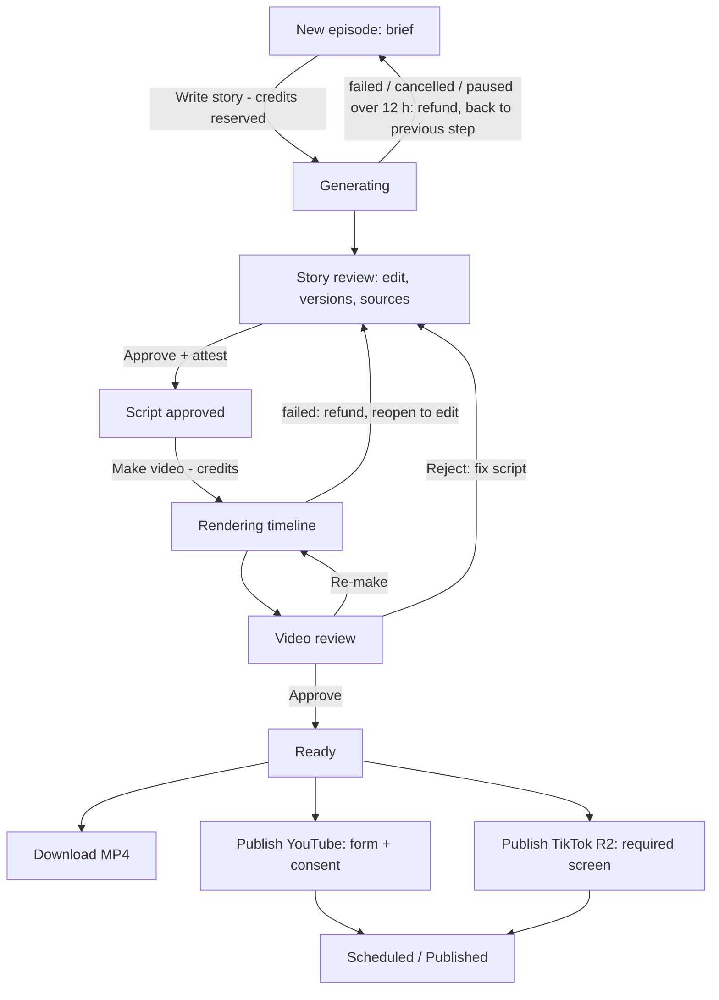

# 10 — Web UI (Angular 22, Clean Architecture) (M1–M2)

> Contracts: `00-overview.md` §5.1, §5.3 (feature layout), §5.4 (standards), §7 (states), §8 (routes). Backend behaviour: `09-backend-api.md`. Publishing rules: 06/07. This plan owns **every screen, the front-end architecture and UX quality**.
> Level: **high-level plan — not the final plan.** It fixes scope, contracts, key decisions, risks and rough estimates only. Every feature in it will still get (1) a review of the relevant sections and (2) its own **detailed feature plan** in `plans/features/`, reviewed again before implementation (process and template: `00-overview.md` §10.1). Details and estimates here may change in that step.
> Delivery phase (personal-first, `00-overview.md` §4.1): P except the S items listed in `00-overview.md` §4.1 (landing/pricing pages, register, CAPTCHA, billing/account, admin, TikTok screen, accessibility pass); 10.3.1-T1 privacy/terms pages, 10.4.3 autopilot and 10.7.1/10.7.2/10.7.4 YouTube publishing are P. Where this plan says M1 for an S item, read M2.

## 1. Purpose and scope

**Goal:** a clear, bilingual (vi/en) web app that a non-technical creator can use end-to-end, plus admin tools, built with Angular 22 and Clean Architecture per feature.

**In scope:** workspace and guardrails; core (auth, HTTP, errors, realtime, i18n); public SSR pages; auth screens; dashboard; series; episodes (story review = checkpoint #1, render progress, video review = checkpoint #2); publish (YouTube; TikTok in R2); channels; billing; account; admin; accessibility; testing.

**Out of scope:** native mobile apps; a video editor (users only edit text/keywords); marketing site CMS.

## 2. BA and UX review of this part

| # | Finding | Decision |
|---|---|---|
| U1 | Persona P1 is non-technical → pipeline jargon (keywords, render, MPT) confuses | UI words: "Scenes" (keywords), "Make video" (render), "Review", "Publish". Never show MPT/OpenAI names |
| U2 | Waiting 10–30 min for a render is the biggest UX risk | Progress timeline with stages + e-mail/in-app notification when ready; users can leave the page |
| U3 | Checkpoint #1 must feel like real editing, not a click-through, or the mass-produced policy risk grows | Editor encourages edits (hook tips, quality hints from 02.3.4); "Approve" needs an explicit confirm |
| U4 | Credits are abstract | Show the cost in credits **before** every paid action and the balance after |
| U5 | True-crime liability | Sources panel + attestation checkbox before approval (02.3.3); warning banner on true-crime series |
| U6 | Audit reviewers (P3) judge the consent screens | Publish and connect screens follow 06/07 text exactly; screenshots feed the evidence pack (13) |
| U7 | Vietnamese text is longer and has diacritics | Layouts tested with vi strings; fonts with full Vietnamese glyph coverage |
| T1 | Angular features evolve fast | Pin Angular 22.x (22.1.7 ✅ latest on npm 2026-09-16; 22.2.0 ✅ 2026-09-24); use only stable APIs. (10 CR-4) Zoneless is the default, Vitest is the default unit runner, Signal Forms and `httpResource` are stable in 22 (`features/10-web-ui/README.md` FE1–FE5); forms stay typed reactive forms (D13) |

## 3. Requirements

**Functional**
- **FR-10-1** Every route in §5.2 exists with loading, empty, error and success states.
- **FR-10-2** Auth: register (with ToS/Privacy acceptance), verify e-mail, login, silent refresh, logout, forgot/reset.
- **FR-10-3** Series create/edit with voice previews and style previews. Voice step: tags shown as i18n keys `voices.tag.<tag>` (vi + en), no play button when `previewUrl` is null, no speed control (04 CR-11).
- **FR-10-4** Episode journey: brief → generate → edit/versions → approve (with attestation for true crime) → make video → live progress → review (play, approve/reject, download).
- **FR-10-5** Publish to YouTube with per-video consent (flag `youtube_publish`); TikTok post screen with all required items (R2, flag `tiktok_publish`).
- **FR-10-6** Channels connect/disconnect with revoke explanation and the Google permissions link.
- **FR-10-7** Billing: packages, checkout redirect, result page, ledger.
- **FR-10-8** Account: language switch, data export, account deletion (7-day notice).
- **FR-10-9** Admin: users, render jobs, usage/cost, moderation, quota, flags.

**Non-functional**
- **NFR-10-1** Largest Contentful Paint < 2.5 s on public pages (prerendered); app shell interactive < 3 s on 4G [target].
- **NFR-10-2** Initial JS bundle ≤ 250 kB gzip for the authenticated shell; every feature lazy-loaded (budgets in `angular.json`).
- **NFR-10-3** WCAG 2.1 AA on core flows: keyboard only, focus visible, labels, contrast ≥ 4.5:1 in dark theme.
- **NFR-10-4** 100 % of UI strings in vi and en; missing keys fail CI.
- **NFR-10-5** No access token in `localStorage`/`sessionStorage` (memory only; refresh via HttpOnly cookie, 09.3.2).
- **NFR-10-6** Architecture boundaries enforced by lint (00 §5.4).

## 4. Epics and user stories

### Epic 10.1 — Workspace and guardrails

**10.1.1 Create workspace** — *As the Tech Lead I want a strict, standard Angular 22 workspace so that code starts clean.* Must · S
- Given `ng new` (Angular CLI 22), Then: standalone, strict TS + `strictTemplates`, SCSS, routing, SSR enabled for prerendered public routes only, bundle budgets per NFR-10-2, path aliases `@core/*`, `@shared/*`, `@features/*`.
- Zoneless change detection (the default since v21 ✅) + OnPush everywhere; static output (`outputMode: 'static'`), no Node server; served by the `web` container on the same origin as the API (10.1.1-T2, `features/10-web-ui/README.md` D1/D3) (10 CR-4).

**10.1.2 Lint and boundaries** — *As the Tech Lead I want architecture rules in lint so that layers stay clean.* Must · S
- Given ESLint (angular-eslint) + boundary plugin ⚠️ license check, When a `ui` component injects a store/repository, or `domain` imports `@angular/*`, or a feature deep-imports another feature, Then lint fails.
- Rules also forbid `any`, non-OnPush components, and subscriptions without `takeUntilDestroyed`.

**10.1.3 Design system** — *As a user I want a calm, dark "night" theme so that the brand fits the genre and is readable.* Must · M
- Given Angular Material with a custom M3 theme (dark default, light option), Then tokens (colour, spacing, typography with Vietnamese coverage, e.g. "Be Vietnam Pro" ⚠️ license OFL check) are defined once; shared UI: page header, empty state, error state, status chip, cost badge, confirm dialog, stepper.

**10.1.4 Generated API client** — *As a developer I want a typed client from OpenAPI so that the contract never drifts.* Must · S
- Given `openapi.json` from CI (09.9.5), When `npm run api:gen` runs (generator ⚠️ license check, e.g. `openapi-generator` or `ng-openapi-gen`), Then `shared/api/` is regenerated; only `data-access` files import it (lint rule).

**10.1.5 Test tooling** — *As the team I want fast tests so that TDD is realistic.* Must · S
- Given the CLI default unit runner (Vitest ✅) and Playwright (Apache-2.0 ✅) for e2e, When CI runs, Then unit + component tests run in `web.yml` and the Playwright suite runs in `e2e.yml` (11.5.1-T1) against the compose stack on each PR (10 CR-4).

**10.1.6 Content Security Policy and Trusted Types** — *As the security owner I want the browser to refuse injected script so that one XSS cannot steal a session or drive admin actions.* Must · S
- Given the SPA and SSR responses, Then a strict CSP is sent: `script-src 'self'` plus build-time SHA-256 hashes of the inline scripts (static prerendered pages cannot carry per-response nonces; 10 CR-4, `features/10-web-ui/README.md` D4), `object-src 'none'`, `base-uri 'none'`, `frame-ancestors 'none'`, `connect-src` limited to the API origin and the hub, and `require-trusted-types-for 'script'` [DECISION]; a CI e2e check fails if any page logs a CSP or Trusted Types violation.
- Given ESLint, When code uses `bypassSecurityTrust*` or binds `[innerHTML]` outside the one reviewed sanitizer module, Then lint fails.
- Given a download (MP4, export, receipt), Then the `Content-Disposition` filename is sanitized (no quotes, path separators or control characters).

### Epic 10.2 — Core

**10.2.1 Session and silent refresh** — *As a user I want to stay signed in so that I am not interrupted.* Must · M
- Given a 401 from an API call (including `session_revoked` after a stale security stamp), When the refresh cookie is valid, Then one refresh call runs (concurrent 401s share it), the original request is retried once; if refresh fails, the session store clears and the user goes to `/login?returnUrl=…`.
- Given a page reload, When the app boots, Then `POST /auth/refresh` restores the session before guarded routes activate.

**10.2.2 Error handling** — *As a user I want clear messages so that I know what to do.* Must · S
- Given a ProblemDetails `code` (catalogue 09 §5.4), When mapped by `AppErrorMapper`, Then the user sees the i18n message for that code; `validation_failed` maps field errors onto form controls; unknown codes show a generic message with `traceId`.

**10.2.3 Idempotency interceptor** — *As the platform I want safe retries so that double clicks never double-charge.* Must · XS
- Given a paid action, When the store calls it, Then an `Idempotency-Key` (UUID) is generated once per user intent and reused on retry.

**10.2.4 Realtime service** — *As a user I want live updates so that progress moves without refresh.* Must · M
- Given `@microsoft/signalr`, When logged in, Then the service first calls `POST /hubs/ticket` and connects with that 60-second single-use ticket (never the access token in the query string), WebSockets only (`skipNegotiation`); one connection with automatic reconnect exists (each reconnect fetches a new ticket); events are exposed as signals/observables per type; stores subscribe by episode id; on reconnect, stores re-fetch the current state (events may have been missed).
- Given the server aborts the connection after a suspend, role change, MFA reset or password reset, or a connect returns 401 `hub_ticket_invalid`, Then the service does not reconnect until the session refresh succeeds and a new ticket is issued.

**10.2.5 i18n** — *As a Vietnamese user I want the whole UI in Vietnamese so that I understand every step.* Must · S
- Given Transloco (MIT ✅), Then `vi` and `en` JSON files per feature scope; language from profile, else browser; date/number formats per locale; a CI check fails on missing keys.

**10.2.6 Shell and navigation** — *As a user I want a simple layout so that I always know where I am.* Must · S
- Given the shell, Then side nav (Dashboard, Series, Episodes, Channels, Billing, Account, Admin for admins), top bar with credit balance (live), language switch, user menu; responsive down to 360 px.

### Epic 10.3 — Public pages and auth

**10.3.1 Landing, pricing, legal pages** — *As a visitor I want to understand the product so that I sign up.* Must · M
- Given prerendered routes `/`, `/pricing`, `/privacy`, `/terms`, Then each has title/description/OG meta in both languages (`/vi/...` and `/en/...` or `?lang` — [DECISION] path prefix), no auth calls during prerender, and legal pages render the versions from 13.
- The landing page makes **no monetization promise** (DECISIONS §1).

**10.3.2 Register** — *As a visitor I want to create an account so that I can start.* Must · S
- Given the form, When submitted with e-mail, password (strength meter), display name, language and two unticked checkboxes (ToS, Privacy) that must be ticked, Then success shows "check your e-mail" (same message whether or not the e-mail already exists); server errors map to fields; 400 `breached_password` shows "This password appeared in a data breach — choose another" on the password field (also on `/reset-password`).

**10.3.3 Login, verify, forgot/reset** — *As a user I want standard account flows so that access is easy.* Must · M
- Given `/login`, `/forgot-password`, `/reset-password#t=` (token in the URL fragment, 09 BD3; `/verify-email#t=` is S and moves to 10.3.2-T1) (10 CR-4), Then each handles success, expired token, and rate-limit (429 `rate_limited` shows a countdown from `Retry-After`).
- Given 3 failed logins for the account from this IP/device, When the API returns 400 `captcha_required`, Then a CAPTCHA widget appears above the submit button and the next attempt sends its token; the progressive delay (429) is shown as a countdown; there is no "account locked" screen (09.3 lockout is per account + IP/device); the MFA step shows the same CAPTCHA widget when `POST /auth/login/mfa` returns `captcha_required` (09.3.2 failure detector); 429 `mfa_locked_untrusted` shows "Too many wrong codes. Reset your password from the e-mail we sent, or use a device you signed in on before".

### Epic 10.4 — Dashboard and series

**10.4.1 Dashboard** — *As a creator I want an overview so that I see what needs my attention.* Must · S
- Given `GET /episodes` filtered by status, Then cards show "Needs your review" (story_review, video_review), "In progress" (story_generating, rendering), "Ready to publish", and the credit balance with a buy button.

**10.4.2 Series list and editor** — *As a creator I want to set up a series once so that every episode keeps the same style.* Must · M
- Given `/series/new`, Then a 4-step form: 1) topic + language, 2) aspect (landscape long-form / portrait Shorts), 3) voice (list from `GET /voices` filtered by language: display name, gender, tags as i18n keys `voices.tag.<tag>` in vi + en, a play button only when `previewUrl` is not null, no speed control — the speaking rate is fixed in P) (04 CR-11), 4) visual style (grid of preview images from `GET /style-templates?topic=`; labels and hints are i18n keys `series.style.<name>.label` / `.hint` from `seed/i18n-style-labels.v1.json`; for true crime only the two `true_crime` styles show, with `series.style.trueCrimeNotice`); true-crime shows a responsibility notice (03 CR-7).
- Given edit, When the language changes and the voice no longer matches, Then the voice field is cleared with an explanation.

**10.4.3 Autopilot settings and run log (personal phase, 02.8)** — *As the channel owner I want to switch a series to autopilot so that ideas, stories, videos and publishing happen without me.* Must (P) · M
- Given `/series/:id` → Autopilot tab, Then the owner sets on/off, cadence (days, publish time, time zone), daily cap, ready-buffer size, privacy status on publish (public/unlisted/private), veto window, pre-audit mode and (advanced) gate thresholds; turning it on requires accepting the versioned authorization text (02.8.3); the topic is locked while autopilot is on; a true-crime series shows "Fact sheet and story will wait for your approval".
- Given the run log (`GET /series/{id}/autopilot/runs`), Then each run shows the idea picked (with rejected ideas and similarity), gate results, render and publication status, and the reason for any pause; "Pause" / "Resume" call `POST /series/{id}/autopilot/pause|resume`. The log refreshes on `EpisodeUpdated` and polls every 30 s while the tab is open (no `AutopilotRunUpdated` event in P, 02 T2).
- Given publications in the veto window, Then the tab lists them with preview, time left and Edit (`PATCH /publications/{id}`), Cancel (`DELETE`) and Approve now (`POST …/consent`).

### Epic 10.5 — Episodes: story review (checkpoint #1)

**10.5.1 Episode list** — *As a creator I want to find episodes so that I can continue work.* Must · S
- Given `/episodes`, Then a filterable (status, series) cursor-paginated list with status chips and "next action" buttons.

**10.5.2 New episode + generate** — *As a creator I want to write a short idea and get a draft so that I start fast.* Must · S
- Given `/series/:id/episodes/new`, Then a brief textarea (≤ 1,000 chars, counter), target length selector, and a "Write story (up to N credits)" button with "usually about M" below it (`GET /billing/quote`: `maxCredits`, `typicalCredits`, 12.1.3); after click the page shows the generating state live (SignalR) and becomes the editor when done. 02 CR-7: the state comes from `generation { kind, status, stage, errorCode }` on the episode detail and `EpisodeUpdated` (stages `queued|writing|checking|reviewing|revising|scoring|saving|done`); a failure shows the message for `errorCode`. Personal phase: no credit texts (12 is S).

**10.5.3 Story editor — view and edit** — *As a creator I want to edit my script comfortably so that it sounds like me.* Must · L
- Given `story_review`, Then the editor shows title, hook, paragraphs (each editable in place, with its "Scenes" chips = keywords that can be added, edited and removed), ending, description and tags; `hook` and `ending` are segments with their own scene chips, and each paragraph shows its `beat` as a small read-only label (02 CR-9, `story.v1`); autosave is **off** — explicit "Save version" sends `PUT /episodes/{id}/story` with `If-Match`.
- Given flagged keywords (03.2.2), Then their chips are red and "Make video" stays disabled until they are changed; a 409 `keywords_flagged` maps `errors[] { segment, index, rule }` to the chips; advisory hints `scenes_trimmed` / `scenes_sparse` show inline (copy keys in `features/03-image-generation/03.2-keyword-quality/plan.md` §6, 03 CR-7).

**10.5.9 Story editor — structure and dirty guard** — *As a creator I want to reorder and remove paragraphs safely so that I shape the story without losing work.* Must · L
- Given the paragraph list, Then each paragraph can be moved (drag handle and keyboard up/down buttons) and deleted (undo snackbar); scene chips move with their paragraph.
- Given unsaved changes, When navigating away or closing the tab, Then a confirm dialog appears (route guard + `beforeunload`).

**10.5.10 Story editor — hints, highlights and conflicts** — *As a creator I want to see what to improve and never lose a colleague's or tab's edits so that the final script is both good and mine.* Must · L
- Given quality hints (02.3.4), Then they appear inline next to the paragraph/keyword concerned (shared inline-annotation component).
- Given self-review issues (02.6.1, `audit_report`: blocking/advisory, objective/taste, evidence, repair direction), Then they use the same inline component; a version marked `revised` shows "Automatically corrected once" with a diff link; similarity warnings highlight the overlapping paragraphs (task 10.5.3-T2).
- Given 412 `story_version_conflict`, Then a dialog offers "Reload latest" or "Save mine as new version" (never silent overwrite); the user's unsaved text is kept in memory until they choose.

**10.5.4 Versions and diff** — *As a creator I want to see earlier versions so that I can go back.* Should · M
- Given `GET /episodes/{id}/story/versions`, Then a side panel lists versions; selecting two shows a word-level diff; "Restore" creates a new version from the old one.

**10.5.5 Sources and fact sheet (true crime; optional for other topics)** — *As a creator I want to add my sources and check the facts before the story is written so that my story is defensible.* Must · L
- Given `/episodes/:id/research`, Then the user pastes links one by one (max 10) or adds a personal note; each source shows live fetch status (pending / fetched with title / failed with the reason from 02.5.2); blocked domains show the message from 02.5.1 immediately.
- Given ≥ 1 fetched source, When "Build fact sheet (up to N credits)" is clicked (quote as in 10.5.2), Then the fact list appears; each fact is editable, deletable, and shows source chips (click opens the original page in a new tab); "Add fact" requires choosing a source or a note.
- Given a true-crime episode, Then "Write story" is disabled until the fact sheet is approved with ≥ 2 fetched sources; the attestation checkbox (02.3.3) stays on the approve-script dialog; its text and version come from `currentStory.attestation` (02 CR-7, T29).
- Given 412 `fact_sheet_conflict`, Then the same reload/save-as-new dialog as the story editor is shown.

**10.5.6 Approve / reopen** — *As a creator I want to approve my final script so that the video uses exactly it.* Must · S
- Given valid content, When "Approve script" is clicked, Then a confirm dialog shows the cost of the next step ("Make video: up to N credits, usually about M"; unused credits are returned after the render, 12 §5.7) and the note that edits after approval need reopening.

**10.5.7 Series bible panel** — *As a creator I want to see and edit what my series remembers so that episodes stay consistent.* Should · M
- Given `/series/:id/bible`, Then narrator, recurring characters, places, rules and past episode summaries are editable with `If-Match`.
- Given a pending proposal after a story approval, Then a banner shows the proposed changes as a diff with "Accept" and "Dismiss".

**10.5.8 Find sources for me (flag `source_finder`)** — *As a creator I want link suggestions so that research is faster.* Should (P) · S
- Given the flag and 02.7.2, When "Find sources" is clicked on the research page, Then candidate links are listed with their site; the user ticks the ones to add; nothing is added automatically. Routes (02.7.2-T2): `POST /episodes/{id}/sources/find`, `GET …/sources/candidates`, `POST …/candidates/{cid}/add`, `POST …/candidates/{cid}/dismiss` (02 CR-12).

### Epic 10.6 — Render progress and video review (checkpoint #2)

**10.6.1 Make video + progress timeline** — *As a creator I want to see progress so that I trust the system while waiting.* Must · M
- Given `POST /episodes/{id}/render`, Then a timeline shows the guaranteed stages Queued → Rendering → Uploading to library (`RenderProgress.stage` `queued|running|ingesting`, 00 §8) with `percent` as a progress bar, elapsed time, and "We'll e-mail you when it's ready"; the user can leave and return.
- Given a `RenderProgress` event with a finer stage (`voice → subtitles → images → assembling`, plus `checking` for the node-side post-processing), reported by the adapter (`render-status.v1`, 05 D4/D5, F09) (05 CR-9), Then it is shown as a sub-step under Rendering; unknown stage values are ignored, never shown raw.
- Given `render_worker_unavailable`, Then the timeline says "Waiting for a free studio slot" (not an error).
- Given a video with skipped scenes (`renderJob.images.skipped`, 03 D7 rows 2–3), Then video review shows `render.images.skippedBanner` and highlights each skipped segment, with `render.images.moderatedScene` guidance for moderated ones (03 CR-7).
- Given `image_moderated` (no video was made: > 10 % of scenes blocked, 03 D7), Then the message (`errors.image_moderated`) names the blocked scenes with guidance, a credits-refunded notice, and an "Edit scenes" button that calls `POST /episodes/{id}/story/reopen` (episode is back in `story_approved`, 00 §7) and opens the editor.

**10.6.2 Video review** — *As a creator I want to watch before publishing so that nothing bad goes out.* Must · M
- Given `video_review`, Then an HTML5 player plays from the signed URL; the store refreshes the URL before expiry (≤ 15 min) and on player error 403.
- Given the `render-quality.v1` advisory hints `subtitle_sync_suspect`, `subtitle_cues_long` and `music_none` (05 D10), Then they are shown as advisory notes (i18n keys `render.quality.subtitleSyncSuspect`, `render.quality.subtitleCuesLong`; a failed quality gate uses `errors.render_quality_failed`) (05 CR-9).
- Buttons: "Approve video", "Reject — fix script" (reason required), "Re-make video" (shows cost), "Download MP4".

### Epic 10.7 — Publishing and channels

**10.7.1 Channels page** — *As a creator I want to connect my YouTube channel so that I can publish from here.* Must · S
- Given `/channels`, Then connected accounts show name, platform, status, last verified; "Connect YouTube" redirects to Google (`POST /channels/youtube/connect` → URL); callback page shows success/failure.
- "Disconnect" explains: we revoke access with Google right away and delete related data within 7 days; also links https://security.google.com/settings/security/permissions (DECISIONS §10.6 ✅).

**10.7.2 YouTube publish form** — *As a creator I want to publish or schedule with explicit consent so that uploads only happen when I say so.* Must · M
- Given a `ready` episode and flag `youtube_publish`, Then the form has channel, title (prefilled), description, tags, privacy, optional schedule date/time (converted to UTC; scheduled posts are uploaded as private with `publishAt` ✅ — only valid with privacy private per YouTube docs ✅), and read-only "Altered or synthetic content: Yes" (`containsSyntheticMedia = true`).
- Given submit, Then a consent step shows: "I authorise Night Tales Studio to upload this specific video to <channel> [now/at <time>]." The publication is created only after the explicit click (`POST /publications/{id}/consent`).
- Given global quota exhaustion (`youtube_quota_exhausted`), Then the UI shows the next available slot from `GET /publishing/youtube/eta`.

**10.7.3 TikTok post screen (R2)** — *As a creator I want TikTok's required post screen so that my post is compliant.* Must (R2) · L
- On open: call `GET /channels/{id}/tiktok/creator-info`; show the creator **nickname**; if the creator cannot post now, block with the API message; block videos longer than `max_video_post_duration_sec` ✅.
- Title field; privacy dropdown built only from `privacy_level_options` with **no default** ✅; interaction toggles Comment/Duet/Stitch **unchecked by default** and disabled when the creator has them off ✅.
- Commercial content disclosure toggle off by default; when on, "Your brand"/"Branded content" options with the required label texts ✅.
- Before the Post button: "By posting, you agree to TikTok's Music Usage Confirmation" ✅; AI-generated label on by default (`is_aigc` ✅, 07).

**10.7.4 Publication status** — *As a creator I want to see publishing status so that I know when it is live.* Must · S
- Given `PublicationUpdated` events, Then the episode page shows each publication's state (scheduled/uploading/processing/published/failed) with a link to the live post.

### Epic 10.8 — Billing and account

**10.8.1 Buy credits and ledger** — *As a creator I want to buy credits and see where they went so that costs are transparent.* Must · M
- Given `/billing`, Then packages (`GET /billing/packages`: credits, bonus, VND price, price per credit, "about N Standard videos"), optional promo code field, optional "I need a VAT invoice" section (company name, tax code, address → `invoiceInfo` in `POST /billing/checkout`), checkout redirect (`POST /billing/checkout`), return page polling for the credited balance, and a ledger table (date, action, episode link, credits ±, balance).
- Given a ledger line of a job, When expanded, Then it shows quoted ("up to N"), charged and returned credits and the usage breakdown (text tokens, images, render minutes) from `GET /credits/ledger` (12.2.2, 12 §5.7).
- Given the pricing page and the package cards, Then expiry and refund rules (12.6.2, 12.7.5) are shown before payment.

**10.8.2 Account settings** — *As a user I want control of my data so that I trust the service.* Must · M
- Given `/account`, Then profile + language, "Export my data" (`POST /me/export`, e-mail link when ready), "Delete my account" (type e-mail to confirm; shows "completed within 7 days"), connected channels shortcut, accepted policy versions.

**10.8.3 Wallet, payments and refunds** — *As a buyer I want to see what I bought, what expires and get receipts so that paying feels safe.* Must · M
- Given `/billing/wallet`, Then balance split into free and purchased credits with the next expiry (`GET /credits/balance`); a payment history (`GET /billing/payments`) with status, receipt download and "Request refund" when eligible (`POST /billing/payments/{id}/refund-request`, reason required, shows the refundable credits and amount before sending).
- Given balance below one Standard render (12.6.3), Then a dismissible header banner links to `/billing`.

**10.8.5 My activity and sessions** — *As a user I want a history of my actions so that I can track my work and notice anything strange.* Must · M
- Given `/account/activity`, Then a timeline grouped by day (`GET /me/activity`, cursor paging) with category filter (Account & security, Episodes, Publishing, Credits & payments, Support actions) and date range; each row shows time, a translated message (vi/en from `messageKey`), a link to the target, and IP/device for security events; staff actions show "Support team" and the reason.
- Given an episode page, Then a "History" tab shows `GET /episodes/{id}/activity` (generated, versions saved, approved, reopened, rendered, rejected, downloaded, published, credits charged/returned).
- Given `/account/security`, Then active sessions (`GET /me/sessions`) with "Sign out" per session and "Sign out everywhere else"; a "This wasn't me" button (also reached from the new-device e-mail) revokes other sessions and opens change password.

**10.8.4 Bank QR and paused-processing states** — *As a Vietnamese user I want to pay by bank QR and understand pauses so that I am never confused about money.* Should · S
- Given the provider supports bank QR (12.7.4), Then the checkout page shows the QR, exact amount, order code to keep in the transfer note, a countdown, and live status; `needs_review` shows "We are checking your transfer".
- Given `processingPaused = provider_funds_exhausted` on the episode (00 §8, 12.8.3), Then episode pages show "Processing is paused. Your credits are reserved, not charged yet" instead of an error.

### Epic 10.9 — Admin

**10.9.1 Admin area** — *As the operator I want admin screens so that I can run the service.* Must · L
- Given role admin, Then lazy `/admin` with: users (list, detail, actions — 10.9.4), render jobs (filter by status/worker, retry/cancel; no script or scene content is shown), usage & cost (per day/model, margin), moderation events, YouTube quota today (used/limit, queue), feature flags toggles. Non-admins never download this chunk (route `canMatch` guard).

**10.9.2 Admin billing and funding** — *As the owner I want to manage offers and see my API runway so that I top up before money runs out.* Must · M
- Given `/admin/billing`, Then screens for credit packages and promo codes (list, create, edit, deactivate; create/edit owner-only, deactivate allowed to admins), the payments `needs_review` queue with a resolve dialog (grant expected / grant partial / mark failed, note required → `POST /admin/payments/{id}/resolve`) plus `pending_approval` rows with owner approve/reject (10.9.4), and refund requests (approve/reject with reason).
- Given `/admin/funding`, Then cards for estimated OpenAI balance, 7-day burn, runway days (colour at 7/3 days), outstanding liability, weekly set-aside vs actual top-ups; forms to record a balance snapshot and a top-up; a "Resume processing" button when `provider_funds_exhausted` is open.

**10.9.3 System settings** — *As the owner I want to manage API keys and base URLs in one screen so that I change providers without a deploy.* Must · M
- Given role owner, Then `/admin/settings` (own `canMatch` guard; admins never load it) shows one card per integration (09 §5.6): non-secret fields editable; secret fields show `••••1234` with "Replace" and "Clear", never pre-filled or revealed; editing a base URL makes the secret field required; "Test connection" shows ok or the error code and is disabled for an unsaved base URL while a stored secret would be used; an integration locked by the environment shows a "Locked by environment" badge and all its fields are read-only.
- Given the render node image key and image model (D2), Then a read-only row "Node-managed — rotate via runbook" (08 §5.3) is shown with no edit, test or reveal action.
- Given save, When the API returns 401 `reauth_required`, Then a re-auth dialog (password + TOTP, 10.9.5) opens and the save is retried once; 412 `setting_conflict` shows the reload dialog.
- Given a critical setting (`payment.*`, YouTube/TikTok client), When saved and the API returns 202 `setting_change_pending`, Then the card shows a "Pending change" banner with who requested it, the apply time (24 h time-lock) or "waiting for a second owner", and "Cancel"; another owner sees "Approve" and "Cancel" (`GET /admin/settings/changes`, `POST /admin/settings/changes/{id}/approve`, `POST /admin/settings/changes/{id}/cancel`); 409 `setting_change_pending` shows the existing pending change instead of a second one; the card keeps showing the active value until the change applies.
- Given the cancel link in an owner e-mail, Then a public page `/cancel-request#kind=…&id=…&token=…` (token in the URL fragment; no login, no admin chunk, `Referrer-Policy: no-referrer`, no third-party assets) reads the fragment, asks for one confirm click and calls `POST /security/cancel-links/{kind}/{id}` with the token in the body (09.10.8); it shows "cancelled", "already applied" or one generic "link invalid or expired" (400 `cancel_token_invalid`) (10 CR-33: route renamed from `/security/cancel-change`).
- Given "History" on a card, Then versions (who, when, reason, hints) are listed with "Roll back" (confirm dialog); a rollback restores non-secret values only, so the dialog requires re-entering each secret of that integration (old secrets are never restored).
- Given the worker nodes tab, Then nodes are listed (state, capacity, active tasks, last health pull, key hint) with add, drain, activate and "Rotate key" (shows the 09 §5.6 rotation steps as a checklist).

**10.9.4 User management** — *As an admin I want to see and act on a user's account so that support and abuse handling are fast.* Must · M
- Given `/admin/users`, Then a filterable list (query, status, role, verified, has payments) with cursor paging.
- Given `/admin/users/:id`, Then tabs Overview, Sessions, Channels, Credits & payments, Moderation & reports, Audit (`GET /admin/users/{id}`); action buttons (suspend/unsuspend, revoke sessions, resend verification, force password reset, grant credits, start deletion; owner-only: change role, reset MFA) each open a dialog with a required reason; owner-only buttons are hidden for admins.
- Given the actor's role is not higher than the target's (an admin viewing an admin/owner, an owner viewing another owner), Then user-management action buttons are hidden and the self "grant credits" button never appears; the one exception is an owner acting on another owner (MFA reset, demotion, suspend; there is no owner-on-owner delete), which returns 202 `owner_action_pending` and shows "Needs a third owner or a 24 h time-lock" with the apply time, or 202 `owner_action_disputed` and shows "Disputed — waits for a third owner or the host operator"; owners see these in a pending list with a Disputed badge (`GET /admin/owner-actions?status=pending`, `POST /admin/owner-actions/{id}/approve`, `POST /admin/owner-actions/{id}/cancel`); the target sees its pending request with a "Cancel" button (re-auth, no link) on its first request per (action, target) in 30 days, and on a `disputed` request no button and "Waiting for another owner or the host operator"; 409 `cancel_limit_reached` shows "You already used your one cancel for this in 30 days" to the target and "You already cancelled this twice in 30 days" to other owners; 409 `owner_action_disputed` shows "Disputed requests cannot be cancelled by either side"; promoting a user to owner returns 202 `owner_action_pending` like other owner actions, and approve buttons are hidden for owners promoted less than 30 days ago; a `system` (host-operator recovery) request shows no Approve button and an "Object" button instead of Cancel for non-targets (202 `objection_recorded` → "Your objection was recorded; only the target or the host operator can cancel a recovery"); for an owner demoted in the last 30 days, a suspended owner or a restored owner under freeze (409 `owner_dispute_frozen`), all action buttons are hidden and the page shows "Only the host operator can change this account"; e-mailed cancel links open the same `/security/cancel-change` page.
- Given a grant above the per-admin 24 h cap (12.5.1, [DECISION] 2,000 credits), When the API returns 202 `grant_requires_approval`, Then the dialog says it is waiting for owner approval; owners get an approval queue (`GET /admin/credit-grant-requests?status=pending`, `POST /admin/credit-grant-requests/{id}/approve|reject` with reason); `grant_expected`/`grant_partial` resolutions above [DECISION] 1,000 credits appear in the 10.9.2 review queue as `pending_approval` with approve/reject (`POST /admin/payments/{id}/resolve/approve|reject`, 12.3.5); on both, the approve button is disabled for the requester when another owner exists.
- Given the user's content, Then it is not shown here; the moderation and report tabs link to the case view, which logs the access (09.10.5).

**10.9.5 MFA and re-auth** — *As an admin I want an authenticator login so that my account is hard to take over.* Must · S (10 CR-4: enrolment, recovery codes, the login MFA step and the re-auth dialog are built in P by 10.3.3-T3 because owner login always needs them; 10.9.5-T1 keeps the S items only)
- Given `/account/security`, Then TOTP enrolment (QR + manual key, verify a code, show 10 recovery codes once with download), disable (not offered to admin/owner), and regenerate recovery codes.
- Given a user with MFA, Then login asks for the code (`POST /auth/login/mfa`, recovery code allowed); admin/owner without MFA are redirected to enrolment before `/admin`.
- Given `reauth_required`, Then a shared re-auth dialog (password + code) used by 10.9.3 and 10.9.4.

### Epic 10.10 — Quality

**10.10.1 Accessibility pass** — *As a user with assistive tech I want the app usable so that nobody is excluded.* Must · M
- Given core flows, When tested with keyboard only and a screen reader, Then all actions are reachable, dialogs trap focus, live regions announce progress; automated axe checks in e2e ⚠️ (axe-core license MPL-2.0 [INFERENCE], confirm).

**10.10.2 E2E journeys** — *As the team I want the main journeys automated so that releases are safe.* Must · L
- Playwright specs against API + mock-mpt: register→verify(link from test mailbox)→series→episode→generate→edit→approve→render→review→download; ETag conflict; insufficient credits; moderation failure; YouTube publish with consent (mocked Google).

## 5. Technical design

### 5.1 Example feature slice (episodes)

```ts
// features/episodes/domain/episode.model.ts  (no Angular imports)
export type EpisodeStatus = 'draft' | 'story_generating' | 'story_review' | 'story_approved'
  | 'rendering' | 'video_review' | 'ready' | 'scheduled' | 'published' | 'failed' | 'cancelled';
export interface Episode { id: string; status: EpisodeStatus; etag: string; nextActions: EpisodeAction[]; /* … */ }
export const canApproveStory = (e: Episode, s: StoryDraft): boolean =>
  e.status === 'story_review' && s.paragraphs.length > 0 && !s.hasFlaggedKeywords;

// features/episodes/domain/episodes.repository.ts
export abstract class EpisodesRepository {
  abstract get(id: string): Promise<Episode>;
  abstract generateStory(id: string, idempotencyKey: string): Promise<void>;
  abstract saveStory(id: string, draft: StoryDraft, etag: string): Promise<{ etag: string }>;
}

// features/episodes/application/episode-detail.store.ts
@Injectable()
export class EpisodeDetailStore {
  private readonly repo = inject(EpisodesRepository);
  readonly episode = signal<Episode | null>(null);
  readonly status = computed(() => this.episode()?.status);
  async approveStory() { /* call repo, update signals, map AppError */ }
}

// features/episodes/ui/story-editor.component.ts — inputs/outputs only, OnPush, no injection of stores
// features/episodes/feature/story-review.page.ts — provides EpisodeDetailStore, wires ui ↔ store
// features/episodes/episodes.routes.ts — providers: [{ provide: EpisodesRepository, useClass: EpisodesHttpRepository }]
```

State: plain signal-based stores per feature [DECISION]; NgRx SignalStore (⚠️ license check) is acceptable later if stores grow, but not mixed within one feature.

### 5.2 Screen inventory

| Route | Feature/page | API calls | States |
|---|---|---|---|
| `/`, `/pricing`, `/privacy`, `/terms` | public | none / `GET /billing/packages` (build time) | static |
| `/register`, `/login`, `/verify-email`, `/forgot-password`, `/reset-password`, `/cancel-request` (10 CR-33) | auth | `/auth/*`, `POST /security/cancel-links/{kind}/{id}` (token in body) | form, submitting, error, success |
| `/dashboard` | dashboard | `GET /episodes`, `GET /credits/balance` | loading, empty (first-run guide), data |
| `/series`, `/series/new`, `/series/:id` | series | `/series`, `/voices`, `/style-templates` | loading, empty, form, error |
| `/episodes` | episodes | `GET /episodes` | loading, empty, list |
| `/series/:id/episodes/new` | episodes | `POST /series/{id}/episodes`, `POST …/story/generate` | form, generating |
| `/episodes/:id` | episodes (router by status) | `GET /episodes/{id}` + SignalR | per status: generating, story review, rendering, video review, ready, published, failed |
| `/episodes/:id/publish/youtube` | publish | `/channels`, `POST /episodes/{id}/publications`, `POST /publications/{id}/consent` | form, consent, submitted, quota wait |
| `/episodes/:id/publish/tiktok` (R2) | publish | `GET /channels/{id}/tiktok/creator-info`, publications | creator blocked, form, consent, submitted |
| `/channels`, `/channels/:platform/callback` | channels | `/channels*` | list, connecting, callback result |
| `/billing`, `/billing/return` | billing | `/billing/*`, `/credits/*` | packages, redirecting, confirming, ledger |
| `/account` | account | `/me*` | form, export pending, deletion pending |
| `/vi/report`, `/en/report` (10 CR-24) | public (prerendered; CAPTCHA and rate limit; built in 13.3.4-T1) | `POST /reports` | form, submitting, submitted, rate-limited |
| `/account/activity` | account | `GET /me/activity` | loading, empty, timeline, filtered-empty |
| `/account/security` | account | `/me/sessions*`, `/me/mfa/*`, `/auth/reauth` | sessions list (trusted-device badge; signing out a session removes its trust), MFA enrol/verify, recovery codes shown once, re-auth dialog |
| `/admin/**` | admin (`canMatch`: admin or owner, MFA enrolled) | `/admin/*` | tables with filters |
| `/admin/settings` | admin-settings (own `canMatch`: owner only; chunk never loaded for admins) | `/admin/settings*`, `/admin/worker-nodes*` | cards, pending change, locked by environment, history/rollback |

### 5.3 Episode journey (UX flow)



## 6. Task breakdown

| Task ID | Task | Area | Size | Depends on |
|---|---|---|---|---|
| 10.1.1-T1 | `ng new`, static prerender for public routes, aliases, budgets | FE | S | — |
| 10.1.1-T2 | `web` container (nginx), same-origin routing contract, dev proxy (10 CR-4) | FE | S | 10.1.1 |
| 10.1.2-T1 | ESLint + boundary rules + CI lint | FE | S | 10.1.1 |
| 10.1.3-T1 | Material M3 theme, fonts, shared UI components | FE | M | 10.1.1 |
| 10.1.4-T1 | OpenAPI generator script + lint rule for imports | FE | S | 09.9.5 |
| 10.1.5-T1 | Unit runner + Playwright setup + CI | FE | S | 10.1.1 |
| 10.1.6-T1 | Build-time hash CSP + Trusted Types, ESLint sanitizer ban, CSP-violation e2e check, safe download filenames (10 CR-4: S → M) | FE | M | 10.1.1, 10.1.2 |
| 10.2.1-T1 | Session store, auth interceptor, refresh queue, guards | FE | M | 09.3.2 |
| 10.2.2-T1 | AppErrorMapper + form error binding | FE | S | 09.1.4 |
| 10.2.3-T1 | Idempotency-Key interceptor/helper | FE | XS | 10.2.1 |
| 10.2.4-T0 | UI design (app shell, nav, language switch, user menu, realtime status) (10 CR-31) | UX | S | 10.1.3 |
| 10.2.4-T1 | SignalR service (hub ticket, WebSockets only) + reconnect re-fetch + server-abort handling | FE | M | 09.8.1 |
| 10.2.5-T1 | Transloco setup, scopes, missing-key CI check | FE | S | 10.1.1 |
| 10.2.6-T1 | Shell layout, nav, live balance | FE | S | 10.2.4 |
| 10.3.1-T0 | UI design (public marketing + auth) (10 CR-24) | UX | M | 10.1.3 |
| 10.3.1-T1 | Privacy and terms pages (prerender + meta, vi/en; P — required before the YouTube audit) | FE | S | 13.1.1-T1, 13.1.2-T1 |
| 10.3.1-T2 | Landing and pricing pages (prerender + meta) | FE | S | 10.3.1-T1 |
| 10.3.2-T1 | Register page + verify-email page (verify moved from 10.3.3-T1, 10 CR-4) | FE | S | 10.2.1 |
| 10.3.3-T0 | UI design (login, MFA, forgot/reset, re-auth, legal pages) (10 CR-31) | UX | M | 10.1.3 |
| 10.3.3-T1 | Login (password step)/forgot/reset pages | FE | M | 10.2.1 |
| 10.3.3-T2 | CAPTCHA widget + progressive-delay countdown on `captcha_required`/`rate_limited`, `breached_password` field error (CAPTCHA provider ⚠️ license/privacy check) | FE | XS | 10.3.3-T1, 09.3 |
| 10.3.3-T3 | MFA login step, owner enrolment, recovery codes, re-auth dialog (P; moved from 10.9.5-T1, 10 CR-4) | FE | M | 10.3.3-T1, 09.3.2, 09.10.4 |
| 10.4.1-T0 | UI design (dashboard, series editor, autopilot tab, run log, veto list) (10 CR-31) | UX | M | 10.1.3 |
| 10.4.1-T1 | Dashboard | FE | S | 10.5.1 |
| 10.4.2-T1 | Series list + 4-step editor + style grid | FE | M | 09.4 |
| 10.4.2-T2 | Voice picker with preview audio (04 CR-11; 10 CR-4) | FE | S | 09.4.2 |
| 10.4.3-T1 | Autopilot tab (settings, authorization, re-auth, pause/resume) | FE | M | 02.8 |
| 10.4.3-T2 | Autopilot run log, calibration panel, veto-window list (10 CR-4) | FE | M | 10.4.3-T1, 02.8, 06 |
| 10.5.1-T0 | UI design (episode list, new + generate, story editor, conflict, dirty guard) (10 CR-31) | UX | M | 10.1.3 |
| 10.5.1-T1 | Episode list | FE | S | 09.5.1 |
| 10.5.2-T1 | New episode + generate state | FE | S | 09.5.2 |
| 10.5.3-T1 | Story editor view/edit: paragraphs, scene chips, flagged chips, Save version with ETag | FE | L | 10.5.2 |
| 10.5.9-T1 | Paragraph reorder (drag + keyboard) / delete with undo, dirty guard + `beforeunload` | FE | L | 10.5.3-T1 |
| 10.5.10-T1 | Inline annotation component + quality hints, 412 conflict dialog keeping unsaved text | FE | L | 10.5.3-T1 |
| 10.5.3-T2 | Self-review issues, "corrected once" badge, similarity highlights in the editor | FE | XS | 10.5.10-T1, 02.6.1 |
| 10.5.4-T0 | UI design (versions/diff, approve & reopen, research page, find sources, bible) (10 CR-31) | UX | M | 10.1.3 |
| 10.5.4-T1 | Versions panel + diff + restore | FE | M | 10.5.3 |
| 10.5.5-T1 | Research page: sources list, fetch status, fact-sheet editor, approve | FE | L | 02.5, 10.5.3 |
| 10.5.7-T1 | Series bible panel + proposal diff | FE | M | 02.6.3 |
| 10.5.8-T1 | Find-sources suggestions | FE | S | 02.7.2 |
| 10.5.6-T1 | Approve/reopen dialogs with cost | FE | S | 10.5.3 |
| 10.6.1-T0 | UI design (render timeline, failure states, video review) (10 CR-31) | UX | S | 10.1.3 |
| 10.6.1-T1 | Render timeline (guaranteed stages + optional sub-steps) + failure states | FE | M | 09.6 |
| 10.6.1-T2 | "Make video" action (keyword gate, idempotency) + cancel render (10 CR-14) | FE | S | 10.6.1-T1, 09.6.4 |
| 10.6.2-T1 | Video review page + URL refresh | FE | M | 09.7 |
| 10.7.1-T0 | UI design (channels: connect, callback result, disconnect) (10 CR-31) | UX | S | 10.1.3 |
| 10.7.1-T1 | Channels page + callback (re-auth + legal gate; 10 CR-14: S → M) | FE | M | 06 |
| 10.7.2-T0 | UI design (publish form, consent, quota wait, publication status, veto-email pages) (10 CR-31) | UX | M | 10.1.3 |
| 10.7.3-T0 | UI design (TikTok) (10 CR-24) | UX | S | 10.1.3 |
| 10.7.2-T1 | YouTube publish form + consent + quota wait | FE | M | 06 |
| 10.7.3-T1 | TikTok connect + creator info (R2) (10 CR-24: split) | FE | M | 10.7.3-T0, 07 |
| 10.7.3-T2 | TikTok post composer + status (R2) (10 CR-24: split) | FE | M | 10.7.3-T1, 07 |
| 10.7.4-T1 | Publication status widgets | FE | S | 06 |
| 10.7.4-T2 | Veto e-mail pages: cancel-by-link (public) and approve-now (10 CR-14) | FE | S | 10.7.4-T1, 06.2.2 |
| 10.8.1-T0 | UI design (billing + account) (10 CR-24) | UX | M | 10.1.3 |
| 10.8.1-T1 | Billing packages, promo field, checkout, return, ledger | FE | M | 12 |
| 10.8.3-T1 | Wallet, payment history, receipts, refund request, low-balance banner | FE | M | 12.6, 12.7 |
| 10.8.4-T1 | Bank QR checkout + paused-processing states | FE | S | 12.7.4, 12.8.3 |
| 10.8.2-T1 | Account settings, export, deletion | FE | M | 13 |
| 10.8.5-T1 | Activity timeline + episode History tab + sessions/"this wasn't me" (10 CR-34: mounts into 10.5.3-T1's `@case`) | FE | M | 09.3.6, 09.3.7, 10.5.3-T1 |
| 10.9.1-T0 | UI design (admin) (10 CR-24) | UX | M | 10.1.3 |
| 10.9.1-T1 | Admin area: shell + users + render-jobs + usage + flags (10 CR-24: split) | FE | M | 10.9.1-T0, 09.9.1 |
| 10.9.1-T2 | Admin area: moderation + quota + reports + deletion requests (10 CR-24: split) | FE | M | 10.9.1-T0, 09.9.1 |
| 10.9.2-T1 | Admin billing (packages, promos, review queue, refunds) + funding page | FE | M | 12.7, 12.8 |
| 10.9.3-T1 | Owner settings screens, worker nodes tab, history/rollback with secret re-entry, node-managed row, re-auth retry | FE | M | 09.10.2 |
| 10.9.3-T2 | Critical-setting pending change banner, apply time, approve/cancel, public cancel-link page | FE | S | 10.9.3-T1, 09.10.2 |
| 10.9.4-T1 | Admin user list + detail tabs + action dialogs | FE | M | 09.10.5 |
| 10.9.4-T2 | Role-hierarchy action hiding, owner-action pending list, credit-grant approval queue, `pending_approval` payment approve/reject | FE | M | 10.9.4-T1, 09.10.4, 12.5.1, 12.3.5 |
| 10.9.5-T1 | MFA disable for users, admin/owner redirect to enrolment before `/admin` (the P parts moved to 10.3.3-T3, 10 CR-4) | FE | XS | 10.3.3-T3, 09.10.4 |
| 10.10.1-T1 | Accessibility pass (harness + public/auth/billing/account) + axe in e2e (10 CR-24: split) | FE | S | all public/auth/billing/account screens |
| 10.10.1-T2 | Accessibility pass (admin/publishing) + axe in e2e + per-route budgets (10 CR-24: split) | FE | S | all admin/publishing screens |
| 10.10.2-T1 | Playwright journeys | FE | L | all screens |
| 10.10.2-T2 | SaaS journeys (S): register/verify/legal/18+, sandbox billing checkout, admin actions (user suspend, credit-grant approval, flag toggle re-auth) (10 CR-40) | QA | M | 10.10.2-T1, 10.3.2, 10.8.1, 10.9.1, 10.9.4 |

## 7. Test plan

- **Domain/util unit tests:** status → next actions; `canApproveStory`; mappers DTO ↔ model; keyword flag rules mirror backend codes.
- **Store tests:** with fake repositories — success, AppError mapping, ETag conflict path, optimistic updates rolled back on error, realtime event merge.
- **Component tests:** story editor (edit, chips, reorder by keyboard, delete + undo, dirty guard, 412 dialog keeps unsaved text), render timeline (guaranteed stages only; finer stage shown as sub-step; unknown stage ignored), settings (pending critical change shows apply time and cancel; rollback asks for secrets; node-managed row has no actions), user detail (actions hidden when actor role ≤ target role), login (CAPTCHA after `captcha_required`), publish consent (button disabled until explicit consent), TikTok screen (no default privacy, disabled interactions, duration block).
- **Security checks:** e2e fails on any CSP/Trusted Types violation; the SignalR connect URL never contains the access token.
- **E2E:** 10.10.2 list; run in CI against docker compose (API + mock-mpt + mail catcher).
- **Manual:** vi/en visual review of every screen; 360 px mobile check; screen reader smoke (VoiceOver).

## 8. Risks and mitigations

| Risk | Mitigation |
|---|---|
| Story editor complexity explodes | Structured paragraphs (not rich text); editor split into three stories (10.5.3 view/edit, 10.5.9 structure + dirty guard, 10.5.10 hints + conflicts) plus 10.5.3-T2 |
| Trusted Types breaks a third-party library (Material, SignalR, CAPTCHA) | Check in 10.1.6 before the first feature; a narrowly named policy in the sanitizer module is the only allowed exception |
| Missed realtime events | Re-fetch on reconnect and on page focus |
| Audit rejection due to UI wording | Wording owned by 06/07/13; screenshots reviewed before filing |
| Angular upgrade churn | Pin 22.x; upgrade on a schedule with `ng update` in a dedicated PR |

## 9. Exit criteria

- **M1:** all screens except publish/TikTok/billing work against the real API and mock-mpt; e2e main journey green; vi/en complete; a11y pass on core flows.
- **M2:** YouTube publish, channels, billing, account deletion live behind flags; evidence screenshots produced for 13.
- **R2:** TikTok post screen passes the internal checklist of every required item.

## 10. Open questions and contract change requests

- [DECISION recorded in 10.3.1] Public URLs use `/vi/…` and `/en/…` path prefixes.
- ✅ Closed (10 CR-4): zoneless default, Signal Forms and `httpResource` stable, Vitest default runner (`features/10-web-ui/README.md` FE2–FE5).
- **Contract changes (applied to 00):** `GET /episodes/{id}` includes `nextActions` and the latest render `stage`/`percent`; `RenderProgress` payload defined in 00 §8; `GET /publishing/youtube/eta` for the quota wait state; admin render-job retry/cancel routes.
- **Contract changes (applied to 00/09):** approval routes (00 §8 "Admin — approvals": settings changes, owner actions, credit-grant requests, payment resolve approve/reject, signed single-use cancel token), `POST /hubs/ticket`; codes `captcha_required`, `rate_limited`, `breached_password`, `setting_change_pending`, `owner_action_pending`, `grant_requires_approval`, `session_revoked`, `hub_ticket_invalid` in 09 §5.4.
- **Hand-over from plan 03 (2026-09-24, read before detailing this plan).** Plan 03 is owner-signed and its task files already name the task ids below. Keep those ids, or update the `Depends on` / `Blocks` cells in plan 03 when they change. Contract: `features/03-image-generation/README.md` D1–D14.
  - [ ] 10.4.2-T1 style picker (CR-7):
    - Copy the labels from `seed/i18n-style-labels.v1.json` (03.1.1-T1) into the vi/en bundles as `series.style.<name>.label` / `.hint`.
    - Call `GET /style-templates?topic=` so a `true_crime` series only sees `true_crime` styles.
    - Empty state: when there is no preview image, show the label only (03.1.2-T1).
  - [ ] 10.5 video review / render states (CR-7):
    - Map the 409 `keywords_flagged` `errors[] { segment, index, rule }` to red chips and disable "Make video".
    - Show the advisory hints `scenes_trimmed` / `scenes_sparse`.
    - Show the skipped-scenes banner from `latestRenderJob.images.skipped`, with "Edit scenes".
    - Add copy for `image_moderated` (names the scene, no retry) and for `image_generation_failed`, including its detail `provider_funds_exhausted`.
    - Dev states come from mock-mpt `MOCK_IMAGE_REPORT` (03.4.3-T2).

## 11. Estimate summary

| Epic | Days |
|---|---|
| 10.1 Workspace + guardrails | 4.5 |
| 10.2 Core (10 CR-31: +0.5 `10.2.4-T0`) | 4.25 |
| 10.3 Public + auth (10 CR-24: +1.0 `10.3.1-T0`; 10 CR-31: +1.0 `10.3.3-T0`) | 5.75 |
| 10.4 Dashboard + series + autopilot (10 CR-31: +1.0 `10.4.1-T0`) | 5.0 |
| 10.5 Story review (10 CR-31: +1.0 `10.5.1-T0` +1.0 `10.5.4-T0`) | 14.25 |
| 10.6 Render + video review (10 CR-31: +0.5 `10.6.1-T0`) | 3.0 |
| 10.7 Publishing + channels (10 CR-31: +0.5 `10.7.1-T0` +1.0 `10.7.2-T0`; 10 CR-24: +0.5 `10.7.3-T0`) | 7.0 (incl. 2.5 R2) |
| 10.8 Billing + account (10 CR-24: +1.0 `10.8.1-T0`) | 5.5 |
| 10.9 Admin (10 CR-24: +1.0 `10.9.1-T0`; 10 CR-40: `10.9.5-T1` now cleanly detailed as S — supersedes the former +0.25 stated-vs-real S-subtotal correction, since the base 6.75 already includes `10.9.5-T1`) | 7.75 |
| 10.10 Quality (10 CR-24: L split into two S, total unchanged; 10 CR-40: + `10.10.2-T2` SaaS journeys) | 4.0 |
| **Total** | **61.0** → with 20 % buffer **73.2** person-days (of which R2: 2.5 raw / 3.0 with buffer; P 41.0, S 20.0; 10 CR-4: was 45.25 / 54.3 — wave 1 re-estimated in `features/10-web-ui/README.md` §9; 10 CR-14: wave 2 +1.5, Part B §B9; 10 CR-22 + 10 CR-31 combined: +10.0 d raw for 12 new `-T0` design tasks, D19/WD11/SD11 owner rule 2026-09-25; 10 CR-39: arithmetic fix, P 41.5 → 41.0 = wave 1 31.5 + wave 2 9.5; 10 CR-40: `10.9.5-T1` detailed as S (+0.25, moved off the P placeholder, superseding the old stated-vs-real 0.25 correction) + new `10.10.2-T2` (+1.0) — S 18.75 → 20.0) |
