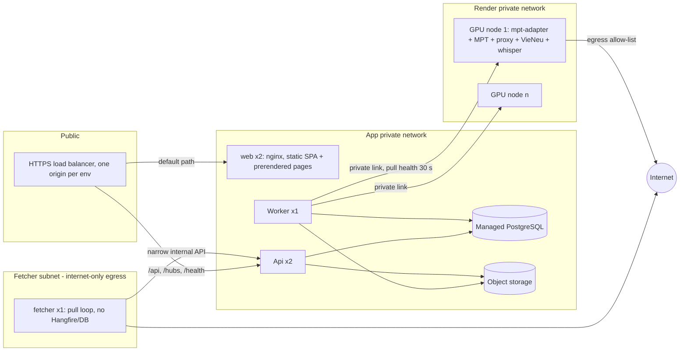

# 11 — Environments, Worker Deployment and CI/CD (M1)

> Contracts: `00-overview.md` §5 (architecture, local dev), §11 (NFRs). Worker contract: `05` §5.3. Proxy: `04`. Backend: `09`. Facts: `../DECISIONS.md` §10.4 (capacity), §10.8 (security).
> Detailed plan: `features/11-worker-deployment/` (README D1–D19, 32 tasks); ready with conditions 2026-09-24 (11 CR-1).
> Level: **high-level plan — not the final plan.** It fixes scope, contracts, key decisions, risks and rough estimates only. Every feature in it will still get (1) a review of the relevant sections and (2) its own **detailed feature plan** in `plans/features/`, reviewed again before implementation (process and template: `00-overview.md` §10.1). Details and estimates here may change in that step.
> Delivery phase (personal-first, `00-overview.md` §4.1): P except 11.2.3 separate prod accounts and 11.5.3-T2 signing/SBOM (S). Where this plan says M1 for an S item, read M2.

## 1. Purpose and scope

**Goal:** developers work locally without a GPU, staging and production run the same artefacts, and render workers are private, observable and scalable.

**In scope:** local Docker Compose; `mock-mpt`; staging/prod topology; GPU worker node build; private networking; multi-worker dispatch; object storage; CI/CD; secrets; backups; monitoring; capacity and cost measurement; hosting evaluation.

**Out of scope:** Kubernetes (not needed for MVP [DECISION]); multi-region.

## 2. BA and Tech Lead review of this part

| # | Finding | Decision |
|---|---|---|
| W1 | GPU servers are the largest fixed cost and are idle at night | Start with 1 GPU node; measure utilisation before adding; allow scale-to-zero later ⚠️ provider-dependent |
| W2 | MPT/VieNeu/proxy must never be internet-reachable ✅ | Private network only; the Worker reaches each node's `mpt-adapter` (11.3.5) over a private link; nodes never open connections into the app network [DECISION] |
| W3 | Frontend/backend dev must not wait for GPU | `mock-mpt` (.NET minimal API) implements the `mpt-adapter` contract (05.4.1, 11.3.5) with configurable delays/failures |
| W4 | Hosting provider [OPEN] | Evaluation checklist §5.6; no vendor prices asserted |
| W5 | MPT memory task state may be lost on restart (05 spike) | Decision taken: no Redis — the adapter keeps its own durable task store and reports `render_lost` for a task it no longer knows (05 F06, D4) (05 CR-4) |
| W6 | Storage choice affects licensing (e.g. some self-hosted S3 servers are AGPL ⚠️) | Prefer managed S3-compatible storage in prod; local dev uses SeaweedFS (Apache-2.0); MinIO, Garage, self-hosted Grafana and Renovate are AGPL and rejected ✅ (11 CR-1) |
| W7 | TL review 2026-09-24 (`features/11-worker-deployment/` F01–F28) | Adapter re-sized and split (5.0 d), .NET with shared Contract/Server projects, cuDNN 9 libraries for whisper on the node, prod environment in P, node keys from the secret manager in P, operator-run node deploy from a hashed bundle (11 CR-1) |

## 3. Requirements

- **FR-11-1** `docker compose up` starts postgres, api, worker, web (dev server or built), mock-mpt, S3-compatible storage, mail catcher.
- **FR-11-2** `mock-mpt` implements `render-node.v1` exactly (05 README D4/D5/D14): submit, query status (state + percent; the D5 `stage` sub-steps `queued|voice|subtitles|images|assembling|checking|done`), download canned MP4 by task id, `/subtitles`, `/cancel`, health + active task count, cleanup, failure injection (`tts_failed`, `image_moderated`, `assembly_failed`, `node_error`, `quality:<check>`, `timeout`, `lost_task`), per-request delay; it serves the 05 D14 fixtures (05 CR-4); terminal statuses carry an `images.v1` report chosen by `MOCK_IMAGE_REPORT` (`ok`, `moderated:<slots>`, `skipped:<share>`, `moderated_all`, `funds`, `none`) or the per-term trigger `__block_image__`, and submits violating the 03 D4 image fields return 400 `adapter_contract_violation` (03.4.3-T2, 03 CR-5) (05 CR-4). `MOCK_FAIL_MODE=tts_failed` reproduces what the real adapter reports when MPT ends with `failed_stage = audio` (04 D6, 04 CR-12); the mock maps `lost_task` → `render_lost` and `timeout` → the task never reaches a terminal state (the Worker raises `render_timeout`), and keeps `image_moderated` as an alias of `MOCK_IMAGE_REPORT=moderated_all`; it is plain HTTP only inside the local compose network (05 D15 S1) (05 CR-4).
- **FR-11-3** Staging and production each have: API instance(s), Worker instance, managed PostgreSQL, object storage, ≥ 1 GPU render node, private network.
- **FR-11-4** GPU node runs VieNeu (GPU backend, `VIENEU_MAX_STREAMS` ✅), proxy, MPT, faster-whisper on GPU and `mpt-adapter` (11.3.5); the proxy binds loopback `127.0.0.1:8001` only, as on the Mac (04 D1), under the systemd unit `vieneu-proxy.service` (04 D13); MPT and VieNeu bind `127.0.0.1` on the node (05 README F12, D15 S1); only `mpt-adapter` listens on the private interface, over HTTPS on `:8090` with a node-local certificate whose SHA-256 fingerprint the Worker pins per node (`worker_nodes.tls_cert_sha256`) and refuses any other certificate (05 D15 S1); the adapter port is reachable from the Worker range only; health endpoints (05 CR-4). Sizing rule (04 D5): `VIENEU_MAX_STREAMS ≥ max_concurrent_tasks` and `PROXY_MAX_CONCURRENT ≥ max_concurrent_tasks` (04 CR-12).
- **FR-11-5** Worker registry: each node has id, adapter base URL, capacity (`max_concurrent_tasks`), state (`active`/`draining`/`down`); the Worker pulls each adapter's health every 30 s; `active_tasks` is derived from `render_jobs` in `submitted`/`running` per node; dispatcher picks the node with most free slots.
- **FR-11-6** CI/CD builds, tests, versions and deploys API/Worker/Web images and the worker-node bundle; DB migrations run as a separate step before app rollout.
- **FR-11-7** Backups: daily full + point-in-time recovery; backup retention 30 days [DECISION] (deleted data ages out within that window); monthly restore test.
- **NFR-11-1** Zero public ports on render nodes (verified by an external port scan).
- **NFR-11-2** Deploy without downtime for API (rolling or blue/green).
- **NFR-11-3** Recovery point objective ≤ 15 min, recovery time ≤ 4 h [targets].

## 4. Epics and user stories

### Epic 11.1 — Local development

**11.1.1 Docker Compose** — *As a developer I want the whole stack locally so that I can build features offline from the GPU.* Must · M
- Given `docker compose up`, Then all FR-11-1 services start with health checks; seed data loaded (09.2.5); `.env.example` documents every variable; no real secrets needed.

**11.1.2 mock-mpt** — *As a developer I want a fake render node so that render flows can be tested end-to-end.* Must · M
- Given `tools/mock-mpt`, Then it implements the exact `render-node.v1` routes/shapes (11.3.5; 05 README D4/D5/D14), including the `/subtitles` and `/cancel` routes and the 05 D14 fixtures, returns a canned 10-second MP4 per aspect, progresses 0→100 % over a configurable time, reports health + active task count, and fails when the request contains a trigger keyword (e.g. `__fail_image__`) or when configured by env (hard gate: 11.1.2-T1 starts only after 05.4.1-T2) (05 CR-4).
- Given CI, Then 09 integration tests and 10 e2e tests use it.

### Epic 11.2 — Cloud environments

**11.2.1 Hosting evaluation** — *As the owner I want a provider chosen on evidence so that cost and latency fit.* Must · S
- Given the checklist §5.6, When 2–3 providers are scored with **official** price pages captured with dates, Then a decision is recorded in DECISIONS.md.

**11.2.2 Staging environment** — *As the team I want a production-like staging so that releases are rehearsed.* Must · M (+ S fetcher, XS SignalR)
- Given infrastructure scripts (IaC tool ⚠️ license check — e.g. OpenTofu/MPL-2.0 [INFERENCE]), Then staging is created from code: network (app, render and `fetcher` subnets, §5.1), managed PostgreSQL, storage bucket(s), API + Worker + fetcher hosts, TLS certificates, DNS.
- Given more than one Api instance, Then the load balancer either routes SignalR over WebSockets only (client `skipNegotiation`, transport WebSockets) or uses sticky sessions for `/hubs/*` [DECISION]; Worker notifications reach every Api instance via PostgreSQL LISTEN/NOTIFY (09).
- Given the `fetcher` container (02.5.2, 02 §5.7), Then it runs the `NightTales.Fetcher` pull loop (no Hangfire) in its own subnet with internet-only egress: its only route into the app network is the Api internal listener `:8081` (lease → heartbeat → result, bearer `FETCHER_API_TOKEN` from the secret manager); no route to PostgreSQL, storage or the render network, no cloud metadata endpoint, no DB/storage/OpenAI credentials, no listening port; an egress test proves app (except `:8081`), PostgreSQL, storage, render and metadata addresses are unreachable from it (02 CR-1, 02 README D10, T43). If 02.7.1 picks option B, the finder sidecar runs in the same subnet under the same rules.

**11.2.3 Production environment** — *As the operator I want production isolated from staging so that tests never touch real users.* Must · M
- Given the same scripts with prod variables, Then prod has separate accounts/keys, separate Google/TikTok OAuth projects (06/07), separate OpenAI project for text with a hard budget, and a second separate OpenAI project for node image generation (11.3.2).

### Epic 11.3 — GPU render node

**11.3.1 Node image** — *As the operator I want a reproducible render node so that adding capacity is one command.* Must · L
- Given a Linux GPU server, When the provisioning script runs, Then it installs NVIDIA driver + CUDA version required by VieNeu's PyTorch backend ⚠️ (read VieNeu docs), ffmpeg, `uv`, fonts (05.2.2-T1, `check-fonts.sh`), music sync (05.3.1-T1 `check-music.sh`, 05.3.2-T2 `sync-music.sh`), pinned MPT and VieNeu commits, proxy (04), `mpt-adapter` (11.3.5), whisper model cache; it renders the MPT config with `render-mpt-config.py --profile node` (05.1.1-T2) (05 CR-4); services run under systemd (or containers with GPU runtime ⚠️) with restart policies.
- Given the proxy (04), Then the node bundle contains `worker-node/proxy/` and `seed/voices.v1.json`; it runs as `vieneu-proxy.service` (`worker-node/proxy/systemd/vieneu-proxy.service`, `User=nts-proxy`, `EnvironmentFile=/etc/nts/vieneu-proxy.env`, `IPAddressAllow=127.0.0.1 ::1`, 04 D13; 11 CR-6) bound to `127.0.0.1:8001` (04 D1), with `PROXY_MAX_CONCURRENT` sized per 04 D5; this task fixes the node paths that 04 D13 marks ⚠️ (04 CR-12).
- Given `/health` of VieNeu, proxy and MPT, Then `mpt-adapter` aggregates them into its health response — the proxy's `proxy-health.v1` object is embedded unchanged as `tts_proxy` (04 D8, 04 CR-12); the Worker pulls it every 30 s (no node agent pushes into the app network).
- Given the Mac trial (01), Then provisioning starts from `worker-node/CARRY-OVER.md` (01.3.3: pins, weight revisions + sha256, lock hashes, config template, env catalog) and handles the Mac → Linux GPU differences (01 CR-9): VieNeu ONNX-CPU → PyTorch CUDA backend (`--extra cuda` ⚠️ confirm at the pin), `VIENEU_MAX_STREAMS` sized to the GPU; faster-whisper `device = "cuda"`, `compute_type = "float16"` ⚠️; MPT `video_codec` never `h264_videotoolbox` (Mac-only); the MPT WebUI is never deployed (01 D14); Mac speed numbers are a baseline only (01 R4), capacity is measured in 11.6.3. The Mac scripts' guard sequence (render + guards before start, loopback/private bind check, smoke) is kept in the systemd units (`render-mpt-config.py` as `ExecStartPre` [INFERENCE]).

**11.3.2 Private networking** — *As the platform I want render nodes unreachable from the internet so that the shared-key MPT API is safe.* Must · M
- Given the node, Then firewall denies all inbound except SSH from a bastion/VPN and the `mpt-adapter` port from the Worker private range, served over HTTPS with a node certificate whose SHA-256 fingerprint the Worker pins (11.3.5, 05 D15 S1); the adapter key is distinct per node and rotates one node at a time through the `ADAPTER_API_KEY_NEXT` window (05 D15 S3) (05 CR-4) (the MPT/VieNeu CIDR allow-list in settings = render subnet only, 09 §5.6); an external port scan finds no open ports except SSH (or none, with a VPN).
- Given node egress, Then an allow-list permits only `api.openai.com`, the music/storage sync endpoint and OS/package mirrors (the latter during provisioning only), and the node's music credential is read-only and scoped to `music/` (05 D15 S7) (05 CR-4); node → app network connections are denied except responses to Worker-initiated requests [DECISION]; a test from the node proves the app subnet and the metadata endpoint are unreachable.
- Given MPT's image key, Then it is held only by the **image relay** inside `mpt-adapter` (node secret `NODE_OPENAI_IMAGE_KEY`; MPT's `openai_image_api_keys = []`; the relay listens on `127.0.0.1:8091` only and the node firewall test proves it is not reachable from outside) (03 D5, 03 CR-6); it is node-managed deploy config (not editable in admin settings) from a separate OpenAI project limited to image models with its own hard budget [DECISION]; rotation is a step of the "suspected key leak" runbook (08 §5.3): create the new key in that project → redeploy nodes one at a time (drain → update → test → activate) → revoke the old key.

**11.3.3 Worker registry and dispatch** — *As the backend I want to choose a free node so that jobs spread across workers.* Must · M
- Given `worker_nodes` (id, base_url, capacity, state, last_heartbeat_at = last successful health pull), Then the Worker pulls each node's `mpt-adapter` health every 30 s; `active_tasks` is derived from `render_jobs` in `submitted`/`running` for that node (the adapter-reported count is used only to alert on drift); `SubmitRenderJob` picks the `active` node with most free slots; nodes with no successful health pull for 2 min → `down`; `draining` nodes finish current tasks but get no new ones.
- Given an adapter health whose `tts_proxy.status` is not `"ok"` (`proxy-health.v1`, 04 D8), Then the node gets no new tasks until it is `"ok"` again (04 CR-12).

**11.3.4 Output cleanup** — *As the operator I want render disks not to fill up so that nodes stay healthy.* Must · S
- Given ingested outputs (09.6.3), Then the backend calls the adapter cleanup operation `DELETE /v1/renders/{task_id}` (which deletes the MPT task and releases the task's image plan) ✅ (05 CR-4) and a node cron removes outputs older than 24 h; disk usage alert at 80 %.

**11.3.5 `mpt-adapter`** — *As the backend I want one stable render-node contract so that MPT changes and MPT's shared-key API never leak into the platform.* Must · L
- Given the pinned contract `render-node.v1` (05 README D4/D5/D14), Then a thin service beside MPT on each node implements it in full: submit, status (state + percent; the D5 sub-steps `voice → subtitles → images → assembling` + `checking`), `/subtitles`, output download by task id, `/cancel`, health (VieNeu + proxy + MPT, from a cached assets job — no per-request hashing) + active task count, cleanup; a durable task store (no Redis), idempotency by `render_job_id` + body sha256, capacity `429 adapter_capacity_full`, the lost-task rule (`render_lost`), cancel releases the task's image plan, `n_threads` injection from `ADAPTER_MPT_THREADS`, and the D15 S2–S4/P1/P3/P5/P6 rules (auth before body, 2 MiB body cap, fixed outcome messages) (05 CR-4); it is the only service reachable from the Worker range, over HTTPS; auth is one `x-api-key` per node (stored in `worker_nodes`).
- Given the proxy health, Then the adapter health embeds `proxy-health.v1` unchanged as `tts_proxy`, and the node is dispatchable only while `tts_proxy.status = "ok"` (04 D8); given an MPT task that fails with `failed_stage = audio`, Then the adapter reports job outcome `tts_failed` (04 D6; same shape as mock-mpt `MOCK_FAIL_MODE=tts_failed`) (04 CR-12).
- Given a download, Then the adapter serves the file for a known task id only (no path parameters, no redirects); the Worker builds the URL from the registered base URL + task id, never from response bodies, and enforces size/content-type caps; measurement and normalisation run on the node (05 D9, O3): `render_check.py run --normalize` writes `final-1.norm.mp4` before the task reports `succeeded`, and the Worker verifies hashes only (05 CR-4).
- Given MPT's image calls, Then they go through the adapter's loopback **image relay** (03.4.3-T1): it adds the key and the chosen `quality`, paces to `ImageRelay:ImagesPerMinute`, refuses prompts not registered by the submit's `image_plan`, records status/`error.code`/`usage` per call per task, and the adapter status returns `images.v1` for terminal tasks; health adds `image_relay { ok, tokens_available, active_plans }` (03 D5/D6, 03 CR-5).
- Given node logs and task dirs, Then MPT logs (which contain full prompts) stay on the node, are never shipped to central logging and rotate after 7 days; the adapter cleanup deletes the task dir and the relay's per-task JSONL after ingest, or 24 h after a failure; the relay and adapter log ids, hashes, codes and counts only (03 D12, 03 CR-6).
- Given the adapter, Then it is pinned and shipped with the node bundle, has contract tests replaying the 05 D14 fixtures (incl. `worker-node/contract/samples/images/`), and mock-mpt (11.1.2) implements the same contract (05 CR-4).

### Epic 11.4 — Storage

**11.4.1 Buckets and policies** — *As the platform I want private storage so that videos are only reachable via signed URLs.* Must · S
- Given buckets `nt-media-<env>` (private, versioning off, server-side encryption on) and `nt-public-<env>` (voice/style previews, public-read or CDN), Then lifecycle rules delete temp uploads after 1 day; app retention handled by 09.7.3.

### Epic 11.5 — CI/CD and secrets

**11.5.1 Pipelines** — *As the team I want automated builds and deploys so that releases are boring.* Must · M
- Given GitHub Actions (owner decision 2026-09-24, 09 README O2; (09 CR-13)), Then on PR: backend build/test (incl. Testcontainers), web lint/test/build, e2e with compose; on main: build images tagged with git SHA, push to registry, deploy to staging automatically, deploy to prod on manual approval (prod environment with required reviewers).
- Migrations: an explicit job runs EF migration bundle before rollout; expand/contract rule (09 NFR-09-6).

**11.5.2 Secrets** — *As the platform I want secrets outside code so that leaks are unlikely.* Must · S
- Given the runtime secret manager (provider-native; never CI secrets), Then the **bootstrap** secrets (DB credentials, JWT signing key, Data Protection key-encryption key, object-storage credentials, public URLs/OAuth redirect URIs, per-integration host allow-lists, private CIDR) are injected at runtime; **integration** secrets (OpenAI text key, OAuth client secrets, adapter/VieNeu keys, payment, SMTP) are entered by the owner in the admin settings (09.10) and may also be set here as env break-glass values that win over the DB; the node image key is node-managed (11.3.2); rotation procedure documented (incl. adapter one-node-at-a-time rotation, 09 §5.6); the key-encryption key is backed up separately from DB backups; secret scanning on every push.

**11.5.3 Supply chain** — *As the platform I want builds and deploys that cannot be hijacked so that a stolen CI token or a poisoned dependency does not reach production.* Must · M
- Given CI, Then deploys authenticate via OIDC to environment-scoped cloud roles (no long-lived deploy keys); the prod environment requires reviewers; `pull_request` workflows receive no secrets and `pull_request_target` is never combined with a checkout of PR code; every third-party action is pinned by commit SHA.
- Given dependencies, Then Renovate or Dependabot opens update PRs; images are signed (cosign ⚠️ license check) and an SBOM is published per image; deploys verify the signature.
- Given the node bundle, Then Python dependencies install from `uv.lock` with hashes, and model weights (VieNeu, whisper) are pinned by revision + sha256 and verified at provisioning.

### Epic 11.6 — Operations foundation

**11.6.1 Backups and restore** — *As the owner I want data recoverable so that an incident is not fatal.* Must · S
- Given managed PostgreSQL with PITR (or `pgBackRest` ⚠️ if self-managed), Then daily backups + WAL retention 7 days; backups (DB and object-storage versions/copies) are retained 30 days [DECISION], so deleted data ages out of backups within that window (stated in the privacy policy and deletion scopes, 13); a monthly restore drill into a scratch DB is documented with the time taken.
- Given a restore, Then before the restored system reopens, every `data_deletion_requests` row completed after the backup's timestamp is re-applied (13), and the drill checks this step.

**11.6.2 Monitoring and alerts** — *As the operator I want to know about problems before users do.* Must · M
- Given OpenTelemetry export to a backend (⚠️ choose: self-hosted Grafana stack vs provider-native), Then dashboards: API latency/errors, job queue depth, outbox lag, render success rate, GPU utilisation, disk, OpenAI cost/day, YouTube quota; alerts on thresholds defined in 08.

**11.6.3 Capacity and cost measurement** — *As the owner I want videos/hour and cost/video on real hardware so that pricing (12) and scaling are correct.* Must · M
- Given the first GPU node, When 20 renders (mixed vi/en, 5–15 min, both aspects) run with concurrency 1, 2, 4, Then record wall time per stage, GPU/CPU/RAM peaks, failures, and compute cost/video = node cost per hour ÷ videos per hour; results feed 12 and DECISIONS §10.4.

## 5. Technical design

### 5.1 Topology

Web serving (10 CR-1): the `web` container runs beside each Api instance and the LB routes by path, so the SPA and the API share one origin (`features/10-web-ui/README.md` D3); no CDN in P.

Network rules [DECISION]: render nodes accept only the Worker range on the `mpt-adapter` port and never open connections into the app network (11.3.2); the `fetcher` container leases `fetch_tasks` (`fetch_source`, and `find_sources` only if 02.7.1 picks option B) from the Api internal listener `:8081` and posts results back there (no Hangfire queue); it has internet-only egress, no route to PostgreSQL, storage, the render network or the metadata endpoint, and no DB/storage credentials (02 CR-1, 02 README D10, 11.2.2); SignalR runs WebSockets-only or with sticky sessions (11.2.2).

### 5.2 Compose services (local)

`postgres`, `storage` (S3-compatible emulator ⚠️ license), `mail` (SMTP catcher), `api`, `worker`, `mock-mpt`, `web`. Ports only on `localhost`.

### 5.3 mock-mpt behaviour (implements `render-node.v1` exactly, 05 README D4/D5/D14; 11.3.5) (05 CR-4)

| Env var | Effect |
|---|---|
| `MOCK_RENDER_SECONDS` | Time from 0 → 100 % |
| `MOCK_FAIL_RATE` | Random failure probability |
| `MOCK_FAIL_MODE` | `tts_failed` (= the adapter's mapping of MPT `failed_stage = audio`, 04 CR-12) / `image_moderated` (alias of `MOCK_IMAGE_REPORT=moderated_all`, kept) / `assembly_failed` → `render_assembly_failed` / `node_error` → `render_node_error` / `quality:<check>` → a `check` block that fails `<check>` (D5) / `timeout` (no terminal state; the Worker raises `render_timeout`) / `lost_task` → `render_lost` (05 CR-4) |
| `MOCK_IMAGE_REPORT` | `ok` / `moderated:<slots>` / `skipped:<share>` / `moderated_all` / `funds` / `none` — the `images.v1` block of terminal statuses (03.4.3-T2, 03 CR-5) |
| `MOCK_VIDEO_SECONDS` | Duration used for the image report's needed count (default 10) |
| `MOCK_API_KEY` | Required `x-api-key` value |

Routes: the mock serves the whole `render-node.v1` surface — submit, status, download, `/subtitles`, `/cancel`, health, cleanup — and the 05 D14 fixtures; plain HTTP only inside the local compose network (05 D15 S1) (05 CR-4).

### 5.4 New table (contract change)

`worker_nodes(id, name, base_url, api_key_ciphertext, api_key_hint, capacity, state, last_heartbeat_at, gpu_model, created_at)`; `base_url` is the node's `mpt-adapter`; `last_heartbeat_at` = last successful Worker health pull (every 30 s); `active_tasks` is derived from `render_jobs` in `submitted`/`running` per node, not stored; the adapter key is managed in the admin settings (09.10); the node image key is node-managed and never stored here (11.3.2).

### 5.5 Release flow

PR → CI green → merge → images `:sha` → staging deploy + smoke tests (health, login, create episode against staging worker) → manual approval → prod migration job → prod rollout → post-deploy smoke.

### 5.6 Hosting evaluation checklist

GPU types available and their VRAM (VieNeu + whisper on one card); hourly and monthly price (official page, dated); billing granularity (per second/hour); ability to stop/start GPU nodes; region and latency to Vietnam and to OpenAI/YouTube; managed PostgreSQL with PITR; S3-compatible storage + egress price; private networking between services; data-processing terms/GDPR/VN data rules ⚠️; support quality; account/payment options for a Vietnam-based business.

## 6. Task breakdown

Detailed in `features/11-worker-deployment/` (README §8.1 is the canonical dependency table; this table mirrors it) (11 CR-1).

| Task ID | Task | Area | Size | Depends on |
|---|---|---|---|---|
| 11.1.1-T1 | Compose app services (api, worker, web profile), `.env.example`, health checks, localhost ports (extends 09.1.1-T2) | Ops | S | 09.1.1-T2 |
| 11.1.1-T2 | Mailpit + SeaweedFS emulator + bucket init | Ops | S | 11.1.1-T1 |
| 11.1.2-T1 | mock-mpt on the shared `NightTales.RenderNode.Server` core + canned media + D14 fixtures (hard gate: after 05.4.1-T2) | BE | S | 05.4.1-T2, 11.3.5-T1, 11.1.1-T1; 03.4.1-T1 soft |
| 11.1.2-T2 | Failure injection + tests | BE | S | 11.1.2-T1 |
| 11.2.1-T1 | Score 2–3 providers with dated official prices | BA | S | — |
| 11.2.2-T1 | OpenTofu module + staging | Ops | M | 11.2.1-T1 |
| 11.2.2-T2 | `fetcher` subnet + egress test (02 CR-1) | Ops | S | 11.2.2-T1, 02.5.2-T3 |
| 11.2.2-T3 | Load balancer: WebSockets-only `/hubs/*` | Ops | XS | 11.2.2-T1 |
| 11.2.2-T4 | `prod` environment in P from the same module | Ops | S | 11.2.2-T1, 11.5.2-T1 |
| 11.2.3-T1 | (S) prod in its own account/projects | Ops | M | 11.2.2-T4, 11.5.3-T1 |
| 11.3.1-T1 | GPU host base: driver, CUDA libs, ffmpeg, users, layout, venvs, weights, `gpu-smoke.sh` | Ops | M | 11.2.1-T1, 01.3.3-T1, 01.3.3-T2 |
| 11.3.1-T2 | Node services: systemd units, env files, config profile + asset checks, music sync | Ops | M | 11.3.1-T1, 11.3.5-T3, 11.3.5-T4, 04.1.5-T1, 05.1.1-T2, 05.2.2-T1, 05.3.1-T1, 05.3.2-T2 |
| 11.3.1-T3 | Node bundle + `nts-node` deploy/rollback/drain | Ops | M | 11.3.1-T2, 11.5.1-T2, 11.3.3-T1 |
| 11.3.2-T1 | Firewall/VPN, adapter TLS certificate + pin, external port scan | Ops | S | 11.3.1-T2, 11.2.2-T1 |
| 11.3.2-T2 | Egress rules + deny tests; node keys (image project, music read-only, adapter rotation) | Ops | S | 11.3.2-T1, 11.4.1-T1 |
| 11.3.3-T1 | `worker_nodes`, seeding, pinned-TLS connection factory, health poller, node CLI | BE | M | 09.2.2-T2, 11.3.5-T1, 09.3.6-T1 |
| 11.3.3-T2 | `INodeSelector` dispatch rules + node metrics | BE | S | 11.3.3-T1 |
| 11.3.4-T1 | Node orphan cleanup timer + disk alert | Ops | S | 11.3.1-T2, 11.3.5-T2 |
| 11.3.5-T1 | `NightTales.RenderNode.Contract` + `.Server` core + fixture replay | BE | L | 05.4.1-T2, 09.1.1-T1 |
| 11.3.5-T2 | Adapter MPT backend: store, poller, lost rule, cancel, delete | BE | M | 11.3.5-T1 |
| 11.3.5-T3 | Adapter post-processing (`render_check.py --normalize`) + outputs | BE | M | 11.3.5-T2, 05.5.1-T1 |
| 11.3.5-T4 | Adapter health, HTTPS host, key checks | BE | M | 11.3.5-T2, 04.1.4-T1, 05.2.2-T1, 05.3.1-T1 |
| 11.4.1-T1 | Buckets, encryption, lifecycle, credentials | Ops | S | 11.2.2-T1 |
| 11.5.1-T1 | App CI/CD: e2e, images, migrations, staging, prod | Ops | M | 09.1.5-T1, 11.1.1-T1, 11.1.1-T2, 11.1.2-T2, 11.2.2-T1, 11.2.2-T4 |
| 11.5.1-T2 | Node CI + bundle build | Ops | S | 09.1.5-T1, 11.3.5-T1 |
| 11.5.2-T1 | Runtime secret manager + rotation doc + scanning | Ops | S | 11.2.1-T1, 11.2.2-T1 |
| 11.5.3-T1 | OIDC deploy roles, prod reviewers, secret-free PR workflows, SHA-pinned actions | Ops | S | 11.5.1-T1 |
| 11.5.3-T2 | (S) cosign signing + SBOM | Ops | S | 11.5.1-T1, 11.5.1-T2, 11.3.1-T3 |
| 11.5.3-T3 | Dependabot + lock-hash enforcement | Ops | XS | 11.5.1-T1, 11.5.1-T2, 11.3.1-T1; 01.3.3-T1 soft |
| 11.6.1-T1 | Backups (30-day retention) + restore drill incl. re-applying deletions | Ops | S | 11.2.2-T4 |
| 11.6.2-T1 | Telemetry backend, dashboards, alerts | Ops | M | 11.2.1-T1, 11.3.3-T2, 09.9.3 |
| 11.6.3-T1 | 20-render capacity test + cost/video | Ops/BA | M | 11.3.1-T3, 11.3.2-T2, 09.6.3-T1 |

## 7. Test plan

- Compose smoke: fresh clone → `docker compose up` → e2e main journey passes.
- mock-mpt and `mpt-adapter` contract tests replay 05 samples.
- Staging smoke after each deploy; prod post-deploy smoke.
- Security: external port scan of render nodes; egress tests from a render node (app subnet + metadata unreachable) and from the `fetcher` container (app except Api `:8081`, PostgreSQL, storage, render and metadata unreachable, 02 CR-1); adapter download rejects unknown task ids; TLS config check; secret scan; deploy fails on an unsigned image.
- DR: restore drill monthly; node rebuild from script timed.

## 8. Risks and mitigations

| Risk | Mitigation |
|---|---|
| GPU availability/price changes | Provider-agnostic provisioning script; evaluate a second provider |
| Single GPU node = single point of failure | Jobs queue while down (`render_worker_unavailable`); second node when utilisation > 60 % |
| Drift between Mac trial and GPU node | Carry-over list (01.3.3); same pinned commits |
| Storage egress cost for downloads/uploads | Measure in 11.6.3; signed URLs with short TTL; consider CDN |
| Compromised render node or fetcher pivots into the app network | Nodes and fetcher cannot open connections into the app network; Worker pulls health; fetcher only pulls/posts through the Api internal listener `:8081`, holds no DB/storage credentials (02 CR-1) |
| Node image key leaks | Separate OpenAI project limited to image models with its own hard budget; rotation in the key-leak runbook (11.3.2) |

## 9. Exit criteria (M1)

- Local compose + mock-mpt used by 09/10 tests.
- Staging with one real GPU node renders the trial videos through the API.
- CI/CD deploys staging automatically; backups + restore drill done once; capacity/cost numbers recorded.

## 10. Open questions and contract change requests

- [OPEN] Hosting provider and region.
- ⚠️ Licenses: IaC tool, S3 emulator, telemetry stack.
- ✅ **CR-4 (from 01) — image metering on the node: closed 2026-09-24.** The image relay inside `mpt-adapter` (03.4.3-T1, estimated in plan 03) records per-call `usage` per render task and returns it in `images.v1`; it is also where `quality` is injected (03 D5/D8/D9, 03 CR-5). No separate node component.
- **From plan 01 (applied 2026-09-24):** CR-9 (Mac → GPU differences, 11.3.1); inputs from `worker-node/CARRY-OVER.md` (01.3.3-T2 walkthrough with the 11 owner).
- **Contract changes (applied to 00):** add `worker_nodes` to 00 §6.
- **Contract changes (applied to 00):** `worker_nodes` without a stored `active_tasks` column (derived from `render_jobs`), `base_url` = `mpt-adapter`, `last_heartbeat_at` = last successful Worker health pull; §5 architecture shows the `fetcher` subnet and node egress rules; `RenderProgress.stage` guaranteed `queued|running|ingesting`.
- **Hand-over from plan 03 (2026-09-24, read before detailing this plan).** Plan 03 is owner-signed and its task files already name the task ids below. Keep those ids, or update the `Depends on` / `Blocks` cells in plan 03 when they change. Contract: `features/03-image-generation/README.md` D1–D14.
  - [x] (11 CR-1: carried into `features/11-worker-deployment/` D5/D6/D8/D13/D15) 11.3.5-T1 `mpt-adapter`:
    - Must host the image relay of 03.4.3-T1 in the same process: a loopback listener `127.0.0.1:8091`, the `ImagePlanRegistry` registered at submit and released at cleanup, and the `images` block in the terminal status. The relay itself is estimated in plan 03 (1.0 d), not here.
    - The adapter strips the adapter-only `image_plan` before calling MPT.
    - Health gains `image_relay { ok, tokens_available, active_plans }`.
    - Choose the adapter language here (open in 03 DoR condition 4). The relay contract is language-neutral.
  - [x] (11 CR-1: carried into `features/11-worker-deployment/` D5/D6/D8/D13/D15) 11.1.2-T1 mock-mpt:
    - Leave hook points for 03.4.3-T2: `MOCK_IMAGE_REPORT`, `MOCK_VIDEO_SECONDS`, the trigger `__block_image__`, and the D4 submit-field validation (400 `adapter_contract_violation`) (05 CR-4).
    - Keep `MOCK_FAIL_MODE=image_moderated` as an alias.
  - [x] (11 CR-1: carried into `features/11-worker-deployment/` D5/D6/D8/D13/D15) 11.3.1 node image:
    - The MPT `config.toml` guards enforce the D4 image block: `openai_image_base_url = http://127.0.0.1:8091/v1`, `openai_image_api_keys = []`, `openai_image_prompt_template = ""`, `twelvelabs_rerank_terms = false`, `material_directory = ""`.
    - D12: MPT logs and task dirs never leave the node, and rotate after 7 days (CR-6).
  - [x] (11 CR-1: carried into `features/11-worker-deployment/` D5/D6/D8/D13/D15) 11.3.2 private networking:
    - The secret `NODE_OPENAI_IMAGE_KEY` is held only by the relay.
    - The firewall test proves port 8091 is loopback-only (CR-6).
  - [x] (11 CR-1: carried into `features/11-worker-deployment/` D5/D6/D8/D13/D15) 11.3.3 registry and dispatch:
    - Stop dispatching to a node whose health has `image_relay.ok = false`.
    - With N active nodes, set each node's `ImageRelay:ImagesPerMinute = floor(account limit ÷ N)` (03 DR-5). A shared limiter is phase S.
  - [x] (11 CR-1: carried into `features/11-worker-deployment/` D5/D6/D8/D13/D15) 11.4.1 storage: the bucket `nt-public-<env>` holds `style-previews/<name>.v1.webp`, public-read and immutable cache (03.1.2-T1 uploads).
  - [x] (11 CR-1: carried into `features/11-worker-deployment/` D5/D6/D8/D13/D15) 11.6 operations: scrape the relay metrics `image_calls_total{status,error_code}`, `image_relay_wait_seconds` and `image_relay_rejections_total{code}`, and alert on `invalid_api_key` and on quota codes.

## 11. Estimate summary

Re-estimated in `features/11-worker-deployment/` §9; accepted 2026-09-24 (owner standing approval) (11 CR-1).

| Epic | Days |
|---|---|
| 11.1 Local dev | 2.0 |
| 11.2 Cloud environments | 3.75 (P 2.75, S 1.0) |
| 11.3 GPU render node + `mpt-adapter` | 11.0 |
| 11.4 Storage | 0.5 |
| 11.5 CI/CD + secrets | 3.75 (P 3.25, S 0.5) |
| 11.6 Ops foundation | 2.5 |
| **Total** | **23.0** (P 21.5, S 1.5) → with 20 % buffer **27.6** person-days (was 17.75 / 21.3) |
