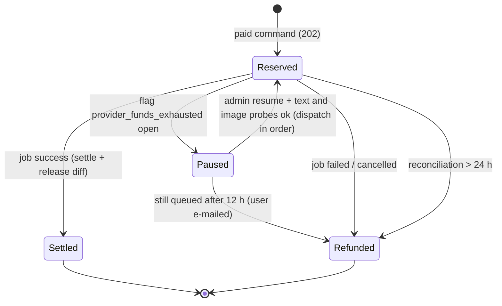
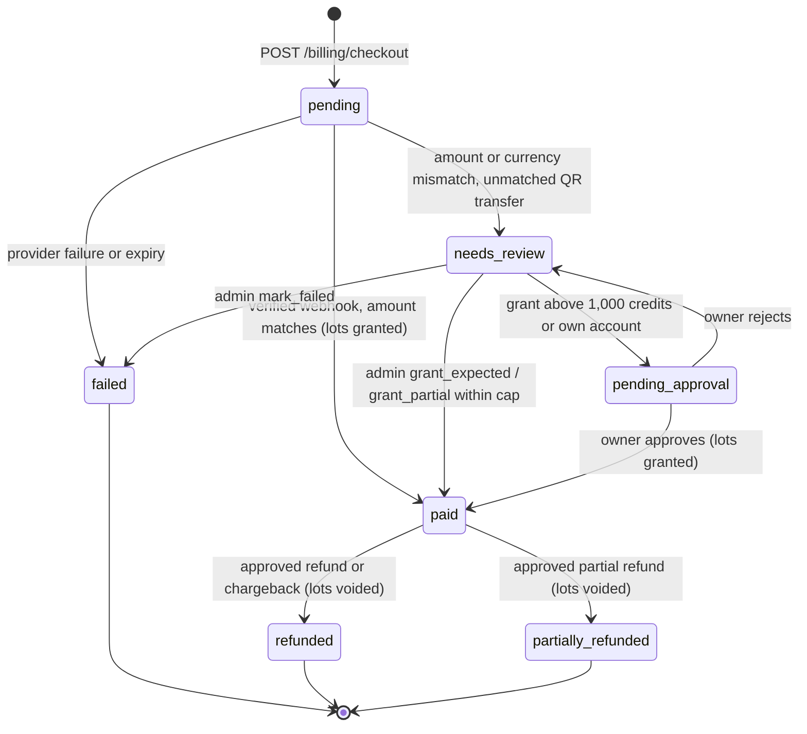
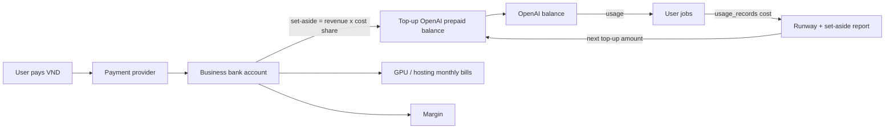
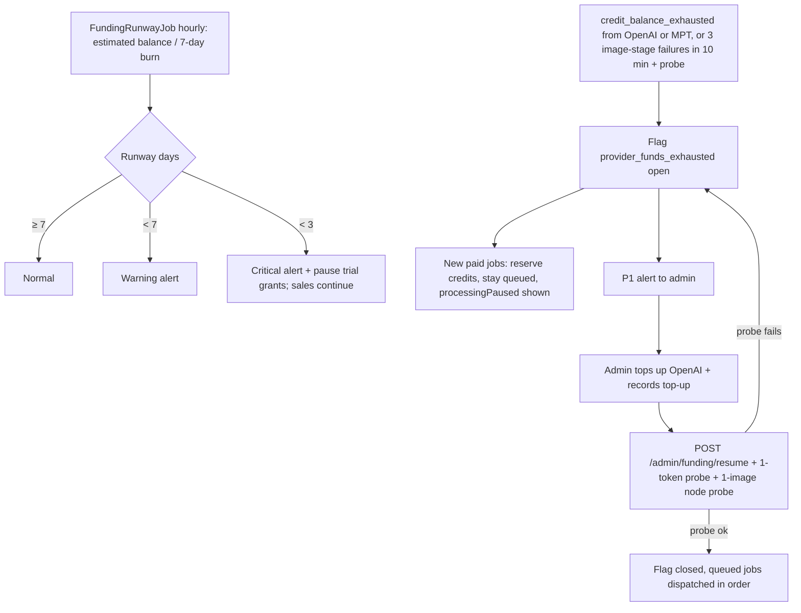

# 12 — Credits, Pricing and Payments (M1 ledger → M2)

> Contracts: `00-overview.md` §6 (`credit_ledger`, `credit_accounts`, `credit_lots`, `credit_packages`, `promo_codes`, `promo_redemptions`, `price_versions`, `payments`, `payment_events`, `refund_requests`, `provider_balance_snapshots`, `provider_topups`, `usage_records`), §7 (credits flow), §8 (billing and admin routes). Backend patterns: 09 (CQRS, idempotency). Cost inputs: 01/03 measurements, 11.6.3 GPU cost. Facts: `../DECISIONS.md` §4, §10.5.
> Level: **high-level plan — not the final plan.** It fixes scope, contracts, key decisions, risks and rough estimates only. Every feature in it will still get (1) a review of the relevant sections and (2) its own **detailed feature plan** in `plans/features/`, reviewed again before implementation (process and template: `00-overview.md` §10.1). Details and estimates here may change in that step.
> Delivery phase (personal-first, `00-overview.md` §4.1): all S — built after Gate 2. Where this plan says M1 for an S item, read M2.

## 1. Purpose and scope

**Goal:** users buy credits before they spend, the platform never loses money on a job, every credit movement is auditable, and **the money from sales reliably funds the AI providers (OpenAI prepaid balance) before it runs out**.

**In scope:** credit unit; price formula; credit packages and free trial; wallet with credit lots and expiry; promo codes; reserve → settle/release → refund; spend limits; payment provider integration (provider [OPEN]), incl. bank-transfer QR if the provider supports it; webhooks; receipts; user refund requests; refunds/chargebacks; admin adjustments; margin reporting; **provider funding**: OpenAI balance tracking, runway, top-up policy and the "money to set aside for API" report.

**Out of scope:** recurring subscriptions (Could, after beta data); tax/e-invoice implementation (flagged to an accountant ⚠️).

## 2. BA review of this part

| # | Finding | Decision |
|---|---|---|
| B1 | Real image cost is above the 1024×1024 floor ✅ (DECISIONS §4) and GPU cost is unknown | **No public prices until** 03.3.1 and 11.6.3 measurements exist |
| B2 | Costs are per operation (story, render) and vary with length | Charge per operation with a length tier, not per GPU minute |
| B3 | Failed jobs must not cost the user | Reserve → refund on failure (00 §7) |
| B4 | BYOK not possible with a shared MPT ✅ (DECISIONS §10.5) | Platform-paid only |
| B5 | Payment options for a Vietnam-based business are unverified ⚠️ | Evaluation checklist; provider behind an `IPaymentProvider` port |
| B6 | YouTube publishing capacity is capped globally (100/day ✅) | Publishing is free but queued; never sell "unlimited publishing" |
| B7 | OpenAI API is **prepaid** ✅: usage stops when the balance is exhausted (error `credit_balance_exhausted`), and a short negative balance is possible — "do not rely on the prepaid balance as an instantaneous spending cutoff" ✅ | Track runway; circuit breaker on `credit_balance_exhausted` (12.8.3); keep our own spend caps (12.4.1) |
| B8 | OpenAI purchased credits **expire after 1 year and are non-refundable** ✅; max balance is capped by the account's trust tier ✅ | Top up by **runway** (days of burn), never pre-fund all user liability at once (§5.5) |
| B9 | Users pay in VND, OpenAI bills in USD | Package prices in VND with an FX buffer; margin report uses the real top-up FX rate (12.8.4) |
| B10 | Unused purchased credits are a liability; trial/bonus credits are not paid money | Separate credit lots by source; spend soonest expiry first, free before purchased at equal expiry (FR-12-11); a refund or chargeback voids every lot of that payment, bonus included (12.3.4, 12.7.5) |

## 3. Requirements

- **FR-12-1** 1 credit = a fixed internal value ([DECISION] 1 credit ≈ US$0.01 of **price**, not cost), shown as whole numbers.
- **FR-12-2** Prices are versioned (`price_versions`: provider rates, margin parameters, per-call limits, floors); every reserve records the price version and the job is charged with that version.
- **FR-12-3** Ledger is append-only; balance = SUM(amount) = SUM(`credit_lots.remaining` of live lots) (checked by `CreditReconciliationJob`); balance never below zero; every row has a unique `idempotency_key`; lot changes happen under the same `credit_accounts` row lock as the ledger row (12.6.1).
- **FR-12-4** Reserve before paid work; settle actual (≤ reserve); release the difference; refund the reserve on failure.
- **FR-12-5** Packages purchasable via a payment provider; credits granted only after a verified webhook.
- **FR-12-6** Free trial credits on e-mail verification (enough for 1 short episode [DECISION]), once per user, abuse-checked.
- **FR-12-7** Global and per-user daily spend caps; OpenAI project hard budget.
- **FR-12-8** Admin grant/adjust with reason, audit-logged, under separation of duties: no self-grants, no grants to admin/owner accounts, a per-admin rolling 24 h cap, owner approval above it, and a daily "credits minted" digest to owners (12.5.1).
- **FR-12-9** Margin report per day/operation: revenue vs measured cost (`usage_records` + GPU share).
- **FR-12-10** Packages are data (`credit_packages`), editable by admins, with VND (and optional USD) prices and optional bonus credits.
- **FR-12-11** Credits are held in lots (`credit_lots`) with source and expiry; spend order: soonest expiry first, and within the same expiry free lots (trial/bonus/promo) before purchased lots.
- **FR-12-12** Promo codes can add bonus credits to a purchase or grant credits directly; per-code and per-user limits.
- **FR-12-13** Every paid purchase has a receipt; business buyers can request a VAT invoice ⚠️ (process confirmed by an accountant).
- **FR-12-14** Users can request a refund of **unused purchased** credits within a window ([DECISION] 14 days ⚠️ consumer law check); bonus credits come with the purchase, so bonus credits of that payment already spent are deducted from the refund (12.7.5, shown before sending and stated in the terms, 13); admins approve.
- **FR-12-15** Admins see provider balance, daily burn, runway and outstanding credit liability; alerts fire before the OpenAI balance runs out.
- **FR-12-16** When OpenAI returns `credit_balance_exhausted` ✅, dispatch of paid jobs pauses (circuit breaker); new and queued jobs keep their reserve but nothing is settled, and failed jobs are refunded.
- **FR-12-17** Credits charged for a job are computed from **metered usage** (text tokens, images, GPU seconds → USD cost → credits) with the §5.7 formula: the quote is the maximum (reserve), the charge is the metered amount, never below the operation floor and never above the quote.
- **NFR-12-1** Ledger operations are concurrency-safe under parallel requests from the same user.
- **NFR-12-2** Webhook processing is idempotent and signature-verified.

## 4. Epics and user stories

### Epic 12.1 — Pricing model

**12.1.1 Cost model** — *As the owner I want cost per operation computed from measurements so that prices keep ≥ 60 % margin (00 §3).* Must · M
- Given measurements (story tokens incl. self-review and worst-case single revision; fact-sheet tokens; images × tokens/image per aspect; TTS/whisper/render GPU seconds per minute of finished video × node cost per GPU second; payment fees; FX buffer), Then a spreadsheet and a config table give **cost** per operation × tier (e.g. Short ≤ 1 min portrait, Standard ≤ 8 min, Long ≤ 15 min).
- Operations priced in MVP: `story_generate` (writer + review + ≤ 1 revision + review #2, 02.6; 02 CR-6), `fact_sheet` (02.5.3), `render` (per tier). Series-bible proposals, idea generation, source finding, moderation and publishing are free (cost absorbed, still bounded by `IBudgetGuard`; 02 CR-6, 02 T11).
- Price formula and parameters: §5.7 (cost × k ÷ credit value, rounded up once per job, with a floor per operation and tier).

**12.1.2 Price table** — *As the platform I want versioned prices so that old jobs keep their price.* Must · S
- Given a `price_versions` row (rates per model/quality/aspect and GPU second, `gpu_s_per_video_min`, `margin`, `fee_rate`, `fx_buffer`, `credit_usd`, limits, floors), When prices change, Then a new version becomes active from a timestamp; running reserves keep their version. 02 CR-2: the P subset (`version`, `active_from`, `rates` incl. text per model and `web_search_call`, `limits` = `max_output_tokens` per step and tier) is created in the personal phase by 02.2.4-T1 and seeded from `OpenAi:Pricing`; this story adds the credit columns (`credit_usd`, `margin`, `fee_rate`, `fx_buffer`, `floors`, image/GPU rates) at M2.

**12.1.3 Show cost before action** — *As a creator I want to see the price before clicking so that there are no surprises.* Must · S
- Given `GET /billing/quote?operation={story_generate|fact_sheet|render}&episodeId=…`, Then the API returns `maxCredits` (the reserve, §5.7 step 5), `typicalCredits` (median charge of the last 50 settled jobs of the same operation and tier, or null) and balance after; `story_review` and `story_revision` usage has no own price (included in `story_generate`, 12.1.1) and the query rejects them with 400; the UI (10.5.6, 10.6.1) shows "up to N credits, usually about M".

**12.1.4 Credit calculator** — *As the platform I want one pure function that turns metered usage into credits so that reserve, charge and quote always agree.* Must · S
- Given a price version and a list of usage items, Then `CreditCalculator` (Domain, no I/O) returns the USD cost per item, the job cost and the credits per §5.7; the same function computes the reserve from upper bounds and the charge from actual usage.
- Given the provider reports no usage for an item, Then the item uses the counted quantity × the measured rate and `usage_records.estimated = true`. Images normally carry real per-call usage from the node image relay (`images.v1`, 03 D5/D8); an image call without `usage`, or a render without a report, falls back to `tokens_per_image[aspect:quality]` (03 CR-4).
- Given a render, Then the GPU item is `gpu_s_per_video_min` (measured, 11.6.3, stored in the price version) × the **actual output duration** in minutes (ffprobe, 05), never the wall time from dispatch to done, so queue time and image-API waits are never charged to the user.

### Epic 12.2 — Ledger

**12.2.1 Reserve / settle / release / refund** — *As the platform I want correct accounting so that users and the business are both protected.* Must · L
- Given a paid command, When `ICreditLedger.ReserveAsync` runs inside the command transaction, Then it locks the user's `credit_accounts` row (`SELECT … FOR UPDATE`), checks balance ≥ amount, inserts `reserve` (negative), and returns a reservation id; insufficient → `insufficient_credits` (402).
- Given the job succeeds, Then `settle` records `charged = min(reserve, max(floor, credits(actual cost)))` from the job's `usage_records` (§5.7) and `release` returns `reserve − charged`; if the uncapped credits exceed the reserve, the gap is logged as platform loss (alert, usually a wrong rate or limit).
- Given the job fails or is cancelled, Then `refund` returns the full reserve.
- Given the same `idempotency_key` twice, Then the second insert is a no-op.

**12.2.2 Balance and history queries** — *As a creator I want to see my balance and history so that I trust the numbers.* Must · S
- Given `GET /credits/balance` and `GET /credits/ledger?cursor=`, Then balance equals the ledger sum; history groups reserve + settle + release of one job as one line in the UI, with details: quoted, charged, returned, and the usage breakdown (text tokens, images, render minutes).

**12.2.3 Reconciliation job** — *As the operator I want nightly checks so that accounting bugs are caught.* Must · S
- Given `CreditReconciliationJob` (daily), Then reserves older than 24 h without settle/refund are refunded (with alert), and no negative balances exist.

**12.2.4 Wire credits into paid commands** — *As the platform I want every paid action to reserve and every job to settle or refund so that no path spends provider money for free.* Must · S
- Given `GenerateStoryCommand`, `GenerateFactSheetCommand` and the render command behind `POST /episodes/{id}/render` (09.6), Then each reserves in its own transaction and its job settles or refunds; an architecture test fails if a handler marked `[PaidOperation]` has no reserve call.

### Epic 12.3 — Payments

**12.3.1 Provider evaluation** — *As the owner I want a payment provider that works for my business so that users can pay.* Must · S
- Given the checklist §5.4, When 2–4 candidates (domestic Vietnamese gateways and international merchant-of-record options) are scored from **official** pages with dates, Then the choice is recorded in DECISIONS.md. All availability/fees ⚠️ until then.
- Given merchant onboarding (business documents, bank verification, contract, sandbox → production approval) can take weeks ⚠️ (external lead time, not verified per provider), Then the evaluation starts in **M0/M1** and the application is filed as soon as a provider is chosen, so the M2 sandbox exit criterion is not blocked by onboarding (§8).

**12.3.2 Packages and checkout** — *As a creator I want to buy a credit package so that I can make videos.* Must · M
- Given `GET /billing/packages` (active `credit_packages` rows, e.g. Starter/Creator/Studio, prices in VND and USD ⚠️ pending provider), When `POST /billing/checkout` with a package id, optional `promoCode`, and `Idempotency-Key`, Then the promo is validated (12.7.2), a `payments` row (`pending`, amount, currency, package id, credits, bonus credits, price version) is created and the provider's hosted checkout URL (or bank-transfer QR details, 12.7.4) is returned.

**12.3.3 Webhooks** — *As the platform I want to credit users only for real payments so that fraud is limited.* Must · M
- Given `POST /billing/webhooks/{provider}`, When the signature is valid, Then the event is stored raw in `payment_events` (unique provider event id), processed once, `payments.status` updated, and on `paid` a `purchase` ledger row + a purchased `credit_lots` row (expiry 12.6.2) are added, plus a `bonus` lot for package/promo bonus credits; invalid signature → 401 + alert; replays → 200 no-op.
- Given the webhook amount or currency differs from the `payments` row, Then no credits are granted, the payment becomes `needs_review`, and admins are alerted.
- Given a valid `paid` webhook whose amount matches, When the provider has a payment status API ⚠️, Then before granting, `ProcessPaymentWebhookCommand` re-fetches the payment by the provider's payment id from that API (server-side call with our credentials, base URL from settings, never a URL from the webhook body); only a re-fetched `paid` with the same amount and currency grants credits; any other answer → `needs_review` + alert; a provider API error → the event is retried with backoff and after 30 min goes to `needs_review`. Without a status API, Then signature + amount match is the only check (stated in DECISIONS when the provider is chosen).
- Given any change to a `payment.*` setting (09.10), Then for 24 h `PaymentAnomalyJob` (every 15 min) compares paid count and amount per hour with the same hours of the previous 7 days and alerts owners (11.6.2 pipeline) when either exceeds [DECISION] 3× the baseline or a single user receives > 3 purchases in 1 h.
- Given no webhook within 30 min of a `pending` payment, Then `PaymentStatusSyncJob` queries the provider's status API (if available ⚠️) and applies the same processing.

**12.3.5 Resolve payments needing review** — *As the operator I want to settle odd payments by hand so that no buyer is left without credits or charged twice.* Must · S
- Given `GET /admin/payments?status=needs_review`, Then each row shows expected vs received amount/currency, order code, provider events and the user.
- Given `POST /admin/payments/{id}/resolve` with `action` = `grant_expected` (credit the package as bought), `grant_partial` (credits = received amount ÷ package price per credit, rounded down), or `mark_failed`, plus a mandatory `note`, Then the payment becomes `paid` (with lots created as in 12.3.3) or `failed`; an overpayment is refunded through the provider refund API when available, otherwise noted for a manual bank refund; every resolve writes `audit_logs`.
- Given a `grant_expected` or `grant_partial` whose credits (incl. bonus) exceed [DECISION] 1,000, or a resolve by an admin on a payment of their own account, Then the payment becomes `pending_approval` instead of `paid`, no lots are created, and an owner (a different person than the resolver where two owners exist) approves or rejects it via `POST /admin/payments/{id}/resolve/approve|reject`; approval creates the lots as in 12.3.3; both steps write `audit_logs` and a security alert (11.6.2 pipeline + e-mail to owners, 08 §5.2).

**12.3.4 Refunds and chargebacks** — *As the operator I want refunds handled consistently so that balances stay correct.* Should · S
- Given a provider refund/chargeback event, Then every lot with that `payment_id` (purchase and bonus lots, including a promo bonus) is voided: a negative `adjust` row removes its `remaining` and `credit_lots.voided_at` is set (balance never below zero; any shortfall logged as platform loss); the account is flagged for review on chargeback and paid commands return `account_under_review` until an admin clears it.

### Epic 12.4 — Limits and abuse

**12.4.1 Spend caps** — *As the owner I want caps so that a bug or abuser cannot burn the OpenAI budget.* Must · S
- Given config `max_credits_per_user_per_day` and `max_platform_cost_usd_per_day`, When exceeded, Then paid commands return 429 `spend_cap_reached`; admins are alerted at 80 %. 02 CR-2: the platform half (daily/monthly USD caps over `usage_records` + open worst-case bounds, `IBudgetGuard`) is built in P by 02.2.2-T2; this story adds the per-user credit cap at M2.

**12.4.2 Trial credits** — *As a new user I want free credits so that I can try the product.* Must · S
- Given e-mail verification, Then a one-time `grant` (idempotency key `trial:{userId}`); disposable e-mail domains and repeated device/IP patterns are blocked from the trial ([DECISION] simple list + rate limit).

### Epic 12.5 — Admin and reporting

**12.5.1 Admin grants and adjustments** — *As the owner I want admins to fix balances fast but never mint credits unchecked so that one compromised or dishonest admin cannot create free provider spend.* Must · M
- Given `POST /admin/users/{id}/credits` with amount and reason, When the target is a `user`-role account other than the actor and the grant fits the cap, Then an `adjust`/`grant` row with `created_by`, a `credit_lots` row (source `adjust`) and an `audit_logs` entry are written.
- Given the target is the actor's own account, Then 403 `self_grant_forbidden`; Given an admin targets an `admin` or `owner` account, Then 403 `grant_target_forbidden` (owners may grant to admins, never to themselves).
- Given the sum of positive grants by this actor (admin or owner) in the rolling 24 h (direct grants + approved `grant_expected`/`grant_partial` + value × `max_redemptions` of promo codes they created, 12.7.2) plus this grant exceeds [DECISION] 2,000 credits, Then no credits move: a `credit_grant_requests` row (`pending`, amount, target, reason, requested_by) is created, the API returns 202 with its id, and owners get a security alert (11.6.2 pipeline + e-mail, 08 §5.2).
- Given `GET /admin/credit-grant-requests?status=pending` and `POST /admin/credit-grant-requests/{id}/approve|reject`, When an owner (a different person than the requester where two owners exist) approves, Then the grant is applied as above in one transaction and the request becomes `approved`; reject stores a reason; requests not decided in 7 days expire; each decision writes `audit_logs`.
- Given negative adjustments (removing credits), Then they are not capped but are audit-logged and appear in the digest.
- Given 08:00 local time daily, Then `CreditsMintedDigestJob` e-mails every owner: credits granted per admin (direct, resolves, promo redemptions), pending and expired requests, and the top 10 recipients of the last 24 h.

**12.5.2 Margin dashboard** — *As the owner I want margin per operation so that I adjust prices early.* Should · M
- Given `usage_records` (cost) and settled ledger rows (revenue), Then `GET /admin/usage` returns per day and operation: jobs, credits charged, revenue (at package price), cost, margin %, platform losses.

### Epic 12.6 — Wallet: lots, expiry, low balance

**12.6.1 Credit lots and spend order** — *As the platform I want to know which credits were paid for so that refunds, chargebacks and liability are correct.* Must · L
- Given any credit grant (`trial`, `bonus`, `promo`, `purchase`, `adjust`), Then a `credit_lots` row stores `source`, `amount`, `remaining`, `expires_at`, `payment_id`; every ledger row that moves credits references its `lot_id`.
- Given a reserve, Then `ICreditLedger` consumes lots in the FR-12-11 order under the same `credit_accounts` row lock, skipping lots with `expires_at ≤ now` or `voided_at` set; a reserve that spans lots writes one ledger row per lot; release/refund returns credits to the **same** lots.
- Given a release/refund to a lot that has expired or been voided since the reserve, Then in the same transaction the returned credits are removed again with an `expire` (expired lot) or `adjust` (voided lot) row, so dead lots never become spendable.
- Given `GET /credits/balance`, Then it returns total, breakdown (free vs purchased), and the next expiry (amount + date).

**12.6.2 Expiry** — *As the owner I want credits to expire on a clear rule so that liability does not grow forever and matches OpenAI's 1-year expiry ✅.* Must · S
- Given [DECISION] purchased and bonus lots valid **12 months** from payment, trial lots **30 days**, promo lots per code ⚠️ (confirm consumer-law requirements before launch), Then `CreditExpiryJob` (daily) writes `expire` ledger rows for the `remaining` of expired lots; credits already taken by an open reserve are handled when that reserve settles or is refunded (12.6.1).
- Given a lot expiring within 30 days, Then the user gets one e-mail and an in-app notice.
- Given the rules, Then they are shown on the pricing page and in the terms (13).

**12.6.3 Low-balance nudge** — *As a creator I want to know before I run out so that my next episode is not blocked.* Should · S
- Given balance < the price of one Standard render, Then the dashboard shows a banner with "Buy credits"; an e-mail is sent at most once per 7 days (user can opt out).

### Epic 12.7 — Packages, promotions, receipts, refunds

**12.7.1 Package catalog** — *As the owner I want to change packages without a deploy so that I can test offers.* Must · S
- Given `GET/POST /admin/credit-packages` and `PATCH /admin/credit-packages/{id}`, Then admins manage `code`, names (vi/en), `credits`, `bonus_credits`, `price_vnd`, `price_usd`, `active`, `sort_order`; changes are audit-logged; old payments keep their snapshot (credits and price copied onto `payments`).
- Given a package whose effective price per credit is below the cost floor (12.1.1), Then saving is rejected with `package_below_cost`.

**12.7.2 Promo codes** — *As the owner I want promo codes so that I can run launch offers and partnerships.* Should · M
- Given `GET/POST /admin/promo-codes` and `PATCH /admin/promo-codes/{id}`, Then a code has `kind` (`bonus_percent` on purchase / `fixed_credits` grant), value, `valid_from/to`, `max_redemptions`, `per_user_limit`, `min_package_id`, `active`.
- Given an admin (not owner) calls `POST` or `PATCH /admin/promo-codes`, Then 403 `forbidden` (list stays readable); only owners create or change codes; deactivating (`active = false`) is allowed to admins as an emergency stop.
- Given an owner creates a `fixed_credits` code, Then its minting exposure = value × `max_redemptions` (e.g. 50 credits × 100 redemptions = 5,000) counts toward that owner's 24 h cap (12.5.1); above the cap the code is saved `active = false` with a `credit_grant_requests` row that a second owner approves (with one owner: activation after a 24 h time-lock with an e-mailed cancel link); raising `max_redemptions` or value by PATCH counts only the increase; `bonus_percent` codes need a paid purchase and are not counted.
- Given `POST /billing/promo/redeem` (fixed-credit codes) or `promoCode` at checkout (bonus codes), Then validation returns `promo_invalid`, `promo_expired`, `promo_exhausted` or `promo_already_used`; `max_redemptions` is checked under a row lock on the `promo_codes` row and `per_user_limit` under the user's `credit_accounts` lock (counting that user's redemptions), so parallel requests cannot exceed either limit; a payment carries at most one promo (unique `payment_id` where not null); bonus credits are granted **only** after the payment is paid, as a lot with that `payment_id`.

**12.7.3 Payment history and receipts** — *As a buyer I want receipts so that I can account for my spend.* Must · S
- Given `GET /billing/payments` and `GET /billing/payments/{id}/receipt`, Then the user sees date, package, amount, method, status, credits, and can download an HTML/PDF receipt with the business details.
- Given the checkout step (10.8.1), Then a business buyer may enter company name, tax code and address (`payments.invoice_info`, sent with `POST /billing/checkout`) to request a VAT e-invoice ⚠️ (issuing flow and provider decided with the accountant; out of MVP build). Invoice details cannot be added after payment in MVP.

**12.7.4 Bank-transfer QR (if supported by the provider)** — *As a Vietnamese user I want to pay by bank QR so that I do not need a card.* Should · M
- Given the chosen provider supports bank-transfer QR with payment notifications ⚠️, When checkout selects it, Then the QR shows the exact amount and a unique order code in the transfer note; the provider webhook matches the order code; underpaid, overpaid or unmatched transfers go to `needs_review` for an admin.
- Given no provider support, Then this story is dropped (not replaced by manual bank-statement matching in MVP).

**12.7.5 Refund requests** — *As a buyer I want to get money back for credits I did not use so that buying feels safe.* Should · S
- Given `POST /billing/payments/{id}/refund-request` within the window (FR-12-14), Then refundable credits = remaining purchased credits of that payment − bonus credits of that payment already spent; if > 0 a `refund_requests` row (`pending`) is created with the credits and money amount; otherwise `refund_not_eligible`.
- Given an admin approves (`POST /admin/refund-requests/{id}/approve`), Then the provider refund API is called (idempotent), every lot of that payment is voided (12.3.4 rule, without the review flag), and the payment becomes `refunded`/`partially_refunded`; reject (`POST /admin/refund-requests/{id}/reject`) stores a reason and e-mails the user.

### Epic 12.8 — Funding the AI providers

**12.8.1 Provider balance, burn and runway** — *As the owner I want to see how long my OpenAI balance lasts so that I top up in time.* Must · M
- Given `POST /admin/funding/balance-snapshots` (admin enters the OpenAI balance shown on the billing page, [DECISION] until a supported balance API is verified ⚠️) and `usage_records`, Then `GET /admin/funding` returns: last known balance, estimated current balance (snapshot − cost recorded since), 7-day average daily burn, **runway days**, outstanding user credit liability (unexpired purchased + free credits) and its estimated cost to serve, and revenue collected in the last 7/30 days.
- Given the same view for GPU/hosting, Then fixed monthly costs (config) are shown so the owner sees total money needed per month.

**12.8.2 Top-up records and set-aside report** — *As the owner I want to know how much of each sale must go to API costs so that I never spend the provider money.* Must · S
- Given `POST /admin/funding/topups` (provider, amount USD, amount paid VND, FX rate, date, reference), Then the top-up is stored and the next estimated balance includes it.
- Given the weekly report, Then it shows: revenue, **set-aside for providers** = revenue × cost share (1 − margin, from 12.1.1), actual provider cost, actual top-ups, and the gap; the gap drives the next top-up amount.

**12.8.3 Alerts and circuit breaker** — *As the owner I want the platform to protect itself when provider money runs out so that users are not charged for failures.* Must · M
- Given runway < 7 days, Then a warning alert; < 3 days, Then a critical alert **and** trial grants pause automatically (sales continue, because sales fund the top-up). Users who verify their e-mail during the pause get a deferred `TrialGrantRequested` outbox message; `FundingRunwayJob` grants it once runway is ≥ 3 days again (idempotency key `trial:{userId}` prevents doubles).
- Given the backend's `OpenAiErrorClassifier` sees `credit_balance_exhausted` ✅, **or** `PollRenderJob` maps an MPT task failure whose error text contains that code (⚠️ confirm in the 05 spike that MPT keeps OpenAI's error text), **or** ≥ 3 renders fail at the image stage within 10 min (then a 1-token paid probe call confirms), Then the platform flag `provider_funds_exhausted` opens.
- Given the flag is open, When a user starts a paid action, Then the command still succeeds (202): the credits are **reserved** and the job is created in `queued`, but nothing is dispatched to OpenAI or MPT; `GET /episodes/{id}` and `EpisodeUpdated` carry `processingPaused = provider_funds_exhausted`, and the UI shows "Processing is paused. Your credits are reserved, not charged yet" (10.8.4); admins get a P1 alert.
- Given running jobs fail while the flag is open, Then they are refunded and the episode moves back per 00 §7 (`story_generating → draft | story_review`, `rendering → story_approved`).
- Given an admin top-up, When `POST /admin/funding/resume` is called and a 1-token probe succeeds **and** a 1-image probe through one healthy render node succeeds (the node uses its own node-managed image key and OpenAI project, which may be funded separately, 05/11), Then the flag closes and queued jobs are dispatched in order; if the text probe passes but the image probe fails, the flag stays open with reason "node image project unfunded" and admins are alerted; jobs still queued after 12 h are cancelled, refunded, and the user is e-mailed.
- Given OpenAI auto-reload ✅ (threshold, restore-to amount, optional monthly limit), Then [DECISION] it is enabled on the production organization with a monthly limit tied to the 30-day forecast; the monthly limit is recorded in the funding view.

**12.8.4 FX and pricing review** — *As the owner I want VND prices to stay above cost when the exchange rate moves so that margin holds.* Should · S
- Given `fx_usd_vnd` (config, updated at each top-up from the actual rate paid), Then the margin report and `package_below_cost` check use it; if margin on any package falls below 50 % for 7 days, an alert asks for a price review (new `price_versions` / package prices).

## 5. Technical design

### 5.1 Ledger rules (Clean Architecture placement)

- Domain: `CreditReservation` value object, ledger entry kinds, invariants (no negative balance, settle ≤ reserve).
- Application: port `ICreditLedger` — `ReserveAsync(user, operation, reference, ct)`, `SettleAsync(reservationId, actualCredits)`, `RefundAsync(reservationId, reason)`, `GrantAsync(user, source, amount, expiresAt, reference)`, `ExpireAsync(lotId)`, `VoidPaymentLotsAsync(paymentId, reason)`; commands `CheckoutCommand`, `ProcessPaymentWebhookCommand`, `SyncPaymentStatusCommand`, `ResolvePaymentCommand`, `DecidePaymentResolveCommand`, `RedeemPromoCommand`, `RequestRefundCommand`, `ApproveRefundCommand`, `RejectRefundCommand`, `AdminAdjustCreditsCommand`, `DecideCreditGrantRequestCommand`, `UpsertCreditPackageCommand`, `UpsertPromoCodeCommand`, `RecordProviderBalanceCommand`, `RecordProviderTopUpCommand`, `ResumeProviderDispatchCommand`; queries `GetBalanceQuery`, `GetLedgerQuery`, `GetQuoteQuery`, `GetPackagesQuery`, `GetPaymentsQuery`, `GetReceiptQuery`, `GetAdminPaymentsQuery`, `GetCreditGrantRequestsQuery`, `GetRefundRequestsQuery`, `GetMarginReportQuery`, `GetFundingOverviewQuery`.
- Minting guard (Application): `MintingPolicy` checks actor ≠ target, target role, and the actor's rolling 24 h minted sum (direct grants + approved resolves + promo exposure) under a per-actor advisory lock, so parallel grants cannot exceed the cap; it is called by `AdminAdjustCreditsCommand`, `ResolvePaymentCommand` and `UpsertPromoCodeCommand`.
- Infrastructure: `CreditService` (EF + row lock on `credit_accounts`), `IPaymentProvider` adapter for the chosen provider.
- Reserve is called from command handlers; settle/refund from job/outbox handlers — never from the UI directly. Balance stays derived; an optional cached balance column may be added in the same transaction if queries get slow.
- Account deletion (13.3.2-T1, 13 CR-14): `payments` and `credit_ledger`/`credit_lots` rows are **kept, never deleted** — `user_id` is replaced by a stable pseudonym at deletion time, amounts, dates, package/price-version references and provider ids are retained unchanged for accounting and tax records; only PII-bearing fields (invoice_info, provider account identifiers tied to the person) are scrubbed. This is the same rule 13's Deletion scopes table (§5.4) names for the "Account" scope.
- Jobs: `PaymentStatusSyncJob` (every 10 min for pending payments), `PaymentAnomalyJob` (every 15 min for 24 h after a `payment.*` setting change, 12.3.3), `CreditExpiryJob` (daily), `LowBalanceNotifierJob` (daily), `FundingRunwayJob` (hourly: runway, alerts, trial pause), `CreditReconciliationJob` (daily, 12.2.3), `CreditsMintedDigestJob` (daily 08:00: owner digest + expiry of undecided grant requests after 7 days, 12.5.1).
- `OpenAiErrorClassifier` (Infrastructure) maps `credit_balance_exhausted` to the `provider_funds_exhausted` flag before any retry policy runs (Polly must not retry it).

### 5.2 Flow

Credit reservation per paid job (incl. the provider-funds pause, 12.8.3):

Payment status (12.3, 12.7.5):

### 5.3 Error codes

`insufficient_credits` (402), `spend_cap_reached` (429), `payment_provider_error` (502), `webhook_signature_invalid` (401), `package_not_found` (404), `package_below_cost` (400), `promo_invalid` (400), `promo_expired` (400), `promo_exhausted` (409), `promo_already_used` (409), `refund_not_eligible` (409), `account_under_review` (403), `self_grant_forbidden` (403), `grant_target_forbidden` (403), `grant_request_not_pending` (409), `forbidden` (403, admin creating/editing promo codes, 12.7.2). `provider_funds_exhausted` is **not** an error response: it is the `processingPaused` reason on episodes and jobs (12.8.3). A grant above the cap is **not** an error: it returns 202 with a pending `credit_grant_requests` id (12.5.1).

### 5.4 Payment provider checklist

Accepts a Vietnam-registered business (or individual) as merchant; payout currency/bank; payment methods users in Vietnam use (local cards, e-wallets, bank QR) and international cards; hosted checkout (no card data on our servers); signed webhooks; payment status API; refunds API; fees (official page, dated); merchant-of-record and tax handling for foreign buyers; e-invoice support ⚠️ (Vietnamese e-invoice obligations — confirm with an accountant); sandbox quality; SDK licence.

### 5.5 Funding model (how sales pay for the API)

Runway alerts and circuit breaker (12.8.1, 12.8.3):

- **Top-up rule [DECISION]:** keep the OpenAI balance ≥ 14 days of forecast burn, top up weekly by the set-aside gap, and let auto-reload ✅ cover spikes. Never pre-fund more than ~60 days of burn, because OpenAI credits expire after 1 year and are non-refundable ✅, and the trust tier caps the balance ✅.
- **Beta funding:** before public prices (12.1.1 gate), the owner funds OpenAI from own budget; beta credits are admin-granted and capped per day (12.4.1).
- **Separate accounts [DECISION]:** one OpenAI organization/project for production and a separate one for staging/dev, each with its own budget, so tests never eat production money.

### 5.6 Credit lot spend order (example)

Balance: trial 50 (expires in 20 days), purchased 1,000 (expires in 11 months), bonus 100 from the same payment (expires in 11 months). A reserve of 120 takes 50 trial → 70 bonus. A later refund of that job returns 50 to trial and 70 to bonus. A refund request for that payment: refundable = 1,000 purchased − 70 bonus already spent = 930 credits; on approval the purchased lot and the bonus lot are both voided. A chargeback voids both lots the same way and flags the account.

### 5.7 Credit calculation (metering → credits)

Users hold **credits**, never raw provider tokens: one video uses three different resources (text tokens, image generation, GPU time), so each usage item is converted to USD cost first and the job cost is converted to credits once.

**Step 1 — cost per usage item** (rates from the job's price version; per-1M rates ÷ 1,000,000):

- Text call (writer, review, revision, fact sheet): `cost = (input − cached) × r_in + cached × r_cached + output × r_out`. Token counts come from the response `usage` object; `output` includes reasoning tokens ⚠️ (confirm field names in 02.2.4-T1).
- Image (03 D8, 03 CR-4): per billed image `cost = text_tokens × r_text_in + image_tokens × r_image_in + output_tokens × r_image_out` from `price_versions.rates.image[model]` (O8: 5 / 8 / 30 USD per 1M; official-API rates for phase S — the phase-P relay flat price 184 VND/image, 02 CR-27, is not a SaaS price basis); without usage, `tokens_per_image[aspect:quality] × r_image_out` (measured in 03.3.1). Reserve bound: `MaxTerms × (tokens_per_image_p95 × r_image_out + 200 × r_text_in)`, where `MaxTerms` comes from `RenderImagePlanner` (03 D3; images needed at 10-s clips + 15 % spares, ≤ tier cap).
- Render GPU (TTS + whisper + assembly on our node): `cost = gpu_s_per_video_min × output_minutes × r_gpu`, where `gpu_s_per_video_min` is the measured GPU seconds per minute of finished video (11.6.3, stored in the price version), `output_minutes` = actual duration of the ingested video (ffprobe, 05) and `r_gpu = node cost per hour ÷ 3600 ÷ render concurrency` (11.6.3). Wall time from dispatch to done is **not** used, so queue time and image-API waits are never charged; the backend still records measured node seconds per job in `usage_records.gpu_seconds` for the margin report (12.5.2) and for re-measuring the rate.

**Step 2 — job cost:** `C = Σ cost` over `usage_records` with the job's `reservation_id`.

**Step 3 — credits:** `credits(C) = ceil(C × k ÷ credit_usd)` with `k = (1 + fx_buffer) ÷ ((1 − margin) × (1 − fee_rate))`. Rounding happens once per job, never per call.

**Step 4 — charge:** `charged = min(reserve, max(floor[operation, tier], credits(C)))`; `release = reserve − charged`. A failed or cancelled job is refunded in full (12.2.1); its cost stays in `usage_records` as platform cost.

**Step 5 — reserve (the quote "up to N credits"):** `reserve = max(floor, credits(C_max))`, where `C_max` uses hard upper bounds enforced on the requests:

- Text input tokens ≤ UTF-8 bytes of the assembled prompt (a byte-level BPE token is at least 1 byte, so this never under-estimates and needs no tokenizer); output tokens ≤ the `max_output_tokens` sent on every call (limits in the price version). `story_generate` = writer + review + one revision + review #2, each at its `max_output_tokens` (02.6; 02 CR-6).
- Images ≤ `ceil(D_max × 60 ÷ ClipSeconds)` = `ceil(D_max × K)` with `ClipSeconds = 10` (03 D3): 6 / 48 / 90 for Short / Standard / Long; 12.1.1 reads the cap from `RenderImagePlanner`, it does not recompute it (03 CR-4).
- GPU seconds ≤ tier maximum minutes × `gpu_s_per_video_min` × 1.5 [DECISION], capped by the render timeout.

Because every bound is enforced on the request, `credits(C) ≤ reserve` holds unless a rate or limit is wrong; that case is capped and alerted (12.2.1).

**Worked example** (illustrative parameters ⚠️, real values from 12.1.1 measurements): `margin = 0.60`, `fee_rate = 0.03` ⚠️, `fx_buffer = 0.05`, `credit_usd = 0.01` → `k = 1.05 ÷ (0.40 × 0.97) ≈ 2.706`.

| Job | Metered usage | Cost C | credits(C) | Floor | Reserve (quote) | Charged | Released |
|---|---|---|---|---|---|---|---|
| Story (gpt-6-luna $0.10 / $0.50 per 1M ✅) | writer 6,000 in + 4,000 out; review 10,000 in + 1,500 out; no revision | $0.00435 | 2 | 5 | 5 | 5 | 0 |
| Render Standard, 8 min | 48 images × $0.013 (1024² medium, DECISIONS §4) + 8 min × 75 GPU s per video minute (⚠️ illustrative) = 600 GPU s × $0.00014 ($0.50/h ⚠️) | $0.624 + $0.084 = $0.708 | ceil(191.6) = 192 | 50 | 203 (48 images + 8 × 75 × 1.5 = 900 GPU s → $0.750 × k ÷ 0.01 = 202.96) | 192 | 11 |

The story is so cheap that its floor dominates; the floor also covers fixed costs (moderation, storage, support). The render charge is driven by images, so the keyword cap (03.2.1) is the main cost control.

## 6. Task breakdown

| Task ID | Task | Area | Size | Depends on |
|---|---|---|---|---|
| 12.1.1-T1 | Cost spreadsheet from measurements | BA | M | 01, 03.3.1, 11.6.3 |
| 12.1.2-T1 | `price_versions` table (rates, parameters, limits, floors) + loader | BE | S | 09.2 |
| 12.1.3-T1 | Quote query endpoint (`maxCredits`, `typicalCredits`) | BE | S | 12.1.4 |
| 12.1.4-T1 | `CreditCalculator` (Domain) + `usage_records` reservation link, `max_output_tokens` on every OpenAI call, GPU item = `gpu_s_per_video_min` × output minutes | BE | S | 12.1.2, 02.2.4 |
| 12.2.1-T1 | `ICreditLedger` reserve/settle/release/refund with row lock | BE | L | 09.2 |
| 12.2.4-T1 | Wire into story/render/fact-sheet handlers and jobs + paid-operation arch test | BE | S | 12.2.1-T1, 09.5, 09.6 |
| 12.2.2-T1 | Balance + ledger queries | BE | S | 12.2.1 |
| 12.2.3-T1 | Reconciliation job | BE | S | 12.2.1 |
| 12.3.1-T1 | Provider evaluation with dated official pages; starts M0/M1, onboarding application filed on choice | BA | S | — |
| 12.3.2-T1 | `IPaymentProvider` + checkout command | BE | M | 12.3.1 |
| 12.3.3-T1 | Webhook endpoint, signature, idempotent processing | BE | M | 12.3.2 |
| 12.3.3-T2 | Status re-fetch before grant + `PaymentAnomalyJob` after payment-setting change (re-estimated S → M, 12 CR-4) | BE | M | 12.3.3-T1, 09.10, 11.6.2 |
| 12.3.5-T1 | Admin needs_review list + `ResolvePaymentCommand` | BE | S | 12.3.3 |
| 12.3.5-T2 | `pending_approval` for resolves > 1,000 credits or own account + owner approve/reject | BE | XS | 12.3.5-T1, 12.5.1-T1 |
| 12.3.4-T1 | Refund/chargeback handling | BE | S | 12.3.3 |
| 12.4.1-T1 | Spend caps + alerts | BE | S | 12.2.1 |
| 12.4.2-T1 | Trial grant + abuse checks | BE | S | 09.3.1 |
| 12.5.1-T1 | Admin grant/adjust + `MintingPolicy` (no self-grant, target role, rolling 24 h cap with advisory lock) | BE | M | 09.9.1 |
| 12.5.1-T2 | `credit_grant_requests` + owner approve/reject + 7-day expiry + `CreditsMintedDigestJob` + security alerts | BE | S | 12.5.1-T1, 11.6.2 |
| 12.5.2-T1 | Margin query | BE | M | 12.2, 02.2.4 |
| 12.6.1-T1 | `credit_lots` + lot-aware reserve/release/refund | BE | L | 12.2.1 |
| 12.6.2-T1 | `CreditExpiryJob` + expiry notices | BE | S | 12.6.1 |
| 12.6.3-T1 | Low-balance banner data + notifier job | BE | S | 12.6.1 |
| 12.7.1-T1 | `credit_packages` + admin CRUD + cost-floor check | BE | S | 12.1.2 |
| 12.7.2-T1 | Promo codes + redemptions + checkout integration | BE | M | 12.3.2 |
| 12.7.2-T2 | Owner-only promo create/patch, exposure (value × `max_redemptions`) counted in the cap, second-owner approval or 24 h time-lock activation | BE | S | 12.7.2-T1, 12.5.1-T1 |
| 12.7.3-T1 | Payment history + receipt rendering | BE | S | 12.3.3 |
| 12.7.4-T1 | Bank-transfer QR flow + needs_review queue (if provider supports) | BE | M | 12.3.1 |
| 12.7.5-T1 | Refund request + admin approve/reject + provider refund | BE | S | 12.3.4 |
| 12.8.1-T1 | Funding overview query + balance snapshots | BE | M | 12.5.2 |
| 12.8.2-T1 | Top-up records + weekly set-aside report | BE | S | 12.8.1 |
| 12.8.3-T1 | Runway alerts, trial pause + deferred trial grants, resume with probe | BE | S | 12.8.1 |
| 12.8.3-T3 | Resume 1-image probe through one healthy node (adapter), "node image project unfunded" reason | BE | XS | 12.8.3-T1, 05 |
| 12.8.3-T2 | Circuit breaker: classifier, MPT failure mapping, paused-queue dispatch, 12 h cancel (re-estimated S → M, 12 CR-4) | BE | M | 12.8.3-T1, 09.6, 05 |
| 12.8.4-T1 | FX config + margin-drop alert | BE | S | 12.5.2 |

## 7. Test plan

- **Unit:** `CreditCalculator` against the §5.7 worked example (cost $0.708, k ≈ 2.706, 192 credits, floor, reserve 203 from 8 × 75 × 1.5 = 900 GPU s, cap); the render GPU item uses output minutes, not wall time (same video, 10 min queue delay → same charge); reserve from byte and `max_output_tokens` bounds is ≥ the charge for recorded real usage samples; rounding happens once per job; estimated items when provider usage is missing; settle > reserve cap; refund after settle forbidden. `MintingPolicy`: self-grant → `self_grant_forbidden`; admin → admin/owner target → `grant_target_forbidden`; cap boundary with 1,500 already minted: grant of 500 applies (sum = 2,000), grant of 501 becomes a pending request; promo exposure 50 × 100 = 5,000 > 2,000 → code saved inactive + request; PATCH `max_redemptions` 100 → 120 counts only 50 × 20 = 1,000.
- **Integration (real PostgreSQL):** 20 parallel reserves for one user never overdraw; lot spend order and refund-to-same-lot; reserves skip expired/voided lots; refund of a job whose lot expired or was voided meanwhile does not revive credits; idempotent replays; reconciliation refunds stale reserves; webhook replay, bad signature, amount mismatch → `needs_review`; re-fetched status ≠ `paid` or a different amount → `needs_review`, no lots; provider API error → retried, then `needs_review`; each resolve action; resolve of 1,001 credits → `pending_approval`, owner approval creates lots, the resolving admin cannot approve their own resolve; 10 parallel grants by one admin never exceed the 24 h cap; pending grant request approved by an owner applies once (double approve → `grant_request_not_pending`), rejected or 7-day-expired requests move no credits; admin `POST /admin/promo-codes` → 403; promo `max_redemptions` and `per_user_limit` under parallel requests; refund and chargeback void purchase **and** bonus lots of the payment; refundable amount subtracts spent bonus; digest lists every grant of the last 24 h per admin.
- **Fault injection:** fake OpenAI returns `credit_balance_exhausted` (backend call, and mock-mpt image failure carrying that text) → flag opens, new paid commands return 202 with a reserve and no dispatch, running failures refund and move the episode back per 00 §7, resume after probe dispatches queued jobs; text probe ok but mock adapter image probe fails → flag stays open; jobs older than 12 h are refunded; trial grants during a pause are delivered after resume exactly once; a `payment.*` setting change followed by a 3× paid spike raises the anomaly alert.
- **Provider sandbox:** full checkout → webhook → balance updated; refund event; status-sync without webhook.

## 8. Risks and mitigations

| Risk | Mitigation |
|---|---|
| Prices set before costs are known | Gate on measurements; beta with admin-granted credits |
| Race conditions in the ledger | Row lock; tests with parallelism |
| Payment provider unavailable for the business type, or merchant onboarding takes weeks ⚠️ | Evaluate from M0/M1 and file the onboarding application as soon as a provider is chosen (12.3.1); provider behind a port |
| Chargeback fraud | Hosted checkout, trial limits, account review |
| OpenAI balance runs out at night | Auto-reload ✅ with monthly limit, runway alerts at 7 / 3 days, circuit breaker so users are never charged for provider-funded failures |
| Over-funding OpenAI and losing expired credits | Top-up by runway (≤ ~60 days), never by total liability |
| Exchange rate moves against VND prices | FX from actual top-ups, margin-drop alert, versioned prices |
| Credit expiry or refund rules break consumer law | Lawyer check before launch (13.6); rules shown before purchase |
| Insider (or compromised admin) mints credits for themselves or accomplices | `MintingPolicy`: no self-grants, admins grant only to `user` accounts, rolling 24 h cap [DECISION] 2,000 per actor incl. promo exposure; above cap and resolves > 1,000 need an owner's approval; promo create/patch owner-only; security alerts + daily minted digest to owners (12.5.1, 12.3.5, 12.7.2) |
| Forged or replayed "paid" webhook after payment settings are tampered with | Signature + amount match + status re-fetch from the provider API ⚠️ before granting; paid-volume anomaly alert for 24 h after any payment-setting change (12.3.3) |

## 9. Exit criteria

- **M1:** price versions, `CreditCalculator`, ledger with reserve/settle/release/refund, credit lots, spend caps and admin grants (with the minting rules) live on staging; every paid job reserves and settles or refunds; beta credits are admin-granted.
- **M2:** provider chosen; sandbox checkout end-to-end (card and, if supported, bank QR); receipts; refund request flow; funding view with runway and alerts tested with a fake exhausted-balance error; margin report shows ≥ 60 % on measured costs before public prices go live.

## 10. Open questions and contract changes

- [OPEN] Payment provider; currencies shown (VND, USD); whether bank-transfer QR is supported.
- ⚠️ Tax/e-invoice obligations for selling digital credits inside and outside Vietnam — accountant.
- ⚠️ Credit expiry (12 months) and the 14-day refund window under Vietnamese consumer law — lawyer (13.6).
- ⚠️ Whether OpenAI offers a supported API to read the prepaid balance; until then admins enter snapshots.
- **Contract changes (applied to 00):** `credit_accounts`, `price_versions` (rates, parameters, limits, floors), `credit_lots` (incl. `voided_at`), `credit_packages`, `promo_codes`, `promo_redemptions`, `payment_events`, `refund_requests`, `provider_balance_snapshots`, `provider_topups` tables; `usage_records` columns `reservation_id`, `cached_input_tokens`, `gpu_seconds`, `estimated`, `price_version`; `credit_ledger.price_version` on reserve rows; ledger kinds `bonus`, `expire`; `payments` snapshot columns; billing, promo, receipt, refund, payment-resolve and admin funding routes; `processingPaused` on episodes; `story_generating` failure/cancel transitions in 00 §7; feature flag `provider_funds_exhausted`.
- **Contract changes (applied to 00):** `credit_grant_requests`; `payments.status` value `pending_approval` + `resolve_requested_by`; `price_versions.gpu_s_per_video_min`; grant-request and resolve approve/reject routes (00 §8 "Admin — approvals"); promo create/edit owner-only; `POST /admin/users/{id}/credits` may return 202. Error codes live in §5.3 and 09 §5.4.
- **Hand-over from plan 03 (2026-09-24, read before detailing this plan).** Plan 03 is owner-signed and its task files already name the task ids below. Keep those ids, or update the `Depends on` / `Blocks` cells in plan 03 when they change. Contract: `features/03-image-generation/README.md` D1–D14.
  - [ ] 12.1.2 `price_versions.rates.image` has the D8 shape: `text_in_per_1m`, `image_in_per_1m`, `image_out_per_1m`, `tokens_per_image`, `tokens_per_image_p95` per `aspect:quality`. Until 03.3.1-T2 measures, the seed uses a 6,000-token placeholder.
  - [ ] 12.1.1 cost per tier: use the per-video numbers that 03.3.1-T2 hands over (`NeededImages × mean` and `MaxTerms × p95` cost per image).
  - [ ] 12.8.3 P subset: the pause reason `provider_funds_exhausted` is raised by the `ProviderFundsExhausted { Source = "image" }` event of 03.4.2-T1 (D7 row 7).
  - [ ] No-usage rule: a render with no `usage` entry is metered with `estimated = true` (D8).

## 11. Estimate summary

| Epic | Days |
|---|---|
| 12.1 Pricing model | 2.5 |
| 12.2 Ledger | 3.5 |
| 12.3 Payments | 4.75 |
| 12.4 Limits + abuse | 1.0 |
| 12.5 Admin + reporting | 2.5 |
| 12.6 Wallet: lots, expiry, low balance | 3.0 |
| 12.7 Packages, promos, receipts, refunds | 4.0 |
| 12.8 Funding the AI providers | 3.75 |
| **Total** | **25.0** → with 20 % buffer **30.0** person-days (12 CR-4: 12.3.3-T2 S→M, 12.8.3-T2 S→M) |
