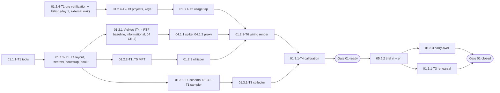

# 01 — Environment Setup: Tech Lead review, shared decisions and feature index

> Reviews: `../../01-environment-setup.md` (high-level, M0). Process: `../../00-overview.md` §10.1, step (2) review → step (3) detailed feature plans (this folder).
> Reviewed: 2026-09-23 by the Tech Lead; DoR review and owner sign-off 2026-09-24 (§12). Verdict: **approve with changes** — the scope is right, but the plan cannot meet its own FR-01-3 (per-run tokens/cost/RAM) and NFR-01-1 (secrets) with the tasks it lists, the §5.2 config sketch has wrong key placement, and one risk can make the M0 trial fail outright (F03).
> Legend: ✅ read from source/docs (URL + date) · ⚠️ unverified · [DECISION] · [OPEN] · [INFERENCE].

## 0. How this folder is organised

```
plans/features/01-environment-setup/
  README.md                         ← this file: review, shared decisions D1–D12, task template, index, re-estimate
  01.1-base-tooling/                ← stories 01.1.1 + 01.1.2
    plan.md                         ← detailed feature plan (template 00 §10.1)
    01.1.1-T1-<slug>.md             ← one file per task (template §6 below)
    …
  01.2.1-vieneu-cpu/
  01.2.2-mpt-install/
  01.2.3-whisper-model/
  01.2.4-openai-access/
  01.3.1-measurement/               ← stories 01.3.1 + 01.3.2
  01.3.3-carry-over/
```

Each feature folder holds `plan.md` (the feature plan) and one `<task-id>-<slug>.md` per task. Task IDs follow `00-overview.md` §9 (`<story>-T<n>`); they **replace** the task table in `01-environment-setup.md` §6 (mapping in §8).

## 1. Facts verified for this review

Upstream code was read on 2026-09-23 at the default branch; every fact MUST be re-checked at the pinned commit during install (the pin may differ).

| # | Fact | Source |
|---|---|---|
| E1 | **Planning Mac only** (owner decision DEC-2: implementation runs on a different machine → re-capture E1/E2 there in 01.1.1-T1): macOS 27.0, 16 GB, internal disk FileVault **on** (66 GiB free); project volume `/Volumes/Project` is APFS over USB, **not encrypted**, **Owners: Disabled** (file modes/ownership not enforced) ✅ | `diskutil info /Volumes/Project`, `fdesetup status` (run 2026-09-23) |
| E2 | Planning Mac only (re-capture on the implementation machine). Installed: Homebrew 7.0.6, git 2.49.0, ffmpeg 9.0.2 with `libmp3lame` and `aac` encoders; **not installed**: `uv`, `gitleaks`. Ports 8000/8001/8002/8080/8501 free. Repo has **no commits yet** ✅ | shell checks 2026-09-23 |
| M1 | MPT `main` @ `3d5f4e42` (2026-09-21, v1.3.7). `listen_host` (default `0.0.0.0`) and `listen_port` (8080) are **top-level** keys; `api_key`, `video_source`, `llm_provider`, `openai_*`, `openai_image_*`, `subtitle_provider`, `enable_redis`, `max_concurrent_tasks` (default 5), `upload_post_*` are in `[app]`; `[whisper]` has `model_size` (default `large-v3`), `device` (`cpu`), `compute_type` (`int8`); `[kokoro]` has `base_url`, `api_key`, `model_id`, `voices` ✅ | `config.example.toml` L15–590 |
| M2 | MPT API: `uv run python main.py` (uvicorn, host/port from config). WebUI: `sh webui.sh` → Streamlit with `--server.address=$MPT_WEBUI_HOST` (default `127.0.0.1`) and port `$MPT_WEBUI_PORT` (default 8501, **silently tries 8502–8599 if busy**) ✅ | `main.py`, `webui.sh` |
| M3 | Whisper: MPT loads `<mpt_root>/models/whisper-<model_size>/model.bin` if present, else downloads by name; `language` is **not** passed (auto-detect); `vad_filter`, `word_timestamps` on ✅ | `app/services/subtitle.py` |
| M4 | `openai_image` sends only `{model, prompt, n: 1, size}` — **no `quality`, no `moderation`**; retries 429/5xx 3× (5/15/30 s); on any failure it logs `openai image generation failed` and **skips the keyword** (no Pexels fallback, no error raised) ✅ | `app/services/material.py` L1079–1545 |
| M5 | LLM `openai`: `chat.completions.create`, not streaming; empty `openai_base_url` → `https://api.openai.com/v1`; empty model → `gpt-5.5`; MPT retries 5× ✅ | `app/services/llm.py`, `app/models/llm_provider.py` |
| M6 | Bundled music: `resource/songs`; random pick by extension (`.mp3 .m4a .aac .wav .flac .ogg .opus .wma`) from songs + `storage/bgm`; empty list → no music. Fonts in `resource/fonts` include `BeVietnamPro-Bold/Medium.ttf`; default font `STHeitiMedium.ttc` ✅ | `app/services/bgm.py`, `video.py`, repo tree |
| M7 | MPT: Python `>=3.11`, `.python-version` 3.11, install `uv python install 3.11 && uv sync --frozen`; ffmpeg from `IMAGEIO_FFMPEG_EXE` → PATH → imageio-ffmpeg; pins `faster-whisper==1.1.0`, `moviepy==2.2.1`, `streamlit==1.59.1`, `openai==2.24.0` ✅ | `pyproject.toml`, `README-en.md`, `app/utils/utils.py` |
| M8 | `config.toml` is read from the MPT root; if missing it is **copied from `config.example.toml`** (→ auth off, `0.0.0.0`). The WebUI **rewrites `config.toml`** on reruns via temp file + `os.replace` (a symlink would be replaced by a regular file). No general env override ✅ | `app/config/config.py`, `webui/Main.py` L330 |
| M9 | loguru format `YYYY-MM-DD HH:MM:SS | LEVEL | "file:line": func - msg`; stage markers `## generating video script`, `## generating video terms`, `## generating audio`, `## generating subtitle`, `## downloading videos from <source>`, `## combining video`, `## generating video`, `task <id> finished` / `task failed … stage:` ✅ (end-of-audio marker ⚠️) | `app/services/task.py`, `app/utils/logging_utils.py` |
| M10 | MPT licence **MIT** (`LICENSE` "MIT License / Copyright (c) 2024 Harry"; `pyproject` `license = { text = "MIT" }`) ✅ | `LICENSE`, `pyproject.toml` |
| M11 | Empty `app.api_key` = auth **off**; missing/wrong `x-api-key` → **401** `invalid API key`; browser `Origin` not allowed → 403 ✅ | `app/controllers/base.py`, `app/asgi.py` |
| V1 | VieNeu (`pnnbao97/VieNeu-TTS` main, SDK 3.8.3, Apache-2.0): `HOST` default **`0.0.0.0`**, `PORT` 8000, `VIENEU_API_KEY` unset = open, `VIENEU_WATERMARK` default on (needs the `[watermark]` extra, which pulls torch — behaviour without it ⚠️), `VIENEU_PRECISION` fp32 (int8 needs x86 VNNI → **fp32 on M4** [INFERENCE]), `VIENEU_MAX_STREAMS` 1 on CPU fp32, `VIENEU_QUEUE_TIMEOUT` 10 s → 429 ✅ | `apps/openai_speech.py`, README |
| V2 | Routes: `POST /v1/audio/speech` (auth), `GET /v1/voices`, `POST /v1/voices` (voice-clone upload), `GET /v1/models`, `GET /health` (**no auth**, ready only after model load ≈ 19 s on CPU). Wrong/missing Bearer → 401; mp3 → 400; unknown voice → 400 ✅ | `apps/openai_speech.py` |
| V3 | Start: `uv run python -m apps.openai_speech`; Mac install: plain `uv sync` (torch-free ONNX, CPUExecutionProvider only; ONNX threads = min(cpu/2, 8), not configurable). Python `.python-version` 3.12 ✅ | README, `pyproject.toml`, `onnx_runtime_lite.py` |
| V4 | VieNeu `requires-python = ">=3.10"` (classifiers 3.10–3.13); `.python-version` pins **3.12**, which uv uses ✅ | `pyproject.toml`, `.python-version` |
| V5 | Weights: `pnnbao-ump/VieNeu-TTS-v3-Turbo` (subfolder `onnx_update` = fp32) + codec `OpenMOSS-Team/MOSS-Audio-Tokenizer-Nano`, via `hf_hub_download` → honours `HF_HOME`. Server loads `mode="v3turbo"` (not v4) ✅. Voices: **25** in SDK 3.8.3 (default "Hải Đăng"), 23 on the HF card (SDK 3.7.1) ✅ | `src/vieneu/v3turbo.py`, voices JSON, HF card |
| V7 | VieNeu code **Apache-2.0**; weights, ONNX files and preset voices apache-2.0 per HF card; generated audio allowed in commercial/monetised content; v4 proprietary (vieneu.io only). Codec repo `OpenMOSS-Team/MOSS-Audio-Tokenizer-Nano` licence ⚠️ (checked in 01.2.1-T1) ✅ | `LICENSE`, HF card, README |
| W1 | faster-whisper MIT ✅ (closes DECISIONS §8 item 10); `large-v3-turbo` → `mobiuslabsgmbh/faster-whisper-large-v3-turbo`; CTranslate2 has **no Metal/MPS** → CPU on Mac, int8 recommended on CPU ✅ | faster-whisper `LICENSE`, `utils.py`; CTranslate2 hardware docs |
| O1 | OpenAI spend limits per org/project can **Enforce a hard limit** → 429 `project_spend_limit_exceeded` (enforcement not instant) ✅ | developers.openai.com/api/docs/guides/spend-limits |
| O2 | Prepaid credits; **auto-reload on by default**; zero balance → `credit_balance_exhausted`, not an instant cutoff ✅ | help.openai.com/en/articles/8264644 |
| O3 | Per-project model allow-list: Project → Limits → Model Usage (Owner only) ✅ | help.openai.com/en/articles/9186755 |
| O4 | Key permissions All / Restricted / Read only; chat + images need **Model capabilities: Request** ✅ | developers.openai.com/api/docs/guides/rbac |
| O5 | GPT Image models: "you **may** need API Organization Verification" ⚠️ (plan for it) | image-generation guide |
| O6 | Images `quality` default **`auto`** when omitted (flare also accepts `xhigh`, `max`); `moderation` `auto`/`low`; `usage` = `input_tokens{text,image}`, `output_tokens`, `total_tokens` (may be absent — handle) ✅ | images API reference |
| O7 | Usage/Costs APIs need an **Admin key**; costs only in 1-day buckets ✅ | admin usage API reference |
| O8 | `gpt-image-2.5-flare`: text input $5/1M, image input $8/1M, image output $30/1M; Tier 1 = **5 images/min**. `gpt-6-luna`: $0.10 in / $0.50 out per 1M ✅ | pricing page, model page |

## 2. Findings

Severity: **B** blocks M0 · **H** breaks an FR/NFR or produces wrong numbers · **M** rework or drift risk · **L** clarity.

| # | Sev | Where (plan 01) | Finding | Action (owner feature) |
|---|---|---|---|---|
| F01 | B | R1, 04 §8 | MPT's kokoro TTS request has a **120 s idle timeout** — no bytes for 120 s, not a total-request cap (04 R1 ✅) — and VieNeu runs **one fp32 stream on CPU** (V1) (04 CR-2) | RTF measured on day 1 on a 1,000-char and a 5-min text, vi + en; result recorded but **informational** (capacity input), not pass/fail (01.2.1-T4). The real pass/fail check is 04.1.2-T3: `ttfb_ms` < 30,000 and `max_gap_ms` < 60,000 on the 5-min fixtures through the proxy; the "fail → chunking" branch is withdrawn (owner-approved 2026-09-24, 04 O1) (04 CR-2) |
| F02 | H | 01.3.1, 03.3.1 ⚠️ | No mechanism gives **per-run** tokens: MPT does not log `usage` (M4/M5); the Costs API has only daily buckets and needs an Admin key (O7) | [DECISION D6] local **usage tap** on `127.0.0.1:8002`: MPT `openai_base_url` and `openai_image_base_url` point at it (config only, no fork); it forwards to OpenAI and writes `usage` per call (01.3.1-T2) |
| F03 | H | §5.2, DECISIONS §3 | Image **quality cannot be set**: MPT sends no `quality` (M4) → API default `auto` (O6). "medium ~$0.013/image" in DECISIONS §4 is therefore not what the trial will pay | Record the quality the API echoes; CR-3 to plan 03 to decide (accept `auto`, inject in tap/adapter, or upstream PR). The tap observes by default and injects only when explicitly configured |
| F04 | H | 01.3.2 | `/usr/bin/time -l` cannot give per-step peaks: whisper and render run **inside the MPT process** (M3), MoviePy spawns ffmpeg **children** not counted in Python RSS, and macOS compresses/swaps memory | Process-tree RSS sampler (1 s) + swap + memory pressure, attributed to stage windows from MPT log markers (M9) (01.3.2-T1, 01.3.1-T3) |
| F05 | H | NFR-01-1, R2 | Secrets would sit in plaintext `config.toml` on an **unencrypted USB volume with ownership disabled** (E1) — `chmod 600` has no effect there. MPT rewrites the file with `os.replace` (M8), so a symlink to a safe place does not survive | [DECISION D1/D3] runtime tree `$NTS_HOME` on the FileVault disk; keys in macOS Keychain; config rendered at each start |
| F06 | H | §5.2 | Config sketch is wrong/incomplete: `listen_host` is **top-level**, not `[app]` (M1); `listen_port` missing; `[whisper] device/compute_type` missing; `[kokoro] voices = []`/`model_id` missing (04 §5.2); `openai_base_url` missing (empty model name falls back to `gpt-5.5`, M5); `upload_post_enabled = false` not asserted | Template in 01.2.2-T2 copies placement from the pinned `config.example.toml`; renderer guards (D5) |
| F07 | H | 01.2.2 | If `config.toml` is missing MPT **copies the example** → `api_key = ""` (auth off) and `listen_host = "0.0.0.0"` (M8, M11). A failed render step would silently start an open API on the LAN | Start script refuses to start unless the rendered file passes guards (D5); smoke test asserts 401 (01.2.2-T5) |
| F08 | M | 01.2.2 | WebUI (Streamlit) is a second server not in §5.1: no auth, rewrites `config.toml`, port drifts to 8502–8599 when busy (M2, M8) | **Resolved by DEC-4:** the WebUI is not used in M0 (D14). No WebUI start script; only the API runs. Never on the worker (CR-9) |
| F09 | M | 01.2.1 | VieNeu binds `0.0.0.0` and is **open** without a key (V1); `/health` never needs auth (V2); `POST /v1/voices` accepts voice-clone uploads | `HOST=127.0.0.1` + key always; smoke tests 401 and bind; CR-2: proxy must not forward `POST /v1/voices` |
| F10 | M | 01.2.1, DECISIONS §5.3 | `VIENEU_WATERMARK=1` needs the `[watermark]` extra (torch). Plain Mac `uv sync` omits it → watermark may be silently off, or startup fails ⚠️ | 01.2.1-T4 determines the behaviour; if the extra is needed, measure its RAM cost and record the decision |
| F11 | M | 01.2.4 | "Budget ⚠️ hard vs alert" is now answerable: project **hard limit** exists (O1); prepaid **auto-reload is on by default** (O2); image models may need **org verification** (O5, external wait); Tier 1 = **5 images/min** (O8) vs MPT skipping a keyword after 3 retries (M4) → images can go **missing silently** | Two projects (story/image, matches DECISIONS §10.11), allow-lists, hard limits, auto-reload off, verification started on day 1; the collector counts skipped keywords (01.2.4, 01.3.1) |
| F12 | M | §6 | Estimates disagree: story sizes sum to **5.0 d**, task sizes to **4.5 d** (01.2.2 M vs 1.25 d of tasks; 01.2.3/01.2.4 S vs XS tasks; 01.3.1 S vs XS task) | Re-estimate §9 |
| F13 | M | §6 | Task table misses work that FRs/stories require: MPT start scripts (FR-01-1), proxy placeholder (scope), gitleaks hook (§8), config rendering (NFR-01-1), MPT bind/LAN check, CC0 placeholder, voices snapshot, NFR-01-2 rehearsal, a cheap wiring render before the real trial | New tasks in the feature folders |
| F14 | M | 01.1.2, 05 §5.1 | Layout clash: 05 wants `worker-node/mpt/` = "pinned checkout via script, not vendored" + `config.template.toml`; 01 wants `worker-node/music/`. Cloning upstream inside the repo also makes `git status` noisy and puts venvs/weights on the USB disk | [DECISION D1] repo holds only tracked templates/scripts; clones, venvs, weights live in `$NTS_HOME` |
| F15 | M | 01.2.2 vs 05.1.1-T1, 05.3.1-T1 | Overlap: config template and bundled-music removal are planned twice | 01 builds the first template and `strip-bundled-music.sh`; 05.1.1 adds the upgrade diff; 05.3.1 wraps the script as a build check (CR-7) |
| F16 | M | `.gitignore` | Gaps: no rule for images (`*.png *.jpg *.webp`), other audio (`*.m4a *.aac *.flac *.ogg *.opus`), weights (`*.onnx *.bin *.safetensors *.pt`), logs; `.env*` would also hide an `.env.example` template | Add rules; name templates `env.example` (01.1.2-T1) |
| F17 | M | 01.2.3 | MPT default `model_size` is `large-v3`, not turbo (M1); language is auto-detected (M3) → a vi clip can be misdetected | Template sets turbo; model pre-placed in MPT's local lookup dir (no hub call at run time); detection checked on samples; CR-5 to 05 |
| F18 | L | 01.1.1 | "`python` on PATH" is not needed: uv installs per-project interpreters (MPT 3.11, VieNeu 3.12, M7/V3) | Record uv-managed versions instead |
| F19 | L | 01.2.1 | "Call from another machine on the LAN" needs a second device | `lsof` listen address + `curl` to the Mac's LAN IP from the Mac itself (connection refused proves a loopback-only bind) |
| F20 | L | 01.1.1 | Tool versions "written in the sheet" would repeat on every row | Per-run manifest `trial/runs/<run_id>/run.json`; the sheet row references `run_id` |
| F21 | L | §9 | Exit criteria mix "environment ready" with "M0 done" (the two sheet rows need 02–05) | Two gates: **01-ready** and **01-closed** (§7) |
| F22 | L | §5.3 | Sheet lacks columns 03.3.1 and 12.1.1 need (aspect, quality echoed, per-image averages, skipped keywords, per finished minute); "words" undefined for Vietnamese | Schema v2 appends columns; existing names unchanged (02 and 03 consume them) (01.3.1-T1) |
| F23 | L | 01.2.2 | vi trial subtitles use MPT's Chinese default font (05 F6); MPT already ships `BeVietnamPro` (M6) | Out of 01 scope; CR-6 to 05.2.2 |
| F24 | H | 01.2.4, 00 §3 | `gpt-image-2.5-flare` Tier 1 = **5 images/min** (O8). MPT makes 3 attempts on a 429, waiting 5 s and 15 s (≈ 20 s in total; the 30 s entry of its backoff table is never used), and then **skips the keyword silently** (M4) (03 CR-8). The image stage of a 5-min video is therefore ≥ 1 min per 5 images at best, and a burst can lose images without failing the task. This hits both the trial timing row and the 00 §3 target (≤ 30 min median) | 01.2.4-T1 records the tier and image RPM; 01.2.2-T6 counts `openai image generation failed` lines and tap 429s (an invalid run if > 0); `image_http_429_count` / `image_failed_count` columns (01.3.1-T1); pacing or a tier increase is raised to 03 before 05.5.2 — resolved by 03 D5 (relay token bucket on the node) and owner O4 (tier increase request) (03 CR-8) |
| F25 | M | D3 | A Keychain item created without a trusted-app ACL may make every later `security find-generic-password -w` show a GUI "allow access" prompt ⚠️. Start scripts would then not run non-interactively (FR-01-1), and the NFR-01-2 rehearsal takes longer | Create items with `-T /usr/bin/security` (01.1.2-T2), and prove one non-interactive read in a fresh login session (01.1.1-T3 rehearsal) |
| F26 | M | D1 | Moving secrets to `$NTS_HOME` is not enough, because the **code that reads them** (`worker-node/bin/*`, `trial/tools/*`, `.githooks`) stays on the ownership-disabled, unencrypted USB volume (E1). Another local account, or anyone holding the drive, can plant a script that reads every `nts.*` item (security review SEC-01) | D13 ([OPEN], decided on the implementation machine) |
| F27 | M | 01.2.2 WebUI | The WebUI has no auth, holds the real OpenAI and proxy keys, and rewrites `config.toml`. The plan only detected the rewrite (SEC-02) | D14 (WebUI dropped from M0) |

## 3. Shared decisions for all feature plans (contract)

Feature plans and task files MUST use these names exactly. A change here is made in this file first.

**D1 Runtime split [DECISION].** The repo holds only tracked, secret-free files. Everything else lives in `NTS_HOME="${NTS_HOME:-$HOME/.nts}"` on the internal FileVault disk, excluded from Time Machine (`tmutil addexclusion`; reproducible from pins, secrets are in the Keychain).

**D1 amendment (01 CR-11, DEC-5, 2026-09-25).** On the implementation Mac, `NTS_HOME=<repo>/.nts` = `/Volumes/Project/NightTalesStudio/.nts`. The owner wants everything for this project, runtime included (clones, venvs, weights, media), inside the project folder. The volume has 474 GiB free; the internal disk has 67 GiB. `.nts/` is ignored by `.gitignore`, so nothing in it is ever committed. `nts_home` (lib.sh) accepts a path inside the repo only if it is exactly `<repo>/.nts` and `git check-ignore` confirms it is ignored. Secret readers and writers (`secret`, `secrets.sh set|init-local|rotate-local`, `render-mpt-config.py`) pass the D13 gate of the recorded mode: `accepted-risk` since DEC-6 (no volume check). In mode `volume` they refuse (exit 2) until the volume is encrypted and owned. Where task files write `$HOME/.nts`, read it as `$NTS_HOME`. The D1 "outside the repo" and "internal disk" guards (01.1.2-T1 step 5, `nts_home`, the D5 `/Volumes/` refusal) are replaced by these rules. `lib.sh` defaults to `<repo>/.nts` when `NTS_HOME` is unset, so shells that skip `~/.zshrc` (agents, cron) resolve the same path. The same value is also exported in `~/.zshrc` and recorded in `worker-node/README.md` § Layout and in `STATUS.md`. Gitleaks directory scans exclude `.nts/`, because it holds upstream clones (01.1.2-T4 runbook).

```
repo (tracked)                                   $NTS_HOME (never tracked)
worker-node/README.md          runbook           src/mpt/            MPT clone @ MPT_COMMIT (+ .venv, config.toml 0600)
worker-node/pins.env           pins (D2)         src/mpt/models/whisper-large-v3-turbo/   whisper weights (M3 lookup)
worker-node/bin/*.sh|*.py      scripts (D9)      src/vieneu/         VieNeu clone @ VIENEU_COMMIT (+ .venv)
worker-node/mpt/config.template.toml             src/proxy-venv/     (bootstrap.sh proxy, 04.1.5-T1) (04 CR-4)
worker-node/mpt/config.example.pinned.toml       hf/                 HF_HOME for VieNeu weights
worker-node/mpt/whisper-large-v3-turbo.sha256    mpt-config.last.redacted.toml  last render, secrets redacted (drift diff)
worker-node/vieneu/voices.snapshot.json          music/              verified CC0 source audio (copied into MPT songs dir)
worker-node/vieneu/weights.sha256                logs/<service>-<YYYYmmdd-HHMMSS>.log
worker-node/vieneu/env.example                   runs/<run_id>/      media copies, rss raw data
worker-node/proxy/             (plan 04 owns)    runs/samples/       VieNeu WAV samples (04.1.1, 01.2.3-T2)
worker-node/music/LICENSES.csv (audio ignored)   current_run         file holding the active run_id
worker-node/CARRY-OVER.md
trial/measurements.csv, trial/schema.md, trial/prices.json, trial/fixtures/ (TTS/whisper test texts)
trial/baselines/<component>-mac-<YYYYMMDD>.json  component baselines (vieneu, whisper, openai-access, rehearsal)
trial/tools/                   tap, sampler, collector, bench-vieneu.sh
trial/runs/<run_id>/           run.json, openai_usage.jsonl, rss.csv, stages.json, ffprobe.json, notes.md
.githooks/pre-commit, pre-push gitleaks (01.1.2-T4)
```

Scripts in `worker-node/bin/` and their owning task: `lib.sh`, `secrets.sh` (01.1.2-T2) · `env-versions.sh` (01.1.1-T1) · `bootstrap.sh` (01.1.2-T3) · `start-vieneu.sh` (01.2.1-T2) · `fetch-vieneu-weights.sh` (01.2.1-T1) · `smoke-vieneu.sh`, **`smoke.sh`, `check-binds.sh`** (01.2.1-T3 — first smoke task on day 1; `smoke.sh` runs every `smoke-*.sh` in a fixed order then `check-binds.sh`, prints `PASS`/`FAIL`/`WARN`/`INFO` lines, exits with the highest code; `check-binds.sh` covers every D4 port) · `render-mpt-config.py`, `start-mpt-api.sh`, `smoke-mpt.sh`, `strip-bundled-music.sh`, `install-music.sh` (01.2.2) · `fetch-whisper-model.sh` (01.2.3-T1) · `openai-access-check.sh` (01.2.4-T3).

**D2 Pins [DECISION].** `worker-node/pins.env` is the only place versions live: `MPT_REPO`, `MPT_COMMIT`, `VIENEU_REPO`, `VIENEU_COMMIT`, `VIENEU_MODEL_REPO`, `VIENEU_MODEL_REVISION`, `VIENEU_CODEC_REPO`, `VIENEU_CODEC_REVISION`, `WHISPER_MODEL_REPO`, `WHISPER_MODEL_REVISION`, `MPT_PYTHON=3.11`, `VIENEU_PYTHON=3.12`, `PROXY_PYTHON=3.12` (04 CR-3). Full 40-char SHAs (`load_pins` rejects anything else and unknown keys). 01.1.1-T2 resolves the model/codec revisions **before** any download; 01.2.1-T1 / 01.2.3-T1 only verify them and never hand-edit `pins.env`. Weight files get `sha256` in `worker-node/vieneu/weights.sha256` and `worker-node/mpt/whisper-large-v3-turbo.sha256`, linked from `CARRY-OVER.md`. Install uses the upstream lock (`uv sync --frozen`). Candidate MPT pin: `3d5f4e42…` (main, 2026-09-21) — confirm full SHA at install.

**D3 Secrets [DECISION].** macOS Keychain generic passwords, account `$USER`:

| Service name | Content | Created by |
|---|---|---|
| `nts.openai.story` | OpenAI key, project `nts-trial-story` | owner, interactive prompt |
| `nts.openai.image` | OpenAI key, project `nts-trial-image` | owner, interactive prompt |
| `nts.mpt.api_key` | MPT `app.api_key` | `secrets.sh init-local` (random 32 bytes hex) |
| `nts.vieneu.api_key` | `VIENEU_API_KEY` | `secrets.sh init-local` |
| `nts.proxy.api_key` | `PROXY_API_KEY` = MPT `[kokoro] api_key` | `secrets.sh init-local` |

Owner-entered keys use `security add-generic-password -U -a "$USER" -s <service> -T /usr/bin/security -w` (no value → prompt, so nothing reaches shell history; `-T` adds `/usr/bin/security` to the item's trusted apps so scripts can read without a GUI prompt, F25 ⚠️ verify on macOS 27). Scripts read with `security find-generic-password -a "$USER" -s <service> -w`, pass values only through the child process environment, never print them, never run with `set -x`. The only file with secrets is `$NTS_HOME/src/mpt/config.toml` (mode 0600, FileVault disk). Keys never go into the repo, logs, `run.json`, chat or screenshots.

**D4 Ports and binds [DECISION].** All `127.0.0.1`: VieNeu 8000 · proxy 8001 (04) · usage tap 8002 · MPT API 8080. Port 8501 (MPT WebUI) is **unused in M0** (D14): nothing may listen on 8501–8599. Start scripts fail (exit 2) if the port is already listening. `worker-node/bin/check-binds.sh` (01.2.1-T3) is an **allowlist**: every LISTEN row on a D4 port, and every LISTEN socket of the service process trees, must be `127.0.0.1:<port>` or `[::1]:<port>`. IPv4 and IPv6 LAN probes must be refused (SEC-05).

**D5 MPT config rendering [DECISION].** `worker-node/mpt/config.template.toml` (placement copied from the pinned example) contains `${NTS_MPT_API_KEY}`, `${NTS_OPENAI_STORY_KEY}`, `${NTS_OPENAI_IMAGE_KEY}`, `${NTS_PROXY_API_KEY}`. `worker-node/bin/render-mpt-config.py` (stdlib only; `string.Template.substitute`, fails on any missing variable) renders in memory, **guards the rendered text before writing** (exit 1 on violation, the last good config stays in place), then writes `$NTS_HOME/src/mpt/config.toml` atomically with mode 0600 and refuses (exit 2) any output path under `/Volumes/`. Minimum guards: `listen_host == "127.0.0.1"` (top-level), `app.api_key` non-empty, `video_source == "openai_image"`, `subtitle_provider == "whisper"`, `whisper.model_size == "large-v3-turbo"`, `upload_post_enabled == false`, `pexels_api_keys == []`, `pixabay_api_keys == []`, `max_concurrent_tasks == 1`, `openai_model_name` and `openai_image_model` non-empty; the full list is in 01.2.2-T2. Redaction is by key name **and** by value (any of the 4 mapping values or an `sk-…` value, SEC-09). It keeps a redacted copy `$NTS_HOME/mpt-config.last.redacted.toml`; start scripts render on every start and print a secret-free diff if the file changed since the last render. Under D14 the WebUI has its own worktree and config, so such a diff means something other than the WebUI edited the API config — treat it as a finding.

**D6 Usage tap [DECISION, trial only].** `trial/tools/usage_tap.py` on `127.0.0.1:8002` forwards `/v1/*` to `https://api.openai.com/v1` (TLS verified, `Authorization` passed through, tap holds no key). MPT: `openai_base_url` and `openai_image_base_url` = `http://127.0.0.1:8002/v1`. Per call it appends one JSON line to `trial/runs/<run_id>/openai_usage.jsonl` (`run_id` read from `$NTS_HOME/current_run`, else `no-run`): `ts, run_id, endpoint, model, http_status, error_code, latency_ms, request {size, quality, moderation, n}, response {quality, size}, usage`. It never logs headers, prompts, message content or image bytes. Body mutation is off by default; `TAP_IMAGE_QUALITY=<value>` injects `quality` only after CR-3 decides. Not carried to the worker as-is (CR-4 decides production metering).

**D7 OpenAI projects [DECISION — amounts accepted by the owner 2026-09-24, DEC-3].** Org: prepaid, auto-reload **off**, org hard limit $30/month. Project `nts-trial-story`: allow-list `gpt-6-luna` only, hard limit $5; **temporarily** also `gpt-6-sol` during the 02.1.3-T1 A/B window only (owner adds it before 02.1.3-T1 and removes it after 02.1.3-T2; dates recorded in the access record; 02 CR-17, owner-approved 2026-09-24). Project `nts-trial-image`: allow-list `gpt-image-2.5-flare` only, hard limit $25. One Restricted key per project with Model capabilities = Request (+ List models = Read). Keys named `nts-trial-<story|image>-mac-<YYYYMM>`, revoked at M0 close.

**D8 Measurement sheet.** Schema v2 = the 31 columns of `01-environment-setup.md` §5.3 unchanged and in order, then appended columns defined in `trial/schema.md` (01.3.1-T1). Only `trial/tools/finish_run.py` appends rows; RFC 4180 CSV, UTF-8, `.` decimals, ISO-8601 UTC timestamps, USD with 6 decimals; no blank cells (`n/a:<reason>`).

**D9 Script conventions.** Bash with `set -euo pipefail`, `shellcheck` clean, `--help`, idempotent; exit codes `0` ok · `1` check failed · `2` usage/environment error. Common helpers in `worker-node/bin/lib.sh` (`nts_home`, `load_pins` — parses `pins.env` line by line, never `source`s it —, `secret <service>`, `require_port_free <port>`, `log`, `die <code> <msg>`). Services run in the foreground, one terminal each, output `tee`'d to `$NTS_HOME/logs/`. Python helpers are stdlib-only and run with `uv run --no-project --python 3.12`. No `sudo` in any script; the only `sudo` in plan 01 is the owner's one-time D13 volume step, typed by hand. Every 01.2.x/01.3.x task adds its own section to `worker-node/README.md` (runbook) as part of its Definition of Done.

**D10 Run IDs.** `YYYYMMDD-HHMM-<lang>-<aspect>-<nn>`, e.g. `20260925-1030-vi-landscape-01`; lang `vi|en`, aspect `landscape|portrait`.

**D11 One heavy job at a time.** `max_concurrent_tasks = 1`, `VIENEU_PRECISION=fp32`, `VIENEU_MAX_STREAMS=1`; no other heavy app during measured runs (noted in `notes.md`).

**D12 Two gates.** See §7.

**D13 Trusted execution location [OPEN → decide at implementation, DEC-2].** The owner decided (2026-09-24) that plan 01 will be **implemented on a different machine**, not the planning Mac where E1/E2 were measured. Implementation note: before the first secret is created (01.2.4-T2, `secrets.sh init-local`), 01.1.1-T1 step 0 re-captures E1/E2 on the target machine and picks one option: (a) the repo already sits on an internal, encrypted disk with ownership enforced → D13 is satisfied, record `mode: internal` (preferred; no extra step); (b) the repo is on an external volume → encrypt it and enable ownership (`sudo diskutil enableOwnership <vol>` by the owner, backup first ⚠️) → `mode: volume`; (c) neither is possible → export mode: `bootstrap.sh --export` copies a committed tree to `$NTS_HOME/exec/<sha>/` and secret-reading scripts run only from there (needs a first commit; re-export after each script change) → `mode: export`. `lib.sh` `_nts_trusted_location` enforces whichever mode is recorded in `worker-node/README.md`. The clean-account rehearsal (01.1.1-T3) always uses its own clone and rehearsal keys.

**D13 decision (DEC-5, 2026-09-25): mode `volume`** on the planning Mac itself, which is now the implementation machine. Owner one-time steps, typed by hand, **before the first secret**: back up the volume (the repo is also on GitHub), encrypt `Project` (Finder → right-click → Encrypt ⚠️ label), `sudo diskutil enableOwnership /Volumes/Project`, then `sudo chown -R "$USER":staff /Volumes/Project/NightTalesStudio` ⚠️ (files created while ownership was off may be stored as uid 99 `_unknown`, which macOS treats as owned by whoever reads them). The volume also holds other projects; encryption and ownership apply to them too. `lib.sh` `_nts_trusted_location` passes only when `diskutil info` of the repo volume **and** of the `$NTS_HOME` volume show `Owners: Enabled` and `Encrypted: Yes` (or `FileVault: Yes`). Until then, 01.1.2-T2 `init-local`, 01.2.1-T2 (VieNeu key) and everything after them that needs a key stay `blocked (owner)` in `STATUS.md`.

**D13 decision superseded (DEC-6, owner, 2026-09-25): mode `accepted-risk`.** No encryption and no `enableOwnership`. The owner accepts that `.nts/src/mpt/config.toml` (plain-text OpenAI keys, M8) is readable by anyone holding the drive and by any local process. The one hard rule is that **keys never leave this Mac**. It is enforced by the `.gitignore` rules (`.nts/`, `config.toml`, `*.env`, `.env*`), by the fail-closed gitleaks `pre-commit` and `pre-push` hooks (01.1.2-T4), and by the Keychain being the only key source (D3). Compensating controls: the D7 hard limits and revocation in the dashboard if the drive is lost (01.2.4-T3). `_nts_trusted_location` returns 0 in this mode; `volume` stays available.

**D14 No WebUI in M0 [DECISION, owner DEC-4, 2026-09-24].** The MPT WebUI (Streamlit) is not started in M0: gate 01-ready does not need it, and the wiring render (01.2.2-T6) uses the API. `start-mpt-webui.sh` is not written; `check-binds.sh` fails if anything listens on 8501–8599. This removes SEC-02 / F27 (a WebUI holding real keys and rewriting `config.toml`). If a UI is wanted later, the earlier design (separate worktree `$NTS_HOME/src/mpt-webui` with dummy `webui-disabled-<hex>` keys and a 30-min auto-stop) is the starting point and needs a new decision. Never on the worker (CR-9).

## 4. Change requests to other files

| CR | To | Request | Status (2026-09-24) |
|---|---|---|---|
| CR-1 | 04 | Proxy JSON log per request adds `chars`, `audio_seconds`, `vieneu_ms`, `ffmpeg_ms`, `status` (no text) → feeds `tts_seconds_audio` and `tts_wall_seconds` | Applied to 04 NFR-04-4 |
| CR-2 | 04 | Proxy forwards only `POST /v1/audio/speech` and `GET /v1/voices`; never `POST /v1/voices` (voice-clone upload, V2) | Applied to 04 FR-04-6 |
| CR-3 | 03 | Decide image quality: MPT sends none → `auto` (M4, O6). Options: accept `auto` and price from measurement; inject in the tap now and `mpt-adapter` later; or upstream PR adding a quality key (no fork) | Applied to 03 G6 + §10 as [OPEN] decision (options a/b/c) |
| CR-4 | 03 / 11 / 12 | Production image metering: MPT exposes no `usage`; decide whether the node runs a metering forwarder like D6 (feeds `usage_records`, FR-03-4) | Applied to 03 §10 and 11 §10 as [OPEN] decision |
| CR-5 | 05 | Whisper gets no `language` (M3) → measure misdetection in 05.2.1; evaluate `[whisper] initial_prompt` ⚠️ | Applied to 05 F8 |
| CR-6 | 05 | `BeVietnamPro-*.ttf` already ships in MPT `resource/fonts` (M6) → first candidate for 05.2.2 (licence ⚠️) | Applied to 05 F6 |
| CR-7 | 05 | 05.1.1-T1 starts from the 01 template (adds only the upgrade diff); 05.3.1-T1 reuses `strip-bundled-music.sh` as the build check; re-estimate both | Applied to 05 (05.1.1 → XS, 05.3.1 reuses the strip script; 05 total 9.0 → 8.75) |
| CR-8 | DECISIONS | §5.3 "voices listed manually" superseded by 04 F2 (`voices = []`); §3 voice count = 25 in SDK 3.8.3 (23 on card); §8 item 10 closed (faster-whisper MIT); §4 image price assumes `medium`, which MPT cannot select (F03); add Tier 1 = 5 images/min (O8) | Applied to DECISIONS §2, §3, §4, §5.3, §8 |
| CR-9 | 11 | Mac vs node differences to plan for: VieNeu ONNX-CPU → PyTorch CUDA (`--extra cuda`), whisper `cpu/int8` → `cuda/float16`, `video_codec` (Mac-only `h264_videotoolbox` must not be used on the node), WebUI never deployed, ONNX thread count fixed upstream | Applied to 11.3.1 |
| CR-10 | 00 §4.1/§13 | Plan 01 raw 4.5 → 10.0 d (§9); **accepted by the owner 2026-09-24 (DEC-1)** — apply to the 00 roll-up | Applied to 00 §4.1 and §13 (also WORKFLOW, DIAGRAMS, DECISIONS §10.11/§10.12, plan 01 §11) |
| CR-11 | 01 D1, D5, D13; 01.1.2-T1, 01.1.2-T2, 01.1.2-T4, 01.2.2-T2 | DEC-5: implement on this Mac. `NTS_HOME=<repo>/.nts` (gitignored). D13 mode `volume`. The "internal disk, outside the repo" guards change to "exactly `<repo>/.nts`, ignored; secrets only when the volume passes the D13 `volume` check". Also: `worker-node/pins.env` matches the old `*.env` rule, so `.gitignore` adds `!worker-node/pins.env` | Applied to D1/D13 (amendment paragraphs) and `.gitignore`. Task files keep their original text; the amendment wins. Status: `STATUS.md` |
| CR-12 | 01 V5, D2; 01.1.1-T2, 01.2.1-T1; 11.3.1 | V5 correction found at install: at `VIENEU_COMMIT` the Mac ONNX path loads codec `OpenMOSS-Team/MOSS-Audio-Tokenizer-Nano-ONNX` (`src/vieneu/_v3_turbo_engine/onnx_runtime_lite.py:41` `_CODEC_REPO`), not `…-Nano`. `…-Nano` is the PyTorch-path default (`v3turbo.py:138`, `configuration_v3_turbo.py:58`), which the GPU worker (plan 11, CR-9) will use; 11.3.1 must pin that repo separately. Licence apache-2.0 (card at `ceff0d07…`) | Applied to `pins.env` (`VIENEU_CODEC_REPO`/`VIENEU_CODEC_REVISION` re-resolved with the 01.1.1-T2 procedure) and `weights.sha256`; 11.3.1 not yet edited ([OPEN] for plan 11) |
| CR-13 | DECISIONS §5.3; 11 README §3 (VieNeu install line), 11.3.1-T1; 01.3.3-T1 | Watermark (01.2.1-T4 steps 2 and 4, DEC-7). At `VIENEU_COMMIT` the plain sync has no `resemble-perth`: class C, silent off, `src/vieneu/base.py:128-131`. `--extra watermark` locks `resemble-perth` 1.0.1 with no dependencies (`uv.lock:3381-3387`), so without torch init fails: class B, "Watermarker init failed", `base.py:134-144`. Success logs `Audio watermarking initialized (Perth)` (`base.py:141`). The node must sync `--extra cuda --extra watermark` (torch/torchaudio 2.8.0 come from `cuda`) and fail closed without that log line | Applied to DECISIONS §5.3, 11 README (VieNeu venv line), 11.3.1-T1 (Venvs line + acceptance check), 01.3.3-T1 §10 |
| CR-14 | 00 §6 (`assets`), 05 README §10, 06 (publication) | Ownership proof (DEC-8): a **signed per-render hash manifest**. At render acceptance the system writes a manifest `{episode_id, render_job_id, assets[kind, sha256, size_bytes], rendered_at, system}` (reuse, do not duplicate: `assets.sha256` 00 §6:288, the run-dir `manifest.json` 05.4.1 plan.md:102, `X-Content-SHA256` 05 README:186; the new scope is only the signed, timestamped record plus key custody, not a new manifest format or a parallel store) and signs it with an owner key held in the secret store, never in the repo; publication later appends the platform video id. Verification = recompute sha256 of a file and check the signature. [OPEN] for the owning plan (05 at detailing, 06 for the video id): key type and rotation, storage of the manifest (table vs asset), export for a dispute. No new provider, no new paid service |
| CR-15 | 01.2.4 (T1–T3), 01.3.1-T2 (tap upstream), 01.3.1-T1 `prices.json`, 01.2.2-T2/T4; later: 02.2.1-T2, 03.4.3-T1, 09.10.1-T1, 11.3.2-T2 | DEC-9. The OpenAI upstream is `OPENAI_BASE_URL` in `worker-node/pins.env` (validated `https://<host>/v1` by `load_pins`). The renderer's direct URL, `start-mpt-api.sh --no-tap` and the tap-upstream check read it; the tap (01.3.1-T2) MUST forward to it instead of a hard-coded `api.openai.com`. 01.2.4-T1 org verification and the OpenAI dashboard hard limit do not apply to a relay: the spending cap moves to the relay account (owner). [OPEN]: does the relay serve `gpt-6-luna` and `gpt-image-2.5-flare` under those names (check with `GET /v1/models` once a key exists, 01.2.4-T3)? Are its prices equal to `prices.json`? Is it acceptable for phase S (plan 13: user data goes to a third party)? The later-plan files still say `api.openai.com` and change when those plans are implemented |

## 5. Sequencing



Suggested order for one developer: **day 1** 01.2.4-T1 (start the external wait first), 01.1.1-T1/T2, 01.1.2-T1…T4, 01.2.1-T1…T4 (RTF baseline recorded by end of day, informational (04 CR-2)) · **day 2** 01.2.2-T1…T5, 01.2.3, 01.2.4-T2/T3, 01.3.1-T1, 01.3.2-T1 · **day 3** 01.3.1-T2/T3 · then 04 proxy → 01.2.2-T6 + 01.3.1-T4 → gate 01-ready.

## 6. Task file template

Every `<task-id>-<slug>.md` uses these headings:

```markdown
# <task-id> — <title>

| Story | Size | Area | Depends on | Blocks | Gate |
|---|---|---|---|---|---|

## Goal
One or two sentences: the observable outcome.

## Inputs
Facts (README §1 ids), pins, secrets (Keychain service names), files from other tasks.

## Steps
Numbered, concrete: commands, file paths, config keys. Commands never contain secret values.

## Outputs
Files created/changed (tracked vs `$NTS_HOME`), recorded values and where they are written.

## Acceptance checks
Checkbox list; each check is a command or observation with its expected result.

## Failure handling
Known failure modes → what to do; stop conditions; rollback.

## Notes
⚠️ items to confirm at the pinned commit, links.
```

## 7. Gates

- **01-ready** (Definition of Ready for 03.3, 04.1.2 end-to-end, 05.4, 05.5.2): D13 mode recorded and verified (01.1.1-T1); all services start from the documented commands; `smoke.sh` green (health, 401s, binds allowlist, `git.hooks`); OpenAI calls pass through the tap and are logged; the wiring render (01.2.2-T6) produced a video and `finish_run.py` produced a complete sheet row from it; RTF baseline (01.2.1-T4) recorded — informational, the streaming pass/fail check is 04.1.2-T3 (04 CR-2); gitleaks full-history scan exit 0.
- **01-closed** (plan 01 exit, part of M0): two complete rows (`vi`, `en`) from 05.5.2; `CARRY-OVER.md` reviewed by the plan 11 owner; clean-account rehearsal ≤ 2 h excluding model downloads (NFR-01-2), with its rehearsal keys revoked; gitleaks full-history scan exit 0; keys of the trial projects rotated or revoked as decided; rendered `config.toml` files deleted (01.2.4 §11).

## 8. Feature index and task mapping

| Feature folder | Stories | Tasks (new) | Replaces (01 §6) |
|---|---|---|---|
| `01.1-base-tooling/` | 01.1.1, 01.1.2 | 01.1.1-T1 install tools + version manifest · T2 upstream requirements → `pins.env` · T3 runbook + clean-account rehearsal · 01.1.2-T1 layout + `.gitignore` + `$NTS_HOME` · T2 `lib.sh` + `secrets.sh` · T3 `bootstrap.sh` · T4 gitleaks hook | 01.1.1-T1, 01.1.1-T2, 01.1.2-T1 |
| `01.2.1-vieneu-cpu/` | 01.2.1 | T1 install at pin + weight pins · T2 start script · T3 smoke script · T4 RTF/RAM baseline (informational, 04 CR-2), watermark, WAV handoff | 01.2.1-T1…T3 |
| `01.2.2-mpt-install/` | 01.2.2 | T1 install at pin · T2 template + renderer + guards · T3 strip bundled music + CC0 placeholder · T4 API start script (no WebUI, D14) · T5 smoke · T6 wiring render | 01.2.2-T1…T3 |
| `01.2.3-whisper-model/` | 01.2.3 | T1 fetch pinned model into MPT lookup dir + offline proof · T2 speed/RAM/language check | 01.2.3-T1 |
| `01.2.4-openai-access/` | 01.2.4 | T1 org verification + billing guard · T2 projects, allow-lists, hard limits, keys → Keychain · T3 negative tests + rotation note | 01.2.4-T1 |
| `01.3.1-measurement/` | 01.3.1, 01.3.2 | 01.3.1-T1 schema v2 + dictionary + prices · T2 usage tap · T3 run collector · T4 calibration · 01.3.2-T1 RAM sampler | 01.3.1-T1, 01.3.2-T1 |
| `01.3.3-carry-over/` | 01.3.3 | T1 write `CARRY-OVER.md` · T2 walkthrough with plan 11 owner | 01.3.3-T1 |

## 9. Re-estimate

| Feature | High-level (tasks) | Detailed | Why it moved |
|---|---|---|---|
| 01.1 Base tooling | 0.75 | 2.25 | bootstrap with pin verification, Keychain helper, gitleaks hook, rehearsal (F05, F13) |
| 01.2.1 VieNeu | 1.0 | 1.5 | RTF baseline (informational, 04 CR-2) + watermark check (F01, F10) |
| 01.2.2 MPT | 1.25 | 2.0 | renderer with guards, API start script with upstream checks, wiring render (WebUI dropped by DEC-4; T4 stays XS) (F06–F08, F13) |
| 01.2.3 Whisper | 0.25 | 0.5 | offline proof + language check (F17) |
| 01.2.4 OpenAI | 0.25 | 0.75 | two projects, allow-lists, negative tests (F11) |
| 01.3.1 + 01.3.2 Measurement | 0.75 | 2.25 | usage tap, collector with stage attribution (F02, F04) |
| 01.3.3 Carry-over | 0.25 | 0.75 | content list + review with plan 11 (F14) |
| **Total** | **4.5** | **10.0** → with 20 % buffer **12.0** person-days | +5.5 d raw; **accepted by the owner 2026-09-24 (DEC-1)**; partly offset by CR-7 in plan 05 (≈ −0.25 d) |

Lean option (drop D6, −0.75 d) was **rejected by the owner (DEC-1)**: the usage tap stays, so the sheet holds per-run token and cost numbers.

## 10. Canonical task dependency graph

Built from the Depends/Blocks cells of all 29 task files (union of both directions) and reduced to direct prerequisites; no cycles. Where a header cell and this table differ, **this table wins** (header cells may list transitive or prose dependencies). External prerequisites are not shown: plan 04 (04.1.1 spike, 04.1.2 proxy) before 01.2.2-T6, and 05.5.2 (trial vi + en) before 01.1.1-T3 and 01.3.3-T1.

| Wave | Task | Direct prerequisites | Unblocks |
|---|---|---|---|
| 1 | 01.1.1-T1 | — | 01.1.2-T1 |
| 1 | 01.2.4-T1 | — | 01.2.4-T2 |
| 2 | 01.1.2-T1 | 01.1.1-T1 | 01.1.1-T2, 01.1.2-T2, 01.1.2-T4, 01.3.1-T1 |
| 3 | 01.1.1-T2 | 01.1.2-T1 | 01.1.2-T3 |
| 3 | 01.1.2-T2 | 01.1.2-T1 | 01.1.2-T3, 01.2.4-T2, 01.3.1-T2, 01.3.2-T1 |
| 3 | 01.1.2-T4 | 01.1.2-T1 | 01.1.1-T3 |
| 3 | 01.3.1-T1 | 01.1.2-T1 | 01.3.1-T3 |
| 4 | 01.1.2-T3 | 01.1.1-T2, 01.1.2-T2 | 01.2.1-T1, 01.2.2-T1 |
| 4 | 01.2.4-T2 | 01.1.2-T2, 01.2.4-T1 | 01.2.2-T2, 01.2.4-T3 |
| 4 | 01.3.1-T2 | 01.1.2-T2 | 01.2.2-T4, 01.3.1-T3 |
| 4 | 01.3.2-T1 | 01.1.2-T2 | 01.3.1-T3 |
| 5 | 01.2.1-T1 | 01.1.2-T3 | 01.2.1-T2 |
| 5 | 01.2.2-T1 | 01.1.2-T3 | 01.2.2-T2, 01.2.2-T3 |
| 5 | 01.2.4-T3 | 01.2.4-T2 | 01.2.2-T6 |
| 5 | 01.3.1-T3 | 01.3.1-T1, 01.3.1-T2, 01.3.2-T1 | 01.2.2-T6 |
| 6 | 01.2.1-T2 | 01.2.1-T1 | 01.2.1-T3 |
| 6 | 01.2.2-T2 | 01.2.2-T1, 01.2.4-T2 | 01.2.2-T4 |
| 6 | 01.2.2-T3 | 01.2.2-T1 | 01.2.2-T4 |
| 7 | 01.2.1-T3 | 01.2.1-T2 | 01.2.1-T4, 01.2.2-T6 |
| 7 | 01.2.2-T4 | 01.2.2-T2, 01.2.2-T3, 01.3.1-T2 | 01.2.2-T5, 01.2.3-T1 |
| 8 | 01.2.1-T4 | 01.2.1-T3 | 01.2.3-T2 |
| 8 | 01.2.2-T5 | 01.2.2-T4 | 01.2.2-T6 |
| 8 | 01.2.3-T1 | 01.2.2-T4 | 01.2.2-T6, 01.2.3-T2 |
| 9 | 01.2.2-T6 | 01.2.1-T3, 01.2.2-T5, 01.2.3-T1, 01.2.4-T3, 01.3.1-T3 | 01.3.1-T4 |
| 9 | 01.2.3-T2 | 01.2.1-T4, 01.2.3-T1 | 01.3.1-T4 |
| 10 | 01.3.1-T4 | 01.2.2-T6, 01.2.3-T2 | 01.1.1-T3, 01.3.3-T1 |
| 11 | 01.1.1-T3 | 01.1.2-T4, 01.3.1-T4 | — |
| 11 | 01.3.3-T1 | 01.3.1-T4 | 01.3.3-T2 |
| 12 | 01.3.3-T2 | 01.3.3-T1 | — |

Soft edges (only a live or end-to-end check waits; the task's code and stub tests do not): 01.2.4-T1 → 01.2.4-T3, 01.2.4-T1 → 01.3.1-T2, 01.2.4-T2 → 01.3.1-T2, 01.2.4-T3 → 01.3.1-T2. Because of these, the external OpenAI verification wait (01.2.4-T1, O5) blocks only the paid checks and 01.2.2-T6, never the MPT install, smoke or whisper tasks.

Critical path (one developer): 01.1.1-T1 → 01.1.2-T1 → 01.1.2-T2 → 01.1.2-T3 → 01.2.2-T1 → 01.2.2-T2 → 01.2.2-T4 → 01.2.3-T1 → 01.2.2-T6 (needs 04) → 01.3.1-T4 → gate 01-ready → 05.5.2 → 01.3.3-T1/T2 + 01.1.1-T3 → gate 01-closed.

## 11. Owner decisions (2026-09-24)

| Id | Decision | Effect |
|---|---|---|
| DEC-1 | Keep the full estimate: **10.0 d raw / 12.0 d with buffer**; the usage tap (D6) stays | §9 accepted; CR-10 to apply in 00 |
| DEC-2 | Plan 01 will be implemented on **another machine**, not this Mac | D13 becomes an implementation-time choice (internal / volume / export); E1/E2 are re-captured on the target machine in 01.1.1-T1; the machine facts in the feature plans (disk, installed tools, free ports) are planning-Mac values |
| DEC-3 | OpenAI budget: org **$30** hard, `nts-trial-story` **$5**, `nts-trial-image` **$25**, auto-reload **off** | D7 final |
| DEC-4 | **No MPT WebUI in M0** | D14 rewritten; 01.2.2-T4 covers only the API start script; SEC-02/F27 closed by removal |
| DEC-5 (2026-09-25) | **Supersedes DEC-2.** Plan 01 is implemented on this Mac (M4, 16 GB, macOS 27.0). The runtime lives inside the project folder: `NTS_HOME=/Volumes/Project/NightTalesStudio/.nts`, gitignored | D13 mode `volume` (owner encrypts `Project` and enables ownership before the first secret); D1 amended (CR-11). Progress is tracked in `/STATUS.md` |
| DEC-6 (2026-09-25) | **No volume encryption.** The only hard rule is that API keys are never published (never committed or pushed) | D13 mode `accepted-risk` (D13 paragraph); gitleaks hooks plus `.gitignore` are the enforcing control; owner steps for `volume` dropped |
| DEC-7 (2026-09-25) | **Keep the VieNeu watermark** as an AI-provenance mark. It is required in production; the Mac M0 trial runs without it (audio never published). The owner's goal is copyright marking of the system's output, but Perth cannot do that (same mark for every user, no payload: `perth_watermarker.py:25`). Ownership proof is decided by DEC-8 | CR-13; `watermark.decision` in `trial/baselines/vieneu-mac-20260925*.json`; 01.2.1-T4 closed |
| DEC-8 (2026-09-25) | **Ownership / copyright proof = option (a): a signed per-render hash manifest**, built in-house. Rejected: (b) a payload-carrying watermark (new dependency, licence check) and (c) Resemble's paid PerTh product (a second paid provider; OpenAI is the only one). The Perth watermark stays for AI provenance (DEC-7) | CR-14 |
| DEC-9 (2026-09-25) | **OpenAI calls go through the owner's OpenAI-compatible relay `https://api.aixingialaire.shop/v1`**, not `https://api.openai.com/v1`. The keys `nts.openai.story`/`nts.openai.image` are relay keys, stored the same way (Keychain, `secrets.sh set`). TL risk note given to the owner: the relay operator sees every prompt, story, image and key; model availability, prices and uptime are the relay's; the OpenAI ToS/billing guards (01.2.4-T1) don't cover it. Accepted for phase P. Phase S use is [OPEN] (plan 13) | CR-15 |
| DEC-10 (2026-09-25) | Two relay decisions. (1) Access-check denials C2/C4/C6/C7 are **recorded, not failed**: the relay has no per-key allow-list like an OpenAI Restricted project. Observed: C7 `gpt-6-astra` → 200. The story key's image call → 403 "Image generation is not enabled for this group". Spend is capped in the relay account. (2) Image model: **try `gpt-image-2.5-flare` first, fall back to `gpt-image-2`** when the relay reports the model unavailable. On 2026-09-25 every image model (flare, 2, 1.5, 1) → 503 "No available compatible accounts" on the image key, so image generation is **blocked on the relay side**. The owner must ask the relay to enable images for the image key's group | 01.2.4-T3 (`openai-access-check.sh`), `trial/baselines/openai-access-mac-20260925.json` |

## 12. Definition-of-Ready review (2026-09-24)

**Reviewer:** the Tech Lead. There is no independent agent pass: the subagent API returned `401 Invalid API key`.

**Checked by script:**
- 7 `plan.md` files have sections 1–11.
- 29 task files have the §6 headings and the one-row table.
- Code fences are balanced.
- Every `01.x.y-Tn` reference exists.
- The §10 graph was re-used as the canonical order (no cycles, per §10).

**Checked against downstream consumers:**

| Consumer | Needs from 01 | Result |
|---|---|---|
| 02 M0 harness (02.1.3-T0) | `uv` (01.1.1-T1), Keychain `nts.openai.story` (01.2.4-T2), usage tap on `127.0.0.1:8002` forwarding any `/v1/*` path incl. `/v1/responses` and logging numeric `usage` leaves (01.3.1-T2) | ✅ compatible |
| 02 M0 harness | tap `run_id` attribution | ⚠️ **defect found and fixed on the 02 side.** The tap only attributes a `current_run` matching the D10 regex, and the harness cell ids do not match it. 02.1.3-T0 Notes and plan UC2 now use a D10 batch id plus a token-sum cross-check. The tap regex is unchanged (it is a security control, NTS01-SEC-04) |
| 02 CR-17 | access check C7 uses `gpt-6-astra`; `gpt-6-sol` is allow-listed only for the 02.1.3-T1 window | ✅ applied earlier (01.2.4 plan, T2, T3) |
| 01.3.1-T3 run collector | aggregates `/chat/completions` and `/images/generations` only | ✅ acceptable: M0 story usage is reported by the 02 harness, not by the video sheet |

**Verdict: ready with conditions.**
1. D13 (storage mode) is decided in 01.1.1-T1 on the implementation machine (DEC-2).
2. Gate **01-ready** also needs plan 04 (04.1.1 spike, 04.1.2 proxy) before 01.2.2-T6. Plan 04 has no detailed feature plan yet, so 01-ready cannot close before 04 is detailed and built. This does **not** block M0 of plan 02, which needs only 01.1.1-T1, 01.1.2-T1, 01.1.2-T2, 01.2.4-T1…T3 and 01.3.1-T2 (`../02-story-writing/README.md` §12).
3. 01.2.4-T1 waits on OpenAI organisation verification (external, O5); only the paid checks wait (§10 soft edges).

**Owner sign-off:** ✅ **signed by the owner 2026-09-24.** The three conditions above stay in force (D13 decided on the implementation machine; 01-ready also needs plan 04; 01.2.4-T1 waits on O5).

Note 2026-09-24: gate 01-ready item "RTF gate decided" changed to "RTF baseline recorded (informational)"; the pass/fail streaming check moved to 04.1.2-T3 — owner-approved under 04 O1 (04 CR-2).

Note 2026-09-24 (condition 2): plan 04 is now detailed (`../04-voice-proxy/README.md`, owner decisions accepted). 01-ready still waits for 04.1.1-T1 and 04.1.2-T1/T2 to be **built** before 01.2.2-T6 (04 CR-16).

