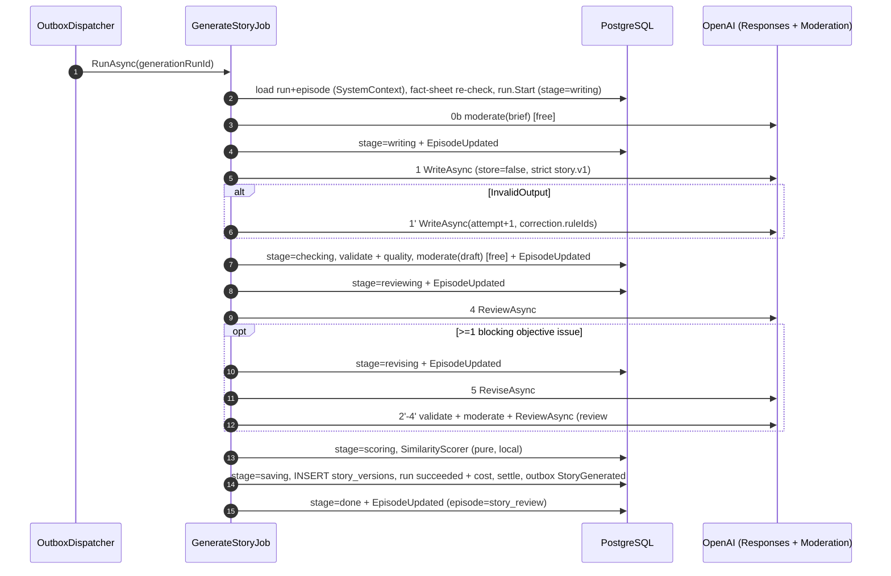

# 02.2.2-T3 — `GenerateStoryJob` pipeline, stage progress, settle/refund and `StaleGenerationSweeperJob`

| Story | Size | Area | Depends on | Blocks | Phase / flag |
|---|---|---|---|---|---|
| 02.2.2 | M (1.0) | BE + jobs | 02.2.2-T1, 02.2.2-T2, 02.2.4-T1 (`IUsageMeter`, `IPriceCatalog`), 02.2.1-T2 (`IStoryWriter`, `ITextClient`), 02.2.3-T2 (assembler), 02.4.1-T1 (`IContentModerator`), 09.2.6 (Hangfire/`IJobScheduler`, ids-only) | 02.3.2-T1, 02.6.1-T1, 12.2.4-T1 (12: story command wiring; 09.5.2-T1 withdrawn, 09 W2 CR-3) | P · `Story:SelfReview:Enabled` |

## Goal

A `queued` `generation_runs` row is executed end-to-end in D21's exact order: the job loads the run under the owner's system context, re-checks the fact sheet, moderates the brief, writes, validates, moderates, reviews, revises once when required, scores, saves one or two `story_versions` rows, settles the reservation and emits `StoryGenerated` — moving the episode to `story_review`; any failure returns the episode to its previous status with the D8 code on the run, and the `StaleGenerationSweeperJob` recovers every kind of crashed run.

## Inputs

- README: **D21** (step order + owner per step; `RunContext`), **D7** (outcome mapping, per-call timeouts, SDK retries off, one resilience layer), **D2** (`stage`, `attempt`, `models`, `error_code`, `counts_toward_limit`), **D3/D4** (schema + length limits), **D5** (composite `prompt_version`), **D8** (job outcome codes), **D12** (moderation stages/blocking categories), **D13** (`episode.story_version_saved`), **D19** (no content in logs/args), **D22** (`audit.v1`); F04 (failure → previous status), F16 (latency, Long measured not gated), F23 (retry budget: Hangfire retry 0), F24 (stage progress is the only progress contract).
- Plan `02.2.2/plan.md` §3.4 (`GenerationRun`/`StoryGenerationProgress`), §3.6 (counting/pause table), §4 U4 (steps 0–7), §5.2 (events), §7.1–§7.5 (job, mapping, timeout/sweeper, latency, integrations), §8 (security), §9 (test plan), §10 items 1/5/6 (all resolved by TL T18/T20/T21).
- 09.2.6 (Hangfire PostgreSQL storage, ids-only architecture test, `AddOrUpdate` recurring jobs), 09.2.4 (at-least-once outbox), 02.6.1/02.6.2 (`ReviewAsync`/`ReviseAsync`), 02.5.6 (`SimilarityScorer`), 02.5.3 (`IFactSheetGuard`).

## Design

### Job entry (ids only)

```csharp
// src/NightTales.Application/Features/Stories/Jobs/GenerateStoryJobHandler.cs  (outbox handler)
// src/NightTales.Application/Features/Stories/Jobs/GenerateStoryJob.cs          (job method)
public sealed class GenerateStoryJob(StoryGenerationPipeline pipeline, ILogger<GenerateStoryJob> log)
{
    public Task RunAsync(Guid generationRunId);   // the ONLY parameter (ids-only arch test, 09.2.6)
}
```

`Hangfire` `default` queue, enqueued by `IJobScheduler.Enqueue<GenerateStoryJob>(runId)` from the `StoryGenerationRequested` outbox handler. **Retry 0** (F23/D7); transient failures are handled inside the call by the D7 resilience layer (2 attempts on 429/5xx/timeout per call), a crash is recovered by the sweeper (§7.3). `[AutomaticRetry(Attempts = 0)]` on the job method.

### Pipeline (D21 order, followed exactly)

| Step | `stage` | Call | On failure |
|---|---|---|---|
| 0 | — | load run + episode under `SystemContext(run.UserId)`; **re-check `IFactSheetGuard.EnsureApprovedAsync`** and compare `FactSheetId` with `run.input_fact_sheet_id` | mismatch or missing → `FailAsync` (`story_generation_failed`, detail `fact_sheet_outdated`, not counted) |
| 0b | — | `IContentModerator.CheckAsync([episode.Brief, episode.Title], Brief, ct)` | flagged → `FailAsync` (`story_moderated`, **counted**) before any paid call |
| 1 | `writing` | `progress.StartAsync`; `IStoryWriter.WriteAsync(StoryWriteRequestFactory.Build(...), ct)` | retry once on `InvalidOutput` (attempt+1, `Correction.RuleIds` only, never the invalid text); second → `story_invalid_output`, not counted |
| 2 | `checking` | `StoryDraftValidator.Validate` then `StoryQualityChecker.Check` (pure, no retry) | issues → `audit.v1.local.issues` |
| 3 | `checking` | `IContentModerator.CheckAsync([title, body, description, tags…], Draft, ct)` | blocking category → recorded + approval blocked downstream (**not** a run failure, D12); other → advisory |
| 4 | `reviewing` | `IStoryWriter.ReviewAsync(reviewReq, ct)` — only when `Story:SelfReview:Enabled` (default **true**) | maps per the outcome table below |
| 5 | `revising` | `IStoryWriter.ReviseAsync(revReq, ct)` — **only when ≥ 1** issue is `blocking` **and** `objective`; then steps 2–4 run **once more** (review #2, no further revision) | review #2 issues → `audit.v1.revision.review_after` |
| 6 | `scoring` | `SimilarityScorer.Score(storyText, corpus, options)`; corpus from `ISimilarityCorpusProvider.LoadAsync(episodeId, lang, ct)` | advisory only; corpus failure → `similarityScore = null` + a `similarity_unavailable` local advisory, never a failed run |
| 7 | `saving` | build `StoryVersion` rows (`generated`, plus `revised` with `parent_version_id`), derive `body`/`keywords`/`word_count`, insert, write `audit_report` + `similarity_score`; `progress.CompleteAsync` → settle + outbox `StoryGenerated` | DB failure → `story_generation_failed`, refunded |

`StoryGenerationProgress` (Application, T1's companion) is the **only** writer of run+episode state, so both aggregates change together: `StartAsync`, `RecordStageAsync(runId, stage)` (run `stage` + `episode.MarkGenerationStage` + `EpisodeUpdated`), `PauseAsync(runId, reason)`, `CompleteAsync(input)`, `FailAsync(input)`, `CancelAsync(runId, reason)`. Stage changes are emitted **on transition only** (≤ 7 per run), so a retried step does not spam the UI. `Story:SelfReview:Enabled` is read once per run and the value actually used is recorded in `generation_runs.models`.

`StoryWriteRequestFactory` is the only place calling `IBibleSnapshotProvider.GetForWriterAsync` / `IStructurePlanProvider.GetForEpisodeAsync` (both nullable → the data object omits the key) and setting `RunContext.PriceVersion = priceCatalog.GetActive(run.QueuedAt).Version`.

### Sequence



### Outcome mapping (D7) → run/episode/refund/counting

| OpenAI outcome | Step | Run | Episode | Refund | Counted |
|---|---|---|---|---|---|
| `Ok` | any | continue | unchanged | — | — |
| `InvalidOutput` (`max_output_tokens` / schema-invalid) | 1 | retry once (`attempt+1`) | unchanged | — | — |
| `InvalidOutput` again | 1 | `failed` `story_invalid_output` | back to previous (F04) | yes | false |
| `Moderated` (refusal part / `content_filter`) | 1, 4, 5 | `failed` `story_moderated` + `moderation_events(stage=draft)` | back to previous | yes | **true** |
| `ProviderFundsExhausted` (429 `*_spend_limit_exceeded`, `credit_balance_exhausted`) | any | stays `queued`, `pause_reason = provider_funds_exhausted` | unchanged | no | false |
| `IBudgetGuard` denies before a dispatch | any | stays `queued`, `pause_reason = spend_cap_reached` | unchanged | no | false |
| `ProviderError` (other 4xx) | any | `failed` `story_generation_failed` | back to previous | yes | false |
| `ProviderUnavailable` (5xx/timeout after 2 attempts) | any | `failed` `story_generation_failed` | back to previous | yes | false |
| DB failure at step 7 | 7 | `failed` `story_generation_failed` | back to previous | yes | false |

Refund: `ICreditLedger.RefundAsync(run.ReservationId, reason, ct)`, `reason` ∈ {`story_invalid_output`, `story_moderated`, `story_generation_failed`, `provider_unavailable`}. Settle: `SettleAsync(reservationId)` **after** the `story_versions` insert commits and `generation_runs.cost_usd` is written (Σ `usage_records.cost_usd` by reservation). Both are idempotent by `reservationId` and guarded by the run's terminal status, so a re-run cannot double-refund. The `story_versions` insert and the outbox `StoryGenerated` row commit in the same transaction (09.2.4).

### Retry, timeout, sweeper

- **Hangfire retry 0** (F23); `09 §5.3` is aligned by CR-16 (TL T22).
- **Per-run timeout:** `Story:Job:TimeoutSeconds` default **360** (TL T21); `Story:Job:TimeoutSecondsLong` default **480** when `episode.LengthTier = long`. The moderation call timeout is **15 s** (TL T21), so the worst case (writer 90 + review 45 + revision 90 + review #2 45 + two moderation calls 15 s = 300 s) fits inside 360. Deadline = `started_at + timeout`; at ≥ 80 % the job logs a warning and increments `story_generation_soft_timeout_total`. `ct` is checked between steps, so a deadline hit cancels the current call → `story_generation_failed` (not counted, refunded).
- **`StaleGenerationSweeperJob`** — recurring every 5 min, `AddOrUpdate` id `stale-generation-sweeper`, Worker (09.2.6); covers **every** `kind` (D2 L139):

```sql
-- (a) running past deadline + 60 s
SELECT id, kind, episode_id, previous_episode_status, reservation_id, user_id FROM generation_runs
 WHERE status = 'running' AND started_at < now() - make_interval(secs => (@timeoutSeconds + 60));
-- (b) queued and never started for 12 h (12.8.3 cancel-after-12-h rule)
SELECT … FROM generation_runs WHERE status = 'queued' AND queued_at < now() - interval '12 hours';
```

For each row: branch (a) → `status = failed`, `error_code` = the kind's generic code (`story_generation_failed`, `fact_sheet_generation_failed`, `bible_proposal_generation_failed`, `ideas_generation_failed`, `find_sources_generation_failed`); branch (b) → `status = cancelled`, `error_code = story_generation_cancelled` (D8, TL T20 — the sweep cancels a stuck `queued` run; this is **not** a user cancel). Both branches set `counts_toward_limit = false`, `finished_at = now()`, `error_detail = 'stale_run_sweep'`; `RefundAsync(reservation_id, "stale_run")`; and for `kind = story` with a non-null `episode_id` → `Episode.FailStoryGeneration(previous_episode_status, code, countsTowardLimit: false)` (T7 of T1's table). Other kinds never move an episode. Batched by `Story:Sweeper:BatchSize` (default 200).
- **Crash semantics:** the job is idempotent on the run — `status ∈ {succeeded, failed, cancelled}` → log and return; `status = running` **and** `started_at + timeout + 60 s > now` → another worker owns it → return; otherwise the sweeper picks it up. The job never re-enqueues itself.
- **Cancellation:** no user-facing route in P (§10 item 7); `CancelStoryGeneration` serves the admin path (09.9.1) and account deletion (13.3.2), and 12.8.3's 12 h rule cancels paused runs. A **user** cancel is `cancelled` and **counted** (D2 L142); a **sweeper** cancel (branch (b) above) is `cancelled`, **not counted**, with `error_code = story_generation_cancelled`. Both raise `StoryGenerationFailed` with `ErrorCode = story_generation_cancelled` (D8, TL T20).

### Latency (NFR-02-1, F16 — targets to be measured in M1)

| Step | p95 target | Hard timeout (D7) |
|---|---|---|
| 0 fact-sheet re-check | < 20 ms | — |
| 0b brief moderation | < 2 s | 15 s |
| 1 write | 55 s (Short) / 70 s (Standard) | 90 s |
| 2 validate + quality | < 200 ms | — |
| 3 draft moderation | < 3 s | 15 s |
| 4 review | 25 s | 45 s |
| 5 revise | 50 s | 90 s |
| 2'–4' validate + moderate + review #2 | 28 s | 45 s |
| 6 similarity | < 300 ms | — |
| 7 save + settle | < 500 ms | — |
| whole job, no revision (Short/Standard) | ≈ 95 s → p95 < 120 s ✅ | 360 s |
| whole job with revision (Short/Standard) | ≈ 145 s ⚠️ measured in M1 | 360 s |
| whole job (Long) | ≈ 190 s / 290 s with revision | 480 s |

## Steps

1. Add `StoryGenerationPipeline` implementing steps 0–7 and `StoryGenerationProgress` (T1's companion service).
2. Add `GenerateStoryJob` + its `StoryGenerationRequested` outbox handler + `[AutomaticRetry(Attempts = 0)]`; register in DI.
3. Add the invalid-output retry loop (step 1 only) with `RunContext.Attempt + 1` and `Correction.RuleIds`.
4. Add `StoryWriteRequestFactory` and wire `IUsageMeter` recording on every call (incl. failures that carried usage).
5. Add settle/refund with the terminal-status guard; write `generation_runs.cost_usd`, `prompt_version`, `models`.
6. Add `StaleGenerationSweeperJob` (recurring, every kind) + `Story:Job:*`, `Story:Sweeper:BatchSize`, `Story:SelfReview:Enabled` config keys.
7. Add the metrics (`story_generation_duration_seconds{tier,stage}`, `story_invalid_output_total`, `story_generation_runs_total{kind,status,trigger}`, `story_generation_soft_timeout_total`) and the D19-safe log lines.
8. Add the tests below.

## Outputs

- New: `src/NightTales.Application/Features/Stories/Generation/{StoryGenerationPipeline,StoryGenerationProgress,StoryWriteRequestFactory}.cs`
- New: `src/NightTales.Application/Features/Stories/Jobs/{GenerateStoryJob,GenerateStoryJobHandler}.cs`
- New: `src/NightTales.Application/Features/Stories/Jobs/StaleGenerationSweeperJob.cs`
- Changed: DI + Hangfire registration (09.2.6), `appsettings.json` (`Story:Job:*`, `Story:Sweeper:BatchSize`, `Story:SelfReview:Enabled`)
- No migration.

## Acceptance checks

- [ ] `Pipeline_HappyPath_StagesInD21Order` records `writing, checking, checking, reviewing, scoring, saving, done`.
- [ ] A happy-path run leaves `generation_runs.status = succeeded`, `cost_usd > 0`, one `story_versions` row (`source = generated`), `episodes.status = story_review`, one `outbox_messages` `StoryGenerated`.
- [ ] `Sweeper_CoversEveryKind`: five seeded runs (one per `kind`), all swept in one pass; only the `story` one moves its episode.
- [ ] `Sweeper_SeriesLevelRun_FailsWithoutTouchingAnEpisode` (`episode_id IS NULL`).
- [ ] `Job_AlreadySucceeded_ReturnsWithoutTouchingAnything` and `Job_RunningOwnedByAnotherWorker_Returns`.
- [ ] `Pipeline_ProviderFundsExhausted_StaysQueued_WithPauseReason` leaves `generation_runs.pause_reason = 'provider_funds_exhausted'` and `status = queued` (TL T19).
- [ ] With `Story:SelfReview:Enabled=false` the recorded stage sequence skips `reviewing`/`revising` and `models` records the value used.
- [ ] `curl`/`psql` after a run: `select stage, error_code, counts_toward_limit from generation_runs` matches the outcome table for each failure fixture.
- [ ] No prompt/brief/story text appears in any log line or in `generation_runs.error_detail` (D19).
- [ ] (02 CR-25, from T1 QA) `StoryGenerationProgress` rejects a progress call (`StartAsync`/`RecordStageAsync`/`CompleteAsync`/`FailAsync`/`CancelAsync`) for a run that is terminal or is not the episode's current/active run (the run whose id started the generation), before it touches the episode: a late redelivery for run A is never applied to a later generation by run B. Tests: `Progress_TerminalRun_IsRejected`, `Progress_RunThatIsNotTheEpisodesActiveRun_IsRejected` (episode and run unchanged).
- [ ] (02 CR-25, from T1 QA) The sweeper cancels through a `GenerationRun` overload that sets `error_code` (`story_generation_cancelled`) and `counts_toward_limit = false` (T1's `Cancel(now)` only leaves the flag as it was). Test: `Sweeper_StuckQueuedRun_IsCancelled_WithErrorCode_AndNotCounted`.

## Tests

Application unit (`FakeTextClient`/`FakeContentModerator`/`FakeClock`/`FakeBudgetGuard`, D20):
- `Pipeline_HappyPath_StagesInD21Order`
- `Pipeline_InvalidOutputOnce_RetriesWithCorrectionAndSucceeds`
- `Pipeline_InvalidOutputTwice_FailsInvalidOutput_NotCounted_Refunded`
- `Pipeline_ModeratedDraft_FailsModerated_Counted_Refunded`
- `Pipeline_BriefFlagged_FailsBeforeAnyPaidCall` (`FakeTextClient.Calls == 0`)
- `Pipeline_BlockingCategoryInDraft_DoesNotFailTheRun_FlagsApproval`
- `Pipeline_BlockingObjectiveIssue_RunsExactlyOneRevisionAndReviewTwo`
- `Pipeline_AdvisoryOnlyIssue_SkipsRevision`
- `Pipeline_SelfReviewDisabled_SkipsReviewAndRevision`
- `Pipeline_BudgetGuardDeniesAtSecondDispatch_PausesQueued_NoRefund`
- `Pipeline_ProviderFundsExhausted_StaysQueued_WithPauseReason`
- `Pipeline_DeadlineExceeded_FailsGenerationFailed_Refunded`
- `Pipeline_CorpusUnavailable_StoresNullSimilarityAndAdvisory`
- `Pipeline_FactSheetChangedBetweenRequestAndDispatch_FailsOutdated`
- `Job_AlreadySucceeded_ReturnsWithoutTouchingAnything`
- `Job_RunningOwnedByAnotherWorker_Returns`
- `StoryWriteRequestFactory_SetsPriceVersionFromQueuedAt`

Integration:
- `Sweeper_RunningPastDeadline_FailsNotCounted_ReturnsEpisodeToPreviousStatus`
- `Sweeper_QueuedOver12h_CancelsRefundsAndEmails`
- `Sweeper_CoversEveryKind`
- `Sweeper_SeriesLevelRun_FailsWithoutTouchingAnEpisode`
- `Pipeline_StageChanges_EmitEpisodeUpdatedPerTransition`

Manual / M1: `OPENAI_LIVE_TESTS=1` runs one real `WriteAsync` + one `ReviewAsync` + one moderation and records the measured per-stage latency into the §7.4 table (F16).

## Failure handling and edge cases

| Case | Behaviour |
|---|---|
| Worker dies mid-run | the run stays `running`; the sweeper (a) fails it, refunds, returns the episode to the previous status |
| Run stuck `queued` (e.g. paused) > 12 h | sweeper (b) cancels it, refunds, e-mails (12.8.3) |
| Episode already moved by an admin/sweeper | T9 → the job logs and returns without touching the episode |
| `ISimilarityCorpusProvider` fails | `similarityScore = null` + a `similarity_unavailable` advisory; the run still succeeds |
| Moderation call 5xx after the retry budget | fail closed → `story_generation_failed` (never a silent pass) |
| `IUsageMeter` write fails | logged, never fails the run (D14) |
| Revision `Reject` | 02.6.2's rule: keep the pre-revision version; no second revision |
| Rollback | redeploy the previous Worker; a `running` run is recovered by the sweeper and refunded (P: no-op) |

## Notes

- ✅ `09 §5.3` is aligned by CR-16 (TL T22): `generationRunId` only, retry 0 (F23/D21).
- ✅ Timeouts per TL T21: `Story:Job:TimeoutSeconds = 360`, `TimeoutSecondsLong = 480`, moderation 15 s — the worst case (300 s) fits inside 360.
- ✅ `story_generation_cancelled` is in D8 (TL T20) and is the `ErrorCode` of the cancelled-run event.
- ⚠️ Long-tier p95 is **measured, not gated** (F16).
- Links: D2 · D3 · D4 · D5 · D7 · D8 · D12 · D13 · D19 · D21 · D22 · F04 · F16 · F23 · F24 · 09.2.4/09.2.6 · 02.5.3 · 02.5.6 · 02.6.1/02.6.2 · 02.4.1-T1.
