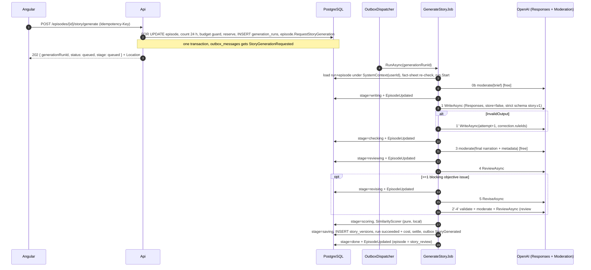

# 02.2.2 — Generate story job, safety and the daily limit (feature plan)

> Refines: `../../../02-story-writing.md` stories **02.2.2** (Epic 02.2), **02.4.1** and **02.4.2** (Epic 02.4), §3 (FR-02-2, FR-02-5, FR-02-6, FR-02-7, NFR-02-1), §5.1 (`Features/Stories/`), §5.3, §5.5, §5.7, §6 (replaces tasks 02.2.2-T1, 02.4.1-T1, 02.4.2-T1). Contract: `../README.md` — facts §1, findings F04/F05/F06/F16/F20/F23/F24/F29/F34/F38, decisions **D1/D2/D3/D4/D5/D6/D7/D8/D9/D12/D13/D14/D19/D20/D21/D22**, task template §6, gates §7, index §8, re-estimate §9. Layout and templates: `../../../00-overview.md` §5.2, §6, §7, §8, §10.1. Errors: `../../../09-backend-api.md` §5.3–5.4. Money: `../../../12-billing-credits.md` §5.7, 12.8.3. UI: `../../../10-web-ui.md` 10.5.2, 10.5.3, 10.5.10, 10.8.4.
> Legend: ✅ verified (source) · ⚠️ unverified · [DECISION] · [OPEN] · [INFERENCE].
> Status: detailed plan, 2026-09-23. Nothing implemented yet.

## 1. Scope

| | |
|---|---|
| Stories | **02.2.2 Generate story job** — *As a creator I want to click "Generate" and see progress so that I know it is working.* Must · **02.4.1 Moderation handling** — *As the operator I want refusals recorded so that abuse and prompt problems are visible.* Must · **02.4.2 Regeneration limit** — Must |
| Tasks | 02.2.2-T1 entities + `Episode` methods + migration (M 1.0) · 02.2.2-T2 command + endpoint + idempotency + budget (S 0.5) · 02.2.2-T3 `GenerateStoryJob` + stages + sweeper (M 1.0) · 02.4.1-T1 moderation / refusal handling (S 0.5) · 02.4.2-T1 daily limit (XS 0.25) = **3.25 d** |
| In scope | `generation_runs` (D2) + the CR-4 `story_versions` columns and their migration; the `Episode` story state machine + the four domain events; `GenerateStoryCommand` + `POST /api/v1/episodes/{id}/story/generate` + `Idempotency-Key`; the P implementations of `ICreditLedger` (`MeteringOnlyCreditLedger`) and `IBudgetGuard` (`UsageBudgetGuard`) with `Budget:*`; the `GenerateStoryJob` pipeline in the exact D21 order, its stage progress (CR-7), the invalid-output retry, the settle/refund path, the per-run timeout and the `StaleGenerationSweeperJob`; `IContentModerator` + `OpenAiContentModerator` (D12) and the refusal / `content_filter` mapping; the rolling-24 h generation limit |
| Out of scope | Writer internals, prompts, prompts catalog, the `story.v1` schema and the validator (**02.2**, D3/D5/D6 — consumed here through fixed D21 signatures only); self-review prompts and the revision rules beyond the toggle + one-revision gate (**02.6.1/02.6.2**); `StoryQualityChecker` rules (**02.3.4**); approve/reopen/edit and the true-crime attestation (**02.3.1–02.3.3**); `SimilarityScorer` internals and thresholds (**02.5.6**); fact-sheet contents (**02.5.3–02.5.5**; this plan calls the approved-sheet guard hook only); autopilot cadence, pause and slots (**02.8.3**; this plan provides the `trigger = autopilot` path and the events it reacts to); credits/prices/ledger tables (**12**, S) |
| Acceptance (restated from the stories) | Given an episode in `draft` or `story_review`, When `POST /episodes/{id}/story/generate` is called with an `Idempotency-Key`, Then the episode becomes `story_generating`, a metered reservation exists and an `outbox_messages` row for `StoryGenerationRequested` is committed in the same transaction (202 + Location). Given the job succeeds, Then one `story_versions` row (`source = generated`, or `revised` with a `parent_version_id` when the single revision ran) is saved, the episode becomes `story_review`, `EpisodeUpdated` fires. Given the same `Idempotency-Key` is reused, Then no second run is created and the original response is returned. Given a refusal or `content_filter`, Then a `moderation_events` row is saved, the reservation is refunded, and the message says what to change. Given 5 counted generations in the last 24 h for the episode, Then 429 `story_generation_limit` with `Retry-After`. |

Two rule changes from the high-level plan are load-bearing here and are taken from the TL review, not from §3: a failed generation returns the episode to its **previous** status, never to `story_review` (F04/P3), and there are **no credits** in the personal phase — `ICreditLedger` is metering-only and `IBudgetGuard` is the real spend backstop (F03/D1). `story_versions` is written here but **never updated** (FR-02-3).

## 2. Confirmed facts

| # | Fact used here | Status / source |
|---|---|---|
| D2 | `generation_runs` column list, the two partial unique indexes, the counting rule, the "sweeper covers every kind" rule | ✅ `../README.md` D2 (already updated by TL rulings #2/#3) |
| D7 | Outcome mapping of an OpenAI response to `Ok`/`InvalidOutput`/`Moderated`/`ProviderFundsExhausted`/`ProviderError`/`ProviderUnavailable`; per-call timeouts (writer 90 s, review 45 s, facts 60 s, others 30 s — **moderation 15 s per TL T21**) ⚠️ those are D7's numbers; SDK retries off, one resilience layer | ✅ README D7; ⚠️ the exact `ClientRetryPolicy` option name in `OpenAI` 2.14.0 (D7 marks it ⚠️) |
| O4 | `max_output_tokens` covers visible **and** reasoning tokens; a capped call has `incomplete_details.reason = max_output_tokens` | ✅ README O4 (Responses create reference) |
| O6 | Refusal = a content part `type: "refusal"`; content filtering = `incomplete_details.reason = "content_filter"`. **No documented error code for blocked input** | ✅ README O6 — the ⚠️ is why `story_moderated` is driven by the outcome mapping, not by an error code |
| O7 | `omni-moderation-latest` is free; 13 categories; no text-length limit found ⚠️ | ✅/⚠️ README O7 (moderation guide) |
| P1 | `09.5.2-T1` plans `ICreditLedger` with a metering-only P implementation; `09 §5.1` and `12.2.1` call the same port `ICreditService` → CR-2 renames it | ✅ README P1; `../../../09-backend-api.md` §5.1 L309 still says `ICreditService` — follow D1, CR-2 fixes the plan text |
| P3 | `00 §7` returns a failed generation to the previous state; the true-crime guard sits on `draft → story_generating` | ✅ README P3; `../../../00-overview.md` L313–318 |
| P6 | Reserve upper bound: input ≤ UTF-8 bytes of the prompt, output ≤ `max_output_tokens`; tiers Short/Standard/Long | ✅ README P6; `02.2.4-T1` (`price_versions` P subset, metering only — plan 12, the former price/cost authority, is deleted by DEC 10.14) |
| F04 | The high-level "second invalid output → `story_review` with `story_invalid_output`" breaks `00 §7` from `draft` | ✅ README F04 → the error lives on the run; the episode returns to `previous_episode_status` |
| F06 | The limit needs a definition of "day" and of what counts, plus a per-attempt record to show errors | ✅ README F06 → D2 `generation_runs` + the rolling 24 h rule |
| F16 | The worst case is 4 calls (writer + review + revision + review #2); a 120 s p95 is unrealistic for Long | ✅ README F16/CR-6 → §7.4 latency budget; Long is measured, not gated |
| F20 | Moderation only exists for autopilot in the high-level plan; refusals and `content_filter` stops are not separated | ✅ README F20 → D12 stages + §4 U5 |
| F23 | Retries multiply (SDK × Polly × Hangfire × invalid-output) | ✅ README F23 → 02.2.1-T2 owns the SDK/Polly halves; this plan owns "one invalid-output retry" and "Hangfire retry 0" |
| F24 | Progress has no contract beyond `EpisodeUpdated` | ✅ README F24 → CR-7 `generation { kind, status, stage, errorCode, startedAt }` |
| F29 | `story_not_in_review` duplicates 09 `episode_invalid_state`; codes are missing | ✅ README F29/D8 |
| Repo | `09 §5.3` (L341) listed `GenerateStoryJob | outbox StoryGenerationRequested | 2× transient only | episode id + generation counter` | ✅ read 2026-09-24 — **resolved by CR-16** (TL T22): 09 §5.3 is fixed to Hangfire retry **0** and `generationRunId` as the only argument (F23, D21) |
| Repo | `09 §5.1` (L305) showed `GenerateStoryCommand(Guid EpisodeId, string? ETag)` + an `If-Match` pass-through | ✅ read 2026-09-24 — **resolved by CR-16** (TL T22): 09 §5.1 is refreshed to the D9 route (no `If-Match` on generate) |
| Repo | `09 §5.4` had `idempotency_key_reused` 422 but no code for a missing key | ✅ read 2026-09-24 — **accepted** (TL T18): `idempotency_key_required` 400 is the code, added to D8 / 09 §5.4 |
| Repo | `00 §6` `episodes` has no column to hold the active run; D2 had no `pause_reason` column | ✅ read 2026-09-24 — the run column is still **not** needed (Design §3.3); `pause_reason` **was added** by TL T19 |

Open questions closed here: "which day does FR-02-7 mean" → a rolling 24 h window over counted runs (D2, §3.6). "What counts" → D2's rule, implemented in §3.6. "Does a failed run show up anywhere" → `generation_runs.error_code` + `EpisodeUpdated` (CR-7). Also closed: the run-timeout arithmetic (TL T21 → `Story:Job:TimeoutSeconds = 360`, `TimeoutSecondsLong = 480`, moderation 15 s, §7.3/§7.4). Still open: whether P gets a user-facing cancel route (§10 item 7).

## 3. Domain and data

### 3.1 Table `generation_runs` (new; D2, CR-4)

One row per paid generation of **any** kind. `02.2.2-T1` owns the table and its migration; the other kinds only insert rows.

| Column | Type | Notes |
|---|---|---|
| `id` | `uuid` | PK, UUIDv7 |
| `user_id` | `uuid` NOT NULL | FK `users(id)`; `IUserOwned`; set from the episode/series, never from the request body (09.2.3) |
| `series_id` | `uuid` NOT NULL | FK `series(id)`; **NOT NULL on every row** (TL ruling #2) |
| `episode_id` | `uuid` NULL | FK `episodes(id)` **ON DELETE CASCADE** (D19); NULL **only** for `ideas`/`bible_proposal` — NOT NULL for `story`, `fact_sheet`, `find_sources` (TL T17) |
| `kind` | `text` NOT NULL | `story`/`fact_sheet`/`bible_proposal`/`ideas`/`find_sources` |
| `trigger` | `text` NOT NULL | `user`/`autopilot`/`system` |
| `idempotency_key` | `text` NULL | the key that created the run; `idempotency_keys` stays the dedupe authority (09.1.3) |
| `status` | `text` NOT NULL | `queued`/`running`/`succeeded`/`failed`/`cancelled` |
| `stage` | `text` NOT NULL | `queued`/`writing`/`checking`/`reviewing`/`revising`/`scoring`/`saving`/`done` |
| `previous_episode_status` | `text` NULL | `draft`/`story_review`; the F04 return target. Null for kinds that do not move the episode |
| `input_fact_sheet_id` | `uuid` NULL | FK `fact_sheets(id)` **ON DELETE SET NULL**; the sheet the handler saw (§4 U1 step 5); compared again at job start (§4 U4 step 0) |
| `reservation_id` | `uuid` NULL | `ReservationId` from `ICreditLedger.ReserveAsync` (D1) |
| `counts_toward_limit` | `bool` NOT NULL DEFAULT true | §3.6 |
| `worst_case_usd` | `numeric(12,6)` NOT NULL | `IStoryCostEstimator.WorstCaseAsync(...).Cost.Usd` (D1); the guard's open bound |
| `cost_usd` | `numeric(12,6)` NULL | Σ `usage_records.cost_usd` for the reservation, written at settle |
| `error_code` | `text` NULL | D8 job-outcome codes; never an HTTP code |
| `error_detail` | `text` NULL | safe text, never content (`fact_sheet_outdated`, `stale_run_sweep`, …) |
| `pause_reason` | `text` NULL | TL T19; `spend_cap_reached` / `provider_funds_exhausted`; non-null only while `status = queued` (§3.6) |
| `result_story_version_id` | `uuid` NULL | FK `story_versions(id)` ON DELETE SET NULL |
| `result_fact_sheet_id` | `uuid` NULL | FK `fact_sheets(id)` ON DELETE SET NULL |
| `prompt_version` | `text` NULL | D5 composite, written after the first successful assembly |
| `models` | `jsonb` NULL | per step: `{ "writer": {...}, "review": {...}, "revision": {...}, "moderation": "omni-moderation-latest" }` (model id, `reasoning.effort`, `max_output_tokens` actually sent) |
| `attempt` | `int` NOT NULL DEFAULT 0 | writer invalid-output retry counter (0 = first attempt) |
| `queued_at` / `started_at` / `finished_at` | `timestamptz` NOT NULL / NULL / NULL | `queued_at` == `created_at` by construction |
| `created_at` / `updated_at` | `timestamptz` NOT NULL / NULL | house rule (00 §6) |

Constraints:

```sql
ALTER TABLE generation_runs
  ADD CONSTRAINT ck_generation_runs_kind    CHECK (kind IN ('story','fact_sheet','bible_proposal','ideas','find_sources')),
  ADD CONSTRAINT ck_generation_runs_trigger CHECK (trigger IN ('user','autopilot','system')),
  ADD CONSTRAINT ck_generation_runs_status  CHECK (status IN ('queued','running','succeeded','failed','cancelled')),
  ADD CONSTRAINT ck_generation_runs_stage   CHECK (stage IN ('queued','writing','checking','reviewing','revising','scoring','saving','done')),
  ADD CONSTRAINT ck_generation_runs_prev    CHECK (previous_episode_status IS NULL
                                                  OR previous_episode_status IN ('draft','story_review')),
  -- scope (T17): series-level kinds are ideas/bible_proposal; story/fact_sheet/find_sources are episode-scoped
  ADD CONSTRAINT ck_generation_runs_scope   CHECK ((episode_id IS NULL) = (kind IN ('ideas','bible_proposal'))),
  -- pause (T19): the pause reason is its own column, never overloaded into error_detail
  ADD CONSTRAINT ck_generation_runs_pause   CHECK (pause_reason IS NULL
                                                  OR pause_reason IN ('spend_cap_reached','provider_funds_exhausted')),
  ADD CONSTRAINT ck_generation_runs_money   CHECK (worst_case_usd >= 0 AND (cost_usd IS NULL OR cost_usd >= 0)),
  ADD CONSTRAINT ck_generation_runs_times   CHECK (finished_at IS NULL OR started_at IS NULL OR finished_at >= started_at),
  ADD CONSTRAINT ck_generation_runs_failed  CHECK (status <> 'failed' OR error_code IS NOT NULL);

-- at most one active run per episode and kind (409 story_generation_in_progress / fact_sheet_generation_in_progress)
CREATE UNIQUE INDEX ux_generation_runs_active_episode
  ON generation_runs (episode_id, kind) WHERE episode_id IS NOT NULL AND status IN ('queued','running');

-- at most one active series-level run per series and kind
CREATE UNIQUE INDEX ux_generation_runs_active_series
  ON generation_runs (series_id, kind) WHERE episode_id IS NULL AND status IN ('queued','running');

CREATE INDEX ix_generation_runs_episode_kind_queued ON generation_runs (episode_id, kind, queued_at DESC); -- D2 + the limit query
CREATE INDEX ix_generation_runs_open ON generation_runs (status) INCLUDE (worst_case_usd)
  WHERE status IN ('queued','running');                                     -- IBudgetGuard open bounds (§4 U2)
CREATE INDEX ix_generation_runs_sweep ON generation_runs (status, COALESCE(started_at, queued_at)); -- sweeper (§7.3)
CREATE INDEX ix_generation_runs_user_id ON generation_runs (user_id);
```

`find_sources` is **episode-scoped** (TL T17): `episode_id` is NOT NULL for `story`, `fact_sheet` and `find_sources`, and NULL only for `ideas`/`bible_proposal`; `ck_generation_runs_scope` encodes exactly that. (`fetch_tasks.episode_id` still carries the episode for the fetcher, D10.)

### 3.2 Table `story_versions` — the CR-4 columns and immutability

`09.2.2` creates `story_versions` from 00 §6 (L268). This plan adds the CR-4 columns and the uniqueness the version counter needs:

```sql
ALTER TABLE story_versions
  ADD COLUMN parent_version_id  uuid NULL REFERENCES story_versions(id) ON DELETE SET NULL,
  ADD COLUMN generation_run_id  uuid NULL REFERENCES generation_runs(id) ON DELETE SET NULL,
  ADD COLUMN fact_sheet_id      uuid NULL REFERENCES fact_sheets(id)     ON DELETE SET NULL,
  ADD COLUMN schema_version     text NOT NULL DEFAULT 'story.v1';

CREATE UNIQUE INDEX ux_story_versions_episode_version ON story_versions (episode_id, version);
CREATE INDEX ix_story_versions_generation_run_id ON story_versions (generation_run_id);
```

- `version` is `max(version) + 1` per episode, computed inside the insert transaction under the episode row lock taken by `GenerateStoryCommand` / `EditStoryCommand` (§4 U6). The unique index is the backstop that turns a lost race into 500/409 instead of a silent duplicate.
- `parent_version_id` is set only when `source = revised`, to the `generated` version the revision replaced; `generation_run_id` is set for `generated` and `revised`, NULL for `edited` (02.3.1).
- Immutable: no update path. EF maps every property with `ValueGeneratedNever()` and `AfterSaveBehavior = Throw` so `SaveChanges` on a modified tracked `StoryVersion` throws; `IAppDbContext` exposes no `Update`/`Remove` for it; an architecture test asserts no handler outside `Features/Admin` (09.9.1) touches `db.StoryVersions.Entry(...).State` other than `Added`.
- Derived fields (D3) are computed **on save**, never stored stale: `body`, `keywords`, `word_count` come from `StoryVersion.Derive(StoryContentV1)`. `content jsonb` holds the `story.v1` object plus the backend-added `schema_version` and `fact_sources[]` (02.5.5 builds `fact_sources`; this plan stores what it is given).
- `audit_report jsonb` (`audit.v1`, D22) and `similarity_score numeric(5,4)` are written by the job in the same insert.

### 3.3 `Episode` aggregate: the story state machine

The episode's own transitions stay exactly 00 §7 L313–318. The generation run's `status`/`stage` live on the other aggregate; the episode only needs to know *that* it is generating. **No new `episodes` column is needed** — `episode.status` plus `generation_runs.previous_episode_status` is the whole state, so CR-4 is not extended here.

`src/NightTales.Domain/Episodes/Episode.Story.cs` (partial of the aggregate owned by 09.5.1):

```csharp
public ErrorOr<Success> RequestStoryGeneration(Guid generationRunId, GenerationTrigger trigger, DateTimeOffset now);
public ErrorOr<Success> MarkGenerationStage(Guid generationRunId, GenerationStage stage, DateTimeOffset now);
public ErrorOr<Success> CompleteStoryGeneration(IReadOnlyList<Guid> versionIds, Guid currentStoryVersionId, DateTimeOffset now);
public ErrorOr<Success> FailStoryGeneration(Guid generationRunId, EpisodeStatus previousStatus, GenerationErrorCode code,
                                           bool countsTowardLimit, DateTimeOffset now);
public ErrorOr<Success> CancelStoryGeneration(Guid generationRunId, EpisodeStatus previousStatus, DateTimeOffset now);
```

Transition table (this is the authority for the unit tests in `02.2.2-T1`):

| # | From `Episode.Status` | Method | Next | Guard | Raises |
|---|---|---|---|---|---|
| T1 | `draft` | `RequestStoryGeneration` | `story_generating` | an approved fact sheet exists when `topic = true_crime` (checked by the **handler** through `IFactSheetGuard`, §4 U1 step 5) | `StoryGenerationRequested` |
| T2 | `story_review` | `RequestStoryGeneration` | `story_generating` | same; the previous version stays current until the new one is saved | `StoryGenerationRequested` |
| T3 | `story_generating` | `RequestStoryGeneration` | — | 409 `story_generation_in_progress` (02 CR-30: the handler reports an episode that is already generating with its own code; the run index gives the same 409 for a *new* request racing an active run) | — |
| T4 | any other (`story_approved`, `rendering`, `video_review`, `ready`, `scheduled`, `published`, `failed`, `cancelled`) | `RequestStoryGeneration` | — | 409 `episode_invalid_state` | — |
| T5 | `story_generating` | `MarkGenerationStage` | `story_generating` (no status change) | the episode is generating; the stage order is enforced by `GenerationRun.AdvanceStage` (forward-only, §3.4) | `StoryGenerationStageChanged` |
| T6 | `story_generating` | `CompleteStoryGeneration` | `story_review` | `versionIds` non-empty and contains `currentStoryVersionId`; the run is in stage `saving` | `StoryGenerated` (Carries `StoryVersionId = currentStoryVersionId`, `Revised = versionIds.Count > 1`) |
| T7 | `story_generating` | `FailStoryGeneration` | `previousStatus` ∈ {`draft`,`story_review`} | `previousStatus` must be the one the run stored | `StoryGenerationFailed` (+ `error_code`, `counts_toward_limit` are written to the run by the caller) |
| T8 | `story_generating` | `CancelStoryGeneration` | `previousStatus` ∈ {`draft`,`story_review`} | as T7 | `StoryGenerationFailed` with `ErrorCode = story_generation_cancelled` (D8) |
| T9 | not `story_generating` | `MarkGenerationStage` / `CompleteStoryGeneration` / `FailStoryGeneration` / `CancelStoryGeneration` | — | `DomainError.Episode.NotGenerating` → the job logs and returns **without** touching the episode (a sweeper or an admin already moved it) | — |

Every method is idempotent for a repeated call with the same `generationRunId` **and** the same target status: the second call returns `Success` without raising a second event. This is what makes the outbox's at-least-once delivery (09.2.4) safe.

`EpisodeStatus` uses the 00 §7 names; `previousStatus` is a value of that enum, persisted as text with the check constraint above.

### 3.4 `GenerationRun` aggregate (state only, no events)

`src/NightTales.Domain/Stories/Generation/GenerationRun.cs` owns the run row's own lifecycle so that all five kinds share it (D2). It raises **no** domain events — the episode is the observable state machine (§3.3) and `EpisodeUpdated` is raised from there (CR-7). To make it impossible to update one without the other, both are called through one Application service:

```csharp
// src/NightTales.Application/Features/Stories/Generation/StoryGenerationProgress.cs
public sealed class StoryGenerationProgress(IAppDbContext db, IClock clock)
{
    public ValueTask<ErrorOr<Success>> StartAsync(Guid runId, CancellationToken ct);                       // queued -> running, started_at = now
    public ValueTask<ErrorOr<Success>> RecordStageAsync(Guid runId, GenerationStage stage, CancellationToken ct); // run.stage + episode.MarkGenerationStage
    public ValueTask<ErrorOr<Success>> PauseAsync(Guid runId, GenerationPauseReason reason, CancellationToken ct); // stays queued, counts_toward_limit = false, pause_reason = reason
    public ValueTask<ErrorOr<Success>> CompleteAsync(CompletionInput input, CancellationToken ct);          // run succeeded + cost + episode.CompleteStoryGeneration
    public ValueTask<ErrorOr<Success>> FailAsync(FailureInput input, CancellationToken ct);                // run failed + episode.FailStoryGeneration (story only)
    public ValueTask<ErrorOr<Success>> CancelAsync(Guid runId, string reason, CancellationToken ct);
}
```

`GenerationRun` methods: `Start(now)`, `AdvanceStage(GenerationStage, now)` (forward-only along `queued → writing → checking → reviewing → revising → scoring → saving → done`, allowing the D21 re-entry `checking` → `reviewing` after a revision), `MarkPaused(GenerationPauseReason, now)`, `Succeed(decimal costUsd, now)`, `Fail(string errorCode, string? detail, bool countsTowardLimit, now)`, `Cancel(now)`.

### 3.5 Domain events (payloads are the contract)

`src/NightTales.Domain/Stories/Generation/Events/`:

| Event | Payload | Consumers |
|---|---|---|
| `StoryGenerationRequested` | `EpisodeId, SeriesId, UserId, GenerationRunId, Trigger` | outbox → `GenerateStoryJob` (09.2.4) |
| `StoryGenerationStageChanged` | `EpisodeId, SeriesId, UserId, GenerationRunId, Stage, Trigger` | outbox → `EpisodeUpdated` (CR-7) |
| `StoryGenerated` | `EpisodeId, SeriesId, UserId, GenerationRunId, StoryVersionId, Revised, Trigger` | 02.6.1 bible proposal, 02.8.2 gates, 02.8.3 orchestration (D21) |
| `StoryGenerationFailed` | `EpisodeId, UserId, GenerationRunId, ErrorCode, Trigger` | 02.8.3 pause triggers (autopilot), UI error state |

`StoryGenerationFailed.ErrorCode` is a `GenerationErrorCode` value object over the D8 job codes plus the platform pause reasons (§3.6). `StoryGenerated` is **not** raised on a partial save: the outbox row and the `story_versions` insert commit in the same transaction (09.2.4).

### 3.6 Counting, pausing and the sweeper's vocabulary

`counts_toward_limit` for `kind = story`, `trigger = user` (D2 L139–142, the rule owned by 02.4.2-T1):

| Outcome | `status` | `error_code` | `counts_toward_limit` |
|---|---|---|---|
| saved a version | `succeeded` | — | **true** |
| refusal / `content_filter` / brief flagged | `failed` | `story_moderated` | **true** (the user's content caused it) |
| invalid output twice | `failed` | `story_invalid_output` | false (platform) |
| 5xx / timeout / other 4xx after the retry budget | `failed` | `story_generation_failed` | false (platform) |
| `429 *_spend_limit_exceeded` / `credit_balance_exhausted` | `queued` → later `cancelled` | `provider_funds_exhausted` in `pause_reason` | false |
| over a spend cap at dispatch | `queued` → later `cancelled` | `spend_cap_reached` in `pause_reason` | false |
| sweeper timed out (`running` > timeout + 60 s) or stuck `queued` > 12 h | `failed` / `cancelled` | kind's `*_generation_failed` | false |
| cancelled (admin / account deletion) | `cancelled` | — | **true** (D2) |

Two platform pause reasons, exactly as D1/12.8.3 name them: `spend_cap_reached` (our own daily/monthly USD cap, `IBudgetGuard`) and `provider_funds_exhausted` (OpenAI cannot be paid, 12.8.3 flag). While a run is paused it stays `queued` with `pause_reason` = the pause reason (TL T19); 12.8.3's resume dispatches it, and 12.8.3's 12 h rule cancels it (refund + e-mail). `GET /episodes/{id}` and `EpisodeUpdated` carry `processingPaused = <reason>` for an episode with such a run (10.8.4 L217) — the DTO field is part of CR-7; this plan supplies the value.

**Distinct from `spend_cap_reached` at command time:** the *command* does check `IBudgetGuard` and returns 429 `spend_cap_reached` (D1); the *job* re-checks it before every paid dispatch (§7.2). The *`provider_funds_exhausted` flag is not checked at command time* — 12.8.3 requires 202 + a `queued` run, so the UI can say "reserved, not charged yet" (10.8.4).

### 3.7 Migration

One migration, owner `02.2.2-T1`, **expand only** (no column dropped, no data lost):

```
20260924xxxxxx_AddGenerationRunsAndStoryVersionProvenance
  Up:   CREATE TABLE generation_runs + indexes + check constraints
        ALTER TABLE story_versions ADD the four CR-4 columns
        CREATE UNIQUE INDEX ux_story_versions_episode_version
  Down: drop the four columns, drop the table
```

Order inside the migration: `generation_runs` **before** the `story_versions.generation_run_id` FK — hence the FK for that column is added only after the table exists (the `story_versions` table itself already exists from 09.2.2). Backfill: none. `story_versions.generation_run_id` is NULL for every pre-existing row; `schema_version` defaults to `story.v1`; `parent_version_id` NULL until 02.6.2 writes a revision. Because 09.2.2's CI check (09.2.2-T2) runs the migration against an empty DB **and** against the previous schema with seed data, this migration must be idempotent-safe in that harness; no `DROP`, no type narrowing.

## 4. Use cases

### U1 `GenerateStoryCommand` — `POST /api/v1/episodes/{id}/story/generate`

```csharp
// src/NightTales.Application/Features/Stories/Commands/GenerateStory/GenerateStoryCommand.cs
public sealed record GenerateStoryCommand(
        Guid EpisodeId,
        GenerationTrigger Trigger = GenerationTrigger.User,
        string? IdempotencyKey = null)          // non-HTTP callers pass it; the endpoint passes the header
    : ICommand<ErrorOr<GenerateStoryAccepted>>, IIdempotentCommand, IIdempotencyKeySource;

public sealed record GenerateStoryAccepted(Guid GenerationRunId, string Status, string Stage);
```

No request body. `lengthTier` and `brief` are episode columns set at creation (09.5.1) and there is no `PATCH /episodes/{id}` in 00 §8, so the tier is fixed for the episode's life; `If-Match` is **not** required (D9 does not list this route) and the 09 §5.1 example's `string? ETag` parameter is dropped (§10 item 2). Handler order, inside the pipeline `Logging → Authorization → Validation → UnitOfWork → Idempotency → Audit` (09.1.3, 09 README D5/D6; (09 CR-12)). The idempotency record is written inside the command transaction:

| Step | Action | Failure |
|---|---|---|
| 1 | `db.Episodes` load by id; missing or not the caller's → 404 (09.2.3 L91, never 403) | `episode_not_found` 404 |
| 2 | `Trigger != User` requires a system context (D1 `SystemContext`); a user setting `autopilot` is rejected | `forbidden` 403 |
| 3 | state check — `episode.Status ∈ {draft, story_review}`; `story_generating` → 409 `story_generation_in_progress` (02 CR-30) | 409 `episode_invalid_state` for every other status |
| 4 | **true-crime guard hook** — `IFactSheetGuard.EnsureApprovedAsync(episode.Id, series.Topic, ct)` (owner 02.5.3; TL ruling). The handler needs only the verdict; it stores `ApprovedFactSheet.FactSheetId` as `input_fact_sheet_id` (null for a non-true-crime episode with no sheet) | 409 `fact_sheet_required` |
| 5 | **daily limit** (02.4.2-T1, §4 U6) | 429 `story_generation_limit` + `Retry-After` |
| 6 | active-run check — explicit query for the fastest error, the partial unique index is the guarantee | 409 `story_generation_in_progress` |
| 7 | `usageBound = await storyCostEstimator.WorstCaseAsync(episode.LengthTier, series.Language, ct)` | — |
| 8 | `IBudgetGuard.CheckAsync(usageBound.Cost, ct)` (§4 U2) | 429 `spend_cap_reached` |
| 9 | `reservationId = await creditLedger.ReserveAsync(userId, CreditOperation.StoryGenerate, episode.Id, usageBound, ct)` (§4 U3) | the P implementation never fails; a future ledger's `insufficient_credits` is its own error |
| 10 | insert the `generation_runs` row: `kind = story`, `status = queued`, `stage = queued`, `previous_episode_status = episode.Status`, `counts_toward_limit = true`, `worst_case_usd = usageBound.Cost.Usd`, `input_fact_sheet_id`, `idempotency_key`, `queued_at = clock.UtcNow` | — |
| 11 | `episode.RequestStoryGeneration(run.Id, Trigger, now)` (T1/T2) → the domain event lands in `outbox_messages` in the same transaction (09.2.4) | — |
| 12 | return `GenerateStoryAccepted(run.Id, "queued", "queued")`; the endpoint maps it to 202 + `Location: /api/v1/episodes/{id}` | — |

Steps 5–10 run under **one transaction** on the episode row lock (§4 U6) so the count, the limit check and the run insert cannot interleave. `[Audited("episode.story_generation_requested", Category.Episodes, Visibility.User)]` (D13) with `data = { episodeId, generationRunId, trigger, tier, worstCaseUsd }` — ids and numbers only, never the brief (D13 L336, D19).

Idempotency: the `Idempotency-Key` header is **required** on this route; the endpoint reads it into the command. Reuse with the same key and the same `EpisodeId` returns the stored `202` body (same `generationRunId`), no new run, no second reservation. Reuse with a different `EpisodeId` — i.e. a different effective request — is 422 `idempotency_key_reused` (09 §5.4). A missing header on this route is 400 `idempotency_key_required` (TL T18).

Autopilot path: `AutopilotPlanJob` (02.8.3-T1) sends the same command with `Trigger = GenerationTrigger.Autopilot` and `IdempotencyKey = $"autopilot:{seriesId}:{slotAt:O}:story"` (D17), under `SystemContext(ownerId)`. No `FR-02-7` counting (D2 L143 — the autopilot rules cap it instead) and no `If-Match`.

### U2 `IBudgetGuard` (D1) and its P implementation

```csharp
// src/NightTales.Application/Abstractions/Pricing/IBudgetGuard.cs
public interface IBudgetGuard { ValueTask<ErrorOr<Success>> CheckAsync(CostBound worstCaseUsd, CancellationToken ct); }

// src/NightTales.Infrastructure/Pricing/UsageBudgetGuard.cs
internal sealed class UsageBudgetGuard(IReadDb readDb, IOpenBoundsReader openBounds, BudgetOptions options, IClock clock) : IBudgetGuard;
```

`spent(day) + openBounds + worstCaseUsd > Budget:MaxPlatformCostUsdPerDay` → 429 `spend_cap_reached`; the same rule per calendar month against `Budget:MaxPlatformCostUsdPerMonth`. Both in **UTC** ("spent today (UTC)", D1 L120).

```sql
-- IOiapenBoundsReader implementation: GenerationRunOpenBoundsReader
SELECT COALESCE(SUM(worst_case_usd), 0) FROM generation_runs WHERE status IN ('queued','running');
```

`spent` comes from `usage_records` in its own transaction (D14), so it must be read through `IReadDb`:

```sql
SELECT COALESCE(SUM(cost_usd), 0) FROM usage_records WHERE created_at >= @dayStartUtc;   -- day
SELECT COALESCE(SUM(cost_usd), 0) FROM usage_records WHERE created_at >= @monthStartUtc; -- month
```

`IOpenBoundsReader` is the single extension point so that 05/12 can add render reservations later without touching the guard (§10 item 9).

| Config key | Default | Meaning |
|---|---|---|
| `Budget:Enabled` | `true` | `false` only in tests/dev; production never disables it |
| `Budget:MaxPlatformCostUsdPerDay` | `3` | owner proposal (D1 L120) |
| `Budget:MaxPlatformCostUsdPerMonth` | `40` | D1 L121 |

### U3 `ICreditLedger` (D1) and `MeteringOnlyCreditLedger`

```csharp
// src/NightTales.Application/Abstractions/Money/ICreditLedger.cs
public interface ICreditLedger
{
    ValueTask<ErrorOr<ReservationId>> ReserveAsync(Guid userId, CreditOperation op, Guid referenceId, UsageBound bound, CancellationToken ct);
    ValueTask<ErrorOr<Success>> SettleAsync(ReservationId reservationId, CancellationToken ct);          // actual cost read from usage_records by reservation
    ValueTask<ErrorOr<Success>> RefundAsync(ReservationId reservationId, string reason, CancellationToken ct);
}

// src/NightTales.Infrastructure/Money/MeteringOnlyCreditLedger.cs  (P)
public sealed class MeteringOnlyCreditLedger : ICreditLedger
{
    public ValueTask<ErrorOr<ReservationId>> ReserveAsync(...) => ValueTask.FromResult(ErrorOr<ReservationId>.From(ReservationId.New()));
    public ValueTask<ErrorOr<Success>>      SettleAsync(...)   => ValueTask.FromResult(Result.Success);   // no ledger rows
    public ValueTask<ErrorOr<Success>>      RefundAsync(...)   => ValueTask.FromResult(Result.Success);   // idempotent no-op
}
```

`CreditOperation` values (D1 L123): `story_generate`, `fact_sheet`, `bible_proposal`, `idea`, `source_find`. The P implementation **never** rejects, writes no rows to `credit_ledger`/`credit_lots`, and returns a fresh `ReservationId` (UUIDv7). `SettleAsync` is where 12 will read the actual cost: `SELECT COALESCE(SUM(cost_usd),0) FROM usage_records WHERE reservation_id = @id` plus the settle/release diff — in P it only needs `generation_runs.cost_usd` to be written by the job (§7.2 step 8). `RefundAsync(reservationId, reason)` is idempotent by `reservationId` so a retried `RefundAsync` after a crash is harmless. `12.1.2` replaces the registration at M2 (CR-2).

### U4 The `GenerateStoryJob` pipeline

`RunAsync(Guid generationRunId)` — D21's order, followed exactly:

| Step | `stage` | Call | On failure |
|---|---|---|---|
| 0 | (no stage yet) | load the run + episode under `SystemContext(run.UserId)`; **re-check `IFactSheetGuard.EnsureApprovedAsync`** and compare `FactSheetId` with `run.input_fact_sheet_id` | `fact_sheet_outdated` → `FailAsync` (`story_generation_failed`, not counted) per the TL ruling; a *missing* sheet is also `fact_sheet_outdated`, never `fact_sheet_required` (the request already passed) |
| 0b | — | `IContentModerator.CheckAsync([episode.Brief, episode.Title], ModerationStage.Brief, ct)` (D12) | flagged → `FailAsync` (`story_moderated`, **counted**) before any paid call; the message carries the categories only |
| 1 | `writing` | `progress.StartAsync`; `IStoryWriter.WriteAsync(req, ct)` with `req = StoryWriteRequestFactory.Build(run, episode, series, length, bible, facts, avoidPlots)` | see §7.2's outcome table (retry once on `InvalidOutput`, then fail) |
| 2 | `checking` | `StoryDraftValidator.Validate(content, rules)` then `StoryQualityChecker.Check(content, ctx)` — pure, no retry, no writer call | validator `Reject` cannot happen here (step 1 already rejected those); `Blocking`/`Advisory` go into `audit.v1.local.issues` (D22) |
| 3 | `checking` | `IContentModerator.CheckAsync([title, body, description, tags…], ModerationStage.Draft, ct)` (§4 U5) | blocking category → recorded + approval blocked downstream; non-blocking → advisory hint. **Not** a run failure (D12 L328) |
| 4 | `reviewing` | `IStoryWriter.ReviewAsync(reviewReq, ct)` — only when `Story:Review:Enabled` (default **true**; 02 §10 T113) | `InvalidOutput`/`Moderated`/provider errors map as in §7.2 |
| 5 | `revising` | `IStoryWriter.ReviseAsync(revReq, ct)` — **only when ≥ 1** review issue is `blocking` **and** `objective`; then steps 2–4 run **once more** on the revision (review #2, no further revision) | review #2's issues are recorded in `audit.v1.revision.review_after` |
| 6 | `scoring` | `SimilarityScorer.Score(storyText, corpus, options)` with the corpus from `ISimilarityCorpusProvider.LoadAsync(episodeId, lang, ct)` (D21/02.5.6) | advisory only; the score is stored, the block happens at approve |
| 7 | `saving` | build `StoryVersion` rows (`generated`, plus `revised` with `parent_version_id`), derive `body`/`keywords`/`word_count`, insert, write `audit_report` + `similarity_score`; `progress.CompleteAsync` → settle + outbox `StoryGenerated` | a DB failure → `FailAsync` (`story_generation_failed`) and the reservation is refunded |

The **one invalid-output retry** is step 1's own loop, and only there: a second `InvalidOutput` fails the run `story_invalid_output`. The retry sets `RunContext.Attempt + 1` and `StoryWriteRequest.Correction = new WriterCorrection(ruleIds)`; the assembler emits that as the data-object key `correction: { previous_attempt_failed_rules: [...] }` — **never** the invalid text (02.2.3/D6). No retry is taken from step 2 or from `ReviseAsync` (02.6.2 owns the "revision `Reject` → keep the pre-revision version" rule).

`Story:Review:Enabled` (default `true`; shipped by 02.6.1-T1, 02 §10 T113) exists so this plan can ship before 02.6.1: with the flag off, steps 4–5 are skipped and the run goes `writing → checking → scoring → saving`. The flag is read once per run; the value actually used is recorded in `generation_runs.models` so a later quality investigation can tell the two pipelines apart.

`StoryWriteRequestFactory` (Application `Features/Stories/Generation`) is the only place that calls `IBibleSnapshotProvider.GetForWriterAsync(seriesId, ct)` and `IStructurePlanProvider.GetForEpisodeAsync(episodeId, ct)` (peer contracts, §10). It also sets `RunContext.PriceVersion = priceCatalog.GetActive(run.QueuedAt).Version` (string, D21; 12 CR-17) so every step prices its own call consistently with the reserve.

### U5 Moderation (02.4.1-T1)

```csharp
// src/NightTales.Application/Abstractions/Moderation/IContentModerator.cs  (D12)
public interface IContentModerator
{
    ValueTask<ModerationResult> CheckAsync(IReadOnlyList<string> texts, ModerationStage stage, CancellationToken ct);
}
public sealed record ModerationResult(bool Flagged, IReadOnlyList<string> Categories, IReadOnlyDictionary<string, double> Scores);
```

`OpenAiContentModerator` (Infrastructure/OpenAI) posts to `POST /v1/moderations`, model `omni-moderation-latest` (O7, free), chunks each text to ≤ 8,000 chars ⚠️ (no documented limit), and records one `usage_records` row with `operation = moderation`, `cost_usd = 0`, `estimated = true` (12.8.3/moderator returns no usage). Stages: `brief`, `draft`, `autopilot_gate` (02.8.2) plus the TL ruling #3 additions `bible_proposal`, `ideas`, `find_sources` (kind-based). Mapping, exactly D12 + §7.2:

| Signal | `ModerationStage` | Result | Run | `moderation_events` |
|---|---|---|---|---|
| writer refusal / `incomplete_details.reason = content_filter` | `draft` | `Moderated(categories?)` | fails `story_moderated`, refund, **counted** | yes, `source = openai_text`, `excerpt` ≤ 300 chars of the flagged segment |
| moderation flag on the brief | `brief` | `Flagged` | fails `story_moderated` **before** any paid call, refund, counted | yes, excerpt from the brief |
| moderation flag on the draft, blocking category (`sexual/minors`, `self-harm/instructions`, `illicit/violent`, `hate/threatening`) | `draft` | `Flagged` | run **succeeds**; `audit.v1.moderation = { flagged: true, categories }` blocks **approve** (02.3.2/02.3.3 read it) | yes |
| moderation flag on the draft, any other category | `draft` | `Flagged` | run succeeds; advisory hint only | yes |

`moderation_events` columns used: `user_id, episode_id, source = 'openai_text'`, `stage`, `categories text[]`, `excerpt` (≤ 300 chars, from **our own** brief or draft, never source text — D19/D22), plus the house `id/created_at`. `operation = moderation` is a CR-4 value (F34).

### U6 Daily limit (02.4.2-T1)

Rolling 24 h window, `kind = story`, `trigger = user`, `counts_toward_limit = true`, per episode (D2 L139):

```sql
-- count + oldest (one round trip, two aggregates)
SELECT COUNT(*) AS counted,
       MIN(queued_at) AS oldest
FROM generation_runs
WHERE episode_id     = @episodeId
  AND kind            = 'story'
  AND trigger         = 'user'
  AND counts_toward_limit
  AND queued_at       > now() - make_interval(hours => @windowHours);   -- Story:LimitWindowHours, default 24
```

`counted >= Story:DailyGenerationLimit` (default 5, FR-02-7) → error `story_generation_limit` with `Retry-After = ceil(extract(epoch from oldest + interval '24 hours' - now()))` seconds, floor 1. The status is 429 and the body is ProblemDetails with `code = story_generation_limit` plus the same `Retry-After` (D8 L255).

Race safety: the count and the run insert happen in **one transaction**, and the transaction takes the episode row lock first:

```sql
SELECT id FROM episodes WHERE id = @episodeId FOR UPDATE;
```

Implement as `IAppDbContext.LockEpisodeForUpdateAsync(Guid episodeId, CancellationToken ct)` (Infrastructure, raw `FromSqlInterpolated`), called as step 1 of U1 — *before* the state check, so the status read and the count see one consistent snapshot. Two concurrent generate calls for one episode therefore serialise on the episode row (and the winner's insert then makes the loser's step 6 fail with `story_generation_in_progress`). The partial unique index is the second backstop. A serialisable isolation level is **not** required: the row lock + the unique index + the read-inside-the-transaction rule are sufficient and keep the command cheap.

## 5. API and events

### 5.1 Route

| Route | Verb | Auth | `Idempotency-Key` | `If-Match` | Success | Errors |
|---|---|---|---|---|---|---|
| `/api/v1/episodes/{id}/story/generate` | POST | user JWT (owner of the episode) | **required** | not required (D9) | `202` + body + `Location: /api/v1/episodes/{id}` | 400 `idempotency_key_required`; 401; 403 `forbidden` (non-user trigger); 404 `episode_not_found` (also covers another tenant, 09.2.3); 409 `episode_invalid_state`, `story_generation_in_progress`, `fact_sheet_required`; 412 — none; 422 `idempotency_key_reused`; 429 `story_generation_limit` + `Retry-After`, `spend_cap_reached`, `rate_limited`; 503 `provider_unavailable` is **not** possible here (nothing is dispatched in the request, T5) |

OpenAPI fragment (registered in the story endpoint group, `src/NightTales.Api/Endpoints/StoryEndpoints.cs`):

```yaml
post:
  summary: Start a story generation
  parameters:
    - in: path
      name: id
      required: true
      schema: { type: string, format: uuid }
    - in: header
      name: Idempotency-Key
      required: true
      schema: { type: string, maxLength: 128 }
  requestBody: { required: false }
  responses:
    "202":
      description: Queued
      headers:
        Location: { schema: { type: string }, example: /api/v1/episodes/0191f.../ }
      content:
        application/json:
          schema:
            type: object
            required: [generationRunId, status, stage]
            properties:
              generationRunId: { type: string, format: uuid }
              status: { type: string, enum: [queued] }
              stage:  { type: string, enum: [queued] }
    "409":
      description: episode_invalid_state | story_generation_in_progress | fact_sheet_required
      content: { application/problem+json: { schema: { $ref: "#/components/schemas/ProblemDetails" } } }
    "422": { description: idempotency_key_reused }
    "429": { description: story_generation_limit | spend_cap_reached }
```

`ProblemDetails` carries `code`, `traceId`, and `errors` (field errors) per 09.1.4 — no new mapper.

### 5.2 Events

| Direction | Event | Transport | Payload |
|---|---|---|---|
| out (command tx) | `StoryGenerationRequested` | `outbox_messages` → `OutboxDispatcher` (Worker `BackgroundService`, 5 s, 09.2.4; (09 CR-14)) → `IJobScheduler.Enqueue<GenerateStoryJob>(runId)` | ids only (09.2.6) |
| out (each stage) | `StoryGenerationStageChanged` | outbox → `EpisodeUpdated` | `episodeId` + `generation { kind, status, stage, errorCode, startedAt }` (CR-7) |
| out (each stage + terminal) | `EpisodeUpdated` | `NOTIFY` on channel `realtime` → every Api `LISTEN` → SignalR group `user:{id}` (00 §5.2, 09.8.1 L213–214) | ids + the `generation` block only, **no** story text (D19) |
| out (success) | `StoryGenerated` | outbox → 02.6.1/02.8.2/02.8.3 handlers | D21 payload |
| out (failure) | `StoryGenerationFailed` | outbox → 02.8.3 pause triggers | D21 payload |
| in | — | — | none; the job is started from the outbox, never from HTTP (T5) |

`EpisodeUpdated` is emitted **on transition**, not per token: at most 7 messages per run (one per `stage` change) plus the terminal one. A stage change that does not alter the row is skipped so a retried step does not spam the UI. This is the whole progress contract — no new event type (F24).

## 6. UI

Reference stories — this backend designs no screen: **10.5.2** (new episode + generate, S), **10.5.3** (story editor, L), **10.5.10** (hints/highlights/conflicts, L). What this plan must supply:

| UI state | Backend source | Notes |
|---|---|---|
| generating (live) | `EpisodeUpdated` → `generation.stage` | 10.5.2 "after click the page shows the generating state live (SignalR) and becomes the editor when done" |
| paused | `processingPaused` on `GET /episodes/{id}` / `EpisodeUpdated` | shown instead of an error; the copy names the pause only — no credits copy in P (DEC 10.14: cost metering is owner-only) |
| failed | `generation.errorCode` + `moderationCategories` | the run is the only place the code lives (F04/F06); the UI must also offer "Try again" from `draft`/`story_review` |

Copy keys the UI needs (vi/en), all under the `story.generation.*` namespace; the backend returns **codes**, the UI resolves the key (no prose from the API, D19):

| Key | vi | en |
|---|---|---|
| `story.generation.stage.writing` | `Đang viết kịch bản…` | `Writing the script…` |
| `story.generation.stage.checking` | `Đang kiểm tra…` | `Checking…` |
| `story.generation.stage.reviewing` | `Đang tự đánh giá…` | `Self-reviewing…` |
| `story.generation.stage.revising` | `Đang sửa lần cuối…` | `Applying one correction…` |
| `story.generation.stage.scoring` | `Đang kiểm tra trùng lặp…` | `Checking similarity…` |
| `story.generation.stage.saving` | `Đang lưu…` | `Saving…` |
| `story.generation.error.story_invalid_output` | `Bản nháp không hợp lệ. Hãy thử lại.` | `The draft did not pass validation. Try again.` |
| `story.generation.error.story_generation_failed` | `Không tạo được kịch bản. Vui lòng thử lại.` | `The story could not be generated. Please try again.` |
| `story.generation.error.story_generation_limit` | `Đã đạt giới hạn 5 lần tạo mỗi ngày cho tập này. Còn {{seconds}} giây.` | `This episode reached its 5 generations for today. {{seconds}}s left.` |
| `story.generation.error.spend_cap_reached` | `Đã chạm hạn mức chi tiêu. Vui lòng thử lại sau.` | `The spending cap was reached. Please try again later.` |
| `story.generation.paused.provider_funds_exhausted` | `Tạm dừng xử lý. Vui lòng thử lại sau.` | `Processing is paused. Please try again later.` |
| `story.generation.moderation.brief` | `Ý tưởng chưa phù hợp. Hãy bỏ các chi tiết bị đánh dấu và thử lại.` | `The idea is not suitable. Remove the flagged details and try again.` |
| `story.generation.moderation.child_safety` | `Không được có nội dung liên quan đến trẻ em.` | `Content involving minors is not allowed.` |
| `story.generation.moderation.graphic_violence` | `Giảm mô tả bạo lực chi tiết.` | `Reduce graphic violence.` |
| `story.generation.moderation.violence` | `Giảm mức độ bạo lực.` | `Reduce the level of violence.` |
| `story.generation.moderation.sexual` | `Giảm mô tả tình dục.` | `Reduce sexual content.` |
| `story.generation.moderation.hate` | `Giảm ngôn từ thù địch.` | `Reduce hateful language.` |
| `story.generation.moderation.harassment` | `Giảm ngôn từ quấy rối hoặc đe doạ.` | `Reduce harassing or threatening language.` |
| `story.generation.moderation.self_harm` | `Giảm chi tiết tự hại.` | `Reduce self-harm detail.` |
| `story.generation.moderation.illicit` | `Giảm chi tiết phạm pháp hoặc bạo lực nghiêm trọng.` | `Reduce criminal or seriously violent detail.` |
| `story.generation.revised.badge` | `Đã tự sửa một lần` | `Automatically corrected once` |
| `story.generation.action.retry` | `Thử lại` | `Try again` |
| `story.generation.action.generate` | `Viết kịch bản` | `Write story` |

The 02.4.1 story's "reduce graphic violence" example is the `graphic_violence` key above. A11y: the stage line and the failed state are `aria-live="polite"` regions; the moderation message is `role="alert"` and focus is not stolen. The backend never sends the flagged text in the failure response (§8).

## 7. Jobs and integrations

### 7.1 `GenerateStoryJob` (Hangfire `default` queue, via `IJobScheduler`)

```csharp
// src/NightTales.Application/Features/Stories/Jobs/GenerateStoryJobHandler.cs   (outbox handler, D21)
// src/NightTales.Application/Features/Stories/Jobs/GenerateStoryJob.cs          (job method; ids only, 09.2.6)
public sealed class GenerateStoryJob(StoryGenerationPipeline pipeline, ILogger<GenerateStoryJob> log)
{
    public async Task RunAsync(Guid generationRunId) { … }   // the ONLY parameter (ids-only arch test, 09.2.6)
}
```

Sequence:



### 7.2 Outcome mapping (D7) and what it does to the run

| OpenAI outcome | Step | Run result | Episode | Refund | Counted |
|---|---|---|---|---|---|
| `Ok` | any | continue | unchanged | — | — |
| `InvalidOutput` (`incomplete_details.reason = max_output_tokens` or schema-invalid) | 1 | retry once (`attempt + 1`) | unchanged | — | — |
| `InvalidOutput` again | 1 | `failed` `story_invalid_output` | back to `previous_episode_status` (F04) | yes | false |
| `Moderated` (refusal part / `content_filter`) | 1, 4, 5 | `failed` `story_moderated` + `moderation_events(stage = draft)` | back to previous | yes | **true** |
| `ProviderFundsExhausted` (429 `*_spend_limit_exceeded`, `credit_balance_exhausted`) | any | stays `queued`, `pause_reason = provider_funds_exhausted` | unchanged (still `story_generating`) | no (nothing settled) | false |
| `IBudgetGuard` denies before a dispatch | any | stays `queued`, `pause_reason = spend_cap_reached` | unchanged | no | false |
| `ProviderError` (other 4xx) | any | `failed` `story_generation_failed` | back to previous | yes | false |
| `ProviderUnavailable` (5xx / timeout after 2 attempts) | any | `failed` `story_generation_failed` | back to previous | yes | false |
| DB failure at step 7 | 7 | `failed` `story_generation_failed` | back to previous | yes | false |

Refund is `ICreditLedger.RefundAsync(run.ReservationId, reason, ct)` with `reason` ∈ {`story_invalid_output`, `story_moderated`, `story_generation_failed`, `provider_unavailable`}. Settle is `SettleAsync(reservationId)` **after** the `story_versions` insert committed; both are idempotent by `reservationId` (§4 U3) and are guarded by the run's terminal status so a re-run cannot double-refund.

### 7.3 Retry, timeout, sweeper and crash recovery

- **Hangfire retry: 0** for `GenerateStoryJob` (F23/D7). A transient failure is handled *inside* the call by the D7 resilience layer (2 attempts on 429/5xx/timeout per call). A crash is recovered by the sweeper, not by Hangfire. ✅ `09 §5.3` is aligned by CR-16 (TL T22).
- **Per-run timeout:** `Story:Job:TimeoutSeconds` default **360** (TL T21); the run's deadline is `started_at + TimeoutSeconds`. `Story:Job:TimeoutSecondsLong` default **480** applies when `episode.LengthTier = long`. The moderation call timeout is **15 s** (TL T21), so the worst case (writer 90 + review 45 + revision 90 + review #2 45 + two moderation calls 15 s = 300 s) fits inside 360. At ≥ 80 % of the deadline the job logs a warning and emits `story_generation_soft_timeout_total`; the pipeline checks `ct` between steps, so a deadline hit cancels the current call and lands in the `ProviderUnavailable`/`OperationCanceledException` row of §7.2 → `story_generation_failed` (not counted, refunded).
- **`StaleGenerationSweeperJob`** — recurring every 5 min, `AddOrUpdate` id `stale-generation-sweeper`, registered in the Worker (09.2.6). It covers **every** `kind` (D2 L139):

```sql
-- (a) running past its deadline + 60 s
SELECT id, kind, episode_id, previous_episode_status, reservation_id, user_id FROM generation_runs
 WHERE status = 'running'
   AND started_at < now() - make_interval(secs => (@timeoutSeconds + 60));
-- (b) queued and never started for 12 h (12.8.3's cancel-after-12-h rule)
SELECT … FROM generation_runs
 WHERE status = 'queued'
   AND queued_at < now() - interval '12 hours';
```

For every row: branch (a) → `status = failed`, `error_code` = the kind's generic code (`story_generation_failed`, `fact_sheet_generation_failed`, `bible_proposal_generation_failed`, `ideas_generation_failed`, `find_sources_generation_failed`); branch (b) → `status = cancelled`, `error_code = story_generation_cancelled` (D8, TL T20 — the sweep cancels a stuck `queued` run; this is **not** a user cancel). Both branches set `counts_toward_limit = false`, `finished_at = now()`, `error_detail = 'stale_run_sweep'`; `RefundAsync(reservation_id, "stale_run")`; and for `kind = story` with a non-null `episode_id` → `Episode.FailStoryGeneration(previous_episode_status, code, countsTowardLimit: false)` (T7) so the episode leaves `story_generating`. Other kinds never move an episode (`ideas`/`bible_proposal` have no episode; `fact_sheet`/`find_sources` carry one but do not use the episode status). Batched (`Story:Sweeper:BatchSize` default 200), each item processed under `SystemContext(user_id)` (09.2.3 L94), and the whole batch re-runs safely because every step is idempotent on the terminal status.
- **Crash semantics:** the outbox is at-least-once (09.2.4) and the job is idempotent on the run: if `status ∈ {succeeded, failed, cancelled}` → log and return; if `status = running` **and** `started_at + timeout + 60 s > now` → another worker owns it → return without touching anything; otherwise the sweeper will pick it up. The job never enqueues itself again.
- **Cancellation:** `DELETE /episodes/{id}/story/generation` is **not** in 00 §8, so P has no user-facing cancel route (§10 item 7). `CancelStoryGeneration` exists for the admin path (09.9.1's `POST /admin/.../cancel` pattern) and for account deletion (13.3.2), and `12.8.3`'s 12 h rule cancels paused runs. A **user** cancel is `cancelled` and **counted** (D2 L142); a **sweeper** cancel (branch (b) above) is `cancelled`, **not counted**, with `error_code = story_generation_cancelled`. Both raise `StoryGenerationFailed` with `ErrorCode = story_generation_cancelled` (D8, TL T20).

### 7.4 Latency budget (NFR-02-1, F16)

| Step | p95 target | Hard timeout (D7) |
|---|---|---|
| 0 fact-sheet re-check | < 20 ms | — |
| 0b brief moderation | < 2 s | 15 s |
| 1 write | 55 s (Short), 70 s (Standard) | 90 s |
| 2 validate + quality | < 200 ms | — |
| 3 draft moderation | < 3 s | 15 s |
| 4 review | 25 s | 45 s |
| 5 revise | 50 s | 90 s |
| 2'–4' validate + moderate + review #2 | 28 s | 45 s |
| 6 similarity | < 300 ms (local, 10 corpus texts) | — |
| 7 save + settle | < 500 ms | — |
| **whole job, no revision (Short/Standard)** | **≈ 95 s → p95 < 120 s ✅** | 360 s |
| **whole job with a revision (Short/Standard)** | ≈ 145 s → p95 < 240 s ⚠️ measured in M1 | 360 s |
| **whole job (Long)** | ≈ 190 s / 290 s with revision | 480 s |

`⚠️ All numbers are targets to be measured in M1` (F16 marks the 120 s claim unverified). The NFR p95 < 120 s is gated on Short/Standard **and** no revision; Long is measured and reported, not gated (F16's decision). The StepOutputLimits per tier come from `price_versions.limits` (D4/D14) so a bigger model or tier cannot silently blow the budget.

### 7.5 External calls and integrations

| Integration | Where | Failure mapping |
|---|---|---|
| OpenAI Responses (writer/review/revision) | 02.2.1-T2's `OpenAiTextClient`; this plan only calls `IStoryWriter` and the moderator | §7.2, D7 |
| OpenAI Moderation (`omni-moderation-latest`) | `OpenAiContentModerator` (02.4.1-T1) | a 5xx/timeout after the retry budget → **fail closed**: the run fails `story_generation_failed` (never a silent pass) ⚠️ the only fail-closed moderation path in my scope; 02.8.2 owns the autopilot variant |
| `usage_records` writes | 02.2.4-T1's `IUsageMeter`, called by `ITextClient` and by the moderator | one row per provider response, own transaction (D14); a metering failure is logged, never fails the run |
| `IStoryCostEstimator` / `IPriceCatalog` | 02.2.4-T1 (StoryWriterPlan, TL ruling) | a missing price version is a start-up validation failure, not a runtime one |
| `IFactSheetGuard` | port records declared by 02.2.2-T2, implementation 02.5.5-T1 (folder `02.5.3-fact-sheet/`, TL ruling; 02 CR-24) | §4 U1 step 4 / §4 U4 step 0 |
| `IBibleSnapshotProvider` / `IStructurePlanProvider` | 02.6.3 / 02.8.1 (BibleIdeasPlan) | both nullable; absent → the data object omits the key |
| `ISimilarityCorpusProvider` / `SimilarityScorer` | 02.5.6 (CheckpointSimilarityPlan) | a corpus failure degrades to `similarityScore = null` and a `similarity_unavailable` local advisory issue, never a failed run |
| `IStoryWriter.ReviewAsync` / `ReviseAsync` | 02.6.1/02.6.2 | §7.2; `Story:Review:Enabled = false` skips both (02 §10 T113) |

## 8. Security and privacy

| Threat | Control |
|---|---|
| Cost abuse by looping generations (the reason FR-02-7 exists) | the rolling-24 h limit (02.4.2-T1) + `IBudgetGuard`'s daily/monthly USD caps (D1) + the 09.3.5 paid-endpoint rate limit (30/min per user) + the `(episode_id, kind)` partial unique index (one active run) |
| Idempotency bypass → double spend | `Idempotency-Key` required, `idempotency_keys(user_id, key)` unique (09.2.2 L85), 422 on a reused key with a different request; the reservation is created inside the same transaction as the run row, so a retry cannot reserve twice |
| Another tenant generating on someone else's episode | EF global query filter + `IUserOwned` (09.2.3) → 404, never 403; `user_id`/`series_id` on the run are copied from the episode, never from the body |
| A user forging the autopilot trigger to escape FR-02-7 | `Trigger != User` requires a system context (§4 U1 step 2); the endpoint always passes `User` |
| Cross-tenant reads inside the job | the job runs under `SystemContext(run.UserId)` with filters **on**; a payload without the id fails the job (09.2.3 L93); `IgnoreQueryFilters` never appears in this feature |
| Prompt / brief / story text in logs, traces or job arguments | D19 + 09.2.6: the job method takes a `Guid` only (ids-only architecture test); Serilog/OTel never see prompts, briefs, brief text, source text or the draft; `generation_runs.error_detail` is safe text; `audit_logs.data` holds ids, codes and numbers only (D13 L336) |
| Content abuse and its evidence | every flag writes `moderation_events` (`source = openai_text`, `stage`, `categories`, `excerpt` ≤ 300 chars of **our own** text); the run's error state carries codes only; the model's refusal never reaches the log |
| Flagged text echoed back to the UI (XSS / leakage into support) | the failure response and `EpisodeUpdated` carry `errorCode` + `categories`, never the excerpt; the UI resolves its own copy key (§6) |
| Stored story text sent to OpenAI again (retention) | `store = false` on every call (D7/O5), so no OpenAI-side retention; the invalid-output retry sends only rule **ids**, never the invalid text (D6) |
| Job arguments used as a data-exfiltration channel via the Hangfire dashboard | ids-only + MFA cookie auth on `/internal/jobs` (09.2.6 L230) |
| Refund fraud (refund a run whose draft was saved) | settle/refund are guarded by the run's terminal status inside the same transaction as the `story_versions` insert; `RefundAsync` is idempotent by `reservationId` |
| Deleting an episode must delete its generation history | `generation_runs.episode_id` **ON DELETE CASCADE**, `story_versions` deleted with the episode (D19 L376); `usage_records` are kept with `episode_id` nulled ⚠️ confirm with 13.3 (D19's own ⚠️) |

Retention: no new retention surface. `generation_runs` holds ids, codes, numbers and one safe text field; `moderation_events.excerpt` holds ≤ 300 chars of the brief or the draft and is deleted with the episode (00 §6 L287 + 13).

## 9. Test plan

Unit (`tests/NightTales.Domain.UnitTests/Stories/Generation/`, `…/Episodes/`):

| Name | Asserts |
|---|---|
| `RequestStoryGeneration_FromDraft_SetsGeneratingAndRaisesRequested` | T1 |
| `RequestStoryGeneration_FromStoryReview_KeepsTheOldVersionCurrent` | T2 |
| `RequestStoryGeneration_FromStoryApproved_ReturnsEpisodeInvalidState` | T4 |
| `RequestStoryGeneration_RepeatedForSameRun_IsIdempotent` | one event only |
| `MarkGenerationStage_ForwardOnly_RejectsBackwards` | `AdvanceStage` on the run |
| `MarkGenerationStage_WhenNotGenerating_ReturnsNotGenerating` | T9 — no event |
| `CompleteStoryGeneration_SetsStoryReviewAndRaisesGenerated` | T6 |
| `CompleteStoryGeneration_EmptyVersionList_ReturnsValidationError` | T6 guard |
| `FailStoryGeneration_ReturnsToPreviousStatus_NotStoryReview` | **F04** — the regression the high-level plan got wrong: from `draft` the episode is `draft` again (not `story_review`) |
| `FailStoryGeneration_StoryModerated_KeepsCountsTowardLimitTrue` | §3.6 |
| `FailStoryGeneration_StoryInvalidOutput_SetsCountsTowardLimitFalse` | §3.6 |
| `CancelStoryGeneration_ReturnsToPreviousStatus` | T8 |
| `StoryVersion_Derive_BuildsBodyKeywordsAndWordCount` | D3 derived fields |
| `StoryVersion_AnyPropertyChange_ThrowsOnSaveChanges` | immutability (§3.2) |
| `GenerationRun_AdvanceStage_AllowsCheckingAgainAfterRevising` | D21 re-entry |
| `BudgetOptions_Defaults_AreThreeAndForty` | D1 |

Application unit (`tests/NightTales.Application.UnitTests/Features/Stories/`), with `FakeTextClient`/`FakeContentModerator`/`FakeClock`/`FakeBudgetGuard` (D20):

| Name | Asserts |
|---|---|
| `Pipeline_HappyPath_StagesInD21Order` | the recorded stage sequence is `writing, checking, checking, reviewing, scoring, saving, done` — this is the order test for the whole feature |
| `Pipeline_InvalidOutputOnce_RetriesWithCorrectionAndSucceeds` | `attempt = 1`, `Correction.RuleIds` = the validator's ids, and the retry request contains **no** invalid text |
| `Pipeline_InvalidOutputTwice_FailsInvalidOutput_NotCounted_Refunded` | §7.2 |
| `Pipeline_ModeratedDraft_FailsModerated_Counted_Refunded` | §7.2 + one `moderation_events` row |
| `Pipeline_BriefFlagged_FailsBeforeAnyPaidCall` | `FakeTextClient.Calls == 0` |
| `Pipeline_BlockingCategoryInDraft_DoesNotFailTheRun_FlagsApproval` | D12 L328 |
| ~~`Pipeline_BlockingObjectiveIssue_RunsExactlyOneRevisionAndReviewTwo`~~ | moved to 02.6.2-T1 with step 5 (02 §10 T113) |
| `Pipeline_BlockingObjectiveIssue_NoReviser_KeepsGeneratedVersion` | no `ReviseAsync` yet: the issues are recorded in `audit_report`, the generated version is kept, no `revising` stage (02 §10 T113) |
| `Pipeline_AdvisoryOnlyIssue_SkipsRevision` | no `revising` stage |
| `Pipeline_ReviewDisabled_SkipsReviewAndRevision` | `Story:Review:Enabled = false` (02 §10 T113) |
| `Pipeline_BudgetGuardDeniesAtSecondDispatch_PausesQueued_NoRefund` | §7.2 |
| `Pipeline_ProviderFundsExhausted_StaysQueued_WithPauseReason` | §7.2 + 12.8.3 |
| `Pipeline_DeadlineExceeded_FailsGenerationFailed_Refunded` | per-run timeout |
| `Job_AlreadySucceeded_ReturnsWithoutTouchingAnything` | crash/idempotency |
| `Job_RunningOwnedByAnotherWorker_Returns` | crash/idempotency |
| `StoryWriteRequestFactory_SetsPriceVersionFromQueuedAt` | D21 — the string `PriceVersion` (12 CR-17) |

Integration (`tests/NightTales.Api.IntegrationTests/`, `WebApplicationFactory` + real PostgreSQL 17 via `PostgresFixture`):

| Name | Asserts |
|---|---|
| `Generate_DraftEpisode_Returns202AndCommitsOutbox` | 202 + `generationRunIds`; one `generation_runs` row `queued`; one `outbox_messages` row; `episodes.status = story_generating`; `Location` header |
| `Generate_TrueCrimeWithoutApprovedSheet_Returns409FactSheetRequired` | no run, no reservation |
| `Generate_TrueCrimeWithApprovedSheet_StoresInputFactSheetId` | §4 U1 step 4 |
| `Generate_FactSheetReApprovedBetweenRequestAndDispatch_FailsOutdated` | run `failed`, `story_generation_failed`, `error_detail = fact_sheet_outdated`, not counted, refunded |
| `Generate_ActiveRun_Returns409StoryGenerationInProgress` | the partial unique index, not only the query |
| `Generate_SixthIn24h_Returns429StoryGenerationLimitWithRetryAfter` | `Retry-After` = seconds until the oldest leaves the window; the 6th call creates no row |
| `Generate_ModeratedRun_IsCounted_PlatformFailureIsNot` | the two counting rules against the DB |
| `Generate_SameKeySameRequest_ReturnsTheSameBody_NoSecondRun` | idempotency |
| `Generate_SameKeyDifferentEpisode_Returns422IdempotencyKeyReused` | 09 §5.4 |
| `Generate_WithoutKey_Returns400` | `idempotency_key_required` (TL T18) |
| `Generate_OverDailyCap_Returns429SpendCapReached` | `FakeBudgetGuard` refusing; no run row |
| `Generate_BySystemContextWithAutopilotTrigger_IsAcceptedWithoutLimit` | 02.8.3's path: no FR-02-7 counting |
| `Generate_ByUserWithAutopilotTrigger_Returns403` | §4 U1 step 2 |
| `Generate_AnotherTenantsEpisode_Returns404` | the generated cross-tenant table (09.2.3 L95) |
| `Generate_ConcurrentTwoCalls_OnlyOneRun` | the FOR UPDATE lock + the unique index |
| `Sweeper_RunningPastDeadline_FailsNotCounted_ReturnsEpisodeToPreviousStatus` | §7.3 (a), F04 |
| `Sweeper_QueuedOver12h_CancelsAndRefunds` | §7.3 (b); the 12.8.3 e-mail is a hand-over (02 §10 T113(e)) |
| `Sweeper_CoversEveryKind` | five seeded runs, one per kind, all swept (D2 L139) |
| `Sweeper_SeriesLevelRun_FailsWithoutTouchingAnEpisode` | `episode_id IS NULL` |
| `MeteringOnlyCreditLedger_WritesNoLedgerRows_SettleAndRefundAreNoOps` | D1/P1 |
| `UsageBudgetGuard_OverDailyCap_ReturnsSpendCapReached` | the SQL of §4 U2 against seeded `usage_records` + open runs |
| `UsageBudgetGuard_OpenWorstCaseBounds_CountTowardTheCap` | §4 U2 |
| `ModerationEvent_ExcerptNeverExceeds300Chars` | D12 |
| `ModerationEvent_ExcerptComesFromOurText_NotFromSources` | D19 |

Manual / M1: `OPENAI_LIVE_TESTS=1` runs one real `WriteAsync` + one `ReviewAsync` + one moderation through the real adapter and records the measured per-stage latency into the §7.4 table (F16's measurement). No live test of a refund (nothing is charged in P).

## 10. Tasks and re-estimate

| Task | Title | Size | Depends on | Blocks |
|---|---|---|---|---|
| 02.2.2-T1 | `story_versions` + `generation_runs` + `Episode` methods + migration | M 1.0 | 09.2.2 (initial migration), 09.5.1 (`Episode` aggregate), 02.1.1-T0 (D3/D4 types) | T2, T3, 02.5.3-T2, 02.8.1-T1 |
| 02.2.2-T2 | `GenerateStoryCommand` + endpoint + idempotency + `IBudgetGuard` + `ICreditLedger` | S 0.5 | T1, 09.1.3 (behaviours), 02.2.4-T1 (`IStoryCostEstimator`), 02.4.2-T1; 02.5.5-T1 soft (CR-24) | 02.3.1-T1, 02.5.5-T1 (port, CR-24) |
| 02.2.2-T3 | `GenerateStoryJob` + stages + settle/refund + timeout + `StaleGenerationSweeperJob` | M 1.0 | T1, T2, 02.2.1-T2 (`IStoryWriter`), 02.2.3-T2 (assembler), 02.4.1-T1, 02.6.1-T1 (`ReviewAsync`) | 02.3.2-T1 (09.5.2-T1 withdrawn, 09 W2 CR-3; 12.2.4-T1 deleted by DEC 10.14) |
| 02.4.1-T1 | `IContentModerator` + `OpenAiContentModerator` + refusal mapping + `moderation_events` | S 0.5 | T1 (`error_code` column), 02.2.4-T1 (`IUsageMeter`) | T3, 02.8.2-T2 |
| 02.4.2-T1 | Rolling-24 h generation limit + 429 + `Retry-After` + row lock | XS 0.25 | T1 (`generation_runs` + the counting rule) | T2 (calls it) |
| **Total** | | **3.25 d** | | |

Matches `../README.md` §9 ("02.2.2 job + safety 1.75 → 3.25, +1.5 for `generation_runs`, migrations, stage progress, sweeper, moderation port") exactly. No re-estimate difference to report.

### Open items for the TL

Items **1–6 and 8** below were **resolved by the TL on 2026-09-24** (README §10 T17–T22, D2/D8 updated); kept as the decision record. Items **7** (user-facing cancel route) and **9** (`IOpenBoundsReader` ownership) remain open.

1. ✅ **`09 §5.3` retry/argument row** — **CR-16 (TL T22)**: 09 §5.3 is fixed to Hangfire retry **0** and `generationRunId` as the only argument (F23, D21).
2. ✅ **`09 §5.1` generate example** — **CR-16 (TL T22)**: refreshed to the D9 route; `GenerateStoryCommand(Guid EpisodeId, GenerationTrigger, string? IdempotencyKey)`, no `If-Match`.
3. ✅ **`idempotency_key_required` (400)** — **accepted (TL T18)**: it is the code for a missing key on this route, now in D8 / 09 §5.4.
4. ✅ **`generation_runs.pause_reason`** — **added (TL T19)**: `pause_reason text NULL` with `ck_generation_runs_pause` over `{spend_cap_reached, provider_funds_exhausted}`; `error_detail` is no longer overloaded.
5. ✅ **`story_generation_cancelled`** — **in D8 (TL T20)**: it is the `ErrorCode` of the cancelled-run event.
6. ✅ **Run-timeout arithmetic** — **fixed (TL T21)**: `Story:Job:TimeoutSeconds = 360`, `Story:Job:TimeoutSecondsLong = 480`, moderation call timeout 15 s, so the worst case (300 s) fits.
7. **No user-facing cancel route (P)** — `DELETE /episodes/{id}/story/generation` is not in 00 §8. `CancelStoryGeneration` exists for the admin/account-deletion paths and 12.8.3's 12 h rule. If the UI (10.5.2) should offer "Stop", a route is needed; recorded as [OPEN] rather than invented.
8. ✅ **`find_sources` scope** — **resolved (TL T17)**: `find_sources` is episode-scoped; `ck_generation_runs_scope` sets `episode_id` NOT NULL for `story`/`fact_sheet`/`find_sources` and NULL only for `ideas`/`bible_proposal`.
9. **`IOpenBoundsReader` is a new port** — the guard's "open worst-case bounds" term needs a reader that 05/12 can extend with render reservations. It is introduced here (Infrastructure, one query) rather than in 09/12 because it is only useful once `generation_runs` exists. If 12.4.1 wants to own it, the interface moves and nothing else changes.

## 11. Rollout

- **Feature flags:** none of its own. `Story:Review:Enabled` (default **true**; 02 §10 T113) is the only toggle and it exists to decouple this plan from 02.6.1/02.6.2; `Budget:Enabled` (default true) is the guard's kill-switch for tests only. `source_finder` (02.7) is unrelated.
- **Migration order:** `02.2.2-T1`'s `AddGenerationRunsAndStoryVersionProvenance` ships first and alone (expand only, no backfill, no `DROP`); T2/T3 then depend on the table. `09.2.2-T2`'s CI check must run it against both an empty DB and the seeded previous schema.
- **Order of implementation:** T1 → 02.4.2-T1 (it is a query + a check, and T2 calls it) → T2 → 02.4.1-T1 → T3. T3 is the first task that can be exercised end-to-end; until 02.2.1-T2 lands, `FakeTextClient` (D20) stands in for the adapter.
- **Monitoring (D19):** `story_generation_duration_seconds{tier,stage}`, `openai_tokens_total{operation,model,kind}`, `openai_cost_usd_total{operation}`, `story_invalid_output_total`, `moderation_flags_total{stage,category}`, plus `story_generation_runs_total{kind,status,trigger}` and `story_generation_soft_timeout_total`. Alerts: `story_generation_failed` rate > 10 % over 15 min (P1 to the owner), any `spend_cap_reached`/`provider_funds_exhausted` (P1, 12.8.3), sweeper finding more than 3 stale runs in one pass (P2 — usually a Worker outage), and `moderation_flags_total{stage="brief"}` spiking (P3, abuse signal).
- **Rollback:** the flag-free parts are reversible by migration `Down` (drop the table and the four columns — safe while nothing else writes those columns). A bad *pipeline* is rolled back by redeploying the previous Worker; a run already `running` when the Worker dies is recovered by the sweeper on the next deploy, and its reservation is refunded (P: a no-op). Nothing in this feature writes outside `generation_runs`, `story_versions`, `moderation_events`, `usage_records`, `outbox_messages` and `episodes.status`, so no rollback needs a data repair.
- **Gate `02-M1-core`:** this feature is a prerequisite ("generate → edit → approve works end-to-end through the API, with metering (`usage_records` per call) and idempotency"). The evidence to attach at the gate: `Generate_DraftEpisode_Returns202AndCommitsOutbox`, `Pipeline_HappyPath_StagesInD21Order`, `Generate_SameKeySameRequest_ReturnsTheSameBody_NoSecondRun`, `Generate_SixthIn24h_Returns429StoryGenerationLimitWithRetryAfter`, and one `usage_records` row per provider call from a real run.
