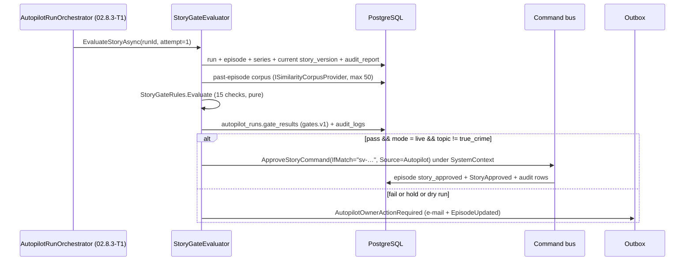

# 02.8.2-T1 — Gate engine: story gate + video gate + `gate_results` + audit/History + true-crime hold

| Story | Size | Area | Depends on | Blocks | Phase / flag |
|---|---|---|---|---|---|
| 02.8.2 | M (1.0) | BE | 02.3.2-T1 (approve commands, `ApprovalSource`), 02.6.1-T1 (`audit.v1`), 02.5.6-T1 (`SimilarityScorer`, `ISimilarityCorpusProvider`: `LoadAsync(episodeId, lang, ct)` for the sources corpus per README D21, `GetPastEpisodesAsync(seriesId, excludeEpisodeId, max, ct)` for past episodes), 02.4.1-T1 (`IContentModerator`), 05.5.1-T2 (`render_jobs.quality_report` = `render-quality.v1`; soft, the gate reads defensively) (05 CR-6), 09.7.1-T1 (video approve), CR-3 (`audit_logs` in P), 09.2.6-T3 (`SendEmailJob`, 09 W2 CR-9) | 02.8.2-T2, 02.8.2-T3, 02.8.3-T1, 02.8.3-T4 | P · `Autopilot:Gates:DryRun` |

## Goal

A single `IAutoApprovalGate` decides, from stored data only, whether an autopilot episode's story and rendered video may be approved without the owner: it returns a per-check verdict (`gates.v1`) that is persisted on `autopilot_runs.gate_results`, and on a pass it approves through the same commands a user calls, as a system actor, writing `audit_logs` and the episode History. A true-crime story never passes; every failure leaves the episode in its review state and notifies the owner.

## Inputs

- README: D9 (ETags, `if_match_required`), D12 (moderation stages/categories), D13 (audit keys), D16 (rubric), D17 (≤ 2 story generations per run), D19 (logging), D21 (one revision, fixed signatures), D22 (`audit.v1`, segment addressing); F20 (moderation split), F31 (no named-entity claim), F36 (metadata limits); P2/CR-3 (`audit_logs` in P).
- Plan `02.8.2/plan.md`: §3.1 check list, §3.2 check list, §3.3 thresholds, §3.4 `gates.v1`, §3.5 tables and the streak SQL, §4 use cases and audit keys.
- `00 §6` `autopilot_runs` (`gate_results jsonb`, `outcome`, `pause_reason`, `idea_id`, `episode_id`), `story_versions`, `render_jobs`, `assets`, `moderation_events`, `audit_logs`; `00 §7` Episode machine; `09 §5.2` CQRS rules (`SystemContext`, outbox).
- 05.5.1: duration ±5 %, loudness −16…−14 LUFS (after node normalisation), subtitles present when enabled, advisory hint `subtitle_sync_suspect` (gate check 10), `render_quality_failed` already ends a bad render before this gate (05 CR-6).
- `tests/NightTales.TestKit` (D20): `FakeContentModerator`, `FakeTextClient`, `FakeClock`, builders, `story.v1` fixtures.

## Design

### Types and paths (00 §5.2 layout)

Domain — `src/NightTales.Domain/Stories/Gates/`:

```csharp
public sealed record GateCheck(string Id, string Kind, decimal? Value, decimal? Threshold, bool Pass, string? Detail);
public sealed record StoryGateResult(bool Pass, bool Hold, int Attempt, Guid StoryVersionId,
                                     IReadOnlyList<GateCheck> Checks, IReadOnlyList<string> Failures);
public sealed record VideoGateResult(bool Pass, Guid RenderJobId, Guid AssetId,
                                     IReadOnlyList<GateCheck> Checks, IReadOnlyList<string> Failures);
public static class StoryGateRules      // pure: no IO, no clock, no DB
{
    public static StoryGateResult Evaluate(StoryGateInput input, AutopilotGateProfile profile);
}
public static class VideoGateRules
{
    public static VideoGateResult Evaluate(VideoGateInput input, AutopilotGateProfile profile);
}
```

`StoryGateInput` / `VideoGateInput` are flat records assembled by the evaluators: `StoryGateInput(StoryVersionFacts Version, AuditReportV1 Audit, SimilaritySignals Similarity, ModerationGateOutcome Moderation, RealWorldSignal RealWorld, SeriesGateContext Series, LengthBand Length)`; `VideoGateInput(QualityReportV1? Report, RenderJobFacts RenderJob, AssetFacts Asset, bool SubtitlesEnabled, Aspect Aspect, int ImageModerationEvents)`. `ImageModerationEvents` = `quality_report.images.moderated_count`; check 7 counts `quality_report.images.skipped` (03 D7, 03 CR-3).

Application — `src/NightTales.Application/Features/Autopilot/Gates/`:

```csharp
public interface IAutoApprovalGate
{
    ValueTask<ErrorOr<StoryGateOutcome>> EvaluateStoryAsync(Guid runId, int attempt, CancellationToken ct);
    ValueTask<ErrorOr<VideoGateOutcome>> EvaluateVideoAsync(Guid runId, CancellationToken ct);
}
public sealed record StoryGateOutcome(StoryGateResult Result, bool AutoApproved, GateStopReason? Reason);
public sealed record VideoGateOutcome(VideoGateResult Result, bool AutoApproved, GateStopReason? Reason);
public enum GateStopReason { None, DryRun, Hold, FailedChecks, OwnerApprovalRequired, ModeratorUnavailable }
```

- `StoryGateEvaluator : IAutoApprovalGate` — `src/NightTales.Application/Features/Autopilot/Gates/StoryGateEvaluator.cs`. Loads the run, its episode, series, current story version, the `audit.v1` report, the past-episode corpus, the moderation result and the real-world signal (T2's `IRealWorldSignalDetector`); calls `StoryGateRules.Evaluate`; persists via `GateResultWriter`; on `Pass && mode == live` calls `AutopilotApprovalService.ApproveStoryAsync`.
- `VideoGateEvaluator : IAutoApprovalGate` — `…/Gates/VideoGateEvaluator.cs`. Loads the run, the latest succeeded `render_jobs` row of the episode, its `quality_report`, the `assets` row, the enabled-subtitle flag from `render_jobs.params` and the count of `moderation_events` for that render job; calls `VideoGateRules.Evaluate`.
- `GateResultWriter` — `…/Gates/GateResultWriter.cs`. `Task WriteStoryAsync(Guid runId, StoryGateResult r, GateMode mode, string profile, ct)` merges into `autopilot_runs.gate_results` (`jsonb` read-modify-write under the row's `xmin`); same for `WriteVideoAsync`. Never overwrites the other block; keeps the highest `attempt` seen for the story block.
- `AutopilotApprovalService` — `…/Gates/AutopilotApprovalService.cs` (UC2/UC4).
- `AutopilotNotificationService` — `…/Gates/AutopilotNotificationService.cs` (UC6). Writes the outbox row `AutopilotOwnerActionRequired` **in the same transaction** as the gate result (00 §5.2 side-effect rule).
- `IGateFailureStreakReader` — `src/NightTales.Application/Abstractions/IGateFailureStreakReader.cs`:

```csharp
public interface IGateFailureStreakReader
{
    ValueTask<int> GetStreakAsync(Guid seriesId, CancellationToken ct);   // consecutive most-recent gate_failed outcomes
    ValueTask<AutopilotRunGateSnapshot?> GetLatestAsync(Guid seriesId, CancellationToken ct);
}
```

  Implementation `GateFailureStreakReader` in `src/NightTales.Infrastructure/Persistence/Queries/` using the SQL in plan §3.5 (no new column; T4 consumes it).

### Approve call shape (UC2/UC4)

```csharp
// UC2 — the same command a user calls, as a system actor
var etag = $"\"sv-{version.Id}\"";                       // D9 strong ETag
using var scope = systemContext.For(run.UserId);          // ICurrentUser.Id = owner, actor_type = system
var result = await sender.Send(new ApproveStoryCommand(
    episodeId, IfMatch: etag, Attestation: null, Source: ApprovalSource.Autopilot), ct);
```

- `episode_invalid_state` on a second call is treated as success **only** when `episode.ApprovedStoryVersionId == episode.CurrentStoryVersionId` (idempotent replay of the same approval); otherwise it is a failure of the step.
- `ApprovalSource.Autopilot` + `topic = true_crime` → `episode_invalid_state` from the domain (02.3.2-T1). The gate never gets there because check 15 fails first; this is the defence-in-depth path and it is asserted by a test.
- Video: `ApproveVideoCommand(episodeId, Note: "autopilot")` (09.7.1-T1).
- Audit rows written by the gate (D13, ids/scores/codes only — no text):

```jsonc
// action = autopilot.story_auto_approved, category = episodes, visibility = user, actor_type = system
{ "runId": "…", "episodeId": "…", "attempt": 1, "mode": "live",
  "checks": [ { "id": "self_review_mean_score", "pass": true }, { "id": "similarity_sources", "pass": true } ],
  "failures": [], "meanReviewScore": 3.86, "sourceSimilarity": 0.021, "pastEpisodeSimilarity": 0.044 }
```

### Sequence (story gate)



## Steps

1. Add the Domain records and `StoryGateRules`/`VideoGateRules` with the check ids from plan §3.1/§3.2 as constants (`StoryGateCheckIds`, `VideoGateCheckIds`) so tests, the UI copy keys and `audit_logs.data` share one source.
2. Add `AutopilotGateProfile` + binding `AutopilotGateOptions` (`src/NightTales.Application/Features/Autopilot/Gates/AutopilotGateOptions.cs`) with `Profiles` as a dictionary and `Resolve(string? ref)` doing the `strict`-over-`default` overlay (plan §3.3). Register with `IOptionsMonitor`.
3. Add `AuditReportV1` deserialisation helpers (`StoryGateInputFactory`) that tolerate a `null`/stale `model_review` and never throw: absent data → the corresponding check fails closed.
4. Implement `StoryGateEvaluator` (15 checks in the plan's order; `true_crime` runs 14 then 15), `VideoGateEvaluator` (10 checks; check 10 `subtitle_sync`, 05 CR-6), `GateResultWriter`, `AutopilotApprovalService`, `AutopilotNotificationService`.
5. Implement `GateFailureStreakReader` + `IGateFailureStreakReader` and register it.
6. Wire `[Audited]`/explicit `audit_logs` writes for the three gate actions; assert `actor_type = system` comes from `SystemContext` (09.2.3).
7. Add the outbox event `AutopilotOwnerActionRequired` and its handler → `SendEmailJob` (09.2.6) with the plan-local template `autopilot_owner_action_required` (vi/en) + SignalR `EpisodeUpdated`.
8. Add metrics `autopilot_gate_total{gate,result}`, `autopilot_gate_check_failed_total{check}`, `autopilot_gate_duration_seconds` (D19) and structured logs with `runId`, `episodeId`, check ids and codes only.
9. Register `IAutoApprovalGate` in the Application DI; expose it to 02.8.3-T1 through the orchestrator only (no endpoint).

## Outputs

- New: `src/NightTales.Domain/Stories/Gates/{GateCheck,StoryGateResult,VideoGateResult,StoryGateRules,VideoGateRules,StoryGateCheckIds,VideoGateCheckIds}.cs`
- New: `src/NightTales.Application/Features/Autopilot/Gates/{IAutoApprovalGate,StoryGateEvaluator,VideoGateEvaluator,GateResultWriter,AutopilotApprovalService,AutopilotNotificationService,AutopilotGateOptions,StoryGateOutcome,VideoGateOutcome,GateStopReason}.cs`
- New: `src/NightTales.Application/Features/Autopilot/Gates/StoryGateInputFactory.cs` (audit-report → gate input, fail-closed)
- New: `src/NightTales.Application/Abstractions/IGateFailureStreakReader.cs`, `src/NightTales.Infrastructure/Persistence/Queries/GateFailureStreakReader.cs`
- New: `src/NightTales.Application/Features/Autopilot/Events/AutopilotOwnerActionRequired.cs` + handler
- Changed: `appsettings.json` (`Autopilot:Gates` block), outbox handler registration, DI, e-mail template files (vi/en)
- No migration. `autopilot_runs.gate_results` already exists (00 §6).
- Config keys added: `Autopilot:Gates:DryRun` (true), `Autopilot:Gates:DryRunMaxEpisodes` (10), `Autopilot:Gates:Profiles:default|strict:…` (plan §3.3).

## Acceptance checks

- [ ] `dotnet test tests/NightTales.Domain.UnitTests --filter FullyQualifiedName~Gates` green, including `StoryGate_TrueCrime_AlwaysHolds` and `VideoGate_QualityReportAbsent_FailsClosed`.
- [ ] `dotnet test tests/NightTales.Api.IntegrationTests --filter FullyQualifiedName~AutoApproveStory` green: episode `story_approved`, `approved_story_version_id` set, `autopilot_runs.gate_results` contains `schema_version = gates.v1` with a `story` block, and `audit_logs` has both `episode.story_approved` (actor_type `system`, `data.approval_source = autopilot`) and `autopilot.story_auto_approved`.
- [ ] `dotnet test … --filter FullyQualifiedName~AutoApproveStory_SecondCall_IsIdempotent` green: a second evaluation adds no version and no second approval row.
- [ ] With `Autopilot:Gates:DryRun=true`, `AutopilotApproval_DryRun_NeverCallsApproveCommand` asserts zero `ApproveStoryCommand`/`ApproveVideoCommand` sends and a stored `mode = "dry_run"`.
- [ ] True crime: `AutoApproveStory_TrueCrime_LeavesStoryInReview` leaves the episode in `story_review` and puts one `AutopilotOwnerActionRequired` message in `outbox_messages` with `Reason = "true_crime_hold"`.
- [ ] `GateStreak_TwoConsecutiveGateFailures_ReturnsTwo` returns 2 for two `gate_failed` runs and 0 when a `published` run is in between.
- [ ] `curl -s localhost:8080/api/v1/episodes/{id} | jq '.status'` after a live pass returns `"story_approved"` (manual smoke on the local stack).
- [ ] Logs and metrics from a gate run contain no story text, brief, facts or source URLs (`grep` over the captured log fixture; D19).
- [ ] No new HTTP route appears in `openapi.json` (`git diff` of the generated file is empty).

## Tests

Unit (Domain, `tests/NightTales.Domain.UnitTests/Stories/Gates/`):
- `StoryGate_AllChecksPass_ReturnsPass`
- `StoryGate_MeanScoreBelowThreshold_Fails`
- `StoryGate_StaleModelReview_Fails`
- `StoryGate_OneBlockingObjectiveIssue_Fails` (and `…_AdvisoryTasteIssue_Passes`)
- `StoryGate_RevisionCountAboveMax_Fails`
- `StoryGate_ContentWarningOutsideAllowList_Fails`
- `StoryGate_TrueCrime_AlwaysHolds`
- `StoryGate_ProfileOverlay_StrictRaisesThresholds`
- `VideoGate_QualityReportAbsent_FailsClosed`
- `VideoGate_SkippedKeyword_Fails`
- `VideoGate_LoudnessOutsideRange_Fails`
- `VideoGate_SubtitlesEnabledButAbsent_Fails`
- `VideoGate_AssetShaMismatch_Fails`

Unit (Application, `tests/NightTales.Application.UnitTests/Features/Autopilot/Gates/`):
- `GateResultWriter_MergesStoryThenVideo_PreservesStoryChecks`
- `GateResultWriter_SecondStoryAttempt_KeepsHigherAttempt`
- `AutopilotApproval_DryRun_NeverCallsApproveCommand`
- `AutopilotApproval_SecondApprovalOfSameVersion_TreatedAsSuccess`
- `AutopilotNotification_Failure_WritesOutboxInSameTransaction`
- `StoryGateInputFactory_MissingModelReview_FailsClosed`

Integration (`tests/NightTales.Api.IntegrationTests/Features/Autopilot/`):
- `AutoApproveStory_EndToEnd_SetsStoryApprovedAndWritesAudit`
- `AutoApproveStory_SecondCall_IsIdempotent`
- `AutoApproveStory_TrueCrime_LeavesStoryInReview`
- `AutoApproveVideo_EndToEnd_SetsReady`
- `GateFailure_TwoRunsInARow_StreakIsTwo`
- `AutoApproveStory_AutopilotSourceOnTrueCrime_ReturnsEpisodeInvalidState` (defence in depth: call the command directly)

Manual: none (T3 owns the calibration run).

## Failure handling and edge cases

| Case | Behaviour |
|---|---|
| `audit_report` null or `model_review` stale | `self_review_present` fails → owner review. Never a pass |
| `quality_report` missing a field | that check fails with `detail = "field_absent"`; the video stays in `video_review` |
| Moderator unavailable (5xx after the D7 retry budget) | `moderation_gate` fails with `detail = "moderator_unavailable"` → owner review (fail closed) |
| Similarity corpus query fails | the run step is retried by the tick; the gate is not evaluated with a missing corpus (no pass on unknown) |
| Episode already `story_approved` with the same version | treated as a successful replay (idempotency) |
| Episode status changed between evaluation and approve (second tab) | the ETag `If-Match` returns 412 `story_version_conflict`; the gate records `failures += ["etag_conflict"]` and the owner is notified |
| True crime | always `hold`; the owner sees the full check list |
| Render succeeded but the asset row is missing | `asset_integrity` fails; the episode stays in `video_review` |
| Two gate failures in a row | the gate only records; 02.8.3-T4 pauses the series on the streak |
| Dry run | `mode = dry_run`, no approve call, owner notified for every episode |
| Rollback | set `DryRun = true`; no data change is needed and stored verdicts stay valid |

## Notes

- ✅ `quality_report` field names are fixed by `render-quality.v1` (05 README D10; written by 05.5.1-T2) (05 CR-6). Defensive reads stay: a rename degrades to "owner review", never to a wrong pass.
- ⚠️ `Similarity:PastEpisodes:BlockAbove` (0.15) is the *human* block; the gate uses the stricter `Autopilot:Gates:Story:MaxPastEpisodeSimilarity` (0.10) so autopilot does not produce a near-duplicate of its own last episode (DECISIONS §6 mass-produced risk). Confirm with 02.5.6-T2's calibration.
- ⚠️ The gate reads the moderation result computed at `draft` time by 02.4.1-T1 rather than calling the moderator again; a story **edited** after generation has no `autopilot_gate` result, so the gate calls `IContentModerator` itself then (free, D12). Which is the case is recorded in `gate_results.moderation.checked_at`.
- ⚠️ (from 02.6.2-T1, #180) A revised current version has `story_versions.audit_report.model_review` = review #1 (the one that asked for the revision). The gate reads blocking objective issues from `audit_report.revision.review_after` (review #2) when `revision.applied` is true, and from `model_review` otherwise; `GET /episodes/{id}` `currentStory.review` already follows this rule (`StoryReadProjection.Review`). Revision reasons when `applied:false` are in `AuditReportBuilder.RevisionReasons`.
- [OPEN] `autopilot.owner_action_required` is not in D13 (plan §10 open item 1).
- [OPEN] SignalR `AutopilotRunUpdated` is not in 00 §8 (plan §10 open item 2).
- Links: README D9/D12/D13/D16/D17/D21/D22 · 05.5.1 (`../../05-video-assembly-subtitles.md` §4) · 03 §5.2 · 09 §5.2/§5.3.
