# 02.8.3 — Cadence and publishing (feature plan)

> Refines: `../../02-story-writing.md` story **02.8.3**, Epic 02.8 (§4), §5 technical design, §7 test plan, §8 risks; `../../00-overview.md` §4.1 (personal phase), §5.2 (CQRS, `SystemContext`), §6 (`series`, `series_autopilot_authorizations`, `autopilot_runs`, `publications`), §7 (Episode / Publication machines), §8 (routes).
> Contract: `../README.md` — facts §1 (P1/P4/P6), findings F01–F38 (esp. F28, F33), decisions **D1** (`ICreditLedger`/`IBudgetGuard`), **D2** (`generation_runs`), **D13** (audit keys), **D17** (scheduling, the core of this feature), **D19**, **D21**, CR-4; gates §7 (`02-M1-autopilot`); task template §6. Template: `../../00-overview.md` §10.1.
> Sibling contracts: 02.8.1-T2 `IIdeaPlanner.ProposeAndPickAsync(seriesId, slotAt, RunContext) → ValueTask<ErrorOr<IdeaPick>>` + `MarkUsedAsync(ideaId, episodeId, ct)`; 02.8.2 `IAutoApprovalGate` + `IGateFailureStreakReader`; 02.3.2-T1 `ApproveStoryCommand`/`StoryApproved { …, ApprovalSource }`; 06.2.2-T3 `AutopilotConsentJob`; 06.2.4 lead time 2 h; 09.6.1 render command; 09.7.1 video approve.
> Legend: ✅ verified (source) · ⚠️ unverified · [DECISION] · [OPEN] · [INFERENCE].
> Status: detailed plan, 2026-09-23. Nothing implemented yet.

## 1. Scope

| | |
|---|---|
| Story | **02.8.3 Cadence and publishing** — *As the channel owner I want episodes published on a schedule so that the channel grows without me.* Must (P) |
| Tasks | 02.8.3-T1 slot planner + `AutopilotPlanJob` + run state machine + ready buffer (L 2.25 — includes the +0.25 `TimeZoneInfo` slot calculator, README §10 T7) · 02.8.3-T2 autopilot endpoints + series authorization accept/revoke + settings validation (S 0.5) · 02.8.3-T3 publish hand-off to 06 + pre-audit mode (S 0.5) · 02.8.3-T4 pause triggers + spend caps + outbox alerts + resume (M 1.0) = **4.25 d** (README §9: 1.5 → 4.25, F28/F33/T7) |
| In scope | `autopilot_settings` jsonb schema + validation; slot computation from a cadence with **DST-correct** local→UTC conversion; `autopilot_runs` columns beyond 00 §6 (`slot_at`, `state`, `step`, `start_at`, `publication_id`, `attempt`, `waiting_for`, `finished_at`, `authorization_id`) and the **run state machine**; one recurring `AutopilotPlanJob` tick (D17); the ready-buffer semantics; per-run caps (≤ 2 story generations, ≤ 1 render); the true-crime path including the F33 no-go branch; `SystemContext(ownerId)` for every step; the autopilot routes + the versioned series authorization (text, hash, accept, revoke, covered-field changes); the publication hand-off to 06 (title/description/tags/privacy/`publish_at`/`contains_synthetic_media`/`autopilot_authorization_id`); pre-audit mode; the complete pause-trigger table, spend caps (`IBudgetGuard` + an autopilot per-run cap), the outbox alert e-mail and the resume rules; the takedown hook to the 08.4.4 runbook |
| Out of scope | Idea generation, novelty and variety (02.8.1-T1/T2, 02.8.4-T1 — consumed as `IIdeaPlanner`); the gate rules themselves (02.8.2-T1/T2/T3 — consumed as `IAutoApprovalGate`); render internals and the quality checks (09.6.3, 05.5.1); the publication aggregate, consent, upload, scheduling, go-live poll and quota ledger (06.2.1–06.2.6, 06.3 — we call `CreatePublicationCommand` and observe `PublicationUpdated`); the `AutopilotConsentJob` itself (06.2.2-T3); the YouTube OAuth client, connection health and the platform incident path (06.1.2, 06.4.2, 11.6.2); the Autopilot tab screens (10.4.3-T1); source finding internals (02.7.2-T3) and fetching (02.5.2); billing/credits (12 — P is metering-only, D1) |
| Acceptance (story, restated) | Given cadence + daily cap + buffer, the orchestrator starts generation early enough for the publish time and creates the publication with `publish_at` through 06 (`containsSyntheticMedia = true`). The owner accepts a versioned series authorization; 06.2.2-T3 writes a per-publication consent from it after the veto window; turning autopilot off or changing the text revokes it until re-accepted. Any trigger in the §3.6 table pauses the series (no new idea/story/render jobs), records `autopilot_pause_reason` and e-mails the owner through the outbox with the already-scheduled YouTube videos and Studio links. Pre-audit mode keeps the cadence and uploads private (`published_private_locked`, no go-live check). |

Two clarifications of the story's wording, both recorded as CRs in §10:

- The story says the alert e-mail lists "videos already scheduled on YouTube with a Studio link". The Studio link is `https://studio.youtube.com/video/{external_post_id}/edit` ⚠️ (URL shape not verified against Google docs; a channel-level fallback `https://studio.youtube.com/channel/{external_account_id}/videos/upload` is used when the video id is absent).
- "Pause after N private videos" (the alternative pre-audit mode) is implemented as a **pause trigger**, so it lives in T4's table, not in the publish path.

## 2. Confirmed facts

| # | Fact used here | Status / source |
|---|---|---|
| D17 | One recurring `AutopilotPlanJob` (every 15 min, `AddOrUpdate` id `autopilot-plan`) computes the next slots per enabled, unpaused series from `autopilot_settings`; one `autopilot_runs` row per slot inside `now + buffer_days`, `UNIQUE (series_id, slot_at)`; each run advances the state machine through the same commands a user would call, under `SystemContext(ownerId)`, `trigger = autopilot`, idempotency key `autopilot:{seriesId}:{slotAt:O}:{step}`; ≤ 1 idea pick, ≤ 2 story generations, ≤ 1 render per run; two gate failures in a row pause the series | ✅ README D17 |
| D1 | `ICreditLedger` (metering-only in P) + `IBudgetGuard.CheckAsync(worstCaseUsd, ct)` before every paid dispatch; `Budget:MaxPlatformCostUsdPerDay` = **$3**, `Budget:MaxPlatformCostUsdPerMonth` = **$40**; over a cap → 429 `spend_cap_reached` and autopilot pauses with reason `spend_cap_reached`; `CreditOperation` values include `story_generate`, `fact_sheet`, `bible_proposal`, `idea`, `source_find` | ✅ README D1 |
| D2 | `generation_runs` one row per paid generation; `kind ∈ {story, fact_sheet, bible_proposal, ideas, find_sources}`, `trigger ∈ {user, autopilot, system}`, `idempotency_key`, `worst_case_usd`, `cost_usd`, `counts_toward_limit`; partial unique `(episode_id, kind) WHERE episode_id IS NOT NULL AND status IN ('queued','running')` and `(series_id, kind) WHERE episode_id IS NULL AND status IN ('queued','running')`; autopilot runs are capped by the autopilot rules, not FR-02-7 | ✅ README D2 (+ TL ruling: `series_id` NOT NULL, `episode_id` nullable) |
| D13 | Audit action keys for this feature: `autopilot.enabled`, `autopilot.disabled`, `autopilot.authorization_accepted`, `autopilot.authorization_revoked`, `autopilot.paused`, `autopilot.resumed`; `data` holds ids, versions, scores and codes only | ✅ README D13 |
| D8 | `autopilot_authorization_required` 409, `autopilot_topic_locked` 409; plus the shared `episode_invalid_state`, `spend_cap_reached`, `reauth_required` (401), `if_match_required` (428) | ✅ README D8 |
| D21 | Fixed signatures for the pipeline steps; `RunContext(GenerationRunId, UserId, SeriesId, Guid? EpisodeId, ReservationId, GenerationTrigger, Attempt, string PriceVersion)` (12 CR-17); `TextCallResult<T>`; jobs take ids only | ✅ README D21 + TL rulings #2/#3 |
| 09.3.2 | `POST /auth/reauth` (password; plus TOTP when enrolled) within the last 5 min is required for channel connect and MFA changes; the same pattern is used for other sensitive actions (09.10.4) | ✅ `../../09-backend-api.md` §4 (09.3.2, 09.10.4), error `reauth_required` 401 |
| 09.2.3 | Worker jobs from the outbox run under `SystemContext(userId)`; filters stay on; a missing `userId` fails the job; `IgnoreQueryFilters` only in `Features/Admin` + allow-listed system jobs | ✅ 09 §4 (09.2.3), §7 |
| 09.2.6 | `IJobScheduler` port over Hangfire (PostgreSQL storage); `AutopilotPlanJob` listed as recurring; job arguments are ids only; `/internal/jobs` dashboard | ✅ 09 §5.3, §4 (09.2.6) |
| 06.2.4 | Upload happens early with a **lead time of 2 h** (or immediately if quota allows), as `private` with `publishAt`; the UI shows "Scheduled on YouTube for …" | ✅ `../../06-youtube-posting.md` §4 (06.2.4) |
| 06.2.2-T3 | `AutopilotConsentJob` (recurring 1 min) writes `consent_at`, `consent_text_version`, `consent_source = autopilot`, `autopilot_authorization_id` for **that** publication after the veto window; if `veto_notice_sent_at` is empty no consent is written and **the series pauses** (02.8.3) | ✅ 06 §4 (06.2.2), §6 (06.2.2-T3), 09 §5.3 |
| 06.2.5 | `PublicationGoLiveJob` at `publish_at + 5 min` checks `status.privacyStatus` and moves the publication to `published`; retries every 15 min for 2 h | ✅ 06 §4 (06.2.5) |
| 00 §7 | Publication: `awaiting_consent → scheduled → uploading → processing → published \| failed \| cancelled`; it cannot leave `awaiting_consent` without `consent_at`; Episode: `ready → scheduled → published` via publications; `story_approved → rendering → video_review → ready`; `rendering → story_approved` on failure | ✅ 00 §7 |
| 00 §6 | `series.autopilot_enabled`, `autopilot_settings jsonb`, `current_autopilot_authorization_id`, `autopilot_paused_at`, `autopilot_pause_reason`; `series_autopilot_authorizations` (version, text_version, text_hash, topic, channel_connection_id, cadence, privacy status, accepted_at, revoked_at); `autopilot_runs` (started_at, idea_id, episode_id, outcome, gate_results, pause_reason); `publications` (`consent_source`, `autopilot_authorization_id`, `veto_notice_sent_at`, `contains_synthetic_media`) | ✅ 00 §6 |
| DEC §10.12 | Fully automatic personal studio; fiction auto-approved by gates, true crime waits; per-channel daily cap default 1; veto window default 12 h; the owner knowingly carries the mass-produced-content monetization risk | ✅ `../../DECISIONS.md` §6, §10.12 |
| DEC §6 | YouTube `videos.insert` from an unaudited API project is private-only; lifted only by the compliance audit → pre-audit mode is a first-class state, not an error path | ✅ DECISIONS §6, §10.12 |
| 05.5.1 | A render that fails the checks never reaches the video gate (it returns to `story_approved` with `render_quality_failed`) | ✅ 05 §4, 09 §5.4 |
| — | **NodaTime rejected by the TL** (README §10 T7): 09.1.1 keeps Domain free of packages. Slot computation uses `TimeZoneInfo.FindSystemTimeZoneById` (IANA ids; ICU on Linux images ⚠️ confirm `InvariantGlobalization=false` in the container) behind Domain `ISlotCalculator`. DST gap → the next valid minute; DST overlap → the earlier offset. +0.25 d on 02.8.3-T1 | ✅ README §10 T7 |

Open questions closed here: which scheduler (D17: one tick); where DST is handled (`TimeZoneInfo`, T7 above, §3.2); who creates the publication (this feature, by calling 06.2.1); how "early enough" is computed (§3.4 formula). Still open: ⚠️ the render/story estimate defaults must be replaced by 05/M1 measurements (§3.4); ⚠️ the Studio deep-link shape (§1).

## 3. Domain and data

### 3.1 `autopilot_settings` jsonb (validation owned by 02.8.3-T2)

```jsonc
{
  "schema_version": 1,
  "cadence": { "days_of_week": ["mon", "thu"], "publish_time": "19:00", "time_zone": "Asia/Ho_Chi_Minh" },
  "daily_cap": 1,                       // per channel per local day, 1..5
  "buffer_days": 2,                     // ready-buffer depth AND planning horizon, 1..7
  "privacy": "private",                 // "public" | "unlisted" | "private" (Developer Policies III.E.3.f)
  "veto_window_hours": 12,              // 2..48
  "pre_audit_mode": "keep_cadence_private",  // | "pause_after_n_private"
  "pre_audit_pause_after": 3,           // used only by the second mode, 1..20
  "gate_thresholds_ref": "default",     // profile name, 02.8.2-T3
  "tone": "atmospheric, restrained, no gore, first person",   // ≤ 500 chars, 02.8.1 consumes it
  "banned_themes": ["children in danger", "real named people"], // ≤ 20 × ≤ 100 chars, 02.8.1 consumes it
  "render_lead_minutes": 15,            // null → Autopilot:RenderEstimate:Minutes
  "story_lead_minutes": 10              // null → Autopilot:StoryEstimate:Minutes
}
```

Validation (`AutopilotSettingsValidator`, Application `Features/Autopilot/Settings/`): every key above with the stated range; `days_of_week` non-empty, unique, ⊆ `{mon…sun}`; `publish_time` matches `^([01]\d|2[0-3]):[0-5]\d$`; `time_zone` resolves via `TimeZoneInfo.FindSystemTimeZoneById(id)` (README §10 T7) without throwing — a bad id is **400 `autopilot_settings_invalid`** with `errors["cadence.time_zone"]`, never a silent UTC fallback; unknown top-level keys are rejected (`additionalProperties: false` semantics) so a typo cannot be ignored. `tone` and `banned_themes` are in the schema because 02.8.1 consumes them (TL ruling #3); they are **not** part of the authorization text, so changing them does not revoke (§3.5).

### 3.2 Slot computation (`TimeZoneInfo`, DST-correct — README §10 T7)

```csharp
// Domain/Series/Autopilot/ISlotCalculator.cs + SlotCalculator.cs — pure, no package dependency (09.1.1: Domain stays free of NuGet packages)
public interface ISlotCalculator { IReadOnlyList<DateTimeOffset> NextSlots(AutopilotCadence cadence, DateTimeOffset now, int horizonDays, int dailyCap); }
```

- `days_of_week` + `publish_time` + `time_zone` → `var tz = TimeZoneInfo.FindSystemTimeZoneById(cadence.TimeZoneId)` (IANA id; throws `TimeZoneNotFoundException` on an unknown id, caught by the settings validator as `autopilot_settings_invalid`, never here). For each local date in `[now in tz, now + horizonDays]`, if the weekday is in the set: build `var local = new DateTime(y, m, d, h, min, 0, DateTimeKind.Unspecified)` at `publish_time`.
- **DST gap** (spring forward, the local time does not exist — `tz.IsInvalidTime(local)`): advance `local` minute by minute until `!tz.IsInvalidTime(local)` (bounded to 4 h, effectively the next valid minute, typically +1 h) — the slot still happens, later in wall-clock terms.
- **DST overlap** (fall back, the local time occurs twice — `tz.IsAmbiguousTime(local)`): use the **larger** UTC offset — `new DateTimeOffset(local, tz.GetAmbiguousTimeOffsets(local).Max())` — which is the pre-transition (daylight) offset and therefore the **first** UTC instant (New York 01:30: −04:00 → 05:30Z first, −05:00 → 06:30Z second). `Min()` would pick the second occurrence.
- Otherwise: `TimeZoneInfo.ConvertTimeToUtc(local, tz)` → `DateTimeOffset` (UTC).
- Both DST cases are logged once per occurrence (`autopilot_slot_dst_adjusted_total{zone,kind}`) and the chosen instant is what is stored — no ambiguity is left to a later step.
- ⚠️ `TimeZoneInfo.FindSystemTimeZoneById` needs the ICU IANA tzdb available to the runtime; the container image must **not** set `InvariantGlobalization=true` (which drops IANA id resolution) — a start-up self-check resolves `"UTC"` and one DST zone (e.g. `"America/New_York"`) and fails loudly if either throws.
- `IClock` (Application, already used elsewhere) exposes `DateTimeOffset UtcNow`, faked by `FakeClock` in tests (D20) — no NodaTime `IClock`, plain `DateTimeOffset`.
- The result is a list of `DateTimeOffset` (UTC). `slot_at` is stored as `timestamptz` (00 §6 + CR-4).
- Daily cap: when two series share a channel (`series.default_channel_id`), a local day may hold at most `daily_cap` **publications for that channel**. The planner skips a slot whose local day already has `daily_cap` slots (of any series on that channel) in a non-cancelled state; the skipped slot is not recorded as a run (no noise in the run log) but is logged at debug level with `autopilot_slot_skipped_total{reason="daily_cap"}`.
- Horizon: `horizonDays = buffer_days + max(cadence interval, 1)` so the next slot is always planned even with a sparse cadence.

### 3.3 `autopilot_runs` — columns, constraints, indexes

00 §6 gives `user_id, series_id, started_at, idea_id, episode_id, outcome, gate_results, pause_reason`. CR-4 adds `slot_at timestamptz` unique with `series_id`. This feature adds the rest (one additive migration, no contract step — the table has no production data at that point):

| Column | Type | Notes |
|---|---|---|
| `slot_at` | `timestamptz NOT NULL` | the intended publish instant (§3.2). `UNIQUE (series_id, slot_at)` |
| `state` | `text NOT NULL` | live machine position (§3.5), CHECK against the 18 states |
| `step` | `text NULL` | last completed idempotency step (`idea`, `story`, `story2`, `story_gate`, `render`, `video_gate`, `publication`, `consent`, `go_live`) |
| `outcome` | `text NULL` | 00 §6 enum, set when the run stops (§3.5 mapping); NULL while producing |
| `pause_reason` | `text NULL` | 00 §6; the enum in §3.6 |
| `start_at` | `timestamptz NOT NULL` | computed earliest safe start (§3.4) |
| `publication_id` | `uuid NULL` → `publications(id)` | the publication created by this run |
| `authorization_id` | `uuid NULL` → `series_autopilot_authorizations(id)` | the authorization this run relied on |
| `attempt` | `int NOT NULL DEFAULT 0` | story generations used (≤ 2) |
| `render_attempts` | `int NOT NULL DEFAULT 0` | ≤ 1 |
| `waiting_for` | `text NULL` | `fact_sheet` \| `sources` \| `story` \| `video` — why the owner is needed |
| `last_transition_at` | `timestamptz NOT NULL` | observability + the stale-run sweeper |
| `finished_at` | `timestamptz NULL` | non-null only in a terminal state |

Indexes: `(series_id, slot_at DESC)` (run log + the streak query), `(state, start_at)` (the tick's "what is due" scan), `(series_id, state)` (the concurrency guard). `autopilot_runs` is `IUserOwned` (`user_id` denormalised from the series, 09.2.3) — the architecture test requires it because it has a `series_id` FK.

Migration: `src/NightTales.Infrastructure/Persistence/Migrations/<ts>_AutopilotRunsStateAndSlot.cs` — additive `ADD COLUMN` + the unique constraint + indexes; down = drop columns/indexes. The initial `autopilot_runs` table comes from 09.2.2-T2 (00 §6), so no table creation here.

### 3.4 Timing: when each step starts

```
upload_at            = slot_at − PublishLead                    (06.2.4, 120 min)
publication_create_at= upload_at − veto_window_hours            (06.2.2, ≥ 12 h by default)
render_deadline      = publication_create_at − PublicationCreateMargin (10 min, notice delivery)
render_start_at      = render_deadline − render_estimate
story_start_at       = render_start_at − story_estimate
start_at             = min(story_start_at, slot_at − buffer_days)   // the ready buffer pulls it earlier
```

Config: the lead time and the minimum veto window are read from 06's `YouTubeOptions.PublishLeadMinutes` (120) and `YouTubeOptions.MinVetoWindowHours` (2) — one source, no duplicate `Autopilot:` keys (06 CR-3, `../../06-youtube-posting/README.md` D11); `Autopilot:PublicationCreateMarginMinutes` 10, `Autopilot:RenderEstimate:Minutes` 15 ⚠️ (replace with the 05 measurement), `Autopilot:StoryEstimate:Minutes` 10 ⚠️ (replace with the M1 measurement), `Autopilot:MaxBufferDays` 7.

**Worked example** — fiction, `standard` tier, cadence Mon+Thu 19:00 `Asia/Ho_Chi_Minh`, veto 12 h, buffer 2 d:

| Step | Instant (UTC) | Wall clock (UTC+7) |
|---|---|---|
| `slot_at` (Thu 2026-10-08 19:00 +07) | `2026-10-08T12:00Z` | Thu 19:00 |
| `start_at` = min(Wed 21:25Z, Tue 12:00Z) → **buffer wins** | `2026-10-06T12:00Z` | Tue 19:00 |
| idea pick | `2026-10-06T12:00Z` | Tue 19:00 |
| story generation | `2026-10-06T12:05Z` | Tue 19:05 |
| story gate + auto-approve | `2026-10-06T12:20Z` | Tue 19:20 |
| render | `2026-10-06T12:25Z` | Tue 19:25 |
| video gate + auto-approve | `2026-10-06T12:45Z` | Tue 19:45 |
| `publication_create_at` | `2026-10-07T22:00Z` | **Thu 05:00** |
| veto window ends (`AutopilotConsentJob`) | `2026-10-08T10:00Z` | Thu 17:00 |
| upload (06.2.4, `private` + `publishAt`) | `2026-10-08T10:00Z` | Thu 17:00 |
| go-live (06.2.5) | `2026-10-08T12:05Z` | Thu 19:05 |

The buffer is what makes the episode sit `ready` for ~1.5 days before its publication is even created; the veto window is never shortened. Without the buffer (sparse cadence or `buffer_days = 1`), `start_at` falls back to `story_start_at` and the production window is ~35 min before `publication_create_at` — acceptable for `standard`, too tight for `long` (⚠️ the `long` tier must raise `render_lead_minutes`; T1's validation warns when `render_lead_minutes + story_lead_minutes` exceeds the window implied by `buffer_days`).

**Missed slot:** the publication is created only while `publication_create_at ≤ now < upload_at − MinVetoWindowHours`. It never goes out before `publication_create_at`. A late video still inside the window gets a shortened veto of at least 2 h (02.8.3-T3 guard). Once `now ≥ upload_at − MinVetoWindowHours` the slot is missed: the run ends `failed` with `pause_reason = slot_missed` and the next slot is used. Two consecutive misses count as two failures for the pause streak (§3.6).

### 3.5 Run state machine

```mermaid
stateDiagram-v2
  [*] --> planned
  planned --> awaiting_authorization: no valid authorization
  awaiting_authorization --> planned: owner re-accepts (autopilot.authorization_accepted)
  planned --> idea_picked: tick, now >= start_at
  idea_picked --> researching: topic = true_crime
  idea_picked --> story_generating: fiction
  researching --> waiting_owner: fact sheet draft ready — owner approval required
  researching --> waiting_owner: no source_finder go (F33) — "add sources"
  waiting_owner --> story_generating: owner approved the fact sheet / added sources
  story_generating --> story_gate: StoryGenerated (trigger=autopilot)
  story_generating --> failed: StoryGenerationFailed (not counted)
  story_gate --> rendering: pass, auto-approved (ApproveStory, ApprovalSource=Autopilot)
  story_gate --> story_generating: fail, attempt < 2 (one regenerate)
  story_gate --> gate_failed: fail, attempt = 2
  story_gate --> waiting_owner: true-crime hold (never auto-approves)
  waiting_owner --> rendering: owner approved the story (StoryApproved, user)
  rendering --> video_gate: render succeeded (episode video_review)
  rendering --> failed: render failed (<= 1 render per run)
  video_gate --> publication_created: pass, auto-approved + timing allows
  video_gate --> gate_failed: fail (live mode)
  video_gate --> waiting_owner: DryRun, or a gate check needing the owner (moderation flag, real-world signal)
  waiting_owner --> publication_created: owner approved the video (VideoApproved, user) + timing allows
  video_gate --> failed: slot missed (now >= upload_at - MinVetoWindowHours)
  publication_created --> veto_window: veto notice delivered
  publication_created --> paused: veto notice undelivered
  veto_window --> scheduled: consent written by 06.2.2-T3
  veto_window --> cancelled_by_owner: cancelled / story reopened
  scheduled --> published: PublicationUpdated published (audit passed)
  scheduled --> published_private_locked: pre-audit mode, processed
  scheduled --> failed: upload failed / rejected / quota
  planned --> paused: pause trigger
  idea_picked --> paused: pause trigger
  story_generating --> paused: pause trigger
  rendering --> paused: pause trigger
  paused --> planned: resume returns to the state held before the pause (table row); drawn to planned for brevity
  gate_failed --> [*]
  published --> [*]
  published_private_locked --> [*]
  cancelled_by_owner --> [*]
  failed --> [*]
  waiting_owner --> failed: wait expired (owner_approval_expired)
```



Transition table (trigger, guard, idempotency key, outcome written):

| From → To | Trigger | Guard | Idempotency key / step | `outcome` |
|---|---|---|---|---|
| `planned → awaiting_authorization` | tick | `series.current_autopilot_authorization_id` null or revoked | `…:authorization` | `awaiting_authorization` |
| `awaiting_authorization → planned` | outbox `AutopilotAuthorizationAccepted` | authorization valid for the current settings snapshot | — | NULL (cleared) |
| `planned → idea_picked` | tick, `now ≥ start_at` | series enabled, not paused, authorization valid, connection `active`, no other producing run of the series, daily cap not exhausted for the slot's local day, `IBudgetGuard` ok, `generation_runs` slot free | `autopilot:{seriesId}:{slotAt:O}:idea` | NULL |
| `idea_picked → story_generating` | same tick | episode created from `IdeaPick.Picked`; `MarkUsedAsync` | `…:story` | NULL |
| `idea_picked → researching` | same tick | `topic = true_crime` and `source_finder` flag on and 02.7.1 = go | `…:find_sources` then `…:fact_sheet` | NULL |
| `idea_picked → waiting_owner` | same tick | `topic = true_crime` and **no** go (F33) | `…:sources_required` | `waiting_owner` |
| `researching → waiting_owner` | `FactSheetGenerated` | fact sheet draft exists | — | `waiting_owner` |
| `waiting_owner → story_generating` | `FactSheetApproved` (user) | approved sheet is current | `…:story` | NULL (cleared) |
| `story_generating → story_gate` | `StoryGenerated` (`Trigger=autopilot`) | run's `episode_id` matches | `…:story_gate:{attempt}` | NULL |
| `story_generating → story_generating` | `StoryGenerationFailed` with `story_invalid_output` / `story_generation_failed` | `attempt < 2` (platform failure uses the one regenerate) | `…:story2` | NULL |
| `story_generating → failed` | `StoryGenerationFailed` with `story_moderated`, or a platform failure at `attempt = 2` | — | — | `failed` (reason = the error code; counts toward the §3.6 two-in-a-row trigger) |
| `story_generating → paused` | run held with `pause_reason = spend_cap_reached` / `provider_funds_exhausted` (02.2.2, D2) | — | — | `paused` (§3.6 trigger) |
| `story_gate → rendering` | gate pass, `mode = live` | `ApproveStoryCommand` succeeded (ETag ok) | `…:story_gate:{attempt}` | NULL |
| `story_gate → story_generating` | gate fail | `attempt < 2` | `…:story2` (attempt 2) | NULL |
| `story_gate → gate_failed` | gate fail | `attempt = 2` | `…:story_gate:2` | `gate_failed` |
| `story_gate → waiting_owner` | true-crime hold (or `DryRun`) | — | `…:story_gate:{attempt}` | `waiting_owner` |
| `waiting_owner → rendering` | `StoryApproved` (`ApprovalSource=user`) | — | `…:render` | NULL (cleared) |
| `rendering → video_gate` | `RenderSucceeded` (09.6.3, T57; episode `video_review`) | `render_attempts = 1` (one render per run) | `…:video_gate` | NULL |
| `rendering → failed` | render job `failed`/`cancelled` (episode back to `story_approved`) | — (no second render per run) | — | `failed` (`render_failed`; counts toward the two-in-a-row trigger) |
| `video_gate → publication_created` | gate pass + `publication_create_at ≤ now < upload_at − MinVetoWindowHours` (`now ≥ cutoff` → `failed` `slot_missed`; `now < publication_create_at` → wait) | `ApproveVideoCommand` ok; episode `ready` | `…:publication` | NULL |
| `video_gate → gate_failed` | video gate fail in `live` mode (05.5.1 checks, skipped keywords) | — | `…:video_gate` | `gate_failed` |
| `video_gate → waiting_owner` | `DryRun`, or a check that routes to the owner (02.8.2-T2 moderation/real-world signal) | — | `…:video_gate` | `waiting_owner` |
| `video_gate → failed` | `now ≥ upload_at − MinVetoWindowHours` before the publication exists | — | — | `failed` (`slot_missed`) |
| `waiting_owner → publication_created` | `VideoApproved` (user) | same timing guard as the `video_gate → publication_created` row | `…:publication` | NULL (cleared) |
| `publication_created → veto_window` | `PublicationUpdated` with `veto_notice_sent_at` set | — | — | NULL |
| `publication_created → paused` | `PublicationUpdated` without `veto_notice_sent_at` within 30 min | — | — | `paused` |
| `veto_window → scheduled` | `PublicationUpdated { status: scheduled }` (06.2.2-T3 wrote consent) | `consent_at` non-null | `…:consent` | NULL |
| `veto_window → cancelled_by_owner` | `PublicationUpdated { status: cancelled }`, `StoryReopened`, `VideoRejected` | — | — | `cancelled_by_owner` |
| `scheduled → published` | `PublicationUpdated { status: published }` | audit passed (`youtube_audit_status ≠ pending`) | `…:go_live` | `published` |
| `scheduled → published_private_locked` | `PublicationUpdated { status: processing→processed }` | `youtube_audit_status = pending` | `…:go_live` | `published_private_locked` |
| `scheduled → failed` | `PublicationUpdated { status: failed }` with `youtube_upload_failed`/`youtube_rejected`/`youtube_quota_exhausted` | — | — | `failed` |
| any non-terminal → `paused` | a §3.6 trigger | — | — | `paused` |
| `paused → <previous state>` | `POST …/resume` | triggers re-checked, authorization valid, connection `active` | — | NULL (cleared) |
| `waiting_owner → failed` | tick, `now > waiting_since + Autopilot:WaitingOwner:ExpiryHours` (48) | — | — | `failed` (`owner_approval_expired`) |
| any → `failed` | an unrecoverable error | — | — | `failed` |

Rules that hold for every row:

- `outcome` is written when the run **stops** (a terminal state, or a blocked state: `waiting_owner`, `paused`, `awaiting_authorization`) and cleared to NULL when the run continues. `finished_at` is set only for terminal states — consumers that want "done" filter `finished_at IS NOT NULL`, consumers that want "why did it stop" read `outcome`. Both columns are in the DTO.
- Every transition is written with `last_transition_at` in the same transaction as the state change, and the orchestrator only advances when `state` is behind the target (compare-and-set on `(state, step)`), so a duplicated outbox delivery is a no-op.
- Terminal states: `published`, `published_private_locked`, `gate_failed`, `cancelled_by_owner`, `failed`.
- `SystemContext(ownerId)` for every command and query inside a step (09.2.3); the actor is `system`, so `audit_logs.actor_type = system` and `autopilot_runs.user_id` is the tenant filter key.
- `GenerationTrigger.Autopilot` on every `generation_runs` row this feature creates; FR-02-7's daily limit does **not** apply (D2).
- The `production concurrency` guard: at most one run of a series in a producing state (`planned`…`publication_created`). The ready buffer is therefore realised by *when* the single run starts (`start_at`, §3.4), not by parallel runs.

### 3.6 Pause triggers (complete table)

`AutopilotPauseReason` enum, stored in `autopilot_runs.pause_reason` and `series.autopilot_pause_reason`. `series.autopilot_paused_at` is set with it.

| # | Trigger | Detection source | Reason code | What stops | Alert copy key |
|---|---|---|---|---|---|
| 1 | Two gate failures in a row | `IGateFailureStreakReader.GetStreakAsync(seriesId) ≥ 2` (02.8.2-T1) after a run ends `gate_failed` | `gate_failed_streak` | new idea/story/render jobs for the series; the failed episode stays in its review state | `autopilot.pause.gate_failed_streak` |
| 2 | Daily platform spend cap | `IBudgetGuard` refusal (429 `spend_cap_reached`) during any autopilot dispatch | `spend_cap_reached` | the whole series; already-scheduled publications keep their YouTube schedule | `autopilot.pause.spend_cap_reached` |
| 3 | Monthly platform spend cap | same, monthly window (D1) | `spend_cap_reached` | same | `autopilot.pause.spend_cap_reached` |
| 4 | Per-run cost cap | run cost from `usage_records.cost_usd` (joined by the run's `generation_run_id`s) > `Autopilot:MaxCostUsdPerRun` (default 1.50) | `run_cost_cap_reached` | the current run ends `failed`; the series pauses | `autopilot.pause.run_cost_cap_reached` |
| 5 | Provider funds exhausted | `generation_runs.error_code = provider_funds_exhausted` (D7/D2, 12.8.3) | `provider_funds_exhausted` | same as 2 | `autopilot.pause.provider_funds_exhausted` |
| 6 | Channel connection not `active` | `channel_connections.status ≠ active` for the authorization's connection (06.4.2), checked at each tick and on `ChannelConnectionChanged` | `channel_not_active` | the series; a publication already `scheduled` is left to 06 (which will fail it and tell the owner) | `autopilot.pause.channel_not_active` |
| 6b | Channel connection is `platform = tiktok` | same check, extended: the authorization's connection has `platform = 'tiktok'` (TikTok Direct Post has no scheduling parameter, 07 CR-5) — checked at each tick before `AutopilotSlotPlanner.PlanAsync` inserts a run for the series, mirroring the 02.8.3-T2 enable-time gate | `autopilot_channel_unsupported` | the series; no run is ever created for it | `autopilot.pause.channel_unsupported` |
| 7 | OAuth client incident | `invalid_client`/`unauthorized_client` (06.2.3-T3, 06.4.2-T2, 11.6.2 P1) — **not** a user revoke | `oauth_client_incident` | the series (no reconnect prompt); clears when the incident clears | `autopilot.pause.oauth_client_incident` |
| 8 | YouTube quota exhausted | the publication returns to `scheduled` with `next_attempt_at` = next PT midnight and error code `youtube_quota_exhausted` (06.2.3-T2, `../../06-youtube-posting/README.md` D9/D10; 06 CR-4) | `youtube_quota_exhausted` | the series until the next PT midnight (auto-resume is **not** used — the owner decides) | `autopilot.pause.youtube_quota_exhausted` |
| 9 | Upload failure | `publications.status = failed` with `youtube_upload_failed` | `upload_failed` | the series | `autopilot.pause.upload_failed` |
| 10 | Video rejected by YouTube | `publications.status = failed` with `youtube_rejected` (06.2.5 `rejectionReason`) | `video_rejected` | the series | `autopilot.pause.video_rejected` |
| 11 | Veto notice not delivered | `publications.veto_notice_sent_at IS NULL` 30 min after creation (06.2.2 ¶"if the e-mail was not delivered … the series pauses") | `veto_notice_undelivered` | the series; the publication stays `awaiting_consent` (no consent is written, so nothing uploads) | `autopilot.pause.veto_notice_undelivered` |
| 12 | Repeated run failures | two consecutive runs of the series end `failed` for the same non-platform reason | `repeated_run_failures` | the series | `autopilot.pause.repeated_run_failures` |
| 13 | Slot missed twice in a row | two consecutive runs end `failed` with `pause_reason = slot_missed` | `slot_missed` | the series (a sign the estimates are wrong) | `autopilot.pause.slot_missed` |
| 14 | Pre-audit mode "pause after N private videos" | `pre_audit_mode = pause_after_n_private` and the count of the series' `published_private_locked` runs ≥ `pre_audit_pause_after` | `pre_audit_private_limit` | the series (the default mode does **not** pause) | `autopilot.pause.pre_audit_private_limit` |
| 15 | Owner pressed Pause | `POST /series/{id}/autopilot/pause` (also the entry point for an owner takedown, 08.4.4-T1) | `owner_paused` | the series | none (no e-mail; the owner just did it) |
| 16 | Authorization revoked | `current_autopilot_authorization_id` null/revoked (§3.5) | — (state `awaiting_authorization`, **not** a pause) | production stops; the series is not marked paused, and the UI shows "re-accept the authorization" | `autopilot.authorization_required` (banner, no e-mail) |

**(DEC 10.14 residue) — the content-report trigger is out of the table:** the public abuse-report form and its `reports` table were dropped with 13.3.4, so nothing produces that pause and row 15 (content report) is deleted. The already-shipped code still carries `AutopilotPauseReason.ContentReported` and its value in the `ck_autopilot_runs_pause_reason` check constraint; both are unreachable and tracked for removal in STATUS `DEC10.14-2`.

**(02.8.3-T1 S71 deviation) — row 16:** shipped code pauses the run with `owner_paused` instead (`AutopilotStepSupport.SeriesMaySpendAsync`), because §3.5 can reach `awaiting_authorization` only from `planned`. Kept as shipped under a deferred owner review (STATUS S71-43, 2026-10-21); the rejected alternative was to move the run to `awaiting_authorization` and re-gate.

Alert e-mail (all rows except 15/16) — one outbox message per pause event, template `autopilot_alert` (vi/en), sent by `SendEmailJob` (09.2.6):

```
Subject: [NightTales] Autopilot paused — <series title>
Why:      <copy key rendered in the owner's locale>
When:     <paused_at, owner's locale>
Scheduled on YouTube (they go live unless you change them there):
  - <video title> — <publish_at> — https://studio.youtube.com/video/<external_post_id>/edit
  - …
Fix:      <one sentence per reason: top up the project limit / reconnect the channel / review the episode / resume>
Run log:  <public app URL>/series/<id>?tab=autopilot
```

The scheduled-video list is built from `publications` of the series with `status ∈ {scheduled, uploading, processing}` and `external_post_id IS NOT NULL`, ordered by `publish_at`, capped at 20 rows (the rest as "… and N more"). No content beyond titles/times/links (D19: titles of **our own** publications are allowed here; source titles and URLs never are).

**Resume** (`POST /series/{id}/autopilot/resume`, T4): re-checks every trigger in the table (a pause reason that still holds refuses the resume with 409 `autopilot_pause_reason_active` — a new code, §10 open item) and requires a valid, current authorization (else 409 `autopilot_authorization_required`). Resuming clears `series.autopilot_paused_at`/`pause_reason`, sets the paused runs back to their previous state, and records `autopilot.resumed`. Auto-resume does **not** exist: a pause always waits for the owner, except that a pause caused by an *expired* YouTube quota day can be resumed by the owner the next day (no automation).

### 3.7 Authorization

`series_autopilot_authorizations` (00 §6) columns: `user_id`, `series_id`, `version` (int, per series, from 1), `text_version` (e.g. `autopilot-auth.v1`), `text_hash` (sha256 hex of the **rendered** text, lowercase), `topic`, `channel_connection_id`, `cadence` (jsonb — the **full settings snapshot** the text covered: `{cadence, daily_cap, privacy, veto_window_hours, pre_audit_mode}`), `privacy`, `accepted_at`, `revoked_at`, plus `revoked_reason` (CR). Only one row per series may be un-revoked (`current_autopilot_authorization_id` points at it).

Text template `prompts/shared/autopilot-authorization.{vi|en}.v1.md` (embedded, hashed at start-up like the prompt catalog, D5) with placeholders `{{series_title}}`, `{{topic_label}}`, `{{channel_title}}`, `{{days_of_week}}`, `{{publish_time}}`, `{{time_zone}}`, `{{daily_cap}}`, `{{privacy_label}}`, `{{veto_window_hours}}`, `{{pre_audit_note}}`. Body (en):

> I authorize NightTalesStudio to upload **each autopilot episode of the series "{{series_title}}"** (topic: {{topic_label}}) to the YouTube channel **{{channel_title}}** on this cadence: **{{days_of_week}} at {{publish_time}} ({{time_zone}})**, at most **{{daily_cap}}** video(s) per day, with privacy **{{privacy_label}}**. Every episode is shown to me before it is uploaded, and I can edit or cancel it during the veto window of **{{veto_window_hours}} hours**; if I do nothing, the upload proceeds. {{pre_audit_note}} I understand that the videos are synthetic media and are flagged as such, and that I can turn this off at any time, which stops future uploads.

`{{pre_audit_note}}` is rendered only when `youtube_audit_status = pending`: "Until the YouTube API audit is approved, uploads stay **private** and are not published publicly."

- `text_hash` is computed over the rendered text **after** locale selection and placeholder substitution, NFC-normalised, UTF-8, hex — so "the text I accepted" is exactly recoverable and verifiable from the stored hash.
- Accept (`POST /series/{id}/autopilot/authorization` with `{ textVersion, textHash }`): the server re-renders the text, compares both values, and rejects a mismatch with 409 `autopilot_authorization_required` + `errors["textHash"] = "stale_text"` (the owner's page was rendered from an older template or settings). On success it inserts a new row (version = previous + 1) and points `series.current_autopilot_authorization_id` at it, then writes `autopilot.authorization_accepted`.
- Revoke: automatically on any covered-field change (list below) or when autopilot is disabled — sets `revoked_at`, `revoked_reason ∈ {disabled, text_changed, topic_changed, channel_changed, superseded}`, clears `current_autopilot_authorization_id`, writes `autopilot.authorization_revoked`, and moves non-terminal runs to `awaiting_authorization`. `DELETE /series/{id}/autopilot/authorization` does the same with `revoked_reason = owner_revoked`.
- **Covered fields** (an explicit list comparison against the authorization's stored `cadence` snapshot, checked at every settings write — **not** a whole-rendered-text diff): `series.topic`, `series.default_channel_id`, `settings.cadence.*`, `settings.daily_cap`, `settings.privacy`, `settings.veto_window_hours`, `settings.pre_audit_mode`. **Not covered** (no revocation): `tone`, `banned_themes`, `gate_thresholds_ref`, `render_lead_minutes`, `story_lead_minutes`, `series.title`. **Confirmed by the TL (README §10 T10):** the authorization names the series **by id**, not by a hash of its title — `{{series_title}}` is shown to the owner at accept time as a courtesy, but a later rename does not revoke. This is why the covered-field check is a discrete field list, not a diff of the rendered text (a title-bearing text would otherwise force re-acceptance on every rename).

### 3.8 Spend caps

- Platform: `IBudgetGuard` before every paid dispatch (D1) — `Budget:MaxPlatformCostUsdPerDay` $3, `Budget:MaxPlatformCostUsdPerMonth` $40. A refusal → the run ends `failed` (`spend_cap_reached`) and the series pauses (trigger 2/3).
- Autopilot per-run: `Autopilot:MaxCostUsdPerRun` (default 1.50) — computed from `usage_records.cost_usd` of the run's `generation_runs` rows (one `ideas` row + up to two `story` rows + optional `fact_sheet`/`find_sources` + one render estimate). Checked before the story dispatch, before the regenerate, and before the render request. Over → trigger 4.
- Autopilot per-day: `Autopilot:MaxCostUsdPerDay` (default 3.00, aligned with the platform cap) — the sum of `usage_records.cost_usd` for the series' runs in the rolling local day; over → pause with `spend_cap_reached`.
- No new table: `usage_records` already carries `cost_usd`, `episode_id` and `reservation_id` (00 §6, D14); the run join is through `generation_runs.id → usage_records` via `reservation_id` (both written by the same `RunContext`).

## 4. Use cases

| # | Use case | Command / query (Application `Features/Autopilot/`) | DTO in → out | Auth | Errors |
|---|---|---|---|---|---|
| UC1 | Read autopilot state + settings | `GetAutopilotQuery(seriesId)` | → `AutopilotDto { enabled, settings, pausedAt, pauseReason, authorization { version, textVersion, textHash, acceptedAt }, authorizationText { textVersion, text, textHash }, requiredAuthorization, channel { id, title, status }, gatesDryRun, gatesDryRunRemaining, nextSlots[3] { slotAt, startAt, state } }` | owner of the series (404 otherwise, 09.2.3) | 404 |
| UC2 | Update settings / enable / disable | `PutAutopilotCommand(seriesId, IfMatch, Enabled, AutopilotSettingsDto)` | → `AutopilotEtag` (`"sa-<series.xmin>"` ⚠️ CR) | owner + **re-auth within 5 min when enabling** | 400 `autopilot_settings_invalid`, 409 `autopilot_authorization_required`, 409 `channel_reauth_required`, 409 `autopilot_topic_locked`, 412 `series_conflict`, 428 `if_match_required`, 401 `reauth_required` |
| UC3 | Accept the authorization | `AcceptAutopilotAuthorizationCommand(seriesId, TextVersion, TextHash)` | → `{ version, acceptedAt }` | owner + re-auth within 5 min | 409 `autopilot_authorization_required` (`errors.textHash = stale_text`), 400 `autopilot_settings_invalid` (settings invalid → cannot render the text) |
| UC4 | Revoke the authorization | `RevokeAutopilotAuthorizationCommand(seriesId, Reason?)` | → 204 | owner | 404 |
| UC5 | Pause | `PauseAutopilotCommand(seriesId, Note?)` | → 204 | owner | 404 |
| UC6 | Resume | `ResumeAutopilotCommand(seriesId)` | → 204 | owner | 409 `autopilot_pause_reason_active`, 409 `autopilot_authorization_required`, 409 `channel_reauth_required` |
| UC7 | List runs | `ListAutopilotRunsQuery(seriesId, cursor, limit)` | → `{ items: AutopilotRunDto[], nextCursor }` | owner | 404 |
| UC8 | Advance a run (internal) | `AutopilotRunOrchestrator.AdvanceAsync(runId, ct)` | — | `SystemContext(run.user_id)` | logs only |
| UC9 | Plan slots (internal) | `AutopilotSlotPlanner.PlanAsync(now, ct)` | — | system job (allow-listed, `IgnoreQueryFilters` read of `(id, user_id)` pairs only, then per-series `SystemContext`) | logs only |

`AutopilotRunDto { id, slotAt, startAt, state, outcome, pauseReason, step, attempt, renderAttempts, waitingFor, ideaId, episodeId, publicationId, gateResults (summary: mode, story.pass, video.pass, failures[]), authorizationId, finishedAt, lastTransitionAt }` — cursor pagination on `(slot_at DESC, id DESC)`.

Audit keys (D13) and `data`:

| Action | `data` |
|---|---|
| `autopilot.enabled` | `seriesId, settingsHash, authorizationId, authorizationVersion` |
| `autopilot.disabled` | `seriesId, revokedAuthorizationId, reason` |
| `autopilot.authorization_accepted` | `seriesId, authorizationId, version, textVersion, textHash` |
| `autopilot.authorization_revoked` | `seriesId, authorizationId, reason` |
| `autopilot.paused` | `seriesId, pauseReason, runId?, publicationId?` |
| `autopilot.resumed` | `seriesId, previousPauseReason` |

## 5. API and events

| Method | Route | Body | Status | Notes |
|---|---|---|---|---|
| GET | `/series/{id}/autopilot` | — | 200 `AutopilotDto` | UC1; also the source of the authorization text for the consent dialog |
| PUT | `/series/{id}/autopilot` | `AutopilotSettingsDto` + `enabled` | 200 `AutopilotEtag` | UC2; `If-Match` required (428) |
| POST | `/series/{id}/autopilot/authorization` | `{ textVersion, textHash }` | 201 `{ version, acceptedAt }` | new route, CR-12 to 00 §8 (accepted, README §10 T6) |
| DELETE | `/series/{id}/autopilot/authorization` | — | 204 | new route, CR-12 to 00 §8 (accepted) |
| POST | `/series/{id}/autopilot/pause` | `{ note? }` | 204 | |
| POST | `/series/{id}/autopilot/resume` | — | 204 | |
| GET | `/series/{id}/autopilot/runs` | `?cursor=&limit=` | 200 `{ items, nextCursor }` | UC7 |

OpenAPI fragment (illustrative, one route):

```yaml
/series/{id}/autopilot:
  put:
    summary: Update autopilot settings and/or enabled state
    parameters: [ { name: If-Match, in: header, required: true, schema: { type: string } } ]
    requestBody:
      content:
        application/json:
          schema:
            type: object
            required: [ enabled, settings ]
            properties:
              enabled: { type: boolean }
              settings:
                $ref: '#/components/schemas/AutopilotSettings'
    responses:
      '200': { description: Updated, headers: { ETag: { schema: { type: string } } } }
      '409': { description: 'autopilot_authorization_required | channel_reauth_required | autopilot_topic_locked' }
      '412': { description: series_conflict }
      '428': { description: if_match_required }
```

Events:

| Event | Kind | Payload | Consumer |
|---|---|---|---|
| `AutopilotAuthorizationAccepted` | outbox (internal) | `{ userId, seriesId, authorizationId, version }` | the orchestrator (clear `awaiting_authorization`) |
| `EpisodeUpdated` (00 §8, existing) | outbox → SignalR | 00 §8 shape | run log UI (10.4.3-T1) re-fetches `GET …/autopilot/runs` on receipt; **no new SignalR event** — README §10 T2 rejected `AutopilotRunUpdated`. The tab also polls every 30 s while open, so a run-only state change (no episode touched, e.g. `gate_failed`, `paused`) is visible within 30 s |
| `AutopilotOwnerAlert` | outbox → e-mail | the §3.6 alert payload | `SendEmailJob` |
| `PublicationUpdated` (06) | outbox → SignalR | 00 §8 shape | the orchestrator (veto/scheduled/published/cancelled/failed); `publication_id` itself is attached from `CreatePublicationCommand`'s synchronous return value, not from an event |
| `StoryGenerated` / `StoryGenerationFailed` (02.2.2) | outbox | `Trigger = autopilot` | the orchestrator |
| `StoryApproved` (02.3.2) | outbox | `ApprovalSource` | the orchestrator (continue after an owner approval) |

⚠️ Only `StoryGenerated`, `StoryGenerationFailed`, `StoryApproved` and `StoryReopened` are named in README D21. The remaining event names above and in §7.2/§7.3 (`FactSheetGenerated`, `FactSheetApproved`, `RenderCompleted`, `ChannelConnectionChanged`, `PlatformIncidentRaised/Cleared`) are **[INFERENCE]** and are requested as confirmed contract events in §10 open item 11. The handlers subscribe by `outbox_messages.type`, so a rename is a one-line change; the orchestrator's time-based fallback (plan §7.2) keeps the machine correct if an event is never delivered or is renamed before this is confirmed.

## 6. UI

Reference: `../../10-web-ui.md` story **10.4.3** (Autopilot tab, 10.4.3-T1) and 10.5.2. This feature supplies the data.

| 10.4.3 element | Field | States / notes |
|---|---|---|
| On/off switch | `enabled` | enabling opens the authorization dialog; the switch is disabled with a hint while `authorizationRequired` |
| Cadence editor | `settings.cadence` (weekday chips + time + IANA time-zone select) | the time-zone list is the tzdb list from the backend; a DST adjustment is shown as a hint on the affected slot |
| Daily cap, buffer, privacy, veto window, pre-audit mode | `settings.*` | pre-audit mode shows the `youtube_audit_status` value it depends on |
| Topic lock | `series.topic` + `enabled` | read-only with a tooltip while autopilot is on (`autopilot_topic_locked`) |
| Authorization block | `authorization`, `authorizationText` | "Accepted version 3 on …"; a change to a covered field shows "re-accept required" |
| Pause banner | `pausedAt`, `pauseReason` | one line + the e-mail copy key; the Resume button is disabled while the reason still holds |
| Run log | `GET …/autopilot/runs` | §1 run states + gate badges (02.8.2 plan §6); refreshed on `EpisodeUpdated` and by a 30 s poll while the tab is open (no new SignalR event, README §10 T2) |
| Next slots preview | `nextSlots[]` | slot + start time, so the owner can see when production begins |

Copy keys added by this feature (vi/en):

| Key | vi | en |
|---|---|---|
| `autopilot.settings.cadence_days` | Ngày đăng | Publish days |
| `autopilot.settings.publish_time` | Giờ đăng | Publish time |
| `autopilot.settings.time_zone` | Múi giờ | Time zone |
| `autopilot.settings.daily_cap` | Số video tối đa mỗi ngày | Max videos per day |
| `autopilot.settings.buffer_days` | Số ngày chuẩn bị trước | Days prepared in advance |
| `autopilot.settings.privacy` | Chế độ hiển thị khi đăng | Privacy when published |
| `autopilot.settings.veto_window` | Thời gian bạn có thể hủy (giờ) | Veto window (hours) |
| `autopilot.settings.pre_audit_mode` | Chế độ trước khi YouTube duyệt | Pre-audit mode |
| `autopilot.authorization.required` | Bạn cần chấp nhận lại uỷ quyền | You must re-accept the authorization |
| `autopilot.authorization.accepted_version` | Đã chấp nhận phiên bản {version} | Accepted version {version} |
| `autopilot.authorization.stale_text` | Nội dung uỷ quyền đã thay đổi, vui lòng tải lại | The authorization text changed, please reload |
| `autopilot.topic_locked` | Không đổi được chủ đề khi đang bật tự động | The topic cannot change while autopilot is on |
| `autopilot.pause.banner` | Tự động đã tạm dừng: {reason} | Autopilot paused: {reason} |
| `autopilot.resume.blocked` | Chưa thể tiếp tục: {reason} | Cannot resume yet: {reason} |
| `autopilot.next_slots.title` | Lịch sắp tới | Upcoming schedule |

Accessibility: the cadence weekday chips are a `fieldset` with `role="group"`; the time-zone select is searchable and labelled; the authorization dialog traps focus, shows the full text in a scrollable region with a heading, and its accept button is the only enabled action until the text has been scrolled to the end (10.4.3-T1 owns the markup).

## 7. Jobs and integrations

### 7.1 `AutopilotPlanJob` (the only new job)

- Registered through `IJobScheduler` (09.2.6) as recurring, `AddOrUpdate` id **`autopilot-plan`**, cron `*/15 * * * *` (D17), queue `default`, arguments: none (ids-only rule is satisfied trivially).
- Each tick: (1) `AutopilotSlotPlanner.PlanAsync(now)` — for every series with `autopilot_enabled` and `archived_at IS NULL` and not paused **and whose authorization's `channel_connections.platform` is not `tiktok`** (07 CR-5 — a defence-in-depth mirror of the 02.8.3-T2 enable-time gate; a covered-field authorization revoke already blocks this in the normal path), compute the slots in the horizon, insert missing `autopilot_runs` rows with `INSERT … ON CONFLICT (series_id, slot_at) DO NOTHING`, set `start_at` per §3.4; (2) `AutopilotRunOrchestrator.AdvanceDueAsync(now)` — for every non-terminal run with `start_at ≤ now` (or whose step is due), advance one step, in its own `SystemContext(user_id)` scope and its own transaction.
- Bounded work: at most `Autopilot:PlanJob:MaxRunsPerTick` (default 50) runs advanced per tick, oldest `start_at` first; the rest wait for the next tick (15 min).
- The per-series scan uses the allow-listed system query pattern (09.2.3): one query reading `(id, user_id)` pairs, then per-item `SystemContext`.
- Failure of one run never aborts the tick (try/catch per run, log `runId` + code, continue). A tick that throws before any work is retried by Hangfire (`IJobScheduler`, 2 attempts) — safe because every step is idempotent.
- Recurring registration lives in `NightTales.Worker` (`src/NightTales.Worker/RecurringJobs/AutopilotPlanJobRegistration.cs`); the job body is in Application so the Api can also drive it in tests.

### 7.2 Step triggers summary

| Step | Time-based (tick) | Event-based |
|---|---|---|
| create the episode from the idea | ✓ | — |
| story generation | ✓ (after the idea, same tick) | — |
| story gate | ✓ (fallback) | `StoryGenerated` |
| render request | ✓ | `StoryApproved` (owner, true crime) |
| video gate | ✓ (fallback) | render done |
| create the publication | ✓ (only when `now ≥ publication_create_at`) | — |
| veto → scheduled | — | `PublicationUpdated` (06.2.2-T3) |
| scheduled → published | ✓ (fallback at `publish_at + 10 min`) | `PublicationUpdated` (06.2.5) |

The time-based fallbacks make the machine self-healing after a missed outbox message or a Worker restart (00 §5.2 at-least-once delivery, so a duplicate handler is the normal case and must be a no-op).

### 7.3 Integrations and their failure mapping

| Integration | Call | Failure → |
|---|---|---|
| 02.8.1 `IIdeaPlanner` | `ProposeAndPickAsync` (+ `MarkUsedAsync`) | `NoIdea(reason)` → run `failed` (`pause_reason = idea_generation_failed`), counted for trigger 12; `provider_funds_exhausted` → trigger 5 |
| 02.2.2 `GenerateStoryCommand` | via the orchestrator, `Trigger = autopilot` | 409 `story_generation_in_progress` → wait for the next tick; 429 `spend_cap_reached` → trigger 2 |
| 02.8.2 `IAutoApprovalGate` | `EvaluateStoryAsync` / `EvaluateVideoAsync` | a verdict, never an exception; a technical failure inside the gate → `failed` for the run, no pause (it is our bug) |
| 09.6.1 render | `POST /episodes/{id}/render` equivalent command | render failure → run `failed` (`render_failed`); 2 in a row → trigger 12 |
| 09.7.1 video approve | `ApproveVideoCommand` | 412/409 → run `failed` |
| 06.2.1 publication | `CreatePublicationCommand(episodeId, channelConnectionId, title, description, tags, privacy, publishAt, containsSyntheticMedia: true, autopilotAuthorizationId)` | 409 `publication_consent_required`/validation → run `failed` (`publication_create_failed`); 429 quota → trigger 8 |
| 06.2.2-T3 | observed only | `veto_notice_sent_at` missing → trigger 11 |
| 06.2.3/06.2.5 | observed only | triggers 8/9/10 |
| 02.7.2 finder + 02.5 fetch | for true crime with a go | no candidates / all fetches failed → `waiting_owner` with `waiting_for = sources` (F33 behaviour, even when the flag is on) |
| 02.5.3 fact sheet | `GenerateFactSheetCommand` | failure → `waiting_owner` with `waiting_for = fact_sheet` (the owner can generate it manually) |

### 7.4 Pre-audit mode (owned by T3)

- Read the audit status from `YouTubeOptions.AuditStatus` (`pending|approved|rejected`) through `IOptionsMonitor` — the environment value (09 WT27 / W2 CR-10; 06 D11, 06 CR-3); the `system_settings` source and its task, 09.10.3-T1, were dropped by DEC 10.14.
- `pending` + `keep_cadence_private` (default): the publication is created with `privacy = private`, **no `publishAt` is sent to YouTube** (otherwise YouTube would go live itself), the 06.2.5 go-live check is skipped, and the run ends `published_private_locked` when 06 reports the video processed. CR to 06.2.4-T1: skip `publishAt` when the project is in pre-audit mode.
- `pending` + `pause_after_n_private`: same, plus pause trigger 14 once `pre_audit_pause_after` videos are locked.
- `approved`: normal path (`publicly` scheduled, go-live check active).
- `rejected`: pause the series with `channel_not_active`-like handling? No — a rejected audit is not a per-series failure. [DECISION] `rejected` is treated as `pending` (private forever) plus a UI banner; the owner decides. Logged once per tick.

## 8. Security and privacy

| Threat | Control |
|---|---|
| Autopilot publishes something the owner never authorized | The authorization text names series, topic, channel, cadence, daily cap, privacy and veto window; `text_hash` binds the accepted text to the stored row; any covered-field change revokes and blocks production (`awaiting_authorization`); the veto window is never shortened below `MinVetoWindowHours`; 06 refuses a publication without `consent_at` (defence in depth) |
| Enabling autopilot from a stolen session | `POST /auth/reauth` (password + TOTP when enrolled) within 5 min for enabling and for accepting the authorization (09.3.2 pattern, 401 `reauth_required`); the enabling e-mail goes to the owner (outbox) |
| Silent topic change to a more sensitive genre | `autopilot_topic_locked` 409 on `PATCH /series` while enabled (guard supplied to 09.4.1-T1); the topic is a covered field, so disabling + changing + re-enabling requires a new acceptance |
| Cross-tenant run control | Every command is owner-scoped (404 for another user, 09.2.3); the orchestrator runs under `SystemContext(run.user_id)` with filters **on**; the tick's cross-series scan reads only `(id, user_id)` through the allow-listed system query |
| Runaway spend | `IBudgetGuard` (D1) + the per-run and per-day autopilot caps (§3.8) + the daily cap of publications; a refusal always pauses rather than retrying |
| Log/leak of story text through the alert e-mail | The alert carries the series title, episode titles, times and Studio links only (our own data, D19); no brief, story, fact or source text; `audit_logs.data` holds ids/codes only (D13) |
| Pre-audit mode accidentally publishing publicly | The publication is created `private` **and** `publishAt` is withheld, so even a bug in the go-live skip cannot make it public; the run outcome `published_private_locked` is the audit trail |
| Retention/deletion | `autopilot_runs` and `series_autopilot_authorizations` are deleted with the series (13/D19); the authorization row's `text_hash` and `text_version` are the audit evidence for the audit pack (06.5.1) and must survive until the episode is deleted ⚠️ confirm with 13.3 |

## 9. Test plan

Unit (`tests/NightTales.Domain.UnitTests/Series/Autopilot/`):

| Test | Expects |
|---|---|
| `SlotCalculator_MonThuCadence_ReturnsBothWeekdays` | two instants per week, ordered |
| `SlotCalculator_DstGap_ShiftsForward` | `America/New_York` 2027-03-14 02:30 → the instant of 03:00 local |
| `SlotCalculator_DstOverlap_PicksEarlierInstant` | `America/New_York` 2026-11-01 01:30 → exactly `2026-11-01T05:30:00Z` (offset −04:00), never 06:30Z |
| `SlotCalculator_NoDstZone_IsStable` | `Asia/Ho_Chi_Minh` never shifts |
| `SlotCalculator_HorizonDays_IncludesNextSlot` | horizon = buffer + one interval |
| `SlotCalculator_DailyCap_SkipsSecondSlotOfTheSameLocalDay` | one slot per day when cap = 1 |
| `AutopilotSettingsValidator_InvalidTimeZone_Fails` | `errors["cadence.time_zone"]` |
| `AutopilotSettingsValidator_PublishTimeFormat_Fails` | `"7:00"` rejected |
| `AutopilotSettingsValidator_UnknownKey_Fails` | `additionalProperties` semantics |
| `AutopilotSettingsValidator_ToneAndBannedThemes_Limits` | 501 chars / 21 items rejected |
| `RunStateMachine_IllegalTransition_Throws` | `published → rendering` rejected |
| `RunStateMachine_OutcomeWrittenOnlyWhenStopping` | `scheduled` has `outcome = null`, `finished_at = null` |
| `Timing_StartAt_UsesBufferWhenEarlier` | §3.4 worked example |
| `Timing_StartAt_FallsBackToStoryStart_WhenBufferTooLate` | sparse cadence case |
| `Timing_MinVetoWindow_ShortensButNeverBelow2h` | — |
| `PauseStreak_TwoGateFailures_Pauses` | trigger 1 |
| `PauseTriggers_TableCoverage_EveryReasonHasACopyKey` | reflection test over the enum vs the copy keys |
| `AuthorizationText_RendersAllCoveredFields` | every placeholder substituted; no `{{` left |
| `AuthorizationText_HashIsStable_ForSameInputs` | same inputs → same hash |
| `AuthorizationCoveredFields_ChangeRevokes` | topic/channel/cadence/daily cap/privacy/veto/pre-audit revoke; tone/banned themes/thresholds do not |
| `AlertEmail_ListsScheduledPublications_WithStudioLinks` | ≤ 20 rows + "… and N more" |
| `PreAuditMode_WithholdsPublishAt` | the publication request has no `publishAt` |

Integration (`tests/NightTales.Api.IntegrationTests/Features/Autopilot/`):

| Test | Expects |
|---|---|
| `PlanJob_CreatesOneRunPerSlot_AndIsIdempotent` | a second tick inserts nothing (`ON CONFLICT`) |
| `PlanJob_SkipsPausedSeries` | no new runs |
| `PlanJob_RespectsDailyCapPerChannel` | a second series on the same channel gets no slot on a full day |
| `FictionRun_EndToEnd_ReachesPublished` | with `FakeTextClient` + `FakeContentModerator` + a fake 06: `idea_picked → … → published`, `state = published`, `outcome = published`, `finished_at` set |
| `FictionRun_GateFailure_RegeneratesOnce_ThenGateFailed` | `attempt = 2`, outcome `gate_failed` |
| `FictionRun_TwoGateFailuresInARow_PausesSeries` | `series.autopilot_pause_reason = gate_failed_streak` + one alert outbox row |
| `TrueCrimeRun_StopsAtFactSheetWaitingOwner` | state `waiting_owner`, `waiting_for = fact_sheet`, no story generation |
| `TrueCrimeRun_NoFinderGo_WaitsForSources` | F33 branch, `waiting_for = sources` |
| `TrueCrimeRun_OwnerApprovesBoth_ReachesPublication` | continues after `FactSheetApproved` + `StoryApproved(user)` |
| `Run_SpendCapRefusal_PausesWithSpendCapReached` | `FakeBudgetGuard` refusal → pause + alert |
| `Run_PerRunCostCap_Pauses` | `usage_records` sum above `MaxCostUsdPerRun` |
| `PauseResume_ReChecksTriggers` | resume refused while the reason holds (409), allowed after it clears |
| `Resume_WithoutAuthorization_Returns409` | `autopilot_authorization_required` |
| `PutAutopilot_WithoutReauth_Returns401` | `reauth_required` |
| `PutAutopilot_TopicChangeWhileEnabled_Returns409` | `autopilot_topic_locked` |
| `PutAutopilot_SettingsInvalid_Returns400` | `autopilot_settings_invalid` with field errors |
| `AcceptAuthorization_StaleHash_Returns409` | `errors.textHash = stale_text` |
| `AcceptAuthorization_ThenCoveredFieldChange_Revokes` | `current_autopilot_authorization_id` null, runs → `awaiting_authorization`, audit rows written |
| `PreAuditMode_PublicationCreatedPrivate_NoPublishAt` | the recorded 06 request has `privacy = private`, `publishAt = null` |
| `PreAuditMode_Processed_EndsPublishedPrivateLocked` | outcome `published_private_locked` |
| `VetoNoticeUndelivered_PausesAfter30Min` | trigger 11 + alert |
| `CrossTenant_AutopilotRoutes_Return404` | the cross-tenant rows for the new routes are enumerated by hand (the 09.2.3-T2 generated table was dropped by DEC 10.14) |
| `AlertEmail_ContainsScheduledPublicationsWithStudioLinks` | body assertion |

Manual: the M1-autopilot gate — a fiction series produces and schedules on its cadence with no manual step; a true-crime series stops for approval; a gate failure and a spend cap each pause with an alert.

## 10. Tasks and re-estimate

| Task | Title | Size | Depends on | Blocks |
|---|---|---|---|---|
| 02.8.3-T1 | Slot planner + `AutopilotPlanJob` + run state machine + ready buffer | L 2.25 (README §10 T7: +0.25 for `TimeZoneInfo`) | 02.8.1-T1/T2 (`IIdeaPlanner`), 02.8.2-T1, 02.8.2-T3, 09.2.6, 09.4.1, 02.2.2-T3, 09.6.1 | 02.8.3-T2, T3, T4 (the former 06.5.2-T1 block (06 CR-18) was dropped by DEC 10.14) |
| 02.8.3-T2 | Autopilot endpoints + series authorization accept/revoke + settings validation | S 0.5 | 02.8.3-T1, 09.4.1-T1, 09.3.2 (re-auth) | 02.8.3-T4 |
| 02.8.3-T3 | Publish hand-off to 06 + pre-audit mode | S 0.5 | 02.8.3-T1, 06.2.1-T1, 06.2.2-T3, 06.2.4-T1 (the former 09.10.3-T1 dependency was dropped by DEC 10.14; the setting is configuration) | 02.8.3-T4 |
| 02.8.3-T4 | Pause triggers + spend caps + outbox alerts + resume | M 1.0 | 02.8.3-T1, 02.8.3-T2, 02.8.3-T3, 06.4.2-T1, 06.2.3-T2 (06 CR-4), 11.6.2, 08.4.4-T1 (soft; 08 CR-4) | M1-autopilot gate, 08.4.2-T1 (08 CR-5) |
| **Total** | | **4.25 d** | | |

High-level 02 §6 had a single 02.8.3-T1 M (1.5 d for the epic). README §9 re-estimated 02.8.3 to **4.25 d** (F28 three schedulers → one tick, run state machine, slot idempotency; F33 true-crime branch; +0.25 d for the `TimeZoneInfo` slot calculator, README §10 T7). Sizes L(2.25) + S(0.5) + S(0.5) + M(1.0) = 4.25 d, matching README §9 exactly.

### Open items for the TL — resolved by README §10

1. ~~`series_autopilot_authorizations.revoked_reason`~~ **Accepted** (T6, CR-4).
2. ~~`autopilot_runs` extra columns~~ **Accepted** (T6, CR-4 extension).
3. ~~New authorization routes~~ **Accepted** (T6, CR-12 to 00 §8).
4. ~~New error codes~~ **Accepted**: `autopilot_settings_invalid` (400), `series_conflict` (412), `autopilot_pause_reason_active` (409) are now in D8 (T5).
5. ~~`youtube_audit_status` settings key~~ **Accepted then superseded**: CR-13 to 09 §5.6 (T8) is withdrawn by DEC 10.14 — the settings catalogue and `system_settings` are dropped, so the value is the `Youtube:AuditStatus` configuration key read through `IOptionsMonitor`.
6. ~~CR to 06.2.4-T1 (omit `publishAt`)~~ **Accepted**, and extended: CR-14 also covers 06.2.2-T3 (`AutopilotConsentJob` must skip a paused series, T9) — this plan's T4 already assumed the second half; both are now contract.
7. ~~`"sa-<xmin>"` ETag family~~ **Accepted**: added to D9 directly (T4).
8. ~~NodaTime~~ **Rejected**: `TimeZoneInfo` behind `ISlotCalculator` (T7); reflected in §2, §3.2 and the sizing above.
9. ~~`series.title` covered-field~~ **Confirmed** (T10): not covered; the authorization names the series by id (§3.7).
10. ~~SignalR `AutopilotRunUpdated`~~ **Rejected** (T2): no new event in P. The run log re-fetches on `EpisodeUpdated` and polls every 30 s while the Autopilot tab is open (reflected in §5, §6).
11. ~~Gate thresholds owner-editable at runtime~~ **No** (T3): thresholds stay in appsettings per profile.
12. ~~D17 15-min tick vs 09 §5.3 "per series cadence"~~ **D17 stands** (T16): CR-15 to 09 §5.3's job row.
13. **Still open** — `Autopilot:RenderEstimate:Minutes` / `StoryEstimate:Minutes` defaults (15/10) are guesses; replace with the 05 render measurement and the M1 story p95 (F16) before the M1-autopilot gate.
14. ~~Still open~~ **Resolved by README §10 T57**: `FactSheetGenerated` [02.5.3], `FactSheetApproved` [02.5.4], `RenderSucceeded` [09.6.3, CR-23]. Original note — three step-trigger events are not named anywhere in `plans/` (only `StoryGenerated`, `StoryGenerationFailed`, `StoryApproved`, `StoryReopened` are contract, per README D21): a **fact-sheet-draft-ready** event (`researching → waiting_owner`, owner 02.5.3 — e.g. `FactSheetGenerated`), a **fact-sheet-approved** event (`waiting_owner → story_generating`, owner 02.5.4 — e.g. `FactSheetApproved`) and a **render-done** event (`rendering → video_gate`, owner 09.6.3 — e.g. `RenderSucceeded`). Without these, those three transitions are reachable only through the tick's time-based fallback (plan §7.2), which is correct but adds up to 15 min of latency. Requested: 02.5.3, 02.5.4 and 09.6.3 each confirm or add one outbox event; this plan's `Events/*.cs` handlers subscribe by `outbox_messages.type`, a one-line change once named.

## 11. Rollout

1. **Order:** T1 (planner + machine, `DryRun` on) → T3 (publication hand-off, pre-audit mode) → T2 (routes + authorization) → T4 (pause triggers + alerts). 02.8.2-T3 keeps the gates in dry run, so the first runs stop at `waiting_owner` and the whole pipeline is exercised without publishing.
2. **Enable order for the owner:** accept the authorization → `enabled = true` with `pre_audit_mode = keep_cadence_private` while `youtube_audit_status = pending` → watch the first 3 runs in the run log → after 02.8.2-T3's calibration, set `Autopilot:Gates:DryRun = false` → the first real `scheduled` publication.
3. **Monitoring:** `autopilot_runs_total{state,outcome}`, `autopilot_step_duration_seconds{step}`, `autopilot_pause_total{reason}`, `autopilot_slot_dst_adjusted_total{zone,kind}`, `autopilot_slot_skipped_total{reason}`, `autopilot_run_cost_usd{series}` (D19). Alerts (11.6.2): any `autopilot_pause_total` increment (the owner e-mail already fires), and a run stuck in the same `state` for > 60 min (`autopilot_run_stuck_total`).
4. **Migration order:** the additive migration ships with T1 before the first tick is registered; the recurring job registration is behind the `youtube_publish` feature flag (06.5.2) — with the flag off, `AutopilotPlanJob` does not plan (and the routes return 404 `feature_disabled`), so a misconfigured deployment cannot start publishing.
5. **Rollback:** set `enabled = false` on the series (revokes the authorization, stops production, leaves scheduled publications to 06 — the owner cancels them in the UI or lets the veto/schedule stand). To stop everything platform-wide, remove the recurring job registration (one line) — running publications continue through 06, nothing is orphaned because every run is re-driven by the tick or an outbox event.
6. **First-week checklist:** verify one DST-adjusted slot (pick a series in a DST zone and watch `autopilot_slot_dst_adjusted_total`), one veto-window expiry (06.2.2-T3 writes the consent), one manual pause/resume, and one deliberate gate failure to see the alert e-mail.
