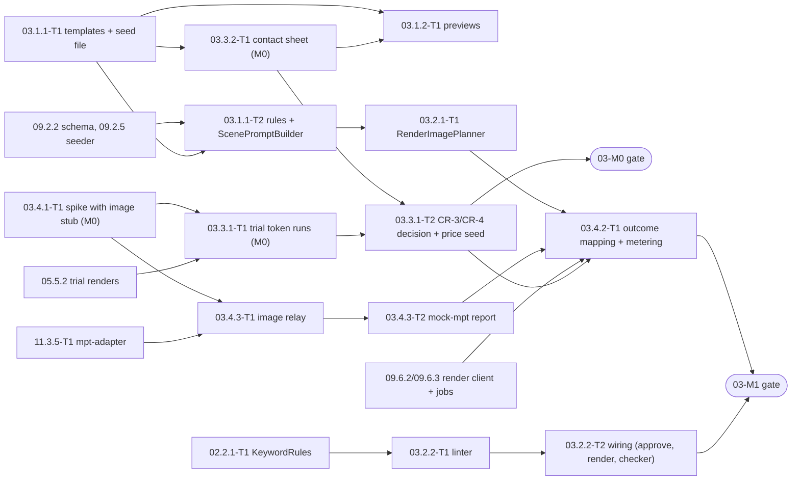

# 03 — Image Generation: Tech Lead review, shared decisions and feature index

> Reviews: `../../03-image-generation.md` (high-level, M0 → M1, all P). Process: `../../00-overview.md` §10.1, step (2) review → step (3) detailed feature plans (this folder).
> Reviewed: 2026-09-24 by the Tech Lead. Feature plans: 4 folders, 4 `plan.md` + 13 task files, written 2026-09-24. Status: **owner decisions O1–O6 accepted 2026-09-24 (§10); re-estimate accepted (§9); CR-1…CR-14 applied 2026-09-24 (§4); TL DoR 2026-09-24 (§11): ready with conditions, findings DR-1…DR-5 fixed; owner-signed 2026-09-24**. Verdict: **approve with changes**. The scope is right (style per series, keyword rules, measurement before pricing, no Edits path). But the plan was written without reading MPT's image code, and three of its core assumptions are wrong: a blocked image never fails an MPT task (F01), the image count is set by `audio ÷ video_clip_duration`, not by the keyword count (F03), and MPT shuffles scene order by default (F02). CR-3 (quality) and CR-4 (metering) both need a component on the node that no plan owns yet (F05). The estimate misses that component (F14).
> Legend: ✅ read from source/docs (file + line, date) · ⚠️ unverified · [DECISION] · [OPEN] · [INFERENCE].

## 0. How this folder is organised

```
plans/features/03-image-generation/
  README.md                         ← this file: facts, findings, shared decisions D1–D14, task template, sequencing, index, re-estimate
  03.1-style-system/                ← stories 03.1.1, 03.1.2 (templates, builder, previews)
  03.2-keyword-quality/             ← stories 03.2.1, 03.2.2 (scene budget, render linter)
  03.3-measurement/                 ← stories 03.3.1, 03.3.2 (M0: contact sheet, trial tokens, CR-3/CR-4 decision)
  03.4-failures/                    ← stories 03.4.1, 03.4.2 + new 03.4.3 (spike, image relay, outcome mapping)
```

Each feature folder holds `plan.md` (template `00-overview.md` §10.1, sections 1–11) and one `<task-id>-<slug>.md` per task (template §6 below). Task IDs follow `00-overview.md` §9. They **replace** the task table in `03-image-generation.md` §6 (mapping in §8). New tasks get the next free `T<n>` of their story; the new story **03.4.3** (image relay) comes from F05.

## 1. Facts verified for this review

MPT code was read on 2026-09-24 from a local snapshot at `/private/tmp/mptsrc/MoneyPrinterTurbo-main` (`pyproject.toml` `version = "1.3.7"`, the same release as the 01 pin candidate `3d5f4e42`, 01 README M1). The snapshot has no git metadata, so the exact commit is **not** proven ⚠️. Line numbers below are from this snapshot. 03.4.1-T1 step 0 re-checks every `I` fact at the pinned commit before anything is built on it.

| # | Fact | Source |
|---|---|---|
| I1 | The `openai_image` request body is exactly `{model, prompt, n: 1, size}`. There is no `quality`, `moderation`, `response_format` or `user` field ✅ | `app/services/material.py` L1453–1458 (`generate_images_openai`) |
| I2 | With `openai_image_size = ""` the size is `1024x1536` (portrait), `1536x1024` (landscape), `1024x1024` (square) ✅ | `material.py` L1102–1106, L1158–1169 |
| I3 | Final prompt = `openai_image_prompt_template.replace("{term}", term)` when the template is non-empty and contains `{term}`; otherwise the raw term. A replace error also falls back to the raw term ✅ | `material.py` L1172–1193 |
| I4 | Retries: statuses 429/500/502/503/504, `OPENAI_IMAGE_MAX_ATTEMPTS = 3`, backoff table `(5, 15, 30)`. With 3 attempts only the 5 s and 15 s waits are used, so a 429 burst gives up after **≈ 20 s** of waiting (01 F24 says ≈ 50 s — too high). 401/403 are retried only when > 1 key is configured. Every other status ≥ 400 (including 400 `moderation_blocked`) returns at once, no retry ✅ | `material.py` L1108–1119, L1304–1390 |
| I5 | A read timeout or dropped connection is **not** retried ("unconfirmed … avoid double billing"); only a connect timeout is. Timeouts are `(connect 30 s, read 300 s)` ✅ | `material.py` L1116, L1338–1356 |
| I6 | On failure MPT logs `openai image generation failed: term=<repr>, detail=HTTP <status>: <error.message, ≤ 300 chars>` and **skips the keyword** (returns `[]`). The OpenAI `error.code` is not logged, only the message ✅ | `material.py` L1204–1228, L1462–1468 |
| I7 | Images are generated **on demand**, in list order. After each success MPT adds `video_clip_duration` seconds and stops as soon as `successes × video_clip_duration ≥ audio_duration × video_count`. So billed successful images = `min(T, ceil(audio_s ÷ clip_s))` for `T` terms; a skipped term is replaced by the next one ✅ | `material.py` L1513–1590; `app/services/task.py` L733–746 |
| I8 | When the clips are shorter than the audio, `combine_videos` loops the clips until the audio is covered ✅ | `app/services/video.py` L934–949 |
| I9 | Zero clips → task failed, stage `materials`, message `failed to download video materials from openai_image` ✅ | `task.py` L803–809 |
| I10 | `video_concat_mode` defaults to `random`: `combine_videos` calls `random.shuffle(primary_items)`. Order is kept only with `video_concat_mode = "sequential"` (or `match_materials_to_script = true`, which forces sequential) ✅ | `video.py` L245–257, L823; `task.py` L738–742; `app/models/schema.py` L111, L115 |
| I11 | `video_terms` as a **string** is split on `,` and `，`; as a **list** each item is only `strip()`ed. There is no length limit. An empty result fails the task at stage `terms` ✅ | `task.py` L313–352; `schema.py` L108 |
| I12 | Terms are re-ranked by TwelveLabs only when TwelveLabs is enabled **and** `twelvelabs_rerank_terms = true` (default `false`) ✅ | `app/services/twelvelabs.py` L97–113; `config.example.toml` L216 |
| I13 | `VideoParams.video_clip_duration` defaults to **5** (`ge=1`); the config example comment shows 3 ✅ | `schema.py` L113; `config.example.toml` L647 |
| I14 | With `material_directory = ""` images are saved in the task dir as `openai-image-<uuid12>.png` (file names never come from the term). The task dir also receives `material_sources` (with `search_term`) and `script.json` (script, search terms, all params) ✅ | `material.py` L1393–1431, L128–155, L1532–1534; `task.py` L355–361 |
| I15 | The image key is optional: empty `openai_image_api_keys` → no `Authorization` header. The source is "enabled" when `openai_image_base_url` and `openai_image_model` are set ✅ | `material.py` L1122–1135, L1320–1336 |
| I16 | A `url` response is downloaded up to 3× from the same URL (never re-generated); `b64_json` is decoded; an undecodable image skips the keyword; a disk write error raises and fails the task ✅ | `material.py` L1230–1302, L1393–1431, L1470–1480 |
| I17 | MPT logs the full final prompt at INFO (`generating image via openai-compatible endpoint: model=…, term=…, size=…`) and again on failure (I6) ✅ | `material.py` L1459–1461 |
| O6 | Images API: `quality` defaults to `auto` when omitted (flare also accepts `xhigh`, `max`); `moderation` is `auto`/`low`; `usage` = `input_tokens` (+ `input_tokens_details.text_tokens/image_tokens`), `output_tokens`, `total_tokens`, and may be absent ✅ | 01 README §1 O6 (images API reference, 2026-09-23) |
| O8 | `gpt-image-2.5-flare`: text input $5, image input $8, image output **$30** per 1M tokens; Tier 1 = **5 images/min** ✅ | 01 README §1 O8 (pricing + model page, 2026-09-23) |
| O9 | A blocked request returns `error.code = "moderation_blocked"`; do not auto-retry the same prompt ✅ | DECISIONS §5.2 |
| P1 | 01 D6 usage tap logs per call `request {size, quality, moderation, n}`, `response {quality, size}`, `error_code`, `usage`; it never logs prompts; `TAP_IMAGE_QUALITY` can inject `quality`; M0 only (CR-4 decides production) ✅ | 01 README D6; 01.3.1-T2 |
| P2 | Schema v2 already has `image_count`, `moderation_blocked_count`, `image_http_429_count`, `image_failed_count`, `image_tokens_per_image_avg`, `image_cost_per_image_usd` ✅ | 01.3.1-T1 cols 15, 18, 45, 46 |
| P3 | 02 D3/D4: 1–2 keywords per segment; K = 6 keywords/min; segments ≈ `ceil(D × K ÷ 1.5)`; `KeywordRules` (English, 3–12 words, name heuristic, gore list) lives in Domain `Stories/Keywords/` (02 CR-5, 02.2.1-T1) ✅ | 02 README D3, D4, CR-5 |
| P4 | 02.8.2-T2 already expands scene prompts itself (`Template.Replace("{term}", k)`) and strips "the known negative clause" by a suffix heuristic before moderation ✅ | 02.8.2-T2 §Scene-prompt expansion |
| P5 | 02.8.2-T1 video gate check 7 reads `quality_report.failed_scenes` + `quality_report.keywords_skipped` (= 0 to pass); `VideoGateInput` carries `ImageModerationEvents` ✅ | 02.8.2-T1, 02.8.2 plan §3.2 |
| P6 | 09.2.2: `style_templates.template` has `CHECK position('{term}' in template) > 0`; `name` unique; `topic_hint` nullable CHECK of topic values; `series.style_template_id` FK RESTRICT ✅ | 09.2.2 plan §3 |
| P7 | 09.2.5-T1 seeds 2 **placeholder** style templates in `seed/catalog.dev.json`, "until plan 03" ✅ | 09.2.5-T1 steps 2, Notes |
| P8 | 09.6.3: never auto-retry `image_moderated`; failure → episode `rendering → story_approved`; `render_jobs.params` holds non-content settings only; job arguments are ids only ✅ | 09 §4 09.6.1, 09.6.3 |
| P9 | 12 §5.7: image cost = images × `r_image[model, quality, aspect]`, or tokens × rate when usage is reported; images ≤ `ceil(D_max × K)`; `estimated = true` when no usage ✅ | 12 §4 12.1.x, §5.7 |
| P10 | 10.5: flagged keywords are red chips and "Make video" is disabled; the `image_moderated` message names the scene with "Edit scenes" (reopen) ✅ | 10 §4 10.5.x |
| P11 | 11.3.5 `mpt-adapter` contract: submit, status, download by task id, health, cleanup; its implementation language is not fixed; 11 §10 says a metering forwarder "is a new node component with its own task and estimate" ✅ | 11 §4 11.3.5, §10 |

## 2. Findings

Severity: **B** blocks a milestone · **H** breaks an FR/NFR or a contract · **M** rework or drift risk · **L** clarity.

| # | Sev | Where (plan 03) | Finding | Action (owner feature) |
|---|---|---|---|---|
| F01 | B | FR-03-5, 03.4.2, 09.6.3, 10.5 | "A moderation failure ends the render job with `image_moderated`" cannot happen: MPT skips a blocked keyword, uses the next term, loops clips, and reports the task as **succeeded** (I6–I8). The task only fails when **every** image fails (I9). The task API has no per-image data, and MPT does not even log the `error.code` (I6). The backend therefore cannot see a moderated image at all today | [DECISION D5, D6, D7] A node **image relay** records every image call (status, `error.code`, usage) per render task. The adapter status returns an `images.v1` report. The backend maps it with the outcome table D7: a video with blocked scenes is **kept** and goes to review; `image_moderated` is terminal only when no video was produced (03.4.3-T1, 03.4.2-T1) |
| F02 | H | FR-03-2, 05 §5.2 | MPT's default `video_concat_mode = random` shuffles the clips (I10). The scenes then appear in random order against the narration — the keyword-per-segment design (02 D3) is lost | [DECISION D4] Every submit sets `video_concat_mode = "sequential"` and `match_materials_to_script = true`; mock-mpt and the adapter contract test assert it (03.2.1-T1, CR-5) |
| F03 | H | 03.2.1, §5.3, 12 §5.7 | Image count is driven by `ceil(audio_s ÷ video_clip_duration)` (I7), not by the keyword count. With MPT's default clip of 5 s (I13) a video needs **12 images/min** — twice K = 6 — so the 12 §5.7 cost example is 2× too low. "Trim/merge keywords" is the wrong lever; "merge" is not even possible for phrases | [DECISION D3] `video_clip_duration = 60 ÷ K = 10 s` per job. The keyword list is capped at `MaxTerms` (needed images + 15 % spares, never above the tier maximum). Extra terms are **free** (MPT stops once the audio is covered) and replace skipped ones. Drop "merge" (03.2.1-T1) |
| F04 | H | §5.2 | A styled term contains commas. If `video_terms` is ever sent as a **string**, MPT splits it on `,` (I11): one styled scene becomes 4–6 paid images of fragments | [DECISION D4] `video_terms` is always a JSON **array**. The relay rejects a prompt that does not end with the platform negative clause (`relay_prompt_unstyled`), which also catches fragments (03.4.3-T1) |
| F05 | H | §10 CR-3, CR-4, 11 §10 | CR-3 (quality) and CR-4 (production metering) have the same answer: something between MPT and OpenAI must add `quality` and record `usage`. No plan owns that component; 11 only says it would be "a new node component with its own task and estimate" (P11) | [DECISION D5] New story **03.4.3 Image relay**: a loopback listener inside `mpt-adapter`. MPT's `openai_image_base_url` points at it. It injects the image key and `quality`, paces requests, attributes each call to a render task by prompt hash, and writes a per-task report. CR-4 → relay metering; CR-3 → option (b), value chosen by 03.3.2 |
| F06 | H | G7, 01 F24 | At Tier 1 (5 images/min, O8) MPT waits only ≈ 20 s in total before it skips a keyword (I4). A 5-min video needs 30 images (D3) = 6 min of quota at best | Relay token bucket (`ImageRelay:ImagesPerMinute`, holds a request up to 90 s instead of returning 429) + one relay-side retry of an upstream 429 `rate_limit_exceeded`. Owner asks for a tier increase before M1 (§10 O4). 01 F24 text corrected by CR-8 |
| F07 | M | 03.1.1, 02.8.2-T2 | The negative clause lives inside each template's text. 02.8.2-T2 must strip it again with a suffix heuristic before moderation (P4), and a new template can forget it | [DECISION D1] `style_templates.template` holds the **style only**. `ScenePromptBuilder` appends a versioned platform `NegativeClause` (v1). 02.8.2-T2 calls the builder instead of its own `Replace` and strip (CR-3) |
| F08 | M | §8, 02 D19 | The node keeps content: MPT logs every full prompt at INFO (I17) and writes `script.json` with the whole script into the task dir (I14). 02 D19 ("never log story text") covers only the backend | [DECISION D12] MPT logs stay on the node (never shipped), rotated after 7 days; the adapter cleanup deletes the task dir after ingest (05.4.1 item 7); the relay logs hashes only. CR-6 to 11 |
| F09 | M | §5.1 | The node image key sits in MPT's `config.toml`, which MPT itself rewrites and prints on errors ⚠️ | [DECISION D5] With the relay, MPT gets `openai_image_api_keys = []` (I15). Only the relay holds the key. A stray MPT call without a planned prompt hash is refused (`relay_unknown_prompt`) |
| F10 | M | 03.2.2 | "Names found in `fact_sources` titles" is under-specified: titles are often Vietnamese, keywords are English and ASCII; the real names of a true-crime case are mostly in the approved **fact statements**, not in titles | [DECISION D11] Candidate names = runs of ≥ 2 capitalised tokens from source titles **and** approved fact statements, folded to ASCII lower case; a keyword is flagged when it contains ≥ 2 consecutive tokens of a candidate name (03.2.2-T1) |
| F11 | M | G4, 03.1.1 | "Templates force illustration/silhouette for true crime" has no rule: a true-crime series could pick "Vintage photo grain" (photographic, people) | [DECISION D2] A `true_crime` series may only use templates with `topic_hint = 'true_crime'`. A 7th template (`case-file-illustration`) gives true crime two choices. CR-2 to 09.4.1 validation |
| F12 | M | 03.1.2 | Preview images: no size, format, storage key or cost bound | [DECISION D2] One landscape WebP per template, ≤ 150 KB, key `style-previews/<name>.v1.webp` in `nt-public-<env>`, generated by the 03.3.2 tool in `--mode previews` (03.1.2-T1) |
| F13 | M | 03.1.1, 10.4.2 | The picker needs vi and en names, but 00 §6 `style_templates` has only `name` | [DECISION D2] No new column: labels are i18n keys `series.style.<name>.label` / `.hint` in the web bundles (CR-7 to 10.4.2) |
| F14 | M | §6, §11 | The estimate has no relay, no stub-driven spike (a real moderated image cannot be provoked on purpose), no image report mapping, no decision task | Re-estimate §9: **7.0 d raw / 8.4 buffered** (+2.0 d raw) |
| F15 | M | 03.4.2 | Images of a failed render are still billed. The high-level plan only meters successful renders (FR-03-4) | [DECISION D8] Usage rows are written on **every** terminal render state, before adapter cleanup (03.4.2-T1) |
| F16 | M | §5.1 | Changing a template's text silently changes the look of every existing series and makes old renders untraceable | [DECISION D1] `render_jobs.params.style_prompt_version` = `style=<name>@<sha8>;neg=v1`; a text change = new seed version, noted in the release notes; channel owners are not asked in P |
| F17 | M | 03.2.1, 10.5 | Which keywords are dropped when the cap bites is undefined, and the user is not told | [DECISION D3] Deterministic trim: keep the first keyword of every segment, then drop second keywords from the end. Hint `scenes_trimmed` (advisory) in quality hints and `render_jobs.params.image_plan` |
| F18 | L | §5.4 | `keyword_limit_exceeded` is never raised once trimming is automatic | Replaced by the advisory hint `scenes_trimmed` (D10) |
| F19 | L | §5.3 | The cost formula ignores the text-input part of each image call ($5/1M, O8) | `ImageCostCalculator` uses all three token classes (D8) |
| F20 | L | 01.2.2-T6 | The wiring-render cost ceiling assumes a ≈ 3 s clip; MPT's per-job default is 5 s (I13) | CR-8 to 01.2.2-T6 (text only; the $4.50 ceiling still holds) |
| F21 | L | §5.2 | "Worker's global template is set to `{term}`" | [DECISION D4] Set it to `""`: MPT then sends the term unchanged (I3), and the relay's styled-prompt check (F04) catches any unstyled call |

## 3. Shared decisions for all feature plans (contract)

Feature plans and task files MUST use these names exactly. Make any change here first.

**D1 Style template contract [DECISION].**
- `style_templates.template` = the **style text only**: exactly one `{term}`, 60–600 chars after trim, no line breaks, no `"`, no negative clause. `name` = slug `^[a-z0-9]+(-[a-z0-9]+)*$`, 3–40 chars. Enforced by `StyleTemplateRules.Validate(name, template)` (Domain `Catalog/`) at seed time; the DB CHECK from 09.2.2 stays as the last line.
- `NegativeClause` (Domain `Catalog/NegativeClause.cs`) is versioned platform text. v1 = `No gore, no blood, no text, no letters, no logos, no watermark, no real person likeness.`
- `ScenePromptBuilder.Build(StyleTemplate style, string keyword) → ScenePrompt(string Text, string ModerationText, string Sha256)`:
  - `Text` = `template.Replace("{term}", keyword, Ordinal)` + `" "` + `NegativeClause.V1` — what OpenAI receives.
  - `ModerationText` = the replaced template without the clause — what 02.8.2-T2 moderates.
  - `Sha256` = lower-case hex SHA-256 of the UTF-8 `Text` — the relay's attribution key (D5).
- `StylePromptVersion.For(style)` = `style=<name>@<first 8 hex of sha256(template)>;neg=v1`, stored in `render_jobs.params.style_prompt_version`.
- A deactivated template (`active = false`) disappears from `GET /style-templates` but keeps working for series that already use it (FK RESTRICT, P6). Deleting a row is never done.

**D2 Catalogue v1 [DECISION].** Source file `seed/style-templates.v1.json` (tracked; owner 03.1.1-T1), loaded by the 09.2.5 `StyleTemplateSeeder` in every environment (CR-1). Seven templates:

| `name` | `topic_hint` | en label | vi label |
|---|---|---|---|
| `dark-folklore-ink` | `ghost` | Dark folklore ink | Mực tàu dân gian u tối |
| `foggy-cinematic` | `ghost` | Foggy cinematic | Điện ảnh sương mù |
| `vintage-photo-grain` | `ghost` | Vintage photo grain | Ảnh cũ nhiễu hạt |
| `watercolor-night` | `spiritual` | Watercolor night | Màu nước đêm |
| `temple-candlelight` | `spiritual` | Temple candlelight | Ánh nến đền chùa |
| `noir-sketch` | `true_crime` | Noir sketch | Phác thảo noir |
| `case-file-illustration` | `true_crime` | Case-file illustration | Minh hoạ hồ sơ vụ án |

- Topic rule: a `true_crime` series may only use a template with `topic_hint = 'true_crime'`. `ghost`/`spiritual` series may use any template **except** the `true_crime` ones (hint = suggestion only).
- Labels are web i18n keys `series.style.<name>.label` and `series.style.<name>.hint` (vi + en), not DB columns (CR-7).
- Previews: one landscape image per template, WebP, ≤ 150 KB, 768 px wide, storage key `style-previews/<name>.v1.webp` in bucket `nt-public-<env>`; `preview_storage_key` is set by the seed file (03.1.2-T1).

**D3 Scene budget [DECISION].**
- K = 6 images per minute (02 P3) ⇒ `Images:ClipSeconds` = **10** (`60 ÷ K`), sent as `video_clip_duration` on every job.
- `RenderImagePlanner.Plan(RenderImagePlanInput) → RenderImagePlan` (Domain `Rendering/Images/`):
  - `EstimatedSeconds = tokens(video_script) ÷ Story:Length:Rate:{lang} × 60` (02 D4 token rule; `StoryText.Tokenize`).
  - `NeededImages = ceil(EstimatedSeconds ÷ ClipSeconds)`.
  - `MaxTerms = min(ceil(NeededImages × (1 + Images:SpareShare)), ceil(TierMaxMinutes × 60 ÷ ClipSeconds))`, `SpareShare` = **0.15**. `TierMaxMinutes`: short 1, standard 8, long 15 (02 D4).
  - Terms = story keywords in order (02 D3 derived `keywords`). If `count > MaxTerms`: keep the **first** keyword of every segment, then drop second keywords starting from the **last** segment until the count fits; if the first keywords alone exceed `MaxTerms`, drop first keywords from the end (hint `scenes_trimmed`, advisory).
  - If `count < ceil(NeededImages × 0.7)` → hint `scenes_sparse` (advisory: MPT will loop images, I8).
- The worst-case image bound for budget/reserve is `MaxTerms` images (every term may be called once, I7) × the per-image price (D8).
- `RenderImagePlan(IReadOnlyList<ScenePrompt> Prompts, int ClipSeconds, int NeededImages, int MaxTerms, IReadOnlyList<string> HintCodes, string StylePromptVersion)`. Only counts, hashes and hint codes go into `render_jobs.params.image_plan`, never keywords (P8).

**D4 Image fields of every render submit [DECISION].** Built in memory by 09.6.2 from the plan (never persisted, P8):

| Field | Value |
|---|---|
| `video_source` | `"openai_image"` |
| `video_terms` | JSON **array** of `ScenePrompt.Text` (never a string, F04) |
| `video_clip_duration` | `RenderImagePlan.ClipSeconds` (10) |
| `video_concat_mode` | `"sequential"` (F02) |
| `match_materials_to_script` | `true` (keeps order and skips any rerank, I10, I12) |
| `video_count` | `1` |
| adapter-only `image_plan` | `{ "max_images": MaxTerms, "prompt_sha256": [ … in order … ] }` — consumed by the relay (D5), not forwarded to MPT |

- Node MPT config (image part): `openai_image_base_url = "http://127.0.0.1:<relay port>/v1"`, `openai_image_api_keys = []`, `openai_image_model = "gpt-image-2.5-flare"`, `openai_image_size = ""`, `openai_image_prompt_template = ""` (F21), `twelvelabs_rerank_terms = false`, `material_directory = ""` (CR-5 to 05 FR-05-1 / 11.3.1 guards).
- M0 is different (D13): the Mac trial keeps the 01 usage tap and a per-run global template.

**D5 Image relay [DECISION, new story 03.4.3].** A loopback HTTP listener **inside the `mpt-adapter` process** (one deployable; .NET 10 per 11 D3, bound through `IImagePlanSink`, 11 CR-5 — the contract below stays language-neutral).
- Bind `127.0.0.1:${ImageRelay:Port}` (default **8091**). Only `POST /v1/images/generations` is served; everything else → 404 `relay_path_not_allowed`.
- Upstream `https://api.openai.com/v1/images/generations`, TLS verified, key `NODE_OPENAI_IMAGE_KEY` from the node secret (11.3.2), added as `Authorization: Bearer` by the relay. MPT never holds the key (F09).
- Request checks, in order: JSON body ≤ 64 KB; `model` = `ImageRelay:Model`; `n = 1`; `prompt` ends with the current `NegativeClause` text → else 400 `relay_prompt_unstyled`; `sha256(prompt)` matches an unused slot of an **active** plan → else 400 `relay_unknown_prompt`; claiming a **new** slot keeps the task's distinct claimed slots ≤ `max_images` → else 400 `relay_image_cap_reached` (a retry of an already claimed slot never counts against the cap, DoR DR-2).
- Body changes: sets `quality = ImageRelay:Quality` when configured (D9) and `moderation = ImageRelay:Moderation` (default `"auto"`); nothing else is changed.
- Pacing: a process-wide token bucket of `ImageRelay:ImagesPerMinute` (default **5**, Tier 1, O8). The bucket is per node (shared by all tasks on that node), so it matches the account limit only while **one** active node uses the image key. 11.3.3 allows several nodes: with N active nodes set `ImagesPerMinute = floor(account limit ÷ N)` in node config, and a shared limiter is a phase S item (DoR DR-5). A request waits up to `ImageRelay:MaxWaitSeconds` (**90**) for a token; after that → 429 `relay_rate_limited` to MPT. Budget: every request has a deadline `ImageRelay:RequestDeadlineSeconds` (**270**) counted from arrival, < MPT read timeout 300 s (I5), so the relay always answers before MPT gives up. Pacing waits at most `min(90, deadline left)`; each upstream attempt gets read timeout `min(UpstreamReadSeconds 180, deadline left)`. An upstream 429 with `error.code = rate_limit_exceeded` is retried by the relay up to 2× honouring `Retry-After` (≤ 30 s), takes a new bucket token, and is attempted only if `Retry-After + 60 s` still fits in the deadline; otherwise the 429 is passed through to MPT (DoR DR-1). Quota/billing 429s (`insufficient_quota`, `billing_hard_limit_reached`, `project_spend_limit_exceeded`) are **never** retried.
- Attribution: the adapter registers `image_plan.prompt_sha256[]` for a task at submit and releases it at cleanup. A prompt hash that appears twice in one task fills the next unused slot of that hash; across concurrent tasks the oldest active task wins (collision is logged, `relay_attribution_collision`). A retryable failure (429/5xx) leaves the slot claimed, so MPT's retry of the same prompt reuses that slot instead of taking a new one (03.4.3-T1).
- Per call it appends one line to `${ImageRelay:DataDir}/<adapterTaskId>.jsonl`: `{ ts, slot, prompt_sha256, http_status, error_code, quality_sent, quality_echoed, size, usage, request_id, latency_ms, relay_wait_ms, attempt }`. **Never**: prompt text, headers, image bytes, URLs. The file is deleted by the adapter cleanup.
- Health: the adapter health response gains `image_relay { ok, tokens_available, active_plans }`.

**D6 Image report `images.v1` [DECISION].** Returned in the adapter status for a terminal task (CR-5 to the 05.4.1 contract and 11.3.5); mock-mpt emits the same shape (03.4.3-T2).

```json
{
  "schema": "images.v1",
  "planned": 34, "needed": 30, "called": 31, "succeeded": 30,
  "failed": [ { "slot": 7, "http_status": 400, "error_code": "moderation_blocked" } ],
  "unattempted": 3,
  "quality_sent": "medium", "quality_echoed": ["medium"], "size": "1536x1024", "model": "gpt-image-2.5-flare",
  "usage": [ { "slot": 0, "request_id": "req_…", "text_tokens": 92, "image_tokens": 0, "output_tokens": 1056, "estimated": false } ],
  "relay_rejections": { "relay_prompt_unstyled": 0, "relay_unknown_prompt": 0, "relay_image_cap_reached": 0, "relay_rate_limited": 0 }
}
```

- `needed` is `null` from the relay (it does not know the audio length); the Worker fills it from `render_jobs.params.image_plan.needed` before classifying (03.4.2-T1).
- `slot` = 0-based index into `image_plan.prompt_sha256` (= index into the sent `video_terms`). The backend maps a slot back to the story segment through the stored plan order (03.4.2-T1).
- `failed` lists final outcomes only (after MPT and relay retries); `usage` has one entry per **billed** call (every call with a `usage` body, success or not).

**D7 Render outcome mapping [DECISION; replaces FR-03-5 and 03.4.2's acceptance].** `ImageOutcomeClassifier.Classify(MptTerminalState, ImageReportV1, ImagePolicy) → ImageOutcome` (Domain `Rendering/Images/`). `skipped = count(failed)`; `moderated = count(failed where error_code = moderation_blocked)`; `skippedShare = skipped ÷ max(1, needed)`. `Images:MaxSkippedShare` = **0.10**.

| # | MPT terminal | Report | Render job | Episode | Auto-retry (00 §7) | Side effects |
|---|---|---|---|---|---|---|
| 1 | succeeded | `skipped = 0` | `succeeded` → ingest | `video_review` | — | usage rows |
| 2 | succeeded | `moderated ≥ 1`, `skippedShare ≤ 0.10` | `succeeded` → ingest | `video_review` | — | one `moderation_events` row per moderated slot; `quality_report.images` lists the scenes; autopilot video gate check 7 fails → owner review (CR-3) |
| 3 | succeeded | `moderated = 0`, `0 < skippedShare ≤ 0.10` | `succeeded` → ingest | `video_review` | — | advisory `images_skipped` in `quality_report.images` |
| 4 | succeeded | `skippedShare > 0.10`, all skipped are moderated | `failed` `image_moderated` | `story_approved` | **never** | `moderation_events` rows; UI "Edit scenes" (P10) |
| 5 | succeeded | `skippedShare > 0.10`, any non-moderation skip | `failed` `image_generation_failed` (detail `images_incomplete`) | `story_approved` | yes, ≤ 2 | usage rows |
| 6 | failed, stage `materials` | `moderated ≥ 1` | `failed` `image_moderated` | `story_approved` | never | as row 4 |
| 7 | failed, stage `materials` | any `error_code` ∈ quota/billing codes (D5) | `failed` `image_generation_failed` (detail `provider_funds_exhausted`) | `story_approved` | no (12.8.3 P subset pause) | opens `provider_funds_exhausted` |
| 8 | failed, stage `materials` | other / no report | `failed` `image_generation_failed` | `story_approved` | yes, ≤ 2 | usage rows if any |

- Rows are evaluated in this precedence: **7 before 6** (a funds code wins over moderated slots, so the funds pause is always opened), then 6, 8 for failed tasks; 4, 5, 2, 3, 1 for succeeded tasks. 03.4.2-T1 code follows this order (DoR DR-3).
- Rows 4 and 5 fail a video that was rendered: with > 10 % of scenes missing, MPT's clip looping (I8) makes the video visibly broken [DECISION, owner confirms at §10 O2].
- `moderation_events`: `source = openai_image`, `stage = render_image`, `categories = []` (the Images API returns none ⚠️), `excerpt` = the **keyword** of the slot (≤ 300 chars), never the full prompt.
- The `quality_report.images` block (owner 03.4.2-T1): `{ schema: "images.v1", needed, succeeded, skipped: [ { slot, segment, reason } ], moderated_count, trimmed_count, hints: [] }` with `segment` in D22 addressing (`hook`, `p:<i>`, `ending`). 02.8.2-T1 check 7 reads `skipped` instead of `failed_scenes`/`keywords_skipped` (CR-3).

**D8 Image metering and price [DECISION, CR-4 resolved].**
- One `usage_records` row per `images.v1.usage` entry: `provider = openai`, `operation = image`, `model`, `render_job_id`, `episode_id`, `input_tokens = text_tokens + image_tokens`, `output_tokens`, `image_count = 1`, `estimated`, `cost_usd`, `price_version`, `provider_request_id = request_id`.
- Written by `RecordImageUsage` on **every** terminal state (F15), in its own transaction, idempotent: skipped when rows with `(render_job_id, operation = image)` already exist.
- `ImageCostCalculator` (Domain `Usage/`, pure): `text_tokens × r_text_in + image_tokens × r_image_in + output_tokens × r_image_out`, rates from `price_versions.rates.image[model]` (O8: 5 / 8 / 30 USD per 1M).
- No `usage` for a call → `estimated = true`, cost = `tokens_per_image[aspect:quality]` from `price_versions.rates.image[model]` × `r_image_out`.
- `price_versions.rates.image` shape (CR-4 to 02.2.4-T1 / 12.1.2): `{ "gpt-image-2.5-flare": { "text_in_per_1m": 5, "image_in_per_1m": 8, "image_out_per_1m": 30, "tokens_per_image": { "landscape:medium": 0, "portrait:medium": 0, … }, "tokens_per_image_p95": { … } } }`, filled by 03.3.1-T2 from measurements. Until then the seed uses **6,000** tokens/image for every cell ⚠️ (pessimistic placeholder, not measured).
- `IImageCostEstimator.WorstCase(Aspect aspect, int maxTerms, int priceVersion) → CostBound` = `maxTerms × (tokens_per_image_p95[aspect:quality] × r_image_out + 200 × r_text_in)`. 09.6.1 passes it to `IBudgetGuard.CheckAsync` (02 D1) before dispatch and before each auto-retry (CR-4).

**D9 Image quality [DECISION, CR-3 → option (b)].** The relay injects `ImageRelay:Quality`. Allowed: `low | medium | high | auto`. Value = the 03.3.2 decision (proposal: `medium`), recorded in DECISIONS §4 by 03.3.1-T2. Until that task lands the value is **unset** = pass-through, i.e. the API default `auto` (O6). Option (c), an upstream MPT PR, stays possible later and would not change the backend. In M0, the same value is applied through `TAP_IMAGE_QUALITY` (01 D6) for the confirmation runs of 03.3.1-T1.

**D10 Codes for plan 03 (merge into 09 §5.4, CR-9).**

| Code | Kind | Raised by |
|---|---|---|
| `keywords_flagged` | 409, `errors[] { segment, index, rule }` | `ApproveStoryCommand` and `RenderEpisodeCommand` when `RenderKeywordLinter` returns a blocking issue (03.2.2-T2) |
| `image_moderated` | job outcome (`render_jobs.error_code`) | D7 rows 4, 6 |
| `image_generation_failed` | job outcome, `error_message` detail ∈ `images_incomplete`, `provider_funds_exhausted`, `rate_limited`, `upstream_error` | D7 rows 5, 7, 8 |
| `scenes_trimmed`, `scenes_sparse` | advisory hint codes (quality hints + `image_plan.hints`) | D3 |
| `images_skipped` | advisory in `quality_report.images` | D7 row 3 |
| `keyword_name_detected` | linter rule id (blocking) | D11 |
| `relay_*` | node-internal only (relay JSONL, adapter report), never an HTTP response of the platform | D5 |

`keyword_limit_exceeded` (03 §5.4) is **withdrawn** (F18).

**D11 Render keyword linter [DECISION].** `RenderKeywordLinter.Lint(IReadOnlyList<SegmentKeywords> keywords, NameCorpus names) → IReadOnlyList<ValidationIssue>` (Domain `Stories/Keywords/`, beside `KeywordRules`).
- Runs `KeywordRules` first (02.2.1-T1 rules, unchanged).
- `NameCorpus.From(IEnumerable<string> texts)`: for each text, NFD → drop combining marks → map `đ/Đ` → `d/D`; take runs of ≥ 2 tokens that start with an upper-case letter, skipping a run-start stop list (`the, a, this, that, in, on, at, of, police, court, case, vu, toa, cong` after folding; `an` is kept because it is also a Vietnamese given name); skip a whole text that is in Title Case (≥ 60 % of its ≥ 3-letter tokens capitalised, typical English headlines); store each run as lower-case token arrays.
- Texts = `story_sources.title` of fetched url sources **and** the `statement` of every fact in the episode's approved fact sheet (true crime). Fiction episodes have an empty corpus.
- A keyword is flagged (`keyword_name_detected`, blocking, objective) when its folded lower-case tokens contain any **2 consecutive tokens** of any candidate run. Issues carry D22 segment addressing.

**D12 Node logging and data [DECISION].** MPT logs (I17) and task dirs (I14) are content. They stay on the node disk, are never shipped to central logging, rotate after **7 days**, and the task dir is deleted by the adapter cleanup after a successful ingest (05.4.1 item 7) or 24 h after a failure. The relay and the adapter log ids, hashes, codes and counts only. CR-6 to 11.3.1.

**D13 M0 vs M1 [DECISION].**
- **M0 (Mac trial, plans 01/05):** usage tap (01 D6) stays the measurement path; the style is set with MPT's **global** `openai_image_prompt_template` = the chosen template text + `{term}` + the negative clause, one style per run; `video_terms` come from the 02.1.3-T0 harness as a list; `video_clip_duration = 10` and `video_concat_mode = sequential` are set in the submit body. No relay on the Mac.
- **M1 (node):** backend expansion (D1), relay (D5), report (D6), mapping (D7), metering (D8).

**D14 Test kit.**
- `tests/NightTales.TestKit/Rendering/FakeRenderClient` gains scripted `ImageReportV1` outcomes (all ok · moderated slot k · skipped share 15 % · funds exhausted · no report).
- mock-mpt: env `MOCK_IMAGE_REPORT=ok|moderated:<slots>|skipped:<share>|moderated_all|funds|none`, plus the per-term trigger `__block_image__` (03.4.3-T2, CR-5 to 11.1.2).
- M0 spike: `trial/tools/image_stub.py` (stdlib) fakes the Images API for MPT with scripted failures (03.4.1-T1). No real policy-violating prompt is ever sent on purpose [DECISION].

## 4. Change requests to other files

**Applied 2026-09-24** after the owner accepted §9 and O1–O6 (§10). Each edited text is tagged `(03 CR-n)`. Exception: the measured numbers of CR-12 (DECISIONS §4) are written by 03.3.1-T2 once they exist; only the rule and a pointer are applied now.

| CR | To | Request |
|---|---|---|
| CR-1 | 09.2.5-T1 / plan | `StyleTemplateSeeder` reads `seed/style-templates.v1.json` (D2) in **every** environment; the 2 placeholders in `seed/catalog.dev.json` are removed; seeding validates with `StyleTemplateRules` (D1) |
| CR-2 | 09.4.1-T1, 09.4.2 | Create/Update series: `true_crime` requires `topic_hint = 'true_crime'`; fiction rejects `true_crime` templates → 400 `validation_failed` field `styleTemplateId` (D2). `GET /style-templates?topic=` filters by the same rule |
| CR-3 | 02.8.2-T1, 02.8.2-T2 | T2: use `ScenePromptBuilder.Build(...).ModerationText`; drop the local `Replace` and the negative-clause strip and `Autopilot:Gates:Moderation:StripNegativeClause`. T1: check 7 reads `quality_report.images.skipped` (count = 0) and `moderated_count` (D7) |
| CR-4 | 02.2.4-T1, 12.1.2, 09.6.1 | `price_versions.rates.image` shape (D8); 09.6.1 calls `IImageCostEstimator.WorstCase` + `IBudgetGuard.CheckAsync` before dispatch and before each auto-retry |
| CR-5 | 05 §5.2/§5.3, 05.4.1, 11.3.5, 11.1.2, 11.3.1 | Submit fields D4 (`video_terms` array, `video_clip_duration = 10`, `video_concat_mode = sequential`, `match_materials_to_script = true`, adapter-only `image_plan`); adapter status carries `images.v1` (D6); relay inside the adapter (D5); node MPT image config + guards (D4); mock-mpt `MOCK_IMAGE_REPORT` |
| CR-6 | 11.3.1, 11.3.2 | D12 log/data rules; relay holds `NODE_OPENAI_IMAGE_KEY`; the relay port is loopback-only (node firewall test) |
| CR-7 | 10.4.2-T1, 10.5.x | Style labels via i18n keys (D2); video review shows `quality_report.images.skipped` scenes with "Edit scenes"; `image_moderated` copy says "no video was made" (D7 rows 4, 6); new hint copy `scenes_trimmed`, `scenes_sparse`, `images_skipped` |
| CR-8 | 01 README F24, 01.2.2-T6 | I4: MPT waits ≈ 20 s (not 50 s) before skipping; I13: per-job default clip is 5 s |
| CR-9 | 09 §5.4 | Merge D10; drop `keyword_limit_exceeded` |
| CR-10 | 03 high-level §3/§4/§5/§10 | FR-03-1 negative clause appended by the builder (D1); FR-03-5 → D7; 03.2.1 "trim/merge" → D3; §5.1 key in the relay; CR-3/CR-4 closed by D9/D8 |
| CR-11 | 00 §4.1, §13 | Plan 03 raw 5.0 → 7.0 d (§9) after the owner accepts |
| CR-12 | DECISIONS §4, §5.2 | §4: quality decision + measured tokens/image per aspect (03.3.1-T2); §5.2: "moderation_blocked → MPT skips the keyword, the relay reports it" |
| CR-13 | 02 README D21 (T28), 02.3.2-T1 | `StoryRenderInput` gains `IReadOnlyList<SegmentKeywords> Segments` (segment address + keywords, story order) so the planner can trim per segment and map failed slots back to scenes (03.2.1-T1, 03.4.2-T1); `Keywords` stays as the flat list |
| CR-14 | 02.3.4-T1 | `StoryCheckContext` gains `NameCorpus Names` and `RenderImagePlan? Plan`; the checker appends `RenderKeywordLinter` issues and the plan hints (03.2.2-T2) |

## 5. Sequencing



Suggested order for one developer:
- **M0:** 03.1.1-T1 → 03.3.2-T1 → 03.4.1-T1 → (05.5.2) → 03.3.1-T1 → 03.3.1-T2 → 03.1.2-T1.
- **M1 wave 1 (after 09 wave 1):** 03.1.1-T2 → 03.2.1-T1 → 03.2.2-T1 → 03.2.2-T2.
- **M1 wave 2 (after 11.3.5-T1 and 09.6.2):** 03.4.3-T1 → 03.4.3-T2 → 03.4.2-T1.

## 6. Task file template

Same as `../02-story-writing/README.md` §6:

```markdown
# <task-id> — <title>

| Story | Size | Area | Depends on | Blocks | Phase / flag |
|---|---|---|---|---|---|

## Goal
## Inputs
## Design
## Steps
## Outputs
## Acceptance checks
## Tests
## Failure handling and edge cases
## Notes
```

## 7. Gates

- **03-M0** (part of M0 exit, Gate 1 input): 7 templates written and reviewed; contact sheet rated; tokens/image and cost/image known per aspect for `auto` **and** the chosen quality; D9 quality and D8 metering recorded in DECISIONS §4; spike note `worker-node/contract/images.md` delivered to 05.4.1; zero skipped images in the 05.5.2 rows, or the cause recorded.
- **03-M1**: a render through the relay on the node has `video_terms` in story order, 10-s clips, `quality` injected, a complete `images.v1` report, usage rows with `estimated = false`, and the D7 table covered by integration tests against mock-mpt. `keywords_flagged` blocks approve and render. The seeded catalogue is live with previews.

## 8. Feature index and task mapping

| Feature folder | Stories | Tasks | Replaces (03 §6) |
|---|---|---|---|
| [`03.1-style-system/`](03.1-style-system/plan.md) | 03.1.1, 03.1.2 | 03.1.1-T1 style spec + 7 templates + seed file (S) · 03.1.1-T2 `StyleTemplateRules` + `NegativeClause` + `ScenePromptBuilder` + seeder hook (S) · 03.1.2-T1 preview images (XS) | 03.1.1-T1, 03.1.1-T2, 03.1.2-T1 |
| [`03.2-keyword-quality/`](03.2-keyword-quality/plan.md) | 03.2.1, 03.2.2 | 03.2.1-T1 `RenderImagePlanner`: clip, cap, trim, hints, worst case (S) · 03.2.2-T1 `RenderKeywordLinter` + `NameCorpus` (S) · 03.2.2-T2 linter wiring: checker, approve, render (XS) | 03.2.1-T1, 03.2.2-T1 |
| [`03.3-measurement/`](03.3-measurement/plan.md) | 03.3.1, 03.3.2 | 03.3.2-T1 quality contact sheet + per-quality tokens (S) · 03.3.1-T1 trial renders token measurement (S) · 03.3.1-T2 CR-3/CR-4 decision + `price_versions` image seed (XS) | 03.3.1-T1, 03.3.2-T1 |
| [`03.4-failures/`](03.4-failures/plan.md) | 03.4.1, 03.4.2, 03.4.3 | 03.4.1-T1 spike: MPT image failure behaviour with an image stub (M) · 03.4.3-T1 image relay in `mpt-adapter` (M) · 03.4.3-T2 mock-mpt `images.v1` report (XS) · 03.4.2-T1 outcome mapping, moderation events, metering (M) | 03.4.1-T1, 03.4.2-T1 |

## 9. Re-estimate

| Feature | High-level (tasks) | Detailed | Why it moved |
|---|---|---|---|
| 03.1 style system | 1.5 | 1.25 | builder is small; previews reuse the contact-sheet tool (F12); +1 template (F11) |
| 03.2 keyword quality | 1.5 | 1.25 | linter reuses `KeywordRules` (02 CR-5); planner replaces "merge" (F03, F17) |
| 03.3 measurement | 1.0 | 1.25 | decision + price seed task (D8, D9) |
| 03.4 failures | 1.0 | 3.25 | image relay is new (F05, F06, F09); stub-driven spike (D14); outcome table + metering on every state (F01, F15) |
| **Total** | **5.0** | **7.0** → with 20 % buffer **8.4** person-days | +2.0 d raw. The relay also closes 11 §10 CR-4 and 12's "image usage" gap, so it is work the programme would otherwise meet in 11 without an estimate |

Lean options if the owner rejects the increase:
- Drop the relay and accept option (a): `auto` quality, estimated image cost only, moderation seen only as "fewer images" through log scraping by the adapter: −1.25 d (03.4.3-T1/T2), at the cost of unknown per-video cost, no pacing and no scene-level moderation message.
- Drop previews (text-only picker): −0.25 d.

## 10. Owner decisions

> **All six accepted by the owner on 2026-09-24**, as recommended below. O4 is an owner action (tier request) tracked in 03.3.1-T2; O6 is revisited after the first 20 M1 renders.

| # | Item | Decision (accepted 2026-09-24) |
|---|---|---|
| O1 | Accept the relay (D5) as a P component inside `mpt-adapter`, and its +2.0 d | Yes — it is the only way to meet FR-03-4, FR-03-5 and NFR-03-1 with an unmodified MPT |
| O2 | D7: fail a rendered video when > 10 % of scenes are missing (rows 4–5) instead of sending it to review | Yes; 10 % ≈ 3 of 30 scenes, where looping becomes visible |
| O3 | D9 default quality before the M0 evidence | Unset (= `auto`) until 03.3.1-T2; proposal after evidence: `medium` |
| O4 | Ask OpenAI for a higher image tier before M1 (5 images/min makes a 5-min video wait ≥ 6 min for images) | Yes, as soon as the M0 spend history allows ⚠️ tier rules not re-read |
| O5 | Seven templates instead of six (second true-crime style, F11) | Yes |
| O6 | Pre-moderate scene prompts on the **human** path too (free omni-moderation; image moderation differs, so the gain is unknown) | Not in P; decide after the first 20 renders' block rate |

## 11. Definition-of-Ready review (2026-09-24)

**Method.** Same as `../02-story-writing/README.md` §11. The TL review was done directly; no agent review was used.
- A script checked all 4 `plan.md` files (sections 1–11 present and in order), all 13 task files (the 9 headings in order, a one-row table, balanced code fences), every `03.x.x-Tn` reference across `plans/` (0 unknown), and the task-size sum (7.0 d = §9 and `03-image-generation.md` §11).
- External `Depends on` ids: 20 resolve to detailed task files. 7 point at plans that are not detailed yet, and each is a named story in its high-level plan: `09.6.1-T1`, `09.6.2-T1`, `09.6.3-T1` (09 §4), `11.1.2-T1`, `11.3.5-T1` (11 §4), and `10.4.2-T1` (10 §4). `05.5.2`, `04.1.2` and `11.4.1` are story-level references.
- Targeted reading covered the highest-risk designs: D3 planner arithmetic (both worked examples recomputed), D5 relay checks, timing and attribution, the D7 precedence against the 03.4.2-T1 classifier code, D8 idempotency against `render_jobs` "one row per attempt" (00 §6), and the D1 prompt builder with its hash.

**DoR checklist (`00-overview.md` §10), per story** (03.1–03.4):

| Criterion | Result |
|---|---|
| User value stated | ✅ Each `plan.md` §1 restates the story and its acceptance |
| Acceptance in Given/When/Then | ✅ In `03-image-generation.md` §4 (rewritten by CR-10); refined per task as observable checks |
| Dependencies known | ✅ All resolve (see Method). ⚠️ 7 point at plans that are not detailed yet: see condition 3 |
| Estimate ≤ XL | ✅ Largest tasks are M (03.4.1-T1, 03.4.2-T1, 03.4.3-T1) |
| API contract / UI linked | ✅ `GET /style-templates?topic=` in 00 §8 (CR-11); codes in 09 §5.4 (CR-9); `images.v1` in 00 §5 / 05 / 11 (CR-5); UI in 10.4.2 / 10.5 (CR-7) |
| Tests cover the main behaviour | ✅ Named tests in every code task. 03.1.1-T1, 03.1.2-T1, 03.3.x and 03.4.1-T1 are content, measurement and spike tasks, with manual evidence by design |

**Findings from this review (fixed):**
- **DR-1: the relay timing budget ignored its own retries.** A 90 s wait, plus 2 × `Retry-After` 30 s, plus a 180 s read is 330 s, which is more than MPT's 300 s. The fix is `ImageRelay:RequestDeadlineSeconds` = 270. Each wait and read is clipped to the time left. A retry takes a bucket token and runs only if `Retry-After + 60 s` still fits; otherwise the 429 passes through. Applied to D5, 03.4 `plan.md` §7 and §11, and 03.4.3-T1, with a new test.
- **DR-2: the cap had two definitions.** D5 said "call count < `max_images`", while 03.4.3-T1 said "distinct slots". Counting calls would stop MPT's own retries of one slot. D5 now uses distinct claimed slots, with a new test.
- **DR-3: the D7 table order hid a precedence.** A failed task with a funds code and moderated slots must open the funds pause. The classifier already checks row 7 before row 6; D7 now states the full evaluation order.
- **DR-4: evidence legend.** `Convert.ToHexStringLower` was marked `✅ [INFERENCE]`. It is now ⚠️, with a fallback.
- **DR-5: the token bucket is per node.** 11.3.3 allows several active nodes, which would multiply the account rate. D5 now says: with N nodes, set `ImagesPerMinute = floor(limit ÷ N)`. A shared limiter is a phase S item.

**Checked, no change needed:**
- D8 usage idempotency is per `render_job_id`, and each auto-retry is a new `render_jobs` row (00 §6), so retries are metered.
- The moderation recorder is idempotent per render job.
- The planner worked examples are correct: 390 s → 39 → 45; 54 s → 6 → 6.
- `ScenePromptBuilder` trims only, and the hash covers the exact `Text` sent.

**Verdict: Ready, with conditions.** The conditions below are not gaps in the plans:
1. ✅ Owner sign-off of this section. **Signed 2026-09-24.**
2. Gates that stay as planned tasks:
   - 03.4.1-T1 step 0 re-reads I1–I17 at the pinned MPT version. If MPT changes a prompt before sending it (trimming, template, encoding), every relay hash check fails (`relay_unknown_prompt`), so that must be confirmed there. D5 and D7 are revised if the spike disagrees.
   - 03.3.2-T1 and 03.3.1-T2 choose the quality and replace the 6,000-token placeholder before 03.4.3-T1 sets `ImageRelay:Quality`.
3. Start order:
   - **Open now:**
     - 03.1.1-T1 and 03.3.2-T1 (M0, after 01.3.1-T2 and 01.2.4-T2).
     - 03.4.1-T1 (after 01.2.2-T5).
     - 03.3.1-T1 and 03.3.1-T2 (after 05.5.2 trial renders; 05 is not detailed, but its trial runs are M0 work of plan 01/05).
   - **Open after 09 wave 1 and the 02 M1 tasks they name:** 03.1.1-T2, 03.2.1-T1 and 03.2.2-T1.
   - **Wait for the detailed plans of 11 (11.1.2, 11.3.x) and 09 wave 2 (09.6):**
     - 03.2.2-T2, which needs 09.6.1-T1.
     - 03.4.2-T1, 03.4.3-T1 and 03.4.3-T2.
     - 03.1.2-T1 upload, which needs 11.4.1.
   - This means gate `03-M1` cannot close before those plans exist.
   - Hand-over checklists for these dependencies are recorded in §10 "Hand-over from plan 03" of `04`, `05`, `09`, `10`, `11` and `12` (2026-09-24). The detailed plan of each reads that block first.
4. ⚠️ Items to confirm at implementation:
   - ✅ The `mpt-adapter` language: .NET 10 (11 D3; 11 CR-5).
   - `x-request-id` on image responses.
   - Whether the Images API returns `usage` on a moderation-blocked 400. If not, D8 marks the entry `estimated = true`.
   - The exact `error.code` values for moderation and quota. The spike records what is seen; no policy-violating prompt is sent on purpose (D14).
5. Owner action O4: raise the OpenAI image tier before M1.

**Residual risk:** one person read selectively (about 50 % of the text, chosen by risk). This was not an independent line-by-line review. A second human reader is recommended for 03.4.3-T1, because the relay holds a paid key and is the only guard on image spend.
