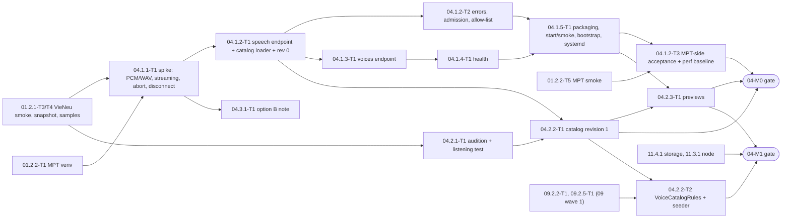

# 04 — Voice Proxy and Voice Catalog: Tech Lead review, shared decisions and feature index

> Reviews: `../../04-voice-proxy.md` (high-level, M0 → M1, all P). Process: `../../00-overview.md` §10.1, step (2) review → step (3) detailed feature plans (this folder).
> Reviewed: 2026-09-24 by the Tech Lead. Feature plans: 3 folders, 3 `plan.md` + 12 task files, written 2026-09-24. Status: **owner decisions O1–O4 accepted and re-estimate 5.5 d raw / 6.6 d buffered signed (2026-09-24, §9–§10); CR-1…CR-16 applied (§4); TL rulings T1–T14 and one agent review pass applied (§10); DoR review done 2026-09-24, verdict ready with conditions, owner-signed 2026-09-24 (§11)**. Verdict: **approve with changes**. The scope is right: a thin Python proxy on the MPT `kokoro` slot, a curated catalog, static previews, no voice cloning. But the proxy design in §5.1 ("buffer the whole WAV, then transcode") meets a timeout that the plan misreads: MPT's 120 s is an **idle** timeout, so a buffered proxy that sends nothing until the MP3 is ready fails any story whose synthesis takes > 120 s, while a **streaming** proxy never hits it (F01). The same change removes the planned chunking fallback and changes the premise of the signed 01 RTF gate (CR-2). The second large risk is product-side: all 25 VieNeu presets are Vietnamese regional speakers, so English narration may sound accented (F04, O2).
> Legend: ✅ read from source/docs (file + line, date) or reproduced here · ⚠️ unverified · [DECISION] · [OPEN] · [INFERENCE].

## 0. How this folder is organised

```
plans/features/04-voice-proxy/
  README.md                              ← this file: facts, findings, shared decisions D1–D14, CRs, task template, gates, index, re-estimate
  04.1.1-speech-endpoint/                ← stories 04.1.1 (spike), 04.1.2 (speech endpoint, errors, MPT-side acceptance)
  04.1.3-voices-health-packaging/        ← stories 04.1.3 (voices), 04.1.4 (health), 04.1.5 (packaging), 04.3.1 (option B note)
  04.2-voice-catalog/                    ← stories 04.2.1 (curation), 04.2.2 (catalog file + backend rules), 04.2.3 (previews)
```

Each feature folder holds `plan.md` (template `00-overview.md` §10.1, sections 1–11) and one `<task-id>-<slug>.md` per task (template §6). Task IDs follow `00-overview.md` §9. They **replace** the task table in `04-voice-proxy.md` §6 (mapping in §8). The non-conforming id `04.1.x-T9` (tests) is dropped: every code task now carries its own tests, and the MPT-side acceptance run becomes `04.1.2-T3`. `04.2.2` is split into a content task (T1, M0) and a backend task (T2, M1), because the backend part needs 09 wave 1. Story ids named by plans 01 and 03 (`04.1.1`, `04.1.2`, `04.1.3`, `04.1.5`, `04.2.1`) are kept.

## 1. Facts verified for this review

Upstream code was read on 2026-09-24:
- **VieNeu** at `main` = `c1390abbdb2eedcdf58eafb546966c06ce27af71` (committed 2026-09-23), downloaded as a tarball. `apps/openai_speech.py` there is byte-identical to the 397-line snapshot `/private/tmp/vieneu_speech_truth.py` taken 2026-09-23. The 01 pin (`VIENEU_COMMIT`, 01 D2) is chosen in 01.1.1-T2 and may differ ⚠️; 04.1.1-T1 step 0 re-checks every `V` fact at the pin.
- **MPT** from the same local snapshot as plan 03 (`/private/tmp/mptsrc/MoneyPrinterTurbo-main`, `version = "1.3.7"`, no git metadata ⚠️, 03 README §1). Line numbers below are from that snapshot.
- Two experiments were run on the planning Mac (ffmpeg 9.0.2; a scratch venv with uvicorn 0.39.0, starlette 0.49.3, requests 2.32.5). They are evidence for the design, not a substitute for 04.1.1-T1 on the implementation machine (01 DEC-2).

| # | Fact | Source |
|---|---|---|
| V1 | `SpeechRequest` fields and defaults: `model` (any string, default `vieneu-v3-turbo`), `input` (1–20,000 chars, pydantic `min_length`/`max_length`), `voice`, `response_format` (default `wav`), `stream_format` (default `audio`), `speed`, `instructions`, `sample_rate` (48000), `temperature` 0.8, `top_k` 25, `top_p` 0.95, `repetition_penalty` 1.2, `max_chars` 256 ✅ | `apps/openai_speech.py` L229–242 |
| V2 | Only `pcm` (s16le mono, no header) and `wav` are accepted; any other format → 400. `sample_rate` ∈ {48000, 24000, 16000, 8000}. Unknown voice → 400 `unknown voice '<v>'; see GET /v1/voices` ✅ | L297–308, L76 |
| V3 | Admission (`eng.acquire()`) runs **before** the `StreamingResponse` is returned, so a busy server answers 429 before any body: `Retry-After: 1` (queue full) or `2` (waited `VIENEU_QUEUE_TIMEOUT`, default 10 s). Queue length defaults to `max_streams` ✅ | L113–134, L310 |
| V4 | Response headers: `X-Request-Id: spk-<8 hex>`, `X-Sample-Rate`, `Cache-Control: no-store`, and `X-VieNeu-Ignored: speed,instructions` when those fields are sent ✅ | L309–315 |
| V5 | Audio is generated while it streams; the stream slot is released in the generator's `finally`. After the headers are sent, an inference error cannot change the status code ✅ (code); what the client sees is X2 [INFERENCE for VieNeu itself] | L245–275, L316–320 |
| V6 | The WAV header claims an unknown length (`0xFFFFFFFF` in RIFF and `data` sizes) ✅ | L197–208 |
| V7 | `GET /v1/voices` (auth) → `{ "object": "list", "data": [ { id, name, description, gender, featured, aliases } ] }`. `GET /health` (no auth) → `{ status, backend, max_streams, active, waiting, sample_rate }` ✅ | L146–152, L336–338, L382–386 |
| V8 | `voices_v3_turbo.json`: **25 presets**, default `Hải Đăng`; every name and alias is NFC; `gender` ∈ {`male`, `female`}; `description` = `Nam/Nữ · Bắc/Trung/Nam · <style>` (styles: tự nhiên, kể chuyện, tin tức, đọc truyện, giọng đọc tự nhiên); aliases `Anh Khôi → Thiện Minh`, `Minh Quân`/`Minh Quân Pro → Hải Đăng`, `Mạnh Dũng → Quốc Tuấn`. **No language field; every preset is a Vietnamese regional speaker** ✅ | `src/vieneu/assets/voices_v3_turbo.json` @ c1390abb |
| V9 | `resolve_voice_name`: exact string match on the preset name, then the alias map; no Unicode normalisation, no case folding ✅ | `src/vieneu/v3turbo.py` L315–323 |
| V10 | README: v3 Turbo has "10,000+ hours of bilingual training"; for v3 Nano "English words come out with a Vietnamese accent". Turbo's English quality with these presets is **not** stated ⚠️ | `README.md` L13, L331–332 |
| V11 | CPU note in code: 6-core desktop, fp32, one stream RTF 0.58 (two streams 1.19); int8 two streams RTF 0.35/0.67 ✅ (upstream measurement, not ours) | L103–106 |
| M1 | MPT `_openai_compatible_tts` body: `{ model: model_id, input: text, voice, response_format: "mp3", speed: clamp(voice_rate, 0.25, 4.0) }` to `{base_url}/audio/speech`, `Authorization: Bearer <api_key>` when set ✅ | `app/services/voice.py` L2161–2173 |
| M2 | 3 attempts. Any non-200 → log `<provider> tts failed with status <code>: <body[:200]>` and **immediately** try again (`continue`, no sleep, `Retry-After` ignored); any exception (timeout, broken stream, decode error) → next attempt ✅ | L2177–2228 |
| M3 | `requests.post(url, json=payload, headers=headers, timeout=120)` without `stream=True`: the whole body is read into memory, written to a temp `.mp3`, decoded with MoviePy `AudioFileClip`; the duration must be finite and > 0; then `os.replace` onto `audio.mp3` ✅ | L2183–2211 |
| M4 | `kokoro_tts` rejects empty text and text without any alphanumeric character before calling the server; `model_id` defaults to `"kokoro"` ✅ | L2299–2316 |
| M5 | `voice_name` handling: `parse_voice_name` removes **every** `-Female`/`-Male` substring (not only a suffix) and strips (`L371–376`); `_single_tts` checks `is_azure_v2_voice` (name ending `-V2`) **before** `is_kokoro_voice` (`L619`, `L692`); the kokoro branch splits on the first `:` and strips; MPT never checks the name against a voice list ✅ | L371–383, L597–704; `app/services/task.py` L537 |
| M6 | `get_kokoro_voices` (reads `{base_url}/audio/voices`, accepts a list or `{ "voices": [...] }` of strings or `{id}` objects) is called only by the **WebUI** (`webui/Main.py` L539, L552), never by the API path ✅ | L239–289; grep of the snapshot |
| M7 | `tts()` sends the **whole script in one request** for kokoro; pause tags are removed first ✅ | L995–1035 |
| M8 | A TTS failure marks the task failed with `failed_stage = "audio"`, error `failed to synthesize audio; verify the selected voice and TTS connectivity` ✅ | `task.py` L243–290, L545–551 |
| M9 | MPT's lock pins `requests 2.33.1` and `moviepy 2.2.1` ✅ | `uv.lock` L2607–2608, L1574–1575 |
| R1 | `requests` timeout "is not a time limit on the entire response download; rather, an exception is raised if the server has not issued a response for timeout seconds (more precisely, if no bytes have been received on the underlying socket for timeout seconds)" ✅ | https://requests.readthedocs.io/en/latest/user/quickstart/#timeouts (2026-09-24) |
| X1 | ffmpeg 9.0.2 on this Mac: a VieNeu-style WAV (header V6 + 7.0026 s of PCM) piped to `-f wav -i pipe:0 … -f mp3 pipe:1` → exit 0 with warnings `Ignoring maximum wav data size` and `corrupt input packet`; MP3 duration 7.032 s (+29 ms, no Xing header on a pipe). Same audio as raw PCM (`-f s16le -ar 48000 -ac 1`) → exit 0, same duration. Written to a seekable file instead → 7.0026 s exact. Header-only input (0 samples) → **exit 0 and a 44-byte output** ("Output file is empty"). With `-write_xing 0 -id3v2_version 0` the output starts with frame sync `ff fb` (3.000 s → 3.024 s) ✅ | experiment 2026-09-24 |
| X2 | uvicorn 0.39.0 + starlette 0.49.3: a `StreamingResponse` whose generator raises after the first bytes → `requests.post(..., timeout=120)` raises `ChunkedEncodingError: Response ended prematurely`. A body that trickles 1 KB/s for 5 s under `timeout=2` → 200, complete ✅ (requests 2.32.5; MPT pins 2.33.1, M9 ⚠️ re-run in 04.1.2-T3) | experiment 2026-09-24 |
| P1 | 01 D3/D4/D1: key `nts.proxy.api_key` (= MPT `[kokoro] api_key`), port `127.0.0.1:8001`, `worker-node/proxy/` owned by plan 04, venv `$NTS_HOME/src/proxy-venv/` "04 decides", samples in `$NTS_HOME/runs/samples/` ✅ | 01 README D1, D3, D4 |
| P2 | 01 CR-1 log fields (`ts, route, voice, chars, audio_seconds, vieneu_ms, ffmpeg_ms, status`) and CR-2 route allow-list; 01.3.1-T3 sums `audio_seconds` and `vieneu_ms + ffmpeg_ms` of lines with `status = 200` from `$NTS_HOME/logs/proxy-*.log` (Q8 open) (01 CR-20) ✅ | 04 NFR-04-4, FR-04-6; 01.3.1-T1 cols 19, 20, 58; 01.3.1-T3 step 5 |
| P3 | *(as read before the CRs; superseded by CR-2 on 2026-09-24)* 01.2.1-T4 120 s gate: pass if `max(rtf_5min) × 300 < 100 s`, fail → chunking in the proxy before 04.1.2 closes; premise "MPT kokoro timeout 120 s per request" ✅ | 01.2.1-T4 step 5; 01 README F01 |
| P4 | *(as read before the CRs; superseded by CR-5 on 2026-09-24)* 01.2.2-T2 renders `[kokoro] base_url = "http://127.0.0.1:8001/v1"`, `api_key`, `model_id = "kokoro"` (⚠️ "04 decides"), `voices = []`; 01.2.2-T4 step 3a checks that the 8001 listener's command contains "the proxy entry point named by plan 04" ✅ | 01.2.2-T2 L75–79; 01.2.2-T4 L31 |
| P5 | 09.2.2: `voices` = `id text` PK, `display_name`, `language` CHECK, `gender` CHECK `female/male/neutral`, `tags text[]`, `preview_storage_key` null, `active`; `series.voice_id` FK RESTRICT. 09.2.5-T1 `VoiceSeeder` upserts by `id` (display_name, language, gender, tags, active) from `seed/catalog.dev.json`, Development only, "placeholder ids until plan 04" ✅ | 09.2.2 plan L57, L73; 09.2.5-T1 L19–39 |
| P6 | 09.4.1-T1: voice must exist, be active and match the series language (`voice_language_mismatch`); a deactivated voice stays on existing series ✅ | 09.4.1-T1 L46–47, L99 |
| P7 | *(as read before the CRs; superseded by CR-8 on 2026-09-24)* 09 §5.6 lists an integration `vieneu_proxy` (base_url, timeout_s, api_key, render subnet, health `GET /v1/voices`); 09 L264 names a typed "VieNeu" HTTP client ✅ | `09-backend-api.md` L264, L464 |
| P8 | 00 §8 / 11 W2, FR-11-4: the backend talks only to `mpt-adapter`; only the adapter port is reachable from the Worker; the adapter aggregates VieNeu, proxy and MPT health ✅ | 00 §8 L363; 11 L20, L31, L67, L82 |
| P9 | *(as read before the CRs; superseded by CR-13 on 2026-09-24)* 05 §5.2: `voice_name = "kokoro:<voices.id>"`, `voice_rate = 1.0`; 05.5.2: a native speaker rates voice + subtitles ≥ 4/5 for vi **and** en ✅ | 05 L92, L114–115 |
| P10 | *(as read before the CRs; superseded by CR-11 on 2026-09-24)* 10.4.x: series form step 3 = voice list filtered by language with play buttons for previews ✅ | 10 L116–117 |
| P11 | Plan 03 needs a real TTS track for 03.4.1-T1 only softly (`04.1.2`, "or a short text with any working voice") ✅ | 04 §10 hand-over; 03.4.1-T1 L5 |

## 2. Findings

Severity: **B** blocks a milestone · **H** breaks an FR/NFR or a contract · **M** rework or drift risk · **L** clarity.

| # | Sev | Where (plan 04) | Finding | Action (owner feature) |
|---|---|---|---|---|
| F01 | B | §5.1, NFR-04-2, §8; 01 F01, 01.2.1-T4 | MPT's `timeout=120` is an **idle** timeout (R1, M3), not a limit on the request. §5.1 buffers the whole WAV and transcodes before replying, so MPT receives no byte for the whole synthesis time: a 5-min story at RTF 0.58 (V11) is ≈ 174 s of silence → MPT times out, retries twice more (M2) and the task fails at `audio` (M8). A proxy that **streams** MP3 as audio arrives keeps bytes flowing (X2) and has no length limit. The 01 gate (P3) and the chunking fallback are built on the wrong premise | [DECISION D4] Stream: VieNeu PCM → ffmpeg stdin → ffmpeg stdout → response, 200 sent only after the first audio arrives. Chunking is withdrawn. The 01 gate becomes informational; the pass/fail check becomes TTFB and max byte gap, measured by 04.1.2-T3 (CR-2, owner O1) |
| F02 | H | FR-04-1, FR-04-5 | Once a streamed 200 is sent, a later upstream or ffmpeg failure cannot change the status. If the proxy then ends the body cleanly, MPT decodes a **truncated** MP3 whose duration is finite and > 0 (M3) → a video with the narration cut off, reported as success | [DECISION D4] After the commit, any failure **aborts the connection** without the terminating chunk; MPT sees `ChunkedEncodingError` (X2) and retries (M2). Test with the real client library (04.1.2-T2, 04.1.2-T3) |
| F03 | H | F6, FR-04-5 | "Proxy maps 429 to retryable; MPT retries 3×" does not protect anything: MPT retries **immediately** and ignores `Retry-After` (M2). With VieNeu's 10 s queue timeout (V3) the three attempts are spent in ≈ 30 s and the render fails while one other request is still speaking | [DECISION D5] The proxy absorbs upstream 429s before its commit: it retries upstream for up to `ADMISSION_WAIT_S` (60 s) and only then returns 429 `upstream_busy`. 60 s + first audio < 90 s commit deadline < MPT's 120 s idle timeout |
| F04 | H | 04.2.1, 05.5.2 | All 25 presets are Vietnamese regional speakers and carry no language field (V8). VieNeu only states Vietnamese-accented English for Nano (V10). 05.5.2 needs an English native speaker to rate the en voice ≥ 4/5 (P9). There may be **no** acceptable English narrator in the preset set | 04.2.1-T1 rates every candidate with a fluent English listener before selection (D11 protocol); owner decision O2 if no voice passes. DECISIONS §3 (VieNeu) is locked and not reopened here ⚠️ |
| F05 | H | FR-04-6 | FastAPI serves `/docs`, `/redoc` and `/openapi.json` by default. That breaks the route allow-list (01 CR-2) | [DECISION D2] `FastAPI(docs_url=None, redoc_url=None, openapi_url=None)`; a test asserts 404 on those paths (04.1.2-T2) |
| F06 | M | F5 | MPT's rewriting of voice names is broader than F5 says: every `-Female`/`-Male` substring is removed anywhere in the name, and a name ending in `-V2` is routed to Azure before the kokoro branch (M5) | [DECISION D9] `VoiceCatalogRules` rejects ids containing `-Female`, `-Male` or `:`, ending in `-V2`, or with leading/trailing whitespace (04.2.2-T2; the proxy's loader applies the same rules, 04.1.2-T1) |
| F07 | M | FR-04-2, 04.2.2 | Voice ids carry diacritics and spaces (V8), and VieNeu matches them byte-exactly (V9). An NFD string from any client, or an alias, would 400 or silently map to another name | [DECISION D3, D9] The proxy NFC-normalises `voice`. Catalog ids must be canonical preset names in NFC (never aliases). Health flags any catalog id missing upstream (D8) |
| F08 | M | 00 §6 `voices`, 09.2.2 | `voices.id` = VieNeu name as text PK (P5): one preset can belong to **one** language only, and a VieNeu rename breaks every series that uses it | [DECISION D9] One language per voice (a bilingual preset gets one catalog language). VieNeu stays pinned (01 D2); a rename is a catalog migration, owner action |
| F09 | M | 04.2.2-T1 | Ownership overlap: "Voice catalog seed + `GET /api/v1/voices`" duplicates 09.2.5-T1 (`VoiceSeeder`) and 09.4.2-T1 (voices query) | [DECISION D9] 04 owns the **content file** `seed/voices.v1.json`, the rules and the seeder change (04.2.2-T1/T2, CR-9); the endpoint stays 09.4.2-T1 |
| F10 | M | P7 | 09 §5.6 defines a backend integration `vieneu_proxy` with its own health call. This contradicts 00 §8 and 11 (P8): the Worker never talks to the proxy, and the proxy is not reachable from the Worker. Its health path `GET /v1/voices` is also not a proxy route | Remove the row and the "VieNeu" typed client (CR-8); proxy health reaches the backend only through the adapter health (D8, CR-12) |
| F11 | M | FR-04-1 | Text without speakable content makes VieNeu return 200 with no samples; ffmpeg then exits 0 with an empty MP3 (X1). A proxy that trusts ffmpeg's exit code returns an empty 200 | [DECISION D4] The commit waits for the first PCM bytes; zero audio → 502 `upstream_empty_audio` (not a 200) |
| F12 | M | F3, 04.1.1 | The unknown-length WAV header decodes (X1), but ffmpeg prints warnings on every file. A check that treats stderr as failure would reject every request. Raw PCM has no header at all and gives the exact sample count | [DECISION D4] Request `response_format: "pcm"` with `sample_rate: 48000` and decode with `-f s16le -ar 48000 -ac 1`; `X-Sample-Rate` must equal 48000. 04.1.1-T1 still records the WAV result for DECISIONS §8 item 6 and for option B |
| F13 | M | NFR-04-4, 01 CR-1 | With streaming, HTTP 200 is sent before the outcome is known, but 01.3.1-T3 sums lines with `status = 200` (P2). Aborted streams would be counted as delivered audio | [DECISION D7] `status` = the **logical** outcome (200 only when the full MP3 was delivered); the sent code is `http_status`. The collector needs no change (CR-7 answers 01 Q8) |
| F14 | M | 04.2.2, 09.4.1 | If the proxy's allow-list were "active voices only", deactivating a voice would break every existing series that uses it (P6 keeps them) | [DECISION D9] The proxy accepts **every** id in the catalog file; `active = false` only hides a voice from pickers and lists |
| F15 | M | FR-04-2, 01.2.2-T6 | MPT's API never reads the voice list; only the WebUI does (M6), and the WebUI is not used (01 D14, never on the node). "MPT fetches from the proxy" is therefore not a render dependency | 04.1.3-T1 stays (operators, smoke, parity) at XS; 01.2.2-T6's dependency on 04.1.3 becomes soft (CR-6) |
| F16 | M | §6, §11 | The estimate has no MPT-side acceptance run with MPT's own client, no node packaging (systemd, loopback, bootstrap), no backend rules/seeder change, and previews without loudness matching | Re-estimate §9: **5.5 d raw / 6.6 buffered** (+1.0 d raw) |
| F17 | M | Risk "client disconnect" | When MPT gives up (timeout, abort), the proxy cancels its upstream request; whether VieNeu frees the stream slot at once or only after generation ends is unknown ⚠️ (Starlette iterates VieNeu's sync generator in a threadpool, V5). On a 1-stream CPU a late release makes MPT's retry wait | 04.1.1-T1 measures it (`/health` `active` after a client abort); D5's admission wait absorbs a late release up to 60 s |
| F18 | L | FR-04-1 | `speed` is ignored upstream and only produces an `X-VieNeu-Ignored` header (V4); `model` from MPT (`"kokoro"`, M4) has no meaning upstream | [DECISION D3] The proxy never forwards `speed` or MPT's `model`; it always sends `model = "vieneu-v3-turbo"`. `[kokoro] model_id = "vieneu-v3-turbo"` for readable logs (CR-5) |
| F19 | L | §5.3; 01 D2, 01.1.2-T3, 01.2.2-T4 | Loose ends in plan 01: no `PROXY_PYTHON` pin, no `proxy` bootstrap target, no proxy entry-point name for the SEC-04 listener check | CR-3, CR-4, CR-6; entry point `nts_vieneu_proxy` (D1) |
| F20 | L | 04.2.1 | Preset `Adam bựa` has a slang name unsuitable as a display name; descriptions exist only in Vietnamese (V8) | O4: exclude it; display names = preset names; tags carry the description in vi + en i18n (D9) |
| F21 | L | A1 | "~50 lines" understates the proxy: streaming pipeline, admission, error mapping, health and logging are ≈ 400 lines of Python plus tests | Informational; covered by §9 |
| F22 | L | NFR-04-1 | "Private interface (worker)": MPT and the proxy run on the same node, so nothing off-host ever needs the proxy | [DECISION D1] Loopback bind on the Mac **and** the node (CR-12) |

## 3. Shared decisions for all feature plans (contract)

Feature plans and task files MUST use these names exactly. Make any change here first.

**D1 Process and packaging [DECISION].**
- Python **3.12** (same interpreter family as VieNeu and the 01 D9 helpers), FastAPI + uvicorn + httpx, one uvicorn worker, asyncio. Package `nts_vieneu_proxy`, entry point `python -m nts_vieneu_proxy` (this exact string is what 01.2.2-T4 step 3a and `smoke-proxy.sh` look for in the listener's command line, CR-6).
- Source tree `worker-node/proxy/`: `pyproject.toml`, `uv.lock` (committed, hashes), `.python-version` (`3.12`), `src/nts_vieneu_proxy/{__init__,__main__,app,config,catalog,upstream,transcode,errors,reqlog,voice_cache,health}.py` (`reqlog`, not `logging`, so the stdlib module is not shadowed), `tests/`, `tools/`, `systemd/vieneu-proxy.service`, `README.md`. Runtime dependencies: `fastapi`, `uvicorn` (without the `[standard]` extra), `httpx`; test dependencies: `pytest`, `pytest-asyncio`, `requests`. Licences are checked from the lock in 04.1.5-T1 (all expected MIT/BSD/Apache ⚠️).
- Venv: `UV_PROJECT_ENVIRONMENT="$NTS_HOME/src/proxy-venv" uv sync --frozen --project worker-node/proxy` (01 D1 placeholder, filled by the `bootstrap.sh proxy` target, CR-4). Python version pin `PROXY_PYTHON=3.12` in `worker-node/pins.env` (CR-3).
- Bind **`127.0.0.1:8001`** on the Mac and on the node (F22). The config loader refuses any other host (exit 2). Mac: foreground process started by `worker-node/bin/start-proxy.sh`, output tee'd to `$NTS_HOME/logs/proxy-<YYYYmmdd-HHMMSS>.log` (01 D9). Node: systemd unit `vieneu-proxy.service` (D13).

**D2 Routes, methods and auth [DECISION] (FR-04-6, 01 CR-2).**

| Route | Method | Auth | Upstream call |
|---|---|---|---|
| `/v1/audio/speech` | POST | Bearer `PROXY_API_KEY` | VieNeu `POST /v1/audio/speech` |
| `/v1/audio/voices` | GET | Bearer `PROXY_API_KEY` | VieNeu `GET /v1/voices` (cached, D9) |
| `/health` | GET | none (loopback only; body has no secrets, like VieNeu V7) | VieNeu `GET /health` |

- Any other path → 404 `route_not_found`; a known path with another method → 405 `method_not_allowed` with `Allow`. `/docs`, `/redoc`, `/openapi.json` are disabled (F05). The proxy has **no** code path to VieNeu `POST /v1/voices`, `GET /v1/models` or any other route: the upstream client exposes exactly three methods (`speech`, `voices`, `health`), each with a fixed path.
- Auth: `hmac.compare_digest` on the exact header value `Bearer <key>`; missing or wrong → 401 `proxy_unauthorized`. The auth check runs before body parsing. `PROXY_API_KEY` and `VIENEU_API_KEY` must each be ≥ 32 chars (startup exit 2 otherwise).
- Errors use VieNeu's/OpenAI's shape, which MPT logs (M2): `{ "error": { "message": "<≤ 200 chars, no input text>", "type": "proxy_error", "code": "<D6 code>" } }`.

**D3 Speech request contract [DECISION].** Checks in this order; the first failure answers:
1. Raw body ≤ `MAX_BODY_BYTES` = 262,144 → else 413 `body_too_large` (read with a counting limit, never buffered beyond it).
2. JSON object → else 400 `invalid_request`.
3. `input` is a string with ≥ 1 non-whitespace char → else 400 `invalid_request`; `len(input)` (code points, the unit of V1) ≤ 20,000 → else 413 `input_too_long`. The text is forwarded **unchanged** (no strip, no normalisation).
4. `response_format` absent or `"mp3"` → else 400 `unsupported_format`.
5. `voice` is a string; `v = unicodedata.normalize("NFC", voice.strip())`; `v` ∈ catalog ids (D9, **all** entries, active or not) → else 400 `voice_not_in_catalog`.
6. Ignored: `model`, `speed`, `instructions`, and every unknown field (logged as `ignored_fields`, names only).

Upstream body, always exactly: `{ "model": "vieneu-v3-turbo", "input": <input>, "voice": <v>, "response_format": "pcm", "stream_format": "audio", "sample_rate": 48000 }`. Sampling fields are not sent (upstream defaults, V1, recorded per pin in 04.1.1-T1).

**D4 Streaming pipeline [DECISION] (F01, F02, F11, F12).**
- Phases: `admit` (D5) → `upstream_open` (POST sent, wait for status + headers) → `first_audio` (wait for the first PCM bytes) → **commit** (send `200`, `Content-Type: audio/mpeg`, `Cache-Control: no-store`, `X-Request-Id: px-<8 hex>`, chunked, no `Content-Length`) → `streaming` → `done`.
- Upstream checks before commit: status 200, `Content-Type` starts with `audio/pcm`, `X-Sample-Rate` = `48000` → else 502 `upstream_bad_format`; first PCM bytes within the commit deadline → else 504 `upstream_first_audio_timeout`; upstream ends with 0 PCM bytes → 502 `upstream_empty_audio`.
- ffmpeg is started when the upstream status is 200, with exactly:
  `ffmpeg -hide_banner -loglevel error -f s16le -ar 48000 -ac 1 -i pipe:0 -vn -c:a libmp3lame -b:a ${MP3_BITRATE} -write_xing 0 -id3v2_version 0 -flush_packets 1 -f mp3 pipe:1`
  (`asyncio.create_subprocess_exec`, no shell, `stdin/stdout/stderr = PIPE`). Three concurrent tasks: upstream → ffmpeg stdin (then close stdin); ffmpeg stdout → response chunks (16 KiB reads); stderr → bounded buffer (last 8 KiB, logged as `ffmpeg_stderr_tail` only on failure; it never contains input text). Backpressure is end-to-end: a slow reader blocks the pipes, which pauses the upstream read. Memory per request stays O(pipe buffers).
- The commit happens when ffmpeg has produced its first MP3 bytes (which requires PCM to have arrived). ffmpeg failure before commit → 500 `transcode_failed`.
- After commit, any failure (upstream read error or gap > `UPSTREAM_READ_GAP_S`, upstream ends early with an HTTP/protocol error, ffmpeg exit ≠ 0, `REQUEST_MAX_S` exceeded) **aborts the connection** by raising inside the response iterator (uvicorn closes the socket without the final chunk, X2). ffmpeg is killed, the upstream response is closed, and the log line gets `status: 502` with `error_code` `upstream_stream_broken` | `transcode_failed` | `request_max_exceeded`.
- Client disconnect (MPT gave up) → cancel the writer and stderr tasks, kill ffmpeg; log `status: 499`, `error_code: client_disconnected`. **Upstream drain (TL ruling T15):** once VieNeu has answered 200, the proxy never closes the upstream response early — after a client disconnect, a post-commit ffmpeg failure or `request_max_exceeded` it keeps reading and discarding PCM until VieNeu ends the stream (bounded by `UPSTREAM_READ_GAP_S` per gap and `REQUEST_MAX_S` total), and holds its semaphore slot until then. Only an upstream read error or gap timeout closes the upstream directly.
- `audio_seconds = pcm_bytes ÷ 2 ÷ 48000` (3 decimals). An odd `pcm_bytes` is logged as warning `pcm_odd_tail` (the last byte is dropped by ffmpeg, X1). Streamed MP3 runs ≈ 25–30 ms longer than the PCM (X1); accepted (05.5.1 checks ± 5 %).
- Timing budget against MPT's 120 s idle timeout (R1): admission ≤ 80 s (T15), commit deadline `FIRST_AUDIO_DEADLINE_S` = 90 s from arrival, then gaps ≤ `UPSTREAM_READ_GAP_S` = 60 s (ffmpeg flushes every packet). Both limits leave ≥ 30 s margin.

**D5 Admission and concurrency [DECISION] (F03, F17).**
- Proxy semaphore `PROXY_MAX_CONCURRENT` (default 4; Mac start script sets 2) limits concurrent speech pipelines (ffmpeg processes).
- Waiting for the semaphore and upstream 429s share one budget, `ADMISSION_WAIT_S` = 80 s from arrival (T15). On an upstream 429, sleep `min(Retry-After or 2, 5, budget left)` and retry the upstream POST (a new request, same body). Budget spent → 429 `upstream_busy` (or `proxy_busy` if the semaphore was the blocker) with `Retry-After: 5`. MPT will still retry immediately (M2); the goal is that its **first** attempt succeeds under normal contention.
- Nothing has been sent to MPT during admission, so the admission wait only counts against the 90 s commit deadline.
- Node sizing rule (CR-12): `VIENEU_MAX_STREAMS ≥ MPT max_concurrent_tasks` and `PROXY_MAX_CONCURRENT ≥ MPT max_concurrent_tasks`, so admission never waits in steady state.

**D6 Proxy error codes [DECISION].** Node-internal only (proxy log, MPT log), never a platform HTTP code. MPT turns every non-200 into three immediate attempts and then `failed_stage = audio` (M2, M8); the adapter reports that as job outcome `tts_failed` (CR-10, CR-12).

| Code | HTTP to MPT | Raised when |
|---|---|---|
| `proxy_unauthorized` | 401 | Bearer missing or wrong (D2) |
| `route_not_found` / `method_not_allowed` | 404 / 405 | D2 |
| `body_too_large` / `input_too_long` | 413 | D3 steps 1, 3 |
| `invalid_request` | 400 | D3 steps 2, 3 |
| `unsupported_format` | 400 | D3 step 4 |
| `voice_not_in_catalog` | 400 | D3 step 5 |
| `upstream_rejected` | 400 | VieNeu 400 before commit; message = VieNeu `error.message` truncated to 200 chars |
| `upstream_auth_failed` | 502 | VieNeu 401 (proxy misconfiguration; never shown to MPT as 401) |
| `upstream_busy` / `proxy_busy` | 429 + `Retry-After: 5` | D5 budget spent |
| `upstream_unavailable` | 502 | connect error, connect timeout, VieNeu 5xx or any other status before commit |
| `upstream_bad_format` | 502 | D4 header checks |
| `upstream_first_audio_timeout` | 504 | no audio by `FIRST_AUDIO_DEADLINE_S` |
| `upstream_empty_audio` | 502 | upstream finished with 0 PCM bytes |
| `transcode_failed` | 500 before commit · connection abort after | ffmpeg start failure or exit ≠ 0 |
| `upstream_stream_broken`, `request_max_exceeded` | connection abort (logged 502) | D4 after commit |
| `client_disconnected` | — (logged 499) | D4 |
| `internal_error` | 500 from uvicorn (log only) | unexpected exception before commit; the pipeline is still closed (slot released, ffmpeg reaped, one log line) |

**D7 Request log line [DECISION] (NFR-04-4, 01 CR-1).** One JSON object per request (every route, including 401/404), written to stdout as a single line, UTF-8, `ensure_ascii=False`, after the response ends:

```json
{ "ts": "2026-09-25T03:31:02.123Z", "rid": "px-1a2b3c4d", "route": "/v1/audio/speech", "method": "POST",
  "voice": "Thiện Minh", "chars": 4210, "audio_seconds": 301.337, "vieneu_ms": 175210, "ffmpeg_ms": 84,
  "ttfb_ms": 1290, "max_gap_ms": 2210, "admission_wait_ms": 0, "bytes_out": 7234176,
  "status": 200, "http_status": 200, "error_code": null, "upstream_rid": "spk-9f8e7d6c",
  "ignored_fields": ["model", "speed"], "wall_ms": 175420 }
```

- `ts` = request arrival (ISO-8601 UTC, ms, `Z`). `route` = one of the three D2 routes or `"other"` (the raw path is never logged). `status` = logical outcome (F13): 200 only when the complete MP3 was delivered; otherwise the D6 status (aborted streams 502, client disconnect 499). `http_status` = the status line actually sent (`null` when none was sent).
- `vieneu_ms` = upstream POST sent → last upstream byte; `ffmpeg_ms` = last upstream byte → ffmpeg exit (the transcoding tail); `ttfb_ms` = arrival → first byte written to MPT; `max_gap_ms` = the largest pause between two writes to MPT (evidence against the 120 s idle limit). Fields that do not apply are `null`.
- `ignored_fields` is bounded (P1 security review): at most 16 names, each truncated to 64 chars, then `"+<n> more"`.
- Failure-only keys (omitted when empty): `ffmpeg_stderr_tail` (≤ 8 KiB, D4) and `warnings` (list of codes, today only `pcm_odd_tail`). They are part of the D7 schema; no other key may be added without changing this section.
- **Never logged:** input text, request/response bodies, headers, keys, ffmpeg command-line values other than the bitrate. uvicorn's access log is off (`access_log=False`); uvicorn errors go to stderr (tee'd to the same file by the start script).
- Mac path `$NTS_HOME/logs/proxy-<YYYYmmdd-HHMMSS>.log` (answers 01 Q8, CR-7). Node: journald (D13).

**D8 Health contract `proxy-health.v1` [DECISION] (FR-04-3).** `GET /health` → 200 with `status = "ok"` and `reasons = []`; otherwise 503 with `status = "error"` and ≥ 1 reason. Consumers (smoke, adapter) key off the HTTP status and `reasons`, not the string:

```json
{ "schema": "proxy-health.v1", "status": "ok", "reasons": [],
  "vieneu": { "ok": true, "backend": "onnx", "max_streams": 1, "active": 0, "waiting": 0 },
  "ffmpeg": { "ok": true, "version": "9.0.2", "libmp3lame": true },
  "catalog": { "ok": true, "revision": 1, "voices": 7, "missing_upstream": [] },
  "proxy": { "version": "0.1.0", "started_at": "2026-09-25T03:00:00Z", "in_flight": 0 } }
```

- `reasons` ⊆ {`vieneu_unreachable`, `vieneu_unhealthy`, `vieneu_auth_failed`, `ffmpeg_missing`, `libmp3lame_missing`, `catalog_voice_missing`}. Triggers:
  - VieNeu `/health` (no auth, V7) is called live, timeout 2 s: connect error/timeout → `vieneu_unreachable`; non-200 or `status ≠ "ok"` → `vieneu_unhealthy`.
  - The upstream voice list (`GET /v1/voices`, needs the VieNeu key) is refreshed by `UpstreamVoiceCache` every `CATALOG_CHECK_INTERVAL_S` = 300 s. The **latest** refresh result decides, even when older names are still cached: 401/403 → `vieneu_auth_failed` (the only way to prove `VIENEU_API_KEY`, since `/health` needs none); connect error/timeout/5xx → `vieneu_unreachable`. A stale cache never masks a failed refresh.
  - ffmpeg is probed once at startup (`ffmpeg -hide_banner -version` and `-encoders` containing `libmp3lame`). A missing binary does **not** stop the process (no exit 2): health reports `ffmpeg_missing` / `libmp3lame_missing` and speech answers 500 `transcode_failed`, so the node shows the reason instead of crash-looping.
- `catalog_voice_missing`: at least one catalog id (active or not) is not an `id` in the latest successful VieNeu voice list (aliases do not count, F07). It is evaluated only when a refresh has succeeded at least once. `catalog.missing_upstream` lists those ids. An invalid catalog file never reaches health (the proxy exits 2 at startup, D9), so `catalog_invalid` is not a health reason.
- The adapter health (11.3.5) embeds this object unchanged as `tts_proxy`; the node is dispatchable only when `status = "ok"` (CR-12).

**D9 Voice catalog `voices.v1` [DECISION] (F06–F09, F14, F20).** One tracked file, two readers.
- File `seed/voices.v1.json` (repo root `seed/`, next to `style-templates.v1.json`). Owner: 04.1.2-T1 writes **revision 0** (two provisional entries for development and the wiring render: `Hải Đăng` → `vi`, `Ngọc Huyền` → `en`); 04.2.2-T1 replaces it with the curated **revision 1**.

```json
{ "schema": "voices.v1", "revision": 1, "vieneuCommit": "<40-hex VIENEU_COMMIT the ids were checked against>",
  "voices": [
    { "id": "Thiện Minh", "slug": "thien-minh", "displayName": "Thiện Minh", "language": "vi", "gender": "male",
      "tags": ["storyteller", "deep", "northern"], "active": true, "previewStorageKey": "voice-previews/thien-minh.v1.mp3" } ] }
```

- Rules (`VoiceCatalogRules` in Domain `Catalog/`, C#, 04.2.2-T2; the proxy's `catalog.py` applies the same rules, 04.1.2-T1; both run against the shared fixtures `seed/fixtures/voices/*.json`, D14):
  - `id`: equal to the preset's `id` in VieNeu `GET /v1/voices` (which is the preset name; the server sets `id` and `name` to the same key, `apps/openai_speech.py` L149 ✅), NFC, equal to its own `strip()`, 1–64 code points; first character `str.isalnum()`, every other character `str.isalnum()`, `_`, space, `.` or `-` (this is VieNeu's name pattern `^[^\W_][\w .\-]{0,63}$` under **Python** `str` semantics, which is the standard; the C# side checks characters explicitly with `Rune`, because .NET `\w` differs, TL ruling T7); does **not** contain `-Female`, `-Male` or `:`, does **not** end in `-V2` (M5) → else `voice_id_invalid`.
  - `slug` = `id` → NFD → drop combining marks → `đ/Đ → d` → lower case → runs of `[^a-z0-9]` → `-` → trim `-` (`Hải Đăng` → `hai-dang`); must equal the computed value → else `voice_slug_mismatch`.
  - `displayName` 1–40 chars after trim; `language` ∈ {`vi`, `en`}; `gender` ∈ {`female`, `male`, `neutral`} (09.2.2 CHECK); `tags` ⊆ the closed list below, 0–4 entries, no duplicates; `previewStorageKey` null or exactly `voice-previews/<slug>.v<n>.mp3` (n ≥ 1).
  - File level: `schema = "voices.v1"`; `revision` ≥ 0; `vieneuCommit` 40 hex; ids and slugs unique; ≥ 1 active voice per language when `revision` ≥ 1; unknown or wrongly typed properties are rejected. Codes: `voice_id_invalid`, `voice_slug_mismatch`, every other violation `catalog_invalid` (with the entry's id for entry-level problems, including an unknown entry key; `null` for file-level ones). Any violation → the whole file is rejected (proxy: `CatalogError(code, voice_id)`, exit 2; seeder: `seed_voice_invalid:<id or ->:<code>`).
  - **Check order (both readers, first failure wins):** JSON parse → file-level keys and types → each entry in file order: keys/types → `id` → `slug` → other fields → cross-entry checks (duplicate id, duplicate slug) → ≥ 1 active voice per language. So an invalid id is reported as `voice_id_invalid` even though its slug no longer matches (TL ruling T14).
- Tag vocabulary (closed; i18n keys `voices.tag.<tag>` in vi + en, CR-11): `storyteller`, `natural`, `news`, `deep`, `warm`, `calm`, `bright`, `whisper`, `northern`, `central`, `southern`.
- One language per voice (F08). Aliases are never catalog ids (F07). `Adam bựa` is excluded (O4).
- Proxy reader: loads the file named by `VOICE_CATALOG_FILE` at startup (invalid → exit 2); allow-list = **all** ids (F14); `GET /v1/audio/voices` returns only `active` entries that exist upstream: `{ "voices": [ { "id", "name": displayName, "language", "gender" } ] }` (MPT reads `id`, M6). Reload = restart.
- Backend reader: `VoiceSeeder` (built by 09.2.5-T1 with a placeholder voices block; switched to this file by 04.2.2-T2, which runs after it) reads the same file in **every** environment; outside Development it refuses `revision` 0; it upserts by `id` including `preview_storage_key` (CR-9). `GET /voices` (09.4.2-T1) returns `{ id, displayName, language, gender, tags, previewUrl }` for active voices, `previewUrl` = public URL of `previewStorageKey` in `nt-public-<env>` or `null`.
- Render: `voice_name = "kokoro:" + voices.id` (05 §5.2, 09.6.2).

**D10 MPT configuration and submit fields [DECISION].**
- `[kokoro]`: `base_url = "http://127.0.0.1:8001/v1"`, `api_key = <PROXY_API_KEY>`, `model_id = "vieneu-v3-turbo"` (F18, CR-5), `voices = []`. Mac: rendered by 01.2.2-T2; node: 05.1.1 / 11.3.1 template.
- Every render submit: `voice_name = "kokoro:<voices.id>"`, `voice_rate = 1.0` (ignored upstream), `subtitle_provider = "whisper"` (05 F5: kokoro returns no word timings).
- The speaking rate is not adjustable in P; no rate control in the UI (04 F4, CR-11).

**D11 Curation protocol [DECISION] (04.2.1, F04).**
- Candidates: all presets of the pinned `voices.snapshot.json` (01.2.1-T3) except `Adam bựa` (O4). Texts: `trial/fixtures/voice-audition.vi.txt` and `.en.txt` (≈ 30 s each, ghost-story register, tracked, UTF-8 NFC).
- Samples are generated directly against VieNeu (`127.0.0.1:8000`, PCM) and encoded with the D4 ffmpeg command, so they sound exactly like the proxy output; the proxy is not used, because its allow-list only accepts catalog voices.
- Raters: vi — the owner plus one other native speaker; en — at least one fluent English listener (native preferred). Blind order, file names by random id. Scores 1–5 for naturalness, intelligibility, fit for night stories; mispronunciations noted.
- Selection: per language the 3–4 best with mean naturalness ≥ 3.5 and intelligibility ≥ 4.0. If **no** English candidate passes → owner decision O2 before revision 1 is written; revision 1 then holds the owner's choice with the scores recorded.
- Evidence: `trial/voice-audition/results.csv` (tracked, no audio) and `trial/voice-audition/README.md`; audio stays in `$NTS_HOME/runs/voice-audition/`.

**D12 Previews [DECISION] (04.2.3).**
- Texts `seed/voice-previews/preview.vi.txt` and `preview.en.txt` (tracked, ≈ 10 s of speech, one sentence that sets a night-story mood, no names of real people).
- Generated **through the running proxy** (real pipeline), then `ffmpeg … -af loudnorm=I=-16:TP=-1.5:LRA=11 -ac 1 -ar 48000 -c:a libmp3lame -b:a 128k` to a file ≤ 12 s and ≤ 200 KB. File name `<slug>.v<n>.mp3`; local output `$NTS_HOME/runs/voice-previews/`; manifest `worker-node/proxy/previews.manifest.json` (tracked: `id`, `slug`, `key`, `sha256`, `bytes`, `duration_s`, `text_sha256`, `catalog_revision`).
- Storage key `voice-previews/<slug>.v<n>.mp3` in bucket `nt-public-<env>` (11 §4 11.4.1). Upload waits for 11.4.1; `previewStorageKey` is written into the catalog file only after the upload is verified (HEAD 200, same length). A new preview text or a changed voice ⇒ `n + 1`, never an overwrite (CDN caching).
- Previews are static; no per-user generation (04 §4 04.2.3).

**D13 Mac vs node [DECISION].**
- **Mac (M0):** `worker-node/bin/start-proxy.sh` (01 D9 conventions): `require_port_free 8001`, keys from Keychain (`nts.proxy.api_key`, `nts.vieneu.api_key`) into the child environment only, `VIENEU_BASE_URL=http://127.0.0.1:8000`, `VOICE_CATALOG_FILE=$REPO/seed/voices.v1.json`, `PROXY_MAX_CONCURRENT=2`, then `"$NTS_HOME/src/proxy-venv/bin/python" -m nts_vieneu_proxy` as a foreground child with output tee'd to the log and the child's exit code returned. `worker-node/bin/smoke-proxy.sh` joins `smoke.sh` (01.2.1-T3 aggregator).
- **Node (M1):** `worker-node/proxy/systemd/vieneu-proxy.service`: `User=nts-proxy`, `EnvironmentFile=/etc/nts/vieneu-proxy.env` (`0640 root:nts-proxy`, see below; written from the node secret store, 11.3.2), `ExecStart=<venv>/bin/python -m nts_vieneu_proxy`, `Restart=on-failure`, `NoNewPrivileges=yes`, `ProtectSystem=strict`, `ProtectHome=yes`, `PrivateTmp=yes`, `IPAddressDeny=any`, `IPAddressAllow=127.0.0.1 ::1` (not `localhost`, which admits the resolver stub 127.0.0.53; 11 D20 H4, 11 CR-6), `After=vieneu.service`. Node paths fixed by 11 D8/D10 (11 CR-6): `<venv>` = `/opt/nts/current/venvs/proxy`, `VOICE_CATALOG_FILE=/opt/nts/current/seed/voices.v1.json`, `FFMPEG_PATH=/usr/bin/ffmpeg`; `EnvironmentFile=/etc/nts/vieneu-proxy.env` is `0640 root:nts-proxy`. Amendment (P2/P3 security review, 2026-09-26): the unit also sets `RestrictAddressFamilies=AF_INET AF_INET6 AF_UNIX`, `CapabilityBoundingSet=`, `PrivateDevices=yes`, `ProtectKernelTunables=yes`, `ProtectKernelModules=yes`, `ProtectControlGroups=yes`, `RestrictNamespaces=yes`, `LockPersonality=yes`, `SystemCallArchitectures=native`, `UMask=0077`; 11.3.1-T2 confirms them with `systemd-analyze security`. Mac start script: the keys reach the proxy child by bash prefix assignment only (never exported, never `env VAR=…`, which would put them in argv).
- Same code, same config keys (table below), same catalog file.

| Env var | Default | Rule |
|---|---|---|
| `PROXY_HOST` / `PROXY_PORT` | `127.0.0.1` / `8001` | host must be `127.0.0.1` |
| `PROXY_API_KEY` | — | required, ≥ 32 chars |
| `VIENEU_BASE_URL` | `http://127.0.0.1:8000` | must be `http://127.0.0.1:<port>` (no path) |
| `VIENEU_API_KEY` | — | required, ≥ 32 chars |
| `VOICE_CATALOG_FILE` | — | required; valid `voices.v1` |
| `MP3_BITRATE` | `192k` | ∈ {`128k`, `160k`, `192k`} |
| `UPSTREAM_CONNECT_TIMEOUT_S` | `5` | 1–30 |
| `UPSTREAM_READ_GAP_S` | `60` | 10–100 |
| `FIRST_AUDIO_DEADLINE_S` | `90` | 10–100, > `ADMISSION_WAIT_S` |
| `ADMISSION_WAIT_S` | `80` (T15) | 0–80 |
| `REQUEST_MAX_S` | `1800` | 60–3600 |
| `PROXY_MAX_CONCURRENT` | `4` | 1–32 |
| `CATALOG_CHECK_INTERVAL_S` | `300` | 30–3600 |
| `FFMPEG_PATH` | `ffmpeg` | resolved with `shutil.which` at startup; not found → **not** a config error: health `ffmpeg_missing`, speech 500 `transcode_failed` (D8) |

Invalid config → exit 2 with the variable name (never its value).

**D13.1 ffmpeg child environment — allow-list, never deny-list [DECISION] (added 2026-09-26, code review L-4).** Every ffmpeg child the plan starts — `transcode.Mp3Encoder` (the D4 encoder), the startup probe in `health.py` and `tools/audition.py` — is spawned with an `env` built from an explicit allow-list of inherited variables, never with the inherited environment and never by removing suspicious names from it: **`PATH`, `HOME`, `LANG`, `LC_ALL`, `TMPDIR`**, and nothing else. A key absent from `os.environ` is simply omitted; `env=` is always passed, so no other variable of the proxy process (which holds `PROXY_API_KEY` and `VIENEU_API_KEY`) can reach a child, not even under a name no key/token/secret/password regex would match. `FFREPORT` and other variables that change ffmpeg's behaviour are deliberately out.
- **One list, one source:** `transcode._CHILD_ENV_KEYS` is the definition (`child_env()` is the only builder); `health.py` imports `child_env` from it; `tools/audition.py`, which is stdlib-only and cannot import the package, mirrors the tuple and **must stay equal** to it — an **equality** test in `tests/test_audition_tool.py` pins the two tuples to each other (code review L-1: the previous `set(child) <= {...}` subset assertion could not catch drift at all). Changing the list means editing `transcode.py` and, in the same change, the tool's mirror.
- **Why these five:** `PATH` is the only way `audition.py`'s bare `ffmpeg` is resolved (the proxy itself resolves `FFMPEG_PATH` once at startup with `shutil.which`, D13 table, so the child's `PATH` is not how the encoder is found); `HOME` matters only to ffmpeg `-pre` presets, which are not used; `LANG`/`LC_ALL`/`TMPDIR` keep ffmpeg's locale and temp behaviour predictable. Verified: `ffmpeg` child env, argv, log lines and baseline JSON carry no key (security review of PR #7).

**D14 Test kit [DECISION].**
- Unit and component tests (`worker-node/proxy/tests/`, pytest): fake VieNeu with `httpx.MockTransport` (scripted status, headers, PCM chunks, delays, mid-stream exceptions); **real** ffmpeg; PCM fixtures generated in the test (sine), no voice audio in the repo.
- Wire tests: the app under a real uvicorn on an ephemeral loopback port, called with `requests` (MPT's client library) to prove D4 abort semantics (X2), gaps and timeouts.
- MPT decode check: `worker-node/proxy/tools/mpt_decode_check.py <mp3>` run with MPT's own interpreter (`$NTS_HOME/src/mpt/.venv/bin/python`), which imports MPT's `moviepy` (M9) and prints the `AudioFileClip` duration.
- Shared catalog fixtures `seed/fixtures/voices/{valid-*,invalid-*}.json` plus `expected.json` (file → expected code and id), read by the proxy tests and by `VoiceCatalogRulesTests` (C#); list in 04.2.2-T1.
- Run: `UV_PROJECT_ENVIRONMENT="$NTS_HOME/src/proxy-venv" uv run --frozen --project worker-node/proxy pytest -q`. **Every** `uv run --project worker-node/proxy …` command in this folder (tests, `tools/*.py`) runs with that variable exported, so no `.venv` is ever created inside the repo on the untrusted volume (01 D1, F26). CI for the proxy is `node.yml` (11.5.1-T2; 11 CR-6), so the suite runs locally and in the node provisioning check.

## 4. Change requests to other files

**Applied 2026-09-24** after the owner accepted O1–O4 (§10) and the re-estimate (§9). Each edited text is tagged `(04 CR-n)`.

| CR | To | Request |
|---|---|---|
| CR-1 | 04 high-level §2–§11 | FR-04-1 → PCM upstream + streaming transcode (D3, D4); FR-04-3 → `proxy-health.v1` (D8); FR-04-5 → D6; NFR-04-1 → loopback everywhere (D1); NFR-04-2 → idle-timeout budget (D4); F1/F3/F5/F6 corrected (F06, F12, F03); §5.1 diagram "stream", §5.2 env table → D13, §5.3 files → D1; §6 → README §8; §8 chunking risk withdrawn; §9 exit → README §7; §10 open items closed (V7 shape, F01) |
| CR-2 | 01 README F01; 01.2.1-T4 step 5; 01.2.1 `plan.md` §7 | The 120 s is an idle timeout (R1). Gate result stays recorded but is **informational** (capacity input); the "fail → chunking" branch is withdrawn. The pass/fail check moves to 04.1.2-T3: `ttfb_ms` < 30,000 and `max_gap_ms` < 60,000 on the 5-min fixtures through the proxy (owner O1) |
| CR-3 | 01 README D2; 01.1.2-T2 (`load_pins` key list) | Add `PROXY_PYTHON=3.12` |
| CR-4 | 01.1.2-T3 | `bootstrap.sh proxy` target (and part of `all`): `UV_PROJECT_ENVIRONMENT="$NTS_HOME/src/proxy-venv" uv sync --frozen --project worker-node/proxy --python "$PROXY_PYTHON"`; implemented by 04.1.5-T1 |
| CR-5 | 01.2.2-T2 | `[kokoro] model_id = "vieneu-v3-turbo"` (replaces `"kokoro"` and its ⚠️) |
| CR-6 | 01.2.2-T4 step 3a; 01.2.2-T6 | Entry point string `nts_vieneu_proxy`; T6's dependency on 04.1.3 becomes soft (the MPT API never reads the voice list, M6), and T6 picks the en voice from `seed/voices.v1.json` |
| CR-7 | 01.3.1-T3 Notes / 01.3.1 `plan.md` Q8 | Q8 answered: path `$NTS_HOME/logs/proxy-<YYYYmmdd-HHMMSS>.log`, `ts` = arrival, `status` = logical outcome (D7); no code change |
| CR-8 | 09 §5.6 (L464), §4 09.9.x (L264) | Remove integration `vieneu_proxy` and the "VieNeu" typed client; proxy health reaches the backend only via adapter health (D8) |
| CR-9 | 09.2.5-T1, 09.2.5 `plan.md` | `VoiceSeeder` reads `seed/voices.v1.json` in every environment (revision 0 only in Development), validates with `VoiceCatalogRules`, upserts `preview_storage_key` too; the voices block of `seed/catalog.dev.json` is removed; the "4 voices" acceptance count becomes the file's count |
| CR-10 | 09 §5.4; 09 §4 09.4.2 | Job outcome `tts_failed` (MPT `failed_stage = audio`, auto-retry ≤ 2 per 00 §7); `GET /voices` item shape (D9); the `VoiceId` value object uses the D9 id rules |
| CR-11 | 10 §4 10.4.x (series form), FR-10-3 | Voice step: tags as i18n keys `voices.tag.<tag>` (vi + en), no play button when `previewUrl` is null, no speed control |
| CR-12 | 11 FR-11-4, 11.3.1, 11.3.5, FR-11-2 | Proxy binds loopback on the node (D1); unit `vieneu-proxy.service` (D13); node bundle contains `worker-node/proxy/` and `seed/voices.v1.json`; adapter health embeds `proxy-health.v1` as `tts_proxy` and gates dispatch; sizing rule D5; adapter maps `failed_stage = audio` → `tts_failed` (= mock-mpt `MOCK_FAIL_MODE=tts_failed`) |
| CR-13 | 05 FR-05-1, 05.5.1, 05.5.2 | `[kokoro] model_id = "vieneu-v3-turbo"`; streamed MP3 is ≈ 30 ms longer than the PCM (X1), inside the ± 5 % check; 05.5.2 en voice rating follows O2 |
| CR-14 | 00 §4.1, §13, §6 `voices`, §8 | Plan 04 raw 4.5 → 5.5 d after O3; `voices.id` = canonical VieNeu preset name, NFC, one language per voice, D9 id rules; `GET /voices` item shape |
| CR-15 | DECISIONS §3, §5.3, §8 item 6 | §5.3: the proxy streams PCM → MP3 (not "~30 lines, wav → mp3"); §3 voice row: all presets are Vietnamese regional speakers, English quality ⚠️ (O2); §8 item 6: ffmpeg decodes the unknown-length WAV (X1; re-confirmed at the pin by 04.1.1-T1), pydub (option B) still unverified |
| CR-16 | 01.1.2-T3, 01.2.1-T3, 01.2.1-T4, 01.2.2-T1, 01.2.2-T5, 09.2.2-T1 (`Blocks` cells); 01 README §12 note | Back-references for one-way dependency edges found in the DoR review (DR-4); 01 condition 2 note: plan 04 is detailed, 01-ready waits for 04.1.1-T1 and 04.1.2-T1/T2 to be built |
| CR-17 | 04.1.2-T3 (Design schema, Pass rule, Notes); README §7 gate 04-M0 evidence wording; NFR-04-3 | **Proposed 2026-09-26, `[OPEN]` owner/TL decision — not applied; the `overhead_pct ≤ 5` pass rule is NOT changed.** Make the NFR-04-3 evidence the RTF-normalised overhead and/or a same-session paired A/B, together with the in-request residual `(wall_ms − vieneu_ms) / vieneu_ms` from the D7 lines: raw-wall `overhead_pct` divides two independent runs and VieNeu samples at t=0.8, so the two runs synthesize different amounts of audio (measured RTF 0.176–0.186) and that audio delta passes straight into the metric. Evidence, gate run `.nts/runs/bench-proxy/20260926-080705` (`--repeats 2`, table in `.nts/perf-pr7.json`): vi-5min raw −1.83 % vs RTF-normalised −1.78 %; en-5min raw +3.47 % vs RTF-normalised −1.69 %, and the en denominator was measured with the **vi** voice (`Hải Đăng` — the stored direct baseline records no en voice), so the direct baseline's voice must be recorded and read. The new metrics are **ADDED** baseline fields (04.1.2-T3 Notes, tagged `(04 CR-17)`); nothing is renamed or removed |

**CR-17 is `[OPEN]`:** it is listed here for numbering and traceability but is **not** applied. Until the owner/TL decides, `checks.overhead_le_5pct` from raw-wall `overhead_pct` stays the only NFR-04-3 evidence and the 04.1.2-T3 pass rule and the §7 gate stay as signed. The `result: "incomplete"` behaviour for a run with no `-5min` fixture (04.1.2-T3 Pass rule) is a separate QA fix of a vacuous pass, not part of CR-17.

## 5. Sequencing



Suggested order for one developer:
- **M0 (after 01.2.1-T4 and 01.2.2-T1):** 04.1.1-T1 → 04.1.2-T1 → 04.1.2-T2 → 04.1.3-T1 → 04.1.4-T1 → 04.1.5-T1 → 04.1.2-T3 → (01.2.2-T6 wiring render) → 04.3.1-T1. In parallel, the listening sessions of 04.2.1-T1 (human time) → 04.2.2-T1 → 04.2.3-T1 (local files).
- **M1:** 04.2.2-T2 (after 09 wave 1) → preview upload of 04.2.3-T1 (after 11.4.1) → node deployment through 11.3.1 (CR-12).

## 6. Task file template

Same as `../02-story-writing/README.md` §6:

```markdown
# <task-id> — <title>

| Story | Size | Area | Depends on | Blocks | Phase / flag |
|---|---|---|---|---|---|

## Goal
## Inputs
## Design
## Steps
## Outputs
## Acceptance checks
## Tests
## Failure handling and edge cases
## Notes
```

## 7. Gates

- **04-M0** (input to gate `01-ready` and to M0 exit):
  - 04.1.1-T1 note `worker-node/proxy/SPIKE.md` recorded (PCM and WAV decode at the pin, abort seen by MPT's `requests`, disconnect slot release).
  - Proxy test suite green; `smoke-proxy.sh` PASS inside `smoke.sh`; `check-binds.sh` green for 8001.
  - 04.1.2-T3 baseline `trial/baselines/proxy-mac-<YYYYMMDD>.json`: vi and en 5-min fixtures through MPT's own `voice.tts()`; `ttfb_ms` < 30 s, `max_gap_ms` < 60 s, proxy overhead vs direct VieNeu ≤ 5 % (NFR-04-3), MoviePy duration within 0.1 s of `audio_seconds`.
  - Catalog revision 1 (3–4 voices per language, or the O2 decision for en) with local previews and manifest.
  - Then 01.2.2-T6 and 05.5.2 render through the proxy (their own gates).
- **04-M1**: `VoiceSeeder` loads revision ≥ 1 in every environment with `VoiceCatalogRules`; previews uploaded and `GET /voices` returns `previewUrl`; the node runs `vieneu-proxy.service` bound to loopback and the adapter health shows `tts_proxy.status = ok` (11.3.x, CR-12).

## 8. Feature index and task mapping

| Feature folder | Stories | Tasks | Replaces (04 §6) |
|---|---|---|---|
| [`04.1.1-speech-endpoint/`](04.1.1-speech-endpoint/plan.md) | 04.1.1, 04.1.2 | 04.1.1-T1 spike: PCM/WAV decode, streaming transcode, abort and disconnect behaviour at the pin (S) · 04.1.2-T1 speech endpoint: config, auth, catalog loader, streaming pipeline, log line, catalog revision 0 (M) · 04.1.2-T2 error mapping, admission wait, limits, route allow-list, wire tests (S) · 04.1.2-T3 MPT-side acceptance and performance baseline (S) | 04.1.1-T1, 04.1.2-T1, 04.1.2-T2, 04.1.x-T9 |
| [`04.1.3-voices-health-packaging/`](04.1.3-voices-health-packaging/plan.md) | 04.1.3, 04.1.4, 04.1.5, 04.3.1 | 04.1.3-T1 voices endpoint + upstream voice cache (XS) · 04.1.4-T1 health endpoint `proxy-health.v1` (XS) · 04.1.5-T1 packaging: lock + licences, bootstrap target, start/smoke scripts, runbook, systemd unit (S) · 04.3.1-T1 option B (voxcpm) fallback note (XS) | 04.1.3-T1, 04.1.4-T1, 04.1.5-T1, 04.3.1-T1 |
| [`04.2-voice-catalog/`](04.2-voice-catalog/plan.md) | 04.2.1, 04.2.2, 04.2.3 | 04.2.1-T1 audition samples + blind listening test + selection (S) · 04.2.2-T1 catalog revision 1 + shared fixtures (XS) · 04.2.2-T2 `VoiceCatalogRules` + `VoiceSeeder` file source (S) · 04.2.3-T1 previews: generation, loudness, manifest, upload (S) | 04.2.1-T1, 04.2.2-T1, 04.2.3-T1 |

## 9. Re-estimate

| Feature | High-level (tasks) | Detailed | Why it moved |
|---|---|---|---|
| 04.1.1 + 04.1.2 speech endpoint | 1.75 (XS + S + S + S tests) | 2.5 | streaming pipeline and abort semantics (F01, F02), admission (F03), MPT-side acceptance with MPT's own client (04.1.2-T3) |
| 04.1.3–04.1.5 voices, health, packaging | 1.0 | 1.0 | node packaging (systemd, loopback, bootstrap target) offsets the smaller voices endpoint (F15) |
| 04.3.1 option B note | 0.25 | 0.25 | — |
| 04.2 voice catalog | 1.5 | 1.75 | backend rules + seeder change split out (F09, 04.2.2-T2); English rater (F04) |
| **Total** | **4.5** | **5.5** → with 20 % buffer **6.6** person-days | +1.0 d raw. The streaming design removes the conditional chunking work that 01 F01 would have added on a failed gate (unestimated) |

Lean options if the owner rejects the increase:
- Drop 04.1.3-T1 (voices endpoint; nothing in the render path reads it, F15): −0.25 d. Health would then check the catalog against VieNeu directly (unchanged cost).
- Previews without loudness matching and manifest (plain encode): −0.25 d, at the cost of uneven preview volume.

## 10. Owner decisions

> **Answered 2026-09-24: the owner accepted all four TL recommendations** (O1 yes; O2 the conditional rule (a)/(b) as recommended, applied after 04.2.1-T1; O3 5.5 d raw / 6.6 d buffered; O4 yes). §4 CRs applied the same day.

| # | Item | TL recommendation → owner answer (2026-09-24) |
|---|---|---|
| O1 | Accept the streaming design (D4) and change the signed 01 RTF gate from pass/fail to informational, with the new TTFB/gap check in 04.1.2-T3 (CR-2) | Yes — the gate's premise (a 120 s request limit) is wrong (R1), and the buffered design would fail 5-min stories on the Mac → **accepted** |
| O2 | English narration uses Vietnamese-speaker presets (F04). If no en candidate reaches the D11 thresholds: (a) launch the en channel with the best-rated voice, (b) postpone the en channel, (c) reopen the locked TTS decision (DECISIONS §3) | Decide after 04.2.1-T1 with the scores in hand; (a) if the best en mean naturalness ≥ 3.0, otherwise (b) → **accepted** |
| O3 | Re-estimate 4.5 → 5.5 d raw (6.6 buffered) | Yes → **accepted** |
| O4 | Exclude `Adam bựa` from the catalog; display names are the preset names; descriptions come from tags (vi + en) | Yes → **accepted** |

**TL rulings on feature-plan open items (2026-09-24).** These override older text in the feature plans; the D-sections above already include them.

| # | Open item (raised by) | Ruling |
|---|---|---|
| T1 | README D1 module `logging` vs pinned `reqlog.py` (04.1.1 plan) | `reqlog.py` (stdlib `logging` not shadowed); D1 updated |
| T2 | `ffmpeg_stderr_tail` and `pcm_odd_tail` vs the fixed D7 list (04.1.2-T1) | Failure-only keys `ffmpeg_stderr_tail` and `warnings` are part of D7; D7 updated |
| T3 | `upstream_rejected` needs VieNeu's message (04.1.2-T1) | `UpstreamSpeech.error_message()` on the object yielded by `speech_stream`; still exactly three client methods (D2) |
| T4 | `Mp3Encoder` needs `wait()`, `kill()`, `stderr_tail` (04.1.2-T1) | Accepted; ffmpeg is always reaped |
| T5 | Non-ok health `status` string (04.1.4-T1) | `"error"`; D8 updated |
| T6 | O2 (b) vs D9 "≥ 1 active voice per language" (04.2 plan) | No conflict in P: only the owner creates series, so postponing en = creating no en series; the best en voice stays active; rule unchanged |
| T7 | D9 id regex means different things in Python and .NET (04.2 plan) | Python `str` semantics are normative; C# checks characters with `Rune`; D9 rewritten without regex semantics; shared fixtures pin the edge cases |
| T8 | Unknown JSON properties in the catalog (04.2 plan) | Rejected at file and entry level (`catalog_invalid`); fixture `invalid-unknown-property.json` (04.2.2-T1) |
| T9 | Revision-0 ids not selected in 04.2.1-T1 (04.2 plan) | They stay in revision 1 with `active: false` (the seeder never deletes). If a revision-0 id is re-assigned to another language, only Development data is affected |
| T10 | 04.2.2-T1 steps 6–8 need 04.1.4-T1 and 04.1.5-T1 (04.2 plan) | Soft dependencies (verification steps only); steps 1–5 need 04.1.2-T1 alone |
| T11 | Lean option "drop 04.1.3-T1" (04.1.3 plan) | Stays an owner option under O3; not applied |
| T12 | Slot release after client disconnect may exceed 30 s (04.1.1 plan, F17) | If 04.1.1-T1 measures > 30 s, the TL sets `ADMISSION_WAIT_S` (≤ 80, D13) before 04.1.2-T2 starts; recorded in `SPIKE.md` |
| T13 | Where `previewStorageKey` becomes true (04.2 plan) | Written only after HEAD verification in every `nt-public-<env>` bucket of the run (one catalog file serves all environments) |
| T14 | Invalid-id fixtures also change the derived slug; which code wins? (review) | Pinned D9 check order (parse → file keys → per entry: keys → id → slug → other fields → duplicates → active per language); first failure wins in both readers |
| T15 | 04.1.1-T1 measured VieNeu slot release after a client disconnect at 81.8 s, > 90 s, ≈ 210 s and > 400 s with no TCP connection left (`SPIKE.md` (d)); with `VIENEU_MAX_STREAMS=1` every new request then gets 429 after the 10 s queue timeout. T12's `ADMISSION_WAIT_S` alone cannot cover it (2026-09-25) | [DECISION] The proxy never disconnects from VieNeu once it answered 200: it drains and discards to the end of the stream (D4) and keeps its semaphore slot meanwhile, so VieNeu's generator ends normally and releases (V5; a completed stream released promptly in the spike). `ADMISSION_WAIT_S` default 80 (max, still < `FIRST_AUDIO_DEADLINE_S` 90). Verified live in 04.1.2-T3 (disconnect, then an immediate request succeeds). Addendum (P1 review, 2026-09-26): the drain applies to every upstream 200, including one that then fails the D4 format checks (`upstream_bad_format`); the pump is the only upstream reader and keeps reading (discarding) after an ffmpeg/stdin failure, because an httpx stream cannot be iterated twice; a pre-commit error after a valid 200 (e.g. 504 `upstream_first_audio_timeout`, 500 `transcode_failed`) is answered **at once** while the drain runs detached and still holds the slot; with zero upstream bytes the drain's gap clock starts at drain start; `REQUEST_MAX_S` and the per-write gap are enforced around each send to the client, so a client that stops reading cannot hold a slot forever. Upstream fix not pursued (pin unchanged). Spike deviations from X1 recorded, no contract change: empty PCM/WAV-header-only input gives a 0-byte MP3 (D4 `upstream_empty_audio` still applies); WAV decode showed no warnings |
| T16 | 04.2.2-T1 M5 check was unsatisfiable as written: `is_azure_v2_voice("kokoro:"+id) is False` (QA, 2026-09-26) | The function returns `""`, not `False`, for a name without the `-V2` suffix; the check now asserts falsiness (`not is_azure_v2_voice(...)`). Both M5 functions live in MPT `app/services/voice.py` (L371 `parse_voice_name`, L379 `is_azure_v2_voice`), not `video.py` |
| T17 | 04.2.3-T1 wrote the tracked catalog/manifest through a predictable `.tmp` sibling (following symlinks, non-atomic) and `CliStorage.head_object` mapped **every** storage-CLI failure to 404, so `--upload` could PUT over an existing immutable key (W1 security + code review, 2026-09-26) | [DECISION] Catalog and manifest now go through `_atomic_write`: same-directory `mkstemp` (unpredictable name), no symlink followed, `os.replace`, target mode kept, temp removed on any failure; a symlinked `--catalog`/`--manifest` exits 2 before any bucket traffic and the rollback write is atomic too. `head_object` returns 404 only for a real not-found and raises otherwise, so "could not ask" is never "absent"; the `HEAD → <status>` branch stays as the net for adapters that report a real status. Genuine 404 → PUT is unchanged (04 T13, task §Design). Deferred: W1 SEC low "same-length object adopted without a content digest" — needs the pinned `put_object`/`head_object` signatures to carry an S3 `sha256` metadata digest and a refuse-on-unconfirmable rule that contradicts the pinned idempotent re-run (04.2.3-T1 §Notes [OPEN], owner decision) |
| T18 | 04.2.1-T1 rater sheets: one rater (owner `NMT`) for vi and en; D11 needs owner + one native vi rater and a fluent en listener. Rule 5 tie on equal ranks unstated; `summarize` skips rule 3's vi region tie-break (owner, TL 2026-09-27) | [DECISION] Owner accepts one rater for catalog revision 1 (2026-09-27); a second vi rater and an en rater are added later, `unblind`/selection re-run, and changes go out as revision 2 (retired voices `active: false`, D9). The owner's per-sample labels in `rater` moved to `notes` (`label: …`) before unblinding. Rule 5: equal ranks keep vi (`summarize` behaviour). The TL applies rule 3's region tie-break by hand (`Đức Trí` for `Minh Đức`). `audition.py` style tags: the snapshot writes styles as `Phong cách …`/`Giọng đọc …`, so the prefix is dropped before the §Tags lookup (review RV-0421-1; before the fix 22 of 24 voices got no style tag). Selection and caveats: `trial/voice-audition/README.md` |
| T19 | 04.2.3-T1 loudness tolerance vs single-pass `loudnorm` (QA-0423-3, TL 2026-09-27) | **Accepted: option A (owner, 2026-09-27).** Implemented: `make_previews.py` `LOUD_MIN_I = -18.5` / `LOUD_MAX_I = -14.5`, boundary test `test_previews_loudness_window_t19`. The D12 filter `loudnorm=I=-16:TP=-1.5:LRA=11` runs in dynamic mode on ≈ 7 s clips, and the `TP=-1.5` ceiling binds on all 8 voices, so outputs land 0.7-2.1 LU under −16. Measured: 5 of 12 fresh syntheses missed −16 ± 1.5 (Adam 4 of 4, −17.6 to −18.1). A longer 10.5 s text did not help (Adam −17.93). A two-pass `linear=true` gains ≈ 0.3 LU only. Option A (recommended): the tolerance becomes −16 +1.5/−2.5 (accept −18.5 to −14.5). D12 filter unchanged; `LOUD_TOLERANCE` split into upper/lower bounds; boundary test at −18.5 / −18.51. Option B: lower TP to −1.0 and re-measure (changes the D12 command and `test_previews_loudnorm_command_exact`; not measured yet). The committed `v1` files (−16.69 to −17.38) pass option A and today's tolerance |

**Review of the feature plans (2026-09-24).** One `reviewer` agent pass over the 15 files returned 13 findings. The TL checked each against the files and source before acting; all 13 were valid and are fixed: health could not see a broken VieNeu key and a stale voice cache could mask it (D8 rewritten: the latest refresh decides, `vieneu_auth_failed` from `GET /v1/voices`); cold-cache reason mismatch (`catalog_invalid` is no longer a health reason); catalog id vs `data[].name` (D9: `id` = `name`, `openai_speech.py` L149); the 90 s deadline now also bounds waiting for VieNeu's headers; non-`ProxyError` exceptions before commit still close the pipeline (`internal_error`, D6); the semaphore is released only when held; `smoke-proxy.sh` builds a fresh auth header per call, uses no `jq` and keeps the key out of argv; `make_previews.py` runs in the proxy venv; fixture check order (T14); the C# reader follows T8; a missing ffmpeg is a health reason, not a config error (D13); stale notes, a dependency cell and misused ✅ marks. The TL also fixed `start-proxy.sh` (exit 2 on a busy port, no `exec` in a pipeline, `--check` while running) and a double log emit in the 04.1.2-T1 pseudo-code. This is one agent pass plus TL verification, not an independent human review.

## 11. Definition-of-Ready review (2026-09-24)

**Method.** Same as `../03-image-generation/README.md` §11, run after the owner answers (§10) and the CR application (§4).
- A script checked all 3 `plan.md` files (sections 1–11 present and in order), all 12 task files (the 9 headings in order, a one-row header table, balanced code fences), every `04.x.x-Tn` reference across `plans/`, `DECISIONS.md` and `WORKFLOW.md` (0 unknown), and the task-size sum (5.5 d = §9 = `04-voice-proxy.md` §11 = `00-overview.md` §4.1/§13).
- External `Depends on` / `Blocks` ids: all resolve to detailed task files except `09.4.2-T1` (09 §4, wave 2), `11.3.5-T1`, `11.3.1` and `11.4.1` (11 §4) and `05.5.2` (05 §4); each is a named story in its high-level plan. Every edge was checked in both directions; the union graph of all 138 task nodes has no cycle through a plan 04 task.
- All 51 mermaid blocks in 21 files render (mermaid 11, headless browser), including the edited `04-voice-proxy.md` §5.1.
- The CR edits were made by 4 agents and checked here on disk: tag counts per CR, a grep for the superseded wording (chunking branch, `model_id = "kokoro"`, `vieneu_proxy`, buffered `wav → mp3`, 120 s pass/fail gate) across `plans/`, `DECISIONS.md`, `WORKFLOW.md`, `DIAGRAMS.md`, `AGENTS.md`, and the recomputed totals of 00 §4.1 (P 173.5 / 208.2).
- Targeted reading covered the highest-risk design: the D4/D5 timing budget against MPT's 120 s idle timeout, and the CR-9 split of the seeder between 09 wave 1 and 04.2.2-T2.

**DoR checklist (`00-overview.md` §10), per story** (04.1.1–04.1.5, 04.2.1–04.2.3, 04.3.1):

| Criterion | Result |
|---|---|
| User value stated | ✅ Each `plan.md` §1 restates the story and its acceptance |
| Acceptance in Given/When/Then | ✅ In `04-voice-proxy.md` §4 (updated by CR-1); refined per task as observable checks |
| Dependencies known | ✅ All resolve (see Method). ⚠️ 4 point at plans that are not detailed yet: see condition 3 |
| Estimate ≤ XL | ✅ Largest task is M (04.1.2-T1) |
| API contract / UI linked | ✅ Proxy wire contract D2–D8; `GET /voices` item shape in 00 §8 (CR-14) and 09 09.4.2 (CR-10); `tts_failed` in 09 §5.4 (CR-10); adapter `tts_proxy` in 11 (CR-12); UI in 10 FR-10-3 / 10.4.2 (CR-11) |
| Tests cover the main behaviour | ✅ Named tests in every code task (fake VieNeu, real ffmpeg, MPT's own client in 04.1.2-T3). 04.1.1-T1, 04.2.1-T1 and 04.3.1-T1 are spike, listening and note tasks with manual evidence by design |

**Findings from this review (fixed):**
- **DR-1: the CR-9 edit made a dependency cycle.** The agent applying CR-9 rewrote 09.2.5-T1 (owner-signed, 09 wave 1) to read `seed/voices.v1.json` itself and to depend on 04.2.2-T2, while 04.2.2-T2 depends on 09.2.5-T1 and owns the same change. 09.2.5-T1 and its `plan.md` were restored from the snapshot to the signed text; CR-9 is now recorded there as the end state reached by 04.2.2-T2, which runs after it (09.2.5-T1 `Blocks` 04.2.2-T2). D9 says the same.
- **DR-2: 04.2.2-T2 hard-blocked 09.4.1-T1.** 09.4.1-T1 validates any voice id against the `voices` table, so it runs on the 09.2.5-T1 placeholder voices. The edge is now soft.
- **DR-3: 04.1.5-T1 hard-blocked 01.2.2-T4, and 04.2.2-T1 hard-blocked 01.2.2-T6.** Both would have put plan 04 packaging or curation on the 01 M0 path. The 01.2.2-T4 entry-point check passes as soon as the proxy runs, and catalog revision 0 already has an en voice for 01.2.2-T6 (CR-6). Both edges are now soft.
- **DR-4: six one-way edges.** 01.1.2-T3, 01.2.1-T3, 01.2.1-T4, 01.2.2-T1, 01.2.2-T5 and 09.2.2-T1 did not list the plan 04 task that depends on them. Back-references added (CR-16).
- **DR-5: stale text.** 01 README §12 condition 2 still said plan 04 had no detailed plan (note added, CR-16); 01.2.1 `plan.md` §2 still said the 120 s result was a "decision" (CR-2); `04-voice-proxy.md` A1 still said "~50 lines" (now ≈ 400, F21, CR-1); fact rows P3, P4, P7, P9 and P10 here and in the 04.2 `plan.md` are marked as read before the CRs.

**Checked, no change needed:**
- D4/D5 timing: the 90 s commit deadline runs from arrival, so it already contains the ≤ 60 s admission wait; after commit, gaps are ≤ 60 s. Both keep ≥ 30 s under the 120 s idle timeout. Worst case for MPT on a busy node: 3 immediate attempts × 60 s admission = 180 s before `failed_stage = audio` → `tts_failed`, auto-retried ≤ 2 by the platform (09 §5.4).
- The 03 hand-over (`04-voice-proxy.md` §10): 03.4.1-T1 needs 04.1.2 only softly; 04.1.2-T1 `Blocks` lists it as soft. Ids unchanged.
- WORKFLOW.md and DIAGRAMS.md restate no superseded proxy detail; no SVG needs re-export.

**Verdict: Ready, with conditions — owner-signed 2026-09-24.** The conditions below are not gaps in the plans:
1. ✅ Owner sign-off of this section. **Signed 2026-09-24.**
2. Gates that stay as planned tasks:
   - 04.1.1-T1 step 0 re-reads every `V` fact at the pinned `VIENEU_COMMIT` (the review read `main` = `c1390abb`). `SPIKE.md` must say `D4: GO` before 04.1.2-T1 starts; a no-go goes back to the TL, not to chunking.
   - T12: if the spike measures a slot release > 30 s after a client disconnect, the TL sets `ADMISSION_WAIT_S` (≤ 80) before 04.1.2-T2.
   - O2 (accepted rule) is applied with the 04.2.1-T1 scores: en launches with the best voice if its mean naturalness is ≥ 3.0, otherwise the en channel is postponed (05.5.2 then needs only the vi trial, CR-13).
3. Start order (after the plan 01 tasks named in each header, on the implementation machine):
   - **M0, open once plan 01 reaches them:** 04.1.1-T1 (after 01.2.1-T2/T4, 01.2.2-T1) → 04.1.2-T1 → 04.1.2-T2, 04.1.3-T1 → 04.1.4-T1 → 04.1.5-T1 → 04.1.2-T3; 04.3.1-T1 after the spike. 04.2.1-T1 (after 01.2.1-T3/T4) → 04.2.2-T1 → 04.2.3-T1 (generation part).
   - **After 09 wave 1 (09.2.2-T1, 09.2.5-T1):** 04.2.2-T2.
   - **Wait for the detailed plans of 11 (11.3.5, 11.4.1) and 09 wave 2 (09.4.2):** the 04.2.3-T1 upload part, the adapter `tts_proxy` embedding (CR-12) and `previewUrl`. Gate `04-M1` cannot close before those plans exist.
   - Gate `01-ready` closes only after 04.1.1-T1 and 04.1.2-T1/T2 are built (01 README §12, CR-16).
4. ⚠️ Items to confirm at implementation: package licences from the lock (04.1.5-T1); the English quality of the Vietnamese-speaker presets (F04); `pydub` for option B (04.3.1-T1, unverified).

**Residual risk:** one TL plus one agent review pass (§10) and this DoR pass, reading selectively by risk; the CR edits in other plans were written by agents and checked by grep and targeted diff, not line by line. A second human reader is recommended for 04.1.2-T1 (the streaming pipeline and abort semantics), because a wrong commit/abort rule silently produces truncated narration.
