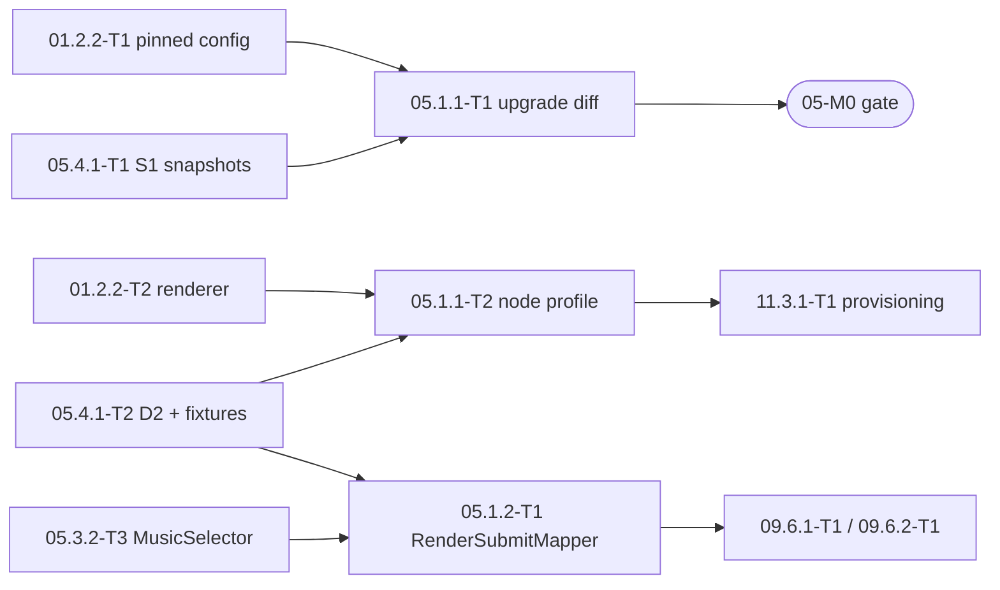

# 05.1 — Render configuration (upgrade drift check, node config profile, render params and submit mapper)

> Refines: ../../../05-video-assembly-subtitles.md §4 epic 05.1 (stories **05.1.1**, **05.1.2**), FR-05-1, §5.2
> Contract: ../README.md — **D1**, **D2**, **D3**, **D4** (submit part), **D6**, **D8** (`MusicChoice`), **D11**, **D13**, **D14**, **F10**, **F12**, **F13**, **F16**, **F22**
> Template: ../../../00-overview.md §10.1
> Legend: ✅ read from source/docs · ⚠️ unverified · [DECISION] · [OPEN] · [INFERENCE]
> Status: detailed plan, 2026-09-24. Nothing implemented yet.

## 1. Scope

**Stories.**
- 05.1.1 *Worker configuration* — "As the Tech Lead I want the MPT node configured from a checked profile and a tool that detects MPT drift before an upgrade, so that a version bump cannot silently change the render contract." Must · high-level XS → **detailed 1.0 d** (T1 + T2; README §9).
- 05.1.2 *Per-job parameter mapping* — "As the backend I want one mapper that turns a render request into MPT's submit body, so that every job sends exactly the fields D3 fixes and the stored `render-params.v1` matches what was rendered." Must · **S (0.5 d)**.

**In scope.** `worker-node/bin/mpt-upgrade-diff.py` + the pinned baselines it consumes (T1); `worker-node/mpt/config.node.template.toml` and the `--profile node` extension of `worker-node/bin/render-mpt-config.py` with the D2 guard table (T2); Domain `RenderParamsV1`, `SubtitlesParams`, `MusicParams`, `SubtitlePreset`, `SubtitlePresetCatalog` and Application `AdapterSubmitRequestV1`, `MptSubmitFields`, `RenderSubmitMapper` (05.1.2-T1).

**Out of scope.** The adapter (11.3.5-T1), mock-mpt (11.1.2-T1), `MptRenderClient` (09.6.2-T1), `render_jobs` persistence (09.6.1-T1), the spike and S0–S16 samples (05.4.1-T1), `render-node.v1` + D14 fixtures (05.4.1-T2), preset values and `subtitle_fit.py` (05.2.3-T1), `MusicSelector`/`MusicTrack`/`music_tracks` (05.3.2-T3), `RenderImagePlan` (03.2.1-T1), `StoryRenderInput` (02.3.2-T1), the Mac profile (01.2.2-T2, signed), `check-fonts.sh` (05.2.2-T1). **Replaces** rows `05.1.1-T1`, `05.1.2-T1` of `05-video-assembly-subtitles.md` §6 (README §8).

## 2. Confirmed facts

| # | Fact | Source |
|---|---|---|
| C2 | Empty `app.api_key` → auth off; else exactly one `x-api-key`, `secrets.compare_digest` → 401 `invalid API key` | README §1 ✅ |
| C3 | `POST /api/v1/videos` → 200 `{"status":200,"message":"success","data":{"task_id":"<uuid4>"}}`; state `4`/`progress 0` written before scheduling; `x-task-id` → MPT `request_id` | README §1 ✅ |
| C5 | Validation errors are HTTP **400** with the fixed message `field required`; unknown body fields are ignored (no `extra="forbid"`) | README §1 ✅ (F10) |
| C7 | Progress 5 → 10 → 20 → 30 → 40 → 50 → 75 → 100; with `video_script` + `video_terms` supplied, 5 → 20 makes no LLM call | README §1 ✅ |
| C14 | `VideoAspect` `"16:9"`/`"9:16"`/`"1:1"`; fps 30; `video_codec ∈ {libx264 (default), h264_nvenc, h264_amf, h264_qsv, h264_mf, h264_videotoolbox}` | README §1 ✅ |
| C18 | `bgm_type = ""` or `bgm_volume ≤ 0` → no music; `bgm_file` resolved inside `storage/bgm` then `resource/songs`; `random` (the schema default) picks from both dirs | README §1 ✅ (F13) |
| C19 | A non-empty `video_script` skips the script LLM and non-empty `video_terms` skips the terms LLM → a node needs no LLM key | README §1 ✅ |
| C20 | Snapshot `config.example.toml`: `listen_host = "0.0.0.0"` L11, `listen_port` L12, `api_key` L26, `subtitle_provider = "edge"` L429, `video_codec` commented L438–440, `endpoint` L448, `material_directory` L453, `enable_redis` L457, `max_concurrent_tasks = 5` L464, `max_queued_tasks = 100` L465, `[whisper]` L500–511 | README §1 ✅ |
| C22 | `VideoParams`: `video_clip_duration ≥ 1` (default 5), `video_count ≥ 1`, `subtitle_display_mode ∈ {sentence, word_by_word}`, `subtitle_animation ∈ {none, pop_spring}`, `text_background_color: bool \| str`, `font_size int = 60`, `stroke_width float = 1.5`, `n_threads = 2` | README §1 ✅ |
| F10 | A typo in a submit body silently falls back to a default → the adapter validates a closed schema, the backend sends no unknown keys | README §2 ✅ |
| F12 | MPT also serves `/docs`, `/openapi.json`, the public static root, upload and LLM routes → the node binds `127.0.0.1` | README §2 ✅ |
| F13 | `bgm_type = "random"` does not record the track used → every job sends `custom` or `""` | README §2 ✅ |
| F16 | Whisper gets no language and `initial_prompt` is global per node → it stays absent in the node profile | README §2 ✅ |
| F22 | `n_threads` and `video_codec` belong to the node, not the job → the backend never sends `n_threads` | README §2 ✅ |
| D2 | The node config table; **every row is a guard** (exit 1 on mismatch) | README §3 [DECISION] |
| D3 | The complete `mpt-submit.v1` body; `render-submit.v1.mpt` holds exactly those keys except `n_threads` | README §3 [DECISION] |
| D6 | `subtitle-presets.v1` revision 1; `landscape` 84 px, `portrait` 64 px / `custom` 62.0 | README §3 [DECISION] |
| D8 | `MusicSelector.Pick` → `MusicChoice(TrackId, File, BgmVolume)?`; `null` → no music; `bgmVolume` stored in the catalog | README §3 [DECISION] |
| D11 | `render-params.v1`: `mapper_version 1`, `aspect`, `language`, `voice_id`, `style_template_id`, `style_prompt_version`, `image_plan` (counts, hint codes, slot segments; no hashes, 05 CR-14), `subtitles {enabled, preset}`, `music {track_id, bgm_volume, attribution}?` (05 CR-14), `clip_seconds` | README §3 [DECISION] |
| D14 | Fixtures `render-submit.v1.{landscape-vi,portrait-en,no-music}.json`; no JSON-Schema files; `JsonUnmappedMemberHandling.Disallow` in C# DTO tests; stdlib tools via `uv run --no-project --python 3.12` | README §3 [DECISION] |
| CR-3 | 09.6.1-T1 stores `BuildParams` output in `render_jobs.params` and rejects a script > 20,000 code points; 09.6.2-T1 calls `BuildSubmit` | README §4 (proposed) |

**Closed here.** FR-05-1 (node configuration = D2 + guards); the job→MPT mapping shape (D3 + D11); where `n_threads` comes from (F22); that no MPT field outside D3 is ever sent (F10). 01.2.2-T2 renders the Mac profile (P1 ✅); 11.3.1-T1 consumes the node profile (CR-4); 01.2.2-T2's Notes gain the `node` profile (CR-5).

## 3. Domain and data

### 3.1 Stored data

No new table, no migration. `render-params.v1` (D11) is the jsonb `render_jobs.params` written by 09.6.1-T1; `music_tracks` is 05.3.2-T3 (P5); `assets.kind = subtitle` is 09.6.3-T1. The rendered config lives on the node (out path from `--out`, ⚠️ fixed by 11.3.1-T1), never in the repo; the node environment file with the `${…}` values is 11.3.2's.

### 3.2 C# types (05.1.2-T1)

| File | Type |
|---|---|
| `Domain/Rendering/RenderParamsV1.cs` | `sealed record RenderParamsV1(int MapperVersion, Guid StoryVersionId, string Aspect, string Language, string VoiceId, Guid StyleTemplateId, string StylePromptVersion, ImagePlanSummary ImagePlan, SubtitlesParams Subtitles, MusicParams? Music, int ClipSeconds)` — mirrors D11 |
| `Domain/Rendering/SubtitlesParams.cs` | `sealed record SubtitlesParams(bool Enabled, string Preset)`; `Preset` = `<aspect>@<revision>` (D11) |
| `Domain/Rendering/MusicParams.cs` | `sealed record MusicParams(string TrackId, decimal BgmVolume, string? Attribution)` (`Attribution` frozen from the catalog at render time for 06, T9); parent `null` when `MusicSelector` returned `null` (D8/D11) |
| `Domain/Rendering/ImagePlanSummary.cs` | `sealed record ImagePlanSummary(int ClipSeconds, int Needed, int MaxTerms, int Planned, int Trimmed, IReadOnlyList<string> Hints, IReadOnlyList<string> SlotSegments, string StylePromptVersion)` + `static ImagePlanSummary From(RenderImagePlan plan, string stylePromptVersion)` — the 03.2 `plan.md` §3.2 counts shape the merged `ImagePlanJson` writes; no prompt hashes (05 CR-14) |
| `Domain/Rendering/Subtitles/SubtitlePreset.cs` | `sealed record SubtitlePreset(string Aspect, string FontName, int FontSize, decimal StrokeWidth, string StrokeColor, string TextForeColor, bool TextBackgroundColor, bool RoundedSubtitleBackground, string SubtitlePosition, decimal CustomPosition, int MaxCharsPerLine, int MaxLines)` — `FontName` (D7) is on the preset because `BuildSubmit` receives only the preset (05 CR-14) |
| `Domain/Rendering/Subtitles/SubtitlePresetCatalog.cs` | `static ErrorOr<SubtitlePresetCatalog> Load(ReadOnlySpan<byte> json)`; `SubtitlePreset For(string aspect)`; `int Revision`; `string FontName` — reads the embedded `seed/subtitle-presets.v1.json` |
| `src/NightTales.RenderNode.Contract/AdapterSubmitRequestV1.cs` (namespace `NightTales.RenderNode.Contract`, 05.4.1-T2) | `sealed record AdapterSubmitRequestV1(string Schema, Guid RenderJobId, MptSubmitFields Mpt, ImagePlanV1 ImagePlan)`, `[JsonPropertyName]` snake_case — the `render-submit.v1` wire (D4); `ImagePlanV1(int MaxImages, IReadOnlyList<string> PromptSha256)` is fed from the prepared prompts' `Sha256` (05 CR-14) |
| `src/NightTales.RenderNode.Contract/MptSubmitFields.cs` (namespace `NightTales.RenderNode.Contract`, 05.4.1-T2) | every D3 field **except `n_threads`** (F22), `[JsonPropertyName]` snake_case, `required` |
| `Application/Features/Rendering/RenderSubmitMapper.cs` | `static RenderParamsV1 BuildParams(RenderParamsInput input)` · `static IReadOnlyList<ScenePrompt> BuildPrompts(RenderImagePlan plan, StyleTemplate style)` · `static ErrorOr<AdapterSubmitRequestV1> BuildSubmit(Guid renderJobId, RenderParamsV1 p, StoryRenderInput story, RenderImagePlan plan, IReadOnlyList<ScenePrompt> prompts, SubtitlePreset preset, MusicTrack? track)` (05 CR-14) |
| `Application/Features/Rendering/RenderParamsInput.cs` | `sealed record RenderParamsInput(Guid StoryVersionId, string Aspect, string Language, string VoiceId, Guid StyleTemplateId, string StylePromptVersion, ImagePlanSummary ImagePlan, SubtitlesParams Subtitles, MusicChoice? Music, string? MusicAttribution, int ClipSeconds)` — `MusicAttribution` is the frozen catalog attribution (`MusicChoice` has none, 05 CR-14) — built by 09.6.1-T1 |

Domain has no EF and references ErrorOr only (09 D1), so `SubtitlePresetCatalog` takes bytes/stream, not a path.

### 3.3 `subtitle-presets.v1` validation (D6)

`Load` rejects, with an `ErrorOr` error and never a throw: `schema != "subtitle-presets.v1"`; `revision < 1`; either aspect missing; `fontName != "BeVietnamPro-Bold.ttf"` (D7); `fontSize ∉ [24,160]`; `strokeWidth ∉ [0,10]`; a colour not matching `^#[0-9A-F]{6}$`; `subtitlePosition ∉ {bottom, top, center, two_thirds_bottom, custom}` (C16); `customPosition ∉ [0,100]`; `maxCharsPerLine ≤ 0`; `maxLines ≤ 0`. `maxCharsPerLine`/`maxLines` never reach MPT (D6).

### 3.4 `render-submit.v1` / `mpt-submit.v1`

`{ "schema": "render-submit.v1", "render_job_id": "<uuid>", "mpt": { …D3… }, "image_plan": { "max_images": <n>, "prompt_sha256": [ … ] } }`; the adapter strips `image_plan`, adds `n_threads`, forwards `mpt` verbatim (D4). Both `image_plan.prompt_sha256` and `mpt.video_terms` are built from the prepared prompts (`RenderSubmitMapper.BuildPrompts(plan, style)`), never from `plan` itself — `RenderImagePlan` carries no prompts (05 CR-14).

| Field | Rule |
|---|---|
| `video_subject` / `video_script` | `story.Title`, 1–200 chars / story body, NFC, 1–20,000 code points, else `render.script_too_long` (D3, 04 V1, CR-3) |
| `video_terms` | `prompts[i].Text` in order (the `prompts` argument of `BuildSubmit`, from `BuildPrompts`); 1–200 strings, each 1–1,000 chars (D3, 03 D4, 05 CR-14) |
| `video_aspect` / `video_language` / `voice_name` | `landscape` → `"16:9"`, `portrait` → `"9:16"` / `p.Language` (`"vi"`\|`"en"`) / `"kokoro:" + p.VoiceId` (D3, C14, 04 D10) |
| `bgm_type`/`bgm_file`/`bgm_volume` | `"custom"`/`track.FileName`/`p.Music.BgmVolume` — or `""`/`""`/`0` when `p.Music` is null (D3, D8, F13; `FileName`, not `File` — 05 CR-14) |
| subtitle fields | `subtitle_enabled` ← `p.Subtitles.Enabled`; `subtitle_position`, `custom_position`, `font_size`, `stroke_color`, `stroke_width`, `text_fore_color`, `text_background_color`, `rounded_subtitle_background`, `font_name` ← preset values, camelCase → snake_case (D3, D6, D7, D11) |

Fixed values (D3), one literal each: `video_fit_mode "cover"`, `video_concat_mode "sequential"`, `video_transition_mode null`, `video_clip_duration 10`, `video_clip_speed 1.0`, `match_materials_to_script true`, `video_count 1`, `video_source "openai_image"`, `video_materials null`, `custom_audio_file null`, `voice_volume 1.0`, `voice_rate 1.0`, `video_music_prompt ""`, `sonilo_bgm_prompt ""`, `subtitle_display_mode "sentence"`, `subtitle_animation "none"`, `paragraph_number 1`, `video_script_prompt ""`, `custom_system_prompt ""`. `n_threads` is **absent** from the record (F22); the adapter injects `ADAPTER_MPT_THREADS` (adapter config, default `max(1, floor(cpu_cores ÷ max_concurrent_tasks))`, README T15/D15 P6).

### 3.5 Node-side artefacts (05.1.1)

| Path | Owner | Note |
|---|---|---|
| `worker-node/mpt/config.node.template.toml` | 05.1.1-T2 | every D2 row; six `${…}` placeholders |
| `worker-node/bin/render-mpt-config.py` | 01.2.2-T2 (signed) ✅ | gains `--profile node`; path as created by 01.2.2-T2 |
| `worker-node/bin/mpt-upgrade-diff.py` | 05.1.1-T1 | stdlib, `uv run --no-project --python 3.12` |
| `worker-node/mpt/config.example.pinned.toml` | 01.2.2-T1 | baseline for the config diff (CR-7); name ⚠️ — open item |
| `worker-node/contract/mpt-videoparams.pinned.json`, `mpt-routes.pinned.json` | 05.4.1-T1 S1 | baselines for the schema and route diffs |

## 4. Use cases

| # | Use case | Behaviour |
|---|---|---|
| UC1 | An MPT upgrade is proposed (`MPT_COMMIT` bump) | run `mpt-upgrade-diff.py --candidate <worktree>`; exit 1 → stop and escalate with the report; exit 0 → re-run the 05.4.1-T1 S0/S3/S5/S12 subset, then refresh the snapshots in the bump commit |
| UC2 | The node is provisioned (11.3.1-T1) | `render-mpt-config.py --profile node --out <node config path>`; every D2 row is a guard; exit 1 lists failing keys with redacted values |
| UC3 | A render job is accepted (09.6.1-T1) | `BuildParams(input)` → `render-params.v1` into `render_jobs.params`; > 20,000 code points rejected before the row is written |
| UC4 | The job is dispatched (09.6.2-T1 / 09.6.3-T1) | `BuildPrompts(plan, style)` then `BuildSubmit(...)` → `render-submit.v1`; the client never composes an MPT field itself (05 CR-14) |
| UC5 | No music (`MusicSelector` → `null`) | `params.music = null`; body sends `bgm_type ""`, `bgm_file ""`, `bgm_volume 0` (C18: no music) |
| UC6 | A preset revision changes | `revision + 1` in `seed/subtitle-presets.v1.json`; new `subtitles.preset = "<aspect>@<revision>"`; old jobs keep their stored params |

## 5. API and events

No HTTP route in this folder: it produces the two wire artefacts of D4/D11 and consumes the MPT wire of D3.

| Artefact | Consumer | Failure surface |
|---|---|---|
| `render-submit.v1` (`BuildSubmit`) | 09.6.2-T1 → adapter `POST /v1/renders` | 400 `adapter_contract_violation` (raised by the adapter, F10), 429 `adapter_capacity_full`, 503 `adapter_node_unhealthy` |
| `render-params.v1` (`BuildParams`) | 09.6.1-T1 stores it, 09.6.2-T1 reads it back | `validation_failed` field `script` for > 20,000 code points (CR-3, 09.6.1-T1) |
| `mpt-submit.v1` (D3 key set) | the adapter (11.3.5-T1) | never sent by the backend; `n_threads` is the adapter's (F22) |

Mapper errors (all `Error.Validation`, returned as `ErrorOr` from `BuildSubmit`; T8; 05 CR-14): `render.script_too_long` (rune count outside 1–20,000 — an empty script returns the same code, D3 has no separate one — pre-checked by 09.6.1-T1, CR-3), `render.subject_invalid` (title 0 or > 200 chars), `render.aspect_invalid`, `render.terms_invalid` (0 or > 200 prompts, or a prompt > 1,000 chars). The four codes are public consts on `RenderSubmitMapper` and are **not** yet in `ErrorCatalogue` — 09.6.1-T1 catalogues them when the handler surfaces them; the mapper's `BuildPrompts`/`BuildSubmit` pair is called by 09.6.2-T1 and 09.6.3-T1, which compare `StylePromptVersion.For(style)` with `p.StylePromptVersion` first. A `p.Music.TrackId ≠ track.Id` mismatch is a programming error → `ArgumentException`, never a new code. Events: none (`RenderJobSubmitted` and the job rows are 09.6.1-T1's). CLI contract (both node tools, 01 D9): `0` success/no blocking change · `1` guard or blocking change · `2` usage or environment; human output by default, `--json` on `mpt-upgrade-diff.py`.

## 6. UI

None — worker-side tooling and backend mapping: no route, no user-visible string, no copy key.

## 7. Jobs and integrations

| Integration | Detail |
|---|---|
| `mpt-upgrade-diff.py` | candidate worktree `$NTS_HOME/src/mpt-candidate` at `MPT_COMMIT`; baselines are repo files; `uv run --no-project --python 3.12` (no venv of its own, D14/01 D9) |
| candidate interpreter calls | the diff runs the **candidate's own** `<candidate>/.venv/bin/python` for `VideoParams.model_json_schema()` and `app.asgi.app.openapi()` — never the Mac's MPT venv |
| `render-mpt-config.py --profile node` | same renderer, same atomic write + 0600 + secret-free drift diff as the Mac profile (01.2.2-T2); values from the process environment (or `--env-file`, open item) |
| 09.6.1-T1 / 09.6.2-T1 | store `BuildParams` output verbatim / call `BuildPrompts(plan, style)` + `BuildSubmit` per attempt and deserialize the D14 fixtures with `JsonUnmappedMemberHandling.Disallow` (CR-3, D14, 05 CR-14) |
| 11.3.1-T1 | `render-mpt-config.py --profile node` then `--check --profile node`, plus `check-fonts.sh`, `check-music.sh`, `sync-music.sh` (CR-4) |
| MPT upgrade runbook | (1) bump `MPT_COMMIT` in `worker-node/pins.env` in its own commit (01 D2); (2) `git worktree add "$NTS_HOME/src/mpt-candidate" "$MPT_COMMIT"` + `uv sync`; (3) diff — exit 0 required; (4) re-run S0/S3/S5/S12; (5) refresh the three snapshots in the same commit; (6) a confirmed BLOCKING change escalates to the TL — D2/D3/D4, the fixtures, the adapter and mock-mpt move together |

## 8. Security and privacy

| Threat | Control |
|---|---|
| A secret in the repo or a rendered config's history | the template holds `${NTS_MPT_API_KEY}` / `${NTS_PROXY_API_KEY}` only; values come from the node environment file (11.3.2); the rendered file is 0600 (01.2.2-T2); `--check` prints key **names** with `<set>`/`<empty>` |
| Keys in argv or a shell trace | `set -euo pipefail`, no `set -x`, no key on a command line; `mpt-upgrade-diff.py` never reads a key |
| MPT exposed beyond the node | D2 guard `listen_host = "127.0.0.1"` (F12); `/docs`, `/openapi.json`, `/stream` and the static mounts are informational, not BLOCKING |
| Script/prompt text in tool output | the diff prints key names, field names and route paths only; the mapper logs counts, never text (C4 is 03 D12's concern) |
| Broken Vietnamese subtitles from a wrong font | the preset guard rejects any `fontName ≠ "BeVietnamPro-Bold.ttf"` (D7, F04); the node guard requires `[whisper] initial_prompt` absent (F16) |
| Mac runtime state on a shared disk | `$NTS_HOME` (default `~/.nts`, FileVault) for the candidate worktree and rendered configs; keys in the macOS Keychain (01 D13) |

## 9. Test plan

- **`mpt-upgrade-diff.py --self-test`** (T1): synthetic TOML/JSON pairs in a `tempfile.TemporaryDirectory()`, no tracked fixtures. Cases: identical → 0; D2 key removed → 1; D2 key default changed → 1; non-D2 key changed → 0 advisory; D3 field type changed → 1; D3 field added → 1; D4 route removed → 1; `/stream` method changed → 0 advisory; C7 progress set changed → 0 warning; missing baseline → 2; `--json` parses with `json.loads`.
- **`render-mpt-config.py --check --profile node`** (T2): valid env → 0 and `tomllib.loads(out)` yields `max_queued_tasks` as an `int` `0`; `max_queued_tasks = 5` → 1; non-empty `openai_api_key` → 1; `listen_host = "0.0.0.0"` → 1; `video_codec = "h264_videotoolbox"` → 1; `[whisper] initial_prompt` present → 1.
- **Golden tests** (05.1.2-T1): the three D14 fixtures are byte-equal to the canonical serialization of `BuildSubmit` output, and each deserializes with `JsonUnmappedMemberHandling.Disallow` (D14) — a new or renamed field on either side fails the test.
- **`RenderSubmitMapperTests`**: `Landscape_vi_matches_golden_fixture`, `Portrait_en_matches_golden_fixture`, `No_music_matches_golden_fixture`, `Portrait_uses_custom_position`, `Script_over_20k_runes_returns_script_too_long`, `Video_terms_follow_prompt_order`, `Mpt_fields_exclude_n_threads`, `Camel_case_preset_maps_to_snake_case_fields`, `BuildParams_preset_is_aspect_at_revision`.
- **`SubtitlePresetCatalogTests`**: `Landscape_preset_values`, `Portrait_preset_values`, `Rejects_revision_zero`, `Rejects_bad_font_name`, `Rejects_font_size_out_of_range`, `Rejects_bad_color`, `Rejects_custom_position_out_of_range`, `Rejects_missing_aspect`.
- **No JSON-Schema files** (D14): the C# DTO tests are the schema check; the Python side compares against the pinned snapshots. xUnit.v3 + Shouldly (repo rule, 05 CR-14); the node tools are stdlib only (no pytest).

## 10. Tasks and re-estimate

| Task | Title | Area | Size | Depends on | Blocks |
|---|---|---|---|---|---|
| 05.1.1-T1 | MPT upgrade drift check: config, `VideoParams`, routes | Worker | **S (0.5)** | 01.2.2-T1 (pinned `config.example.pinned.toml`), 05.4.1-T1 (S1 snapshots `worker-node/contract/mpt-videoparams.pinned.json`, `mpt-routes.pinned.json`) | 05-M0 gate (the node deploy runs the diff, text hand-over; 11 CR-4) |
| 05.1.1-T2 | Node config profile + guards | Worker | **S (0.5)** | 01.2.2-T2 (renderer + guards), 03.4.1-T1 (`--profile` flag in the renderer), 05.4.1-T2 (D2 confirmed at the pin), 05.2.2-T1 (font check) | 11.3.1-T2 (11 CR-4) |
| 05.1.2-T1 | `render-params.v1` + `RenderSubmitMapper` + golden fixtures | BE | **S (0.5)** | 09.1.1-T1 (Contract project, 11 CR-4), 05.4.1-T2 (contract + fixtures), 05.2.3-T1 (`seed/subtitle-presets.v1.json`), 05.3.2-T3 (`MusicSelector`, `MusicTrack`), 03.2.1-T1 (`RenderImagePlan`), 02.3.2-T1 (`StoryRenderInput` via `IStoryRenderInputProvider`) | 09.6.1-T1, 09.6.2-T1 |

Total **1.5 d** (high-level 0.75 d; README §9).

### Open items for the TL

- [RULED — README §10 T15] **D2/D3/F22 — `ADAPTER_MPT_THREADS` has no home.** D3 says the adapter sets it from "node config, default 4", but D2 has no such row and D2 states every row is a guard. Decide node environment variable (11.3.2) vs adapter config key (11.3.5); today 05.1.1-T2 cannot guard it.
- [RULED — README §10 T20] **C22 vs D3 — `rounded_subtitle_background` and the `bool \| str` union are not in C22's enumeration** although D3 requires them. Authority = the pinned `VideoParams` snapshot (05.4.1-T1 S1); if a name or type differs at the pin, D3, `MptSubmitFields` and the D14 fixtures change together (05.1.1-T1 flags a D3 field change as BLOCKING, which surfaces it).
- [RULED — README §10 T16] **D4/C1 — which MPT routes are BLOCKING.** Proposal: only D4's set (`POST /api/v1/videos`, `GET|DELETE /api/v1/tasks/{task_id}`, `GET /api/v1/download/{file_path}`, `GET /ping`); `/stream`, the upload routes, the LLM routes and `/docs` informational. Confirm.
- [RULED — README §10 T21] **D2 `listen_port = 8080` is hard-coded in the node template** and D2 names no environment variable for the port; D4 marks the adapter port ⚠️ final in 11.3.5. If the node MPT port moves, the guard becomes `${NTS_MPT_PORT}`.
- [RULED — README §10 T17] **D11 `subtitles.preset = "<aspect>@<revision>"` with a single top-level `revision` in D6** → changing one aspect bumps both presets. Confirm the format and that `mapper_version` stays 1 across preset revisions.
- [RULED — README §10 T18] **The node environment file is unnamed.** D2 says the `${…}` values come from "the node environment file written by 11.3.2", not yet detailed. 05.1.1-T2 proposes `--env-file FILE` with the process environment as the default; the name must be pinned before 11.3.1-T1.
- [RULED — README §10 T19] **The pinned config baseline filename.** 01.2.2-T1 owns the pinned `config.example.toml` copy (CR-7) but does not name the file; this plan assumes `worker-node/mpt/config.example.pinned.toml`. If 01 used another name, 05.1.1-T1's `--baseline-config` default changes (one line).

## 11. Rollout

- **M0:** 05.1.1-T1 (after 01.2.2-T1 and 05.4.1-T1 S1) satisfies the 05-M0 gate row "`mpt-upgrade-diff.py` green against the pin". No flag.
- **M1:** 05.1.1-T2 (after 05.2.2-T1 and 05.4.1-T2) **before** 11.3.1-T1, which calls `render-mpt-config.py --profile node`. 05.1.2-T1 (after 05.4.1-T2, 05.2.3-T1, 05.3.2-T3, 03.2.1-T1, 02.3.2-T1) **before** 09.6.1-T1/09.6.2-T1.
- **Flags:** none. The profile is selected by `--profile node` at provisioning time; the mapper is compile-time. Emergency rollback = revert the 05.1.2-T1 commit (no migration, no route change).
- **Gate 05-M1 rows:** "node profile renders and passes guards on the node (05.1.1-T2 via 11.3.1-T1)"; "`RenderSubmitMapper` golden tests green and used by 09.6.2-T1 (05.1.2-T1)".
