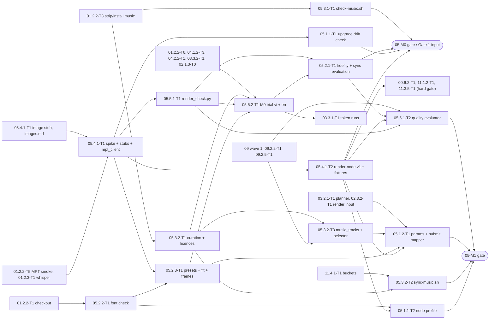

# 05 — Video Assembly, Subtitles, Music and the Worker Contract: Tech Lead review, shared decisions and feature index

> Reviews: `../../05-video-assembly-subtitles.md` (high-level, M0 → M1, all P; 05.4 is Gate 1). Process: `../../00-overview.md` §10.1, step (2) review → step (3) detailed feature plans (this folder).
> Reviewed: 2026-09-24 by the Tech Lead. Feature plans: 5 folders, 5 `plan.md` + 15 task files, written 2026-09-24. Status: **owner decisions O1–O7 and re-estimate 10.75 d raw / 12.9 buffered accepted 2026-09-24 (§10); TL rulings T1–T52, two review passes and one security + performance pass applied (§10, D15); CR-1…CR-13 applied (§4); TL DoR 2026-09-24: ready with conditions, owner-signed 2026-09-24 (§11)**.
> Verdict: **approve with changes**. The scope is right: configure MPT (no fork), whisper subtitles, a Vietnamese font, a licensed music catalog, automated checks, one trial per language, and a spike that fixes the node contract. But the plan was written before MPT's task, subtitle and video code was read, and five of its assumptions are wrong: subtitle **text** already comes from the script (whisper only gives timing, F01), a whisper failure yields a "successful" video with invisible subtitles (F02), subtitles are burned in and cannot be seen by `ffprobe` (F03), the default font lacks 92 Vietnamese letters (F04), and MPT never normalises loudness, so the −16…−14 LUFS check would fail or pass by chance (F05). MPT keeps task state in memory, queues silently, and cannot cancel a running task (F06–F08). The fixes live in the adapter contract (D4), the render check tool (D9) and the presets (D6). Re-estimate **8.75 → 10.75 d raw** (§9).
> Legend: ✅ read from source/docs (file + line, date) or reproduced here · ⚠️ unverified · [DECISION] · [OPEN] · [INFERENCE].

## 0. How this folder is organised

```
plans/features/05-video-assembly-subtitles/
  README.md                     ← this file: facts, findings, shared decisions D1–D14, CRs, task template, gates, index, re-estimate
  05.1-render-config/           ← stories 05.1.1 (upgrade drift check, node config profile), 05.1.2 (render params + submit mapper)
  05.2-subtitles-fonts/         ← stories 05.2.1 (fidelity + sync evaluation), 05.2.2 (font), 05.2.3 (presets)
  05.3-music/                   ← stories 05.3.1 (build check), 05.3.2 (curation, storage sync, music_tracks table + selector)
  05.4.1-worker-contract/       ← story 05.4.1 (spike, contract files and hand-over) — hard gate for 09.6.2-T1, 11.1.2-T1, 11.3.5-T1
  05.5-quality-trial/           ← stories 05.5.1 (render check tool, backend quality report), 05.5.2 (M0 trial)
```

Each feature folder holds `plan.md` (template `00-overview.md` §10.1, sections 1–11) and one `<task-id>-<slug>.md` per task (template §6). Task IDs follow `00-overview.md` §9. They **replace** the task table in `05-video-assembly-subtitles.md` §6 (mapping in §8). All high-level ids are kept (plans 01, 03, 04, 09 and 11 name them). New tasks take the next free `T<n>` of their story: `05.1.1-T2` (node profile), `05.3.2-T3` (`music_tracks` backend, owned by 05 per 09.2.2 plan §1), `05.4.1-T2` stays (now S), `05.5.1-T2` (backend quality report).

## 1. Facts verified for this review

MPT code was read on 2026-09-24 from the local snapshot `/private/tmp/mptsrc/MoneyPrinterTurbo-main` (`pyproject.toml` `version = "1.3.7"`), the same snapshot plans 03 and 04 used. It has no git metadata, so the commit is **not** proven to equal the 01 pin `3d5f4e42` ⚠️; the `config.example.toml` line numbers here differ from 01 M1's, which confirms the snapshot is not byte-identical to the pin. 05.4.1-T1 step S0 re-checks every `C` fact at `MPT_COMMIT` before anything is built on it. Five experiments ran on the planning Mac (ffmpeg 9.0.2, Python 3.9.6 with Pillow 11.3.0, script `/tmp/nts05/font_probe.py`, deleted after the review); they are design evidence, not a substitute for the spike on the implementation machine (01 DEC-2).

| # | Fact | Source |
|---|---|---|
| C1 | Routes: router prefix `/api/v1` with `verify_token` on every v1 route; `POST /videos` (L181), `POST /subtitle`, `POST /audio`, `GET /tasks` (L240, all tasks, paged), `GET /tasks/{task_id}` (L258), `DELETE /tasks/{task_id}` (L290), `GET /musics`, `POST /musics` (upload into `storage/bgm`), `GET/POST /video_materials`, `GET /stream/{file_path:path}` (L457), `GET /download/{file_path:path}` (L490); 3 LLM routes in `llm.py`; unauthenticated `GET /ping` → `"pong"`; static mounts `/tasks` (task dir, auth via middleware) and `/` (public dir); FastAPI `/docs`, `/redoc`, `/openapi.json` are **on** (no `docs_url=None`) ✅ | `app/controllers/v1/base.py` L4–11; `v1/video.py`; `v1/llm.py` L21–54; `ping.py`; `app/asgi.py` L235–288 |
| C2 | Auth: empty `app.api_key` → auth off (warning at startup); otherwise **exactly one** `x-api-key` header, compared as UTF-8 bytes with `secrets.compare_digest`; missing, wrong or duplicated → 401 `{"status":401,"message":"invalid API key"}`; the `/tasks` static mount is guarded by the same function in a middleware ✅ | `app/controllers/base.py` L47–98; `asgi.py` L21–37, L258–275 |
| C3 | `POST /api/v1/videos` → HTTP 200 `{ "status": 200, "message": "success", "data": { "task_id": "<uuid4>" } }` (the response model filters `request_id` and `params`). The state record (`state 4`, `progress 0`) is written **before** scheduling and rolled back if scheduling raises. Header `x-task-id` (≤ 128 printable chars) becomes `request_id` in MPT's log ✅ | `v1/video.py` L202–238; `schema.py` L278–287, L354–368; `base.py` L13–27 |
| C4 | Task creation logs `Task created: {task_id, request_id, params}` at SUCCESS level — the **whole** `VideoParams`, i.e. the full script and all scene prompts ✅ | `v1/video.py` L210–226 |
| C5 | Any request-validation error → HTTP **400** (not 422) `{ "status": 400, "data": [<pydantic errors>], "message": "field required" }` whatever the error. Unknown body fields are **ignored** (`VideoParams` has no `extra="forbid"`) ✅ | `asgi.py` L57–63; `schema.py` L91–161 |
| C6 | `GET /api/v1/tasks/{id}` → `data` = the stored task dict (`extra="allow"`): `task_id`, `state` (`-1` failed, `1` complete, `4` processing), `progress` (int), `failed_stage`, `error`; on success also `videos`/`combined_videos` rewritten to `/tasks/<id>/final-1.mp4` (prefixed by `app.endpoint` when set), `script`, `terms`, `audio_file` and `subtitle_path` (**absolute node paths**), `audio_duration` (int), `materials`, `warnings`, `cross_post_*`. Unknown id → 404 `task not found` ✅ | `v1/video.py` L258–287; `models/const.py` L25–27; `task.py` L1659–1676 |
| C7 | Progress values written by the pipeline: 5 (start) → 10 (script ready) → 20 (terms ready) → 30 (audio done) → 40 (subtitles done) → 50 (images done) → 75 (combined clip, `video_count = 1`) → 100 (final video). With `video_script` and `video_terms` supplied, 5 → 20 takes no LLM call ✅ | `app/services/task.py` L1388, L1510, L1537, L1562, L1587, L1613, L965–966, L1023–1024, L1674 |
| C8 | Failure: `_mark_task_failed(stage, error)` sets `state -1`, keeps the reached `progress`, and keeps the **first** error. Stages: `preflight`, `script`, `terms`, `audio`, `materials`, `video`, `pipeline` (any uncaught exception, message `"<Type>: <text>"`) ✅ | `task.py` L243–290, L1390–1498, L1501–1637, L1720–1740 |
| C9 | Task state: memory by default. `MemoryState.update_task` **replaces** the whole record; `RedisState` writes field by field. Startup recovers only cross-post state, never video tasks: after an MPT restart a memory task answers 404; a Redis task that was running stays `state 4` forever (and `DELETE` refuses it, C11) ✅ | `app/services/state.py` L44–95, L153–172, L232–244; `asgi.py` L39–43 |
| C10 | Queue: while `current_tasks < max_concurrent_tasks` a task gets a thread at once; otherwise it is queued in memory up to `max_queued_tasks` (default 100), else `TaskQueueFullError` → 429 `"<request_id>: task queue is full, please try again later"`. A queued task looks exactly like a running one (`state 4`, `progress 0`). The check is `queue_size() >= max_queued_tasks`, so `max_queued_tasks = 0` rejects every task that finds all slots busy ✅ | `controllers/manager/base_manager.py` L48–85; `memory_manager.py`; `config.example.toml` L464–465 |
| C11 | `DELETE /api/v1/tasks/{id}`: `state 4` (or an active cross-post) → 409 `task is still running`; otherwise `rmtree(storage/tasks/<id>)`, state deleted, 200; unknown → 404. **There is no cancel operation** ✅ | `v1/video.py` L290–322; `task.py` L106–123 |
| C12 | `/download/{file_path:path}` and `/stream/{file_path:path}` resolve the path with `realpath` + `commonpath` inside `storage/tasks` and require a regular file; `/download` returns `FileResponse` with `media_type = video/<ext>`; `/stream` always answers 206 with `Content-Range`. No per-task scoping: any file of any task (script, audio) is readable with the one key. This closes DECISIONS §8 item 11: no traversal outside the task dir ✅ | `v1/video.py` L457–508; `app/utils/file_security.py` |
| C13 | Task dir `storage/tasks/<task_id>/`: `audio.mp3`, `subtitle.srt`, `combined-1.mp4`, `final-1.mp4`, `script.json`, `openai-image-<12 hex>.png` + `<png>.mp4` zoom clips (with `material_directory = ""`). MPT never deletes task dirs on its own ✅ | `task.py` L532, L592, L918, L968, L355–361; `material.py` L1530–1532; `video.py` L1553, L537, L977 |
| C14 | Output: `VideoAspect` values `"16:9"` → 1920×1080, `"9:16"` → 1080×1920, `"1:1"` → 1080×1080; fps 30; audio AAC 192 kb/s at the narration's sample rate; codec from `video_codec` ∈ {`libx264` (default), `h264_nvenc`, `h264_amf`, `h264_qsv`, `h264_mf`, `h264_videotoolbox`} with fallback to libx264. `audio_duration = ceil(mp3 duration)`; required video length = `audio_duration + 0.1 s` ✅ | `schema.py` L34–46; `video.py` L71–75, L86–99, L181–190, L282–299, L1510–1524; `task.py` L560–563 |
| C15 | Subtitles: provider from `[app] subtitle_provider`; `subtitle_enabled = false` → none. `subtitle.create()` with `word_timestamps=True`, `vad_filter=True`, `beam_size=5`, **no `language`**; `initial_prompt` is a **global** `[whisper]` config key; a model-load failure logs and returns `None` without writing a file. Sentence mode then runs `subtitle.correct(srt, script)`, which **replaces every cue's text by the matching script chunk** (in both the "similar > 0.8" and the "mismatch" branch) and appends leftover script chunks with the next cue's times or `00:00:00,000 --> 00:00:00,000`. Script chunks = `split_string_by_punctuations(normalize_script_for_subtitle_matching(script))`, split at every `const.PUNCTUATIONS` character (`, . ? ! ; : … 、` + CJK/Arabic forms) and at newlines; punctuation is dropped from the cue text. `word_by_word` mode skips `correct()`. An empty/invalid SRT → `subtitle_path = ""` and the task still succeeds ✅ | `task.py` L580–645; `subtitle.py` L16–160, L238–330; `utils.py` L281–320, L451–481; `const.py` L1–23 |
| C16 | Subtitles are **burned in** (`SubtitlesClip` → `TextClip`s composited on the video); there is no subtitle stream. Font = `resource/fonts/<font_name>` (`STHeitiMedium.ttc` when empty). Lines wrap by pixel width at **90 % of the frame width**; no line-count limit. Positions: `bottom` (y = 0.95 H − h), `top`, `center`, `two_thirds_bottom`, `custom` (y = (H − h) × p ÷ 100). The glyph check `subtitle_font_supports_text` is called only by the WebUI ✅ | `video.py` L983–1081, L1169–1206, L1238–1423, L1446–1458; `webui/Main.py` L7774 |
| C17 | Audio mix: narration × `voice_volume`; music × `bgm_volume`, 3 s fade-out, looped to the video length; **no loudness normalisation** anywhere. A music load/mix failure keeps the video without music (warning) ✅ | `video.py` L1433–1506 |
| C18 | Music choice: `bgm_type = ""` or `bgm_volume ≤ 0` → none; a set `bgm_file` is resolved inside `storage/bgm`, then `resource/songs` (supported extensions only), otherwise no music; `bgm_type = "random"` (the schema default) → `random.choice` over both dirs; `sonilo` and `elevenlabs` are paid generator types ✅ | `video.py` L656–681; `bgm.py` L73–88, L299–393; `task.py` L75–90 |
| C19 | A non-empty `video_script` skips the script LLM; a non-empty `video_terms` list skips the terms LLM (strings are split on commas, 03 I11). A node therefore needs **no** LLM key ✅ | `task.py` L292–352 |
| C20 | `config.example.toml` (snapshot): `listen_host = "0.0.0.0"` L11, `listen_port` L12, `api_key` L26, `subtitle_provider = "edge"` L429, `video_codec` (commented) L438–440, `endpoint` L448, `material_directory` L453, `enable_redis` L457, `max_concurrent_tasks = 5` L464, `max_queued_tasks = 100` L465, `[whisper]` L500–511 (`initial_prompt` commented) ✅ | `config.example.toml` |
| C21 | MPT lock: fastapi 0.136.3, starlette 1.2.1, uvicorn 0.32.1, faster-whisper 1.1.0, ctranslate2 4.7.1, moviepy 2.2.1 ✅ | `uv.lock` L685, L768, L784, L1574, L2822, L3082 |
| C22 | `VideoParams`: `video_clip_duration ≥ 1` (default 5), `video_count ≥ 1`, `subtitle_display_mode ∈ {sentence, word_by_word}`, `subtitle_animation ∈ {none, pop_spring}`, `text_background_color: bool \| str`, `font_size int = 60`, `stroke_width float = 1.5`, `n_threads = 2`, `custom_audio_file`, `video_materials`, `voice_volume`; `subtitle_position`/`custom_position` defaults come from `config.ui` ✅ | `schema.py` L56–161 |
| X1 | Glyph coverage with MPT's own missing-glyph method, 178 Vietnamese letters (all base letters, all tone combinations, both cases, NFC) + ASCII letters/digits: `BeVietnamPro-Bold.ttf`, `BeVietnamPro-Medium.ttf`, `Charm-Bold.ttf` → 0 missing; **`STHeitiMedium.ttc` → 92 missing** (`Ơ ơ Ư ư Ạ ạ Ả ả Ấ …`); `UTM Kabel KT.ttf` → 0 missing, licence unknown ⚠️. sha256 of the snapshot's `BeVietnamPro-Bold.ttf` = `2fe6c3f9…30bfe` | experiment 2026-09-24 (Pillow 11.3.0) |
| X2 | Line capacity with a replica of MPT's `wrap_text` (Be Vietnam Pro Bold; a 157-char vi and a 183-char en sentence): landscape (max width 1728 px) size 60 → ≤ 58 chars/line, 80 → ≤ 44, **84 → ≤ 41**, 88 → ≤ 38; portrait (972 px) size 60 → ≤ 32, **64 → ≤ 28**, 70 → ≤ 27 | experiment 2026-09-24 |
| X3 | Two-pass `loudnorm` (`I=-15:TP=-1.5:LRA=11`, second pass `linear=true` with the measured values) on a 12 s H.264/AAC file with `-c:v copy`: integrated −45.85 → **−14.9 LUFS**; the H.264 bitstream sha1 is identical before and after; duration 12.000 s kept | experiment 2026-09-24 (ffmpeg 9.0.2) |
| X4 | Digital silence: `loudnorm` reports `input_i = "-inf"`; `silencedetect=noise=-50dB:d=2` reports silence over the whole duration | experiment 2026-09-24 |
| X5 | A truncated MP4 (first 400 KB of 9.8 MB, `moov` at the end as ffmpeg writes by default): `ffprobe` → `moov atom not found`, exit 1 | experiment 2026-09-24 |
| L1 | Be Vietnam Pro: SIL Open Font License 1.1, "Copyright 2021 The Be Vietnam Pro Project Authors"; the licence requirement "does not apply to any document created using the Font Software" (a rendered video) ✅ | https://raw.githubusercontent.com/bettergui/BeVietnamPro/main/OFL.txt (2026-09-24) |
| L2 | YouTube Audio Library: music is copyright-safe **for YouTube videos**, will not be claimed through Content ID, can be monetised in YPP; Creative Commons tracks require credit in the video description; filter "Attribution not required" = standard licence; "YouTube can't give legal guidance, including guidance on issues with music that can occur off the platform" ✅ → use outside YouTube is not covered [INFERENCE] | https://support.google.com/youtube/answer/3376882 (2026-09-24) |
| L3 | YouTube's playback loudness reference (≈ −14 LUFS, downward only) is stated only by secondary sources ⚠️; no official YouTube page was found. The −16…−14 LUFS band stays a [target] | web search 2026-09-24 (non-official) |
| P1 | 01.2.2-T2 renders the Mac config with guards; 03.4.1-T1 adds `render-mpt-config.py --profile spike` (image stub on `127.0.0.1:18003`); 01.2.2-T3 `strip-bundled-music.sh` keeps only files whose sha256 is in `worker-node/music/LICENSES.csv`, and `install-music.sh` copies CSV rows into `resource/songs`; "05.3.2 extends the file without renaming columns" ✅ | 01.2.2-T2, 01.2.2-T3, 03.4.1-T1 §Spike MPT profile |
| P2 | 02.8.2 video gate reads `quality_report.pass`, `duration_sec`, `tts_duration_sec`, `integrated_lufs` (band −16…−14), `width`, `height`, `subtitles_present`, `sha256`, `images.*` and `render_jobs.params.subtitles.enabled`, and fails closed on a missing field (names marked ⚠️ "05.5.1-T1 must confirm") ✅ | 02.8.2 `plan.md` §3.2 L69–85; 02.8.2-T1 L16, L41, L205 |
| P3 | 03 D4/D6/D7/D12: submit image fields, adapter-only `image_plan`, `images.v1` in terminal status, cleanup after ingest or 24 h after failure; `quality_report.images` belongs to 03.4.2-T1 ✅ | `../03-image-generation/README.md` D4–D7, D12 |
| P4 | 04 D6/D8/D10: MPT `failed_stage = audio` → job outcome `tts_failed`; adapter health embeds `proxy-health.v1` as `tts_proxy`; `voice_name = "kokoro:<voices.id>"`, `voice_rate = 1.0`; streamed MP3 ≈ 30 ms longer than the PCM ✅ | `../04-voice-proxy/README.md` D6, D8, D10, X1 |
| P5 | 09.2.2 plan §1: `music_tracks` is owned by plan **05** (not created by 09.2.2); `render_jobs` by 09.6.1; `worker_nodes` by 09.10.1/11 ✅ | 09.2.2 `plan.md` L18–27 |
| P6 | *(as read before the CRs; superseded by CR-3 on 2026-09-24)* 09 high-level: `render_jobs.params` = non-content settings; `IngestRenderOutputJob` builds URLs from `base_url` + `adapter_task_id`, ffprobe/checks "in a sandboxed container"; `render_quality_failed` listed as HTTP 409; 09.6 re-estimated after the 05.4.1 gate ✅ | `09-backend-api.md` L179–195, L406–409 |
| P7 | *(as read before the CRs; superseded by CR-4 on 2026-09-24)* 11 high-level: mock-mpt implements the adapter contract with `MOCK_FAIL_MODE ∈ {tts_failed, image_moderated, timeout, lost_task}`, `MOCK_IMAGE_REPORT`, 400 `mock_contract_violation`; FR-11-4: "the other services bind the private interface"; 11.3.5 adapter owns submit/status/download/health/cleanup; hard gate after 05.4.1 ✅ | `11-worker-deployment.md` L21, L29, L31, L47, L83–89, L164–173, L249–256 |

## 2. Findings

Severity: **B** blocks a milestone · **H** breaks an FR/NFR or a contract · **M** rework or drift risk · **L** clarity.

| # | Sev | Where (plan 05) | Finding | Action (owner feature) |
|---|---|---|---|---|
| F01 | H | F7, 05.2.1, FR-05-3 | Subtitle **text** already equals the script: in sentence mode `correct()` overwrites every cue with the script chunk (C15). Whisper only supplies timing. "Word error rate ≤ 5 %" therefore measures nothing, and F7 (names misspelled) cannot happen. The real risk is **timing**: when whisper's segments do not match the chunks, script chunks are assigned to the wrong time windows, or get zero-length times | [DECISION D3] `subtitle_display_mode = "sentence"` on every job (word-by-word would show raw whisper text). 05.2.1-T1 measures cue-text fidelity (must be 100 %) and **sync**; 05.5.1 flags zero-length and implausible cues (D9) |
| F02 | H | 05.5.1, FR-05-4 | A whisper failure is silent. A model-load failure writes no SRT, `correct()` then writes every chunk with `00:00:00,000 → 00:00:00,000`, and the task succeeds with subtitles nobody can see; an empty SRT drops subtitles and the task still succeeds (C15) | [DECISION D9] The check reads the SRT: cues ≥ 1, zero-duration cues = 0, coverage ≥ threshold. `subtitles_present` is measured, never copied from the request (05.5.1-T1) |
| F03 | H | 05.5.1 "subtitles present if enabled" | Subtitles are burned into the frames (C16); `ffprobe` shows no subtitle stream, so the planned check cannot see them | [DECISION D4, D9] The adapter exposes `subtitle.srt` as an output; checks run on the SRT; the Worker stores it as `assets.kind = subtitle` (useful later for YouTube captions, 06) |
| F04 | H | F6, 05.2.2 | The default font `STHeitiMedium.ttc` misses **92** of the 178 Vietnamese letters (X1); MPT checks glyphs only in the WebUI (C16). A job without `font_name` renders broken vi subtitles | [DECISION D7] `font_name = "BeVietnamPro-Bold.ttf"` on every job (OFL, L1, X1); the adapter rejects any other font (D3); `check-fonts.sh` runs MPT's own glyph function at startup and in provisioning (05.2.2-T1) |
| F05 | H | 05.5.1, NFR, 02.8.2 check 4 | MPT never normalises loudness (C17): the result depends on the voice level and the music gain. A −16…−14 LUFS **check** alone would fail most renders or pass by chance | [DECISION D9, O3] Two-pass `loudnorm` to −15 LUFS / −1.5 dBTP with the video stream copied (X3) on the node, then measure; per-track music gain (D8) |
| F06 | H | §8 risk 1, 05.4.1 items 5, 9 | Task state is memory-only by default; an MPT restart makes every task answer 404, including finished ones. With Redis a running task stays `state 4` forever and cannot be deleted (C9, C11). Neither backend recovers a video task | [DECISION D4] `enable_redis = false` stays. The adapter keeps its own durable task store; MPT 404 for a task it submitted → outcome `render_lost` (transient). Confirmed in the spike (S12) |
| F07 | H | 05.4.1 item 8, FR-11-5 | Tasks beyond `max_concurrent_tasks` are queued invisibly in MPT's memory (same `state 4`, `progress 0`), up to 100, lost on restart, and cannot be cancelled (C10) | [DECISION D2, D4] Node config `max_queued_tasks = 0`; the adapter never submits more than capacity and answers 429 `adapter_capacity_full`; the Worker dispatcher (11.3.3) already picks a node with a free slot |
| F08 | H | 09.6.4 (cancel) | MPT has no cancel and refuses to delete a running task (C11). A cancelled render keeps using GPU time and keeps **paying for images** until it finishes | [DECISION D4, O6] Adapter `POST /v1/renders/{id}/cancel`: releases the task's image plan (the relay then refuses its prompts, 03 D5 `relay_unknown_prompt`, so spend stops), marks the task `cancel_requested`, discards the output, cleans up after MPT's terminal state |
| F09 | M | 00 §8, 09.6.3, 10.6.1 | The finer stages are not "unknown": MPT's progress values map to stages (C7). `voice` (progress 5–29), `subtitles` (30–39), `images` (40–49), `assembling` (50–99) can be reported by the adapter | [DECISION D4] The adapter reports `stage` from progress; the ⚠️ in 00 §8, 09.6.3 and 10.6.1 closes after the spike confirms it at the pin (S3) |
| F10 | M | 05.1.2, 01.2.2-T6 | Validation errors are HTTP 400 with the fixed message `field required` (not 422), and unknown fields are silently ignored (C5): a typo such as `video_concat_mod` falls back to `random` without an error | [DECISION D3] The adapter validates a **closed** submit schema (exact key set, fixed values) → 400 `adapter_contract_violation` listing field names; CR-5 fixes the 422 in 01.2.2-T6 |
| F11 | M | §5.3, DECISIONS §8 item 11 | Output paths: status `videos` holds URIs into a static mount, and `audio_file`/`subtitle_path` are absolute node paths (C6). `/download` serves any file inside `storage/tasks` (C12) | [DECISION D4] The adapter builds `<mpt_task_id>/final-1.mp4` and `subtitle.srt` itself, never forwards MPT paths or URIs; DECISIONS §8 item 11 closed (CR-10) |
| F12 | M | F1, FR-11-4 | MPT also serves `/docs`, `/openapi.json`, the public static root, upload routes and three LLM routes (C1). FR-11-4 binds "the other services" on the private interface | [DECISION D2] MPT binds `127.0.0.1` on the node too; only the adapter listens on the private interface (CR-4); the node config has no LLM key (C19) |
| F13 | M | 05.3.2 | `bgm_type = "random"` (the default) picks any file from two dirs (C18): which track (and licence) a video used is not recorded | [DECISION D3, D8] Every job sends `bgm_type = "custom"` + `bgm_file = <file>` or `bgm_type = ""`; never `random`. `render_jobs.params.music.track_id` records the choice |
| F14 | M | 05.3.2 | `bgm_volume` is a plain multiplier (C17); tracks of different loudness give a different music level per video | [DECISION D8] Per-track `bgmVolume` from the measured loudness |
| F15 | M | FR-05-3 | MPT has no line cap and wraps at 90 % width (C16); each cue is a clause between punctuation marks (C15). "Max 2 lines, ≤ 42/28 chars" depends on the font size and the clause length | [DECISION D6] Sizes 84 (landscape) / 64 (portrait) give ≤ 41 / ≤ 28 chars per line (X2); cues longer than 2 lines are an advisory hint `subtitle_cues_long` (O5) |
| F16 | M | F8, 01 CR-5 | Whisper gets no language, and `initial_prompt` is global per node (C15), so it cannot carry a per-job language hint on a node that renders vi and en. Since the text comes from the script (F01), misdetection only harms timing | `initial_prompt` stays unset (D2); detected language is recorded in M0 from the log (01.3.1 col 51) and its effect on sync is measured in 05.2.1-T1 |
| F17 | M | 05.5.1 duration check | The MP4 is `ceil(audio) + 0.1 s` long (C14) plus ≈ 30 ms MP3 padding (P4): up to ≈ 1.1 s longer than the narration | Duration is compared with the **measured** `audio.mp3` length; ± 5 % holds for every tier; the tail is reported (D9) |
| F18 | M | 03 D12, §5.1 | MPT logs the whole submit body (script + prompts) at SUCCESS (C4), and keeps every task dir until deleted (C13) | D12 of plan 03 already keeps MPT logs on the node; the adapter cleans the task dir (D4); nothing new beyond the confirmation (CR-10) |
| F19 | M | §6, §11, 09.2.2 | The estimate has no node config profile, no `music_tracks` table/seeder/selector (owned by 05, P5), no backend quality evaluation, no contract files for three consumers, and an upgrade diff that ignores `VideoParams` and routes | Re-estimate §9: **10.75 d raw / 12.9 buffered** (+2.0 d raw) |
| F20 | M | 09.6.3, 11.3.5 "sandboxed container" | Measuring on the Worker needs ffmpeg and a media parser in a sandbox next to the .NET Worker; the node already has ffmpeg, the SRT and `audio.mp3` | [DECISION D9, O3] The render check and loudness step run **on the node** inside the adapter's post-processing; the Worker verifies sha256/size/type only and applies the pass/fail policy in C# (05.5.1-T2) |
| F21 | L | 09 §5.4 | `render_quality_failed` is listed as HTTP 409, but it is a job outcome (like `tts_failed`); failure stages `preflight`, `script`, `terms`, `video`, `pipeline` and a lost task have no code | [DECISION D5] Outcome codes; CR-3 |
| F22 | L | 05.1.2 | `n_threads` (MoviePy write threads, default 2) and `video_codec` depend on the node, not on the job | [DECISION D3] The adapter injects `n_threads` from node config; the backend never sends it |
| F23 | L | 05.2.3 portrait | MPT wraps at 90 % of the width (not configurable); on Shorts the right-side buttons may cover long lines ⚠️ | 05.2.3-T1 checks portrait frames against a Shorts overlay mock; font size is the only lever |
| F24 | L | 05.5.2, 03.3.1-T1 | The trial must produce what 03.3.1-T1 needs (two landscape renders with token rows and skipped-image counts) and what 05.2.1-T1 needs (6 videos incl. portrait) without extra runs | 05.5.2-T1 renders L1 (vi) + L2 landscape 5-min — L2 is en when 04 O2 launches en, otherwise a second vi story (03.3.1-T1 always gets two landscape rows; T14); 05.2.1-T1 adds 4 short renders (2 portrait) |

## 3. Shared decisions for all feature plans (contract)

Feature plans and task files MUST use these names exactly. Make any change here first.

**D1 Ownership map [DECISION].**

| Artefact | Owner task | Consumers |
|---|---|---|
| `worker-node/contract/` (MPT observations, `render-node.v1.md`, samples, golden fixtures) | 05.4.1-T1 (samples), 05.4.1-T2 (contract + fixtures) | 11.3.5-T1 (adapter), 11.1.2-T1 (mock-mpt), 09.6.2-T1 (client), 05.5.1-T2 |
| `trial/tools/mpt_client.py` (M0 submit/poll/download), `trial/tools/tts_stub.py` | 05.4.1-T1 | 05.2.1-T1, 05.2.3-T1, 05.5.2-T1 |
| `worker-node/bin/mpt-upgrade-diff.py`, `worker-node/contract/mpt-videoparams.pinned.json`, `mpt-routes.pinned.json` | 05.1.1-T1 (snapshots taken in 05.4.1-T1 S1) | MPT upgrades, 11.3.1 |
| `render-mpt-config.py --profile node` + `worker-node/mpt/config.node.template.toml` | 05.1.1-T2 (extends 01.2.2-T2; the `spike` profile is 03.4.1-T1's, extended by 05.4.1-T1) | 11.3.1-T1 |
| `RenderParamsV1`, `RenderSubmitMapper` (C#); `AdapterSubmitRequestV1`, `MptSubmitFields`, `ImagePlanV1` in `NightTales.RenderNode.Contract` (11 CR-4) | 05.1.2-T1 | 09.6.1-T1, 09.6.2-T1 |
| `seed/subtitle-presets.v1.json`, `worker-node/mpt/tools/subtitle_fit.py` | 05.2.3-T1 | 05.1.2-T1, 05.5.2-T1 |
| `worker-node/fonts/FONTS.csv`, `worker-node/bin/check-fonts.sh`, `worker-node/mpt/tools/font_glyph_check.py`, `trial/fixtures/vi-glyphs.txt` | 05.2.2-T1 | 05.1.1-T2, 11.3.1-T1, adapter health |
| `worker-node/bin/check-music.sh` | 05.3.1-T1 (wraps 01.2.2-T3 scripts, no forked logic) | 11.3.1-T1, `start-mpt-api.sh` |
| `seed/music-tracks.v1.json`, `worker-node/music/LICENSES.csv` rows, `worker-node/music/tools/check_catalog.py` | 05.3.2-T1 | 05.3.2-T2, 05.3.2-T3 |
| `worker-node/bin/sync-music.sh` | 05.3.2-T2 | 11.3.1-T1 |
| `music_tracks` migration, `MusicTrack`, `MusicTrackSeeder`, `MusicSelector` (C#) | 05.3.2-T3 | 05.1.2-T1, 06.2.1-T1 (attribution) |
| `worker-node/checks/render_check.py` (`render-check.v1`) | 05.5.1-T1 | 11.3.5-T1 (post-processing), 05.5.2-T1, 05.2.1-T1 |
| `RenderQualityPolicy`, `RenderQualityEvaluator`, `RenderQualityReportV1` (`render-quality.v1`) (C#) | 05.5.1-T2 | 09.6.3-T1, 02.8.2-T1, 10.6.2-T1 |

The adapter itself (code) is 11.3.5-T1; the image relay inside it is 03.4.3-T1; mock-mpt is 11.1.2-T1/T2. Plan 05 writes their contract, not their code.

**D2 MPT node configuration (profile `node`) [DECISION] (FR-05-1).** Rendered by `render-mpt-config.py --profile node` from `worker-node/mpt/config.node.template.toml` (05.1.1-T2). Every row is a guard (exit 1 on mismatch). Values in `${…}` come from the node environment file written by 11.3.2 (never from the repo).

| Key | Value | Why |
|---|---|---|
| `log_level` | `"INFO"` | 01 D5 |
| `listen_host` / `listen_port` | `"127.0.0.1"` / `8080` | F12; only the adapter faces the network |
| `[app] api_key` | `${NTS_MPT_API_KEY}` (≥ 32 chars) | C2 |
| `video_source` | `"openai_image"` | 03 D4 |
| `pexels_api_keys`, `pixabay_api_keys` | `[]` | no stock sources |
| `openai_image_base_url` | `"http://127.0.0.1:8091/v1"` | image relay (03 D5) |
| `openai_image_api_keys` | `[]` | the relay holds the key (03 F09) |
| `openai_image_model` | `"gpt-image-2.5-flare"` | DECISIONS §3 |
| `openai_image_size`, `openai_image_prompt_template`, `material_directory`, `endpoint` | `""` | 03 D4; C6 |
| `twelvelabs_rerank_terms` | `false` | 03 I12 |
| `llm_provider` / `openai_api_key` / `openai_base_url` | `"openai"` / `""` / `""` | C19: the node never calls an LLM; an accidental call fails without spending |
| `subtitle_provider` | `"whisper"` | DECISIONS §5.4 |
| `enable_redis` | `false` | F06 |
| `max_concurrent_tasks` | `${NTS_MPT_MAX_CONCURRENT}` ∈ 1–8 | 11 sizing; 04 D5 rule `VIENEU_MAX_STREAMS ≥ …` |
| `max_queued_tasks` | `0` | F07 |
| `video_codec` | `${NTS_MPT_VIDEO_CODEC}` ∈ {`libx264`, `h264_nvenc`} | C14; never `h264_videotoolbox` on the node (01 CR-9) |
| `upload_post_enabled`, `upload_post_auto_upload` / `upload_post_api_key` | `false` / `""` | DECISIONS §5.5 |
| `[whisper] model_size` / `device` / `compute_type` | `"large-v3-turbo"` / `${NTS_WHISPER_DEVICE}` ∈ {`cuda`} / `${NTS_WHISPER_COMPUTE}` ∈ {`float16`, `int8_float16`} (D15 P5) | 01 CR-9, NFR-05-1 |
| `[whisper] initial_prompt` | absent | F16 |
| `[kokoro] base_url` / `api_key` / `model_id` / `voices` | `"http://127.0.0.1:8001/v1"` / `${NTS_PROXY_API_KEY}` / `"vieneu-v3-turbo"` / `[]` | 04 D10 |

Profiles of the same renderer: `mac` (default, 01.2.2-T2), `spike` (03.4.1-T1; 05.4.1-T1 adds `[kokoro] base_url = "http://127.0.0.1:18004/v1"` for the TTS stub, allowed in this profile only), `node` (this table). The Mac profile keeps `max_queued_tasks` unset (01 is signed); `mpt_client.py` never submits a second task while one runs.

**D3 MPT submit fields `mpt-submit.v1` [DECISION] (F01, F04, F10, F13, F22).** The complete `VideoParams` body the adapter sends to `POST /api/v1/videos`. The `mpt` object of `render-submit.v1` (D4) must contain **exactly** these keys except `n_threads`; the adapter checks key set, types and fixed values in this order and answers 400 `adapter_contract_violation` with `errors: [ { field, rule } ]` on the first failing group.

| Field | Value | Source |
|---|---|---|
| `video_subject` | story title, 1–200 chars | `StoryRenderInput.Title` (02 D21) |
| `video_script` | approved body, NFC, 1–**20,000** code points (VieNeu input limit, 04 V1) | `StoryRenderInput` |
| `video_terms` | JSON array, 1–200 strings, each 1–1,000 chars | 03 D4 |
| `video_aspect` | `"16:9"` \| `"9:16"` | `series.aspect` (C14) |
| `video_fit_mode` | `"cover"` | fixed |
| `video_concat_mode` | `"sequential"` | 03 D4 |
| `video_transition_mode` | `null` | fixed |
| `video_clip_duration` | `10` | 03 D3 |
| `video_clip_speed` | `1.0` | fixed |
| `match_materials_to_script` | `true` | 03 D4 |
| `video_count` | `1` | fixed |
| `video_source` | `"openai_image"` | fixed |
| `video_materials`, `custom_audio_file` | `null` | fixed (never a server path) |
| `video_language` | `"vi"` \| `"en"` | `series.language` (MPT uses it for its LLM only; informational) |
| `voice_name` | `"kokoro:" + voices.id` | 04 D10 |
| `voice_volume` / `voice_rate` | `1.0` / `1.0` | fixed |
| `bgm_type` / `bgm_file` / `bgm_volume` | `"custom"` / `<file>` / track `bgmVolume` — or `""` / `""` / `0` for no music | D8 |
| `video_music_prompt`, `sonilo_bgm_prompt` | `""` | fixed |
| `subtitle_enabled` | `true` (P: always on) | `render_jobs.params.subtitles.enabled` |
| `subtitle_display_mode` / `subtitle_animation` | `"sentence"` / `"none"` | F01 |
| `subtitle_position`, `custom_position`, `font_size`, `stroke_color`, `stroke_width`, `text_fore_color`, `text_background_color`, `rounded_subtitle_background` | preset values | D6 |
| `font_name` | `"BeVietnamPro-Bold.ttf"` | D7 |
| `paragraph_number` / `video_script_prompt` / `custom_system_prompt` | `1` / `""` / `""` | unused (C19) |
| `n_threads` | **not sent by the backend**; the adapter sets `ADAPTER_MPT_THREADS` (adapter config, default `max(1, floor(cpu_cores ÷ max_concurrent_tasks))`, D15 P6) | F22 |

**D4 Render-node contract `render-node.v1` [DECISION; confirmed or amended by 05.4.1-T2].** Served by `mpt-adapter` (11.3.5-T1), mocked by mock-mpt (11.1.2-T1), called by `MptRenderClient` (09.6.2-T1). Language-neutral.

- Base URL `https://<node private address>:8090` (TLS with a pinned certificate, D15 S1; port ⚠️ final in 11.3.5); JSON UTF-8; timestamps ISO-8601 UTC with `Z`. Auth: exactly one `x-api-key` header, constant-time compare, on **every** route → else 401 `adapter_unauthorized`. Errors: `{ "error": { "code": "<D4/D5 code>", "message": "<≤ 200 chars, no content>", "errors": [ … ] } }`.
- Routes (nothing else; unknown path → 404 `adapter_route_not_found`):

| Route | Result |
|---|---|
| `POST /v1/renders` body `render-submit.v1` (≤ 2 MiB, else 413 `adapter_body_too_large`, D15 S2) | 202 `{ task_id, state: "queued" }` new · 200 same body replayed (idempotent by `render_job_id` + body sha256) · 409 `adapter_idempotency_conflict` (same id, other body) · 400 `adapter_contract_violation` · 429 `adapter_capacity_full` + `Retry-After: 30` · 503 `adapter_node_unhealthy` (health not ok) |
| `GET /v1/renders/{task_id}` | 200 `render-status.v1` · 404 `adapter_task_unknown` |
| `GET /v1/renders/{task_id}/video` | 200 `video/mp4`, `Content-Length`, `X-Content-SHA256` (= `output.video.sha256`) · 409 `adapter_output_not_ready` · 404 |
| `GET /v1/renders/{task_id}/subtitles` | 200 `application/x-subrip; charset=utf-8` · 404 `adapter_output_absent` (subtitles off or dropped) · 409 · 404 |
| `POST /v1/renders/{task_id}/cancel` | 202 (idempotent; a terminal task → 200 no-op) — releases the image plan (F08), output discarded |
| `DELETE /v1/renders/{task_id}` | 204 (MPT task deleted, task dir and relay JSONL removed, 03 D12) · 409 `adapter_task_busy` while MPT still runs |
| `GET /v1/health` | 200 / 503 `render-node-health.v1` |

- `render-submit.v1`: `{ "schema": "render-submit.v1", "render_job_id": "<uuid>", "mpt": { …D3… }, "image_plan": { "max_images": 34, "prompt_sha256": [ … ] } }`. The adapter strips `image_plan` (03 D4), adds `n_threads`, sends `x-task-id: <task_id>` to MPT (C3) so MPT's log carries the adapter id.
- `task_id` = UUIDv7 made by the adapter; MPT's id stays internal (logged only). The adapter stores `{task_id, render_job_id, body_sha256, mpt_task_id, submitted_at, mpt_started_at, state, cancel_requested, outputs}` durably (a file or SQLite under its data dir ⚠️ 11.3.5) and survives its own restart.
- `render-status.v1`:

```json
{ "schema": "render-status.v1", "task_id": "0192…", "render_job_id": "0192…",
  "state": "running", "stage": "images", "percent": 40, "cancel_requested": false,
  "submitted_at": "2026-10-01T02:00:00Z", "started_at": "2026-10-01T02:00:01Z", "finished_at": null,
  "outcome": null, "output": null, "check": null, "images": null,
  "mpt": { "state": 4, "progress": 40, "failed_stage": null, "warnings": [] } }
```

  - `state` ∈ `queued` (accepted, MPT progress 0) · `running` · `succeeded` · `failed` · `cancelled`. `stage` ∈ `queued` · `voice` (progress 5–29) · `subtitles` (30–39) · `images` (40–49) · `assembling` (50–99) · `checking` (MPT complete, D9 post-processing running) · `done` (F09). `percent` = MPT progress, never decreasing; 100 only when `state` is terminal.
  - Terminal success: `output = { "video": { "bytes", "sha256" }, "subtitles": { "bytes", "sha256", "cues" } | null, "narration_seconds": 301.37 }` (`narration_seconds` = measured `audio.mp3` duration, D9), `check` = the `render-check.v1` object (D9), `images` = `images.v1` (03 D6).
  - Terminal failure: `outcome = { "code": "<D5>", "detail": "<mpt failed_stage or adapter reason>", "message": "<fixed sentence per code, D15 S4>" }`, `images` = `images.v1` when the relay saw calls, `check` = the report when D9 failed.
  - Never in a status: node paths, MPT URIs, script, terms, prompts.
- Lost task: MPT answers 404 for a task the adapter submitted, or MPT's process start time is newer than `mpt_started_at` → `failed`, outcome `render_lost` (F06).
- Capacity: the adapter counts its own non-terminal tasks; `active ≥ max_concurrent_tasks` → 429 (F07). MPT 429 (should not happen) is passed on as the same code.
- Cancel: marks `cancel_requested`, releases the image plan, keeps polling MPT; on MPT's terminal state the task becomes `cancelled`, outputs are never served, and the task dir is removed at once.
- `render-node-health.v1`:

```json
{ "schema": "render-node-health.v1", "status": "ok", "reasons": [],
  "capacity": { "max_concurrent_tasks": 2, "active_tasks": 1, "accepting": true },
  "mpt": { "ok": true, "commit": "<MPT_COMMIT>", "config_profile": "node", "started_at": "2026-10-01T00:00:00Z" },
  "tts_proxy": { "schema": "proxy-health.v1", "…": "04 D8, unchanged" },
  "image_relay": { "ok": true, "tokens_available": 5, "active_plans": 1 },
  "assets": { "ok": true, "font": "BeVietnamPro-Bold.ttf", "music_revision": 1, "music_missing": [] },
  "disk": { "ok": true, "task_dir_free_bytes": 120000000000, "used_pct": 41 },
  "adapter": { "version": "0.1.0", "started_at": "2026-10-01T00:00:00Z" } }
```

  `reasons` ⊆ {`mpt_unreachable`, `mpt_unauthorized`, `tts_proxy_not_ok`, `image_relay_not_ok`, `font_missing`, `music_missing`, `disk_low` (used ≥ 85 %), `config_mismatch`, `codec_unavailable`}; `assets` comes from a cache (`assets.checked_at`, D15 P1); `mpt` adds `whisper_device`, `video_codec`, `threads_per_task` (D15 P5). MPT liveness = `GET /ping` + an authenticated `GET /api/v1/tasks?page=1&page_size=1` (proves the key). 503 blocks new submits (dispatch rule, 11.3.3; 04 D8 for `tts_proxy`).

**D4 additions from plan 11 (11 CR-4, additive to v1).** Port **8090** and the SQLite store `/var/lib/nts/adapter/tasks.db` are final (T33 closed, 11 D6). Health gains `gpu { ok, util_pct, mem_used_mb, mem_total_mb, temp_c, sampled_at }` and reason `gpu_unavailable` (11 D7). The node env file of D2 is `/etc/nts/mpt.env` (T18 closed, 11 D8). On the node MPT's ffmpeg is bound with `IMAGEIO_FFMPEG_EXE=/usr/bin/ffmpeg` in `mpt.service`, and the D15 P5 codec check runs that same binary (11 D9). The C# wire types live in `NightTales.RenderNode.Contract` (11 D4).

**D5 Render outcome codes [DECISION] (F21; merge into 09 §5.4, CR-3).** All are job outcomes (`render_jobs.error_code`), never platform HTTP codes. Retries follow 00 §7 (≤ 2 automatic, transient only).

| Code | Raised by | When | Auto-retry |
|---|---|---|---|
| `tts_failed` | adapter | MPT `failed_stage = audio` (04 D6) | yes |
| `image_moderated` / `image_generation_failed` | Worker (03 D7) | MPT `failed_stage = materials`, or a succeeded task whose `images.v1` breaks D7 | per 03 D7 |
| `render_assembly_failed` | adapter | `failed_stage = video` | yes |
| `render_node_error` | adapter | `failed_stage ∈ {preflight, script, terms, pipeline}` (detail = stage) | yes (on another node when one is free) + ops alert |
| `render_lost` | adapter | D4 lost-task rule | yes |
| `render_timeout` | Worker | no terminal state after `Render:MaxMinutes` (60, 09.6.3) | yes |
| `render_output_invalid` | Worker | download size/type cap breached, or sha256 ≠ `output.video.sha256` | yes |
| `render_quality_failed` | Worker (05.5.1-T2) | `RenderQualityEvaluator` → `pass = false` (D10) | no (a deterministic output fails again) |
| `render_cancelled` | Worker | user cancel (09.6.4) — job `cancelled`, not `failed` | — |

mock-mpt `MOCK_FAIL_MODE` values map as: `tts_failed` → `tts_failed`, `image_moderated` → `image_moderated` (via `MOCK_IMAGE_REPORT=moderated_all`, 03), `lost_task` → `render_lost`, `timeout` → the task never reaches a terminal state (the Worker raises `render_timeout`). New modes: `assembly_failed` → `render_assembly_failed`, `node_error` → `render_node_error`, `quality:<check>` → a `check` block that fails `<check>` (CR-4).

**D6 Subtitle presets `subtitle-presets.v1` [DECISION; values tuned once in 05.2.3-T1, owner O4].** File `seed/subtitle-presets.v1.json` (tracked). Read by `SubtitlePresetCatalog` (05.1.2-T1, embedded resource) and by `mpt_client.py` (M0).

```json
{ "schema": "subtitle-presets.v1", "revision": 1, "fontName": "BeVietnamPro-Bold.ttf",
  "presets": {
    "landscape": { "fontSize": 84, "strokeWidth": 3.0, "strokeColor": "#000000", "textForeColor": "#FFFFFF",
                   "textBackgroundColor": false, "roundedSubtitleBackground": false,
                   "subtitlePosition": "bottom", "customPosition": 70.0, "maxCharsPerLine": 42, "maxLines": 2 },
    "portrait":  { "fontSize": 64, "strokeWidth": 3.0, "strokeColor": "#000000", "textForeColor": "#FFFFFF",
                   "textBackgroundColor": false, "roundedSubtitleBackground": false,
                   "subtitlePosition": "custom", "customPosition": 62.0, "maxCharsPerLine": 28, "maxLines": 2 } } }
```

- Keys are camelCase; the mapper converts them to MPT's snake_case fields (D3). `customPosition` is sent in both presets (MPT ignores it unless `subtitlePosition = custom`).
- `maxCharsPerLine`/`maxLines` are not MPT fields; they drive `subtitle_fit.py` and the advisory `long_cues` count (D9): a cue longer than `maxCharsPerLine × maxLines` chars is "long".
- A value change = `revision + 1` and a note in the release notes; the preset revision is stored in `render_jobs.params.subtitles.preset` (D11).

**D7 Font [DECISION] (F04).** `BeVietnamPro-Bold.ttf`, the copy bundled in MPT's `resource/fonts` (no sync, no second copy); fallback `BeVietnamPro-Medium.ttf` (same coverage, X1). Register `worker-node/fonts/FONTS.csv` (`file,family,style,license,license_url,source_url,sha256,checked_at`) + `worker-node/fonts/OFL-BeVietnamPro.txt`. `check-fonts.sh [--mpt-root DIR]` (01 D9 conventions): sha256 equals the register row → then `worker-node/mpt/tools/font_glyph_check.py` run with MPT's interpreter (`$MPT_ROOT/.venv/bin/python`) imports `app.services.video.subtitle_font_supports_text` and checks `trial/fixtures/vi-glyphs.txt` (the 178 letters + the FR test sentence "Người đàn bà áo trắng đứng dưới gốc đa") → exit 0 ok / 1 missing glyph or hash mismatch / 2 environment. `STHeitiMedium.ttc`, `MicrosoftYaHei*`, `UTM Kabel KT.ttf` are never used (licence unknown or glyphs missing).

**D8 Music catalog `music-tracks.v1` [DECISION] (F13, F14; sources O2).**
- Source of truth for the backend: `seed/music-tracks.v1.json`; licence register for the node: `worker-node/music/LICENSES.csv` (01.2.2-T3). `check_catalog.py` proves they agree (every JSON track has a CSV row with the same `file`, `sha256`, `license`; CSV rows not in the JSON are allowed only for the 01 placeholder, `track_id` empty).

```json
{ "schema": "music-tracks.v1", "revision": 1,
  "tracks": [ { "id": "dark-ambient-01", "file": "dark-ambient-01.mp3", "title": "…", "artist": "…",
                "sourceUrl": "https://…", "license": "YouTube-Audio-Library", "licenseUrl": "https://…",
                "attribution": null, "platformScope": "youtube", "moods": ["dark_ambient", "suspense"],
                "durationSec": 184.2, "loudnessLufs": -17.3, "bgmVolume": 0.146,
                "sha256": "<64 hex>", "active": true } ] }
```

- `id` = `file` without extension, `^[a-z0-9]+(-[a-z0-9]+)*$`, ≤ 40 chars. `license` ∈ {`CC0-1.0`, `CC-BY-4.0`, `YouTube-Audio-Library`}; `attribution` required (non-empty) for `CC-BY-4.0`, else `null`. `platformScope` = `youtube` for `YouTube-Audio-Library`, `any` for CC0/CC-BY. `moods` ⊆ {`dark_ambient`, `suspense`, `temple`, `meditation`, `noir`, `calm`}, 1–3 entries. `durationSec` ≥ 60. File extension ∈ {`.mp3`, `.m4a`}.
- CSV columns appended to the 01 header (never renamed, P1): `track_id,platform_scope,evidence_url,retrieved_at`.
- Gain: `bgmVolume = round(clamp(10^((MusicBedLufs − loudnessLufs) ÷ 20), 0.03, 0.40), 3)` with `MusicBedLufs = −34` [target, tuned by ear in 05.5.2-T1]; stored in the JSON so the backend never measures audio.
- Topic → moods: `ghost` → {`dark_ambient`, `suspense`}; `spiritual` → {`temple`, `meditation`, `calm`}; `true_crime` → {`noir`, `suspense`}.
- `MusicSelector.Pick(MusicSelectionInput input, IReadOnlyList<MusicTrack> active) → MusicChoice?` (Domain `Rendering/Music/`, pure): candidates = active ∧ moods ∩ topic moods ≠ ∅ ∧ scope allowed (`youtube` or `any` in P); drop the last `Music:AvoidRecent` (3) track ids of the series; if that empties the set, keep them; order by `id` (ordinal) and take index `BinaryPrimitives.ReadUInt32BigEndian(SHA256(episodeId bytes)[0..4]) mod count` (stable per episode). No candidate → `null` → no music, hint `music_none`. `MusicSelectionInput(SeriesTopic Topic, IReadOnlyList<string> RecentTrackIds, Guid EpisodeId)`; `MusicChoice(string TrackId, string File, decimal BgmVolume)`.
- Attribution: a `CC-BY-4.0` track's `attribution` goes into the publication description (06.2.1-T1, CR-8). `youtube`-scope tracks are never used for another platform (07, R2) or for other users' videos (S) [OPEN → S].
- Storage and sync (M1): object key `music/<file>` in the private assets bucket of 11.4.1 (name ⚠️); `sync-music.sh` fetches missing files with a read-only credential scoped to `music/` (11.3.2 ⚠️), checks sha256, then `install-music.sh` + `strip-bundled-music.sh --check` (01.2.2-T3). M0: files are copied by hand to `$NTS_HOME/music/`.

**D9 Render check and loudness step `render-check.v1` [DECISION] (F02, F03, F05, F17, F20).**
- Tool `worker-node/checks/render_check.py` (stdlib Python 3.12; runs `ffprobe`/`ffmpeg` with list arguments, never a shell; D9 of 01 conventions). Same tool on the Mac (M0, run by `mpt_client.py` / by hand) and on the node (called by the adapter after MPT succeeds, 11.3.5-T1).
- CLI: `render_check.py run --task-dir DIR --aspect landscape|portrait --subtitles on|off [--normalize] [--presets FILE] [--out FILE]` · `render_check.py --self-test`. `--presets` defaults to `<repo>/seed/subtitle-presets.v1.json` (the node bundle ships `seed/`). Inputs: a directory holding `final-1.mp4`, `audio.mp3`, `subtitle.srt`, `script.json` (MPT's own files, C13) — MPT's task dir on the node, or the run dir `mpt_client.py download` fills on the Mac (T2). Exit 0 report written (pass/fail is **not** decided here) · 1 input unreadable (report still written with `errors`) · 2 usage/environment.
- Steps, in order: (1) `ffprobe -show_format -show_streams -of json` on `final-1.mp4` (invalid/truncated → `errors: ["container_invalid"]`, X5); (2) narration duration from `audio.mp3`; (3) loudness pass 1 (`loudnorm=I=-15:TP=-1.5:LRA=11:print_format=json`) on the MP4 audio; `input_i = -inf` → `errors: ["audio_silent"]` (X4); (4) with `--normalize`: pass 2 `linear=true` with the measured values, `-c:v copy -c:a aac -b:a 192k -ar <input rate> -movflags +faststart` → `final-1.norm.mp4`; re-measure it (`ebur128=peak=true`) (X3); record `normalization_type` (dynamic fallback → warning `loudnorm_dynamic`); (5) `silencedetect=noise=-50dB:d=2` → longest and total silence; (6) SRT parse (UTF-8, `HH:MM:SS,mmm --> HH:MM:SS,mmm`): cues, zero-duration, overlapping, non-monotonic, out-of-range (end > duration + 0.5 s), coverage share (union of cue time ÷ narration duration), max cue chars, long cues (> preset `maxCharsPerLine × maxLines`), cps per cue (chars ÷ duration), `sync_suspect` cues (cps > `MAX_CPS` 25 or cue duration > `MAX_CUE_S` 12 s; module constants calibrated in 05.2.1-T1, a change bumps `tool_version`, T3); (7) `text_matches_script`: cue texts equal MPT's chunking of `script.json.script` (port of C15 functions, pinned by fixtures) → `true`/`false` + `text_mismatch_cues`.
- Output (the adapter embeds it as `check` in `render-status.v1`):

```json
{ "schema": "render-check.v1", "tool_version": "1.0.0", "ffmpeg_version": "9.0.2",
  "input": { "file": "final-1.mp4", "bytes": 98123456, "sha256": "…" },
  "output": { "file": "final-1.norm.mp4", "bytes": 98100000, "sha256": "…", "normalized": true },
  "container": { "format": "mov,mp4,m4a,3gp,3g2,mj2", "duration_s": 302.1, "faststart": true },
  "video": { "codec": "h264", "pix_fmt": "yuv420p", "width": 1920, "height": 1080, "fps": 30.0 },
  "audio": { "codec": "aac", "sample_rate": 48000, "channels": 1 },
  "narration": { "duration_s": 301.37 },
  "loudness": { "before": { "integrated_lufs": -19.8, "true_peak_dbtp": -3.1, "lra": 6.2 },
                "after":  { "integrated_lufs": -15.0, "true_peak_dbtp": -1.6, "lra": 6.0 },
                "normalization_type": "linear" },
  "silence": { "longest_s": 1.2, "total_s": 3.4 },
  "subtitles": { "present": true, "cues": 212, "zero_duration": 0, "overlapping": 0, "non_monotonic": 0,
                 "out_of_range": 0, "coverage_share": 0.86, "max_cue_chars": 78, "long_cues": 3,
                 "cps_p95": 17.2, "sync_suspect": 2, "text_matches_script": true, "text_mismatch_cues": 0 },
  "warnings": [], "errors": [] }
```

- With `--normalize` the adapter serves `final-1.norm.mp4` as the `video` output and `output.video.sha256` is its hash. Without it (`--normalize` off, M0 comparison runs) `output` is `null`.
- The tool measures; the **backend** decides (D10). No thresholds other than the SRT heuristics' parameters live in the tool.

**D10 `render_jobs.quality_report` = `render-quality.v1` [DECISION] (P2, 02.8.2).** Written by the Worker (05.5.1-T2 code, called from 09.6.3-T2's ingest (09 W2 CR-12)). Top-level names match 02.8.2's reads; `images` is owned by 03.4.2-T1 (03 D7) and never written here.

```json
{ "schema": "render-quality.v1", "pass": true, "policy_version": 1, "check_tool_version": "1.0.0",
  "duration_sec": 302.1, "tts_duration_sec": 301.37, "integrated_lufs": -15.0, "true_peak_dbtp": -1.6,
  "width": 1920, "height": 1080, "subtitles_present": true, "sha256": "<normalized output>", "normalized": true,
  "subtitles": { "cues": 212, "coverage_share": 0.86, "sync_suspect_share": 0.009, "long_cues": 3, "text_matches_script": true },
  "checks": [ { "id": "duration", "value": 0.0024, "threshold": 0.05, "pass": true } ],
  "hints": ["subtitle_cues_long"],
  "images": { "…": "03.4.2-T1" } }
```

`RenderQualityPolicy` (Domain `Rendering/Quality/`; config keys `RenderQuality:MaxDurationDrift` 0.05, `MinLufs` −16, `MaxLufs` −14, `MaxTruePeakDbtp` −1.0, `MaxLongestSilenceSeconds` 10, `MinSubtitleCoverage` 0.50, `MinCues` 1, `SyncSuspectHintShare` 0.10, `PolicyVersion` 1; T13). `RenderQualityEvaluator.Evaluate(RenderCheckV1? check, RenderExpectations(Aspect, bool SubtitlesEnabled, bool MusicSelected), RenderQualityPolicy)`; a missing check or `text_matches_script = null` fails closed. Blocking checks, in this order — `container_valid` (no `errors`), `streams` (h264 video + aac audio), `resolution` (1920×1080 landscape / 1080×1920 portrait), `duration` (`|duration_sec − tts_duration_sec| ÷ tts_duration_sec ≤ 0.05`), `loudness` (after ∈ [−16, −14] LUFS), `true_peak` (≤ −1.0 dBTP), `silence` (longest ≤ 10 s), `subtitles_present` (when enabled: cues ≥ 1, zero-duration = 0, coverage ≥ 0.50), `subtitle_text` (`text_matches_script = true`). Advisory hints (all written by the evaluator): `subtitle_sync_suspect` (share > 0.10), `subtitle_cues_long` (≥ 1), `loudnorm_dynamic`, `music_none` (`MusicSelected = false`, T12). 02.8.2's new check `subtitle_sync` (CR-6) passes when `subtitle_sync_suspect` is absent. Thresholds marked [target] are set from 05.2.1-T1 / 05.5.2-T1 measurements before M1 (T-ruling).

**D11 `render_jobs.params` = `render-params.v1` [DECISION].** Non-content settings only (09.6.1; P6). Built by `RenderSubmitMapper.BuildParams` (05.1.2-T1), stored by 09.6.1-T1, read back by 09.6.2-T1 to build the submit body with the story text read through `IStoryRenderInputProvider` (02 D21).

```json
{ "schema": "render-params.v1", "mapper_version": 1, "story_version_id": "0192…",
  "aspect": "landscape", "language": "vi", "voice_id": "Thiện Minh",
  "style_template_id": "0192…", "style_prompt_version": "style=dark-folklore-ink@1a2b3c4d;neg=v1",
  "image_plan": { "…": "03 D3/D4 (counts and hashes only)" },
  "subtitles": { "enabled": true, "preset": "landscape@1" },
  "music": { "track_id": "dark-ambient-01", "bgm_volume": 0.146, "attribution": null },
  "clip_seconds": 10 }
```

`music` is `null` when `MusicSelector` returns `null`; `music.attribution` is the track's catalog `attribution` frozen at render time (06.2.1-T1 reads it from here, never from the live catalog; T9). `subtitles.preset` = `<aspect>@<revision>`.

**D12 Spike method (05.4.1-T1) [DECISION].**
- On the implementation Mac, MPT at `MPT_COMMIT` with the `spike` profile. Stubs, no OpenAI spend: image stub `trial/tools/image_stub.py` (03.4.1-T1, `127.0.0.1:18003`), TTS stub `trial/tools/tts_stub.py` (new, `127.0.0.1:18004`, route `POST /v1/audio/speech`, serves fixture MP3s from `$NTS_HOME/runs/spike-05/fixtures/`; modes `ok`, `e500`, `abort` (drop after 4 KB), `empty` (200, 0 bytes), `sine` (tone, no speech), `slow` (first byte after 130 s)). Speech fixtures are made on the Mac (`say` → `ffmpeg` MP3; vi voice ⚠️ availability) and never committed.
- Scenarios S0–S16 (task file): pin check, route/OpenAPI inventory, auth matrix, happy path with a 1 s progress sampler, validation, TTS failures, whisper failure (`HF_HUB_OFFLINE=1` + renamed model dir), no-speech audio, image failure (link to 03 P4), assembly failure, queue (`max_queued_tasks` 0 and 1), restart mid-task, delete matrix, output variants (portrait, subtitles off, `bgm_type` custom/""/random), download/stream/Range, log content, optional real chain through the proxy.
- Samples `worker-node/contract/samples/mpt/S<n>-<slug>.json` (+ `.txt` log excerpts with prompts and script replaced by `<text sha256=…>` via 03's `redact_prompts.py`); observation note `worker-node/contract/mpt-api.md` (one section per scenario, each claim with the sample path).

**D13 Mac vs node [DECISION].**
- **M0 (Mac):** no adapter. `mpt_client.py` (stdlib) builds the D3 body from a run spec (story file, terms file, aspect, voice, preset, music track), posts it, polls `GET /api/v1/tasks/{id}` every 5 s, maps state/stage exactly like D4, downloads `final-1.mp4`, `subtitle.srt`, `audio.mp3` and `script.json` via `/api/v1/download/<id>/…` into `$NTS_HOME/runs/<run_id>/` (T2; the submit body goes to `submit-body.json` there, never into the repo), runs `render_check.py run --normalize`, and prints the D4-shaped status JSON. It is the executable reference for D3/D4 that the adapter's contract tests are compared with.
- **M1 (node):** node profile (D2), adapter (D4) with the D9 post-processing, `check-fonts.sh` + `check-music.sh` in provisioning and in adapter health, `sync-music.sh` (D8).

**D14 Test kit [DECISION].**
- Golden fixtures `worker-node/contract/fixtures/`: `render-submit.v1.{landscape-vi,portrait-en,no-music}.json`, `render-status.v1.{queued,running-voice,running-images,checking,succeeded,failed-tts,failed-materials,failed-assembly,lost,cancelled}.json`, `render-node-health.v1.{ok,proxy-down,disk-low}.json`, `render-check.v1.{ok,loud,silent,no-subtitles,zero-cues,truncated}.json`, `render-quality.v1.{pass,fail-loudness}.json`. They are the contract artefacts; there are no JSON-Schema files (no schema library is added).
- C#: DTO tests deserialize every fixture with `JsonUnmappedMemberHandling.Disallow` and re-serialize it (09.6.2-T1, 05.5.1-T2); mock-mpt serves them (11.1.2-T1); the adapter's contract tests replay them (11.3.5-T1). `FakeRenderClient` (03 D14) gains the `check` block.
- Python: `render_check.py --self-test` generates media with `ffmpeg -f lavfi` (testsrc2, sine, anullsrc) in a temp dir — no binary media in the repo; SRT fixtures `worker-node/checks/fixtures/*.srt` (text).
- Every `uv run --project …` in this folder exports `UV_PROJECT_ENVIRONMENT` under `$NTS_HOME` (04 D14 rule); stdlib tools run with `uv run --no-project --python 3.12` (01 D9).

**D15 Security and performance hardening [DECISION] (security + performance review 2026-09-24, T38–T52).** These rules extend D2, D4, D8, D9 and D13; where they differ, D15 wins.

*Security*
- **S1 Transport (T38).** The Worker ↔ adapter link carries the adapter key, the full script, the scene prompts and the video, so it must be encrypted. The adapter serves **HTTPS** on `:8090` with a node-local certificate; the Worker pins its SHA-256 fingerprint per node (`worker_nodes.tls_cert_sha256`, CR-2/CR-4) and refuses any other certificate. Plain HTTP only for mock-mpt inside the local compose network. D4's base URL becomes `https://<node private address>:8090`.
- **S2 Request handling (T39).** Order: auth first (before the body is read) → body ≤ **2 MiB** (else 413 `adapter_body_too_large`; the largest valid body is ≈ 300 KB) → JSON parse with duplicate keys rejected → D3 checks. `{task_id}` must match the UUID text format before any store lookup (else 404 `adapter_task_unknown`). Auth failures are counted per source address and throttled (> 10/min → 429 `adapter_auth_throttled`).
- **S3 Keys (T40).** The adapter key differs from `NTS_MPT_API_KEY`, `NTS_PROXY_API_KEY` and the relay's image key (startup check, exit 2 on equality). Rotation without downtime: the adapter accepts `ADAPTER_API_KEY` and, during a rotation window, `ADAPTER_API_KEY_NEXT`; the steps go into the 11.3.2 key runbook.
- **S4 Error text (T41).** `outcome.message` is a fixed English sentence per D5 code (catalogue in `render-node.v1.md`); MPT's raw `error` (exception text with paths, C8) stays in the node log only and never reaches `render_jobs.error_message`.
- **S5 Committed samples (T42).** JSON samples are redacted like the logs: `script`, `terms`, `params.video_script`, `params.video_terms`, `params.video_subject` → `<text sha256=…>`; absolute paths → `<mpt_root>/…` or `<task_dir>/…`. `check_fixtures.py --scan worker-node/contract/samples` fails on any absolute path, any string > 200 chars outside an allow-list, or any key matching `*key*|*secret*|*token*`.
- **S6 Least secret per process (T43).** Stubs and helper tools never inherit the MPT key; it is passed only to the command that calls MPT (`NTS_MPT_API_KEY=… mpt_client.py …`), never `export`ed in the spike shell.
- **S7 Music storage credentials (T44).** Operator write key in the Keychain (`nts.music.write`, env `NTS_MUSIC_WRITE_KEY`/`NTS_MUSIC_WRITE_SECRET`, used only by `upload_music.py`); node read-only key (`NTS_MUSIC_READ_KEY`/`NTS_MUSIC_READ_SECRET`, 11.3.2) scoped to prefix `music/` only — `music-evidence/` is not readable from nodes. `curl` receives the credential through `--config -` on stdin (never argv, never `<(…)` from Python). Negative test: a `PUT` with the node key → 403.
- **S8 Rater privacy (T45).** Tracked rating files use pseudonymous rater ids (`R1`, `R2`, …); the name mapping stays in `$NTS_HOME/m0-trial/raters.csv`.

*Performance*
- **P1 Health cost (T46).** The `assets` block of `render-node-health.v1` is computed at adapter start, after a catalog or font change, and every `ADAPTER_ASSETS_REFRESH_S` (600 s) by one background job (single-flight); `GET /v1/health` only reads the cache and adds `assets.checked_at`. `check-fonts.sh` / `check-music.sh` never run per health request.
- **P2 Measure the file that is served (T47).** With `--normalize`, `container`, `video`, `audio`, `silence` and `faststart` are measured on `final-1.norm.mp4`; `input` keeps only the original's `file`, `bytes`, `sha256`. Without `--normalize` they describe `final-1.mp4`.
- **P3 Streaming I/O (T48).** Hashes are computed in 1 MiB chunks (`hashlib.file_digest` or a read loop), never by reading a whole file; the adapter takes `X-Content-SHA256` from `check.output.sha256` instead of re-hashing, and streams the file with `Content-Length` (no buffering); the Worker streams the download to a temp file and hashes while it writes (09.6.3-T2, CR-3; 09 W2 CR-12).
- **P4 Disk (T49).** `final-1.norm.mp4` lives in MPT's task dir and is removed with it: at once for `cancelled`, after ingest (`DELETE`) for `succeeded`, 24 h after any other failure (03 D12). Worst case per node ≈ `max_concurrent_tasks × 2 × video size` plus images; `disk_low` at 85 % stays the backstop.
- **P5 GPU path is asserted (T50).** Node profile only: `[whisper] device = "cuda"`, `compute_type ∈ {float16, int8_float16}` (`cpu`/`int8` stay for `mac`/`spike`). At startup the adapter checks `ffmpeg -hide_banner -encoders` for `NTS_MPT_VIDEO_CODEC` (MPT would fall back to libx264 silently, C14) → else health reason `codec_unavailable`. Health `mpt` block adds `whisper_device`, `video_codec`, `threads_per_task`.
- **P6 Threads (T51).** `ADAPTER_MPT_THREADS` default = `max(1, floor(cpu_cores ÷ max_concurrent_tasks))`; a `max_concurrent_tasks` above what 11.6.3 measured is a TL decision.
- **P7 Bounded waits (T52).** `mpt_client.py poll --timeout` default **3600 s** (= `Render:MaxMinutes`); a poll timeout prints the last status with `state: "running"` and `"poll_timeout": true`, exits 1, and is **not** a failed render: resume with `poll --task-id`, never re-submit while MPT still reports `state 4`. `sync-music.sh` downloads use `curl --connect-timeout 10 --max-time 600 --retry 2 --retry-delay 5 --max-filesize 52428800` (50 MiB per track). NFR-05-1 (≤ 20 min for a 10-min video) is measured on the GPU node by plan 11; plan 05 hands over the Mac per-minute stage split (from the `--trace` ticks) and the `render_check.py` wall time (05.5.2-T1).

## 4. Change requests to other files

**Applied 2026-09-24** after the owner accepted O1–O7 (§10). Each edited text is tagged `(05 CR-n)`. CR-1 (05 high-level), CR-2 (00), CR-3 (09), CR-4/CR-8/CR-9 (11, 06, 10) and CR-10 (DECISIONS) were written by four agents and checked here by tag count, diff against the snapshot `plans-20260924-204743-pre05cr.tgz`, a drift grep for the superseded wording and a render of all 53 mermaid blocks; CR-5, CR-6, CR-7, CR-11 (incl. the re-exported `docs/diagrams/08-render-orchestration.svg`), CR-12 and CR-13 were applied by the TL.

| CR | To | Request |
|---|---|---|
| CR-1 | 05 high-level §2–§11 | F7 closed by F01 (text = script); FR-05-1 → D2; FR-05-3 values → D6; FR-05-4 → D9/D10; 05.2.1 acceptance → cue-text fidelity 100 % + sync (05.2.1-T1); 05.5.1 → D9 (normalise then measure on the node) + D10; §5.1 `checks/render_checks.sh` → `worker-node/checks/render_check.py`; §5.2 → D3; §5.3 → D4 (all ✅ from C1–C13, spike confirms at the pin); §6 → README §8; §8 risk 1 → F06 decision; §10 open question closed; §11 → README §9 |
| CR-2 | 00 §6, §8, §4.1, §13 | §6 `render_jobs.params` → `render-params.v1`, `quality_report` → `render-quality.v1`; `music_tracks` + `track_id` (unique), `file_name`, `platform_scope`, `bgm_volume numeric(4,3)`, `duration_sec`, `loudness_lufs`, `sha256`, `catalog_revision`; `assets.kind = subtitle` holds the SRT; `worker_nodes.tls_cert_sha256` (D15 S1). §8: adapter contract = `render-node.v1` (D4), finer stages from MPT progress (F09), ⚠️ removed after 05.4.1-T2. §4.1/§13: 05 raw 8.75 → 10.75, buffered 10.5 → 12.9 (P totals +2.0 / +2.4) |
| CR-3 | 09 §4 09.6.1–09.6.4, §5.4, §6 | Codes D5 (`render_quality_failed` becomes a job outcome, not 409; new `render_node_error`, `render_assembly_failed`, `render_lost`, `render_timeout`, `render_output_invalid`, `render_cancelled`); 09.6.1-T1 stores `render-params.v1` from `RenderSubmitMapper.BuildParams` and rejects a script > 20,000 code points (`validation_failed`, field `script`); 09.6.2-T1 depends on **05.4.1-T2** (hard gate) and 05.1.2-T1, sends `render-submit.v1`, deserializes the D14 fixtures; 09.6.3-T1 downloads `video` **and** `subtitles` over pinned TLS (D15 S1), streams them to temp files with incremental sha256 (D15 P3), verifies sha256/size/type, stores the SRT asset, calls `RenderQualityEvaluator` (05.5.1-T2) — the "sandboxed container" check is replaced by D9 on the node; 09.6.4-T1 calls adapter cancel (spend stops, GPU work finishes, F08) |
| CR-4 | 11 FR-11-2, FR-11-4, §5.3, 11.1.2, 11.3.1, 11.3.4, 11.3.5 | mock-mpt implements `render-node.v1` exactly: `adapter_contract_violation` replaces `mock_contract_violation`, subtitles and cancel routes, new modes `assembly_failed`, `node_error`, `quality:<check>` (D5), serves D14 fixtures. FR-11-4: MPT (and VieNeu) bind `127.0.0.1` on the node; only the adapter uses the private interface. 11.3.1-T1: node profile (D2), `check-fonts.sh`, `check-music.sh`, `sync-music.sh`. 11.3.5-T1: D4 in full (durable store, idempotency, capacity 429, lost rule, cancel, `n_threads`, D9 post-processing with `--normalize`, health). 11.3.4-T1: cleanup = adapter `DELETE`. 11.3.2-T1/T2: adapter TLS certificate + pinned fingerprint, key rotation window, music read-only credential scoped to `music/` (D15 S1, S3, S7). 11.3.5-T1 also implements D15 S2–S4, P1, P3, P5, P6. 11.1.2-T1 / 11.3.5-T1 depend on **05.4.1-T2** |
| CR-5 | 01.2.2-T6 (Notes + failure table), 01.2.2-T2 (Notes), 01.2.2-T3 (Notes) | T6: validation errors are 400 `field required` (not 422, C5); `data.task_id`, the query route, `VideoAspect` values and `final-1.mp4` are now known (C3, C6, C14) — no step change. T2: the `node` profile is added by 05.1.1-T2 and the `spike` profile gains the TTS stub URL (05.4.1-T1). T3: 05.3.2-T1 appends `track_id,platform_scope,evidence_url,retrieved_at` |
| CR-6 | 02.8.2 `plan.md` §3.2, 02.8.2-T1 | `quality_report` names confirmed (D10, ⚠️ removed); `params.subtitles.enabled` confirmed (D11); new check 10 `subtitle_sync` (hint `subtitle_sync_suspect` absent) for the video gate, which the high-level 02.8.2 story names ("subtitle sync") |
| CR-7 | 03.3.1-T1, 03.4.1-T1 (`Depends`/`Blocks` cells), 03 high-level §10 hand-over | `05.5.2` → `05.5.2-T1` (always two landscape runs, T14); `05.4.1` → `05.4.1-T1`; hand-over boxes ticked: images part merged into `worker-node/contract/render-node.v1.md` (D4), `quality_report.images` untouched by 05 (D10) |
| CR-8 | 06 high-level 06.2.1 (publication create) | Description gets the `CC-BY-4.0` attribution of the render's music track (D8); a `youtube`-scope track blocks publication to any other platform (07) |
| CR-9 | 10 high-level 10.6.1, 10.6.2 | Sub-steps `voice → subtitles → images → assembling` and a new `checking` sub-step are reported (F09, D4); video review shows the `render-quality.v1` hints (`subtitle_sync_suspect`, `subtitle_cues_long`) as advisory notes; copy for `render_quality_failed` (vi + en) |
| CR-10 | DECISIONS §5.4, §5.5, §8 item 11, §10.2 | §5.4: text = script (`correct()`), whisper gives timing; default font lacks Vietnamese glyphs → Be Vietnam Pro Bold (OFL). §5.5: MPT does not normalise loudness → D9; music only via `custom` + catalog. §8 item 11 closed (C12). §10.2: memory task state lost on restart, silent queue, no cancel (C9–C11) |
| CR-11 | DIAGRAMS.md §8 L234, `docs/diagrams/08-render-orchestration.svg`; WORKFLOW.md | §8 step `IN->>IN: sha256, size/type caps, sandboxed ffprobe quality checks` → `IN->>IN: sha256, size/type caps` plus a `PR`/`AD` step "node render check + loudness (render-check.v1)" when O3 (a) is accepted; re-export the SVG. WORKFLOW.md restates no plan 05 detail (swept 2026-09-24: only "05.4 worker-contract spike" at L38, still true) |
| CR-12 | 09.2.2 `plan.md` §1 | Pointer: `music_tracks` is created by 05.3.2-T3 (not in the 09.2.2 bundle; no change to the signed tasks) |
| CR-13 | `Blocks` cells of 01.2.2-T1, T2, T3, T5, T6, 01.2.3-T1, 01.1.1-T3, 03.4.1-T1, 03.3.2-T1, 03.2.1-T1, 02.3.2-T1, 02.1.3-T0, 04.1.2-T1, 04.1.2-T3, 04.2.2-T1, 09.1.1-T1, 09.2.2-T2, 09.2.5-T1 | Back-references to the plan 05 tasks that depend on them (§8.1); soft edges marked soft, so no 05 task lands on an earlier plan's M0 path |

## 5. Sequencing



Suggested order for one developer:
- **M0 (after 01.2.2-T5 and 03.4.1-T1):** 05.4.1-T1 → 05.4.1-T2 (unblocks 09.6/11 planning) → 05.1.1-T1 → 05.5.1-T1. In parallel: 05.2.2-T1 → 05.2.3-T1; 05.3.1-T1; 05.3.2-T1 (BA listening time). Then 05.5.2-T1 (after 01.2.2-T6, 04.1.2-T3, 04.2.2-T1) → 05.2.1-T1.
- **M1:** 05.1.1-T2 (before 11.3.1-T1) · 05.3.2-T3 (after 09 wave 1) → 05.1.2-T1 (before 09.6.1-T1/09.6.2-T1) · 05.5.1-T2 (before 09.6.3-T1) · 05.3.2-T2 (after 11.4.1-T1).

## 6. Task file template

Same as `../02-story-writing/README.md` §6:

```markdown
# <task-id> — <title>

| Story | Size | Area | Depends on | Blocks | Phase / flag |
|---|---|---|---|---|---|

## Goal
## Inputs
## Design
## Steps
## Outputs
## Acceptance checks
## Tests
## Failure handling and edge cases
## Notes
```

## 7. Gates

- **05-M0** (input to Gate 1 = M0 exit, 00 §4):
  - `worker-node/contract/mpt-api.md` + samples S0–S16 recorded at the pin; `render-node.v1.md` + D14 fixtures committed (05.4.1-T1/T2); 09.6 re-estimate requested from the 09 wave 2 detailing (P6).
  - `mpt-upgrade-diff.py` green against the pin (05.1.1-T1).
  - `check-fonts.sh` exit 0; presets file revision 1 with owner-approved frames (05.2.2-T1, 05.2.3-T1).
  - `check-music.sh` exit 0; catalog revision 1 with 20–30 tracks and licence evidence; `check_catalog.py` exit 0 (05.3.1-T1, 05.3.2-T1).
  - `render_check.py --self-test` green (05.5.1-T1).
  - Trial L1 (vi) and, when 04 O2 launches en, L2 (en) pass the D10 policy computed by hand from `render-check.v1`; native ratings ≥ 4/5; sheet rows complete; 03.3.1-T1 has its two landscape rows (05.5.2-T1).
  - Evaluation report with calibrated SRT thresholds and the measured effect of whisper language detection on sync (F16) (05.2.1-T1).
- **05-M1:** node profile renders and passes guards on the node (05.1.1-T2 via 11.3.1-T1); `RenderSubmitMapper` golden tests green and used by 09.6.2-T1 (05.1.2-T1); `music_tracks` seeded and `MusicSelector` used (05.3.2-T3); `sync-music.sh` installs the catalog on the node (05.3.2-T2); `RenderQualityEvaluator` writes `render-quality.v1` in the 09.6.3 ingest integration test with mock-mpt (05.5.1-T2).

## 8. Feature index and task mapping

| Feature folder | Stories | Tasks | Replaces (05 §6) |
|---|---|---|---|
| [`05.1-render-config/`](05.1-render-config/plan.md) | 05.1.1, 05.1.2 | 05.1.1-T1 MPT upgrade drift check: config, `VideoParams`, routes (S) · 05.1.1-T2 node config profile + guards (S) · 05.1.2-T1 `render-params.v1` + `RenderSubmitMapper` + golden fixtures (S) | 05.1.1-T1, 05.1.2-T1 |
| [`05.2-subtitles-fonts/`](05.2-subtitles-fonts/plan.md) | 05.2.1, 05.2.2, 05.2.3 | 05.2.1-T1 subtitle fidelity and sync evaluation, 6 videos, threshold calibration (M) · 05.2.2-T1 font register, licence, `check-fonts.sh`, glyph check (S) · 05.2.3-T1 subtitle presets, fit tool, preview frames (S) | 05.2.1-T1, 05.2.2-T1, 05.2.3-T1 |
| [`05.3-music/`](05.3-music/plan.md) | 05.3.1, 05.3.2 | 05.3.1-T1 `check-music.sh` build check (XS) · 05.3.2-T1 curation of 20–30 tracks, licence records, gain, catalog file (M) · 05.3.2-T2 storage sync to nodes (S) · 05.3.2-T3 `music_tracks` table, seeder, `MusicSelector` (S) | 05.3.1-T1, 05.3.2-T1, 05.3.2-T2 |
| [`05.4.1-worker-contract/`](05.4.1-worker-contract/plan.md) | 05.4.1 | 05.4.1-T1 spike: MPT API, failures, restart, queue, outputs, stubs, `mpt_client.py` (L) · 05.4.1-T2 `render-node.v1` contract, fixtures, hand-over to 09/11 (S) | 05.4.1-T1, 05.4.1-T2 |
| [`05.5-quality-trial/`](05.5-quality-trial/plan.md) | 05.5.1, 05.5.2 | 05.5.1-T1 `render_check.py`: probe, loudness normalisation, SRT checks (M) · 05.5.1-T2 `RenderQualityPolicy`/`Evaluator`, `render-quality.v1` (S) · 05.5.2-T1 M0 trial renders vi + en, ratings, measurements (M) | 05.5.1-T1, 05.5.2-T1 |

### 8.1 Canonical task dependencies

This table is the single source for the `Depends on` / `Blocks` cells of the task files. "soft" = a verification step or an optional scenario only.

| Task | Size | Area | Phase | Depends on | Blocks |
|---|---|---|---|---|---|
| 05.1.1-T1 | S (0.5) | Worker | M0 | 01.2.2-T1, 05.4.1-T1 | 05-M0 gate (node deploy text hand-over; 11 CR-4) |
| 05.1.1-T2 | S (0.5) | Worker | M1 | 01.2.2-T2, 03.4.1-T1, 05.4.1-T2, 05.2.2-T1 | 11.3.1-T2 (11 CR-4) |
| 05.1.2-T1 | S (0.5) | BE | M1 | 09.1.1-T1 (11 CR-4), 05.4.1-T2, 05.2.3-T1, 05.3.2-T3, 03.2.1-T1, 02.3.2-T1 | 09.6.1-T1, 09.6.2-T1 |
| 05.2.1-T1 | M (1.0) | BA | M0 | 05.5.2-T1, 05.5.1-T1, 05.4.1-T1 | 05.5.1-T2, 05-M0 gate |
| 05.2.2-T1 | S (0.5) | Worker | M0 | 01.2.2-T1 | 05.2.3-T1, 05.1.1-T2, 05.5.2-T1, 11.3.1-T2, 11.3.5-T4 (11 CR-4) |
| 05.2.3-T1 | S (0.5) | Worker | M0 | 05.2.2-T1, 05.4.1-T1 | 05.1.2-T1, 05.5.2-T1 |
| 05.3.1-T1 | XS (0.25) | Worker | M0 | 01.2.2-T3 | 05.3.2-T2, 11.3.1-T2, 11.3.5-T4 (11 CR-4), 05-M0 gate |
| 05.3.2-T1 | M (1.0) | BA | M0 | 01.2.2-T3 | 05.3.2-T2, 05.3.2-T3, 05.5.2-T1 soft |
| 05.3.2-T2 | S (0.5) | Worker | M1 | 05.3.2-T1, 05.3.1-T1, 11.4.1-T1 | 11.3.1-T2 (11 CR-4) |
| 05.3.2-T3 | S (0.5) | BE | M1 | 05.3.2-T1, 09.2.2-T2, 09.2.5-T1 | 05.1.2-T1, 06.2.1-T1 soft |
| 05.4.1-T1 | L (2.0) | Worker | M0 | 01.2.2-T5, 01.2.3-T1, 03.4.1-T1; 04.1.2-T1 soft | 05.4.1-T2, 05.1.1-T1, 05.2.3-T1, 05.5.1-T1, 05.2.1-T1, 05.5.2-T1 |
| 05.4.1-T2 | S (0.5) | TL | M0 | 05.4.1-T1 | 09.6.2-T1, 11.1.2-T1, 11.3.5-T1 (hard gate), 05.1.1-T2, 05.1.2-T1, 05.5.1-T2, 12.8.3-T3 (12 CR-19, soft), 12.8.3-T2 |
| 05.5.1-T1 | M (1.0) | Worker | M0 | 05.4.1-T1 | 05.5.2-T1, 05.2.1-T1, 05.5.1-T2, 11.3.5-T3 (11 CR-4) |
| 05.5.1-T2 | S (0.5) | BE | M1 | 05.5.1-T1, 05.4.1-T2, 09.1.1-T1; 05.2.1-T1 soft | 09.6.3-T1; 02.8.2-T1 soft |
| 05.5.2-T1 | M (1.0) | BA | M0 | 01.2.2-T6, 04.1.2-T3, 04.2.2-T1, 05.2.2-T1, 05.2.3-T1, 05.5.1-T1, 05.4.1-T1, 03.3.2-T1, 02.1.3-T0; 05.3.2-T1 soft | 03.3.1-T1, 05.2.1-T1, 01.1.1-T3, 05-M0 gate |

External ids that are not detailed yet: 09.6.1-T1, 09.6.2-T1, 09.6.3-T1 (09 wave 2), 11.1.2-T1, 11.3.1-T1, 11.3.5-T1, 11.4.1-T1 (plan 11), 06.2.1-T1 (plan 06). Each is a named task in its high-level plan's §6 table. The back-references in signed files (01.2.2-T1/T2/T3/T5/T6, 01.2.3-T1, 01.1.1-T3, 03.4.1-T1, 03.3.1-T1, 03.3.2-T1, 03.2.1-T1, 02.3.2-T1, 02.1.3-T0, 04.1.2-T1/T3, 04.2.2-T1, 09.1.1-T1, 09.2.2-T2, 09.2.5-T1) are part of the CR application (§4).

## 9. Re-estimate

| Feature | High-level (tasks) | Detailed | Why it moved |
|---|---|---|---|
| 05.1 render configuration | 0.75 (XS + S) | 1.5 | upgrade drift also covers `VideoParams` and routes (+0.25); node profile + guards were implied in 11/01 CR-9 but owned by nobody (+0.5) |
| 05.2 subtitles + fonts | 2.0 | 2.0 | WER work replaced by fidelity + sync (F01) at the same size |
| 05.3 music | 1.75 | 2.25 | `music_tracks` table, seeder and selector are owned by 05 (P5) and were never estimated (+0.5) |
| 05.4 worker contract | 2.25 (L + XS) | 2.5 | contract files, fixtures and schema sections for three consumers (T2 XS → S) |
| 05.5 quality + trial | 2.0 | 2.5 | backend evaluator and report writer (05.5.1-T2, +0.5); normalisation replaces a check-only script at the same size |
| **Total** | **8.75** | **10.75** → with 20 % buffer **12.9** person-days | +2.0 d raw |

Lean options if the owner rejects the increase:
- Move 05.1.1-T2 (node profile) into 11.3.1-T1: −0.5 d here, +0.5 d in plan 11 (no saving overall).
- Drop the `VideoParams`/route part of 05.1.1-T1 (config diff only): −0.25 d, at the cost of catching MPT contract drift only in the adapter's contract tests.
- Skip normalisation (check only, O3 option b): no saving (the check stays M), but every render outside the band fails.

## 10. Owner decisions

> **Answered 2026-09-24: the owner accepted all seven TL recommendations** (O1 10.75 d raw / 12.9 buffered; O2 option (a); O3 option (a); O4 approval on the 05.2.3-T1 frames; O5 option (a); O6 accepted; O7 accepted), after a security + performance review (D15). §4 CRs applied the same day.

| # | Item | TL recommendation → owner answer (2026-09-24): **accepted** for every row |
|---|---|---|
| O1 | Re-estimate 8.75 → 10.75 d raw (12.9 buffered) | Yes: the additions are owned gaps (F19), not gold plating |
| O2 | Music sources for P: (a) YouTube Audio Library first (copyright-safe on YouTube, no Content ID claims, L2), CC0 second, CC-BY with description credit; YouTube-scope tracks never used off YouTube or for other users. (b) CC0 only | (a): the channel is YouTube-only in P; CC0 tracks can still be claimed by third parties' Content ID ⚠️ |
| O3 | Loudness: (a) normalise every render on the node to −15 LUFS / −1.5 dBTP (audio re-encoded, video copied, X3) and check after; checks run on the node, the Worker only verifies hashes (F20). (b) Check only, on the Worker in a sandbox (09/11 text today) | (a): MPT never normalises (C17); (b) fails renders that a 1-second step would fix and needs ffmpeg beside the .NET Worker |
| O4 | Subtitle look: Be Vietnam Pro Bold, white with black stroke 3, size 84 landscape / 64 portrait, portrait at `custom` 62 % — approved by the owner on the 05.2.3-T1 preview frames | Approve on frames; values may move ± 4 px there without a new decision |
| O5 | Long cues (MPT has no line cap; a clause > 2 lines stays > 2 lines): (a) advisory hint only in P; (b) ask plan 02's writer prompt for clauses ≤ 80 (landscape) / 52 (portrait) chars | (a) now; revisit with the 05.2.1-T1 counts |
| O6 | Cancel: MPT cannot stop a running task (C11). Cancel refunds, stops image spend (plan release), discards the output; GPU work runs to its end | Accept |
| O7 | No per-series music choice in P: the track is picked automatically from the topic moods (D8); a series-level mood or pinned track would be a new `series` field plus a 10.4 UI change | Accept automatic selection for P; revisit after 10 episodes |

**TL rulings on feature-plan open items and review findings (2026-09-24).** They override older text in the feature plans; the D-sections above already include them. Feature-plan lines carry `[RULED — README §10 Tn]`.

| # | Open item (raised by) | Ruling |
|---|---|---|
| T1 | 05.4.1 plan cites C23 (05.4.1 plan) | No C23; `/ping` is part of C1. Citation corrected |
| T2 | `render_check.py` needs `audio.mp3` + `script.json`, `mpt_client.py` fetched only two files; `run --out` vs `--run-dir` (review ×2) | `mpt_client.py download` fetches `final-1.mp4`, `subtitle.srt`, `audio.mp3`, `script.json`; the only flag is `run --spec FILE --run-dir DIR`; D9/D13 updated |
| T3 | `sync_suspect` rule differed (cue > 12 s vs gap > 2 s) and ad-hoc `--max-*` flags (review, 05.5 plan) | Rule = cps > `MAX_CPS` 25 **or** cue duration > `MAX_CUE_S` 12 s, module constants (change = `tool_version` bump after 05.2.1-T1); long cues from `--presets FILE` + `--aspect`; D9 updated |
| T4 | `install-music.sh` needs a source file for every CSV row; sync fetched active tracks only (review) | `upload_music.py` and `sync-music.sh` iterate `LICENSES.csv` rows (active, inactive and the 01 placeholder); retiring a file = remove its CSV row and catalog entry together |
| T5 | Drift check flagged deliberately commented keys (`video_codec`, `initial_prompt`) as BLOCKING (review) | `missing` = present in the baseline and absent in the candidate; comment-only keys are compared as comment lines (advisory) |
| T6 | Progress 75 is computed, not a literal (review) | Literal set {5, 10, 20, 30, 40, 50, 100} plus a regex for `_progress += 50 / params.video_count / 2` (twice) |
| T7 | MPT's `subtitle_font_supports_text` returns a bool and checks only 64 distinct characters (review; `video.py` L1195–1206) | `font_glyph_check.py` calls it once per distinct letter/digit and counts failures |
| T8 | Mapper said "exactly one code" but has four failure causes (review) | Codes `render.script_too_long`, `render.subject_invalid`, `render.aspect_invalid`, `render.terms_invalid` (all `Error.Validation`) |
| T9 | Attribution in force at publish time (05.3 plan) | `render-params.v1.music.attribution` (nullable) frozen at render time; 06.2.1-T1 reads it from the params (D11 updated) |
| T10 | Spike media and `script.json` listed as committed samples (TL check) | Task dirs stay in `$NTS_HOME/runs/spike-05/`; committed samples are redacted JSON/text; tool tests use lavfi media and text SRT fixtures (D14) |
| T11 | `submit-body.json` under the tracked `trial/runs/` would commit the script (TL check) | Only in `$NTS_HOME/runs/<run_id>/`; `trial/runs/<run_id>/` holds metadata and the two JSON reports |
| T12 | Hint `music_none` had no producer (review) | `RenderExpectations(Aspect, SubtitlesEnabled, MusicSelected)`; the evaluator emits `music_none` |
| T13 | `RenderQuality:*` key names (05.5 plan) | Adopted as written in 05.5: `MaxDurationDrift`, `MinLufs`, `MaxLufs`, `MaxTruePeakDbtp`, `MaxLongestSilenceSeconds`, `MinSubtitleCoverage`, `MinCues`, `SyncSuspectHintShare`, `PolicyVersion` (D10 updated) |
| T14 | 03.3.1-T1 needs two landscape runs even when en is not launched (05.5, 05.2 plans) | L2 = en when 04 O2 launches en, otherwise a second vi story; 05.2.1-T1 uses it as its substitute |
| T15 | `ADAPTER_MPT_THREADS` has no D2 row (05.1 plan) | It is an adapter setting (11.3.5-T1 config), not an MPT key; D2 guards MPT's file only |
| T16 | Which MPT routes are BLOCKING in the drift check (05.1 plan) | D4's MPT-side set: `POST /api/v1/videos`, `GET`/`DELETE /api/v1/tasks/{task_id}`, `GET /api/v1/download/{file_path}`, `GET /ping`; the rest advisory |
| T17 | One file-level preset `revision` (05.1 plan) | Accepted: any preset change bumps the file revision; `subtitles.preset = <aspect>@<revision>`; `mapper_version` stays 1 |
| T18 | Node environment file unnamed (05.1 plan) | `render-mpt-config.py --profile node --env-file FILE` (default: process environment); path fixed: `/etc/nts/mpt.env` (11 D8, 11 CR-4) |
| T19 | Pinned example file name (05.1 plan) | Exists: `worker-node/mpt/config.example.pinned.toml` (01.2.2-T1 step 6) |
| T20 | `rounded_subtitle_background`, `text_background_color: bool \| str` (05.1 plan) | Both exist (`schema.py` L152–153); the pinned `VideoParams` snapshot from S1 is the authority for D3 |
| T21 | `listen_port = 8080` fixed on the node (05.1 plan) | Stays a constant: loopback only, no conflict with the adapter port |
| T22 | `music_tracks` has no `user_id` (05.3 plan) | Global catalog like `voices`/`style_templates`: not user-owned, no tenant filter |
| T23 | No `license_url` column (05.3 plan) | Not added: a `CC-BY-4.0` `attribution` must contain the licence name and URL (`check_catalog.py` rule) |
| T24 | Licence evidence cannot be committed (05.3 plan) | Evidence in `$NTS_HOME/music-evidence/<track_id>/`; in M1 `upload_music.py` also copies it to the private bucket prefix `music-evidence/` ($NTS_HOME is excluded from backups, 01 D1) |
| T25 | `text_matches_script = null` (05.5 plan) | Fails `subtitle_text` (fail closed), as 05.5.1-T2 decided |
| T26 | Extra fixtures for `--normalize` off / subtitles off (05.5 plan) | Not added: the tool's self-test covers them; the node always normalises |
| T27 | D6 42 vs measured 41; landscape `customPosition` inert (05.2 plan) | D6 unchanged: 42 is a cap and 84 px measures ≤ 41; the ± tuning range of `customPosition` applies to portrait |
| T28 | Task-local artefacts missing from D1 (05.2 plan) | D1 lists cross-task artefacts only; a file used by one task is owned by that task |
| T29 | `font_glyph_check.py` signature source (05.2 plan) | `subtitle_font_supports_text(font_path, text) -> bool` is defined at `video.py` L1195 (C16); the tool imports it, no WebUI reading |
| T30 | Sheet schema v2 has no music/check columns (05.5 plan) | M0 records them in `trial/runs/<run_id>/` metadata and the trial README; no schema change |
| T31 | `render_check.py` blocked by the spike yet used by `mpt_client.py run` (05.4.1 plan) | `run` calls it only when present; S3/S14 checks are re-run once 05.5.1-T1 lands; no edge inversion |
| T32 | No macOS vi voice for speech fixtures (05.4.1 plan) | Accepted: vi timing evidence then comes from S16 (real VieNeu) and 05.2.1-T1 |
| T33 | Adapter port 8090 and durable store (05.4.1 plan) | Shipped in `render-node.v1.md` as proposed; final: port 8090, SQLite `/var/lib/nts/adapter/tasks.db` (11 D6, 11 CR-4) |
| T34 | `subtitle_sync` check vs `subtitle_sync_suspect` hint (05.5 plan) | The 02.8.2 check passes when the hint is absent (D10) |
| T35 | [target] values (D10 thresholds, `MusicBedLufs`, `Music:AvoidRecent`) (05.3, 05.5 plans) | Set by a TL ruling from the 05.2.1-T1 and 05.5.2-T1 numbers before M1; defaults stand until then |
| T36 | Bucket name, node credential, S3 client (05.3 plan) | Resolved by plan 11: bucket `nt-music-<env>` prefix `music/` (11 D15), node key `NTS_MUSIC_READ_KEY`/`NTS_MUSIC_READ_SECRET` in `/etc/nts/music-sync.env` (11 D8/D11), client option (A) curl (11 CR-4) |
| T37 | If O1 is rejected, cut 05.4.1-T2 (05.4.1 plan) | Not recommended: the fixtures are the only frozen artefact of the hard gate; lean options stay those of §9 |
| T38 | Worker ↔ adapter traffic (key, script, prompts, video) in plaintext over the "private link" (security review; TL) | HTTPS with a pinned certificate fingerprint per node (D15 S1; CR-2, CR-4) |
| T39 | No body cap, auth order, `task_id` format, auth brute force (security review) | D15 S2 |
| T40 | Adapter key rotation and key reuse (security review) | D15 S3 |
| T41 | Raw MPT error text (paths) reaching `render_jobs.error_message` (security review) | Fixed message per code (D15 S4) |
| T42 | Committed JSON samples keep script, terms and absolute paths (security review) | Redacted + `check_fixtures.py --scan` (D15 S5) |
| T43 | Spike shell exports the MPT key to the stubs (security review) | D15 S6 |
| T44 | Music write/read keys share names; `<(…)` impossible from Python; evidence prefix readable by nodes (security review) | D15 S7 |
| T45 | Named raters in a tracked CSV (security review) | Pseudonymous ids (D15 S8) |
| T46 | Health would re-hash all music and import MPT every 30 s (performance + security review) | Cached assets job (D15 P1) |
| T47 | The check measured `final-1.mp4` while `final-1.norm.mp4` is served (performance review) | Measure the served file (D15 P2) |
| T48 | Whole-file hashing and adapter re-hashing (performance review) | Streaming I/O (D15 P3) |
| T49 | Owner of `final-1.norm.mp4` on disk (performance review) | Removed with the task dir (D15 P4) |
| T50 | A node could run whisper on CPU or fall back to libx264 while healthy (performance review) | Node guard `cuda` + codec check + health fields (D15 P5) |
| T51 | Fixed 4 threads × up to 8 tasks (performance review) | Core-based default (D15 P6) |
| T52 | `poll --timeout 900` shorter than a long-tier render; timeout recorded as failure and re-rendered at image cost; unbounded music downloads; NFR-05-1 unmeasured (performance review ×2) | D15 P7 |

**Review of the feature plans (2026-09-24).** Two `reviewer` agent passes (contract/config slice and media/music/quality slice) over the 20 files returned 15 findings (14 distinct; the `run --out`/`--run-dir` mismatch was found by both). The TL checked each against the files and the MPT snapshot before acting; all were valid and are fixed (T2–T8, T12): the D8 gain example contradicted its formula (0.096 → 0.146) and the selector test boundaries had the wrong direction; `render_check.py` needed `audio.mp3` and `script.json` that the M0 client never downloaded; `sync-music.sh` would have failed provisioning on inactive/placeholder CSV rows; the drift check would have blocked on deliberately commented keys and missed the computed progress 75; the glyph check relied on a bool-returning function that inspects only 64 characters; the adapter contract counted 8 routes instead of 7; mapper error codes were incomplete; the spike plan dropped the check report on exit 1; `music_none` had no producer; `sync_suspect` had two definitions. A TL sweep added T10/T11 (no media, script or submit body under tracked paths), the `$NTS_HOME/src/mpt` root in 05.2 (01 D1), the 01.3.1-T3 `start_run.sh` CLI in 05.5.2-T1, and the one-way edge 05.4.1-T1 → 05.5.2-T1. A structural script re-checked all 5 `plan.md` (11 sections in order), all 15 task files (H1, one-row header table, 9 headings, fences), sizes (sum 10.75 d = §9), Depends/Blocks symmetry inside plan 05 (no asymmetry, no cycle), unknown task ids (none) and the 24 fixture names (README D14 = 05.4.1-T2, every fixture used elsewhere is defined). This is an agent pass plus TL verification, not an independent human review.

**Security and performance review (2026-09-24, before the owner's sign-off).** One `security-reviewer` pass and one `reviewer` pass (performance/capacity) over all 21 files returned 9 + 10 findings (two overlapping: health cost; poll timeout). None was rated H by the security pass; the performance pass rated two H (the check measured the unserved file; heavy checks on the 30 s health path). The TL verified each against the files; all were valid and are fixed by D15 and T38–T52. The TL also raised the unencrypted Worker ↔ adapter link independently (T38): plan 11 promises a "private link" but no encryption. Checked clean by the passes: MPT exposure (loopback, no LLM key), output scoping (no path parameters), closed submit schema, idempotency, capacity 429, stubs on loopback, config renderer secret handling, report shapes (counts and hashes only), music hash pinning, D9's decode count (≈ 4 audio decodes + 1 remux, tens of seconds on a 15-min video), polling cadence, subprocess timeouts. Agent passes plus TL verification, not an independent human review.

## 11. Definition-of-Ready review (2026-09-24)

**Method.** Same as `../04-voice-proxy/README.md` §11, run after the owner answers (§10) and the CR application (§4).
- A script checked all 5 `plan.md` (sections 1–11 in order), all 15 task files (H1, one-row header table, the 9 headings in order, balanced fences), the task sizes (10.75 d = §9 = `05-video-assembly-subtitles.md` §11 = `00-overview.md` §4.1/§13 after CR-2; the §4.1 column sums were recomputed: P 175.5 / 210.6), every `NN.x.x-Tn` reference in the plan 05 files (0 unknown), and the canonical table §8.1 against every task header (identical).
- Dependencies: every edge between a plan 05 task and a detailed task file was checked in both directions after CR-13; the union graph of all 146 task nodes has **no cycle through a plan 05 task**. External ids that are not detailed yet (09.6.1-T1, 09.6.2-T1, 09.6.3-T1, 11.1.2-T1, 11.3.1-T1, 11.3.5-T1, 11.4.1-T1, 06.2.1-T1) are named tasks in their high-level §6 tables, which CR-3/CR-4 updated.
- All 53 mermaid blocks in 23 files render (mermaid 11, headless browser); `docs/diagrams/08-render-orchestration.svg` re-exported after CR-11.
- Drift grep across `plans/`, `DECISIONS.md`, `WORKFLOW.md`, `DIAGRAMS.md`, `AGENTS.md` for the superseded wording: "sandboxed ffprobe/quality checks", "only if the 05.4 spike confirms", `mock_contract_violation`, "word error rate", `render_checks.sh`, "05.4.1-T1 (hard gate)", `render_quality_failed` 409 — 0 left outside this folder's history rows.
- Targeted reading covered the highest-risk contract: D4 + D15 (`render-node.v1` transport, limits, lost-task and cancel rules) against 09.6.x and 11.3.5 after CR-3/CR-4.

**DoR checklist (`00-overview.md` §10), per story** (05.1.1, 05.1.2, 05.2.1–05.2.3, 05.3.1, 05.3.2, 05.4.1, 05.5.1, 05.5.2):

| Criterion | Result |
|---|---|
| User value stated | ✅ Each `plan.md` §1 restates the story and its acceptance |
| Acceptance in Given/When/Then | ✅ In `05-video-assembly-subtitles.md` §4 (updated by CR-1); refined per task as observable `- [ ]` checks |
| Dependencies known | ✅ All resolve (see Method). ⚠️ 8 point at plans that are not detailed yet: see condition 3 |
| Estimate ≤ XL | ✅ Largest task is L (05.4.1-T1, 2.0 d) |
| API contract / UI linked | ✅ `render-node.v1` (D4, D15) in 00 §8 and 09/11 (CR-2…CR-4); `render-quality.v1` in 00 §6 and 02.8.2 (CR-2, CR-6); `render-params.v1` (D11); UI copy in 10.6.x (CR-9) |
| Tests cover the main behaviour | ✅ Named tests in every code task (golden fixtures D14, lavfi media, fixture parity Python ↔ C#). 05.4.1-T1, 05.2.1-T1, 05.3.2-T1 and 05.5.2-T1 are spike, evaluation, curation and trial tasks with manual evidence by design |

**Findings from this review (fixed):**
- **DR-1: a soft edge onto a signed close-out task.** 05.1.1-T1 listed `01.3.3-T1 soft` in `Blocks`, but 01.3.3-T1 (01-closed path) does not depend on it. The edge is removed; the upgrade procedure is handed over as text only (05.1.1-T1 Notes).
- **DR-2: residue of superseded wording.** 03.4.3-T2 still named `mock_contract_violation` (now `adapter_contract_violation`, CR-4); 02.8.2 `plan.md` fact row still said `render_quality_failed` 409 (now a job outcome, CR-3); fact rows P6 and P7 here are marked as read before the CRs. 02.8.2-T1 depended on 05.5.1-T1 for `quality_report`; it now depends softly on 05.5.1-T2, the report writer (CR-6), which lists it back.
- **DR-3: `AGENTS.md` diagram count** 51/21 → 53/23 after plan 05.

**Observed outside plan 05 (not fixed here, owner/TL follow-up):** the union graph has a hard cycle inside signed plan 02: `02.5.3-T2 → 02.2.2-T3 → 02.2.2-T2 → 02.5.5-T1 → 02.5.4-T1 → 02.5.3-T2` (read from the `Depends on` cells). No plan 05 task is on it. Suggested fix: 02.2.2-T2 needs only the `IFactSheetGuard` port from 02.5.5-T1, so that edge can become soft (port first, implementation later) — a plan 02 change request.

**Verdict: Ready, with conditions — owner-signed 2026-09-24.** The conditions below are not gaps in the plans:
1. ✅ Owner sign-off of this section. **Signed 2026-09-24** (the owner's "đồng ý" after the security + performance review covers O1–O7 and this DoR).
2. Gates that stay as planned tasks:
   - 05.4.1-T1 step S0 re-reads every `C` fact at `MPT_COMMIT` (the review read an unpinned 1.3.7 snapshot); any change becomes a TL ruling here **before** 05.4.1-T2 freezes `render-node.v1`.
   - 05.4.1-T2 is the hard gate: 09.6.2-T1, 11.1.2-T1 and 11.3.5-T1 do not start before it (CR-3, CR-4).
   - T35: the [target] values (D10 thresholds, `MusicBedLufs`, `Music:AvoidRecent`) are set by a TL ruling from the 05.2.1-T1 / 05.5.2-T1 numbers before M1.
   - O4: the owner approves the 05.2.3-T1 preview frames before 05.5.2-T1 renders.
3. Start order (on the implementation machine, after the plan 01 tasks named in each header):
   - **M0, open once 01.2.2-T5 and 03.4.1-T1 are done:** 05.4.1-T1 → 05.4.1-T2 → 05.1.1-T1 → 05.5.1-T1; in parallel 05.2.2-T1 → 05.2.3-T1, 05.3.1-T1, 05.3.2-T1; then 05.5.2-T1 (after 01.2.2-T6, 04.1.2-T3, 04.2.2-T1, 03.3.2-T1, 02.1.3-T0) → 05.2.1-T1.
   - **M1, can start after their named dependencies:** 05.3.2-T3 (09.2.2-T2, 09.2.5-T1) → 05.1.2-T1 (also 03.2.1-T1, 02.3.2-T1); 05.5.1-T2 (09.1.1-T1); 05.1.1-T2 (before 11.3.1-T1).
   - **Wait for the detailed plans of 11 (11.4.1, 11.3.x) and 09 wave 2 (09.6):** 05.3.2-T2 (bucket), the consumers 11.3.5-T1/11.1.2-T1/09.6.x. Gate `05-M1` cannot close before those plans exist.
4. ⚠️ Items to confirm at implementation: MPT facts at the pin (S0); a macOS Vietnamese voice for spike fixtures (T32); bucket name, node credential and S3 client (T36, 11); adapter port and durable store (T33, 11.3.5); Content ID behaviour of CC0 tracks (O2 note).

**Residual risk:** agent review passes plus TL verification and this DoR pass, reading selectively by risk; the prose CRs in 00/05/06/09/10/11/DECISIONS were written by agents and checked by tags, diffs and drift grep, not line by line. A second human reader is recommended for 05.4.1-T2 (`render-node.v1` is the contract three plans build on) and 05.5.1-T1 (a wrong normalisation or measurement silently changes every published video).
