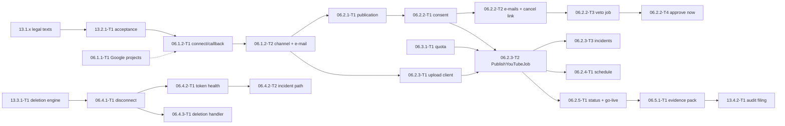

# 06 — YouTube Publishing (personal phase P): Tech Lead review, shared decisions and feature index

> Reviews: `../../06-youtube-posting.md` (high-level, M1 → M3) — **personal phase P only**: DEC 10.14 dropped phase S, so the former S items (multi-client settings + removal guard, fairness queue, admin quota view, flag rollout rules) are not part of the product and have no task files. Companion: `../13-compliance/README.md` (13 P slice: legal texts, acceptance, deletion engine, audit filing), detailed in the same pass because the audit filing needs both.
> Reviewed: 2026-09-25 by the Tech Lead, against the signed consumers (02.8.3, 05, 09 wave 1 + 2, 10 wave 1, 11) and official Google pages read the same day (§1 G-rows; scouts `agent://Scout06Facts`, `agent://Scout06Consumers`, spot-checked by the TL).
> Verdict: **approve with changes.** The high-level plan is sound on consent, quota and data duties, but it misses the callback authentication problem (a browser redirect carries no bearer token), the duplicate-upload risk of a lost upload response, where the veto window and lead time live, an ETag for publications, the incident state for a broken OAuth client, and 12 consumer contradictions (§2). §3 D1–D20 is the contract.
> Status: **ready for implementation with conditions** (DoR 2026-09-25, accepted under the owner's standing approval) — see §11.
> Legend: ✅ read from source/docs (URL or file + line, date) · ⚠️ unverified · [DECISION] · [OPEN] · [INFERENCE].

## 0. How this folder is organised

```
plans/features/06-youtube-posting/
  README.md                        ← facts, findings, decisions D1–D20, CRs, template, gates, index, re-estimate, owner decisions, DoR
  06.1-connect/                    ← 06.1.1 Google projects, 06.1.2 connect/callback/channel list
  06.2.1-publication-consent/      ← 06.2.1 create, 06.2.2-T1/T2 consent + e-mails + cancel link, 06.2.6 cancel
  06.2.2-autopilot-veto/           ← 06.2.2-T3 AutopilotConsentJob + PATCH, 06.2.2-T4 approve now
  06.2.3-upload/                   ← 06.2.3 resumable upload client, PublishYouTubeJob, OAuth error classifier + incidents
  06.2.4-schedule-status/          ← 06.2.4 lead time / publishAt / pre-audit, 06.2.5 processing poll + go-live
  06.3.1-quota-audit/              ← 06.3.1 quota ledger + ETA, 06.5.1 audit evidence pack
  06.4-revocation/                 ← 06.4.1 disconnect, 06.4.2 token health + incident path, 06.4.3 deletion handler
```

Each folder holds `plan.md` (00 §10.1 sections 1–11) and one task file per task. Every id named by other plans is kept (06.2.1-T1, 06.2.2-T3, 06.2.4-T1, 06.2.5-T1, 06.4.2, 06.2.3). No new ids.

## 1. Facts verified for this review

**Google facts (G), read 2026-09-25.**

| Id | Fact | Source |
|---|---|---|
| G1 | `videos.insert`: "100 calls per day … quota cost of 1 unit in the Video Uploads quota bucket"; other methods share 10,000 units/day; `videos.list` = 1 unit; "Daily quotas reset at midnight Pacific Time (PT)" | https://developers.google.com/youtube/v3/docs/videos/insert ✅; https://developers.google.com/youtube/v3/determine_quota_cost ✅ (its "1600 points" page-summary bullet contradicts its own table — ignore) |
| G2 | Projects created after 2020-07-28: unverified API projects' uploads are restricted to private until audited | videos.insert page ✅ |
| G3 | `status.publishAt` "can be set only if the privacy status of the video is private", ISO 8601, only if never published; past date publishes at once; `invalidPublishAt` 400 | https://developers.google.com/youtube/v3/docs/videos ✅ |
| G4 | Title ≤ 100 characters, no `<` `>`; description ≤ **5000 bytes**, no `<` `>`; tags ≤ **500 characters** where commas count and a tag with a space counts its implicit quotes | videos resource ✅ |
| G5 | `status.containsSyntheticMedia` and `status.selfDeclaredMadeForKids` writable on insert | videos resource ✅ |
| G6 | `status.uploadStatus` ∈ `deleted, failed, processed, rejected, uploaded`; `failureReason` ∈ `codec, conversion, emptyFile, invalidFile, tooSmall, uploadAborted`; `rejectionReason` ∈ `claim, copyright, duplicate, inappropriate, legal, length, termsOfUse, trademark, uploaderAccountClosed, uploaderAccountSuspended`; `privacyStatus` ∈ `private, public, unlisted`; `processingDetails` is owner-only | videos resource, videos.list ✅ |
| G7 | Resumable upload: session URI "expires after one week"; chunks in multiples of 256 KB except the last; status probe = empty `PUT` with `Content-Range: bytes */<total>` → `308` + `Range`; `404` = session expired, restart | https://developers.google.com/workspace/drive/api/guides/manage-uploads ✅ (YouTube's own resumable guide URL is 404) |
| G8 | `Google.Apis.YouTube.v3` 1.76.0.4262 and `Google.Apis.Auth` 1.76.0, Apache-2.0, net6.0+; `ResumableUpload.ResumeAsync(Uri)` and `CreateFromUploadUri(Uri, Stream, options)` exist; `MinimumChunkSize = 256 KB`, default 10 MB | nuget.org ✅; `google-api-dotnet-client` `ResumableUpload.cs:111, 506, 524` ✅ |
| G9 | Revoke: `POST https://oauth2.googleapis.com/revoke?token=…` (form-encoded) | https://developers.google.com/identity/protocols/oauth2/web-server ✅ |
| G10 | External + "Testing" projects get refresh tokens that expire in 7 days; ≤ 100 test users; unverified apps: 100 new users in total; 100 refresh tokens per Google account per client | https://developers.google.com/identity/protocols/oauth2 ✅; https://support.google.com/cloud/answer/15549945 ✅ |
| G11 | PKCE is documented for the installed-app flow only; the web-server pages do not mention it | oauth2/native-app ✅; web-server page ⚠️ (absence) |
| G12 | `channels.list` names no scope for `mine=true`; scope descriptions: `youtube.readonly` "View your YouTube account", `youtube.upload` "Manage your YouTube videos" | channels/list ✅; whether `youtube.upload` alone authorizes `channels.list?mine=true` ⚠️ not verified |
| G13 | Developer Policies III.A.1 (link YouTube ToS + own terms bind users to it), III.A.2 (privacy policy, "uses YouTube API Services", Google Privacy Policy link, revoke link), III.D.2 (7 days after in-app revoke, 30 days after Google-page revoke, periodically reconfirm tokens), III.E.4 (reconfirm authorization / refresh or delete stored data every 30 days; user deletion ≤ 7 days); audit form https://support.google.com/youtube/contact/yt_api_form | https://developers.google.com/youtube/terms/developer-policies ✅ |

**Contract facts (C) from signed plans.**

| Id | Fact | Source |
|---|---|---|
| C1 | `CreatePublicationCommand(episodeId, channelConnectionId, title, description, tags, privacy, publishAt, containsSyntheticMedia: true, autopilotAuthorizationId)`; 409 `publication_consent_required`/validation → run `failed`; 429 quota → pause trigger 8 | 02.8.3 `plan.md:455` ✅ |
| C2 | `AutopilotConsentJob` recurring 1 min writes `consent_at`, `consent_text_version`, `consent_source = autopilot`, `autopilot_authorization_id` after the veto window; no consent when `veto_notice_sent_at` is empty or the series is paused (02 CR-14) | 02.8.3 `plan.md:38`; 02.8.3-T4:185, 197 ✅ |
| C3 | Failure map expected by 02: `quotaExceeded` → `scheduled` + `next_attempt_at`; 401/`invalid_grant` → `channel_reauth_required`; `invalid_client`/`unauthorized_client` → platform incident, connection unchanged; outbox `ChannelConnectionChanged`, `PlatformIncidentRaised/Cleared` [INFERENCE names in 02] | 02.8.3-T4:15, 28-31; 02.8.3 `plan.md:381` ✅ |
| C4 | Pre-audit: upload `private`, **no** `publishAt`; P reads `YouTube:AuditStatus` through `IOptionsMonitor` | 02.8.3-T3:162; 09 WT27 / W2 CR-10 ✅ |
| C5 | Go-live: `PublicationGoLiveJob` at `publish_at + 5 min`, every 15 min for 2 h; 02's fallback at `publish_at + 10 min` | 02.8.3 `plan.md:39, 442` ✅ |
| C6 | 09 surfaces to reuse: `IEmailSender.QueueAsync(EmailMessage) → ErrorOr<Guid>`, `IEmailDeliveryStatus.GetAsync`, template catalog (`channel_connected` "added by 06"), token minting at send time (WT17); `ITokenProtector.Protect(purposeSuffix, plaintext)` purpose `tokens.v1/{connectionId}`; `IReauthGuard.RequireRecentAsync(5 min)`; `RequireFeature("youtube_publish")` → 404 `feature_disabled`; `IRealtimeNotifier` (`RealtimeData` only for `RenderProgress`, WT54); `IBlobStore.OpenReadAsync`; `[Audited]`; rate policies `auth`/`paid`/`hub`; error codes `channel_already_connected`, `oauth_state_invalid`, `publication_consent_required`, `youtube_quota_exhausted`, `youtube_upload_failed`, `youtube_rejected` | 09 README BD1, BD3, BD9–BD14, WT17, WT54; 09.2.6-T3:21-29, 83-97; `plans/09-backend-api.md:417-425` ✅ |
| C7 | Episode detail: `PublicationsSummaryDto? Publications` null in P; 06 either extends query (2) or a third query approved by the TL | 09.4.2-5.3 `plan.md:166, 197` ✅ |
| C8 | Music attribution: `render-params.v1.music.attribution` frozen at render time; 06.2.1-T1 reads it from the params (TL ruling T9 overrides 05.3 `plan.md:102, 155`) | 05 README:332-336, 553 ✅ |
| C9 | Veto list (10.4.3-T2): `Publication { …, etag }`; `PATCH` with `If-Match`, 412 → ConflictDialog; consent and `DELETE` from the row | 10.4-series-autopilot `plan.md:156-159, 249-252` ✅ |
| C10 | `autopilot_settings.veto_window_hours` 2..48 (default 12); `privacy`; `Autopilot:PublishLeadMinutes` 120 "must stay equal to 06.2.4's lead time" | 02.8.3 `plan.md:56-63, 126` ✅ |
| C11 | `channel_connections(… access_token_enc, refresh_token_enc, token_expires_at, status active/revoked/expired/error, oauth_client_id, last_verified_at, revoked_at)`; `publications(… status, title, description, tags, privacy, publish_at, next_attempt_at, consent_at, consent_text_version, consent_source, autopilot_authorization_id, veto_notice_sent_at, contains_synthetic_media, external_post_id, platform_payload)`; `platform_quota_usage(platform, quota_day, units_used, units_limit)`; `data_deletion_requests(user_id, scope, reason, requested_at, due_at, completed_at)` | 00 §6 ✅ |
| C12 | Secrets: `nts/<env>/api/YOUTUBE_CLIENT_SECRET` (API role); P settings are environment values (09.10 is S) | 11 README D15; 11.2.2-T1:48 ✅ |

## 2. Findings

| # | Sev | Where | Finding | Resolution |
|---|---|---|---|---|
| F01 | B | 06.1.2 | `GET /channels/youtube/callback` is a top-level browser redirect from Google: it carries **no bearer token** (memory-only, 10 D6) and the refresh cookie is scoped to `/api/v1/auth`. The plan says the callback is "valid" without saying how it authenticates | D3: the callback authenticates by the single-use `state` row, which is bound to the user **and** the live refresh family (`sid`) that started the connect; a revoked family or an expired/used state → redirect with `oauth_state_invalid` |
| F02 | B | 06.2.3 | A lost response after the last chunk makes a retry create a **second video** on the user's channel | D9: the session URI is persisted (encrypted) **before** the first byte; a retry always probes/resumes it (`ResumeAsync`); a new session is opened only after a `404` (expired) or an explicit "not started"; `external_post_id` set → the job only reconciles |
| F03 | H | 06.2.3 | The session URI is a capability to upload into the user's channel; storing it in clear `platform_payload` leaks that capability to anyone with DB read | D9: session URI encrypted with `ITokenProtector` purpose `tokens.v1/{connectionId}` (same key scope as the tokens) |
| F04 | H | 06.2.2 | No ETag on publications, but 10.4.3-T2 sends `If-Match`; consent without `If-Match` lets a stale tab consent to metadata the user never saw | D7: ETag `"pu-<xmin>"`; `If-Match` required on consent, `PATCH`, cancel |
| F05 | H | 06.2.3, 06.4.2 | A broken OAuth client must hold publications and stop refresh, and an operator must clear it — the plan names no state or clear action | D14: table `platform_incidents`; `nts-worker incident clear <id>` (P); outbox `platform_incident_raised.v1` / `…_cleared.v1` |
| F06 | H | 06.2.2 | The veto window and the lead time have no owner key; 02 duplicates the lead time and warns about drift | D11: one option class `YouTubeOptions` (`PublishLeadMinutes` 120, `MinVetoWindowHours` 2, `AuditStatus`); 02 reads it instead of its own key (06 CR-3); `veto_ends_at` stored on the publication at create time |
| F07 | H | 06.2.3 | Quota: 02.8.3 `plan.md:257` and 02.8.3-T3:152 say quota exhaustion fails the publication; 06 and 02.8.3-T4 say it returns to `scheduled` | D10: `scheduled` + `next_attempt_at` = next PT midnight; 02 lines fixed (06 CR-4) |
| F08 | M | 06.2.1 | Description limit: 06 says 5,000 chars, YouTube counts **bytes** (G4); 02 D3 caps generated descriptions at 1,000 chars | D6: ≤ 5,000 UTF-8 bytes including the attribution; 02's 1,000-char rule still applies to generated text |
| F09 | M | 06.2.1 | Tags: YouTube's 500-char count includes commas and implicit quotes (G4); 02 D3's "≤ 400 total" is a different count | D6: `YouTubeTagRules.Length(tags)` implements G4; both rules apply |
| F10 | M | 06.2.1 | Attribution source contradiction (05 T9 vs 05.3 `plan.md:102, 155`) | C8: params (T9); stale 05.3 lines fixed (06 CR-5) |
| F11 | M | A1 | Least-privileged scope for `channels.list?mine=true` unverified (G12) | D2: request `youtube.upload` + `youtube.readonly` |
| F12 | M | FR-06-1 | PKCE for the web-server flow is not documented (G11) | D2: send PKCE S256 anyway (the confidential client secret stays the primary proof); 06.1.2-T1 step 1 records whether Google accepts it; if Google rejects the parameters, drop PKCE and keep state + secret |
| F13 | M | 06.2.5 | `PublicationUpdated` has no payload definition; `RealtimeData` is reserved for `RenderProgress` (WT54) | D13: realtime ids `{ publicationId, episodeId }`, no data; outbox `publication_updated.v1 { publicationId, episodeId, userId, status, errorCode? }` |
| F14 | M | 06.2.1 | Episode detail `publications` block stays null forever unless 06 fills it | D6: 06.2.1-T1 fills it with a third, index-only query (TL-approved per C7) |
| F15 | M | 06.2.5 | 00 §7 moves the episode `ready → scheduled → published` "via publications" but nobody owns the call | D12: 06.2.5-T1 calls `Episode.MarkScheduled/MarkPublished` in the same transaction as the publication change; 06.2.2-T1 when scheduling |
| F16 | M | 06.4.2 | III.E.4 needs a 30-day refresh of stored Authorized Data (channel title, video ids/status), not only token health | D16: `TokenHealthJob` refreshes `channels.list` and batches `videos.list` (≤ 50 ids, 1 unit) for rows older than 25 days, else deletes the stale YouTube fields |
| F17 | M | 06.2.2 | Veto cancel link: no token table named; `approval_cancel_tokens` is S (09.10.8) | D7: `user_action_tokens` kind `publication_cancel` (minted at send time, WT17), expires at `veto_ends_at` or upload start; `POST /publications/cancel-by-link { publicationId, token }` under rate policy `auth` (06 CR-6) |
| F18 | M | 06.4.1 | Deletion `scope` unset | D15: `scope = channel` |
| F19 | M | 06.1.2 | The connect half (re-auth on connect and the connect e-mail) sat in the phase-S slice while 09 requires it in P | D5: re-auth, connect e-mail and single-client pinning live in 06.1.2-T1/T2; the multi-client settings source and the removal guard are not built (DEC 10.14) |
| F20 | L | 06.3.2 | Fairness needs a per-user dimension the ledger lacks | P has one user → 06.3.2 stays S; its table change is decided then |
| F21 | M | 06.2.3 | Token refresh races between the upload job, the poller and `TokenHealthJob` can present a refresh token twice | D9: refresh under `SELECT … FOR UPDATE` on the connection row, re-read after the lock |
| F22 | L | 06.3.1 | `units_limit` has no config key | D10: `YouTube:Quota:UnitsPerDay` (100) seeds the row of each new PT day |

## 3. Shared decisions (contract)

**D1 Scope and phase [DECISION].** P = the 20 tasks of §8.1 and that is the whole plan: phase S is dropped entirely (DEC 10.14), so the former S items — multi-client settings, fairness queue, admin quota view, flag rollout rules — have no task files and are not part of the product. Every 06 route is behind `RequireFeature("youtube_publish")`; recurring jobs register only while the flag is on (as 02.8.3-T1).

**D2 OAuth [DECISION] (F11, F12).** Authorization code flow, confidential web client; scopes `https://www.googleapis.com/auth/youtube.upload` + `https://www.googleapis.com/auth/youtube.readonly`; `access_type=offline`, `prompt=consent`, `include_granted_scopes=false`; PKCE S256 (see F12); redirect URI `https://<origin>/api/v1/channels/youtube/callback` (one origin per env, 10 D3). Staging project stays in Testing (7-day refresh tokens, G10) and never uploads real content; prod project "In production", unverified (00 §4.1).

**D3 Connect and callback [DECISION] (F01).**
- `POST /channels/youtube/connect` (bearer): `IReauthGuard.RequireRecentAsync(5 min)` → 401 `reauth_required`; legal gate (13.2.1-T1 `ILegalAcceptance.EnsureCurrentAsync`) → 409 `legal_acceptance_required`; creates `oauth_states(id, user_id, platform, state_hash, code_verifier_protected, oauth_client_id, refresh_family_id, created_at, expires_at, used_at)` (10 min, single use; state = 32 random bytes base64url; verifier protected with `ITokenProtector` purpose `oauth.v1`) → `200 { authorizationUrl }`.
- `GET /channels/youtube/callback?code&state` (anonymous endpoint, rate policy `auth`): claim with `UPDATE oauth_states SET used_at = now() WHERE state_hash = @h AND used_at IS NULL AND expires_at > now() RETURNING …`; the bound refresh family must still be live; exchange with the client bound to the state; fetch `channels.list?part=snippet&mine=true`; upsert the connection; audit; e-mail; `302` to `/channels?connected=youtube`. Any failure → `302 /channels?error=<code>` (`oauth_state_invalid`, `oauth_denied`, `channel_already_connected`) — fixed paths only, never a caller-supplied URL. The response sets `Referrer-Policy: no-referrer` and `Cache-Control: no-store`; `code`/`state` are redacted in logs (09.9.3-T2).
- One owner per channel: a second user → 409 `channel_already_connected`; the same user reconnecting → tokens replaced, same row.

**D4 Tokens [DECISION].** `access_token_enc`, `refresh_token_enc` = `ITokenProtector.Protect("{connectionId}", …)` (purpose `tokens.v1/{connectionId}`; the id is a UUIDv7 generated before protection). Tokens never leave the Worker/Api process, never appear in DTOs, logs, audit `data` or exceptions. `ChannelConnectionDto { id, platform, externalAccountId, displayName, status, lastVerifiedAt, connectedAt }`.

**D5 OAuth client resolution [DECISION] (F19).** `IOAuthClientResolver.ResolveAsync(string oauthClientId, ct) → ErrorOr<OAuthClient(ClientId, ClientSecret)>` and `ActiveClientId`. P implementation `ConfigOAuthClientResolver`: `YouTube:ActiveClientId` + `YouTube:Clients:<clientId>:SecretName` → secret `YOUTUBE_CLIENT_SECRET` (C12); a connection always uses its pinned `oauth_client_id`. The settings-backed multi-client source and the removal guard are not built (DEC 10.14); this resolver stays the only one.

**D6 Publication aggregate [DECISION] (F08, F09, F14).**
- `Publication.Create(userId, episodeId, connection, PublicationMetadata m, Guid? autopilotAuthorizationId, DateTimeOffset? vetoEndsAt, now)`; invariants: episode `ready` (or `scheduled` for a re-publish? no — one active publication per episode and platform: partial unique `(episode_id, platform) WHERE status NOT IN ('failed','cancelled')`); connection `active` and owned by the user; `contains_synthetic_media = true` always (no API field to turn it off); `selfDeclaredMadeForKids = false`.
- `YouTubeMetadataRules`: title 1–100 chars, no `<` `>`; description ≤ 5,000 UTF-8 bytes **after** appending the attribution (C8: `\n\nMusic: <attribution>` when `render-params.v1.music.attribution` is non-null), no `<` `>`; tags counted per G4 ≤ 500 and ≤ 15 × 30 chars (02 D3); privacy ∈ `public|unlisted|private`; `publishAt` ≥ now + `PublishLeadMinutes` or null.
- Routes: `POST /episodes/{id}/publications` → `201 PublicationDto + ETag`; `GET /episodes/{id}/publications` → `{ items }` (no paging: ≤ a handful per episode). `PublicationDto { id, episodeId, channel { id, displayName }, status, title, description, tags, privacy, publishAt, vetoEndsAt, consentAt, consentSource, externalPostId, externalUrl, errorCode, nextAttemptAt, etag }`.
- Episode detail: 06.2.1-T1 fills `PublicationsSummaryDto(int Published, int Scheduled, DateTimeOffset? LastPublishedAt)` with a third indexed query (TL-approved exception to 09 BD16's two-query rule, C7).

**D7 Consent, e-mails, cancel [DECISION] (F04, F17).**
- ETag `"pu-<xmin>"` (added to `ETags` in 09.1.4-T1's helper, 06 CR-2); `If-Match` required on consent, `PATCH`, `DELETE`.
- `POST /publications/{id}/consent { consentTextVersion }` → `awaiting_consent → scheduled`; the text version must equal `YouTube:ConsentTextVersion` (`pc.v1`; texts vi/en in `Templates/Consent/pc.v1.<locale>.md` embedded, rendered by 10.7.2) else 400 `consent_text_outdated`; `consent_source = user`; audit `publishing.consented`; e-mail `publication_consented` (every consent, C6).
- Autopilot publications are created with `veto_ends_at = now + series.autopilot_settings.veto_window_hours` (≥ `MinVetoWindowHours`); 06.2.2-T2 queues `publication_veto_notice` (preview + edit link + cancel link) and records the `email_messages.id` in `platform_payload.vetoNoticeEmailId`; `veto_notice_sent_at` is set by 06.2.2-T3 when `IEmailDeliveryStatus` reports `sent`.
- Cancel link: token minted at send time by `PublicationCancelTokenMinter` (WT17 pattern) into `user_action_tokens(kind = 'publication_cancel')`, expires at the earlier of `veto_ends_at` and upload start; `POST /publications/cancel-by-link { publicationId, token }` (anonymous, rate policy `auth`, constant-time compare, 400 `cancel_token_invalid` generic) → `cancelled`. Page `/publications/cancel#p=…&t=…` is 10 wave 2's (token in the fragment).

**D8 Autopilot consent job [DECISION] (C2).** `AutopilotConsentJob` (recurring 1 min, queue `publish`, allow-listed system job reading `(id, user_id)` then per-user `SystemContext`): batch ≤ 50 publications `WHERE status = 'awaiting_consent' AND autopilot_authorization_id IS NOT NULL AND veto_ends_at <= now` `FOR UPDATE SKIP LOCKED`; per row: refresh delivery status → `veto_notice_sent_at`; skip (no write) when the notice is not `sent`, the series is paused, the authorization is revoked or not current, or the connection is not `active`; otherwise `Publication.ConsentFromAuthorization(authorization, textVersion, now)` → `scheduled`. `PATCH /publications/{id}` (title, description, tags, privacy, publishAt) only in `awaiting_consent` or `scheduled` before upload: re-runs D6 validation and the 02.8.2 moderation gate (`IAutoApprovalGate.EvaluatePublicationMetadataAsync` ⚠️ name — 02 owns it; [OPEN] if absent, `IContentModerator` on the new text); a passing edit is the owner's consent (`consent_source = user`, `consent_at = now`).

**D9 Upload [DECISION] (F02, F03, F21).**
- Port `IYouTubeClient` (Application): `ExchangeCodeAsync`, `RefreshAsync`, `RevokeAsync`, `GetMyChannelAsync`, `StartUploadAsync(token, VideoInsertRequest, long length, ct) → Uri sessionUri`, `ResumeUploadAsync(token, Uri sessionUri, Stream content, long length, IProgress<long>, ct) → ErrorOr<UploadResult(VideoId)>`, `ProbeUploadAsync(token, Uri, long length, ct) → UploadProbe(Complete(VideoId) | Partial(long nextByte) | Expired)`, `GetVideosAsync(token, IReadOnlyList<string> ids, ct)`; implementation `GoogleYouTubeClient` on `Google.Apis.YouTube.v3` 1.76 (G8) + `Google.Apis.Auth`; credentials only through `IOAuthClientResolver`.
- `PublishYouTubeJob.RunAsync(publicationId)` (queue `publish`, `[JobPolicy(Retries = 5)]` exponential for transport errors): lock the publication; `external_post_id` set → reconcile only; re-check consent (`Publication.StartUpload` refuses without `consent_at`, NFR-06-1), connection `active`, flag on, no open incident for the client; reserve quota (D10); access token via `ITokenService.GetAccessTokenAsync(connectionId)` (refresh when < 5 min left, under `FOR UPDATE` on the connection row, re-read after the lock); session: if `platform_payload.uploadSessionEnc` exists → probe → resume / reconcile / restart on `Expired`; else `StartUploadAsync`, persist the encrypted session URI **and commit** before the first byte; stream `IBlobStore.OpenReadAsync` of the final video, chunk 10 MiB (multiple of 256 KiB); success → `external_post_id`, status `processing`, schedule 06.2.5 poll.
- Error map: `quotaExceeded`/`uploadLimitExceeded` → release unit, `scheduled`, `next_attempt_at` = next PT midnight (+ jitter ≤ 10 min), `youtube_quota_exhausted` on the DTO; 401/`invalid_grant` → connection `expired` + outbox `channel_connection_changed.v1`, publication `failed` `channel_reauth_required`; `invalid_client`/`unauthorized_client` → incident (D14); 4xx validation (`invalidPublishAt`, `invalidTitle`, `invalidDescription`) → `failed` `youtube_upload_failed` + detail code; 5xx/timeout → retry with resume; retries exhausted → `failed` `youtube_upload_failed`.
- Memory: the stream is never buffered whole; one chunk buffer per job; parallelism of queue `publish` = 2.

**D10 Quota ledger [DECISION] (F07, F22).** `IQuotaLedger.TryReserveAsync(platform, now) → ErrorOr<QuotaReservation(DateOnly Day)>` = `INSERT … ON CONFLICT DO NOTHING` of the PT-day row with `units_limit = YouTube:Quota:UnitsPerDay`, then `UPDATE … SET units_used = units_used + 1 WHERE platform = 'youtube' AND quota_day = @d AND units_used < units_limit RETURNING`; `ReleaseAsync(reservation)` decrements only when YouTube never received the insert (failure before `StartUploadAsync` returned, or `quotaExceeded`). PT day via `TimeZoneInfo.FindSystemTimeZoneById("America/Los_Angeles")` (ICU; same rule as 02 T7). `GET /publishing/youtube/eta` → `{ available, nextSlotAt }` (next PT midnight when full). Metric `youtube_quota_used` (11.6.2-T1 alert at 80 %).

**D11 Options [DECISION] (F06).** `YouTubeOptions` (section `YouTube`, validated at start): `ActiveClientId`, `Clients`, `PublishLeadMinutes` = 120, `MinVetoWindowHours` = 2, `AuditStatus` ∈ `pending|approved|rejected` (`IOptionsMonitor`, env in P, WT27), `ConsentTextVersion` = `pc.v1`, `Quota:UnitsPerDay` = 100, `Poll:IntervalSeconds` = 60, `Poll:MaxMinutes` = 120, `GoLive:DelayMinutes` = 5, `GoLive:RetryMinutes` = 15, `GoLive:MaxMinutes` = 120. 02 reads `PublishLeadMinutes` and `MinVetoWindowHours` from here (06 CR-3).

**D12 Scheduling, status, episode [DECISION] (F15; C4, C5).** Queue time = now (no `publishAt`) or `publishAt − PublishLeadMinutes`; the job is enqueued at consent (or scheduled at that time). `AuditStatus ≠ approved` → upload `private`, `publishAt` omitted, publication ends `published_private_locked`? — no new status: it ends `published` with `privacy = private` and `platform_payload.preAudit = true`, and 02.8.3-T3 maps that to its run outcome (C4). `PollYouTubeProcessingJob` every 60 s up to 120 min: `processed` → `published` (or stays `scheduled` while `publishAt` is in the future, then `PublicationGoLiveJob` at `publishAt + 5 min`, every 15 min for 120 min, then `failed` `youtube_go_live_unconfirmed` + admin alert) ; `failed`/`rejected` → `failed` `youtube_rejected` + reason. Episode: first publication `scheduled` → `Episode.MarkScheduled`; `published` → `Episode.MarkPublished` (same transaction).

**D13 Events [DECISION] (F13; C3).** Outbox (Worker handlers, ids only): `publication_updated.v1 { publicationId, episodeId, userId, status, errorCode? }` (→ `IRealtimeNotifier` `PublicationUpdated` with ids `{ publicationId, episodeId }`, no data; → 02 orchestrator), `channel_connection_changed.v1 { connectionId, userId, status }`, `platform_incident_raised.v1 { incidentId, platform, oauthClientId, affectedConnections }`, `platform_incident_cleared.v1 { incidentId, platform, oauthClientId }`. These confirm 02's [INFERENCE] names (06 CR-4).

**D14 Platform incidents [DECISION] (F05).** Table `platform_incidents(id, platform, oauth_client_id, error_code, raised_at, cleared_at, cleared_by, note)`, partial unique `(platform, oauth_client_id) WHERE cleared_at IS NULL`. Raised by `OAuthErrorClassifier` hits in upload or token health; while open: publications of that client stay `scheduled` with `next_attempt_at = null`, `TokenHealthJob` skips the client, the UI shows `publishing_temporarily_unavailable`; P1 alert through 11.6.2-T1. Cleared by `nts-worker incident clear <id> --note "<text>"` (audit `support`, `internal`), which re-schedules held publications (`next_attempt_at = now + jitter`).

**D15 Disconnect and deletion [DECISION] (F18).** `DELETE /channels/{id}` (bearer, `If-Match` not needed — idempotent): Google revoke first (retry 3× with backoff; if still failing, the tokens are wiped anyway and the failure is logged + alerted — the grant dies with the deletion); tokens nulled at once; status `revoked`; `awaiting_consent`/`scheduled` publications → `cancelled` (quota released); `data_deletion_requests(scope = channel, reason = in_app_revoke, due_at = now + 7 d)` via 13.3.1-T1's `IDeletionRequests.CreateAsync`; outbox `channel_connection_changed.v1`. 06.4.3-T1 implements `IDeletionScopeHandler` for `channel`: nulls tokens, channel metadata, `external_post_id`, `platform_payload`, keeps publication rows (13 §5.4).

**D16 Token health and data refresh [DECISION] (F16).** `TokenHealthJob` daily (allow-listed system job): for each `active` connection whose client has no open incident: refresh → `invalid_grant` → `revoked` + deletion request (`reason = google_revoke`, 30 d) + outbox; `invalid_client`/`unauthorized_client` → incident, stop that client for this run; then refresh stored data older than 25 days: `channels.list` (title) and `videos.list` for `external_post_id`s in batches of 50 (1 unit each); a video that no longer exists → null `external_post_id`, keep the row. Runtime bound: ≤ `TokenHealth:MaxConnectionsPerRun` (500).

**D17 Security [DECISION].** Re-auth on connect (D3), legal acceptance before connect (13.2.1-T1), feature flag on every route, owner-only access (tenant filter, 404 for others), CSRF: the callback has no cookie auth and the state binds the session; cancel-by-link token single-use and hashed; tokens and session URIs encrypted (D4, D9); no Google password ever; audit actions `publishing.channel_connected`, `publishing.channel_disconnected`, `publishing.publication_created`, `publishing.consented`, `publishing.consent_autopilot`, `publishing.cancelled`, `publishing.incident_raised`, `publishing.incident_cleared` (ids/codes only); logs never contain titles, descriptions, tokens or channel names (ids only).

**D18 Performance [DECISION].** Streamed uploads (one chunk buffer), jobs batch ≤ 50 rows with `SKIP LOCKED`, indexes: `publications (status, next_attempt_at) WHERE status IN ('awaiting_consent','scheduled','uploading','processing')`, `publications (channel_connection_id)`, partial unique D6, `channel_connections (user_id)`, unique `(platform, external_account_id) WHERE status <> 'revoked'`; `videos.list` batched by 50; episode detail +1 indexed query only (D6).

**D19 Testing [DECISION].** `FakeGoogleServer` in `NightTales.TestKit` (Kestrel, hand-written, no mocking library): token endpoint (code/refresh, `invalid_grant`, `invalid_client`), revoke, `channels.list`, resumable upload (session create, chunk `308` + `Range`, probe, `404` expiry, drop-after-last-chunk), `videos.insert` errors (`quotaExceeded`, `invalidPublishAt`), `videos.list` (status transitions). `GoogleYouTubeClient` takes base URLs from options so tests point at the fake. Integration tests on real PostgreSQL 17 via `PostgresFixture`; PT-day tests across DST with `FakeClock`. Manual staging checks against a real test channel (private uploads only).

**D20 Migrations [DECISION].** One expand-only migration per owning task: `_06_ChannelConnections` + `_06_OAuthStates` (06.1.2-T1/T2), `_06_Publications` (06.2.1-T1, incl. `veto_ends_at`), `_06_PlatformQuotaUsage` (06.3.1-T1), `_06_PlatformIncidents` (06.2.3-T3). New tables/columns go to 00 §6 (06 CR-1).

## 4. Change requests

Applied 2026-09-25 under the owner's standing approval; tagged `(06 CR-n)`.

| CR | Target | Change |
|---|---|---|
| 06 CR-1 | `plans/00-overview.md` §6, §8 | new tables `oauth_states`, `platform_incidents`; `publications.veto_ends_at`; `user_action_tokens.kind` + `publication_cancel`; `data_deletion_requests.scope` `channel` for disconnects; §8 `POST /publications/cancel-by-link` body; `legal_acceptance_required` code |
| 06 CR-2 | `features/09-backend-api/09.1.4-error-mapping/09.1.4-T1-…` | `ETags.Publication(xmin) → "pu-{xmin}"` |
| 06 CR-3 | `features/02-story-writing/02.8.3-cadence-publishing/` (plan §3/§7.4, T1, T3) | read `YouTubeOptions.PublishLeadMinutes`/`MinVetoWindowHours`/`AuditStatus` (no own duplicate keys); §7.4 `DbSettingsProvider` text → `IOptionsMonitor` (W2 CR-10) |
| 06 CR-4 | 02.8.3 `plan.md:257`, 02.8.3-T3:152, `plan.md:381`, 02.8.3-T4 header | quota exhaustion = `scheduled` (D10); event names confirmed (D13); T4 Depends `06.4.2`, `06.2.3` → task ids |
| 06 CR-5 | `features/05-video-assembly-subtitles/05.3-music/plan.md:102, 155`, `05.3.2-T3` | attribution frozen in params per T9 (C8) |
| 06 CR-6 | `features/09-backend-api/09.3-auth/09.3.3-T1-…`, `09.2.6-T3-email-pipeline.md` | `user_action_tokens.kind` gains `publication_cancel`; templates `channel_connected`, `publication_consented`, `publication_veto_notice` + minter registered by 06 |
| 06 CR-7 | `plans/06-youtube-posting.md` §6/§11, `plans/00-overview.md` §4.1/§13 | re-estimate (§9) |
| 06 CR-8 | `features/*` task headers | Blocks back-edges for every hard dependency on 06 tasks (§8.1) |
| 06 CR-9 | `plans/09-backend-api.md` §5.4 | codes per YR5 |
| 06 CR-11 | `features/10-web-ui/10.4-series-autopilot/` (veto-list client model) | `PublicationDto` gains `preAudit` and `requestedPrivacy`; the edit dialog disables privacy on pre-audit rows (YR20) |
| 06 CR-12 | `features/09-backend-api/09.7-video-review-storage/09.7.2-T1-…` | `IBlobStore.OpenReadAsync(bucket, key, fromByte, ct)` ranged overload for upload resume (06.2.3-T2) |
| 06 CR-10 | `features/11-worker-deployment/11.2-cloud-environments/11.2.2-T1-…`, `11.6-operations/11.6.2-T1-…` | LB access log drops the callback query string (YR23); alert rules `platform_incident_open > 0 for 5m` and `deletion request due < 24 h` (06.2.3-T3, 13.3.1-T1) |
| 06 CR-22 | `06.1-connect/plan.md` §4 UC2 steps 8–9 + §5.3; `06.1-connect/06.1.2-T1-connect-callback.md` §Design unit #2 steps 9–10, Steps, Notes; `06.1-connect/06.1.2-T2-channel-connection.md` §Design/Steps/Outputs/Notes | `IConnectChannelConnection.ConnectAsync` returns `Task<ErrorOr<ConnectChannelOutcome>>` with `public sealed record ConnectChannelOutcome(Guid ConnectionId, bool Reconnected)` — the callback audit's `publishing.channel_connected.data.reconnected` reads `Reconnected` (coordinator decision A, 2026-10-18; rejected: the callback re-reads the row before the lock, and accept-always-false). T2's `ConnectAsync` writes the `channel_connection_changed.v1` outbox row and the `channel_connected` e-mail inside unit #2, with no `SaveChanges`/`ExecuteUpdate` before success and every refusal answered as an `ErrorOr` error (never thrown); the one-owner rule is enforced by `ux_channel_connections_account` and answered as `channel_already_connected`; the connect writer's locked read is owner-agnostic and allow-listed (`ChannelConnectionLocker`, `tests/NightTales.Architecture.Tests/AllowLists.cs`) — Infrastructure now holds a second allow-listed `IgnoreQueryFilters` site — because the `AllowAnonymous` callback cannot pin a user scope, so the handler itself compares `row.UserId` to `request.UserId` (another owner → the same refusal, row untouched) and `23505` is only the insert-insert backstop, mapped in `EfUnitOfWork` |
| 06 CR-23 | `plans/00-overview.md` §6 (`publications` row) | `publications` columns as built by 06.2.1-T1 (migration `20261018204807_06_Publications`): adds `self_declared_made_for_kids boolean NOT NULL DEFAULT false` and the two D20 columns `external_url text NULL`, `published_at timestamptz NULL`, which the §6 row did not list (the README D6 SQL and the task file carry them); EF also creates two FK indexes beyond the four D18 indexes (`ix_publications_autopilot_authorization_id`, `ix_publications_episode_id_user_id`). `publications.autopilot_authorization_id` is a single-column FK (SET NULL); the create handler binds the id to the episode's series (and to the connection when the authorization records one) because the DB cannot (`TenantForeignKeyTests` carve-out pinned to that column) |

## 5. Sequencing



## 6. Task file template

Same as `../02-story-writing/README.md` §6 (H1, one-row table `| Story | Size | Area | Depends on | Blocks | Phase / flag |` equal to §8.1, then Goal, Inputs, Design, Steps, Outputs, Acceptance checks, Tests, Failure handling and edge cases, Notes).

## 7. Gates

- **06-connect:** owner connects the channel on staging (re-auth + legal acceptance), the connection row holds encrypted tokens, the connect e-mail arrives, disconnect revokes at Google and creates the 7-day request.
- **06-publish (input to 02 M1 exit, audit filing):** manual publication → consent (e-mail) → private upload to the test channel → `published`; an autopilot publication passes the veto window and uploads; a forced lost-response retry creates **no** second video; `quotaExceeded`, `invalid_grant` and `invalid_client` paths pass against `FakeGoogleServer`.
- **06-audit-ready:** evidence pack complete (06.5.1-T1) and 13 P slice done → 13.4.2-T1 files.

## 8. Feature index and task mapping

| Folder | Tasks (size) |
|---|---|
| `06.1-connect/` | 06.1.1-T1 (S), 06.1.2-T1 (M), 06.1.2-T2 (M) |
| `06.2.1-publication-consent/` | 06.2.1-T1 (M), 06.2.2-T1 (S), 06.2.2-T2 (S), 06.2.6-T1 (S) |
| `06.2.2-autopilot-veto/` | 06.2.2-T3 (M), 06.2.2-T4 (XS) |
| `06.2.3-upload/` | 06.2.3-T1 (L), 06.2.3-T2 (M), 06.2.3-T3 (XS) |
| `06.2.4-schedule-status/` | 06.2.4-T1 (S), 06.2.5-T1 (M) |
| `06.3.1-quota-audit/` | 06.3.1-T1 (M), 06.5.1-T1 (M) |
| `06.4-revocation/` | 06.4.1-T1 (S), 06.4.2-T1 (M), 06.4.2-T2 (XS), 06.4.3-T1 (S) |

### 8.1 Canonical task dependencies

"(soft)" = the task can start with a contract-true fake; the acceptance run needs the real input.

| Task | Size | Area | Phase | Depends on | Blocks |
|---|---|---|---|---|---|
| 06.1.1-T1 | S (0.5) | Ops | P · M1 | 10.3.1-T1 (soft), 13.1.1-T1 (soft), 13.1.2-T1 (soft) | — (Google OAuth verification dropped by DEC 10.14) |
| 06.1.2-T1 | M (1.0) | BE + Security | P · M1 · flag `youtube_publish` | 06.1.1-T1 (soft), 09.3.2-T1, 09.10.4-T1, 09.9.4-T1, 09.9.2-T2, 13.2.1-T1 | 06.1.2-T2, 10.7.1-T1 (10 CR-15), 07.1.2-T1 (07 CR-11), 10.7.1-T0 |
| 06.1.2-T2 | M (1.0) | BE | P · M1 · flag `youtube_publish` | 06.1.2-T1, 09.2.6-T3 | 06.2.1-T1, 06.2.3-T1, 06.4.1-T1, 10.7.1-T1 (10 CR-15), 08.4.1-T1 (08 CR-5), 07.1.2-T1, 07.1.2-T2 (07 CR-11) |
| 06.2.1-T1 | M (1.0) | BE | P · M1 · flag `youtube_publish` | 06.1.2-T2, 09.5.3-T1, 09.7.1-T1, 05.3.2-T3 (soft) | 06.2.2-T1, 02.8.3-T3, 10.7.2-T1 (10 CR-15), 07.2.2-T1 (07 CR-11), 10.7.2-T0 |
| 06.2.2-T1 | S (0.5) | BE | P · M1 · flag `youtube_publish` | 06.2.1-T1 | 06.2.2-T2, 06.2.6-T1, 06.2.3-T2, 10.7.2-T1 (10 CR-15), 07.2.2-T1 (07 CR-11) |
| 06.2.2-T2 | S (0.5) | BE + Security | P · M1 · flag `youtube_publish` | 06.2.2-T1, 09.2.6-T3, 09.3.3-T1 | 06.2.2-T3, 10.7.4-T2 (10 CR-15), 07.2.2-T2 (07 CR-11) |
| 06.2.6-T1 | S (0.5) | BE | P · M1 · flag `youtube_publish` | 06.2.2-T1, 06.3.1-T1 | 06.4.1-T1, 10.7.4-T1 (10 CR-15) |
| 06.2.2-T3 | M (1.0) | BE | P · M1 · flag `youtube_publish` | 06.2.2-T2, 02.8.3-T1, 02.8.3-T2 | 06.2.2-T4, 02.8.3-T3, 10.4.3-T2 (soft), 08.4.2-T1 (08 CR-5) |
| 06.2.2-T4 | XS (0.25) | BE/FE | P · M1 · flag `youtube_publish` | 06.2.2-T3 | 06.5.1-T1, 10.7.4-T2 (10 CR-15) |
| 06.3.1-T1 | M (1.0) | BE | P · M1 | 09.2.2-T1 | 06.2.6-T1, 06.2.3-T2, 06.4.1-T1, 10.7.2-T1 (10 CR-15) |
| 06.5.1-T1 | M (1.0) | BA | P · M1 | 06.2.5-T1, 06.2.2-T4, 06.4.2-T2, 06.4.3-T1, 13.1.1-T1, 13.1.2-T1, 13.2.1-T1, 10.3.1-T1, 10.4.3-T2, 10.7.1-T1, 10.7.2-T1, 10.7.4-T1 | 13.4.2-T1 |
| 06.2.3-T1 | L (2.0) | BE | P · M1 | 06.1.2-T2, 09.7.2-T1 | 06.2.3-T2 |
| 06.2.3-T2 | M (1.0) | BE | P · M1 · flag `youtube_publish` | 06.2.3-T1, 06.2.2-T1, 06.3.1-T1, 09.2.6-T1 | 06.2.3-T3, 06.2.4-T1, 06.2.5-T1, 02.8.3-T4, 07.3.1-T1 (07 CR-11) |
| 06.2.3-T3 | XS (0.25) | BE | P · M1 | 06.2.3-T2, 11.6.2-T1 (soft) | 06.4.2-T2 |
| 06.2.4-T1 | S (0.5) | BE | P · M1 | 06.2.3-T2 | 02.8.3-T3 |
| 06.2.5-T1 | M (1.0) | BE | P · M1 | 06.2.3-T2, 09.8.1-T1 | 06.5.1-T1, 02.8.3-T3, 10.7.4-T1 (10 CR-15) |
| 06.4.1-T1 | S (0.5) | BE + Security | P · M1 | 06.1.2-T2, 06.2.6-T1, 06.3.1-T1, 13.3.1-T1 | 06.4.2-T1, 06.4.3-T1, 10.7.1-T1 (10 CR-15) |
| 06.4.2-T1 | M (1.0) | BE | P · M1 | 06.4.1-T1 | 06.4.2-T2, 02.8.3-T4 |
| 06.4.2-T2 | XS (0.25) | BE | P · M1 | 06.4.2-T1, 06.2.3-T3 | 06.5.1-T1 |
| 06.4.3-T1 | S (0.5) | BE | P · M1 | 06.4.1-T1, 13.3.1-T1 | 06.5.1-T1 |

## 9. Re-estimate

| Area | High-level P | Detailed P | Why |
|---|---|---|---|
| 06.1 setup + connect | 2.0 (T1 0.5, 06.1.2-T1 1.0, T2 0.5) | 2.5 | +0.5 06.1.2-T2 carries re-auth, pinned client and connect e-mail (F19) |
| 06.2 publishing | 7.0 | 8.5 | +0.5 06.2.1-T1 (ETag, attribution, summary block, byte-accurate limits); +0.5 06.2.2-T3 (PATCH re-validation, authorization checks); +0.5 06.2.5-T1 (go-live job + episode status) |
| 06.3 quota | 1.0 (06.3.1-T1) | 1.0 | ETA endpoint folded in |
| 06.4 revocation + duties | 2.25 | 2.25 | unchanged (data refresh inside 06.4.2-T1) |
| 06.5 audit | 1.0 (06.5.1-T1) | 1.0 | unchanged |
| **P total** | **13.25** | **15.25** | +2.0 d |
| Plan 06 total | 13.25 | **15.25** | phase S dropped (DEC 10.14); buffered ×1.2 = 18.3 |

## 10. Owner decisions and TL rulings

**Owner decisions** (accepted 2026-09-25 under the owner's standing approval).

| # | Decision | Outcome |
|---|---|---|
| O1 | Scopes `youtube.upload` + `youtube.readonly` (F11) | Accepted |
| O2 | Re-estimate P 13.25 → 15.25; plan 06 total 15.0 → 15.25 after DEC 10.14 dropped the S slice | Accepted |
| O3 | Audit fallback (06.2.2 [OPEN]): if the audit rejects series-level authorization, keep one-tap approve-now per video (06.2.2-T4) rather than staying private-only | Accepted (the TL recommendation: keeps autopilot usable with one tap) |

**TL rulings.**

| # | Topic | Ruling |
|---|---|---|
| YR2 | Pre-audit publish time (review, B) | 02.8.3-T3 always passes `PublishAt = run.SlotAt`; the row keeps `publish_at`; only the upload request omits `publishAt` while `AuditStatus ≠ approved` (06.2.4-T1) (06 CR-4 extended) |
| YR3 | Consent → upload scheduling (review, B) | The Api never enqueues: consent (user, PATCH or autopilot) writes `publication_updated.v1` (D13 shape, **no** `queueAt`); the Worker handler `PublicationScheduledForUploadHandler` (06.2.3-T2) re-reads the row and schedules `PublishYouTubeJob` at `PublicationQueueTime.For(publishAt, PublishLeadMinutes, now)` (pure, Domain, declared by 06.2.2-T1); quota retries and incident clears reschedule through the same handler |
| YR4 | `platform_incidents` owner | Table, entity, `_06_PlatformIncidents`, `IPlatformIncidentStore` = 06.2.3-T2; classifier, clear verb, metrics = 06.2.3-T3 (D20 reads this way) |
| YR5 | New codes (review) | 09 §5.4 gains `publication_invalid_state` 409, `publication_conflict` 412, `publication_privacy_locked` 409, `channel_not_active` 409; callback redirect codes `oauth_denied`, `oauth_exchange_failed` (query value only); publication `error_code` values `platform_incident`, `youtube_go_live_unconfirmed` (06 CR-9) |
| YR6 | 06.4.1-T1 edges (review) | Depends also on 06.2.6-T1 (`Publication.Cancel`) and 06.3.1-T1 (`IQuotaLedger.ReleaseAsync`, gated on `platform_payload.quotaReservedDay`) |
| YR7 | `DeletionResult` | 13.3.1-T1's shape wins: `IDeletionScopeHandler.ExecuteAsync → ErrorOr<DeletionResult(int ObjectsDeleted, int RowsAffected)>`; failures are `Error`s; 06.4.3-T1 adapts |
| YR8 | Cancel-link tokens (review, H) | `user_action_tokens.subject_id uuid NULL`; `IUserActionTokenService.IssueAsync(userId, kind, subjectId, expiresAt, info, ct)` overload; invalidation scoped to `(user, kind, subject_id)`; `ConsumeAsync` returns the subject and the route requires it to equal `publicationId`; `expires_at = min(veto_ends_at, now + 48 h)`; 09.2.6-T3 splits producer param keys from minter output keys (`cancelUrl`, `approveUrl`) (06 CR-6 extended) |
| YR9 | Consent paths (review, H) | A `PATCH` on an `awaiting_consent` row consents only when the body carries the current `consentTextVersion`; otherwise the edit applies and the row stays `awaiting_consent`. Every consent (user, PATCH, approve-now, autopilot) queues `publication_consented` inside the same transaction (autopilot copy says "approved automatically after the veto window"); a queueing failure fails the command |
| YR10 | OAuth browser binding (review, M) | Connect sets `__Host-nts_oauth` (HttpOnly, Secure, SameSite=Lax, Path=/, 10 min) and stores its hash in `oauth_states.browser_nonce_hash`; the callback requires it (constant-time) — a connect URL cannot be completed in another browser |
| YR11 | Reconnect (review) | Load the row `FOR UPDATE` first; protect the new tokens under the **existing** connection id; re-pin `oauth_client_id` to the state's client; disconnect also locks the row |
| YR12 | Restore re-apply (review, H) | `nts-worker deletions reapply --since` replays completed **and** still-open requests; the channel handler on a restored `active` row revokes first (tokens nulled, status `revoked`) then purges — idempotent |
| YR13 | Deletion uniqueness | Partial unique `(user_id, scope, target_id, reason) NULLS NOT DISTINCT WHERE completed_at IS NULL` |
| YR14 | Foreign/missing target | 06.4.3-T1 distinguishes "gone" from "not visible" with an allow-listed existence check; not visible → `Error` (alerted), never "Completed" |
| YR15 | Documents order | `errors.documents` is sorted: `["privacy","tos"]` everywhere (13 D3 reads this way) |
| YR16 | Incident clear actor | `nts-worker incident clear <id> --operator <name> --note <text>`; `cleared_by` and the audit `ActorLabel` carry the operator |
| YR17 | Held rows in polls (review) | A poll/go-live row whose client has an open incident gets `next_attempt_at = now + 5 × Poll:IntervalSeconds` and `platform_payload.heldByIncidentId`; the clear command reschedules `processing` rows as well (`next_attempt_at = now`) |
| YR18 | Lost-response retry (review, B) | `Publication.StartUpload` is idempotent for `uploading` (returns "resume"), so a retry reaches the probe/resume step (F02) |
| YR19 | Quota consumption | The unit is released only when the session-create request was never sent or Google answered `quotaExceeded`/`uploadLimitExceeded`; any other response to the session-create call (including 4xx validation) consumes it |
| YR20 | Pre-audit privacy | `privacy`/`platform_payload.preAudit`/`requestedPrivacy` are written once by 06.2.1-T1 at create (02.8.3-T3:156: that slot stays private); 06.2.4-T1 and the job only read them; a `PATCH` to non-private on a pre-audit row → 409 `publication_privacy_locked` |
| YR21 | Audit actions | D17 list adds `publishing.channel_revoked_google` and `publishing.publication_updated` |
| YR22 | Veto job passes | `AutopilotConsentJob` runs two passes per tick: (1) stamp `veto_notice_sent_at` for any autopilot row whose notice is `sent` (no window predicate, so 02's trigger 11 never fires on a delivered notice), (2) consent rows whose window ended (D8 reads this way) |
| YR23 | Callback logs | The LB access log for `/api/v1/channels/*/callback` drops the query string (11.2.2-T1 note, 06 CR-10); app logs redact `code`/`state` (09.9.3-T2) |
| YR24 | Incident hold mechanics | Holds are lazy and per row: any job (upload, poll, go-live) that finds an open incident for the row's client sets `platform_payload.heldByIncidentId` and a deferred `next_attempt_at`; there is no raise-time batch sweep. The clear command (06.2.3-T3) is the only sweep and reschedules `scheduled` and `processing` rows carrying that id |
| YR25 | Incident audit/outbox writer | `IPlatformIncidentStore.RaiseAsync` itself writes `publishing.incident_raised` and `platform_incident_raised.v1` when `IsNew`; callers (06.2.3-T2, 06.4.2-T2) never write them |
| YR26 | Veto job claim | The claim uses 09's allow-listed `ISystemWorkQuery.PendingAsync` (no lock); each row is handled by its own command (`ConsentAutopilotPublicationCommand`, `StampNoticeDeliveredCommand`) in its own UnitOfWork with `FOR UPDATE` + `xmin`, so a failing row never rolls back others (D8's `SKIP LOCKED` wording reads this way) |
| YR27 | Upload job guards (review) | (1) early/duplicate delivery (`next_attempt_at > now`) is a no-op; (2) resume skips quota reserve when `quotaReservedDay` is set; (3) an expired session (404) restart reserves a fresh unit; (4) the incident clear sweep loads tracked rows (≤ 200/batch) and calls `Publication.ReleaseHold(now)` so the outbox interceptor emits `publication_updated.v1`; (5) scheduling tests assert the delay on the TestKit job scheduler and call `RunAsync` at the target instant with `FakeClock`; (6) `PublicationErrorCodes` declared once in Domain |
| YR1 | Shortened veto | `veto_ends_at = min(now + veto_window_hours, (publishAt ?? now) − PublishLeadMinutes)`; below `now + MinVetoWindowHours` → 400 `validation_failed` (`publishAt`) (02.8.3 `plan.md:146`) |

## 11. Definition-of-Ready review (2026-09-25)

**Method.** Same as `../10-web-ui/README.md` §11.
- Script (`verify_plan.py … 06-youtube-posting`): 7 `plan.md` files with sections 1–11; 20 task files with the H1, the one-row header, the 9 headings in order and balanced fences; every header equals §8.1; total 15.25 d = §9 = `06-youtube-posting.md` §11 P rows = `00-overview.md` §4.1 after 06 CR-7; whole-repo graph 262 tasks, **0 cycles**; warnings are only ids of not-yet-detailed plans (10 wave 2, 06 S tasks).
- Three review passes (contract 6, security 18, performance 4 findings) plus the writers' own cross-checks; every finding verified on disk by the TL and resolved by rulings YR1–YR27 and two fix rounds; spot checks on disk after the rounds (`StartUpload` resume no-op in both 06.2.1-T1 and 06.2.3-T2, `HasOpenIncidentAsync` signature aligned in 06.4.2-T2, `PublishAt = run.SlotAt` in 02.8.3-T3, `__Host-nts_oauth` in 06.1.2-T1, subject-scoped cancel tokens in 06.2.2-T2 and 09.3.3-T1).
- CRs 06 CR-1…CR-12 applied (00 §6/§8, 02.8.3 plan/T1/T3/T4, 05.3, 09.1.4-T1, 09.2.6-T3, 09.3.3-T1, 09.7.2-T1, 09 §5.4, 10.4 plan, 11.2.2-T1, 11.6.1-T1, 11.6.2-T1, `06-youtube-posting.md`) and swept (`Autopilot:PublishLeadMinutes`, quota → `failed`, `PublishAt: preAudit ? null`, stale attribution source).
- Mermaid: the README block renders.

| DoR item (00 §10) | Status |
|---|---|
| User value stated | ✅ each `plan.md` §1 |
| Acceptance criteria | ✅ observable checkboxes per task (≥ 8 each) incl. `FakeGoogleServer` scenarios and a real-channel staging check |
| Dependencies known | ✅ §8.1; ⚠️ not detailed yet: 10.7.1-T1 / 10.7.2-T1 / 10.7.4-T1 (10 wave 2, needed by 06.5.1-T1 only) |
| Estimate ≤ XL | ✅ largest L (2.0, 06.2.3-T1) |
| API contract linked | ✅ D3–D16, YR rulings, 09 §5.4 codes (06 CR-9) |
| Detailed plan reviewed by TL | ✅ + three independent review passes |

**Verdict: ready for implementation with conditions** (accepted 2026-09-25 under the owner's standing approval).

**Conditions.**
1. First-step confirmations inside the named tasks: whether Google accepts PKCE on the web-server flow (06.1.2-T1, fallback = state + secret); whether `youtube.upload` + `youtube.readonly` suffice for `channels.list?mine=true` (06.1.2-T2); the SDK members for session-create/probe without a content stream (06.2.3-T1 spike, fallback = raw G7 protocol); `__Secure`/`__Host-` cookie behaviour on `http://localhost` (dev only).
2. 06.5.1-T1 waits for 10 wave 2 (10.7.1/10.7.2/10.7.4) and the 13 P slice; 13.4.2-T1 files after it.
3. Second human reader before merge for 06.1.2-T1 (callback authentication), 06.2.2-T2 (cancel tokens), 06.2.3-T2 (upload + quota + duplicate prevention) and 06.2.2-T3 (autopilot consent).
4. The audit fallback (O3) stays ready: if the audit rejects series-level authorization, autopilot runs with approve-now per video.

**Residual risk:** the review passes found 28 real defects, concentrated in cross-folder seams (scheduling path, incident holds, token scoping); writers converged through many peer messages, so the prose may still hold stale sentences — condition 3 covers the riskiest tasks.

