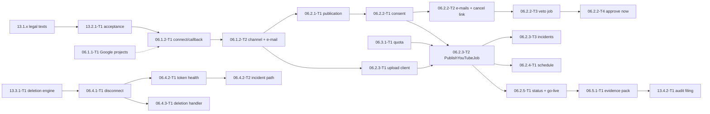

# 06 — YouTube Publishing (personal phase P): Tech Lead review, shared decisions and feature index

> Reviews: `../../06-youtube-posting.md` (high-level, M1 → M3) — **P scope**: every task except the S items 06.1.2-T3 (multi-client settings + removal guard), 06.3.2 (fairness), 06.3.3-T1 (admin quota view) and 06.5.2-T1 (flag rollout rules), which are detailed after Gate 2. Companion: `../13-compliance/README.md` (13 P slice: legal texts, acceptance, deletion engine, audit filing), detailed in the same pass because the audit filing needs both.
> Reviewed: 2026-09-25 by the Tech Lead, against the signed consumers (02.8.3, 05, 09 wave 1 + 2, 10 wave 1, 11) and official Google pages read the same day (§1 G-rows; scouts `agent://Scout06Facts`, `agent://Scout06Consumers`, spot-checked by the TL).
> Verdict: **approve with changes.** The high-level plan is sound on consent, quota and data duties, but it misses the callback authentication problem (a browser redirect carries no bearer token), the duplicate-upload risk of a lost upload response, where the veto window and lead time live, an ETag for publications, the incident state for a broken OAuth client, and 12 consumer contradictions (§2). §3 D1–D20 is the contract.
> Status: **ready for implementation with conditions** (DoR 2026-09-25, accepted under the owner's standing approval) — see §11.
> Legend: ✅ read from source/docs (URL or file + line, date) · ⚠️ unverified · [DECISION] · [OPEN] · [INFERENCE].

## 0. How this folder is organised

```
plans/features/06-youtube-posting/
  README.md                        ← facts, findings, decisions D1–D20, CRs, template, gates, index, re-estimate, owner decisions, DoR
  06.1-connect/                    ← 06.1.1 Google projects, 06.1.2 connect/callback/channel list
  06.2.1-publication-consent/      ← 06.2.1 create, 06.2.2-T1/T2 consent + e-mails + cancel link, 06.2.6 cancel
  06.2.2-autopilot-veto/           ← 06.2.2-T3 AutopilotConsentJob + PATCH, 06.2.2-T4 approve now
  06.2.3-upload/                   ← 06.2.3 resumable upload client, PublishYouTubeJob, OAuth error classifier + incidents
  06.2.4-schedule-status/          ← 06.2.4 lead time / publishAt / pre-audit, 06.2.5 processing poll + go-live
  06.3.1-quota-audit/              ← 06.3.1 quota ledger + ETA, 06.5.1 audit evidence pack
  06.4-revocation/                 ← 06.4.1 disconnect, 06.4.2 token health + incident path, 06.4.3 deletion handler
```

Each folder holds `plan.md` (00 §10.1 sections 1–11) and one task file per task. Every id named by other plans is kept (06.2.1-T1, 06.2.2-T3, 06.2.4-T1, 06.2.5-T1, 06.4.2, 06.2.3). No new ids.

## 1. Facts verified for this review

**Google facts (G), read 2026-09-25.**

| Id | Fact | Source |
|---|---|---|
| G1 | `videos.insert`: "100 calls per day … quota cost of 1 unit in the Video Uploads quota bucket"; other methods share 10,000 units/day; `videos.list` = 1 unit; "Daily quotas reset at midnight Pacific Time (PT)" | https://developers.google.com/youtube/v3/docs/videos/insert ✅; https://developers.google.com/youtube/v3/determine_quota_cost ✅ (its "1600 points" page-summary bullet contradicts its own table — ignore) |
| G2 | Projects created after 2020-07-28: unverified API projects' uploads are restricted to private until audited | videos.insert page ✅ |
| G3 | `status.publishAt` "can be set only if the privacy status of the video is private", ISO 8601, only if never published; past date publishes at once; `invalidPublishAt` 400 | https://developers.google.com/youtube/v3/docs/videos ✅ |
| G4 | Title ≤ 100 characters, no `<` `>`; description ≤ **5000 bytes**, no `<` `>`; tags ≤ **500 characters** where commas count and a tag with a space counts its implicit quotes | videos resource ✅ |
| G5 | `status.containsSyntheticMedia` and `status.selfDeclaredMadeForKids` writable on insert | videos resource ✅ |
| G6 | `status.uploadStatus` ∈ `deleted, failed, processed, rejected, uploaded`; `failureReason` ∈ `codec, conversion, emptyFile, invalidFile, tooSmall, uploadAborted`; `rejectionReason` ∈ `claim, copyright, duplicate, inappropriate, legal, length, termsOfUse, trademark, uploaderAccountClosed, uploaderAccountSuspended`; `privacyStatus` ∈ `private, public, unlisted`; `processingDetails` is owner-only | videos resource, videos.list ✅ |
| G7 | Resumable upload: session URI "expires after one week"; chunks in multiples of 256 KB except the last; status probe = empty `PUT` with `Content-Range: bytes */<total>` → `308` + `Range`; `404` = session expired, restart | https://developers.google.com/workspace/drive/api/guides/manage-uploads ✅ (YouTube's own resumable guide URL is 404) |
| G8 | `Google.Apis.YouTube.v3` 1.76.0.4262 and `Google.Apis.Auth` 1.76.0, Apache-2.0, net6.0+; `ResumableUpload.ResumeAsync(Uri)` and `CreateFromUploadUri(Uri, Stream, options)` exist; `MinimumChunkSize = 256 KB`, default 10 MB | nuget.org ✅; `google-api-dotnet-client` `ResumableUpload.cs:111, 506, 524` ✅ |
| G9 | Revoke: `POST https://oauth2.googleapis.com/revoke?token=…` (form-encoded) | https://developers.google.com/identity/protocols/oauth2/web-server ✅ |
| G10 | External + "Testing" projects get refresh tokens that expire in 7 days; ≤ 100 test users; unverified apps: 100 new users in total; 100 refresh tokens per Google account per client | https://developers.google.com/identity/protocols/oauth2 ✅; https://support.google.com/cloud/answer/15549945 ✅ |
| G11 | PKCE is documented for the installed-app flow only; the web-server pages do not mention it | oauth2/native-app ✅; web-server page ⚠️ (absence) |
| G12 | `channels.list` names no scope for `mine=true`; scope descriptions: `youtube.readonly` "View your YouTube account", `youtube.upload` "Manage your YouTube videos" | channels/list ✅; whether `youtube.upload` alone authorizes `channels.list?mine=true` ⚠️ not verified |
| G13 | Developer Policies III.A.1 (link YouTube ToS + own terms bind users to it), III.A.2 (privacy policy, "uses YouTube API Services", Google Privacy Policy link, revoke link), III.D.2 (7 days after in-app revoke, 30 days after Google-page revoke, periodically reconfirm tokens), III.E.4 (reconfirm authorization / refresh or delete stored data every 30 days; user deletion ≤ 7 days); audit form https://support.google.com/youtube/contact/yt_api_form | https://developers.google.com/youtube/terms/developer-policies ✅ |

**Contract facts (C) from signed plans.**

| Id | Fact | Source |
|---|---|---|
| C1 | `CreatePublicationCommand(episodeId, channelConnectionId, title, description, tags, privacy, publishAt, containsSyntheticMedia: true, autopilotAuthorizationId)`; 409 `publication_consent_required`/validation → run `failed`; 429 quota → pause trigger 8 | 02.8.3 `plan.md:455` ✅ |
| C2 | `AutopilotConsentJob` recurring 1 min writes `consent_at`, `consent_text_version`, `consent_source = autopilot`, `autopilot_authorization_id` after the veto window; no consent when `veto_notice_sent_at` is empty or the series is paused (02 CR-14) | 02.8.3 `plan.md:38`; 02.8.3-T4:185, 197 ✅ |
| C3 | Failure map expected by 02: `quotaExceeded` → `scheduled` + `next_attempt_at`; 401/`invalid_grant` → `channel_reauth_required`; `invalid_client`/`unauthorized_client` → platform incident, connection unchanged; outbox `ChannelConnectionChanged`, `PlatformIncidentRaised/Cleared` [INFERENCE names in 02] | 02.8.3-T4:15, 28-31; 02.8.3 `plan.md:381` ✅ |
| C4 | Pre-audit: upload `private`, **no** `publishAt`; P reads `YouTube:AuditStatus` through `IOptionsMonitor` | 02.8.3-T3:162; 09 WT27 / W2 CR-10 ✅ |
| C5 | Go-live: `PublicationGoLiveJob` at `publish_at + 5 min`, every 15 min for 2 h; 02's fallback at `publish_at + 10 min` | 02.8.3 `plan.md:39, 442` ✅ |
| C6 | 09 surfaces to reuse: `IEmailSender.QueueAsync(EmailMessage) → ErrorOr<Guid>`, `IEmailDeliveryStatus.GetAsync`, template catalog (`channel_connected` "added by 06"), token minting at send time (WT17); `ITokenProtector.Protect(purposeSuffix, plaintext)` purpose `tokens.v1/{connectionId}`; `IReauthGuard.RequireRecentAsync(5 min)`; `RequireFeature("youtube_publish")` → 404 `feature_disabled`; `IRealtimeNotifier` (`RealtimeData` only for `RenderProgress`, WT54); `IBlobStore.OpenReadAsync`; `[Audited]`; rate policies `auth`/`paid`/`hub`; error codes `channel_already_connected`, `oauth_state_invalid`, `publication_consent_required`, `youtube_quota_exhausted`, `youtube_upload_failed`, `youtube_rejected` | 09 README BD1, BD3, BD9–BD14, WT17, WT54; 09.2.6-T3:21-29, 83-97; `plans/09-backend-api.md:417-425` ✅ |
| C7 | Episode detail: `PublicationsSummaryDto? Publications` null in P; 06 either extends query (2) or a third query approved by the TL | 09.4.2-5.3 `plan.md:166, 197` ✅ |
| C8 | Music attribution: `render-params.v1.music.attribution` frozen at render time; 06.2.1-T1 reads it from the params (TL ruling T9 overrides 05.3 `plan.md:102, 155`) | 05 README:332-336, 553 ✅ |
| C9 | Veto list (10.4.3-T2): `Publication { …, etag }`; `PATCH` with `If-Match`, 412 → ConflictDialog; consent and `DELETE` from the row | 10.4-series-autopilot `plan.md:156-159, 249-252` ✅ |
| C10 | `autopilot_settings.veto_window_hours` 2..48 (default 12); `privacy`; `Autopilot:PublishLeadMinutes` 120 "must stay equal to 06.2.4's lead time" | 02.8.3 `plan.md:56-63, 126` ✅ |
| C11 | `channel_connections(… access_token_enc, refresh_token_enc, token_expires_at, status active/revoked/expired/error, oauth_client_id, last_verified_at, revoked_at)`; `publications(… status, title, description, tags, privacy, publish_at, next_attempt_at, consent_at, consent_text_version, consent_source, autopilot_authorization_id, veto_notice_sent_at, contains_synthetic_media, external_post_id, platform_payload)`; `platform_quota_usage(platform, quota_day, units_used, units_limit)`; `data_deletion_requests(user_id, scope, reason, requested_at, due_at, completed_at)` | 00 §6 ✅ |
| C12 | Secrets: `nts/<env>/api/YOUTUBE_CLIENT_SECRET` (API role); P settings are environment values (09.10 is S) | 11 README D15; 11.2.2-T1:48 ✅ |

## 2. Findings

| # | Sev | Where | Finding | Resolution |
|---|---|---|---|---|
| F01 | B | 06.1.2 | `GET /channels/youtube/callback` is a top-level browser redirect from Google: it carries **no bearer token** (memory-only, 10 D6) and the refresh cookie is scoped to `/api/v1/auth`. The plan says the callback is "valid" without saying how it authenticates | D3: the callback authenticates by the single-use `state` row, which is bound to the user **and** the live refresh family (`sid`) that started the connect; a revoked family or an expired/used state → redirect with `oauth_state_invalid` |
| F02 | B | 06.2.3 | A lost response after the last chunk makes a retry create a **second video** on the user's channel | D9: the session URI is persisted (encrypted) **before** the first byte; a retry always probes/resumes it (`ResumeAsync`); a new session is opened only after a `404` (expired) or an explicit "not started"; `external_post_id` set → the job only reconciles |
| F03 | H | 06.2.3 | The session URI is a capability to upload into the user's channel; storing it in clear `platform_payload` leaks that capability to anyone with DB read | D9: session URI encrypted with `ITokenProtector` purpose `tokens.v1/{connectionId}` (same key scope as the tokens) |
| F04 | H | 06.2.2 | No ETag on publications, but 10.4.3-T2 sends `If-Match`; consent without `If-Match` lets a stale tab consent to metadata the user never saw | D7: ETag `"pu-<xmin>"`; `If-Match` required on consent, `PATCH`, cancel |
| F05 | H | 06.2.3, 06.4.2 | A broken OAuth client must hold publications and stop refresh, and an operator must clear it — the plan names no state or clear action | D14: table `platform_incidents`; `nts-worker incident clear <id>` (P); outbox `platform_incident_raised.v1` / `…_cleared.v1` |
| F06 | H | 06.2.2 | The veto window and the lead time have no owner key; 02 duplicates the lead time and warns about drift | D11: one option class `YouTubeOptions` (`PublishLeadMinutes` 120, `MinVetoWindowHours` 2, `AuditStatus`); 02 reads it instead of its own key (06 CR-3); `veto_ends_at` stored on the publication at create time |
| F07 | H | 06.2.3 | Quota: 02.8.3 `plan.md:257` and 02.8.3-T3:152 say quota exhaustion fails the publication; 06 and 02.8.3-T4 say it returns to `scheduled` | D10: `scheduled` + `next_attempt_at` = next PT midnight; 02 lines fixed (06 CR-4) |
| F08 | M | 06.2.1 | Description limit: 06 says 5,000 chars, YouTube counts **bytes** (G4); 02 D3 caps generated descriptions at 1,000 chars | D6: ≤ 5,000 UTF-8 bytes including the attribution; 02's 1,000-char rule still applies to generated text |
| F09 | M | 06.2.1 | Tags: YouTube's 500-char count includes commas and implicit quotes (G4); 02 D3's "≤ 400 total" is a different count | D6: `YouTubeTagRules.Length(tags)` implements G4; both rules apply |
| F10 | M | 06.2.1 | Attribution source contradiction (05 T9 vs 05.3 `plan.md:102, 155`) | C8: params (T9); stale 05.3 lines fixed (06 CR-5) |
| F11 | M | A1 | Least-privileged scope for `channels.list?mine=true` unverified (G12) | D2: request `youtube.upload` + `youtube.readonly` |
| F12 | M | FR-06-1 | PKCE for the web-server flow is not documented (G11) | D2: send PKCE S256 anyway (the confidential client secret stays the primary proof); 06.1.2-T1 step 1 records whether Google accepts it; if Google rejects the parameters, drop PKCE and keep state + secret |
| F13 | M | 06.2.5 | `PublicationUpdated` has no payload definition; `RealtimeData` is reserved for `RenderProgress` (WT54) | D13: realtime ids `{ publicationId, episodeId }`, no data; outbox `publication_updated.v1 { publicationId, episodeId, userId, status, errorCode? }` |
| F14 | M | 06.2.1 | Episode detail `publications` block stays null forever unless 06 fills it | D6: 06.2.1-T1 fills it with a third, index-only query (TL-approved per C7) |
| F15 | M | 06.2.5 | 00 §7 moves the episode `ready → scheduled → published` "via publications" but nobody owns the call | D12: 06.2.5-T1 calls `Episode.MarkScheduled/MarkPublished` in the same transaction as the publication change; 06.2.2-T1 when scheduling |
| F16 | M | 06.4.2 | III.E.4 needs a 30-day refresh of stored Authorized Data (channel title, video ids/status), not only token health | D16: `TokenHealthJob` refreshes `channels.list` and batches `videos.list` (≤ 50 ids, 1 unit) for rows older than 25 days, else deletes the stale YouTube fields |
| F17 | M | 06.2.2 | Veto cancel link: no token table named; `approval_cancel_tokens` is S (09.10.8) | D7: `user_action_tokens` kind `publication_cancel` (minted at send time, WT17), expires at `veto_ends_at` or upload start; `POST /publications/cancel-by-link { publicationId, token }` under rate policy `auth` (06 CR-6) |
| F18 | M | 06.4.1 | Deletion `scope` unset | D15: `scope = channel` |
| F19 | M | 06.1.2 | 06.1.2-T3 (S) contains re-auth on connect and the connect e-mail, which 09 requires in P | D5: re-auth, connect e-mail and single-client pinning move to 06.1.2-T1/T2; 06.1.2-T3 keeps multi-client settings + removal guard (S, XS) |
| F20 | L | 06.3.2 | Fairness needs a per-user dimension the ledger lacks | P has one user → 06.3.2 stays S; its table change is decided then |
| F21 | M | 06.2.3 | Token refresh races between the upload job, the poller and `TokenHealthJob` can present a refresh token twice | D9: refresh under `SELECT … FOR UPDATE` on the connection row, re-read after the lock |
| F22 | L | 06.3.1 | `units_limit` has no config key | D10: `YouTube:Quota:UnitsPerDay` (100) seeds the row of each new PT day |

## 3. Shared decisions (contract)

**D1 Scope and phase [DECISION].** P = the 20 tasks of §8.1. S (after Gate 2): 06.1.2-T3 (multi-client settings from 09.10, removal guard, admin counts; XS), 06.3.2-T1 (fairness), 06.3.3-T1 (admin quota view; the ETA endpoint is P in 06.3.1-T1), 06.5.2-T1 (flag rollout rules). Every 06 route is behind `RequireFeature("youtube_publish")`; recurring jobs register only while the flag is on (as 02.8.3-T1).

**D2 OAuth [DECISION] (F11, F12).** Authorization code flow, confidential web client; scopes `https://www.googleapis.com/auth/youtube.upload` + `https://www.googleapis.com/auth/youtube.readonly`; `access_type=offline`, `prompt=consent`, `include_granted_scopes=false`; PKCE S256 (see F12); redirect URI `https://<origin>/api/v1/channels/youtube/callback` (one origin per env, 10 D3). Staging project stays in Testing (7-day refresh tokens, G10) and never uploads real content; prod project "In production", unverified (00 §4.1).

**D3 Connect and callback [DECISION] (F01).**
- `POST /channels/youtube/connect` (bearer): `IReauthGuard.RequireRecentAsync(5 min)` → 401 `reauth_required`; legal gate (13.2.1-T1 `ILegalAcceptance.EnsureCurrentAsync`) → 409 `legal_acceptance_required`; creates `oauth_states(id, user_id, platform, state_hash, code_verifier_protected, oauth_client_id, refresh_family_id, created_at, expires_at, used_at)` (10 min, single use; state = 32 random bytes base64url; verifier protected with `ITokenProtector` purpose `oauth.v1`) → `200 { authorizationUrl }`.
- `GET /channels/youtube/callback?code&state` (anonymous endpoint, rate policy `auth`): claim with `UPDATE oauth_states SET used_at = now() WHERE state_hash = @h AND used_at IS NULL AND expires_at > now() RETURNING …`; the bound refresh family must still be live; exchange with the client bound to the state; fetch `channels.list?part=snippet&mine=true`; upsert the connection; audit; e-mail; `302` to `/channels?connected=youtube`. Any failure → `302 /channels?error=<code>` (`oauth_state_invalid`, `oauth_denied`, `channel_already_connected`) — fixed paths only, never a caller-supplied URL. The response sets `Referrer-Policy: no-referrer` and `Cache-Control: no-store`; `code`/`state` are redacted in logs (09.9.3-T2).
- One owner per channel: a second user → 409 `channel_already_connected`; the same user reconnecting → tokens replaced, same row.

**D4 Tokens [DECISION].** `access_token_enc`, `refresh_token_enc` = `ITokenProtector.Protect("{connectionId}", …)` (purpose `tokens.v1/{connectionId}`; the id is a UUIDv7 generated before protection). Tokens never leave the Worker/Api process, never appear in DTOs, logs, audit `data` or exceptions. `ChannelConnectionDto { id, platform, externalAccountId, displayName, status, lastVerifiedAt, connectedAt }`.

**D5 OAuth client resolution [DECISION] (F19).** `IOAuthClientResolver.ResolveAsync(string oauthClientId, ct) → ErrorOr<OAuthClient(ClientId, ClientSecret)>` and `ActiveClientId`. P implementation `ConfigOAuthClientResolver`: `YouTube:ActiveClientId` + `YouTube:Clients:<clientId>:SecretName` → secret `YOUTUBE_CLIENT_SECRET` (C12); a connection always uses its pinned `oauth_client_id`. S (06.1.2-T3) swaps in the 09.10 settings source and the removal guard.

**D6 Publication aggregate [DECISION] (F08, F09, F14).**
- `Publication.Create(userId, episodeId, connection, PublicationMetadata m, Guid? autopilotAuthorizationId, DateTimeOffset? vetoEndsAt, now)`; invariants: episode `ready` (or `scheduled` for a re-publish? no — one active publication per episode and platform: partial unique `(episode_id, platform) WHERE status NOT IN ('failed','cancelled')`); connection `active` and owned by the user; `contains_synthetic_media = true` always (no API field to turn it off); `selfDeclaredMadeForKids = false`.
- `YouTubeMetadataRules`: title 1–100 chars, no `<` `>`; description ≤ 5,000 UTF-8 bytes **after** appending the attribution (C8: `\n\nMusic: <attribution>` when `render-params.v1.music.attribution` is non-null), no `<` `>`; tags counted per G4 ≤ 500 and ≤ 15 × 30 chars (02 D3); privacy ∈ `public|unlisted|private`; `publishAt` ≥ now + `PublishLeadMinutes` or null.
- Routes: `POST /episodes/{id}/publications` → `201 PublicationDto + ETag`; `GET /episodes/{id}/publications` → `{ items }` (no paging: ≤ a handful per episode). `PublicationDto { id, episodeId, channel { id, displayName }, status, title, description, tags, privacy, publishAt, vetoEndsAt, consentAt, consentSource, externalPostId, externalUrl, errorCode, nextAttemptAt, etag }`.
- Episode detail: 06.2.1-T1 fills `PublicationsSummaryDto(int Published, int Scheduled, DateTimeOffset? LastPublishedAt)` with a third indexed query (TL-approved exception to 09 BD16's two-query rule, C7).

**D7 Consent, e-mails, cancel [DECISION] (F04, F17).**
- ETag `"pu-<xmin>"` (added to `ETags` in 09.1.4-T1's helper, 06 CR-2); `If-Match` required on consent, `PATCH`, `DELETE`.
- `POST /publications/{id}/consent { consentTextVersion }` → `awaiting_consent → scheduled`; the text version must equal `YouTube:ConsentTextVersion` (`pc.v1`; texts vi/en in `Templates/Consent/pc.v1.<locale>.md` embedded, rendered by 10.7.2) else 400 `consent_text_outdated`; `consent_source = user`; audit `publishing.consented`; e-mail `publication_consented` (every consent, C6).
- Autopilot publications are created with `veto_ends_at = now + series.autopilot_settings.veto_window_hours` (≥ `MinVetoWindowHours`); 06.2.2-T2 queues `publication_veto_notice` (preview + edit link + cancel link) and records the `email_messages.id` in `platform_payload.vetoNoticeEmailId`; `veto_notice_sent_at` is set by 06.2.2-T3 when `IEmailDeliveryStatus` reports `sent`.
- Cancel link: token minted at send time by `PublicationCancelTokenMinter` (WT17 pattern) into `user_action_tokens(kind = 'publication_cancel')`, expires at the earlier of `veto_ends_at` and upload start; `POST /publications/cancel-by-link { publicationId, token }` (anonymous, rate policy `auth`, constant-time compare, 400 `cancel_token_invalid` generic) → `cancelled`. Page `/publications/cancel#p=…&t=…` is 10 wave 2's (token in the fragment).

**D8 Autopilot consent job [DECISION] (C2).** `AutopilotConsentJob` (recurring 1 min, queue `publish`, allow-listed system job reading `(id, user_id)` then per-user `SystemContext`): batch ≤ 50 publications `WHERE status = 'awaiting_consent' AND autopilot_authorization_id IS NOT NULL AND veto_ends_at <= now` `FOR UPDATE SKIP LOCKED`; per row: refresh delivery status → `veto_notice_sent_at`; skip (no write) when the notice is not `sent`, the series is paused, the authorization is revoked or not current, or the connection is not `active`; otherwise `Publication.ConsentFromAuthorization(authorization, textVersion, now)` → `scheduled`. `PATCH /publications/{id}` (title, description, tags, privacy, publishAt) only in `awaiting_consent` or `scheduled` before upload: re-runs D6 validation and the 02.8.2 moderation gate (`IAutoApprovalGate.EvaluatePublicationMetadataAsync` ⚠️ name — 02 owns it; [OPEN] if absent, `IContentModerator` on the new text); a passing edit is the owner's consent (`consent_source = user`, `consent_at = now`).

**D9 Upload [DECISION] (F02, F03, F21).**
- Port `IYouTubeClient` (Application): `ExchangeCodeAsync`, `RefreshAsync`, `RevokeAsync`, `GetMyChannelAsync`, `StartUploadAsync(token, VideoInsertRequest, long length, ct) → Uri sessionUri`, `ResumeUploadAsync(token, Uri sessionUri, Stream content, long length, IProgress<long>, ct) → ErrorOr<UploadResult(VideoId)>`, `ProbeUploadAsync(token, Uri, long length, ct) → UploadProbe(Complete(VideoId) | Partial(long nextByte) | Expired)`, `GetVideosAsync(token, IReadOnlyList<string> ids, ct)`; implementation `GoogleYouTubeClient` on `Google.Apis.YouTube.v3` 1.76 (G8) + `Google.Apis.Auth`; credentials only through `IOAuthClientResolver`.
- `PublishYouTubeJob.RunAsync(publicationId)` (queue `publish`, `[JobPolicy(Retries = 5)]` exponential for transport errors): lock the publication; `external_post_id` set → reconcile only; re-check consent (`Publication.StartUpload` refuses without `consent_at`, NFR-06-1), connection `active`, flag on, no open incident for the client; reserve quota (D10); access token via `ITokenService.GetAccessTokenAsync(connectionId)` (refresh when < 5 min left, under `FOR UPDATE` on the connection row, re-read after the lock); session: if `platform_payload.uploadSessionEnc` exists → probe → resume / reconcile / restart on `Expired`; else `StartUploadAsync`, persist the encrypted session URI **and commit** before the first byte; stream `IBlobStore.OpenReadAsync` of the final video, chunk 10 MiB (multiple of 256 KiB); success → `external_post_id`, status `processing`, schedule 06.2.5 poll.
- Error map: `quotaExceeded`/`uploadLimitExceeded` → release unit, `scheduled`, `next_attempt_at` = next PT midnight (+ jitter ≤ 10 min), `youtube_quota_exhausted` on the DTO; 401/`invalid_grant` → connection `expired` + outbox `channel_connection_changed.v1`, publication `failed` `channel_reauth_required`; `invalid_client`/`unauthorized_client` → incident (D14); 4xx validation (`invalidPublishAt`, `invalidTitle`, `invalidDescription`) → `failed` `youtube_upload_failed` + detail code; 5xx/timeout → retry with resume; retries exhausted → `failed` `youtube_upload_failed`.
- Memory: the stream is never buffered whole; one chunk buffer per job; parallelism of queue `publish` = 2.

**D10 Quota ledger [DECISION] (F07, F22).** `IQuotaLedger.TryReserveAsync(platform, now) → ErrorOr<QuotaReservation(DateOnly Day)>` = `INSERT … ON CONFLICT DO NOTHING` of the PT-day row with `units_limit = YouTube:Quota:UnitsPerDay`, then `UPDATE … SET units_used = units_used + 1 WHERE platform = 'youtube' AND quota_day = @d AND units_used < units_limit RETURNING`; `ReleaseAsync(reservation)` decrements only when YouTube never received the insert (failure before `StartUploadAsync` returned, or `quotaExceeded`). PT day via `TimeZoneInfo.FindSystemTimeZoneById("America/Los_Angeles")` (ICU; same rule as 02 T7). `GET /publishing/youtube/eta` → `{ available, nextSlotAt }` (next PT midnight when full). Metric `youtube_quota_used` (11.6.2-T1 alert at 80 %).

**D11 Options [DECISION] (F06).** `YouTubeOptions` (section `YouTube`, validated at start): `ActiveClientId`, `Clients`, `PublishLeadMinutes` = 120, `MinVetoWindowHours` = 2, `AuditStatus` ∈ `pending|approved|rejected` (`IOptionsMonitor`, env in P, WT27), `ConsentTextVersion` = `pc.v1`, `Quota:UnitsPerDay` = 100, `Poll:IntervalSeconds` = 60, `Poll:MaxMinutes` = 120, `GoLive:DelayMinutes` = 5, `GoLive:RetryMinutes` = 15, `GoLive:MaxMinutes` = 120. 02 reads `PublishLeadMinutes` and `MinVetoWindowHours` from here (06 CR-3).

**D12 Scheduling, status, episode [DECISION] (F15; C4, C5).** Queue time = now (no `publishAt`) or `publishAt − PublishLeadMinutes`; the job is enqueued at consent (or scheduled at that time). `AuditStatus ≠ approved` → upload `private`, `publishAt` omitted, publication ends `published_private_locked`? — no new status: it ends `published` with `privacy = private` and `platform_payload.preAudit = true`, and 02.8.3-T3 maps that to its run outcome (C4). `PollYouTubeProcessingJob` every 60 s up to 120 min: `processed` → `published` (or stays `scheduled` while `publishAt` is in the future, then `PublicationGoLiveJob` at `publishAt + 5 min`, every 15 min for 120 min, then `failed` `youtube_go_live_unconfirmed` + admin alert) ; `failed`/`rejected` → `failed` `youtube_rejected` + reason. Episode: first publication `scheduled` → `Episode.MarkScheduled`; `published` → `Episode.MarkPublished` (same transaction).

**D13 Events [DECISION] (F13; C3).** Outbox (Worker handlers, ids only): `publication_updated.v1 { publicationId, episodeId, userId, status, errorCode? }` (→ `IRealtimeNotifier` `PublicationUpdated` with ids `{ publicationId, episodeId }`, no data; → 02 orchestrator), `channel_connection_changed.v1 { connectionId, userId, status }`, `platform_incident_raised.v1 { incidentId, platform, oauthClientId, affectedConnections }`, `platform_incident_cleared.v1 { incidentId, platform, oauthClientId }`. These confirm 02's [INFERENCE] names (06 CR-4).

**D14 Platform incidents [DECISION] (F05).** Table `platform_incidents(id, platform, oauth_client_id, error_code, raised_at, cleared_at, cleared_by, note)`, partial unique `(platform, oauth_client_id) WHERE cleared_at IS NULL`. Raised by `OAuthErrorClassifier` hits in upload or token health; while open: publications of that client stay `scheduled` with `next_attempt_at = null`, `TokenHealthJob` skips the client, the UI shows `publishing_temporarily_unavailable`; P1 alert through 11.6.2-T1. Cleared by `nts-worker incident clear <id> --note "<text>"` (audit `support`, `internal`), which re-schedules held publications (`next_attempt_at = now + jitter`).

**D15 Disconnect and deletion [DECISION] (F18).** `DELETE /channels/{id}` (bearer, `If-Match` not needed — idempotent): Google revoke first (retry 3× with backoff; if still failing, the tokens are wiped anyway and the failure is logged + alerted — the grant dies with the deletion); tokens nulled at once; status `revoked`; `awaiting_consent`/`scheduled` publications → `cancelled` (quota released); `data_deletion_requests(scope = channel, reason = in_app_revoke, due_at = now + 7 d)` via 13.3.1-T1's `IDeletionRequests.CreateAsync`; outbox `channel_connection_changed.v1`. 06.4.3-T1 implements `IDeletionScopeHandler` for `channel`: nulls tokens, channel metadata, `external_post_id`, `platform_payload`, keeps publication rows (13 §5.4).

**D16 Token health and data refresh [DECISION] (F16).** `TokenHealthJob` daily (allow-listed system job): for each `active` connection whose client has no open incident: refresh → `invalid_grant` → `revoked` + deletion request (`reason = google_revoke`, 30 d) + outbox; `invalid_client`/`unauthorized_client` → incident, stop that client for this run; then refresh stored data older than 25 days: `channels.list` (title) and `videos.list` for `external_post_id`s in batches of 50 (1 unit each); a video that no longer exists → null `external_post_id`, keep the row. Runtime bound: ≤ `TokenHealth:MaxConnectionsPerRun` (500).

**D17 Security [DECISION].** Re-auth on connect (D3), legal acceptance before connect (13.2.1-T1), feature flag on every route, owner-only access (tenant filter, 404 for others), CSRF: the callback has no cookie auth and the state binds the session; cancel-by-link token single-use and hashed; tokens and session URIs encrypted (D4, D9); no Google password ever; audit actions `publishing.channel_connected`, `publishing.channel_disconnected`, `publishing.publication_created`, `publishing.consented`, `publishing.consent_autopilot`, `publishing.cancelled`, `publishing.incident_raised`, `publishing.incident_cleared` (ids/codes only); logs never contain titles, descriptions, tokens or channel names (ids only).

**D18 Performance [DECISION].** Streamed uploads (one chunk buffer), jobs batch ≤ 50 rows with `SKIP LOCKED`, indexes: `publications (status, next_attempt_at) WHERE status IN ('awaiting_consent','scheduled','uploading','processing')`, `publications (channel_connection_id)`, partial unique D6, `channel_connections (user_id)`, unique `(platform, external_account_id) WHERE status <> 'revoked'`; `videos.list` batched by 50; episode detail +1 indexed query only (D6).

**D19 Testing [DECISION].** `FakeGoogleServer` in `NightTales.TestKit` (Kestrel, hand-written, no mocking library): token endpoint (code/refresh, `invalid_grant`, `invalid_client`), revoke, `channels.list`, resumable upload (session create, chunk `308` + `Range`, probe, `404` expiry, drop-after-last-chunk), `videos.insert` errors (`quotaExceeded`, `invalidPublishAt`), `videos.list` (status transitions). `GoogleYouTubeClient` takes base URLs from options so tests point at the fake. Integration tests on real PostgreSQL 17 via `PostgresFixture`; PT-day tests across DST with `FakeClock`. Manual staging checks against a real test channel (private uploads only).

**D20 Migrations [DECISION].** One expand-only migration per owning task: `_06_ChannelConnections` + `_06_OAuthStates` (06.1.2-T1/T2), `_06_Publications` (06.2.1-T1, incl. `veto_ends_at`), `_06_PlatformQuotaUsage` (06.3.1-T1), `_06_PlatformIncidents` (06.2.3-T3). New tables/columns go to 00 §6 (06 CR-1).

## 4. Change requests

Applied 2026-09-25 under the owner's standing approval; tagged `(06 CR-n)`.

| CR | Target | Change |
|---|---|---|
| 06 CR-1 | `plans/00-overview.md` §6, §8 | new tables `oauth_states`, `platform_incidents`; `publications.veto_ends_at`; `user_action_tokens.kind` + `publication_cancel`; `data_deletion_requests.scope` `channel` for disconnects; §8 `POST /publications/cancel-by-link` body; `legal_acceptance_required` code |
| 06 CR-2 | `features/09-backend-api/09.1.4-error-mapping/09.1.4-T1-…` | `ETags.Publication(xmin) → "pu-{xmin}"` |
| 06 CR-3 | `features/02-story-writing/02.8.3-cadence-publishing/` (plan §3/§7.4, T1, T3) | read `YouTubeOptions.PublishLeadMinutes`/`MinVetoWindowHours`/`AuditStatus` (no own duplicate keys); §7.4 `DbSettingsProvider` text → `IOptionsMonitor` (W2 CR-10) |
| 06 CR-4 | 02.8.3 `plan.md:257`, 02.8.3-T3:152, `plan.md:381`, 02.8.3-T4 header | quota exhaustion = `scheduled` (D10); event names confirmed (D13); T4 Depends `06.4.2`, `06.2.3` → task ids |
| 06 CR-5 | `features/05-video-assembly-subtitles/05.3-music/plan.md:102, 155`, `05.3.2-T3` | attribution frozen in params per T9 (C8) |
| 06 CR-6 | `features/09-backend-api/09.3-auth/09.3.3-T1-…`, `09.2.6-T3-email-pipeline.md` | `user_action_tokens.kind` gains `publication_cancel`; templates `channel_connected`, `publication_consented`, `publication_veto_notice` + minter registered by 06 |
| 06 CR-7 | `plans/06-youtube-posting.md` §6/§11, `plans/00-overview.md` §4.1/§13 | re-estimate (§9) |
| 06 CR-8 | `features/*` task headers | Blocks back-edges for every hard dependency on 06 tasks (§8.1) |
| 06 CR-9 | `plans/09-backend-api.md` §5.4 | codes per YR5 |
| 06 CR-11 | `features/10-web-ui/10.4-series-autopilot/` (veto-list client model) | `PublicationDto` gains `preAudit` and `requestedPrivacy`; the edit dialog disables privacy on pre-audit rows (YR20) |
| 06 CR-12 | `features/09-backend-api/09.7-video-review-storage/09.7.2-T1-…` | `IBlobStore.OpenReadAsync(bucket, key, fromByte, ct)` ranged overload for upload resume (06.2.3-T2) |
| 06 CR-10 | `features/11-worker-deployment/11.2-cloud-environments/11.2.2-T1-…`, `11.6-operations/11.6.2-T1-…` | LB access log drops the callback query string (YR23); alert rules `platform_incident_open > 0 for 5m` and `deletion request due < 24 h` (06.2.3-T3, 13.3.1-T1) |
| 06 CR-22 | `06.1-connect/plan.md` §4 UC2 steps 8–9 + §5.3; `06.1-connect/06.1.2-T1-connect-callback.md` §Design unit #2 steps 9–10, Steps, Notes; `06.1-connect/06.1.2-T2-channel-connection.md` §Design/Steps/Outputs/Notes | `IConnectChannelConnection.ConnectAsync` returns `Task<ErrorOr<ConnectChannelOutcome>>` with `public sealed record ConnectChannelOutcome(Guid ConnectionId, bool Reconnected)` — the callback audit's `publishing.channel_connected.data.reconnected` reads `Reconnected` (coordinator decision A, 2026-10-18; rejected: the callback re-reads the row before the lock, and accept-always-false). T2's `ConnectAsync` writes the `channel_connection_changed.v1` outbox row and the `channel_connected` e-mail inside unit #2, with no `SaveChanges`/`ExecuteUpdate` before success and every refusal answered as an `ErrorOr` error (never thrown); the one-owner rule is enforced by `ux_channel_connections_account` and answered as `channel_already_connected`; the connect writer's locked read is owner-agnostic and allow-listed (`ChannelConnectionLocker`, `tests/NightTales.Architecture.Tests/AllowLists.cs`) — Infrastructure now holds a second allow-listed `IgnoreQueryFilters` site — because the `AllowAnonymous` callback cannot pin a user scope, so the handler itself compares `row.UserId` to `request.UserId` (another owner → the same refusal, row untouched) and `23505` is only the insert-insert backstop, mapped in `EfUnitOfWork` |

## 5. Sequencing



## 6. Task file template

Same as `../02-story-writing/README.md` §6 (H1, one-row table `| Story | Size | Area | Depends on | Blocks | Phase / flag |` equal to §8.1, then Goal, Inputs, Design, Steps, Outputs, Acceptance checks, Tests, Failure handling and edge cases, Notes).

## 7. Gates

- **06-connect:** owner connects the channel on staging (re-auth + legal acceptance), the connection row holds encrypted tokens, the connect e-mail arrives, disconnect revokes at Google and creates the 7-day request.
- **06-publish (input to 02 M1 exit, audit filing):** manual publication → consent (e-mail) → private upload to the test channel → `published`; an autopilot publication passes the veto window and uploads; a forced lost-response retry creates **no** second video; `quotaExceeded`, `invalid_grant` and `invalid_client` paths pass against `FakeGoogleServer`.
- **06-audit-ready:** evidence pack complete (06.5.1-T1) and 13 P slice done → 13.4.2-T1 files.

## 8. Feature index and task mapping

| Folder | Tasks (size) |
|---|---|
| `06.1-connect/` | 06.1.1-T1 (S), 06.1.2-T1 (M), 06.1.2-T2 (M) |
| `06.2.1-publication-consent/` | 06.2.1-T1 (M), 06.2.2-T1 (S), 06.2.2-T2 (S), 06.2.6-T1 (S) |
| `06.2.2-autopilot-veto/` | 06.2.2-T3 (M), 06.2.2-T4 (XS) |
| `06.2.3-upload/` | 06.2.3-T1 (L), 06.2.3-T2 (M), 06.2.3-T3 (XS) |
| `06.2.4-schedule-status/` | 06.2.4-T1 (S), 06.2.5-T1 (M) |
| `06.3.1-quota-audit/` | 06.3.1-T1 (M), 06.5.1-T1 (M) |
| `06.4-revocation/` | 06.4.1-T1 (S), 06.4.2-T1 (M), 06.4.2-T2 (XS), 06.4.3-T1 (S) |

### 8.1 Canonical task dependencies

"(soft)" = the task can start with a contract-true fake; the acceptance run needs the real input.

| Task | Size | Area | Phase | Depends on | Blocks |
|---|---|---|---|---|---|
| 06.1.1-T1 | S (0.5) | Ops | P · M1 | 10.3.1-T1 (soft), 13.1.1-T1 (soft), 13.1.2-T1 (soft) | 13.4.1-T1 (13 CR-17) |
| 06.1.2-T1 | M (1.0) | BE + Security | P · M1 · flag `youtube_publish` | 06.1.1-T1 (soft), 09.3.2-T1, 09.10.4-T1, 09.9.4-T1, 09.9.2-T2, 13.2.1-T1 | 06.1.2-T2, 10.7.1-T1 (10 CR-15), 07.1.2-T1 (07 CR-11), 10.7.1-T0 |
| 06.1.2-T2 | M (1.0) | BE | P · M1 · flag `youtube_publish` | 06.1.2-T1, 09.2.6-T3 | 06.2.1-T1, 06.2.3-T1, 06.4.1-T1, 10.7.1-T1 (10 CR-15), 08.4.1-T1 (08 CR-5), 07.1.2-T1, 07.1.2-T2 (07 CR-11), 06.1.2-T3 (06 CR-18) |
| 06.2.1-T1 | M (1.0) | BE | P · M1 · flag `youtube_publish` | 06.1.2-T2, 09.5.3-T1, 09.7.1-T1, 05.3.2-T3 (soft) | 06.2.2-T1, 02.8.3-T3, 10.7.2-T1 (10 CR-15), 07.2.2-T1 (07 CR-11), 10.7.2-T0 |
| 06.2.2-T1 | S (0.5) | BE | P · M1 · flag `youtube_publish` | 06.2.1-T1 | 06.2.2-T2, 06.2.6-T1, 06.2.3-T2, 10.7.2-T1 (10 CR-15), 07.2.2-T1 (07 CR-11) |
| 06.2.2-T2 | S (0.5) | BE + Security | P · M1 · flag `youtube_publish` | 06.2.2-T1, 09.2.6-T3, 09.3.3-T1 | 06.2.2-T3, 10.7.4-T2 (10 CR-15), 07.2.2-T2 (07 CR-11) |
| 06.2.6-T1 | S (0.5) | BE | P · M1 · flag `youtube_publish` | 06.2.2-T1, 06.3.1-T1 | 06.4.1-T1, 10.7.4-T1 (10 CR-15), 13.3.2-T1 (13 CR-17) |
| 06.2.2-T3 | M (1.0) | BE | P · M1 · flag `youtube_publish` | 06.2.2-T2, 02.8.3-T1, 02.8.3-T2 | 06.2.2-T4, 02.8.3-T3, 10.4.3-T2 (soft), 08.4.2-T1 (08 CR-5) |
| 06.2.2-T4 | XS (0.25) | BE/FE | P · M1 · flag `youtube_publish` | 06.2.2-T3 | 06.5.1-T1, 10.7.4-T2 (10 CR-15) |
| 06.3.1-T1 | M (1.0) | BE | P · M1 | 09.2.2-T1 | 06.2.6-T1, 06.2.3-T2, 06.4.1-T1, 10.7.2-T1 (10 CR-15), 06.3.2-T1, 06.3.3-T1 (06 CR-18) |
| 06.5.1-T1 | M (1.0) | BA | P · M1 | 06.2.5-T1, 06.2.2-T4, 06.4.2-T2, 06.4.3-T1, 13.1.1-T1, 13.1.2-T1, 13.2.1-T1, 10.3.1-T1, 10.4.3-T2, 10.7.1-T1, 10.7.2-T1, 10.7.4-T1 | 13.4.2-T1 |
| 06.2.3-T1 | L (2.0) | BE | P · M1 | 06.1.2-T2, 09.7.2-T1 | 06.2.3-T2 |
| 06.2.3-T2 | M (1.0) | BE | P · M1 · flag `youtube_publish` | 06.2.3-T1, 06.2.2-T1, 06.3.1-T1, 09.2.6-T1 | 06.2.3-T3, 06.2.4-T1, 06.2.5-T1, 02.8.3-T4, 07.3.1-T1 (07 CR-11), 06.3.2-T1 (06 CR-18) |
| 06.2.3-T3 | XS (0.25) | BE | P · M1 | 06.2.3-T2, 11.6.2-T1 (soft) | 06.4.2-T2, 08.2.2-T1 (08 CR-16) |
| 06.2.4-T1 | S (0.5) | BE | P · M1 | 06.2.3-T2 | 02.8.3-T3 |
| 06.2.5-T1 | M (1.0) | BE | P · M1 | 06.2.3-T2, 09.8.1-T1 | 06.5.1-T1, 02.8.3-T3, 10.7.4-T1 (10 CR-15) |
| 06.4.1-T1 | S (0.5) | BE + Security | P · M1 | 06.1.2-T2, 06.2.6-T1, 06.3.1-T1, 13.3.1-T1 | 06.4.2-T1, 06.4.3-T1, 10.7.1-T1 (10 CR-15), 13.3.2-T1 (13 CR-17) |
| 06.4.2-T1 | M (1.0) | BE | P · M1 | 06.4.1-T1 | 06.4.2-T2, 02.8.3-T4 |
| 06.4.2-T2 | XS (0.25) | BE | P · M1 | 06.4.2-T1, 06.2.3-T3 | 06.5.1-T1 |
| 06.4.3-T1 | S (0.5) | BE | P · M1 | 06.4.1-T1, 13.3.1-T1 | 06.5.1-T1 |

## 9. Re-estimate

| Area | High-level P | Detailed P | Why |
|---|---|---|---|
| 06.1 setup + connect | 2.0 (T1 0.5, 06.1.2-T1 1.0, T2 0.5) | 2.5 | +0.5 06.1.2-T2 takes the P half of 06.1.2-T3 (re-auth, pinned client, connect e-mail — F19) |
| 06.2 publishing | 7.0 | 8.5 | +0.5 06.2.1-T1 (ETag, attribution, summary block, byte-accurate limits); +0.5 06.2.2-T3 (PATCH re-validation, authorization checks); +0.5 06.2.5-T1 (go-live job + episode status) |
| 06.3 quota | 1.0 (06.3.1-T1) | 1.0 | ETA endpoint folded in |
| 06.4 revocation + duties | 2.25 | 2.25 | unchanged (data refresh inside 06.4.2-T1) |
| 06.5 audit | 1.0 (06.5.1-T1) | 1.0 | unchanged |
| **P total** | **13.25** | **15.25** | +2.0 d |
| S (06.1.2-T3 0.5 → 0.25, 06.3.2 0.5, 06.3.3 0.5 → 0.25, 06.5.2 0.25) | 1.75 | 1.25 | P took the connect half of 06.1.2-T3 and the ETA part of 06.3.3 |
| Plan 06 total | 15.0 | **16.5** | buffered 19.8 |

## 10. Owner decisions and TL rulings

**Owner decisions** (accepted 2026-09-25 under the owner's standing approval).

| # | Decision | Outcome |
|---|---|---|
| O1 | Scopes `youtube.upload` + `youtube.readonly` (F11) | Accepted |
| O2 | Re-estimate P 13.25 → 15.25, plan 06 15.0 → 16.5 | Accepted |
| O3 | Audit fallback (06.2.2 [OPEN]): if the audit rejects series-level authorization, keep one-tap approve-now per video (06.2.2-T4) rather than staying private-only | Accepted (the TL recommendation: keeps autopilot usable with one tap) |

**TL rulings.**

| # | Topic | Ruling |
|---|---|---|
| YR2 | Pre-audit publish time (review, B) | 02.8.3-T3 always passes `PublishAt = run.SlotAt`; the row keeps `publish_at`; only the upload request omits `publishAt` while `AuditStatus ≠ approved` (06.2.4-T1) (06 CR-4 extended) |
| YR3 | Consent → upload scheduling (review, B) | The Api never enqueues: consent (user, PATCH or autopilot) writes `publication_updated.v1` (D13 shape, **no** `queueAt`); the Worker handler `PublicationScheduledForUploadHandler` (06.2.3-T2) re-reads the row and schedules `PublishYouTubeJob` at `PublicationQueueTime.For(publishAt, PublishLeadMinutes, now)` (pure, Domain, declared by 06.2.2-T1); quota retries and incident clears reschedule through the same handler |
| YR4 | `platform_incidents` owner | Table, entity, `_06_PlatformIncidents`, `IPlatformIncidentStore` = 06.2.3-T2; classifier, clear verb, metrics = 06.2.3-T3 (D20 reads this way) |
| YR5 | New codes (review) | 09 §5.4 gains `publication_invalid_state` 409, `publication_conflict` 412, `publication_privacy_locked` 409, `channel_not_active` 409; callback redirect codes `oauth_denied`, `oauth_exchange_failed` (query value only); publication `error_code` values `platform_incident`, `youtube_go_live_unconfirmed` (06 CR-9) |
| YR6 | 06.4.1-T1 edges (review) | Depends also on 06.2.6-T1 (`Publication.Cancel`) and 06.3.1-T1 (`IQuotaLedger.ReleaseAsync`, gated on `platform_payload.quotaReservedDay`) |
| YR7 | `DeletionResult` | 13.3.1-T1's shape wins: `IDeletionScopeHandler.ExecuteAsync → ErrorOr<DeletionResult(int ObjectsDeleted, int RowsAffected)>`; failures are `Error`s; 06.4.3-T1 adapts |
| YR8 | Cancel-link tokens (review, H) | `user_action_tokens.subject_id uuid NULL`; `IUserActionTokenService.IssueAsync(userId, kind, subjectId, expiresAt, info, ct)` overload; invalidation scoped to `(user, kind, subject_id)`; `ConsumeAsync` returns the subject and the route requires it to equal `publicationId`; `expires_at = min(veto_ends_at, now + 48 h)`; 09.2.6-T3 splits producer param keys from minter output keys (`cancelUrl`, `approveUrl`) (06 CR-6 extended) |
| YR9 | Consent paths (review, H) | A `PATCH` on an `awaiting_consent` row consents only when the body carries the current `consentTextVersion`; otherwise the edit applies and the row stays `awaiting_consent`. Every consent (user, PATCH, approve-now, autopilot) queues `publication_consented` inside the same transaction (autopilot copy says "approved automatically after the veto window"); a queueing failure fails the command |
| YR10 | OAuth browser binding (review, M) | Connect sets `__Host-nts_oauth` (HttpOnly, Secure, SameSite=Lax, Path=/, 10 min) and stores its hash in `oauth_states.browser_nonce_hash`; the callback requires it (constant-time) — a connect URL cannot be completed in another browser |
| YR11 | Reconnect (review) | Load the row `FOR UPDATE` first; protect the new tokens under the **existing** connection id; re-pin `oauth_client_id` to the state's client; disconnect also locks the row |
| YR12 | Restore re-apply (review, H) | `nts-worker deletions reapply --since` replays completed **and** still-open requests; the channel handler on a restored `active` row revokes first (tokens nulled, status `revoked`) then purges — idempotent |
| YR13 | Deletion uniqueness | Partial unique `(user_id, scope, target_id, reason) NULLS NOT DISTINCT WHERE completed_at IS NULL` |
| YR14 | Foreign/missing target | 06.4.3-T1 distinguishes "gone" from "not visible" with an allow-listed existence check; not visible → `Error` (alerted), never "Completed" |
| YR15 | Documents order | `errors.documents` is sorted: `["privacy","tos"]` everywhere (13 D3 reads this way) |
| YR16 | Incident clear actor | `nts-worker incident clear <id> --operator <name> --note <text>`; `cleared_by` and the audit `ActorLabel` carry the operator |
| YR17 | Held rows in polls (review) | A poll/go-live row whose client has an open incident gets `next_attempt_at = now + 5 × Poll:IntervalSeconds` and `platform_payload.heldByIncidentId`; the clear command reschedules `processing` rows as well (`next_attempt_at = now`) |
| YR18 | Lost-response retry (review, B) | `Publication.StartUpload` is idempotent for `uploading` (returns "resume"), so a retry reaches the probe/resume step (F02) |
| YR19 | Quota consumption | The unit is released only when the session-create request was never sent or Google answered `quotaExceeded`/`uploadLimitExceeded`; any other response to the session-create call (including 4xx validation) consumes it |
| YR20 | Pre-audit privacy | `privacy`/`platform_payload.preAudit`/`requestedPrivacy` are written once by 06.2.1-T1 at create (02.8.3-T3:156: that slot stays private); 06.2.4-T1 and the job only read them; a `PATCH` to non-private on a pre-audit row → 409 `publication_privacy_locked` |
| YR21 | Audit actions | D17 list adds `publishing.channel_revoked_google` and `publishing.publication_updated` |
| YR22 | Veto job passes | `AutopilotConsentJob` runs two passes per tick: (1) stamp `veto_notice_sent_at` for any autopilot row whose notice is `sent` (no window predicate, so 02's trigger 11 never fires on a delivered notice), (2) consent rows whose window ended (D8 reads this way) |
| YR23 | Callback logs | The LB access log for `/api/v1/channels/*/callback` drops the query string (11.2.2-T1 note, 06 CR-10); app logs redact `code`/`state` (09.9.3-T2) |
| YR24 | Incident hold mechanics | Holds are lazy and per row: any job (upload, poll, go-live) that finds an open incident for the row's client sets `platform_payload.heldByIncidentId` and a deferred `next_attempt_at`; there is no raise-time batch sweep. The clear command (06.2.3-T3) is the only sweep and reschedules `scheduled` and `processing` rows carrying that id |
| YR25 | Incident audit/outbox writer | `IPlatformIncidentStore.RaiseAsync` itself writes `publishing.incident_raised` and `platform_incident_raised.v1` when `IsNew`; callers (06.2.3-T2, 06.4.2-T2) never write them |
| YR26 | Veto job claim | The claim uses 09's allow-listed `ISystemWorkQuery.PendingAsync` (no lock); each row is handled by its own command (`ConsentAutopilotPublicationCommand`, `StampNoticeDeliveredCommand`) in its own UnitOfWork with `FOR UPDATE` + `xmin`, so a failing row never rolls back others (D8's `SKIP LOCKED` wording reads this way) |
| YR27 | Upload job guards (review) | (1) early/duplicate delivery (`next_attempt_at > now`) is a no-op; (2) resume skips quota reserve when `quotaReservedDay` is set; (3) an expired session (404) restart reserves a fresh unit; (4) the incident clear sweep loads tracked rows (≤ 200/batch) and calls `Publication.ReleaseHold(now)` so the outbox interceptor emits `publication_updated.v1`; (5) scheduling tests assert the delay on the TestKit job scheduler and call `RunAsync` at the target instant with `FakeClock`; (6) `PublicationErrorCodes` declared once in Domain |
| YR1 | Shortened veto | `veto_ends_at = min(now + veto_window_hours, (publishAt ?? now) − PublishLeadMinutes)`; below `now + MinVetoWindowHours` → 400 `validation_failed` (`publishAt`) (02.8.3 `plan.md:146`) |

## 11. Definition-of-Ready review (2026-09-25)

**Method.** Same as `../10-web-ui/README.md` §11.
- Script (`verify_plan.py … 06-youtube-posting`): 7 `plan.md` files with sections 1–11; 20 task files with the H1, the one-row header, the 9 headings in order and balanced fences; every header equals §8.1; total 15.25 d = §9 = `06-youtube-posting.md` §11 P rows = `00-overview.md` §4.1 after 06 CR-7; whole-repo graph 262 tasks, **0 cycles**; warnings are only ids of not-yet-detailed plans (10 wave 2, 06 S tasks).
- Three review passes (contract 6, security 18, performance 4 findings) plus the writers' own cross-checks; every finding verified on disk by the TL and resolved by rulings YR1–YR27 and two fix rounds; spot checks on disk after the rounds (`StartUpload` resume no-op in both 06.2.1-T1 and 06.2.3-T2, `HasOpenIncidentAsync` signature aligned in 06.4.2-T2, `PublishAt = run.SlotAt` in 02.8.3-T3, `__Host-nts_oauth` in 06.1.2-T1, subject-scoped cancel tokens in 06.2.2-T2 and 09.3.3-T1).
- CRs 06 CR-1…CR-12 applied (00 §6/§8, 02.8.3 plan/T1/T3/T4, 05.3, 09.1.4-T1, 09.2.6-T3, 09.3.3-T1, 09.7.2-T1, 09 §5.4, 10.4 plan, 11.2.2-T1, 11.6.1-T1, 11.6.2-T1, `06-youtube-posting.md`) and swept (`Autopilot:PublishLeadMinutes`, quota → `failed`, `PublishAt: preAudit ? null`, stale attribution source).
- Mermaid: the README block renders.

| DoR item (00 §10) | Status |
|---|---|
| User value stated | ✅ each `plan.md` §1 |
| Acceptance criteria | ✅ observable checkboxes per task (≥ 8 each) incl. `FakeGoogleServer` scenarios and a real-channel staging check |
| Dependencies known | ✅ §8.1; ⚠️ not detailed yet: 10.7.1-T1 / 10.7.2-T1 / 10.7.4-T1 (10 wave 2, needed by 06.5.1-T1 only) |
| Estimate ≤ XL | ✅ largest L (2.0, 06.2.3-T1) |
| API contract linked | ✅ D3–D16, YR rulings, 09 §5.4 codes (06 CR-9) |
| Detailed plan reviewed by TL | ✅ + three independent review passes |

**Verdict: ready for implementation with conditions** (accepted 2026-09-25 under the owner's standing approval).

**Conditions.**
1. First-step confirmations inside the named tasks: whether Google accepts PKCE on the web-server flow (06.1.2-T1, fallback = state + secret); whether `youtube.upload` + `youtube.readonly` suffice for `channels.list?mine=true` (06.1.2-T2); the SDK members for session-create/probe without a content stream (06.2.3-T1 spike, fallback = raw G7 protocol); `__Secure`/`__Host-` cookie behaviour on `http://localhost` (dev only).
2. 06.5.1-T1 waits for 10 wave 2 (10.7.1/10.7.2/10.7.4) and the 13 P slice; 13.4.2-T1 files after it.
3. Second human reader before merge for 06.1.2-T1 (callback authentication), 06.2.2-T2 (cancel tokens), 06.2.3-T2 (upload + quota + duplicate prevention) and 06.2.2-T3 (autopilot consent).
4. The audit fallback (O3) stays ready: if the audit rejects series-level authorization, autopilot runs with approve-now per video.

**Residual risk:** the review passes found 28 real defects, concentrated in cross-folder seams (scheduling path, incident holds, token scoping); writers converged through many peer messages, so the prose may still hold stale sentences — condition 3 covers the riskiest tasks.

# Part B — S slice: multi-client, fairness, admin quota, rollout

> Scope: exactly the four S items of `../../06-youtube-posting.md` §6 that `00-overview.md` §4.1:101 puts in the SaaS phase and Part A D1 (`README.md:91`) repeats — **06.1.2-T3** (XS), **06.3.2-T1** (S), **06.3.3-T1** (XS), **06.5.2-T1** (XS) = **1.25 d**. Part A (P, 15.25 d) is the signed contract; Part B extends it only (§B3 D21–D29, §B4 CR-13…CR-19, §B2 F23–F32).
> Written 2026-09-25 by the Tech Lead from the files cited below (every `file:line` read in this pass). Owner approvals are in §B10 as "accepted under the owner's standing approval (2026-09-25)".
> Legend: same as Part A. ✅ = read from source (`file:line` or URL) · ⚠️ unverified · [INFERENCE] · [DECISION] · [OPEN].

## B0. Folders of this wave

```
plans/features/06-youtube-posting/
  06.S-saas/      ← 06.1.2-T3 multi-client settings + removal guard + admin client counts, 06.3.2-T1 fairness,
                     06.3.3-T1 admin quota view, 06.5.2-T1 flag rollout rules (4 task files, 1.25 d)
```

**`06.S-saas/` — brief (a writer can work from this paragraph alone).** One folder, four tasks, strict order `06.1.2-T3 → 06.3.2-T1 → 06.3.3-T1 → 06.5.2-T1`. *06.1.2-T3* finishes what Part A F19 moved out of the S story: `IOAuthClientResolver` (D5, `ConfigOAuthClientResolver` in P) gains a settings-backed implementation that reads `system_settings` (`integration = 'youtube'`, keys `oauth.active_client_id`, `oauth.clients` — D27) with the P config resolver as the fallback while no row exists, plus `IYouTubeClientRemovalGuard` (409 `oauth_client_in_use`) and the read-only admin client-count route. *06.3.2-T1* adds the per-user dimension F20 left open: two platform tables (`platform_user_quota_usage`, `platform_user_quota_limits` — D23), the port `IUserQuotaLedger` mirroring `IQuotaLedger` (`06.3.1-T1:38-46`), the reserve/release insertion inside `PublishYouTubeJob`'s existing quota block (CR-13, D24) and the admin override routes (D26). *06.3.3-T1* builds `GET /admin/quota` on the two ledger tables plus the `publications` queue count (D25). *06.5.2-T1* makes `feature_flags.rules` (00 §6:308) live for `youtube_publish` through an additive `IsEnabledForAsync` (D28, CR-14/CR-15) with the rollout chain off → admins → list → percent → all. **Traps:** the two new tables are platform tables (no `IUserOwned`, no query filter, no `xmin`, no `id` column — `06.3.1-T1:21,86`); every admin query that crosses tenants lives in `Features/Admin` (the only allow-listed `IgnoreQueryFilters` site, `plans/09-backend-api.md:94`); the per-user counter must be reserved **before** the global unit (ST1) and released under YR19's exact conditions (ST2); rollout must never touch an in-flight publication (O6); no client secret may enter `value jsonb` (F27).

## B1. Facts verified for this slice

**Spec facts (S) from the signed plans.**

| Id | Fact | Source |
|---|---|---|
| S1 | S scope of 06 = "06.1.2-T3 client pinning and connect e-mail, 06.3.2 fairness queue, 06.3.3 admin quota view, 06.5.2 flag rollout"; M2 closed beta includes them; the connect-e-mail/pinning half of 06.1.2-T3 was moved to P by Part A F19/CR-7, so only multi-client settings + removal guard + counts remain | `00-overview.md:101, 70` ✅; `README.md:84, 91, 102, 242` ✅ |
| S2 | Task sizes/ids fixed by the high-level plan: 06.1.2-T3 XS, 06.3.2-T1 S, 06.3.3-T1 XS, 06.5.2-T1 XS | `06-youtube-posting.md:175-177, 190-191, 197` ✅ |
| S3 | 06.3.2 story: "at most N uploads per user per PT day ([DECISION] 3 in beta), FIFO by `consent_at`; admins can override" | `06-youtube-posting.md:95-96` ✅ |
| S4 | 06.3.3 story: "Given `GET /admin/quota`, Then used/limit/queue length today and forecast; the publish form shows the estimated upload time when the queue is long" (the form banner is P: `06.3.1-T1:163`) | `06-youtube-posting.md:98-99` ✅; `06.3.1-T1` ✅ |
| S5 | 06.5.2 story: "Given `youtube_publish` rules (`jsonb`), Then it can be enabled for admins → beta users → everyone" | `06-youtube-posting.md:119-120` ✅ |
| S6 | F20 left the fairness data model open ("P has one user → 06.3.2 stays S; its table change is decided then"); D1 keeps it S | `README.md:85, 91` ✅ |
| S7 | `IQuotaLedger.TryReserveAsync(string platform, DateTimeOffset now, ct) → ErrorOr<QuotaReservation>`; `QuotaReservation(string Platform, DateOnly Day)` (readonly record struct); `ReleaseAsync` always succeeds; `PacificQuotaDay.Day(now)` / `NextResetAt(now)` (DST-safe single PT-day implementation); platform counters have **no** `id`, no `xmin`, no query filter, full-PK statements, migrations named `<yyyyMMddHHmm>_06_<What>` | `06.3.1-T1:21, 38-53, 63-86` ✅ |
| S8 | The upload job's quota block: step 6 `quota.TryReserveAsync("youtube", clock.UtcNow, ct)` → `reservedThisRun = true`; `youtube_quota_exhausted` → `RescheduleUpload(PublicationErrorCodes.QuotaExhausted, NextPtMidnight(clock) + jitter(≤ 10 min))`; the release happens in `finally` only when `reservedThisRun == true` and (`sessionCreateSent == false` or `quotaExceeded`/`uploadLimitExceeded`); a resume (YR27-2) skips the reserve; a session-404 restart reserves a fresh unit | `06.2.3-T2-publish-youtube-job.md:56, 58, 62`; `06.2.3-upload/plan.md:135, 260, 277` ✅ |
| S9 | `publications` already has an index on `(status, next_attempt_at)` (the claim query's index) — the admin queue length and the forecast reuse it, no new index | `06.2.5-T1:197` ✅ |
| S10 | `platform_quota_usage(platform, quota_day, units_used, units_limit)`; `system_settings(integration, key, value jsonb, secret_ciphertext, secret_hint, is_secret, version, updated_by, updated_at)` unique `(integration, key)`; `system_setting_changes`; `feature_flags(key, enabled, rules jsonb)`; `audit_logs(actor_user_id, actor_type, subject_user_id, action, category, visibility, entity_type, entity_id, data jsonb, ip, user_agent, created_at)` | `00-overview.md:292, 309, 311, 308, 307` ✅ |
| S11 | Admin routes already in the route table: `GET /admin/quota`, `PATCH /admin/feature-flags/{key}`, `GET /admin/settings`, `PUT /admin/settings/{integration}` (+ versions/rollback/test) | `00-overview.md:367, 368` ✅ |
| S12 | Roles are `user`/`admin`/`owner`; MFA is mandatory for admin/owner; OWASP ASVS L2; integration secrets are encrypted (Data Protection, purpose per row) and write-only | `00-overview.md:43, 417`; `plans/09-backend-api.md:247` ✅ |
| S13 | `IgnoreQueryFilters` is allowed **only** in `Features/Admin` (09.9.1) and in the named system jobs on the arch-test allow-list; recurring sweeps read `(id, user_id)` through the one allow-listed system query and then run under `SystemContext(userId)`; 06.1.2-T2 adds a second allow-listed `IgnoreQueryFilters` site in `Infrastructure/Publishing` (`ChannelConnectionLocker`, the connect path's owner-agnostic locked read — the anonymous callback cannot pin a user scope; 06 CR-22) | `plans/09-backend-api.md:94` ✅ |
| S14 | `IUserOwned` is required on every episode/series FK entity; the `IgnoreQueryFilters` allow-list is arch-tested | `plans/09-backend-api.md:505` ✅ |
| S15 | Flags in P: `IFeatureFlags.IsEnabledAsync(string key, ct)`, `CachedFeatureFlags(IFeatureFlagReader reader, IMemoryCache cache, IClock clock)`, `RequireFeature("youtube_publish")` → 404 `feature_disabled` via the 09.1.4-T1 catalogue, CLI `nts-worker flags set <key> on|off` (+ `flags list`), audit action `feature_flag_changed` (`support`/`internal`), event `feature_flags_changed.v1 { Key, Enabled, OccurredAt }`; `feature_flags` is **not** `IUserOwned` and only the read service + CLI touch it | `09.9-platform/plan.md:11, 42, 60, 104-111, 174, 188` ✅ |
| S16 | `rules jsonb` is unused in P: "the P reader answers from `enabled` only … Percentage/targeted rollout belongs to `06.5.2` (S). A non-null `rules` value must not change P behaviour" — [RULED WT13] | `09.9-platform/plan.md:80, 262`; `09.9.2-T2:44-45` ✅ |
| S17 | 09 tasks this slice consumes are **S**: 09.9.1-T1 admin endpoints, 09.9.2-T1 flags write side, all of 09.10 except 09.10.4-T1 (so 09.10.1-T1 = `system_settings` + versions, Data Protection purpose `settings.v1/{integration}/{key}`) | `plans/09-backend-api.md:541-548`; `features/09-backend-api/README.md:607` ✅ |
| S18 | `channel_connections.oauth_client_id` is the pinning column; a connection always resolves its client through `IOAuthClientResolver.ResolveAsync(string oauthClientId, ct) → ErrorOr<OAuthClient(ClientId, ClientSecret)>` + `ActiveClientId`, P implementation `ConfigOAuthClientResolver` (`YouTube:ActiveClientId`, `YouTube:Clients:<clientId>:SecretName` → `nts/<env>/api/YOUTUBE_CLIENT_SECRET`) | `README.md:102` (D5), `:93`; `00-overview.md` §6 C11 ✅ |
| S19 | A broken/removed client id already has a defined failure path: `invalid_client`/`unauthorized_client` → `platform_incidents` row + held publications until an operator clears it (no revoke, no deletion request) | `README.md:83, 87` (F05, F22), `06.2.3-T2` (YR4) ✅ |
| S20 | S total in the high-level plan is 1.75 d, re-estimated to 1.25 d by Part A §9; `00 §4.1` S column for 06 = 1.25 d; 06 total 16.5 d | `README.md:242`; `00-overview.md:101` ✅ |

## B2. Findings

| # | Sev | Where | Finding | Resolution |
|---|---|---|---|---|
| F23 | H | 06.3.2 | "Fair share" cannot be enforced by queue *ordering*: two Worker instances claiming at once both read the same counts, and a "skip capped users" predicate is a per-tick `NOT EXISTS` join with no atomicity. S3's "at most N uploads per user per PT day" must be an admission control at reserve time | D22/D24: `IUserQuotaLedger.TryReserveAsync` is one conditional `UPDATE … WHERE uploads_used < limit RETURNING` (the `IQuotaLedger` pattern, S7), called inside the same `IUnitOfWork` transaction as the global reserve; the capped row goes to `scheduled` + `next_attempt_at = PacificQuotaDay.NextResetAt(now) + jitter ≤ 10 min` — the claim query's existing `(status, next_attempt_at)` index (S9) then skips it, so a capped user can never head-block the FIFO queue |
| F24 | H | 06.3.2, 06.3.3, 06.1.2-T3 | All three new admin reads/writes cross tenants (`platform_user_quota_usage` of every user, `channel_connections` counts per client). Wrong placement leaks other users' data, and a role check alone is not enough (an unauthenticated/`user`-role caller must not even learn whether a client id exists) | D25/D26/D27: the endpoints live in `Features/Admin/YouTube` (the only allow-listed `IgnoreQueryFilters` site, S13), carry the admin/owner policy + MFA (S12), return **counts only** (never titles, episode ids, channel names or tokens), return 404 for a non-admin, and every override write appends an `audit_logs` row (`category = publishing`, `visibility = internal`) |
| F25 | H | 06.3.2 | Double-charging: a resume that already holds `platform_payload.quotaReservedDay` (YR27-2) must not take a second **per-user** slot either, and a session-404 restart takes one (a fresh insert) — the per-user counter must follow the global unit 1:1 in both directions | D24/ST2: one local flag `reservedUserThisRun` set exactly where the global reserve happens (step 6 and the 404 restart), released in the same `finally` under YR19's conditions verbatim (S8); a test asserts counter == units for the resume, 404-restart and failed-session-create sequences |
| F26 | M | 06.1.2-T3 | Removing an OAuth client id that connections are pinned to leaves those users on a permanently failing path (`invalid_client` → incident hold, S19); nothing in P refuses the removal because P has a single config client | D27: `IYouTubeClientRemovalGuard.EnsureRemovableAsync(proposedClientIds, ct)` → 409 `oauth_client_in_use` `{ clientId, connections }`; the guard runs in the same transaction as the `system_settings` write; the **active** client id can never be dropped in the same write it changes |
| F27 | M | 06.1.2-T3 | The settings source could copy a secret into `system_settings.value jsonb` (world-readable in the DB) and bypass the P secret path | D27: the model carries `clientSecretKey` (a name), the secret stays in the secret manager (`nts/<env>/api/YOUTUBE_CLIENT_SECRET`, S18) and the resolver never returns a secret for a client whose key does not resolve (`Error.NotFound("oauth_client_unknown")`); acceptance: a DB+log scan for secret-shaped values in `value jsonb` and in logs |
| F28 | M | 06.5.2 | Percentage rollouts flicker if the bucket is random per evaluation, and a narrowing rollout could orphan work already queued (the S5 chain "admins → beta → everyone" implies narrowing happens in production) | D28/ST5: sticky bucket = SHA-256 of `"{key}:{userId}"`, first 4 bytes big-endian mod 100; ST6 (O6): the rollout gates **new** work only — route access, autopilot planning, publication create — never an existing `awaiting_consent`/`scheduled`/`uploading` row |
| F29 | M | 06.5.2 | P's `IFeatureFlags.IsEnabledAsync(key, ct)` has no user dimension (S15), so `RequireFeature` on an HTTP route cannot gate per user and the recurring jobs (registered once, `02.8.3-T1:98`) cannot either | D28/CR-14/CR-16: additive `IsEnabledForAsync(string key, FeatureFlagSubject subject, ct)` (`FeatureFlagSubject(Guid? UserId, bool IsAdmin)` built from claims, no DB read); `IsEnabledAsync` keeps P semantics for system paths; `RequireFeature` uses the scoped overload; 02's autopilot job gains one per-run user check |
| F30 | L | 06.3.3 | An admin view computing per-user uploads by iterating users (or re-deriving the day from `publications`) is an N+1 that grows with the beta cohort | D25: exactly three statements — the `platform_quota_usage` day row, one `publications` count (`status = 'scheduled'` on the S9 index; cross-tenant via `Features/Admin`), one `platform_user_quota_usage` ⋈ `users` top-20 (`ORDER BY uploads_used DESC, user_id LIMIT 20`); a test asserts three SQL commands and no per-row query |
| F31 | L | 06.3.3, 06.5.2 | The S slice ships no UI, but the copy, the admin page and the vi+en strings must exist or the feature is unusable for an operator | D29/B5: the API returns codes + ISO-8601 only (no localized text); the routes and DTOs are handed to the 10 S admin slice in §B5 and by message (Lead10S); a11y and vi+en copy are that slice's acceptance, not re-opened here |
| F32 | L | all four | Cost/licence/abuse: no new dependency is needed (sticky bucket = BCL `System.Security.Cryptography`; no CAPTCHA, no third-party analytics), no new external service, and the only new DB writes are the two counter rows | ST6/ST7: no new package and no non-permissive licence enters the solution; the admin pages are read on demand (single-digit requests/day); counter rows are one per (user, PT day) → retention note for 11 (90 days) recorded in the 06.3.2-T1 task's Notes |

## B3. Shared decisions (contract, S slice)

**D21 Scope, sizes and phase [DECISION] (S1, S2).** The slice is exactly 06.1.2-T3 (XS 0.25), 06.3.2-T1 (S 0.5), 06.3.3-T1 (XS 0.25), 06.5.2-T1 (XS 0.25) = **1.25 d**, all `S · M2`, one folder `06.S-saas/`. No id is invented; the three P-side changes this slice needs are CRs (§B4), not new tasks. Everything else in 06 stays P and is not reopened.

**D22 Fairness semantics [DECISION] (F23, S3).** Cap = N uploads per **user** per **PT day**, N = `YouTube:Quota:UploadsPerUserPerDay` (default **3**, D29); the order of uploads stays global FIFO by `consent_at` (the P claim + `PublicationQueueTime` are untouched); the cap is enforced at reserve time only, so **consent/creation is never blocked** by the cap — a publication is created, consented and then deferred (the P ETA banner already communicates the wait, S4). Deferral = `scheduled`, `error_code = user_upload_limit_reached`, `next_attempt_at = PacificQuotaDay.NextResetAt(now) + jitter(≤ 10 min)` (the P quota pattern, S8). An admin override replaces the cap for that user until removed. Release conditions are YR19's, exactly (F25).

**D23 Fairness data model [DECISION] (F20, S6, S7, S10).** Two additive platform tables in `06.S-saas`'s own expand-only migration `<yyyyMMddHHmm>_06_UserQuotaUsage` (S7 naming), entities `PlatformUserQuotaUsage` / `PlatformUserQuotaLimit`, configurations `PlatformUserQuotaUsageConfiguration` / `PlatformUserQuotaLimitConfiguration`, DbSets `PlatformUserQuotaUsage` / `PlatformUserQuotaLimits` on `IAppDbContext`/`AppDbContext`:
- `platform_user_quota_usage(platform text CHECK (platform IN ('youtube')), user_id uuid FK → users(id), quota_day date, uploads_used int NOT NULL DEFAULT 0 CHECK (uploads_used >= 0), uploads_limit int NOT NULL CHECK (uploads_limit > 0), units_used int NOT NULL DEFAULT 0, updated_at timestamptz NOT NULL)`, PK `(platform, user_id, quota_day)`. Exactly like `platform_quota_usage` (S7): **no** `id`, **no** `xmin`/ETag, **no** `HasQueryFilter`, **no** `IUserOwned`, no secondary index (every statement filters the full PK); `uploads_limit` stores the limit **used by the last statement** (observability for the admin view); `units_used` mirrors the global unit count for the same user/day.
- `platform_user_quota_limits(user_id uuid PK FK → users(id), uploads_per_day int NOT NULL CHECK (uploads_per_day BETWEEN 1 AND 100), reason text NOT NULL CHECK (length(reason) BETWEEN 3 AND 500), updated_by uuid NOT NULL, updated_at timestamptz NOT NULL)` — the admin override, permanent until deleted.
Both tables are platform-wide by design (the read service and the `Features/Admin` endpoints are the only readers); the FK to `users` is a plain column constraint, not a navigation used by tenant-filtered queries (S13/S14: the arch test exempts platform tables from `IUserOwned` — the exemption line is added by CR-17).

**D24 Port, integration point and release parity [DECISION] (F23, F25; ST1, ST2).**

```csharp
// src/NightTales.Application/Abstractions/Publishing/IUserQuotaLedger.cs
public interface IUserQuotaLedger
{
    Task<ErrorOr<UserQuotaReservation>> TryReserveAsync(Guid userId, DateTimeOffset now, CancellationToken ct = default);
    Task<ErrorOr<Success>> ReleaseAsync(UserQuotaReservation reservation, CancellationToken ct = default);
}
public readonly record struct UserQuotaReservation(string Platform, Guid UserId, DateOnly Day); // QuotaReservation's shape, S7
```

- Implementation `src/NightTales.Infrastructure/Publishing/UserQuotaLedger.cs` (scoped, `IAppDbContext`, `IOptionsMonitor<YouTubeOptions>`, `NightTalesMetrics`), one statement per call:
  `INSERT INTO platform_user_quota_usage (platform, user_id, quota_day, uploads_used, uploads_limit, units_used, updated_at) VALUES ('youtube', @u, @d, 1, COALESCE((SELECT uploads_per_day FROM platform_user_quota_limits WHERE user_id = @u), @default), 1, now()) ON CONFLICT (platform, user_id, quota_day) DO UPDATE SET uploads_used = platform_user_quota_usage.uploads_used + 1, units_used = platform_user_quota_usage.units_used + 1, uploads_limit = COALESCE((SELECT uploads_per_day FROM platform_user_quota_limits WHERE user_id = @u), @default), updated_at = now() WHERE platform_user_quota_usage.uploads_used < COALESCE((SELECT uploads_per_day FROM platform_user_quota_limits WHERE user_id = @u), @default) RETURNING uploads_used, uploads_limit` — 0 rows → `Error.Conflict("user_upload_limit_reached")` (429 in the 09 §5.4 catalogue), 1 row → `new UserQuotaReservation("youtube", userId, PacificQuotaDay.Day(now))`. `units_used` is seeded to `1` and incremented alongside `uploads_used` on every branch, so the two counters never drift (**06 CR-20**). The live `COALESCE` makes an override effective immediately, and `uploads_limit` keeps the snapshot for display.
- `ReleaseAsync` is one statement (`units_used = units_used - 1`, and `uploads_used = GREATEST(uploads_used - 1, 0)` for the day row when `units_used` was > 0) and always returns success — the `IQuotaLedger.ReleaseAsync` contract (S7, Q5).
- **Call site (CR-13):** inside `PublishYouTubeJob` step 6, **before** `quota.TryReserveAsync` (ST1: the per-user slot first, the global unit second, both in the one `IUnitOfWork` transaction) and in step 8's 404-restart reserve; `user_upload_limit_reached` → `RescheduleUpload(PublicationErrorCodes.UserUploadLimitReached, NextPtMidnight(clock) + jitter(≤ 10 min))` with **no** global reserve taken. The release block mirrors YR19 verbatim (ST2) via `reservedUserThisRun` (F25). `PublicationErrorCodes` gains `UserUploadLimitReached = "user_upload_limit_reached"` (YR27-6 declared `PublicationErrorCodes` once in Domain).
- **Registration:** `IUserQuotaLedger → UserQuotaLedger` scoped in both composition roots; `NightTalesMetrics` gains `youtube_user_quota_deferred_total` [INFERENCE name, same holder as `youtube_quota_used`].

**D25 Admin quota view [DECISION] (F24, F30; S4, S9, S10).** `GET /api/v1/admin/quota` (00 §8:367 ✅), policy `Admin` (admin/owner + MFA; `[INFERENCE]` policy name — reuse 09.9.1-T1's admin policy if it already exists), query `GetAdminQuotaQuery() : IQuery<AdminQuotaDto>` tagged `[NotAudited]` (reads are not audited; if the 09.3.6-T1 arch test requires one of the three attributes on the query type, this is the value):

```csharp
public sealed record AdminQuotaDto(DateOnly QuotaDay, int Used, int Limit, int Available,
    DateTimeOffset NextResetAt, int QueueLength, IReadOnlyList<AdminQuotaUserDto> Users);
public sealed record AdminQuotaUserDto(Guid UserId, string DisplayName, int UploadsToday, int UploadsLimit,
    bool Overridden, DateTimeOffset? EarliestScheduledAt);
```

- `Used`/`Limit`/`QuotaDay` from `platform_quota_usage` (missing row → `0`/`YouTubeOptions.Quota.UnitsPerDay`/today, the P read semantics); `Available = max(0, Limit − Used)`; `NextResetAt = PacificQuotaDay.NextResetAt(now)` (no duplicate PT math, S7) — this is the "forecast" of S4; `QueueLength` = one `COUNT(*)` over `publications WHERE status = 'scheduled'` (cross-tenant ⇒ `Features/Admin`, S9 index, S13); `Users` = `platform_user_quota_usage` ⋈ `users` (display name only) `ORDER BY uploads_used DESC, user_id LIMIT 20`, `UploadsLimit` from the pre-computed `uploads_limit` column plus `Overridden` from `platform_user_quota_limits` (one `EXISTS` in the same statement — no per-row query), `EarliestScheduledAt` = `MIN(next_attempt_at)` over that user's `scheduled` publications in the same statement (window function, second statement, still O(1) queries) — **three statements total**, asserted by test (F30). No titles, no episode ids, no channel identifiers, no polling on the server side.

**D26 Admin quota override [DECISION] (F24; S3).** `PUT /api/v1/admin/users/{userId}/quota-limit` body `{ "uploadsPerDay": 3, "reason": "beta support" }` → upsert `platform_user_quota_limits` (`updated_by` = actor); `DELETE /api/v1/admin/users/{userId}/quota-limit` → remove (back to the option default). Both: policy `Admin`, rate policy `paid` (09's existing admin rate policies, `README.md` C6), audit action `publishing.user_quota_limit_changed` / `publishing.user_quota_limit_cleared` (`category = publishing`, `visibility = internal`, `data` = `{ uploadsPerDay, reason }` — S10's `audit_logs` shape), 404 `not_found` for a missing/soft-deleted user, 403 `forbidden` for a `user` role. 400 `validation_failed` when `uploadsPerDay ∉ [1,100]` or the reason is < 3 chars. Placed in `Features/Admin/YouTube/` (S13).

**D27 Multi-client settings source, guard and counts [DECISION] (F26, F27; S18, S10, S17).**
- Keys (integration `youtube`): `oauth.active_client_id` → `value jsonb` = a string; `oauth.clients` → `value jsonb` = `{ "<clientId>": { "displayName": "NightTales prod", "clientSecretKey": "YOUTUBE_CLIENT_SECRET", "createdAt": "<ISO-8601>" } }`. **No secret material in `value jsonb`** (F27): `clientSecretKey` names a secret; resolution keeps the P path (S18) and 09.10's Data Protection purpose `settings.v1/{integration}/{key}` if the row is created as a secret (`is_secret = true`, S10).
- `SettingsOAuthClientResolver : IOAuthClientResolver` (Infrastructure, scoped, `IAppDbContext` + secret accessor + `IMemoryCache` 30 s): `ActiveClientId` = the settings row; `ResolveAsync(oauthClientId, ct)` = the settings map → `Error.NotFound("oauth_client_unknown")` when the map has no entry or the secret key does not resolve. **Fallback [DECISION]:** while `system_settings` has no `youtube` row (or 09.10 is not deployed), the P `ConfigOAuthClientResolver` stays authoritative — registered as a decorator/selector so a P deployment behaves exactly as before (O7).
- `IYouTubeClientRemovalGuard.EnsureRemovableAsync(IReadOnlyCollection<string> proposedClientIds, CancellationToken ct) → ErrorOr<Success>` (Application port, Infrastructure implementation): refuses when a proposed removal drops a client id pinned by any `channel_connections.oauth_client_id` (count query under `Features/Admin`-style system access, S13) → 409 `oauth_client_in_use` with `{ clientId, connections }`; the *active* id must be present in the proposed set. Called by the settings write path (09.10.1's `PUT /admin/settings/{integration}` handler) inside the same transaction — CR-17 covers the catalogue row; 09.10 is not detailed yet, so the task declares the port and the guard, and the CR adds the call.
- `GET /api/v1/admin/youtube/clients` → `YouTubeClientSettingsDto(string ActiveClientId, IReadOnlyList<YouTubeClientDto> Clients)`; `YouTubeClientDto(string ClientId, string DisplayName, bool Active, int Connections, int ActiveConnections, DateTimeOffset? LastConnectedAt, bool InUse)`. One grouped query over `channel_connections` (cross-tenant ⇒ `Features/Admin`, S13) joined to the settings map; no tokens, no channel names, no email. Policy `Admin`.

**D28 Rollout rules [DECISION] (F28, F29; S5, S15, S16).** `feature_flags.rules` for `youtube_publish` is pinned as:

```json
{ "rollout": "off" | "admins" | "list" | "percent" | "all",
  "userIds": ["<guid>", "…"], "percentage": 0, "since": "<ISO-8601>", "note": "beta wave 1" }
```

- Evaluation (`RolloutRuleEvaluator`, pure, Infrastructure/Application as the 09.9.2-T2 CR decides): `enabled = false` → false first (P semantics); `rules` null/absent or `rollout` unknown → fall back to `enabled` (S16: never change P behaviour on an unknown value — ST4); `admins` → `subject.IsAdmin` (role `admin` or `owner`, S12); `list` → `subject.UserId ∈ userIds`; `percent` → `subject.UserId != null && Bucket(key, userId) < percentage`; `all` → true. A `null` subject (`UserId == null, IsAdmin == false`) is false for `admins`/`list`/`percent` (back-office/system calls keep using `IsEnabledAsync`).
- `Bucket(key, userId)` = SHA-256 of `"{key}:{userId}"` (UTF-8), first 4 bytes big-endian as `uint % 100` (ST5) — deterministic per (key, user), no new package (F32).
- Surface (CR-14/CR-15): `IFeatureFlags` gains `IsEnabledForAsync(string key, FeatureFlagSubject subject, CancellationToken ct = default)` and `FeatureFlagSubject(Guid? UserId, bool IsAdmin)`; `IsEnabledAsync(key, ct)` keeps its P meaning (system paths, jobs, CLI); `RequireFeature("youtube_publish")` resolves the subject from `ClaimsPrincipal` (no DB read — F29) and returns the same 404 `feature_disabled` for a user outside the rollout (BD13's no-existence-leak). Cache stays the P 30 s + `feature_flags_changed.v1` eviction; the write path is `PATCH /admin/feature-flags/{key}` (09.9.1-T1, S) with body `{ "enabled": bool, "rules": { … } | null }`, schema-validated (400 `validation_failed`; `percent` ⇒ 0–100; `list` ⇒ 1–500 ids), audited `feature_flag_changed` (`support`/`internal`), evicting through the existing event; the CLI gains `--rules '<json>'` / `--rules clear` and `flags list` prints `rollout=… users=… pct=…`.
- Scope of the gate (O6/ST6): **new work only** — route access, autopilot series planning (one per-run user check in 02.8.3's job, CR-16) and publication create. An existing `awaiting_consent`/`scheduled`/`uploading` row is never cancelled, deferred or held by a rollout change (narrowing a rollout is safe).
- Metric: `feature_flag_evaluations_total{key,result}` [INFERENCE name] on the 09.9.3 metric holder, so the operator can see the cohort size after each step.

**D29 Options, codes and actions [DECISION].** `YouTubeOptions.Quota` (the `06.1.2-T1`/`06.3.1-T1` class, D11) gains `UploadsPerUserPerDay = 3` (config `YouTube:Quota:UploadsPerUserPerDay`, validated 1–100 at startup like the other option keys). New error codes (09 §5.4 catalogue via CR-17): `user_upload_limit_reached` (429), `oauth_client_in_use` (409), `oauth_client_unknown` (404). New audit actions: `publishing.user_quota_limit_changed`, `publishing.user_quota_limit_cleared` (`category = publishing`, `visibility = internal`). No new outbox event type and no new realtime id (the admin views read on demand, F31).

## B4. Change requests (S slice)

| # | Target | Old (exact) | New (exact) |
|---|---|---|---|
| CR-13 | `06.2.3-upload/06.2.3-T2-publish-youtube-job.md:56`, `06.2.3-upload/plan.md:135` | ``Otherwise `quota.TryReserveAsync("youtube", clock.UtcNow, ct)`, and on success set `reservedThisRun = true`; `youtube_quota_exhausted` → `RescheduleUpload(PublicationErrorCodes.QuotaExhausted, NextPtMidnight(clock) + jitter(≤ 10 min))`;`` | Same sentence prefixed by: ``First `userQuota.TryReserveAsync(publication.UserId, clock.UtcNow, ct)` (**ST1: the per-user slot is taken before the global unit**); `user_upload_limit_reached` → `RescheduleUpload(PublicationErrorCodes.UserUploadLimitReached, NextPtMidnight(clock) + jitter(≤ 10 min))` and **no** global reserve in this run; on success set `reservedUserThisRun = true`, then `` + the old sentence verbatim. |
| CR-13b | `06.2.3-upload/06.2.3-T2-publish-youtube-job.md:62`, `06.2.3-upload/plan.md:277` | ``The quota reservation is released in `finally` **only** when `reservedThisRun == true` **and** either `sessionCreateSent == false` … or the classification is `quotaExceeded`/`uploadLimitExceeded`.`` | Append: ``The **per-user** reservation is released on exactly the same branch and conditions (`reservedUserThisRun == true` and the same predicate), so the per-user counter and the global unit move together (**ST2**, F25); step 8's session-404 restart also re-reserves both.`` |
| CR-14 | `09.9-platform/plan.md:80`, `09.9.2-T2-feature-flags-read-service.md:44-45` | ``Percentage/targeted rollout belongs to `06.5.2` (S). A non-null `rules` value must not change P behaviour **[RULED — README §B10 WT13]**.`` | Append: ``From the S slice the reader also exposes `IsEnabledForAsync(key, FeatureFlagSubject subject, ct)`; `IsEnabledAsync(key, ct)` keeps the P semantics (`enabled` only), and `RequireFeature` uses the scoped overload with a subject built from `ClaimsPrincipal` (**06 CR-14**; rules schema and evaluation: `06-youtube-posting/README.md` §B3 D28).`` |
| CR-15 | `09.9-platform/plan.md:188` (CLI), `00-overview.md:367` (`PATCH /admin/feature-flags/{key}`) | ``- `nts-worker flags list` / `flags set <key> on|off` — plain-text table (`key`, `enabled`, `rules: (unused in P)`), exit code 0 on success, 1 on validation failure (unknown key format), 2 on DB failure; no user data printed.`` | ``- `nts-worker flags list` / `flags set <key> on|off [--rules '<json>' \| --rules clear]` — plain-text table (`key`, `enabled`, `rollout=<value>`, `users=<n>`, `pct=<n>`), exit code 0 on success, 1 on validation failure (unknown key format or invalid rules schema), 2 on DB failure; no user data printed. `PATCH /admin/feature-flags/{key}` accepts `{ "enabled": bool, "rules": { "rollout": "off"\|"admins"\|"list"\|"percent"\|"all", "userIds": [], "percentage": 0, "since": "", "note": "" } \| null }` (400 `validation_failed` on an unknown `rollout` or out-of-range values).`` |
| CR-16 | `02.8.3` `AutopilotPlanJob` registration note (`02.8.3-T1:98`) | ``registered only when the `youtube_publish` feature flag is on (06.5.2)`` | Append: ``; each run additionally checks `IFeatureFlags.IsEnabledForAsync("youtube_publish", new FeatureFlagSubject(series.UserId, false), ct)` per series and skips a series outside the rollout — the registration stays `enabled`-based so narrowing the rollout needs no restart (**06 CR-16**; in-flight publications are unaffected)`` |
| CR-17 | `00-overview.md` §6 (`:292` after, `:308`, `:309`), §8 (`:367`, `:368`), `09 §5.4` | `feature_flags | key, enabled, rules jsonb | e.g. youtube_publish, tiktok_publish` etc. | §6: add rows for `platform_user_quota_usage` and `platform_user_quota_limits` (D23 columns) + the `rules` schema sentence for `youtube_publish`; §8 Admin row: add `GET /admin/quota` (already listed — annotate it as the 06.3.3-T1 view), `GET /admin/youtube/clients`, `PUT|DELETE /admin/users/{id}/quota-limit`, and extend `PATCH /admin/feature-flags/{key}` with the `rules` body; §5.4 catalogue: `user_upload_limit_reached` 429, `oauth_client_in_use` 409, `oauth_client_unknown` 404. Also add the platform-table `IUserOwned` exemption line the 09.2.3-T2 arch test needs for the two new tables (**06 CR-17**). Plain text here so the TL applies both edits. |
| CR-18 | `06.1.2-T2`, `06.3.1-T1`, `06.2.3-T2` (Part A task headers) and `09.9.2-T2`, `02.8.3-T1` (09/02 task headers), Blocks cells | e.g. `06.3.1-T1`: `06.2.6-T1, 06.2.3-T2, 06.4.1-T1, 10.7.2-T1 (10 CR-15)` | Append the back-edges that the whole-graph symmetry check of §B8.1 needs: `06.1.2-T2` += `, 06.1.2-T3`; `06.3.1-T1` += `, 06.3.2-T1, 06.3.3-T1`; `06.2.3-T2` += `, 06.3.2-T1`; `09.9.2-T2` += `, 06.5.2-T1`; `02.8.3-T1` += `, 06.5.2-T1`. These five cells are the only asymmetries `verify_plan.py … "### B8.1"` reports besides the not-yet-detailed 09 ids (**06 CR-18**). |
| CR-19 | 10 S admin slice (id pending; handover, not an edit) | — | The 10 S admin UI consumes: `GET /api/v1/admin/quota` → `AdminQuotaDto{ quotaDay, used, limit, available, nextResetAt, queueLength, users[]{ userId, displayName, uploadsToday, uploadsLimit, overridden, earliestScheduledAt } }`; `GET /api/v1/admin/youtube/clients` → `{ activeClientId, clients[]{ clientId, displayName, active, connections, activeConnections, lastConnectedAt, inUse } }`; `PUT|DELETE /api/v1/admin/users/{userId}/quota-limit` (`{ uploadsPerDay, reason }`). All vi+en copy, a11y and any polling belong to that slice (**06 CR-19**). |
| CR-20 | `06.S-saas/plan.md:100-111` (this file `README.md:383-397`, D24) | `VALUES (…, 0, now()) ON CONFLICT … DO UPDATE SET uploads_used = platform_user_quota_usage.uploads_used + 1, uploads_limit = …` — `units_used` never updated on either branch | `VALUES (…, 1, now()) ON CONFLICT … DO UPDATE SET uploads_used = platform_user_quota_usage.uploads_used + 1, units_used = platform_user_quota_usage.units_used + 1, uploads_limit = …` — `units_used` is seeded to `1` on insert and incremented on every conflict branch so it moves 1:1 with `uploads_used`; `ReleaseAsync`'s `WHEN units_used > 0` guard now fires correctly and released slots are credited back (fairness parity, F23/F25, ST2) (**06 CR-20**). |
| CR-21 | `06.S-saas/06.3.2-T1-fairness-queue.md` acceptance | The counter-parity check attributed `platform_quota_usage.units_used` "to that user", but the table has no user column — reworded to attribute the platform delta via the reservation log (RevS07 follow-up). |

*No CR to `06-youtube-posting.md` §11 or `00 §4.1`: the detailed S total (1.25 d) already equals the S column (§B9).*

## B5. Sequencing (S slice)

1. **06.1.2-T3** after `09.10.1-T1` (`system_settings` + versions, S) — it is the settings source's prerequisite; it can **start** against the fallback path (the P config resolver, O7) with a contract-true settings fake, so it does not block on 09.10.
2. **06.3.2-T1** after `06.3.1-T1` (P) and `06.2.3-T2` (P), applying CR-13/CR-13b in the same PR; `09.9.1-T1` (admin group/policy) is soft.
3. **06.3.3-T1** after 06.3.2-T1 (it reads both new tables) and 06.3.1-T1.
4. **06.5.2-T1** after CR-14/CR-15 land in 09.9.2-T2 / 09.9.1-T1; it depends on 06.1.2-T3 only for the settings-backed client id (the rollout flag itself is independent).
5. **Handover to the 10 S admin slice** (message to `Lead10S`, recorded as CR-19): the three routes + DTOs of §B3 D25/D26/D27. Deploy order inside this slice: migration `_06_UserQuotaUsage` (expand-only) → Api (routes) → Worker (the CR-13 call site) → the flag `rules` write last, because turning on a rollout before the settings source is live would only narrow a working flag.

## B6. Task template

Each `06.S-saas/<id>-slug.md`:

```
# <id> — <title>

| Story | Size | Area | Depends on | Blocks | Phase / flag |
|---|---|---|---|---|---|
| <id> | <size> | <area> | <deps> | <blocks> | S · M2 [· flag `youtube_publish`] |

## Goal
## Inputs
## Design
## Steps
## Outputs
## Acceptance checks
## Tests
## Failure handling and edge cases
## Notes
```

The header row is copied verbatim from §B8.1; `## Acceptance checks` is an observable checkbox list (≥ 8); `## Tests` names the TestKit fixtures (D19 of Part A) and the DB-level assertions; `## Notes` carries the `[INFERENCE]` names and the links (Part A D-ids and §B3 D-ids).

## B7. Gates

Gate **`06-saas`** (staging, after the prerequisites above), four checks:
1. **Clients:** add a second client id to `system_settings` (`oauth.clients`), switch `oauth.active_client_id`, connect a channel → `GET /admin/youtube/clients` shows the counts; try to remove the client id an `active` connection is pinned to → 409 `oauth_client_in_use`; `value jsonb` contains no secret-shaped value (F27 scan).
2. **Fairness:** `YouTube:Quota:UploadsPerUserPerDay = 2`, two users with 3 consented publications each, two Worker instances running → the third publication of each user goes `scheduled` with `error_code = user_upload_limit_reached` and `next_attempt_at` = next PT midnight; `platform_user_quota_usage` rows are 2/2 and `platform_quota_usage.units_used` matches the uploads that reached Google; an override (`PUT …/quota-limit` `uploadsPerDay: 3`) lets the deferred row upload on the next attempt.
3. **Admin view:** `GET /admin/quota` numbers match a manual SQL count (day row, queue length, top-20 users); a `user`-role token gets 404; an admin without a fresh MFA step is refused; the response carries no title/episode/channel field (F24).
4. **Rollout:** `PATCH /admin/feature-flags/youtube_publish {"enabled":true,"rules":{"rollout":"admins"}}` → a normal user's `POST /publications` and `GET /channels` return 404 `feature_disabled` while an admin's succeed; `{"rollout":"percent","percentage":50}` → the same user's answer is stable across ≥ 2 cache windows (ST5); `{"rollout":"bogus"}` → 400 `validation_failed`; an `awaiting_consent`/`scheduled` row created before a narrowing still uploads (O6).
**Rollback per check:** the flag rules are set back through the same route (no code deploy); the fairness migration is forward-only, so a rollback = set `UploadsPerUserPerDay = 100` (effectively off) and delete overrides; a soft-deleted connection is unchanged by any of these tasks.

## B8. Feature index and task mapping

| Folder | Tasks | Days |
|---|---|---|
| `06.S-saas/` | 06.1.2-T3, 06.3.2-T1, 06.3.3-T1, 06.5.2-T1 | 1.25 |

### B8.1 Canonical task dependencies

| Task | Size | Area | Phase | Depends on | Blocks |
|---|---|---|---|---|---|
| 06.1.2-T3 | XS (0.25) | BE + Security | S · M2 | 06.1.2-T2, 09.10.1-T1, 09.2.3-T2 (soft) | 06.5.2-T1, 10.9.3-T1 |
| 06.3.2-T1 | S (0.5) | BE | S · M2 | 06.3.1-T1, 06.2.3-T2, 09.9.1-T1 (soft) | 06.3.3-T1 |
| 06.3.3-T1 | XS (0.25) | BE | S · M2 | 06.3.2-T1, 06.3.1-T1, 09.9.1-T1 (soft) | 10 S admin UI (id pending; 06 CR-19), 10.9.1-T2 (10/08 CR-hand-off) |
| 06.5.2-T1 | XS (0.25) | BE | S · M2 · flag `youtube_publish` | 09.9.2-T2, 09.9.1-T1 (soft), 06.1.2-T3, 09.9.2-T1 (09 W3 CR-15), 02.8.3-T1 | 10.7.3-T1 (10 W3 CR-hand-off) |

Edges to other plans are listed in `Depends on` only; the back-edges that belong on other plans' task headers are CR-13…CR-18 in §B4 (CR-18 is exactly the five Blocks cells the whole-graph symmetry check needs). In-slice edges are symmetric (`06.1.2-T3 → 06.5.2-T1`, `06.3.2-T1 → 06.3.3-T1`). Every id here is from `06-youtube-posting.md` §6; no new id is introduced.

## B9. Re-estimate (S slice)

| Task | High-level (`06-youtube-posting.md` §6) | Detailed | Why |
|---|---|---|---|
| 06.1.2-T3 | XS (0.25) | 0.25 | Multi-client settings source + removal guard + admin counts only; the connect e-mail/re-auth/pinning half went to P (F19) |
| 06.3.2-T1 | S (0.5) | 0.5 | Two platform tables + `IUserQuotaLedger` + override routes + the CR-13 call site; the ledger pattern is copied from 06.3.1-T1 (S7), which is what keeps this at 0.5 |
| 06.3.3-T1 | XS (0.25) | 0.25 | Three statements, no new index, no UI |
| 06.5.2-T1 | XS (0.25) | 0.25 | Pure evaluator + one additive interface method + the CR-14/CR-15 wiring |
| **S total** | **1.75** (Part A §9 row) | **1.25** | equals `00-overview.md` §4.1's S column for 06 (1.25) and Part A §9 ✅ — **no CR** |

**Tightness note (no CR raised):** 06.3.2-T1 carries two tables, the port, the override routes and the CR-13 insertion inside a S (0.5). Because sizes are discrete (XS/S/M) and `00 §4.1` fixes the S column at 1.25, the slice stays 1.25 and the risk is logged in §B10 (ST7) instead of a CR; if the DoR review disagrees, the CR is `06.3.2-T1 S (0.5) → M (1.0)` plus `06 S 1.25 → 1.75` in `00 §4.1`/`06-youtube-posting.md §11`/`00 §9` totals.

## B10. Owner decisions and TL rulings (S slice)

**Owner decisions** (each **accepted under the owner's standing approval (2026-09-25)**).

| # | Decision | Outcome |
|---|---|---|
| O4 | Fairness cap for the beta: 3 uploads per user per PT day, configurable (`YouTube:Quota:UploadsPerUserPerDay`), consent/creation never blocked by the cap | Accepted |
| O5 | Per-user override is permanent until removed, audited (`platform_user_quota_limits`), admin-only | Accepted |
| O6 | A rollout change gates new work only; publications already consented/scheduled/uploading always complete | Accepted |
| O7 | The multi-client settings source replaces the P config resolver only while a `system_settings` `youtube` row exists (fallback keeps P behaviour) | Accepted |
| O8 | Admin quota view and client counts are read-only screens for `admin`/`owner` with MFA; no self-service quota UI for users | Accepted |

**TL rulings.**

| # | Topic | Ruling |
|---|---|---|
| ST1 | Reserve order | The per-user slot is reserved **before** the global unit inside one `IUnitOfWork` transaction; a `user_upload_limit_reached` therefore never takes (or leaks) a global unit |
| ST2 | Release parity | The per-user counter is released under YR19's conditions verbatim (`reservedUserThisRun`, `sessionCreateSent`, `quotaExceeded`/`uploadLimitExceeded`); the two counters can never drift by design, and a test asserts they match in the resume, 404-restart and failed-session-create sequences |
| ST3 | Admin surface placement | The three admin endpoints live in `Features/Admin/YouTube` (the only allow-listed `IgnoreQueryFilters` site, S13), return counts only, and are 404 for a non-admin |
| ST4 | Unknown rules | `rules` null or an unknown `rollout` value ⇒ the P `enabled` answer; never fail open beyond P, never 500 |
| ST5 | Sticky bucket | `Bucket(key, userId)` = SHA-256(`"{key}:{userId}"`), first 4 bytes big-endian `% 100`; BCL only, no new package (F32) |
| ST6 | Gate scope | The rollout gates new work only (routes, autopilot planning, publication create); no rollout value cancels, defers or holds an existing row (O6) |
| ST7 | Counter retention/capacity | One `platform_user_quota_usage` row per (user, PT day) — 100 beta users ⇒ 100 rows/day; no pruning in M2, a 90-day retention note is handed to 11 (task Notes) |
| ST8 | No new cross-plan coupling | No new outbox event, no new realtime id, no change to `PublicationQueueTime`, the claim query, `PacificQuotaDay` or the P ETA endpoint; the only P-side changes are CR-13/CR-13b |

## B11. Definition-of-Ready review (S slice)

- Script (`verify_plan.py … 06-youtube-posting "### B8.1"`, 2026-09-25): 4 S tasks (06.1.2-T3, 06.3.2-T1, 06.3.3-T1, 06.5.2-T1), 1.25 raw d = §B9 = `00-overview.md` §4.1's 06 S column; headers equal §B8.1; 0 ERR, 0 cycles.
- Review (RevS07, verified on disk): the fairness-queue `ReleaseAsync` never restored a slot (the upsert never updated `units_used`) — fixed in `06.S-saas/plan.md` and the duplicated D24 statement (06 CR-20); the counter-parity acceptance was reworded to attribute the platform delta via the reservation log (06 CR-21).

| DoR item | Status |
|---|---|
| User value, acceptance, estimate | ✅ |
| Dependencies known | ✅ §B8.1 (06.5.2-T1 after 10 wave 2 + 13 P) |
| Contract linked | ✅ Part B D-n, C11 tables |
| Reviewed | ✅ TL + review pass |

**Verdict: ready for implementation with conditions** (accepted 2026-09-25 under the owner's standing approval). **Conditions:** the Part A conditions still hold; the fairness queue's staging check (`06.3.2-T1` acceptance) must run against the real quota row before rollout.

