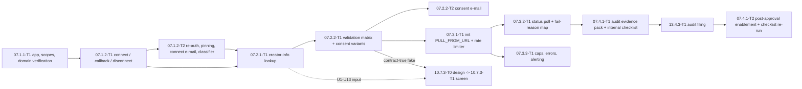

# 07 — TikTok Publishing (SaaS phase S / R2): Tech Lead review, shared decisions and feature index

> Reviews: `../../07-tiktok-posting.md` (high-level, **all S · R2**) — every task in scope, no P slice. Companions: `../06-youtube-posting/README.md` D1–D20 (the patterns this slice reuses: OAuth `state`, client pinning, token purposes, `publications`, consent, incidents, outbox, jobs), `../13-compliance/README.md` (13.4.3-T1 files the audit), `../10-web-ui/README.md` (10.7.3 screen; **UI design is 10.7.3-T0, not 07**).
> Reviewed: 2026-09-25 by the Tech Lead, against the official TikTok pages read the same day (§1 K-rows) and the signed consumers (09, 10, 13, 11, 02.8.3).
> Verdict: **approve with changes.** Scope, consent and audit are right, but the plan's `FILE_UPLOAD` decision contradicts TikTok's own guideline for server-side storage (F01), it never forces `SELF_ONLY` while the client is unaudited (F02), one 6/min bucket is wrong per endpoint (F03), retries can create a second post (F04), Direct Post has no scheduling and the required UX forbids a default privacy, so autopilot cannot post to TikTok (F05), and the consent declaration is conditional on the disclosure selection (F07). §3 D1–D19 is the contract.
> Status: **ready for implementation with conditions** — DoR §11 2026-09-25, accepted under the owner's standing approval (rulings TT13–TT19 applied; blocking condition: 06 CR-13 schema widening lands first).
> Legend: ✅ read from source/docs (URL + date, or file:line) · ⚠️ unverified · [DECISION] · [OPEN] · [INFERENCE].

## 0. How this folder is organised

```
plans/features/07-tiktok-posting/
  README.md                    ← facts K/U/C, findings F, decisions D1–D18, CRs, sequencing, template, gates, index, re-estimate, owner decisions, DoR
  07.1-app-connect/            ← 07.1.1-T1 app + scopes + PULL_FROM_URL ownership, 07.1.2-T1 connect/callback/disconnect, 07.1.2-T2 re-auth + pinning + connect e-mail + error classifier
  07.2-post-screen/            ← 07.2.1-T1 creator-info lookup, 07.2.2-T1 server-side validation + consent variants, 07.2.2-T2 consent e-mail
  07.3-publish/                ← 07.3.1-T1 init (PULL_FROM_URL) + rate limiter, 07.3.2-T1 status poll + fail-reason map, 07.3.3-T1 caps/errors/alerting
  07.4-audit/                  ← 07.4.1-T1 evidence pack + internal checklist, 07.4.1-T2 post-approval enablement + checklist re-run
```

Each folder holds `plan.md` (00 §10.1 sections 1–11) and one task file per task. Every id the high-level plan defines is kept; the only new id is **07.4.1-T2** (split of 07.4.1-T1's post-approval half — declared, see §9). No UI task exists in this slice: the screen is 10.7.3 (design task 10.7.3-T0 first), and 07 supplies it a verified UX input list (§1 U-rows).

## 1. Facts verified for this review

### 1.1 TikTok facts (K), all read 2026-09-25

| Id | Fact | Source |
|---|---|---|
| K1 | Direct Post init `POST /v2/post/publish/video/init/`, scope `video.publish`; "**Each user access_token is limited to 6 requests per minute**"; errors `invalid_param` 400, `spam_risk_too_many_posts` / `spam_risk_user_banned_from_posting` / `reached_active_user_cap` / `unaudited_client_can_only_post_to_private_accounts` / `url_ownership_unverified` / `privacy_level_option_mismatch` 403, `access_token_invalid` / `scope_not_authorized` 401, `rate_limit_exceeded` 429, 5xx retryable | https://developers.tiktok.com/doc/content-posting-api-reference-direct-post ✅ |
| K2 | `POST /v2/post/publish/creator_info/query/`, scope `video.publish`, **20 requests/min per token**; returns `creator_avatar_url` (TTL 2 h), `creator_username`, `creator_nickname`, `privacy_level_options`, `comment_disabled`, `duet_disabled`, `stitch_disabled`, `max_video_post_duration_sec`; public account options `PUBLIC_TO_EVERYONE`/`MUTUAL_FOLLOW_FRIENDS`/`SELF_ONLY`, private account options `FOLLOWER_OF_CREATOR`/`MUTUAL_FOLLOW_FRIENDS`/`SELF_ONLY`; its error struct is returned **with HTTP 200** for `spam_risk_*` / `reached_active_user_cap` | https://developers.tiktok.com/doc/content-posting-api-reference-query-creator-info ✅ |
| K3 | Init body: `post_info.privacy_level` required and must be one of `privacy_level_options`; `post_info.title` (caption) optional, **max 2200 UTF-16 runes**; `disable_duet` / `disable_stitch` / `disable_comment` bool; `video_cover_timestamp_ms`; `brand_content_toggle` **required**; `brand_organic_toggle`; `is_aigc`. `source_info.source` ∈ `FILE_UPLOAD` \| `PULL_FROM_URL`; response `data.publish_id` (≤64) and `data.upload_url` (≤256, FILE_UPLOAD only) | direct-post ref ✅ |
| K4 | `upload_url` is valid **1 hour**; chunk PUT uses the whole returned URL, `Content-Type: video/mp4\|video/quicktime\|video/webm`, `Content-Length`, `Content-Range: bytes first-last/total`; 201 created / 206 partial / 400 malformed / 403 expired / 404 no task / 416 range mismatch / 5xx retry; response header `Content-Range: bytes 0-{uploaded}/{total}` | media transfer guide ✅ |
| K5 | Chunks: `total_chunk_count = floor(video_size / chunk_size)`; each chunk **5–64 MB**, the last may reach 128 MB; < 5 MB must be one whole chunk; > 64 MB must be chunked; 1–1000 chunks; **uploaded sequentially** | media transfer guide ✅ |
| K6 | Video restrictions: MP4 (rec.)/WebM/MOV; H.264 (rec.)/H.265/VP8/VP9; 23–60 FPS; 360–4096 px per side; 3/5/10-minute privileges (init max 10 min); ≤ 4 GB | media transfer guide ✅ |
| K7 | Status `POST /v2/post/publish/status/fetch/` (scope `video.upload`/`video.publish`), **30 requests/min per token**; `status` ∈ `PROCESSING_UPLOAD` \| `PROCESSING_DOWNLOAD` \| `SEND_TO_USER_INBOX` \| `PUBLISH_COMPLETE` \| `FAILED`; `fail_reason` ∈ `file_format_check_failed`, `duration_check_failed`, `frame_rate_check_failed`, `picture_size_check_failed`, `internal` (retryable), `video_pull_failed`, `photo_pull_failed`, `publish_cancelled`, `auth_removed` (no retry), `spam_risk_too_many_posts`, `spam_risk_user_banned_from_posting`, `spam_risk_text`, `spam_risk`; `publicaly_available_post_id` (list<int64>, populated only for public moderated posts), `uploaded_bytes`; processing is usually < 1 min for 512 MB, moderation usually < 1 min but "may take a few hours"; webhooks exist (`post.publish.complete`/`failed`/`publicly_available`) as an alternative | get-video-status ref ✅ |
| K8 | Cancel `POST /v2/post/publish/cancel/` `{publish_id}` — **best-effort**, only during download/processing; errors `invalid_publish_id`, `token_not_authorized_for_specified_publish_id`, `publish_not_cancellable` (already final) | media transfer guide ✅ |
| K9 | Unaudited client: all content restricted to **private** viewing; **up to 5 users may post in a 24-hour window** and those accounts must be private at posting time; **only `SELF_ONLY`** is allowed; going public later requires the account owner to switch the account public then each post's privacy to "Everyone" | content sharing guidelines ✅ |
| K10 | Caps: a **24-hour active-creator cap per API client** based on the usage estimate in the audit application, plus a **posting cap of about 15 posts/day/creator account shared across all Direct Post clients** | content sharing guidelines ✅ |
| K11 | Intended use: authentic creators posting original content; must serve a wide audience — "a utility tool to help upload contents to the account(s) you or your team manages" is **not acceptable**; API clients must not be limited to test applications | content sharing guidelines ✅ |
| K12 | Required UX (verbatim obligations, full list in §1.3) | content sharing guidelines ✅ |
| K13 | OAuth: authorize `https://www.tiktok.com/v2/auth/authorize/?client_key&scope&response_type=code&redirect_uri&state[&disable_auto_auth]`; callback query `code`, `scopes`, `state`, `error`, `error_description`; token `POST https://open.tiktokapis.com/v2/oauth/token/` (form: `client_key`, `client_secret`, `code`, `grant_type`, `redirect_uri`, `code_verifier`) → `open_id`, `scope` (comma list), `access_token`, `expires_in` **86400 (24 h)**, `refresh_token`, `refresh_expires_in` **31536000 (365 d)**; refresh **may return a new `refresh_token` which must be stored**; `code_verifier` is "required for mobile and desktop app only"; revoke `POST https://open.tiktokapis.com/v2/oauth/revoke/` (`client_key`, `client_secret`, `token`) | login-kit-web ✅; oauth-user-access-token-management ✅ |
| K14 | Redirect URI rules: absolute `https`, static (no query, no fragment), ≤ 512 chars, ≤ 10 per app | login-kit-web ✅ |
| K15 | Scopes: `user.info.basic` (open id, avatar, display name; default for Login Kit), `video.publish` ("Directly post content to a user's TikTok profile"), `video.upload` (draft to the creator's account); the user may grant only a subset of the requested scopes; scope approval is per app | scopes-overview ✅; tiktok-api-scopes ✅ |
| K16 | `PULL_FROM_URL`: the URL must be `https`, belong to a domain or URL prefix verified in the app's URL-properties widget (DNS TXT), must not redirect, and must stay reachable for the whole download (timeout **1 hour** after the task starts); **"If video resources are already on API Clients' servers, do not use FILE_UPLOAD; use PULL_FROM_URL instead"** | media transfer guide ✅ |
| K17 | Client secret must stay confidential and must never be embedded in an open-source project or shared with a third party; both audited and unaudited clients must keep the creator's content free of added promotional watermarks | content sharing guidelines ✅ |

### 1.2 Contract facts (C) from signed plans

| Id | Fact | Source |
|---|---|---|
| C1 | `channel_connections(user_id, platform youtube\|tiktok, external_account_id, display_name, scopes text[], access_token_enc, refresh_token_enc, token_expires_at, status active\|revoked\|expired\|error, oauth_client_id (pinned client, 06/07), last_verified_at, revoked_at)` | 00 §6:289 ✅ |
| C2 | `publications(user_id, episode_id, channel_connection_id, platform, status, title, description, tags, privacy, publish_at, next_attempt_at, consent_at, consent_text_version, consent_source user\|autopilot, autopilot_authorization_id, veto_notice_sent_at, veto_ends_at, contains_synthetic_media, external_post_id, platform_payload jsonb (upload session, **TikTok settings**), error_code)` | 00 §6:291 ✅ |
| C3 | 00 §7 Publication: `awaiting_consent → scheduled → uploading → processing → published \| failed \| cancelled`; cannot leave `awaiting_consent` without a `consent_at` recorded **for that video**; credits: reserve → settle → refund of the reserve on failure | 00 §7:340-346 ✅ |
| C4 | Routes: `GET /channels`, `POST /channels/{platform}/connect`, `GET /channels/{platform}/callback`, `DELETE /channels/{id}`, `GET /channels/{id}/tiktok/creator-info`, `GET/POST /episodes/{id}/publications`, `POST /publications/{id}/consent`, `GET /publications/consent-text?locale=`, `PATCH /publications/{id}` (If-Match), `DELETE /publications/{id}`; `Idempotency-Key` on every POST that spends credits or calls a platform; ETag/If-Match on updates; ProblemDetails with a stable `code` | 00 §8:348-372 ✅ |
| C5 | 09 §5.4 currently declares 4 TikTok codes: `tiktok_invalid_post_settings`, `tiktok_video_too_long` → 400; `tiktok_cannot_post_now`, `tiktok_creator_cap` → 429 | plans/09-backend-api.md:422-423 ✅ |
| C6 | 06 owns the tables and the shared machinery: `_06_OAuthStates` + `_06_ChannelConnections` migrations, `oauth_states.browser_nonce_hash` (06 YR10), `IOAuthClientResolver`/`ConfigOAuthClientResolver` (06 D5), `ITokenProtector` purpose `tokens.v1/{connectionId}` (06 D4), `platform_incidents` + `IPlatformIncidentStore.RaiseAsync` + `nts-worker incident clear` (06 D14/YR4/YR25), audit action names `publishing.*` (06 D17) | 06 README D3–D5, D14, D17, D20, YR4, YR10, YR25 ✅ |
| C7 | 06 publication contract: `PublicationDto`, ETag `"pu-<xmin>"` + `If-Match` on consent/PATCH/DELETE, `POST /publications/{id}/consent { consentTextVersion }` → `awaiting_consent → scheduled`, 400 `consent_text_outdated` on a stale version, `consent_source = user`, e-mail `publication_consented` per consent, `Episode.MarkScheduled/MarkPublished` in the same transaction, `Publication.Cancel` only in `awaiting_consent\|scheduled` | 06 README D6, D7, D12, YR9 ✅ |
| C8 | Events: `publication_updated.v1 { publicationId, episodeId, userId, status, errorCode? }`, `channel_connection_changed.v1`, `platform_incident_raised/cleared.v1`; realtime `PublicationUpdated` carries ids only | 06 README D13, F13 ✅ |
| C9 | The Api never enqueues: the Worker's `PublicationScheduledForUploadHandler` re-reads the row and schedules the publish job (06 YR3); claims go through 09's `ISystemWorkQuery.PendingAsyncT` with one command per row (06 YR26); `PublicationErrorCodes` is declared once in Domain (06 YR27) | 06 README YR3, YR26, YR27 ✅ |
| C10 | 13 owns the filing: `13.4.3-T1 TikTok audit submission (R2) | BA | S | depends 07.4.1`; the submission must argue intended use and show every required UX item | plans/13-compliance.md:87-90, 153 ✅ |
| C11 | 10.7.3-T1 "TikTok post screen (R2) | FE | L | depends 07", route `/episodes/:id/publish/tiktok`; the screen's written behaviour (nickname, privacy dropdown with no default, unchecked toggles, disclosure, music declaration, `is_aigc`) | plans/10-web-ui.md:189-195, 306, 381 ✅ |
| C12 | 02.8.3 autopilot creates a publication from a series-level authorization after the veto window and writes `consent_at`, `consent_text_version`, `consent_source = autopilot`; its command is YouTube-shaped (`CreatePublicationCommand(episodeId, channelConnectionId, title, description, tags, privacy, publishAt, containsSyntheticMedia, autopilotAuthorizationId)`) | 06 README C1, C2 ✅ |

### 1.3 Required-UX input for 10.7.3-T0 (verified from K12/K9/K10 — 07 does **not** plan UI implementation)

This table is the input document for **10.7.3-T0** (Lead10S's design task) and the acceptance list for 10.7.3-T1. The server enforces the same rules (D5, §3) so a tampered client cannot bypass them.

| U | Requirement (TikTok, verbatim obligations) | Enforced server-side by |
|---|---|---|
| U1 | Fetch the latest creator info **every time the Post to TikTok page is rendered**; display the creator **nickname** (so the user knows which account) | 07.2.1-T1 |
| U2 | When creator info says the creator cannot post now (`spam_risk_*`, `reached_active_user_cap`, HTTP 200 + error code), **stop the attempt** and prompt to try again later | 07.2.1-T1, 07.3.3-T1 |
| U3 | Block a video whose duration exceeds `max_video_post_duration_sec` from creator info | 07.2.2-T1 (`tiktok_video_too_long`) |
| U4 | Title (caption) is user-editable, ≤ 2200 UTF-16 runes; no promotional watermark/preset text is added | 07.2.2-T1 |
| U5 | Privacy dropdown built **only** from `privacy_level_options`, **no default value**, user must choose manually | 07.2.2-T1 (privacy ∈ options) |
| U6 | Comment / Duet / Stitch: **unchecked by default**, user must turn them on; disabled and greyed out when the creator disabled them | 07.2.2-T1 (cannot enable a creator-disabled interaction) |
| U7 | Commercial-content disclosure toggle **off by default**; when on, "Your brand" (Brand Organic) and/or "Branded content" (Branded Content) must be chosen (at least one) or the publish button stays disabled; label prompts "…will be labeled as 'Promotional content'" / "'Paid partnership'"; hovering the control shows "You need to indicate if your content promotes yourself, a third party, or both." | 07.2.2-T1 (`brand_content_toggle` / `brand_organic_toggle`) |
| U8 | Branded content **cannot** be `SELF_ONLY`: disable "only me" (or auto-switch to public with a message); hovering shows "Branded content visibility cannot be set to private." | 07.2.2-T1 (`tiktok_invalid_post_settings`) |
| U9 | Declaration **before** the publish button: never-commercial and "Your brand" → "By posting, you agree to TikTok's Music Usage Confirmation"; "Branded content" (alone or with "Your brand") → "…Branded Content Policy and Music Usage Confirmation" | 07.2.2-T1 (variant + `consent_text_version`) |
| U10 | Upload starts only after the user's express consent click; the screen shows a preview of what will be posted | 07.2.2-T1 (consent), C3 |
| U11 | Tell the user content may take a few minutes to process and become visible; show the live status | 07.3.2-T1, 10.7.4 |
| U12 | AI-generated content label on (`is_aigc = true`), visible to the user before posting | 07.2.2-T1 (always true) |
| U13 | While the client is unaudited: only `SELF_ONLY` is selectable and the screen explains why (K9); the disclosure/interaction controls behave the same | 07.1.2-T2, 07.2.2-T1 (D4) |

## 2. Findings

| # | Sev | Where | Finding | Resolution |
|---|---|---|---|---|
| F01 | B | 07 K6, §5 | The plan fixes `FILE_UPLOAD` [DECISION], but TikTok's guideline says the opposite for our case: our videos are already on our object storage, and "If video resources are already on API Clients' servers, do not use FILE_UPLOAD; use PULL_FROM_URL instead" (K16). Using the wrong transfer method is an audit-liability and needlessly costs a chunked uploader | D2: `PULL_FROM_URL` is the only transfer; a presigned https URL (TTL ≥ 2 h, no redirect) under a verified domain; CR-1 reverts 07 K6; the chunk path survives only in the fake server |
| F02 | B | 07.3.1-T1, 07.3.3-T1 | Nothing forces `SELF_ONLY` while our client is unaudited; TikTok rejects anything else with 403 `unaudited_client_can_only_post_to_private_accounts` (K1, K9), so beta posts would fail at init after the user already consented | D4: `TikTokOptions.AuditStatus ∈ pending\|approved\|rejected` (mirrors 06's `YouTubeOptions.AuditStatus`, 06 D11); while ≠ `approved` the allowed options are `creator_info ∩ {SELF_ONLY}`, the validator rejects others, and the flag stays owner-only |
| F03 | H | 07.3.1-T1 | One 6/min bucket for every call is wrong: init is 6/min, `creator_info` 20/min, status 30/min, each per user access token (K1, K2, K7) — a single bucket throttles the screen and starves the poller | D6: `ITikTokRateLimiter` with per-endpoint buckets keyed `(connectionId, endpoint)`; a denied acquire defers the job (`next_attempt_at` + jitter), it never fails the publication; a TikTok 429 is a backoff, not a user error |
| F04 | H | 07.3.1-T1 | With `PULL_FROM_URL` the download starts server-side at init, and a lost response/retry can create a **second** post; the plan has no `publish_id` persistence rule and no re-init guard | D7: `publish_id` is persisted in `platform_payload` and committed **before** the first status poll; a non-terminal publication is never re-initialised; a retry after `FAILED` is a new init, and re-init after a poll timeout requires the status endpoint to report `FAILED`/404 first |
| F05 | H | 07 §4–§5 | TikTok Direct Post has **no scheduling parameter** and the required UX forbids a default privacy ("Users must manually select the privacy status … there should be no default value", K12/U5) — so the autopilot path (C12) cannot post to TikTok; the plan silently reuses the shared `Publication`/schedule machinery | D3: TikTok publications are manual-only (`CreateTikTokPublicationCommand`, never from the autopilot orchestrator); `publish_at` = the consent instant; CR-5 makes autopilot authorization reject a TikTok connection |
| F06 | H | 07.3.3-T1 | `url_ownership_unverified` (403) means **our** client's domain verification is broken, not a user error; the plan would surface it as a per-user failure | D10: it is a platform incident (06 D14 reuse: no connection change, publication back to `scheduled`, P1 alert per `oauth_client_id`); the domain/prefix verification is a gate in 07.1.1-T1 |
| F07 | M | 07.2.2-T1 | The consent declaration is conditional: with branded content selected it must also cite TikTok's Branded Content Policy (U9); one text version cannot satisfy the audit | D5: two variants `tt.v1.music`, `tt.v1.branded`; the variant is derived from the disclosure selection, stored in `consent_text_version`, served by `GET /publications/consent-text?locale=&variant=`; a mismatch → 400 `consent_text_outdated` |
| F08 | M | 07.2.2-T1 | Branded content cannot be private (U8); the plan validates privacy against creator options only | D5: `branded_content = true` with `privacy = SELF_ONLY` → 400 `tiktok_invalid_post_settings` (UI-side disable is 10.7.3's, U8) |
| F09 | M | 07.2.2-T1 | The caption limit is **2200 UTF-16 runes** (K3), not characters or bytes; Direct Post has no description/tags field at all | D8: `TikTokMetadataRules.Caption` counts UTF-16 code units; `description`/`tags` stay null for `platform = tiktok` |
| F10 | M | 07 §5, 09 §5.4 | The error surface is incomplete: init adds `reached_active_user_cap`, `spam_risk_user_banned_from_posting`, `privacy_level_option_mismatch`, `unaudited_client_can_only_post_to_private_accounts`, `url_ownership_unverified`, `scope_not_authorized`, `rate_limit_exceeded`; status adds `spam_risk_text`/`spam_risk` (K1, K7) | D10: one table (code → kind → retry? → HTTP → alert? → user copy key) + CR-3 to 09 §5.4; `reached_active_user_cap` is client-wide → P2 alert and a distinct message |
| F11 | M | 07.3.2-T1 | `fail_reason` is the real terminal reason and its retry semantics differ per value (`internal`/`video_pull_failed` retryable; `auth_removed`, `spam_risk*` not; K7); the plan says only "failed with reason" | D9: explicit `fail_reason → error_code` map, including TikTok's own misspelled wire field `publicaly_available_post_id` (used verbatim; our DTO field stays `externalPostId`) |
| F12 | M | 07.2.1-T1 | `creator_info` returns its error struct with **HTTP 200** for `spam_risk_*`/`reached_active_user_cap` (K2) — an HTTP-status-only client would treat "creator cannot post" as success | D11: read `error.code` on 200 as well; map to `canPost = false` + `blockReason` |
| F13 | M | 07 FR-07-1 | Minimum scopes beyond `video.publish` were unknown (plan A1): `creator_info` and Direct Post are both `video.publish` (K2, K1), and the nickname/avatar we need come from `creator_info`, so `user.info.basic` is not required | D12: request **`video.publish` only**; `open_id` (token response, K13) becomes `external_account_id`; connect verifies the granted scope list contains `video.publish`, else no row and `302 /channels?error=tiktok_scope_missing` (F25 — the callback never answers JSON) |
| F14 | M | 07.1.2-T2 | Refreshing can rotate the refresh token ("you must use the newly-returned token", K13) and the plan does not say to store it; a rotated-token race would break every connection | D13: `TokenHealthJob`/`ITokenService` refresh writes **both** tokens under `ITokenProtector` inside the connection-row `FOR UPDATE` (06 D9/F21 pattern), the same transaction that reads the old one |
| F15 | M | security review | `GET /channels/{id}/tiktok/creator-info` is the documented `IExternalLookup` exception (00 §5.2:211) but has no abuse control in the plan: it is an authenticated outbound call per page render | D14: ownership check (another user's channel → 404), rate-limited per user by 09's `paid` policy, never cached across users, nothing persisted (the avatar URL has a 2-hour TTL and is passed through); the endpoint requires a fresh access token via `ITokenService` |
| F16 | M | 07.4.1 | Unaudited clients are capped at **5 posting users per 24 h** and the audit sets our 24-h active-creator cap from the volume we claim (K9, K10) — the plan's audit task never states the claimed volume or the beta gating that follows | D4 + D16: `TikTokOptions` carries `AuditStatus` and the claimed `MonthlyActiveCreators`; while unaudited the flag is owner-only (CR-6) and the claimed volume is the number we file with 13.4.3-T1 |
| F17 | M | 07.2.2-T1 | `privacy` for TikTok is a different enum from YouTube's `public/unlisted/private`; `publications.privacy` is shared, and the plan leaves the mapping implicit | D8: `publications.privacy` stores the TikTok wire enum verbatim (`SELF_ONLY`, `MUTUAL_FOLLOW_FRIENDS`, `PUBLIC_TO_EVERYONE`, `FOLLOWER_OF_CREATOR`); `platform_payload.tiktok` holds the flags/disclosure/`publishId` |
| F18 | M | reuse review | The plan does not say which 06 building blocks are reused, and one is not reusable: `POST /publications/cancel-by-link` (a veto e-mail link) has no TikTok equivalent | D15: reuse `oauth_states`(+`browser_nonce_hash`), `platform_incidents`, `IEmailSender`, `[JobPolicy]`, `ISystemWorkQuery.PendingAsyncT`, `ETags.Publication`, `RequireFeature`, `publication_updated.v1`; no cancel-by-link for TikTok; `DELETE /publications/{id}` closes the pre-upload window only |
| F19 | L | 07.4.1, cost | Posting to TikTok spends no credits (the render already did), so 12 has nothing to refund for a failed post; the plan is silent, which risks a wrongly wired refund | D16: "posting never spends credits" is stated once; no `credit_ledger` row is written by 07; the episode-level refund rules stay 12's |
| F20 | L | 07.2.2-T1 | `GET /publications/consent-text?locale=` (00 §8) returns one text, but there are two variants (F07) | CR-2: the route gains `variant=music\|branded` and returns `{ version, text }` for that variant; 10.7.3 renders the one matching the current selection |
| F21 | L | 08 KPIs, F05 | `publications.publish_at` is a slot/consent timestamp, not a publish instant; counting "published" rows by `publish_at` over-counts (the documented 08 lesson) | CR-9: 08 KPI queries group by `status` transitions (`published`) and platform, never by `publish_at`; 07 writes `publish_at = consent_at` for audit ordering only |
| F22 | L | testing review | `FakeTikTokServer` must cover the 200-with-error and the 403-cap families (F10, F12) or the mapping tests are tautological | D17: the fake serves `creator_info` (public/private options, `comment_disabled`, 200-error struct), init (each 403/429 code), status (every terminal transition and each `fail_reason` family), token (rotating refresh), revoke, and counts requests per endpoint for the limiter tests |
| F23 | L | observability/i18n | No metrics or vi/en copy plan for the new failure families | D18: metrics `tiktok_publish_attempts_total{outcome}`, `tiktok_rate_limit_backoff_total{endpoint}`, `tiktok_active_user_cap_hit_total`, `tiktok_post_latency_seconds`; one vi/en copy key per D10 code (`errors.tiktok.*`) |
| F24 | H | 07 §5 error list, D10 | `access_token_invalid` means "invalid **or has expired**" (K1): TikTok access tokens last 24 h, so a naive mapping of that 401 (and of `scope_not_authorized`) to the client-wide `platform_incident` would hold every connection of the client on a routine expiry — the opposite of the intended blast radius | D10 "401 recovery ladder": refresh once + retry in the same command → still 401 ⇒ per-connection `expired` + `tiktok_reauth_required`; an incident only when the token endpoint itself fails or ≥ 2 distinct connections of the same `oauth_client_id` fail within 1 h |
| F25 | M | D10 row 409 `tiktok_scope_missing` vs D12 callback | The scope check runs inside `GET /channels/tiktok/callback`, which answers `302` (06 D3: every callback failure is `302 /channels?error=<code>`); a redirect endpoint cannot return 409 JSON, and a user simply denying `video.publish` on TikTok's consent screen is normal — not a pageable P2 | D12/D10: the callback emits `302 /channels?error=tiktok_scope_missing`, no row, **no alert**; the code stays a callback query value, never a JSON status (CR-3). A 409 is kept only if a bearer call ever re-checks granted scopes (none does today) |
| F26 | B | D2, 09.7.2-T1 | Presigning `PULL_FROM_URL` off `Storage:ServiceUrl` (dev `http://storage:8333`, 09.7.2-T1:40) would hand TikTok an unreachable URL — every init would fail `video_pull_failed`. 09.7.2-T1 already exposes a second host, `Storage:PublicServiceUrl`, "browser-reachable endpoint used **only** to presign read URLs" (09.7.2-T1:41, 10 CR-21) | D2/CR-4: 07.3.1-T1's presign call **must** go through the public-endpoint client; the `07-post-private` gate proves TikTok actually pulled the video (not just that init returned 200) |
| F27 | H | 06.1.2-T1:81, D12 | `oauth_states.code_verifier_protected` is `text NOT NULL` (06's migration); TikTok's web flow has no PKCE verifier (K13), and the plan's earlier wording ("stored as NULL for web") would violate the column and fail the insert at runtime | D12/TT21: the web flow protects an empty string (`ITokenProtector.Protect("oauth.v1", "")`) instead of NULL — no schema change to 06, no CR to its migration |
| F28 | B | 06.1.2-T1:91, 06.1.2-T2:61, 06.1-connect/plan.md:144,166 | Both connect-side tables still `CHECK (platform IN ('youtube'))` — `ck_oauth_states_platform` and `ck_channel_connections_platform`; `publications.platform` already allows `('youtube','tiktok')` (06.2.1-T1:108) but the two tables 07's connect flow writes to first were never widened. 07.1.2-T1's very first `oauth_states` INSERT and 07.1.2-T1's `channel_connections` upsert both violate the constraint — the connect flow is unbuildable as planned | CR-13: widen both constraints to `('youtube','tiktok')` at all four SQL sites (06.1.2-T1:91, 06.1.2-T2:61, plan.md:144, plan.md:166) and any acceptance check asserting the old list; blocking — 07.1.2-T1's upsert is not testable until `ck_channel_connections_platform` lands |

## 3. Shared decisions (contract)

**D1 Scope and phase [DECISION].** All of plan 07 is S · R2: the 11 tasks of §8.1. Every route is behind `RequireFeature("tiktok_publish")`; recurring jobs register only while the flag is on (06 D1 pattern). No P work exists here; the tables, ports and patterns come from 06 (C6–C9).

**D2 Media transfer `PULL_FROM_URL` [DECISION] (F01, K16).**
- `source_info = { source: "PULL_FROM_URL", video_url }`; the URL is a presigned **https, internet-reachable** URL from our object storage with TTL ≥ `TikTok:UrlTtlMinutes` (default 120), no redirect, under the domain/URL prefix verified in the TikTok app (gate `07-connect`). TikTok's servers fetch this URL directly, so it **must** be built through 09.7.2-T1's `Storage:PublicServiceUrl` client (F26/TT20) — `Storage:ServiceUrl` (dev `http://storage:8333`, 09.7.2-T1:40) is never internet-reachable and would make every init a guaranteed `video_pull_failed`.
- 07.3.1-T1 needs `IBlobStore.GetSignedUrlAsync(bucket, key, TimeSpan ttl, ct)` presigned via the **public** endpoint (CR-4); the API never proxies bytes.
- The chunk protocol (K4, K5) is implemented only by `FakeTikTokServer` for tests; the production client has no chunk code. If TikTok ever rejects `PULL_FROM_URL`, reopening the chunk path is a new task, not a hidden branch.

**D3 Manual publishing only [DECISION] (F05).** `CreateTikTokPublicationCommand(episodeId, channelConnectionId, caption, TikTokPostSettings settings, consentTextVersion)`; the post screen has no date/time field; `publish_at = consent_at` is written at consent for ordering only. The autopilot orchestrator (02.8.3) never targets a `platform = tiktok` connection (CR-5).

**D4 Pre-audit and unaudited behaviour [DECISION] (F02, F16, K9).**
- `TikTokOptions.AuditStatus ∈ pending | approved | rejected` (default `pending`), read through `IOptionsMonitor` (env value in S, 09.10 settings later — same evolution as 06 WT27).
- While `AuditStatus ≠ approved`: allowed `privacy_level_options` = `creator_info.privacy_level_options ∩ { SELF_ONLY }`; any other value → 400 `tiktok_invalid_post_settings`; **and the account itself must be private** — `creator_info.privacy_level_options` containing `PUBLIC_TO_EVERYONE` means a public account, which K9 forbids for an unaudited client, so the post is refused with `tiktok_account_not_private` (409 at create, `failed` at job time — **07 CR-14**) instead of reaching init and 403-ing into a platform incident; `feature_flags.tiktok_publish` is owner-only (`rules` = owner user ids; CR-6); the connect flow still works so the audit evidence can be produced on the owner's own account.
- `AuditStatus` is flipped to `approved` by 07.4.1-T2 after 13.4.3-T1 reports the approval; only then may `tiktok_publish` roll out and the full option list be shown.

**D5 Validation, consent variants [DECISION] (F07, F08, F20).**
- `TikTokPostSettings { privacyLevel, disableComment, disableDuet, disableStitch, disclosureEnabled, brandOrganic, brandedContent }`; server-side matrix: privacy ∈ allowed options (D4) and non-empty; `brandedContent = true` ⇒ privacy ≠ `SELF_ONLY`; `disclosureEnabled = false` ⇒ both disclosure flags false; `disclosureEnabled = true` ⇒ at least one flag set (`brand_content_toggle` must still be sent, `false` when off, K3); `disableDuet`/`disableStitch` may be `false` only when `creator_info.duet_disabled`/`stitch_disabled` are false (U6); duration ≤ `max_video_post_duration_sec` (U3) else 400 `tiktok_video_too_long` — the duration is read from `assets.duration_sec` of the episode's `final_video_asset_id` (00 §6:280/288), never from render params (TT17).
- Consent text variants in `TikTokOptions.ConsentTextVersion`: `tt.v1.music` (no commercial, or "Your brand" only) and `tt.v1.branded` (branded content, alone or with "Your brand"); texts live as embedded templates `Templates/Consent/tt.v1.<variant>.<locale>.md` (vi/en) and are rendered by 10.7.3.
- `POST /publications/{id}/consent { consentTextVersion }`: value must equal the variant derived from the stored disclosure selection, else 400 `consent_text_outdated`; `consent_source = user`; audit `publishing.consented`; `If-Match` required (C7).

**D6 Rate limiting [DECISION] (F03, K1, K2, K7).** `ITikTokRateLimiter.TryAcquireAsync(Guid connectionId, TikTokEndpoint endpoint, CancellationToken ct) → ErrorOr<Unit>` with token buckets: `init` 6/min, `creator_info` 20/min, `status` 30/min, `token` 10/min, `revoke` 10/min — ⚠️ [OPEN]: TikTok documents no limit for these two endpoints; 10/min is a conservative [INFERENCE] and 07.1.1-T1 records the real values against the staging client (TT15). The port is **declared by 07.2.1-T1** in Application (creator_info is its first consumer) and implemented/registered by 07.3.1-T1, so 07.2.1-T1 never waits on 07.3.1-T1 (TT15). Per connection, in-flight calls = 1 (`SemaphoreSlim` per connection id) so sequential `PULL_FROM_URL` tasks never interleave. Bucket keys are `tt:rl:{connectionId}:{endpoint}` in the API/Worker process memory (single Worker instance per env in S; a distributed limiter is [OPEN] only if the Worker is scaled out). A denied acquire in a job → `next_attempt_at = now + 5 s…60 s` (jitter) and a no-op return, never a failed publication (06 YR27 pattern).

**D7 Publish flow and idempotency [DECISION] (F04, K8, C3, C8).**
- States: consent → `scheduled` (outbox `publication_updated.v1`, handler schedules `PublishTikTokJob` — C9); job → `Publication.StartTikTokUpload(now)` → `uploading`; init response → `publish_id` written to `platform_payload.tiktok.publishId` and **committed** (the presigned `video_url` is **never persisted** — it is regenerated from the blob store on demand, D8/TT16); first poll → keep `uploading` while `PROCESSING_DOWNLOAD`, → `processing` on `PROCESSING_UPLOAD`/`PROCESSING_DOWNLOAD` after init is acknowledged, → `published` on `PUBLISH_COMPLETE`, → `failed` on `FAILED`.
- Guards: `next_attempt_at > now` → no-op; `external_post_id` or terminal status → reconcile only; non-terminal → never re-init; `POST /v2/post/publish/cancel/` is **out of scope** (K8 is best-effort and only useful during the download window — recorded as [OPEN] in §11).
- Polling: `PollTikTokStatusJob` every `TikTok:Poll:IntervalSeconds` (20) while `uploading|processing`, up to `TikTok:Poll:MaxMinutes` (30); on timeout → `failed` `tiktok_poll_timeout` (the post may still appear; `publish_id` stays in `platform_payload` for support).

**D8 Metadata rules [DECISION] (F09, F17).** `title` = caption, 1…2200 UTF-16 code units, editable, no server-appended text (K17); `description`/`tags` null for TikTok; `publications.privacy` = the wire enum verbatim; `is_aigc = true` always; `video_cover_timestamp_ms` omitted; `platform_payload.tiktok = { privacyLevel, disableComment, disableDuet, disableStitch, brandContentToggle, brandOrganicToggle, isAigc, publishId?, initAt?, pollAttempts?, lastStatus?, lastFailReason?, uploadedBytes? }` — never tokens and never the presigned URL (it is regenerated, not stored); `initAt`/`pollAttempts`/`lastStatus`/`lastFailReason`/`uploadedBytes` exist for support, the poll backoff and the audit trail (TT16).

**D9 Status mapping [DECISION] (F11, K7).**

| TikTok `status` | publication status | notes |
|---|---|---|
| `PROCESSING_DOWNLOAD` | `uploading` before the first ack, then `processing` | download of our presigned URL |
| `PROCESSING_UPLOAD` | `processing` | FILE_UPLOAD only (fake server) |
| `PUBLISH_COMPLETE` | `published` | `external_post_id` = `publicaly_available_post_id[0]` when non-empty, else null (private/unmoderated post) |
| `FAILED` | `failed` | `error_code` from `fail_reason` (table below) |
| `SEND_TO_USER_INBOX` | never | inbox mode is out of scope (must not appear; if it does → `failed` `tiktok_upload_failed` + alert) |

`fail_reason` → `error_code`: `internal`, `video_pull_failed` → retryable, keep `processing` with `next_attempt_at` (max 3 attempts); `file_format_check_failed`, `duration_check_failed`, `frame_rate_check_failed`, `picture_size_check_failed` → `tiktok_video_invalid` (no retry); `auth_removed` → `tiktok_reauth_required` + connection `expired`; `spam_risk_too_many_posts` → `tiktok_creator_cap`; `spam_risk_user_banned_from_posting` → `tiktok_creator_banned`; `spam_risk_text`, `spam_risk` → `tiktok_content_rejected`; `publish_cancelled` → `cancelled`.

**D10 Error codes (ours) [DECISION] (F06, F10).**

| ours (HTTP) | TikTok source | publication `error_code` | retry | alert | user copy key |
|---|---|---|---|---|---|
| 400 `tiktok_invalid_post_settings` | `privacy_level_option_mismatch`, validator | — | no | no | `errors.tiktok.invalidSettings` |
| 400 `tiktok_video_too_long` | validator vs `max_video_post_duration_sec` | — | no | no | `errors.tiktok.tooLong` |
| 400 `consent_text_outdated` | shared with 06 (C7) | — | no | no | `errors.consent.outdated` |
| 409 `tiktok_cannot_post_now` | `creator_info` 200-error / `spam_risk_*` | `tiktok_cannot_post_now` | manual | no | `errors.tiktok.cannotPostNow` |
| 409 `tiktok_account_not_private` | unaudited client + `creator_info.privacy_level_options` contains `PUBLIC_TO_EVERYONE` (public account, K9) — refused at create and at job time before `init` (D4, 07 CR-14) | `tiktok_account_not_private` | manual (user switches the account private, then re-posts) | no | `errors.tiktok.accountNotPrivate` |
| 302 `/channels?error=tiktok_scope_missing` (callback only, fixed path) | the user denied `video.publish` on TikTok's consent screen — normal, never pageable | `tiktok_reauth_required` on later calls | no (user action) | no | `errors.tiktok.scopeMissing` |
| 429 `tiktok_creator_cap` | `spam_risk_too_many_posts` (≈15/day) | `tiktok_creator_cap` | no | no | `errors.tiktok.creatorCap` |
| 429 `tiktok_rate_limited` | our own inbound throttling (09 rate policy) — the **only** 429 we emit | — | yes (backoff) | no | `errors.rateLimited` |
| TikTok `rate_limit_exceeded` (429) | never a user error: the job defers with `next_attempt_at` (D6) | — | yes (backoff) | no | — |
| — (per connection, after one refresh + retry) | `access_token_invalid` 401 — the token is "invalid **or has expired**" (K1), so a routine 24 h expiry lands here | `tiktok_reauth_required` | no (user re-consent) | P2 when the same connection fails twice | `errors.tiktok.reauthRequired` |
| — (per connection) | `scope_not_authorized` 401 (the user's grant lacks `video.publish`, K1) | `tiktok_reauth_required` | no (user re-consent) | P2 on the 2nd distinct connection of the same client | `errors.tiktok.reauthRequired` |
| — (platform incident, P1) | `url_ownership_unverified` 403, or `unaudited_client_can_only_post_to_private_accounts` 403 (residual race past the D4 account-privacy gate → our bug) | `platform_incident` | after clear | yes (P1) | `errors.publishing.unavailable` |
| — (job-time) | `reached_active_user_cap` (client-wide) | `tiktok_active_user_cap` | manual (next day) | yes (P2) | `errors.tiktok.activeUserCap` |
| — (job-time) | `spam_risk_user_banned_from_posting` | `tiktok_creator_banned` | no | no | `errors.tiktok.creatorBanned` |
| — (job-time) | `spam_risk_text`, `spam_risk` | `tiktok_content_rejected` | no | no | `errors.tiktok.contentRejected` |
| 401 `reauth_required` | connect without recent re-auth (shared 09) | — | no | no | `errors.reauthRequired` |

Everything not mapped is `tiktok_upload_failed`; an unknown 200-error code is logged with `log_id` and treated as `tiktok_upload_failed` (never a silent success). All codes are declared once in Domain `PublicationErrorCodes` with the `tiktok_` prefix (06 YR27).

**401 recovery ladder [DECISION] (F24).** A token 401 is never a client incident on first sight: (1) force a refresh through `ITokenService` (D13) and retry the call **once** inside the same command; (2) still 401 → the connection goes `expired`, the publication `failed` with `tiktok_reauth_required` (no deletion request, re-consent prompt + copy `errors.tiktok.reauthRequired`); (3) **only** when the first 401 comes from the token endpoint itself, or ≥ 2 distinct connections of the same `oauth_client_id` fail within 1 h, is it a `platform_incident` for that client (D14; publications then hold in `scheduled` instead of failing). The incident path exists for app/client misconfiguration, not for expired user tokens.

**D11 Creator info endpoint [DECISION] (F12, F14, C4).** `GET /channels/{id}/tiktok/creator-info` (bearer) → `TikTokCreatorInfoDto { channelId, nickname, avatarUrl, privacyLevelOptions[], commentDisabled, duetDisabled, stitchDisabled, maxVideoPostDurationSec, canPost, blockReason? }`; implemented by `GetTikTokCreatorInfoQuery` through the `IExternalLookup` port (00 §5.2:211) — nothing persisted, no caching across users, `canPost = false` + `blockReason` when `error.code ≠ ok` (HTTP 200 case, K2) or on any cap; the access token comes from `ITokenService` (refresh when < 5 min left).

**D12 OAuth connect [DECISION] (F13, C6, K13, K14).**
- Scope **`video.publish`** only. Authorize URL `https://www.tiktok.com/v2/auth/authorize/?client_key=…&scope=video.publish&response_type=code&redirect_uri=…&state=…&disable_auto_auth=1` (the last one forces the consent screen).
- `POST /channels/tiktok/connect` (bearer): re-auth ≤ 5 min (`IReauthGuard`), legal acceptance (13.2.1-T1), feature flag, then an `oauth_states` row (06 D3 shape: `state_hash`, `code_verifier_protected` — TikTok needs PKCE only for mobile/desktop (K13); `code_verifier_protected` is `NOT NULL` in 06's migration (06.1.2-T1:81), so the web flow protects an **empty string** (`ITokenProtector.Protect("oauth.v1", "")`) rather than storing NULL — F26/TT21; `oauth_client_id`, `refresh_family_id`, `browser_nonce_hash` from `__Host-nts_oauth`, 10 min, single use) → `{ authorizationUrl }`.
- `GET /channels/tiktok/callback?code&state` (anonymous, rate policy `auth`): claim the state row, verify the browser nonce (06 YR10, constant time), exchange the code with the **client bound to the state** (`IOAuthClientResolver`), verify the granted scope list contains `video.publish` (else no row; `302 /channels?error=tiktok_scope_missing`, F25), call `creator_info` once for `creator_nickname` (the avatar URL is used only to render that response and is **never persisted** — `channel_connections` has `display_name` and no avatar column, 00 §6:289, TT13), upsert the connection (`external_account_id = open_id`, `platform = tiktok`, `display_name = creator_nickname`, `oauth_client_id` pinned, tokens encrypted with `ITokenProtector` purpose `tokens.v1/{connectionId}`), audit `publishing.channel_connected`, queue the `channel_connected` e-mail (06.1.2-T2 template family), `302 /channels?connected=tiktok`. Failures → fixed-path `302` with `oauth_state_invalid`, `oauth_denied`, `tiktok_scope_missing`, `channel_already_connected`, `oauth_exchange_failed`; `code`/`state` redacted in logs; `Referrer-Policy: no-referrer`, `Cache-Control: no-store` (06 D3).
- Reconnect: lock the row `FOR UPDATE`, re-protect the new tokens under the **existing** connection id, re-pin `oauth_client_id` (06 YR11); a second user connecting the same `open_id` → no row and `302 /channels?error=channel_already_connected` (a callback query value, never a JSON 409 — F25/TT14).
- `DELETE /channels/{id}`: revoke `POST /v2/oauth/revoke/` with the pinned client (3× backoff, then wipe tokens anyway and alert), cancel `awaiting_consent|scheduled` publications, tokens nulled, status `revoked`, outbox `channel_connection_changed.v1`, `data_deletion_requests(scope = channel, reason = in_app_revoke, due_at = now + 7 d)` via 13.3.1-T1, then the channel deletion handler purges TikTok fields.

**D13 Token lifecycle [DECISION] (F14, K13).** Access token 24 h, refresh 365 d; **a refresh response may carry a new refresh token — always store the returned pair**; refresh writes both encrypted values inside the connection-row `FOR UPDATE` in the same transaction that read the old values (06 D9/F21). `TokenHealthJob` daily (allow-listed, ≤ 500 connections/run): refresh each `active` connection whose client has no open incident; on failure classify per D10: **token-endpoint** errors (a refused refresh/revoke) are client-level — an error body naming the grant/token (`invalid_request` + description, ⚠️ exact names recorded by 07.1.1-T1) → connection `expired` + `tiktok_reauth_required`, any other token-endpoint error → **incident** (F24 ladder step 3), connection untouched, no deletion request (the 06 rule: never read a broken client as mass revocation); **API-call** 401s go through the F24 ladder (refresh + retry → per-connection `expired`), never straight to an incident.

**D14 Security [DECISION] (F15, C6, K17).** Ownership: every channel-scoped route filters by `user_id`, another user's id → 404. Tokens/`open_id` never appear in DTOs, logs, audit `data` or exceptions; audit actions `publishing.channel_connected|channel_disconnected|publication_created|consented|cancelled|incident_raised|incident_cleared` (06 D17 list, ids/codes only, no nicknames/captions). `creator_info` is never cached across users and nothing from it is persisted except the connection's `display_name` (= nickname); the avatar URL is served live and never stored (TT13). Secrets: `nts/<env>/api/TIKTOK_CLIENT_SECRET` (per env, 11; the app keeps `client_secret` server-side only, K17). The callback path `/api/v1/channels/tiktok/callback` drops the query string in the LB access log (CR-10, mirror of 06 YR23).

**D15 Reuse of 06 building blocks and what is not reused [DECISION] (F18, C6–C9).** Reused: `oauth_states` (+`browser_nonce_hash`), `channel_connections.oauth_client_id` pinning, `ITokenProtector` purposes, `platform_incidents` + `IPlatformIncidentStore` + `nts-worker incident clear`, `publication_updated.v1` / `channel_connection_changed.v1` / `platform_incident_*` events, `IEmailSender` + the template catalog, `[JobPolicy]`, `ISystemWorkQuery.PendingAsyncT` claims with one command per row, `ETags.Publication` + `If-Match`, `RequireFeature`, `Episode.MarkScheduled/MarkPublished`, `IRealtimeNotifier` (`PublicationUpdated` ids only). **Not reused:** `POST /publications/cancel-by-link` and the veto-window machinery (no TikTok equivalent), the quota ledger (TikTok has request rate limits, not a unit quota — D6 replaces it), the chunk uploader (D2).

**D16 Job topology and cost [DECISION] (F19, C9).**

| Job | Cadence | Claim | Notes |
|---|---|---|---|
| `PublishTikTokJob` | queued by `PublicationScheduledForUploadHandler` at consent | by id, `[JobPolicy(Retries = 3)]` exponential for transport errors | one init; never re-init while non-terminal |
| `PollTikTokStatusJob` | recurring 20 s (flag on) | `ISystemWorkQuery.PendingAsyncT` (≤ 25 rows filtered `platform = 'tiktok'` on 06 D18's shared predicate `status IN ('awaiting_consent','scheduled','uploading','processing')` — no new index needed, TT18) then one command per row | independent per row; sets `next_attempt_at` for the next poll |
| `TokenHealthJob` (shared, 06.4.2) | daily | shared | TikTok branch per D13 |

"Posting never spends credits": 07 writes no `credit_ledger` row and no refund; the render's own rules (12) are unchanged.

**D17 Testing [DECISION] (F22).** `FakeTikTokServer` in TestKit (Kestrel, hand-written, no mocking library): `POST /v2/oauth/token/` (code, refresh **rotating** the refresh token, invalid code), `POST /v2/oauth/revoke/`, `POST /v2/post/publish/creator_info/query/` (public/private option sets, `comment_disabled`, 200-with-error families), `POST /v2/post/publish/video/init/` (ok, each 403/429 code, 1-hour URL expiry), `POST /v2/post/publish/status/fetch/` (every status transition, each `fail_reason` family, `publicaly_available_post_id` filled and empty), plus per-endpoint request counters for the limiter tests. Client base URLs come from options. Integration tests on real PostgreSQL 17 (`PostgresFixture`); staging check against a real unaudited client and the owner's private test account (SELF_ONLY). No test asserts wiring or DTO copies; every test names a behaviour (privacy matrix, re-init guard, cap mapping, token rotation, incident-on-`url_ownership_unverified`).

**D18 Observability and i18n [DECISION] (F23).** Metrics `tiktok_publish_attempts_total{outcome}`, `tiktok_rate_limit_backoff_total{endpoint}`, `tiktok_active_user_cap_hit_total`, `tiktok_post_latency_seconds` (init→`PUBLISH_COMPLETE`), `tiktok_connection_events_total{event}` (`connected`/`reconnected`/`disconnected`, 07.1.2-T1), `tiktok_oauth_errors_total{endpoint,kind}` (`kind` = `client_level`/`user_grant`, 07.1.2-T2), `tiktok_token_refresh_total{outcome}` (`refreshed`/`rotated`/`expired`/`incident`, 07.1.2-T2), all without nicknames/captions. Every D10 code has one vi/en copy key; the screen (10.7.3) renders `errors.tiktok.*` and shows the `blockReason` text from creator info when `canPost = false`.

**D19 Options [DECISION] (F16, F17).** One class `TikTokOptions` (section `TikTok`, validated at start, `IOptionsMonitor`), the single source for every value 07 uses: `ActiveClientId`; `Clients:<clientId>:SecretName` (secret `TIKTOK_CLIENT_SECRET` per env, D14); `AuditStatus ∈ pending|approved|rejected` (default `pending`, D4); `ConsentTextVersion` (allowed `tt.v1.music`, `tt.v1.branded`, D5); `Transfer` (single value `pull_from_url`, D2); `UrlTtlMinutes` = 120; `Poll:IntervalSeconds` = 20, `Poll:MaxMinutes` = 30; `RateLimits:InitPerMinute` = 6, `:CreatorInfoPerMinute` = 20, `:StatusPerMinute` = 30, `:TokenPerMinute` = 10 (D6); `MonthlyActiveCreators` = the volume claimed in the audit filing (F16); `CaptionMaxUtf16Units` = 2200 (D8). No other key may be read directly.

## 4. Change requests

Proposed 2026-09-25; **all accepted under the owner's standing approval** (§10). The TL applies the edits; exact old → new text below.

| CR | Target | Change (old → new) |
|---|---|---|
| 07 CR-1 | `plans/07-tiktok-posting.md` §5 bullet ("`source_info.source`: `PULL_FROM_URL` … Use `FILE_UPLOAD` from storage [DECISION]; `PULL_FROM_URL` likely needs domain verification ⚠️") and §6 rows 07.3.1-T1 / §11 | → "`source_info.source` = `PULL_FROM_URL` with a ≥ 2 h presigned https URL from our storage under a domain/URL prefix verified in the app (K16: do not use `FILE_UPLOAD` for server-side content) [DECISION, 07 README D2]"; §11 totals **stay** `7.75` raw / `9.3` buffered (recomposition only — §9) |
| 07 CR-2 | `plans/00-overview.md` §8 (Channels + Publications rows) | `GET /publications/consent-text?locale=` → `GET /publications/consent-text?locale=&variant=music\|branded` (`{ version, text }` for that variant, 07 CR/F20); in the Publications row add: "`POST /episodes/{id}/publications` body gains an optional `tiktok` object (`disableComment`, `disableDuet`, `disableStitch`, `disclosureEnabled`, `brandOrganic`, `brandedContent`); `title` doubles as the TikTok caption (≤ 2200 UTF-16 runes); `description`/`tags`/`publishAt` are null for TikTok" |
| 07 CR-3 | `plans/09-backend-api.md` §5.4 | keep `tiktok_invalid_post_settings`, `tiktok_video_too_long` = 400; **replace** `tiktok_cannot_post_now`, `tiktok_creator_cap` → 429 with: `tiktok_cannot_post_now` 409, `tiktok_creator_cap` 429, `tiktok_rate_limited` 429, `consent_text_outdated` 400, callback query values `oauth_denied`, `oauth_exchange_failed`, `tiktok_scope_missing`, `channel_already_connected` (302 only — a redirect endpoint never returns JSON, mirror of 06 YR5; TT14), and the publication `error_code` values `tiktok_active_user_cap`, `tiktok_creator_banned`, `tiktok_content_rejected`, `tiktok_video_invalid`, `tiktok_poll_timeout`, `tiktok_upload_failed`, `platform_incident` (07 README D10) |
| 07 CR-4 | `features/09-backend-api/09.7-*/…-T1` (blob store) | add `IBlobStore.GetSignedUrlAsync(string bucket, string key, TimeSpan ttl, CancellationToken ct) → ErrorOr<Uri>` (or extend the existing signed-URL method) with `ttl` honoured up to 24 h, **built through `Storage:PublicServiceUrl`** (09.7.2-T1:41, never `Storage:ServiceUrl`, F26) — used by 07.3.1-T1 (`PULL_FROM_URL`). **Also**: 09.7.2-T1's `Storage:PresignTtlMinutes` is validated `1..15` — that ceiling must rise to accommodate 07's `TikTok:UrlTtlMinutes` = 120, either by raising the shared option's max to 120 or by adding a separate `Storage:TikTokPresignTtlMinutes` (1..120) that 07.3.1-T1 reads instead (TT16; the TL picks the separate-option form to avoid loosening the general-purpose ceiling for other callers) |
| 07 CR-5 | `features/02-story-writing/02.8.3-*/plan.md` + `features/10-web-ui/10.4-series-autopilot/` | autopilot authorization and run creation reject a `channel_connections.platform = 'tiktok'` connection (409 `autopilot_channel_unsupported`) — TikTok Direct Post has no scheduling parameter and requires a per-post manual privacy choice (07 README D3, F05) |
| 07 CR-6 | `plans/00-overview.md` §6 (`feature_flags` row) + `features/11-worker-deployment/11.6-operations/11.6.2-T1` + `features/06-youtube-posting/06.5.2-T1` (rollout rules) | `tiktok_publish` is not rolled out while `TikTokOptions.AuditStatus ≠ approved`: `feature_flags.rules` = owner user ids only, no percentage rollout, recurring jobs (D16) register only for the boundary owner scope; full rollout only after 07.4.1-T2 (F02, F16, D4) |
| 07 CR-7 | `plans/10-web-ui.md` 10.7.3 and `features/10-web-ui/` (Lead10S) | 10.7.3-T0 (UI design) takes `plans/features/07-tiktok-posting/README.md` §1.3 (U1–U13) as its input list and is a hard dependency of 10.7.3-T1; the screen needs `GET /channels/{id}/tiktok/creator-info`, `GET /publications/consent-text?locale=&variant=`, `POST /episodes/{id}/publications` (with the `tiktok` object), `POST /publications/{id}/consent`; no date field; privacy list = allowed options only (SELF_ONLY while unaudited); it renders `errors.tiktok.*`; the channels page (`10.7.1`) needs a TikTok connect card in R2 whose id Lead10S creates (07 has no UI task) |
| 07 CR-8 | `features/13-compliance/13.4.3-*` header + `plans/13-compliance.md` §table row | `13.4.3-T1` Depends stays `07.4.1`; add that the claimed 24-h active-creator volume comes from `TikTokOptions.MonthlyActiveCreators` and matches the number the platform can serve while unaudited (≤ 5 posting users/24 h, K9/K10) |
| 07 CR-9 | `features/08-90-day-operations/` KPI queries | TikTok KPIs count publications by `status` transition and `platform`, never by `publish_at` (slot/consent time), so "published" is not over-counted (F21) — **applied 2026-09-25**: 08 README Part B records it as fact K24 / finding F17 and 08.1.1-T1's Notes repeat it (Lead08S) |
| 07 CR-10 | `features/11-worker-deployment/11.2-*/…-T1`, `11.6-operations/11.6.2-T1` | LB access log drops the query string for `/api/v1/channels/tiktok/callback` (mirror of 06 CR-10); secret `TIKTOK_CLIENT_SECRET` per env; alert rules `tiktok_active_user_cap_hit_total > 0` (P2) and the existing `platform_incident_open > 0` covers `url_ownership_unverified` |
| 07 CR-11 | `features/*` task headers | Blocks back-edges for the hard dependencies in §8.1: `07.1.2-T1` blocks `07.1.2-T2`, `07.2.1-T1`, `10.7.3-T1` (soft); `07.1.2-T2` blocks `10.7.3-T1` (soft); `07.2.1-T1` blocks `10.7.3-T0`/`10.7.3-T1`/`10.7.3-T2` (soft — T1 needs `creator_info` too, per Lead10S's `10.7.3-T1-connect-creator-info.md:9,15,28`); `07.2.2-T1` blocks `10.7.3-T2` only (soft — the composer, not the connect screen; confirmed by Lead10S); `07.3.1-T1`/`07.3.2-T1` block `10.7.3-T2` (soft); `07.3.2-T1` blocks `07.4.1-T1`; `07.4.1-T1` Depends gains `10.7.3-T2` (already applied on the 07 side — needs no other-plan edit). Foreign-file back-edges (the other plan's TL/writer applies): `06.1.2-T1` Blocks += `07.1.2-T1`; `06.1.2-T2` Blocks += `07.1.2-T1`, `07.1.2-T2`; `06.2.1-T1` Blocks += `07.2.2-T1` (YouTube's `Publication.Create` + create-route task… (YouTube's `Publication.Create`), not the composer; **applied on the 07 side (this file, §8.1) 2026-09-25** — every internal 07 back-edge and every soft `10.7.3-T0/T1/T2` edge above is already symmetric in §8.1; the Foreign-file back-edges (`06.1.2-T1`/`06.1.2-T2`/`06.2.1-T1` Blocks) are P-signed 06 files, out of scope for this S-slice TL — filed as a hand-off to the 06 P-file owner, not applied here. |
| 07 CR-12 | `DECISIONS.md` §10.7 / §5.6 | record: transfer = `PULL_FROM_URL`; scope = `video.publish` only; rates 6/20/30 rpm per endpoint; tokens 24 h/365 d with rotation; unaudited ⇒ private-only, ≤ 5 posting users/24 h, client active-creator cap from the audit; no scheduling API on TikTok |
| 07 CR-13 | `features/06-youtube-posting/06.1-connect/06.1.2-T1-connect-callback.md:91`, `06.1.2-T2-channel-connection.md:61`, `06.1-connect/plan.md:144`, `plan.md:166` | **blocking, land first**: `ck_oauth_states_platform CHECK (platform IN ('youtube'))` → `CHECK (platform IN ('youtube','tiktok'))` (both the task-file SQL and the plan.md SQL); `ck_channel_connections_platform CHECK (platform IN ('youtube'))` → `CHECK (platform IN ('youtube','tiktok'))` (both sites); any acceptance check in those two task files asserting the old single-value list is updated to accept `tiktok` too (F28). No 00 §6 change needed — 00 §6:289 already lists `platform (youtube/tiktok)` without a literal CHECK |
| 07 CR-14 | `README.md` D4 + D10 table + `07-post-private` gate; `07.2-post-screen/07.2.2-T1` (V4b); `07.3-publish/07.3.1-T1` (job gate) + `07.3.3-T1` (code/table); `plans/09-backend-api.md` §5.4 | While `AuditStatus ≠ approved` the account must be **private**, not only the post `SELF_ONLY` (K9): `creator_info.privacy_level_options` containing `PUBLIC_TO_EVERYONE` ⇒ refuse with new code `tiktok_account_not_private` (409 at create; `failed` + `error_code` at job time, before `init`, no platform incident); the 403 `unaudited_client_can_only_post_to_private_accounts` → `platform_incident` mapping stays for the residual race |

## 5. Sequencing



Ordering rules: nothing TikTok can be filed for audit before 07.4.1-T1 (evidence needs the working private path and the screen); `AuditStatus = approved` (07.4.1-T2) is the last step and the only one that unlocks public posting and any flag rollout.

**Residual risk:** the audit may still reject on UX details that 10.7.3-T0 must not "improve" — U1–U13 are verbatim obligations, and a design deviation is an audit risk, so 10.7.3-T0 output needs a checklist pass against §1.3 before 10.7.3-T1 starts.

## 6. Task file template

Same as `../06-youtube-posting/README.md` §6 (= `../02-story-writing/README.md` §6): H1, the one-row header table `| Story | Size | Area | Depends on | Blocks | Phase / flag |` equal to §8.1, then the 9 headings — Goal, Inputs, Design, Steps, Outputs, Acceptance checks, Tests, Failure handling and edge cases, Notes.

## 7. Gates

- **07-connect:** owner connects a private TikTok test account on staging (re-auth + legal acceptance), the row holds encrypted tokens pinned to a client, `open_id` is `external_account_id`, the connect e-mail arrives, disconnect revokes at TikTok and creates the 7-day deletion request.
- **07-screen-contract:** `GET /channels/{id}/tiktok/creator-info` returns the live option set; the HTTP-200 error case sets `canPost = false` + `blockReason`; `GET /publications/consent-text?locale=&variant=` returns both variants vi/en; a tampered create body (privacy not in options, enabled disabled interaction, branded + `SELF_ONLY`, over-long caption, over-long video, stale consent version) is refused with the D10 codes.
- **07-post-private:** a real post to the unaudited client's private account ends `published` with `privacy = SELF_ONLY`, `is_aigc = true`, and `external_post_id` either set (public moderation path) or null; a forced lost-response retry creates **no** second post; a public test account is refused `tiktok_account_not_private` before `init` (07 CR-14); `reached_active_user_cap`, `spam_risk_too_many_posts`, `url_ownership_unverified`, `rate_limit_exceeded` and every `fail_reason` family pass against `FakeTikTokServer`.
- **07-audit-ready:** 07.4.1-T1 evidence pack complete (screencast of the live screen covering U1–U13, both consent texts, data-handling summary, intended-use statement, claimed creator volume) and 10.7.3-T1 shipped → 13.4.3-T1 files.
- **07-public:** after approval, `TikTokOptions.AuditStatus = approved` (07.4.1-T2), the full option list is selectable, one public post succeeds, and the U1–U13 checklist is re-verified on production.

## 8. Feature index and task mapping

| Folder | Tasks (size) |
|---|---|
| `07.1-app-connect/` | 07.1.1-T1 (S), 07.1.2-T1 (M), 07.1.2-T2 (S) |
| `07.2-post-screen/` | 07.2.1-T1 (S), 07.2.2-T1 (M), 07.2.2-T2 (XS) |
| `07.3-publish/` | 07.3.1-T1 (M), 07.3.2-T1 (M), 07.3.3-T1 (S) |
| `07.4-audit/` | 07.4.1-T1 (M), 07.4.1-T2 (S) |

Folder briefs (one writer agent per folder; each folder's `plan.md` follows 00 §10.1):

- **`07.1-app-connect/`** — create/verify the TikTok app (Login Kit + Content Posting API, redirect URIs for staging/prod, privacy/ToS URLs from 13.1.1/13.1.2), request+evidence the `video.publish` scope, register the `PULL_FROM_URL` domain/URL-prefix ownership (DNS), and record the real error taxonomy for `oauth/token`/`oauth/revoke` against the staging client. Implements D12–D14. Traps: PKCE is **not** sent for web (the client secret is the proof, K13); the callback is anonymous and authenticates by the `oauth_states` row + `__Host-nts_oauth` nonce (06 YR10); a refresh **rotates** the refresh token; an unknown client error is an incident, never a connection `expired`; the granted scope list must contain `video.publish` before any row is written (K15).
- **`07.2-post-screen/`** — the backend the screen consumes: `GetTikTokCreatorInfoQuery` through `IExternalLookup` (nothing persisted, HTTP-200-error handling, `blockReason`), and `CreateTikTokPublicationCommand` + `ConsentPublicationCommand` reuse with the full validator matrix, the two consent text variants and the pre-audit `SELF_ONLY` intersection. Implements D4, D5, D8, D11. Traps: `title` is measured in UTF-16 code units (K3) and there is no description/tags field; branded content cannot be `SELF_ONLY`; the disclosure toggle still sends `brand_content_toggle` (required, K3); `If-Match` on consent (C7); the consent text variant must match the stored selection.
- **`07.3-publish/`** — `PublishTikTokJob` (single init with `PULL_FROM_URL`, presigned URL from CR-4, per-endpoint limiter, no re-init while non-terminal), `PollTikTokStatusJob` (status + `fail_reason` mapping, `publicaly_available_post_id`), and the cap/error surface (platform incident for `url_ownership_unverified`/`scope_not_authorized`, P2 alert for `reached_active_user_cap`, vi/en copy). Implements D2, D6, D7, D9, D10, D16, D18. Traps: `publish_id` is committed before the first poll; a 429 is a backoff not a failure; `publish_at` is the consent instant (never used as a publish time by KPIs); no cancel-by-link and no chunk path in production.
- **`07.4-audit/`** — 07.4.1-T1 builds the evidence pack and runs the internal U1–U13 checklist against the live screen (with 10.7.3-T0/T1), hands it to 13.4.3-T1, and drives the response loop; 07.4.1-T2 flips `AuditStatus = approved` after the verdict, re-verifies U1–U13 on production and enables public posting + flag rollout. Implements D4, D16, and CR-8. Traps: do not duplicate the filing (13 owns it, C10); the claimed creator volume is what sets our 24-h active-creator cap (K10); a design "improvement" to the screen is an audit risk.

### 8.1 Canonical task dependencies

"(soft)" = the task can start against a contract-true fake; the acceptance run needs the real input.

| Task | Size | Area | Phase | Depends on | Blocks |
|---|---|---|---|---|---|
| 07.1.1-T1 | S (0.5) | Ops/BA | S · R2 | 13.1.1-T1 (soft), 13.1.2-T1 (soft) | 07.1.2-T1 |
| 07.1.2-T1 | M (1.0) | BE + Security | S · R2 · flag `tiktok_publish` | 07.1.1-T1 (soft), 06.1.2-T1, 06.1.2-T2, 09.3.2-T1, 09.9.4-T1, 13.2.1-T1 | 07.1.2-T2, 07.2.1-T1, 10.7.3-T1 (07 CR-7, soft) |
| 07.1.2-T2 | S (0.5) | BE + Security | S · R2 · flag `tiktok_publish` | 07.1.2-T1, 06.1.2-T2, 09.2.6-T3 | 07.2.1-T1, 10.7.3-T1 (soft) |
| 07.2.1-T1 | S (0.5) | BE | S · R2 · flag `tiktok_publish` | 07.1.2-T1, 07.1.2-T2, 09.2.1-T1 (soft) | 07.2.2-T1, 10.7.3-T0 (soft), 10.7.3-T1 (07 CR-7, soft), 10.7.3-T2 (soft) |
| 07.2.2-T1 | M (1.0) | BE + Security | S · R2 · flag `tiktok_publish` | 07.2.1-T1, 06.2.1-T1, 06.2.2-T1 | 07.2.2-T2, 07.3.1-T1, 10.7.3-T2 (soft) |
| 07.2.2-T2 | XS (0.25) | BE | S · R2 · flag `tiktok_publish` | 07.2.2-T1, 06.2.2-T2, 09.2.6-T3 | — |
| 07.3.1-T1 | M (1.0) | BE | S · R2 · flag `tiktok_publish` | 07.2.2-T1, 06.2.3-T2, 09.7.2-T1 | 07.3.2-T1, 07.3.3-T1, 10.7.3-T2 (soft) |
| 07.3.2-T1 | M (1.0) | BE | S · R2 · flag `tiktok_publish` | 07.3.1-T1, 09.8.1-T1 | 07.3.3-T1, 07.4.1-T1, 10.7.3-T2 (soft) |
| 07.3.3-T1 | S (0.5) | BE | S · R2 · flag `tiktok_publish` | 07.3.1-T1, 07.3.2-T1, 11.6.2-T1 (soft) | 07.4.1-T1 |
| 07.4.1-T1 | M (1.0) | BA | S · R2 | 07.3.2-T1, 07.3.3-T1, 10.7.3-T1, 10.7.3-T2, 13.1.1-T1, 13.1.2-T1 | 13.4.3-T1 (07 CR-8), 07.4.1-T2 |
| 07.4.1-T2 | S (0.5) | BA + Ops | S · R2 | 07.4.1-T1, 13.4.3-T1 | — (unlocks public posting + `tiktok_publish` rollout, 07 CR-6) |

## 9. Re-estimate

| Area | High-level S | Detailed S | Why |
|---|---|---|---|
| 07.1 app + connect | 2.0 (07.1.1-T1 0.5, 07.1.2-T1 1.0, 07.1.2-T2 0.5) | 2.0 | unchanged; 07.1.1-T1 loses the doc-reading work (now in §1) but gains the `PULL_FROM_URL` domain verification |
| 07.2 post screen (backend) | 1.75 (07.2.1-T1 0.5, 07.2.2-T1 1.0, 07.2.2-T2 0.25) | 1.75 | unchanged; the validator matrix grew (disclosure, branded × privacy, UTF-16 caption) but the creator-info lookup is a thin query |
| 07.3 posting | 3.0 (07.3.1-T1 2.0, 07.3.2-T1 0.5, 07.3.3-T1 0.5) | 2.5 | −1.0 07.3.1-T1: `PULL_FROM_URL` removes the chunked uploader (F01) and the presigned URL is a store method; +0.5 07.3.2-T1: the `fail_reason` map, retry classes and reconciliation are real work (F11) |
| 07.4 audit | 1.0 (07.4.1-T1 1.0) | 1.5 | +0.5 new 07.4.1-T2 (post-approval enablement + U1–U13 re-run) |
| **S total** | **7.75** | **7.75** | composition changed, total unchanged (−0.5 in 07.3 offsets +0.5 in 07.4) → with 20 % buffer **9.3** |

Cross-checks: the sum of §8.1 sizes = 7.75 = the high-level §11 total and 00 §4.1's 07 S row (7.75 / 9.3), so **no CR to 00 §4.1 is needed**; 07 CR-1 still rewrites the plan's transfer text (F01) and my §6 row note for 07.3.1-T1.

## 10. Owner decisions and TL rulings

**Owner decisions** — each **accepted under the owner's standing approval (2026-09-25)**.

| # | Decision | Outcome |
|---|---|---|
| O1 | Media transfer: revert 07 K6 `FILE_UPLOAD` and use `PULL_FROM_URL` with a verified domain (F01, K16) | Accepted (TikTok's own guideline for server-side storage; audit-friendlier and −1.0 d) |
| O2 | Re-estimate: recomposition only — S raw stays 7.75 / 9.3 buffered, no 00 §4.1 change (F01 removed the chunked uploader −1.0, 07.3.2-T1 +0.5, new 07.4.1-T2 +0.5) | Accepted |
| O3 | TikTok posting is manual-only: no scheduling field, no autopilot path; `publish_at` = consent instant (F05, CR-5) | Accepted (Direct Post has no scheduling parameter and the required UX forbids a default privacy) |
| O4 | While the client is unaudited: forced `SELF_ONLY`, `tiktok_publish` owner-only, `AuditStatus` gate (F02, CR-6) | Accepted |
| O5 | OAuth scope = `video.publish` only; nickname/avatar from `creator_info`; no `user.info.basic` (F13) | Accepted (narrowest scope; `creator_info` needs only `video.publish`) |
| O6 | Posting to TikTok spends no credits and writes no ledger row (F19) | Accepted (the render already charged; 12's rules unchanged) |

**TL rulings.**

| # | Topic | Ruling |
|---|---|---|
| TT1 | Upload enqueue path | The Api never enqueues: consent writes `publication_updated.v1` (06 D13 shape); `PublicationScheduledForUploadHandler` (06.2.3-T2) reads the row and, when `platform = 'tiktok'`, schedules `PublishTikTokJob` (no `publishAt`, so it is immediate) |
| TT2 | Job claims | `ISystemWorkQuery.PendingAsyncT` + one command per row (06 YR26); `next_attempt_at > now` is a no-op (06 YR27.1) |
| TT3 | Error codes | All new values are declared once in Domain `PublicationErrorCodes` with the `tiktok_` prefix; D10 is the single table (06 YR27.6) |
| TT4 | Unknown OAuth error taxonomy | Unknown/ambiguous refresh or revoke errors are treated as a **platform incident** first; only a named grant/token error marks the connection `expired`. 07.1.1-T1 records the real names on staging before the flag leaves owner-only |
| TT5 | Wire spelling | `publicaly_available_post_id` (TikTok's own spelling) is used verbatim on the wire; our DTO field is `externalPostId` |
| TT6 | No scheduling | The TikTok screen has no date/time field and 07 sends no `publishAt`; `publications.publish_at` is written = `consent_at` and is never read as a publish time (CR-9) |
| TT7 | No defaults | Privacy, interactions and disclosure have no default in the API contract either: a missing `privacyLevel`, a `false` `disableX` where the creator disabled the interaction, or `disclosureEnabled = true` with no option is a 400 (`tiktok_invalid_post_settings`) |
| TT8 | Aspect | A `landscape` series warns on the screen (U-list note) but is not blocked; no 05 change |
| TT9 | Consent variant | The variant is derived from the disclosure selection, not sent by the client as a free choice; a client-sent variant that disagrees with the stored selection → 400 `consent_text_outdated` |
| TT10 | Cancel | `DELETE /publications/{id}` closes the pre-upload window only; no `cancel-by-link` for TikTok; `POST /v2/post/publish/cancel/` stays out of scope ([OPEN], §11) |
| TT11 | `IExternalLookup` | The port is already sanctioned by name (`00-overview.md:211`, `07-tiktok-posting.md:85`): 07.2.1-T1 adds its member (`GetTikTokCreatorInfoAsync(connectionId, ct)`) to that interface in Application and its implementation to Infrastructure; if 09 has already declared the interface, 07 extends it instead of creating a second one — the task checks first and never opens a parallel convention |
| TT12 | Quota ledger | 06's `platform_quota_usage` is **not** used by TikTok (TikTok limits requests per minute, not units per day); D6's limiter is the only mechanism |
| TT13 | Avatar persistence | `creator_avatar_url` has no column on `channel_connections` (00 §6:289: only `display_name`); D11's `avatarUrl` field is served live from the `creator_info` response on every render and is never written to a row; D12/D14 corrected to say so |
| TT14 | Duplicate-account code | `channel_already_connected` is a callback-only outcome: `GET /channels/tiktok/callback` never returns JSON, so it is `302 /channels?error=channel_already_connected` alongside `oauth_state_invalid`/`oauth_denied`/`tiktok_scope_missing`/`oauth_exchange_failed` (F25 consistency, CR-3) |
| TT15 | Rate-limiter port ownership | `ITikTokRateLimiter` is declared in Application by **07.2.1-T1** (its first caller, the `creator_info` bucket) and implemented/registered by 07.3.1-T1; the `token`/`revoke` per-minute values are undocumented ⚠️ [OPEN], recorded by 07.1.1-T1 against the staging client before they are relied on for anything beyond a conservative default |
| TT16 | Session artefact vs URL | The init `publish_id` is the only TikTok artefact persisted in `platform_payload.tiktok`; the presigned `video_url` is **never** persisted (D2's TTL makes storing it pointless and risky) — it is regenerated from `IBlobStore` whenever a job needs to call init or reconcile; `platform_payload.tiktok` also carries `initAt`/`pollAttempts`/`lastStatus`/`lastFailReason`/`uploadedBytes` for support and poll backoff |
| TT17 | Duration source | `max_video_post_duration_sec` is compared against `assets.duration_sec` for the episode's `final_video_asset_id` (00 §6:280 episodes, :288 assets) — never a render-time estimate — because that is the only durable duration the platform has once rendering finished |
| TT18 | Poll job index | `PollTikTokStatusJob`'s claim reuses 06 D18's existing partial index `publications (status, next_attempt_at) WHERE status IN (...)`; TikTok rows are filtered by `platform = 'tiktok'` on top of it — no new index, no CR to 00 §6 |
| TT19 | High-level plan fold | The high-level `07-tiktok-posting.md` §6 task table and §11 estimate did not anticipate the `PULL_FROM_URL` reversal (F01) or the new `07.4.1-T2`; CR-1's target list (sent to Main in full: `:26`, `:36`, `:46`, `:67`, `:68`, `:86`, `:100-101`, `:118` incl. size `L`→`M`, `:126`, plus `07.3.2-T1` `S`→`M` and §11 epic rows 07.3 `3.0`→`2.5`/07.4 `1.0`→`1.5`) is the authoritative fold; the high-level total stays `7.75`/`9.3` (recomposition only) |
| TT20 | Presign host | `PULL_FROM_URL` must be built through `Storage:PublicServiceUrl`, never `Storage:ServiceUrl` (F26); the `07-post-private` gate is not satisfied by init returning `200` alone — the status poll must reach `PROCESSING_DOWNLOAD` and eventually `PUBLISH_COMPLETE`/`FAILED` with a plausible `fail_reason`, proving TikTok's server actually fetched the URL |
| TT21 | Shared-schema blockers | Two 06 defects block 07's connect flow and must land before 07.1.2-T1 is testable: (a) `code_verifier_protected NOT NULL` (F27) — 07 protects an empty string, no CR to 06's migration; (b) `ck_oauth_states_platform`/`ck_channel_connections_platform` still `CHECK (platform IN ('youtube'))` (F28, blocking) — CR-13 widens both to include `tiktok` at all four cited SQL sites; `publications.platform` was already correct (06.2.1-T1:108) |

## 11. Definition-of-Ready review

- Script (`verify_plan.py … 07-tiktok-posting`, 2026-09-25): 11 canonical tasks, 7.75 raw d = §9 = `00-overview.md` §4.1's 07 S row (9.3 buffered); every task file has the H1, the one-row header and the 9 headings; headers equal §8.1; 0 ERR, 0 cycles.
- Review (RevS07, verified on disk): the pre-audit gate restricted the post's `privacy_level` but never checked the connected account's own private/public state — D4 now also refuses `creator_info.privacy_level_options` containing `PUBLIC_TO_EVERYONE` with the new catalogued `tiktok_account_not_private` (07 CR-14), so a public account fails fast instead of 403-ing into a platform-incident hold.

| DoR item (00 §10) | Status |
|---|---|
| User value stated | ✅ each `plan.md` §1 |
| Acceptance criteria | ✅ observable checkboxes per task |
| Dependencies known | ✅ §8.1; blocking: 06's CR-13 schema widening |
| Estimate ≤ XL | ✅ largest M |
| API contract linked | ✅ D1–D14, K1–K9 |
| Detailed plan reviewed by TL | ✅ + review pass |

**Verdict: ready for implementation with conditions** (accepted 2026-09-25 under the owner's standing approval). — conditions already known: (0) **blocking**: CR-13's `ck_oauth_states_platform`/`ck_channel_connections_platform` widening lands in 06 before 07.1.2-T1's connect/upsert is testable (F28); (1) the TikTok client's real error taxonomy (token/refresh/revoke) recorded by 07.1.1-T1 before the flag leaves owner-only; (2) `PULL_FROM_URL` domain verification, the presigned-URL TTL (CR-4) and the public-endpoint presign host (F26) proven on staging — the `07-post-private` gate must show TikTok actually pulled the video, not just a 200 from init; (3) 10.7.3-T0's design output checked against §1.3 U1–U13 before 10.7.3-T1 starts; (4) `POST /v2/post/publish/cancel/` and the inbox (`video.upload`) mode stay [OPEN] for a later release.
