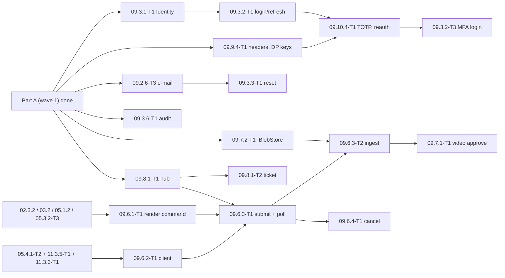

# 09 — Backend API: Tech Lead review, shared decisions and feature index (wave 1 = Part A, wave 2 = Part B)

> Reviews: `../../09-backend-api.md` §4 epics 09.1, 09.2, 09.4.1, 09.5.1, §5.1–5.4, §6, §7 and the 00 contracts they rely on (`../../00-overview.md` §5.1–5.4, §6, §7, §8). Process: `../../00-overview.md` §10.1, step (2) review, then step (3) detailed feature plans (this folder).
> Why this wave: it is the precondition for M1 of plan 02 (`../02-story-writing/README.md` §11 item 3). The other 09 epics (09.3 auth, 09.3.6 audit, 09.6–09.10) get their own waves later, in this folder.
> Reviewed: 2026-09-24 by the Tech Lead. Status: **TL Definition-of-Ready review done (§11): ready with conditions; O1–O3 decided and DoR signed by the owner 2026-09-24**. Verdict: **approve with changes**. The skeleton, CQRS-light rules and tenant model are right. But the plan has **two blockers**:
> - The layer rules forbid what plan 02 already codes against (F01, F02).
> - The pipeline order loses idempotency on a crash and gives 02's locks no transaction (F04).
>
> Legend: ✅ read from source/docs (URL + date) · ⚠️ unverified · [DECISION] · [OPEN] · [INFERENCE].

## 0. How this folder is organised

```
plans/features/09-backend-api/
  README.md                          ← this file: facts, findings, shared decisions D1–D17, task template, sequencing, index, re-estimate
  09.1.1-solution-skeleton/          ← story 09.1.1 (solution, projects, props, dev compose)
  09.1.2-architecture-tests/         ← story 09.1.2
  09.1.3-mediator-pipeline/          ← story 09.1.3 (behaviours, unit of work, idempotency)
  09.1.4-error-mapping/              ← story 09.1.4 (ErrorOr → ProblemDetails, ETag / If-Match helpers)
  09.1.5-ci-pipeline/                ← story 09.1.5
  09.2.1-db-contexts/                ← story 09.2.1 (+ integration-test harness)
  09.2.2-core-schema-migrations/     ← story 09.2.2 (P core tables, migration CI check)
  09.2.3-tenant-isolation/           ← story 09.2.3
  09.2.4-outbox/                     ← story 09.2.4
  09.2.5-seed-data/                  ← story 09.2.5
  09.2.6-worker-hangfire/            ← story 09.2.6
  09.4.1-series-crud/                ← story 09.4.1 (prerequisite of 09.5.1)
  09.5.1-episodes/                   ← story 09.5.1
```

Each feature folder holds `plan.md` (template `00-overview.md` §10.1, sections 1–11) and one `<task-id>-<slug>.md` per task (template §6). Task IDs follow `00-overview.md` §9. They **replace** the matching rows of `09-backend-api.md` §6 (mapping in §8). New tasks get the next free `T<n>` of their story.

## 1. Facts verified for this review

Read on 2026-09-24 from nuget.org (`api.nuget.org/v3-flatcontainer/<id>/index.json` and the package `.nuspec`) and the upstream repositories. Re-check at implementation time.

| # | Fact | Source |
|---|---|---|
| N1 | `Mediator.SourceGenerator` / `Mediator.Abstractions` **3.0.2**, MIT ✅. Message types `ICommand<TResponse>`, `IQuery<TResponse>`; handlers `ICommandHandler<,>`, `IQueryHandler<,>`; `IPipelineBehavior<TMessage,TResponse>` with `ValueTask<TResponse> Handle(TMessage, MessageHandlerDelegate<TMessage,TResponse> next, CancellationToken)` ✅ | github.com/martinothamar/Mediator README §3.1–3.3; GitHub license API |
| N2 | Mediator options are compile-time: `ServiceLifetime` (**default `Singleton`**), `Assemblies`, `PipelineBehaviors` ("ordered array of types used for the pipeline"; the generator adds the DI registrations itself). `CachingMode` exists only from v3.1, which is not a stable release ✅ | Mediator README §3.4 |
| N3 | `ErrorOr` **2.1.1**, MIT ✅. Targets `net10.0`, `net8.0`, `netstandard2.0`, with no dependencies ✅ | nuspec; github.com/error-or/error-or LICENSE.md |
| N4 | `FluentValidation` + `FluentValidation.DependencyInjectionExtensions` **12.1.1**, Apache-2.0 ✅ | nuspec |
| N5 | `Hangfire.Core` / `Hangfire.AspNetCore` **1.8.25**. `LICENSE.md` offers **LGPL v3 or a commercial licence** (GitHub reports NOASSERTION because the licence is multi-licence) ✅. `BackgroundJobClientExtensions` has `Enqueue<T>(…, string queue, Expression…)` overloads ✅ | github.com/HangfireIO/Hangfire LICENSE.md, `src/Hangfire.Core/BackgroundJobClientExtensions.cs` |
| N6 | `Hangfire.PostgreSql` **1.21.1**, LGPLv3 ✅. Targets `netstandard2.0` and depends on `Hangfire.Core ≥ 1.8.0` and `Npgsql ≥ 6.0.11`. The repo moved to `hangfire-postgres/Hangfire.PostgreSql` (last push 2026-03-18). Whether it runs with Npgsql 10 is ⚠️ not verified | nuspec; GitHub API |
| N7 | `Npgsql.EntityFrameworkCore.PostgreSQL` **10.0.3** (PostgreSQL licence) requires `Microsoft.EntityFrameworkCore` `[10.0.4, 11.0.0)` ✅. `Microsoft.EntityFrameworkCore` **10.0.12** MIT ✅. `EFCore.NamingConventions` **10.0.1**, Apache-2.0, requires EF `[10.0.1, 11.0.0)` ✅ | nuspec |
| N8 | `xmin` concurrency: map a `uint` property with `IsRowVersion()` or `[Timestamp]`, and Npgsql maps it to the `xmin` system column ✅ | github.com/npgsql/doc `conceptual/EFCore.PG/modeling/concurrency.md` |
| N9 | EF Core 10 has **named query filters** (several filters per entity, each one can be disabled by name) and complex types mapped with `ComplexProperty(…, b => b.ToJson())` ✅. Npgsql support for complex-type `ToJson()` is ⚠️ not verified | github.com/dotnet/EntityFramework.Docs `ef-core-10.0/whatsnew.md` |
| N10 | `TngTech.ArchUnitNET` + `TngTech.ArchUnitNET.xUnitV3` **0.13.4**, Apache-2.0, repo active (push 2026-09-24) ✅. `NetArchTest.Rules` **1.3.2**, MIT, last release 2021-05-23 ✅ | nuspec; GitHub API |
| N11 | Test stack: `xunit.v3` **4.0.1** Apache-2.0, `Microsoft.AspNetCore.Mvc.Testing` **10.0.12** MIT, `Shouldly` **4.3.0** BSD-3-Clause ✅. No container library: integration tests use the real PostgreSQL 17 named by `NTS_TEST_PG` (owner 2026-09-28, 00 §5.1; 09 W3 CR-35) | nuspec; 00 §5.1 ✅ |
| N12 | Other packages: `Riok.Mapperly` 4.3.1 Apache-2.0, `Serilog.AspNetCore` 10.0.0 Apache-2.0, `Microsoft.AspNetCore.OpenApi` 10.0.12 MIT, `Npgsql` 10.0.3 ✅ | nuspec |
| N13 | .NET 10: runtime 10.0.12, SDK 10.0.401 ✅ (00 §5.1, 2026-09-08). `Guid.CreateVersion7()` (BCL since .NET 9) and `JsonNamingPolicy.SnakeCaseLower` (since .NET 8) ⚠️ from docs knowledge, not re-read | 00 §5.1 |
| N14 | Hangfire recurring jobs are cron-based, and the default `SchedulePollingInterval` is 15 s ⚠️ (not re-read). So a 5-second recurring job is not reliable | [INFERENCE] |

## 2. Findings

Severity: **B** blocker · **H** high · **M** medium · **L** low.

| # | Sev | Where | Finding | Resolution |
|---|---|---|---|---|
| F01 | B | 09.1.1 (09 L58), 00 §5.2 | Domain may have "no package references". But 02 domain methods already return `ErrorOr<Success>`, for example `Episode.RequestStoryGeneration` and `FailStoryGeneration` (02.2.2-T1 L87–90, plan L143). They cannot compile under that rule | [DECISION D1] Domain may reference exactly one package: `ErrorOr` (MIT, no dependencies, N3). Nothing else. The architecture test enforces the allow-list. CR-1 |
| F02 | B | 09.1.1 (L58), 09 §5.1 (L316) | Application may reference only Domain, Mediator.Abstractions, FluentValidation and ErrorOr. But `IAppDbContext` exposes `DbSet<T>` (`db.Episodes.FindAsync`, 09 §5.1; `IAppDbContext.GenerationRuns`, 02.2.2-T1 L128), and queries use `ToListAsync` | [DECISION D1] Application also references `Microsoft.EntityFrameworkCore` (the core package, no provider). `Npgsql*` and `…EntityFrameworkCore.Relational` stay Infrastructure-only (architecture test). CR-1 |
| F03 | H | 09.1.3 | Mediator 3 registers handlers as **singletons** by default (N2), but the handlers take the scoped `IAppDbContext` | [DECISION D4] `options.ServiceLifetime = ServiceLifetime.Scoped` in both composition roots |
| F04 | B | 09.1.3 (L67) | Two problems with the order `… → Idempotency → UnitOfWork`. First, the stored idempotent response is written **outside** the command transaction: if the process crashes between commit and store, the retry runs the paid command a second time. Second, UnitOfWork only calls `SaveChanges`, so there is no ambient transaction for the locks 02 relies on: `pg_advisory_xact_lock` (02 D1/T61) and `LockEpisodeForUpdateAsync` (`SELECT … FOR UPDATE`, 02.4.2-T1 L61) | [DECISION D5/D6] New order: `Logging → Authorization → Validation → UnitOfWork → Idempotency → Audit → handler`. UnitOfWork opens an explicit transaction **before** the handler runs. Idempotency claims its key inside that transaction. CR-2 |
| F05 | H | 09.3.6-T1 (P, 02 CR-3), 09 §7 L543 | `AuditBehavior` has no place in the pipeline. "A rolled-back command leaves no activity row" is only true if audit rows are written inside the command transaction | [DECISION D4] Audit runs inside UnitOfWork, after Idempotency. 09.3.6-T1 fills the slot; this wave reserves it |
| F06 | H | 09 §5.3 (L345) | `OutboxDispatcherJob` is a "recurring 5 s" Hangfire job. Hangfire recurring jobs are cron-based and polled (N14), so 5 s is not reliable, and missed ticks pile up | [DECISION D11] The dispatcher is a Worker `BackgroundService`: a 5 s loop claiming rows `FOR UPDATE SKIP LOCKED`, safe with several Worker instances. CR-3 |
| F07 | H | 00 §6 `outbox_messages` (L305), 09.2.3 (L93) | "`SystemContext(userId)` from the outbox payload; a missing `userId` fails the job" has no column behind it. There is also no retry schedule (`next_attempt_at`), no dead-letter state and no trace context for NFR-09-4 | [DECISION D11] Add columns `user_id` (nullable only for platform events), `next_attempt_at`, `failed_at`, `trace_parent`. CR-4 |
| F08 | H | 09.2.2 (L84–85) | "Every table from 00 §6" in P means about 30 SaaS tables (credits, payments, promos, refunds …) are built in P, and it collides with 02. 02 creates its own tables (`generation_runs`, `story_sources`, `fetch_tasks`, `fact_sheets`, `source_candidates`, `price_versions`, `series_bibles`, `episode_ideas`), but expects 09.2.2 to create `story_versions`, `autopilot_runs`, `series_autopilot_authorizations`, `moderation_events` and `usage_records` (02.8.3 plan L113, 02.2.4-T1 L35, 02.4.1-T1 L85) | [DECISION D9] A table-ownership list: 09.2.2 creates the **P core set**; every other table is created by the migration of the feature that owns it; S tables are not created in P. CR-5 |
| F09 | M | 09.2.6-T1 (09 §6 L489) | The Worker host depends on 09.10.4-T1 (MFA) only because of the dashboard, so every 02 job waits for auth work | Split: 09.2.6-T1 = host, `IJobScheduler`, recurring jobs, arch test; 09.2.6-T2 = dashboard (after 09.10.4-T1) |
| F10 | M | 09.1.1-T2 (L476), 11.1.1-T1 (11 L184) | Circular dependency: 09.1.1-T2 depends on 11.1, and 11.1.1-T1 depends on 09.1.1 | 09.1.1-T2 = `docker-compose.yml` with **PostgreSQL only**; 11.1.1-T1 extends that file (api, worker, mock-mpt, storage emulator). CR-6 |
| F11 | M | 00 §6 `idempotency_keys` (L306) | The behaviour runs in Application and never sees an HTTP status, so `status_code` cannot be filled; `created_at` is missing | [DECISION D6] Replace `status_code` with `response_type`; add `created_at`. CR-4 |
| F12 | M | 00 §6 `users` (L260) | `email citext unique` duplicates ASP.NET Core Identity's unique `normalized_email` index and needs the `citext` extension | [DECISION D9] Uniqueness comes from Identity's `normalized_email` unique index; no `citext`. CR-4 |
| F13 | M | 09.2.1 (L81), 09 §5.4 | An `xmin` race that `If-Match` does not cover throws `DbUpdateConcurrencyException`, and there is no error code for it | [DECISION D5] UnitOfWork maps it to 409 `concurrency_conflict` (retryable). CR-7 |
| F14 | M | 09.5.1 (L167), 00 §7 | DELETE semantics are open: 00 §7 says "cancelled (user deletes)", 09.5.1 says "assets are scheduled for deletion", and there is no rule for `story_generating` | [DECISION D16] `DELETE` → `cancelled`, hidden from reads (404), `EpisodeCancelled` → asset retention. `rendering` and `story_generating` → 409 `episode_invalid_state`. Hard delete belongs to 13.3.1 |
| F15 | M | 09 §5.4, 02 D9 | `series_conflict` (412) exists, but no series ETag besides the autopilot `sa-` one | [DECISION D15] `"se-<xmin>"` on `GET/PATCH /series/{id}`; `If-Match` required on PATCH |
| F16 | M | 09.5.1 (L165) | Creating an episode in an archived series is not defined | 409 `series_archived` (new code). CR-7 |
| F17 | L | 02 task files | Drift found while pinning names. Test-project names `NightTales.IntegrationTests` (02.6.1-T1, 02.6.2-T1) and `NightTales.ArchitectureTests` (02.2.2-T1) do not exist. 02.5.5-T1 uses `Topic.Fiction` (no such topic, 00 §6) and `Error.NotFound("fact_sheet_required", 409)` | Fixed in the 02 files (D2 names; D7 code-driven mapping; `topic != TrueCrime`) (09 CR-9) |
| F18 | L | 00 §5.4 (L244) | Architecture-test library ⚠️ | [DECISION D1] ArchUnitNET (N10), because NetArchTest's last release is from 2021 |
| F19 | L | 00 §5.1 (L152) | Hangfire licence ⚠️ | Confirmed LGPL-3.0 multi-licence (N5, N6). Owner decision O1 (§10) |
| F20 | L | 00 §5.2 (L172) | `IClock` is listed as an Application port, but 02 domain methods take `IClock` (02.6.3-T1 L32–36, 02.8.1-T1 L51–54) | [DECISION D3] `IClock` lives in `Domain/Common` (a pure interface). Application and Infrastructure use it from there |
| F21 | M | 02 README §11 item 3 | The 02 M1 gate names 09.1, 09.2 and 09.5.1, but 09.5.1 depends on 09.4.1 (09 §6 L505), and the owner cannot use the studio without login (09.3) | This wave includes 09.4.1. 02 M1 **development** runs against the test auth scheme (D13). 02 M1 **exit** also needs auth wave 2: 09.3.1-T1, 09.3.2-T1, 09.3.2-T3, 09.10.4-T1 (TOTP) and 09.3.6-T1 (audit). CR-10 to 02 README |
| F22 | L | 09.2.5 (L102) | The owner seed needs ASP.NET Core Identity (09.3.1-T1), but it sits in the persistence epic | 09.2.5-T1 = catalogs + flags; 09.2.5-T2 = owner seed (after 09.3.1-T1) |

## 3. Shared decisions for all feature plans (contract)

Feature plans and task files MUST use these names exactly. Make any change here first.

**D1 Packages and references [DECISION].**
- Pinned in `Directory.Packages.props`, all at the N1–N12 versions:
  - Mediator 3.0.2
  - ErrorOr 2.1.1
  - FluentValidation 12.1.1
  - EF Core 10.0.12
  - Npgsql EF 10.0.3
  - EFCore.NamingConventions 10.0.1
  - Hangfire.Core / AspNetCore 1.8.25
  - Hangfire.PostgreSql 1.21.1
  - ArchUnitNET 0.13.4
  - xunit.v3 4.0.1 (test projects; `NightTales.TestKit` references `xunit.v3.extensibility.core` 4.0.1, because xunit.v3 makes every referencing project an executable test project) and Microsoft.Testing.Platform as the `dotnet test` runner (`global.json` `test.runner`; xunit.v3 4.x does not run under VSTest on the .NET 10 SDK) (09 W3 CR-36)
  - Mvc.Testing 10.0.12
  - Shouldly 4.3.0
  - Serilog.AspNetCore 10.0.0
  - Microsoft.AspNetCore.OpenApi 10.0.12
  - Newtonsoft.Json 13.0.4, a transitive pin (`CentralPackageTransitivePinningEnabled`): Hangfire.Core 1.8.25 pulls 11.0.1, which NuGetAudit reports as GHSA-5crp-9r3c-p9vr (high) and the build fails on (09 W3 CR-36)
- Reference rules (the architecture test enforces them):

| Project | May reference |
|---|---|
| `NightTales.Domain` | `ErrorOr` only (F01) |
| `NightTales.Application` | Domain, `NightTales.RenderNode.Contract` (11 CR-3), `Mediator.Abstractions`, `FluentValidation`, `ErrorOr`, `Microsoft.EntityFrameworkCore` (core only, F02) |
| `NightTales.RenderNode.Contract` | BCL only (11 CR-3) |
| `NightTales.RenderNode.Server`, `NightTales.MptAdapter`, `NightTales.MockMpt` | per `../11-worker-deployment/README.md` D3; never Domain, Application or Infrastructure (11 CR-3) |
| `NightTales.Infrastructure` | Application, Npgsql EF, NamingConventions, `Microsoft.AspNetCore.Identity.EntityFrameworkCore`, Hangfire.Core + Hangfire.PostgreSql, `Microsoft.Extensions.*` |
| `NightTales.Api` | Application, Infrastructure (composition root only), `Mediator.SourceGenerator`, `Hangfire.AspNetCore` (dashboard, 09.2.6-T2), `Microsoft.AspNetCore.OpenApi`, Serilog |
| `NightTales.Worker` | Application, Infrastructure (composition root only), `Mediator.SourceGenerator`, `Hangfire.AspNetCore` (`AddHangfireServer`) |
| `NightTales.Fetcher.Core` / `NightTales.Fetcher` | as in 02 CR-19 (Domain only / Fetcher.Core only) |

- Tests use hand-written fakes from `NightTales.TestKit`. There is **no mocking library** [DECISION]: 09 §7 says "in-memory fakes of ports".

**D2 Projects and paths [DECISION].** 00 §5.2 layout plus:
- `src/`: `NightTales.Domain`, `NightTales.Application`, `NightTales.Infrastructure`, `NightTales.Api`, `NightTales.Worker`, `NightTales.Fetcher.Core`, `NightTales.Fetcher` (the Fetcher projects are created by 02.5.2-T3; 09.1.1 only reserves the names in the solution filter), `NightTales.RenderNode.Contract` (created empty by 09.1.1-T1), `NightTales.RenderNode.Server`, `NightTales.MptAdapter` (created by 11.3.5-T1/T2); `tools/mock-mpt` (11.1.2-T1) (11 CR-3).
- `tests/`: `NightTales.Domain.UnitTests`, `NightTales.Application.UnitTests`, `NightTales.Infrastructure.UnitTests`, `NightTales.Architecture.Tests`, `NightTales.Api.IntegrationTests` (all DB and HTTP tests, including Worker jobs run in-process), `NightTales.TestKit` (fakes, fixtures, builders; referenced by every test project).
- Feature-owned suites may add `NightTales.AcceptanceTests` / `NightTales.Performance.Tests`; these are excluded from the default `dotnet test` run by the solution filter `NightTales.ci.slnf`.
- Files: `global.json` (SDK `10.0.401`, `rollForward: latestPatch`), `Directory.Build.props`, `Directory.Packages.props`, `.editorconfig`, `NightTales.sln`, `docker-compose.yml` (repo root; the optional e2e/image-smoke path — daily dev uses the native Homebrew `postgresql@17` database from 09.1.1-T2, 09 W3 CR-35).

**D3 Domain primitives (`src/NightTales.Domain/Common/`) [DECISION].**
```csharp
public interface IClock { DateTimeOffset UtcNow { get; } }                 // UTC only (F20)
public interface IDomainEvent { DateTimeOffset OccurredAt { get; } }       // records; payload = ids, enums, small values only
public interface IUserOwned { Guid UserId { get; } }                       // tenant filter marker (D10)
public abstract class Entity { public Guid Id { get; protected init; } }   // Guid.CreateVersion7() in factories, ValueGeneratedNever
public abstract class AggregateRoot : Entity
{
    public uint Version { get; private set; }                              // mapped to xmin (N8)
    public IReadOnlyList<IDomainEvent> DomainEvents { get; }
    protected void Raise(IDomainEvent e);
    public void ClearDomainEvents();
}
```
- Domain methods return `ErrorOr<T>` / `ErrorOr<Success>`, and take either `DateTimeOffset now` or `IClock` (both styles exist in 02; new 09 code passes `now`).
- Domain never reads the clock itself.
- `FakeClock : IClock` (settable, `Advance(TimeSpan)`) lives in `tests/NightTales.TestKit/Time/FakeClock.cs`.
- Infrastructure `SystemClock` returns `DateTimeOffset.UtcNow`.

**D4 Mediator and the pipeline [DECISION].**
- Messages use Mediator's own interfaces, `ICommand<ErrorOr<T>>` and `IQuery<ErrorOr<T>>`; handlers are `sealed`.
- Our markers live in `Application/Abstractions/Messaging/`:
  - `IIdempotentCommand { string? IdempotencyKey { get; } }`
  - `IRequireRole { PlatformRole RequiredRole { get; } }`
  - `[AllowAnonymousRequest]`
- Configuration: `AddMediator(o => { o.ServiceLifetime = ServiceLifetime.Scoped; o.Assemblies = [typeof(ApplicationAssemblyMarker)]; o.PipelineBehaviors = MediatorPipeline.Behaviors; })` in Api **and** Worker (F03). `MediatorPipeline.Behaviors` is the single ordered list (`Application/Behaviors/MediatorPipeline.cs`):
  1. `LoggingBehavior<,>` — all messages
  2. `AuthorizationBehavior<,>` — all messages
  3. `ValidationBehavior<,>` — all messages
  4. `UnitOfWorkBehavior<,>` — commands only
  5. `IdempotencyBehavior<,>` — `IIdempotentCommand` only
  6. `AuditBehavior<,>` — commands with `[Audited]`; the slot is reserved, 09.3.6-T1 implements it
- Behaviours are constrained by `where TResponse : IErrorOr`. They short-circuit with `ErrorOrFactory<TResponse>.From(List<Error>)` (`Application/Common/Errors/ErrorOrFactory.cs`), a cached, compiled conversion per closed type.
- Queries skip steps 4–6.

**D5 UnitOfWork semantics [DECISION].**
- For every `ICommand<…>`, the behaviour runs these steps:
  1. `BeginTransactionAsync(IsolationLevel.ReadCommitted)` on `AppDbContext`, **before** the handler.
  2. `next()`.
  3. If the result is **not** an error: `SaveChangesAsync`, which also runs the outbox interceptor (D11), then commit.
  4. Otherwise: rollback, with no `SaveChanges`.
- Port: `IUnitOfWork { BeginAsync; CommitAsync → ErrorOr<Success>; RollbackAsync }` (`Application/Abstractions/Persistence/`), implemented by `EfUnitOfWork` (09.1.3-T2).
- Handlers never call `SaveChangesAsync` or open transactions. Raw locks (`pg_advisory_xact_lock`, `SELECT … FOR UPDATE`) inside handlers join this transaction.
- `DbUpdateConcurrencyException` → rollback → `Error.Conflict(ErrorCodes.ConcurrencyConflict)` (409 `concurrency_conflict`).
- There is **no** retrying execution strategy (`EnableRetryOnFailure` stays off). A transient DB failure surfaces as 503 `service_unavailable`.
- Commands that must persist a failure (for example "run failed") return success values that describe the failure; they do not return errors.

**D6 Idempotency semantics [DECISION].**
- Table `idempotency_keys`:
  - columns `user_id`, `key` (1–128 printable ASCII), `request_hash` (SHA-256 hex of the message type name + canonical JSON of the command without the key), `response_type`, `response jsonb`, `created_at`, `expires_at` (= created + 24 h);
  - unique `(user_id, key)` (F11).
- `IdempotencyBehavior`, inside the UnitOfWork transaction:
  1. `INSERT … ON CONFLICT (user_id, key) DO NOTHING RETURNING id`.
  2. **No row returned** → read the existing row. A concurrent twin blocks on the unique index until the first transaction ends.
     - Different `request_hash` → 422 `idempotency_key_reused`.
     - Expired → overwrite it and continue.
     - Otherwise → deserialize `response` into the success type and return it, without calling the handler.
  3. **Row returned** → `next()`. On success, store `response`, which commits with the command. On error the transaction rolls back and the key disappears with it, so a retry runs again.
- A missing key on a route that requires one is rejected earlier, at the endpoint: 400 `idempotency_key_required` (D7).
- Cleanup: `IdempotencyKeyCleanupJob`, daily, deletes rows where `expires_at < now − 1 d` (09.1.3-T2 registers it once 09.2.6-T1 exists).

**D7 Errors and HTTP mapping [DECISION].**
- Codes are snake_case string constants in `Application/Common/Errors/ErrorCodes.cs`, a closed `static class`. The HTTP status comes from the **catalogue table keyed by code** (`Api/Http/ErrorCatalogue.cs`, 09 §5.4), **not** from `ErrorType`.
  - `ErrorType` is used only to recognise FluentValidation failures (→ `validation_failed` 400, with `errors` grouped by camelCase field).
  - A code missing from the catalogue fails a unit test.
- Factories: `Error.Conflict(code: ErrorCodes.EpisodeInvalidState, description: "…")` etc. Descriptions are English, safe and never contain content.
- ProblemDetails fields: `type` = `https://nighttales.app/errors/<code>` ⚠️ (host is a placeholder), `title`, `status`, `code`, `traceId`, `errors?`, and the extra metadata keys of the error (for example `retryAfterSeconds`).
- Every 429 whose error metadata has `retryAfterSeconds` also sets the `Retry-After` header (02 CR-20).
- Endpoint helpers (`Api/Http/ResultExtensions.cs`):
  - `ToHttpResult()` → 200; `ToHttpResult(etag)` → 200 with the ETag read **after** commit (D15), the delegate the only source
  - `ToCreatedResult(location, etag)` → 201 + `Location` + `ETag`
  - `ToAcceptedResult(location?)` → 202; the name `ToHttpResult202` in 09 §5.1 is renamed to this
  - `ToNoContentResult()` → 204; `ToNoContentResult(etag)` → 204 with the post-commit ETag of a mutation (D15)
- Endpoint filters (`Api/Http/Filters/`):
  - `RequireIdempotencyKey()` → 400 `idempotency_key_required`
  - `RequireIfMatch()` → 428 `if_match_required`
  - `IfMatchHeader` binder → `string?`, passed into the command
- ETag comparison (strong, exact string) is done in the handler against the aggregate's current value; mismatch → 412 with the resource code.

**D8 Persistence conventions [DECISION].**
- Contexts: `AppDbContext : IdentityDbContext<AppUser, AppRole, Guid>, IAppDbContext` and `ReadDbContext : DbContext, IReadDb`. Both apply the same configurations (`ApplyConfigurationsFromAssembly`) and the same query filters. Only `AppDbContext` owns migrations.
- Naming: `UseSnakeCaseNamingConvention()`. The Identity tables are renamed `users`, `roles`, `user_roles`, `user_claims`, `user_logins`, `user_tokens`, `role_claims`.
- Times are `DateTimeOffset` UTC → `timestamptz`. Npgsql rejects non-zero offsets, and that error is intended.
- Enums are stored as snake_case text with a `CHECK` constraint generated by `builder.HasEnumCheck<TEnum>(column)` (`Persistence/Conventions/EnumCheckExtensions.cs`).
- Ids: UUIDv7 from `Guid.CreateVersion7()` in domain factories; the database never generates ids.
- Concurrency: aggregates map `Version` → `xmin` via `IsRowVersion()` (N8).
- JSON: structured `jsonb` uses EF complex types with `ToJson()` (spike PASSED 2026-09-29 on Npgsql EF 10.0.3 / PostgreSQL 17: round-trip incl. nested `List<string>`, translated JSON-property query, `ExecuteUpdate` on a nested complex property — 09.2.1-T1 Notes; N9 resolved ✅). Opaque payloads only (outbox) use `string`/`JsonDocument` with `HasColumnType("jsonb")` fallback.
  - **(09 W3 CR-44)** 09.2.2-T1's own five structured columns — `series.autopilot_settings`, `story_versions.content`, `story_versions.audit_report`, `autopilot_runs.gate_results` and `feature_flags.rules` — stay `string` + `HasColumnType("jsonb")`. Their typed shapes belong to the tasks that own each document via its own migration; EF also rejects an empty complex type, a `JsonElement` member NREs on save, and a single-string shell writes `{"Json":…}`, which additionally breaks `feature_flags.rules` DEFAULT `'{}'`. The task that owns the persisted document type switches that column to `ComplexProperty(…, b => b.ToJson())` when it lands, keeping the column `jsonb`: 02.8.3-T1 `autopilot_settings` and `gate_results`, 02.2.2-T1 `content` and `audit_report`. `feature_flags.rules` is exempt and stays a string permanently (06.5.2-T1 keeps the flag schema and parses `rulesJson` as text).
- `IAppDbContext` exposes `DbSet<T>` per aggregate/entity. 09 adds only its own sets; each feature adds its own.
- `IReadDb` exposes `IQueryable<T> Query<T>() where T : class` (no tracking, tenant filter applied); `ReadDbContext.SaveChanges*` throws `InvalidOperationException`.
- Infrastructure-only helpers such as `LockEpisodeForUpdateAsync` (02) are implemented on `AppDbContext` and declared on `IAppDbContext`.
- Audit timestamps (09 W3 CR-38): `Domain/Common/ICreatedAt { DateTimeOffset CreatedAt }` and `IAuditable : ICreatedAt { DateTimeOffset UpdatedAt }` are owned by 09.2.2-T1. Every entity implements `ICreatedAt` (immutable/append-only tables such as `story_versions`, `usage_records` stop there); entities of mutable tables implement `IAuditable`. One EF convention maps `created_at` for every `ICreatedAt` and `updated_at` only for `IAuditable`, both `timestamptz NOT NULL`, and `AuditableSaveChangesInterceptor` (Infrastructure) stamps them from `IClock`: on `Added` → `CreatedAt` **only while it is still `default`**, plus `UpdatedAt` for `IAuditable`; on `Modified` → `UpdatedAt`.
  - A factory that already received `now` keeps working unchanged (the interceptor never overwrites a non-default `CreatedAt`), so the manual stamps stay only where the factory already takes `now`: 09.5.1 `plan.md`:64, 09.3.1-T3, 09.2.5-T2, 09.2.6-T3 `EmailMessage.Queue`, 02.2.2-T1.
  - Interceptor order on `AppDbContext`: `AuditableSaveChangesInterceptor` **first**, then `OutboxSaveChangesInterceptor` (09.2.4-T1) — both flush inside the one `SaveChanges`, and the outbox reads `DomainEvents` after the stamps are written.
  - Set-based `ExecuteUpdateAsync` bypasses interceptors, so every such path on an `IAuditable` table sets `UpdatedAt` explicitly with `SetProperty(e => e.UpdatedAt, now)` (09.5.1's asset-retention update, 09.7.3-T1's `deleted_at` sweep); `ExecuteDeleteAsync` needs no stamp.
- PostgreSQL 17 everywhere: native Homebrew `postgresql@17` for dev (`127.0.0.1:5432`, 09.1.1-T2), a `postgres:17` service container for CI/tests, the `postgres:17-alpine` image for the optional compose path, production on the same major ⚠️ (hosting choice 11.2.1; owner decisions O3 and 2026-09-28, 00 §5.1; 09 W3 CR-35).

**D9 Table ownership in P [DECISION, CR-5].**
- The 09.2.2 initial migration `InitialCore` creates, from 00 §6:
  - the Identity tables (D8 names) with the 00 §6 `users` columns (role, status, ui_locale, display_name, two_factor_enabled, last_totp_step, security_stamp, owner_dispute_freeze_until, last_login_at, `email_verified_at timestamptz NULL`) and no `citext` (F12; `email_verified_at` by 09 W3 CR-39);
  - `series`, `episodes`, `story_versions` (base columns);
  - `series_autopilot_authorizations`, `autopilot_runs` (base columns);
  - `moderation_events`, `usage_records` (with the 02 CR-4 `operation` values);
  - `assets`, `voices`, `style_templates`, `feature_flags`;
  - `outbox_messages` (D11), `idempotency_keys` (D6).
- `assets` **index** split (09 W3 CR-40): 09.2.2-T1 owns the column types and `ix_assets_retention_due` is **not** created here — it belongs to 09.7.3-T1's index-only migration (`(retention_until) WHERE deleted_at IS NULL AND retention_until IS NOT NULL`), and 09.2.2's `assets` set carries only `(episode_id)`.
- `OutboxMessage` (the Infrastructure type behind `outbox_messages`) is owned by 09.2.2-T1; 09.2.4-T1 consumes it as **Changed**, never as new (09 W3 CR-41).
- Every other table is created by its owner's migration, expand-only:

| Owner | Tables |
|---|---|
| 02 | `generation_runs`, `story_sources`, `fetch_tasks`, `fact_sheets`, `source_candidates`, `price_versions`, `series_bibles`, `episode_ideas` |
| 09.3.x | `refresh_tokens`, `auth_challenges`, `user_action_tokens` (09.3.2-T1, 09.3.2-T3, 09.3.3-T1), `user_consents` (09.3.1-T1), `trusted_devices` (S) (09 W2 CR-5) |
| 09.2.6-T3 | `email_messages` (09 W2 CR-5) |
| 09.8.1-T2 | `hub_tickets` (09 W2 CR-5) |
| 09.9.4-T1 | `data_protection_keys` (09 W2 CR-5) |
| 09.3.6-T1 | `audit_logs` |
| 09.6.1-T1 | `render_jobs` (09 W2 CR-5) |
| 11.3.3-T1 (11 CR-3) | `worker_nodes` |
| 09.10.1 | `system_settings`, `system_setting_versions` |
| 06 | `channel_connections`, `publications`, `platform_quota_usage` |
| 05 | `music_tracks` |
| 13 (P items) | `data_deletion_requests` (13.3.1-T1); `legal_documents` is S — not created in P (13 CR-1) |

- S-only tables (`credit_*`, `payments`, `payment_events`, `promo_*`, `refund_requests`, `provider_*`, `credit_grant_requests`, `owner_action_requests`, `approval_cancel_tokens`, `system_setting_changes`, `reports`) are **not** created in P.
- The initial migration is the only one generated before any feature. Features add one migration each, named `<yyyyMMddHHmm>_<Owner>_<What>`.

**D10 Tenant isolation [DECISION].**
- Every user-owned entity implements `IUserOwned`. The EF named filter `"tenant"` is `e => e.UserId == _currentUserId`, a `Guid?` context field read from `ICurrentUser` at context construction, **parameterized** per query. An unauthenticated context therefore sees no rows.
- `ICurrentUser` (`Application/Abstractions/ICurrentUser.cs`): `Guid? Id`, `bool IsAuthenticated`, `PlatformRole Role`, `ActorType Actor` (`user`/`admin`/`system`).
  - Api implementation: claims (`sub`, `role`).
  - Worker implementation: `ScopedCurrentUser`, set by `ISystemContext`.
- `ISystemContext.For(Guid userId) : IDisposable` (`Application/Abstractions/ISystemContext.cs`, scoped) sets the scope's `ICurrentUser` to `{ Id = userId, Actor = system }`, **before** any `AppDbContext` is resolved in that scope.
  - Nesting or a second call throws.
  - `Guid.Empty` throws.
  - 02's `SystemContext.For(run.UserId)` reads as a call on the injected `ISystemContext`.
- `IgnoreQueryFilters(["tenant"])` is allowed only in `Application/Features/Admin/**` and in the classes on the architecture-test allow-list (`RetentionSweepJob`, `DataDeletionJob`, `CreditReconciliationJob`, `SystemWorkQuery`).
  - Cross-user sweeps read `(id, user_id)` pairs through `ISystemWorkQuery` and process each one under `ISystemContext.For`.
- Other users' rows answer **404 `not_found`**, never 403.

**D11 Outbox [DECISION, CR-3, CR-4].**
- `outbox_messages` columns:
  - `id`, `type` (stable name, below), `payload jsonb`, `user_id` (NOT NULL except for platform events that carry `[PlatformEvent]`);
  - `occurred_at`, `next_attempt_at`, `attempts`, `processed_at`, `failed_at`, `error` (≤ 2,000 chars, safe text), `trace_parent`.
  - Partial index `(next_attempt_at) WHERE processed_at IS NULL AND failed_at IS NULL`.
- Writing: `OutboxSaveChangesInterceptor` (`Persistence/Outbox/`) collects `DomainEvents` from tracked `AggregateRoot`s during `SavingChanges`, adds one row per event in the **same** `SaveChanges`, then clears the events.
  - `type` = the event's `[OutboxEvent("story_approved.v1")]` name. A missing attribute fails the architecture test.
  - `user_id` comes from the aggregate's `IUserOwned.UserId`.
  - `trace_parent` = the current `Activity.Current?.Id`.
- Dispatching: `OutboxDispatcher` is a Worker `BackgroundService`, `Outbox:PollIntervalSeconds` = 5, `Outbox:BatchSize` = 20. Each batch:
  1. Claim rows: `SELECT … WHERE processed_at IS NULL AND failed_at IS NULL AND next_attempt_at <= now() ORDER BY occurred_at LIMIT @n FOR UPDATE SKIP LOCKED`, in a short transaction that bumps `next_attempt_at` by 5 min (a lease).
  2. Handle each message in its **own DI scope** under `ISystemContext.For(user_id)`, calling every `IOutboxHandler<TEvent>` in registration order.
  3. On success: `processed_at = now`.
  4. On exception: `attempts++`, `next_attempt_at = now + min(2^attempts s, 5 min)`; after 10 attempts `failed_at = now` and the dead-letter metric is incremented.
- Handlers are idempotent by contract (at-least-once). `IOutboxHandler<TEvent>` (`Application/Abstractions/Outbox/`): `ValueTask HandleAsync(TEvent e, OutboxContext ctx, CancellationToken ct)`, with `OutboxContext(Guid MessageId, Guid? UserId, int Attempt, DateTimeOffset OccurredAt)`.
- A handler that changes data sends a command through `ISender`, so the pipeline and UnitOfWork apply. A handler that only enqueues calls `IJobScheduler`.
- Metrics: `outbox_lag_seconds` (oldest unprocessed), `outbox_dead_letters_total`.

**D12 Jobs [DECISION].**
- `IJobScheduler` (`Application/Abstractions/Jobs/IJobScheduler.cs`):
  - `string Enqueue<TJob>(Expression<Func<TJob, CancellationToken, Task>> call) where TJob : class, IBackgroundJob`
  - `string Schedule<TJob>(Expression<Func<TJob, CancellationToken, Task>> call, TimeSpan delay)`
  - `void AddOrUpdateRecurring<TJob>(string id, string cron, Expression<Func<TJob, CancellationToken, Task>> call)`
  - `void RemoveRecurringIfExists(string id)`
- Shorthand in 02 (`Enqueue<GenerateStoryJob>(runId)`) means `Enqueue<GenerateStoryJob>((j, ct) => j.RunAsync(runId, ct))`.
- Job classes live in Application `Features/<F>/Jobs/<Name>Job.cs`: plain `sealed` classes implementing the marker `IBackgroundJob`, resolved from DI, with no Hangfire attributes. The `Worker/Jobs/` folder holds only recurring registrations.
- `[JobPolicy(Queue = JobQueue.Default, Retries = 0)]` (Application) is translated by `JobPolicyFilterProvider` (Infrastructure `Jobs/`, a Hangfire `IJobFilterProvider` ⚠️ confirm API) into the queue and an `AutomaticRetryAttribute`. Default when absent: `default` queue, **0** retries.
- Queues: `default`, `render`, `publish`, `email` (09.2.6). Worker counts come from `Jobs:Workers:<queue>`.
- Storage: Hangfire.PostgreSql, same database, schema `hangfire`.
- Ids-only rule: every public method of an `IBackgroundJob` takes only `Guid`, `int`, `long`, enums, `DateTimeOffset`, `CancellationToken`, or a `string` whose parameter name is on the allow-list (`idempotencyKey`, `recurringId`). The architecture test enforces it.
- The Api never schedules jobs: its `IJobScheduler` registration throws. Side effects go through the outbox, and the outbox handlers run in the Worker (09.2.6-T1).
- Recurring jobs are registered at Worker start through `IRecurringJobRegistration` implementations (`AddOrUpdateRecurring` by stable id). Every id that is no longer registered is removed — there is **no prefix exception** (the `manual:` carve-out is dropped, 09 W3 CR-42); a test registers an id in one start and asserts it is gone on the next.
- Config: `Jobs:Workers:<queue>`, `Jobs:QueuePollSeconds` (Hangfire queue poll, 5) and `Jobs:SchedulePollSeconds` (the scheduler's own poll for `Schedule<TJob>` delays) — 09 W3 CR-42.

**D13 Test harness [DECISION].**
- `NightTales.TestKit` holds:
  - `PostgresFixture`: connects to the real PostgreSQL 17 named by `NTS_TEST_PG` — no container is started and no Docker is needed. Missing/blank `NTS_TEST_PG`, or a server that is not major 17, fails the fixture fast with a named error (never a silent skip). It rebuilds a template database once per run and each test class gets `CREATE DATABASE … TEMPLATE nts_template` (09 W3 CR-35).
  - `ApiFactory : WebApplicationFactory<Program>`.
  - `TestAuthHandler`: scheme `Test`; headers `X-Test-User` / `X-Test-Role`; registered **only** by `ApiFactory`.
  - `WorkerHost`: builds the **same** service collection as `Worker/Program.cs` through the `AddWorkerServices` extension (owned by 09.2.6-T1) and has two modes (09 W3 CR-42): **inline** (default) replaces `IJobScheduler` with `InlineJobScheduler`, which runs the job synchronously and records the calls, and starts no Hangfire server; **real-server** (opt-in, `WorkerHost.WithHangfireServer`) adds the Hangfire server with `SchedulePollingInterval = 1 s` for the 09.2.6-T1 enqueue/queue/routing tests only.
  - `FakeClock`, builders (`SeriesBuilder`, `EpisodeBuilder`).
- Integration tests never sleep. They drive time with `FakeClock` and call jobs and dispatcher iterations directly.

**D14 API conventions [DECISION].**
- Base `/api/v1` with Minimal API groups. Each feature implements `IEndpointGroup { void Map(IEndpointRouteBuilder app); }` (`Api/Endpoints/<Feature>Endpoints.cs`), discovered at startup.
- JSON: camelCase properties, enums as snake_case strings (`JsonStringEnumConverter(JsonNamingPolicy.SnakeCaseLower)`), UTC ISO-8601 times.
- Cursor pagination:
  - request `?cursor=&limit=`; `limit` defaults to 20, 1–100, otherwise 400 `validation_failed`;
  - response `{ items, nextCursor }`;
  - the cursor is opaque base64url JSON `{ "c": createdAt, "i": id }`, ordered `(created_at DESC, id DESC)` as a keyset;
  - an invalid cursor → 400 `validation_failed` (field `cursor`).
- The OpenAPI document is generated at build to `src/NightTales.Api/openapi.json` (09.1.5-T1; 09.9.5 owns the contract diff).

**D15 ETags [DECISION].** In addition to 02 D9:
- Episode ETag = `"ep-<episodes.xmin>"`.
- Series ETag = `"se-<series.xmin>"` on `GET/PATCH /series/{id}`. `If-Match` is required on `PATCH /series/{id}` (428 / 412 `series_conflict`).
- Every ETag is returned in the `ETag` header and in the DTO field `etag`.
- `xmin` is assigned at commit, after the handler has returned (D5). Commands therefore return ids, and the endpoint reads the ETag after commit through the async etag delegate of `ToCreatedResult` / `ToHttpResult` (09.1.4-T1, 09.4.1-T1).

**D16 Series and episode domain contract [DECISION].**
- Enums (Domain):
  - `Topic { Ghost, Spiritual, TrueCrime }` with `bool IsFiction(this Topic t) => t != Topic.TrueCrime`
  - `Language { Vi, En }`
  - `Aspect { Landscape, Portrait }`
  - `LengthTier { Short, Standard, Long }`
  - `EpisodeStatus` (00 §7 names: `Draft, StoryGenerating, StoryReview, StoryApproved, Rendering, VideoReview, Ready, Scheduled, Published, Failed, Cancelled`)
  - `PlatformRole { User, Admin, Owner }`
- `Series` (aggregate, `IUserOwned`): `Create(Guid userId, SeriesDraft draft, DateTimeOffset now)`, `Update(SeriesPatch patch, DateTimeOffset now)` (topic change → `series_topic_locked` 409 while `AutopilotEnabled`), `Archive(DateTimeOffset now)`. Events `SeriesCreated`, `SeriesArchived`.
- `Episode` (aggregate, `IUserOwned`):
  - `Create(Guid userId, Guid seriesId, string? title, string brief, LengthTier tier, DateTimeOffset now)` (status `Draft`)
  - `Cancel(DateTimeOffset now)` → `episode_invalid_state` from `StoryGenerating`, `Rendering`, `Cancelled`, `Published`; from any other state → `Cancelled`
- Events (`[OutboxEvent]` names in parentheses):

| Event | Outbox name |
|---|---|
| `EpisodeCreated { EpisodeId, SeriesId, UserId, OccurredAt }` | `episode_created.v1` |
| `EpisodeCancelled { EpisodeId, SeriesId, UserId, PreviousStatus, OccurredAt }` | `episode_cancelled.v1` |
| `SeriesCreated` | `series_created.v1` |
| `SeriesArchived` | `series_archived.v1` |

- 02 adds its own methods to `Episode` in partial files (`Episode.Story.cs` etc.). 09.5.1 owns `Episode.cs`.
- Limits: brief 1–1,000 chars; title ≤ 120 chars (optional); series title 1–120 chars.

**D17 Error codes added by this wave (CR-7).**
- `concurrency_conflict` 409 (D5)
- `series_archived` 409 (F16)
- `series_topic_locked` 409 (D16)
- `episode_conflict` 412 (stale `If-Match` on `DELETE /episodes/{id}`, 09.5.1)
- `service_unavailable` 503 (D5)
- `idempotency_key_required` 400 is already catalogued (02 CR-8)

## 4. Change requests to other files

Tagged `(09 CR-n)` where applied. (This is the wave-1 table; the wave-2 rows are `W2 CR-n` in §B4 and the wave-3 rows — including CR-38…CR-43, applied 2026-09-30 — are `W3 CR-n` in §C4.)

| CR | Target | Change |
|---|---|---|
| CR-1 | 00 §5.2, 09.1.1 | Domain may reference `ErrorOr` only. Application also references `Microsoft.EntityFrameworkCore` (core). Provider packages are Infrastructure-only (F01, F02) |
| CR-2 | 09.1.3, 00 §5.2 (Behaviors line) | Pipeline order `Logging → Authorization → Validation → UnitOfWork → Idempotency → Audit`; UnitOfWork opens the transaction before the handler (F04, F05) |
| CR-3 | 09 §5.3 | `OutboxDispatcherJob` row → `OutboxDispatcher` Worker `BackgroundService`, 5 s loop, `SKIP LOCKED`, 10 attempts with backoff, dead letter (F06) |
| CR-4 | 00 §6 | `outbox_messages` + `user_id`, `next_attempt_at`, `failed_at`, `trace_parent` (F07). `idempotency_keys`: `status_code` → `response_type`, + `created_at` (F11). `users.email`: uniqueness by Identity `normalized_email`, no `citext` (F12) |
| CR-5 | 09.2.2, 00 §6 intro | P core set and table-ownership list (D9); S tables are not created in P (F08) |
| CR-6 | 09 §6 (09.1.1-T2), 11.1.1-T1 | 09.1.1-T2 = PostgreSQL-only `docker-compose.yml`, no dependency on 11.1; 11.1.1-T1 extends it and depends on 09.1.1-T2 (F10) |
| CR-7 | 09 §5.4 | Add `concurrency_conflict` 409, `series_archived` 409, `series_topic_locked` 409, `episode_conflict` 412, `service_unavailable` 503 (D17) |
| CR-8 | 09 §6, §11; 00 §4.1, §13 | Task table replaced by §8 of this file; re-estimate §9 |
| CR-9 | 02 task files | F17 alignments (test-project names, `Topic`, error factory) |
| CR-10 | 02 README §11 item 3 | 02 M1 development: after 09.1, 09.2, 09.4.1, 09.5.1. 02 M1 exit also needs the auth wave (F21) |
| CR-11 | 09.2.6 (L105–109), 09 §6 | 09.2.6 split into T1 host / T2 dashboard (F09); 09.2.5 split into T1 catalogs / T2 owner seed (F22) |
| CR-12 | 02.2.2-T2 (Depends-on row, handler order), 02.2.2 `plan.md` handler order | Superseded order `Authorization → Validation → Idempotency → UnitOfWork` replaced by the D5/D6 order `Logging → Authorization → Validation → UnitOfWork → Idempotency → Audit` (F04). CR-9 had aligned 02 for F17 only |
| CR-13 | 00 §5.1 Database row, 11.5.1, WORKFLOW.md §8.2/§9, 09.1.5 `plan.md` and T1 | Clear the ⚠️ markers resolved by O1–O3: PostgreSQL 17, GitHub Actions |
| CR-14 | 00 §5 diagram, 02.2.2 `plan.md` + T3, 02.6.3 `plan.md`, WORKFLOW.md §6, DIAGRAMS.md §4/§15, 09.1.1/09.2.1 `plan.md`, 09.1.5-T1 | Propagate CR-3 (`OutboxDispatcherJob` → `OutboxDispatcher` `BackgroundService`); the 00 §5 diagram no longer draws Api → Hangfire (the Api only writes the outbox, D12); stale `[OPEN] O3` → decided; 09.1.5-T1 cites 09.1.1-T1 for lock files. `docs/diagrams/04-*.svg` must be re-exported |
| CR-38 | 09 §5.4 (`plans/09-backend-api.md`) | §5.4 cannot supply a plain-401 row: every 401 it lists names a reason (`invalid_credentials`, `mfa_required`, `mfa_token_invalid`, `invalid_mfa_code`, `session_revoked`, `hub_ticket_invalid`, `refresh_token_reused`, `reauth_required`, `mfa_enrolment_required`, `webhook_signature_invalid`), while 09 §4 Epic 09.1 (`09-backend-api.md`:72) requires `Unauthorized` → 401 and `09.1.3-T2`'s `AuthorizationBehavior` returns `Error.Unauthorized(code: ErrorCodes.Unauthorized)` for a default-denied call (`09.1.3-T2`:72, its step 4 lists the code as this wave's). **Add** the row `` | `unauthorized` | 401 | Not authenticated: the pipeline's `AuthorizationBehavior` denies by default (09.1.3-T2) | `` (with the separators escaped when pasted into a table). The code side is already catalogued — `09.1.4-T1` added `ErrorCodes.Unauthorized` and `Status["unauthorized"] = 401` (`ErrorCodes` 161 → 162 constants, `Status` 118 → 119 rows), because the mapper reads the catalogue, not `ErrorType`: an uncatalogued `unauthorized` would answer 500 `internal_error` |

## 5. Sequencing


Waiting for other waves: 09.2.3-T2 (S, after 09.9.5-T1), 09.2.5-T2 (after 09.3.1-T1), 09.2.6-T2 (after 09.10.4-T1).

Critical path (computed from the task files' `Depends on`): 09.1.1-T1 → 09.2.1-T1 → 09.2.2-T1 → 09.2.2-T2 → 09.1.3-T2 → 09.4.1-T1 → 09.5.1-T1 ≈ 7.5 d. The whole wave is 16.0 d of P work for one developer, so the path is not the constraint; the order above is.

## 6. Task file template

Every `<task-id>-<slug>.md` uses these headings (same as `../02-story-writing/README.md` §6):

```markdown
# <task-id> — <title>

| Story | Size | Area | Depends on | Blocks | Phase / flag |
|---|---|---|---|---|---|

## Goal
One or two sentences: the observable outcome.

## Inputs
README facts (N ids), decisions (D ids), findings (F ids), contracts (00 §, 09 §), outputs of other tasks.

## Design
Exact types and file paths (00 §5.2 layout, D2), signatures, DTOs, SQL/EF mapping, JSON, sequence; decisions local to this task.

## Steps
Numbered implementation steps.

## Outputs
Files created/changed, migrations, config keys, docs.

## Acceptance checks
Checkbox list; each check is a named test, a command, or an observation with its expected result.

## Tests
Unit / integration / manual cases with the test names to create.

## Failure handling and edge cases
Known failure modes → behaviour; rollback.

## Notes
⚠️ items to confirm, [OPEN] questions, links.
```

## 7. Gates

| Gate | Condition |
|---|---|
| 09-W1-ready | ✅ closed 2026-09-24: this README + all 13 feature plans pass DoR (§11), signed by the owner (O1–O3 decided 2026-09-24) |
| 09-skeleton | 09.1.1–09.1.5 merged; CI green on an empty feature set; architecture tests fail on a deliberate violation (demonstrated once, then reverted) |
| 09-persistence | 09.2.1–09.2.4 and 09.2.6-T1 merged; `InitialCore` applies on an empty DB; the outbox crash test passes |
| 02-M1-dev | 09.4.1-T1 + 09.5.1-T1 merged → 02 M1 feature work may start (CR-10) |

## 8. Feature index and task mapping

| Folder | Task files | Replaces 09 §6 row(s) |
|---|---|---|
| `09.1.1-solution-skeleton/` | 09.1.1-T1, 09.1.1-T2 | 09.1.1-T1, 09.1.1-T2 |
| `09.1.2-architecture-tests/` | 09.1.2-T1 | 09.1.2-T1 |
| `09.1.3-mediator-pipeline/` | 09.1.3-T1, 09.1.3-T2 | 09.1.3-T1, 09.1.3-T2 |
| `09.1.4-error-mapping/` | 09.1.4-T1 | 09.1.4-T1 |
| `09.1.5-ci-pipeline/` | 09.1.5-T1 | 09.1.5-T1 |
| `09.2.1-db-contexts/` | 09.2.1-T1, 09.2.1-T2 (new) | 09.2.1-T1 |
| `09.2.2-core-schema-migrations/` | 09.2.2-T1, 09.2.2-T2 | 09.2.2-T1, 09.2.2-T2 |
| `09.2.3-tenant-isolation/` | 09.2.3-T1, 09.2.3-T2 (S) | 09.2.3-T1, 09.2.3-T2 |
| `09.2.4-outbox/` | 09.2.4-T1 | 09.2.4-T1 |
| `09.2.5-seed-data/` | 09.2.5-T1, 09.2.5-T2 (new) | 09.2.5-T1 |
| `09.2.6-worker-hangfire/` | 09.2.6-T1, 09.2.6-T2 (new) | 09.2.6-T1 |
| `09.4.1-series-crud/` | 09.4.1-T1 | 09.4.1-T1 |
| `09.5.1-episodes/` | 09.5.1-T1 | 09.5.1-T1 |

## 9. Re-estimate

Sizes: XS 0.25 · S 0.5 · M 1 · L 2 (00 §9).

| Task | High-level | Detailed | Why |
|---|---|---|---|
| 09.1.1-T1 | S 0.5 | S 0.5 | — |
| 09.1.1-T2 | XS 0.25 | XS 0.25 | Native dev DB (`tools/dev/db-init.sh`) + optional compose `postgres` service (F10; 09 W3 CR-35) |
| 09.1.2-T1 | S 0.5 | M 1.0 | Package allow-lists, Fetcher isolation, Hangfire confinement, `[OutboxEvent]`, ids-only jobs, handler rules (D1, D11, D12) |
| 09.1.3-T1 | S 0.5 | S 0.5 | — |
| 09.1.3-T2 | S 0.5 | M 1.0 | Explicit transaction, in-transaction idempotency protocol, concurrency mapping, cleanup job (F04, D5, D6) |
| 09.1.4-T1 | S 0.5 | S 0.5 | — |
| 09.1.5-T1 | S 0.5 | S 0.5 | — |
| 09.2.1-T1 | M 1.0 | M 1.0 | — |
| 09.2.1-T2 | — | S 0.5 | New: `PostgresFixture` template DB (`NTS_TEST_PG`; 09 W3 CR-35), `ApiFactory`, `TestAuthHandler`, `WorkerHost` (D13) |
| 09.2.2-T1 | L 2.0 | L 2.0 | Core set only (F08), but full CHECKs and indexes |
| 09.2.2-T2 | M 1.0 | M 1.0 | — |
| 09.2.3-T1 | M 1.0 | M 1.0 | — |
| 09.2.3-T2 (S) | M 1.0 | M 1.0 | — |
| 09.2.4-T1 | M 1.0 | L 2.0 | Hosted dispatcher, lease/backoff/dead letter, trace propagation, handler registry, crash test (F06, F07) |
| 09.2.5-T1 | S 0.5 | S 0.5 | Catalogs + flags |
| 09.2.5-T2 | — | XS 0.25 | New: owner seed after Identity (F22) |
| 09.2.6-T1 | M 1.0 | M 1.0 | Host without dashboard (F09) |
| 09.2.6-T2 | — | S 0.5 | New: dashboard split out (F09) |
| 09.4.1-T1 | M 1.0 | M 1.0 | — |
| 09.5.1-T1 | M 1.0 | M 1.0 | — |
| **Total** | **13.75** | **17.0** | **+3.25 d raw** (+3.9 buffered) · P 16.0 / S 1.0 |

Plan 09 total: 49.75 → **56.0 d raw / 67.2 buffered** (P 32.25 → 37.5; S 17.5 → 18.5). The wave-1 figure of this table was 53.0 / 63.6; B9 (wave 2) and C9 (wave 3) carry it to 56.0 / 67.2, which is what 00 §4.1 (`37.5 | 45.0 | 18.5 | 22.2`) and 00 §13 (`56.0 | 67.2`) already show (09 W3 CR-43).

Roll-up 00 §13 (final values, after 09 W2 CR-4 and 09 W3 CR-43):
- P: 180.75 → 182.75 raw / 216.9 → 219.3 buffered.
- Total: 259.75 → 262.75 / 311.7 → 315.3.
- Personal phase ≈ 236.7 person-days ≈ 11.8 months (00 §13).

The roll-up is applied by CR-8 with this wave, and revised by 09 W2 CR-4 / 09 W3 CR-43 as later waves re-estimated (pending the owner's approval of §10).

## 10. TL decisions and owner decisions

TL decisions are recorded in D1–D17. Three items need the **owner**:

| # | Decision | TL recommendation | Status |
|---|---|---|---|
| O1 | Hangfire (LGPL-3.0 or commercial, N5) and Hangfire.PostgreSql (LGPLv3, N6), used unmodified from NuGet in a hosted SaaS | Accept LGPL-3.0: no fork, no modified copies, package references only. The `IJobScheduler` port keeps the swap cost ≈ 2 d (09 §8) | **decided by the owner 2026-09-24: as recommended** |
| O2 | CI platform (11.5.1 "GitHub Actions ⚠️ or chosen CI"); the repo has no remote yet | GitHub Actions, workflow file `.github/workflows/backend.yml` | **decided by the owner 2026-09-24: as recommended** |
| O3 | PostgreSQL major for dev, CI and production | 17 (Homebrew `postgresql@17` in dev, `postgres:17` in CI/tests, `postgres:17-alpine` for the optional compose path); production on the same major, confirmed with the hosting choice (11.2.1) — 09 W3 CR-35 | **decided by the owner 2026-09-24: as recommended** |

## 11. Definition-of-Ready review (2026-09-24)

**Reviewer:** the Tech Lead. The agent writers failed with `401 Invalid API key`, so there is no independent reviewer pass.
- 4 `plan.md` files were written by agents before the failure (09.1.1, 09.2.1, 09.2.5, 09.5.1). The TL read each one in full and corrected it:
  - `LockEpisodeForUpdateAsync` ownership moved to 02.2.2-T1;
  - the runtime JSON-mapping switch was removed;
  - the `source_finder` flag was closed;
  - the index list and section structure were aligned;
  - `episode_conflict` was added to D17.
- The TL wrote the other 9 plans and all 20 task files.

**Checked by script:**
- 13 plans have the 11 sections of 00 §10.1.
- 20 task files have the template headings, the one-row table, checkboxes and a tests table.
- Sizes equal §9.
- Code fences are balanced.
- Every task id referenced exists (in this folder or in 09 §6).
- The `Depends on` graph has no cycle; critical path §5.

| DoR item (00 §10) | Status |
|---|---|
| User value, Given/When/Then | ✅ from 09 §4, refined per plan §1/§4 |
| Dependencies known | ✅ per task table; external: 09.3.1-T1 (09.2.5-T2), 09.10.4-T1 + 09.3.6-T1 (09.2.6-T2), 09.9.5-T1 (09.2.3-T2, S) |
| Estimate ≤ XL | ✅ largest L (09.2.2-T1, 09.2.4-T1) |
| API contract linked | ✅ 09.4.1 §5, 09.5.1 §5; error codes D7/D17; ETags D15 |
| Detailed plan reviewed by the TL | ✅ this section |

**Verdict: ready with conditions.**
1. ✅ O1–O3 decided by the owner on 2026-09-24 (§10): LGPL-3.0 accepted, GitHub Actions, PostgreSQL 17.
2. The first step of each task that has a spike runs before the rest of that task:
   - 09.2.1-T1: Npgsql complex-type `ToJson()`;
   - 09.2.6-T1: Hangfire.PostgreSql 1.21.1 on Npgsql 10.0.3;
   - 09.1.2-T1: ArchUnitNET call-site visibility.
   A failed spike takes the documented fallback, and the TL records it in D8/D12.
3. A second human reader for 09.2.3 (tenant isolation) and 09.2.4 (outbox), both security-relevant (00 §10.1).
4. Known gap: `AuditBehavior` is a pass-through until 09.3.6-T1 (wave 2). 02 audit rows are therefore not written before wave 2; this is tracked by CR-10 in the 02 M1 exit.

⚠️ To confirm at implementation (none blocks the plan):
- the Mediator `PipelineBehaviors` literal requirement (09.1.3-T1);
- `IJobFilterProvider` registration and the dashboard 404/antiforgery behaviour (09.2.6);
- `HasPendingModelChanges` (09.2.2-T2);
- the EF 10 non-generic named-filter overload (09.2.3-T1);
- `IsDescending` on Npgsql (09.2.2-T1);
- build-time OpenAPI generation (09.1.5-T1).

**Owner sign-off:** ✅ **signed by the owner 2026-09-24**, including the re-estimate in §9 (+3.25 d). The four conditions above stay in force.

---

# Part B — Wave 2 (P): auth, audit, catalog and episode queries, render orchestration, video review, real-time, platform

> Reviews: `../../09-backend-api.md` §4 epics 09.3 (P part), 09.4.2, 09.5.2–09.5.3, 09.6, 09.7, 09.8, 09.9.2 (read side), 09.9.3–09.9.5, 09.10.4-T1, §5.3–§5.6, and the signed consumers in plans 02, 03, 04, 05 and 11 (every citing line, summarised in `agent://Scout09W2`). Reviewed 2026-09-24 by the Tech Lead.
> Status: **owner decisions W2-O1…O5 and the re-estimate accepted 2026-09-24 under the owner's standing approval (B10); writer items + contract, security and performance reviews applied as WT1–WT56 (B10); W2 CR-1…CR-15 applied (B4); TL DoR 2026-09-24: ready with conditions (B11)**.
> Verdict: **approve with changes**. Scope and contracts hold, but: (1) three artefacts that signed plans already call have **no owner** — `SendEmailJob`/e-mail (02.8.2, 02.8.3), `IBlobStore` (02.5.2-T2) and a feature-flag read service (`feature_disabled` in 02.7/02.8.3); (2) 09.5.2-T1's `ICreditLedger` is already implemented by 02.2.2 — the task is redundant; (3) the P phase has **no public sign-up**, yet 09.3.1-T1 (P) is "register + verify"; (4) the render poll cadence (10 s) is below Hangfire's 15 s scheduler poll; (5) the standard resilience handler's 30 s total timeout breaks a video download, and its circuit breaker (10 % of ≥ 100 calls) never opens at P volume; (6) ASP.NET Identity's TOTP accepts a code more than once and stores authenticator keys and recovery codes unprotected.

## B0. Folders of this wave

```
plans/features/09-backend-api/
  09.3-auth/                     ← 09.3.1-T1, 09.3.1-T3 (S), 09.3.2-T1, 09.3.2-T3, 09.3.3-T1, 09.10.4-T1
  09.2.6-worker-hangfire/        ← + 09.2.6-T3 (e-mail pipeline; wave-2 addition to the signed folder, W2 CR-7)
  09.3.4-me-limits-audit/        ← 09.3.4-T1, 09.3.5-T1, 09.3.6-T1
  09.4.2-5.3-queries/            ← 09.4.2-T1, 09.5.3-T1
  09.6-render-orchestration/     ← 09.6.1-T1, 09.6.2-T1, 09.6.3-T1, 09.6.3-T2, 09.6.4-T1
  09.7-video-review-storage/     ← 09.7.1-T1, 09.7.2-T1, 09.7.3-T1
  09.8.1-realtime/               ← 09.8.1-T1, 09.8.1-T2
  09.9-platform/                 ← 09.9.2-T2, 09.9.3-T1, 09.9.3-T2, 09.9.4-T1, 09.9.5-T1
```

Same templates as Part A (§6). Task ids replace 09 §6 rows (B8); 09.5.2-T1 is **withdrawn** (WF02); new ids take the next free `T<n>` of their story.

## B1. Facts verified for this wave

| Id | Fact | Source |
|---|---|---|
| W1 | `Microsoft.AspNetCore.Authentication.JwtBearer` and `Microsoft.AspNetCore.DataProtection.EntityFrameworkCore` **10.0.12**, MIT, net10.0; `PersistKeysToDbContext<TContext>()` needs `IDataProtectionKeyContext` | api.nuget.org nuspec; learn.microsoft.com data-protection configuration ✅ 2026-09-24 |
| W2 | OpenTelemetry .NET: Extensions.Hosting and OTLP exporter **1.19.1**, Instrumentation.AspNetCore and .Http **1.19.0** (stable), Apache-2.0; **Instrumentation.EntityFrameworkCore has never had a stable release** (latest `1.19.1-beta.1`) | api.nuget.org indexes ✅ |
| W3 | `Npgsql.OpenTelemetry` **10.0.3** stable, emits PostgreSQL spans (`AddNpgsql()`, "experimental" in the docs title) | api.nuget.org; npgsql.org/doc/diagnostics/tracing ✅ |
| W4 | `Serilog.Sinks.OpenTelemetry` **4.2.0** Apache-2.0; `Serilog.Formatting.Compact` 3.0.0 | api.nuget.org ✅ |
| W5 | `AWSSDK.S3` **4.0.103.4** (v4 line) Apache-2.0; `GetPreSignedUrlRequest.ResponseHeaderOverrides.ContentDisposition` exists; the client method names are ⚠️ not verified | nuspec; aws-sdk-net source ✅ / ⚠️ |
| W6 | Identity: `VerifyTwoFactorTokenAsync`, `GenerateNewTwoFactorRecoveryCodesAsync`, `RedeemTwoFactorRecoveryCodeAsync`, `TokenOptions.DefaultAuthenticatorProvider = "Authenticator"`. **"The user can enter the code multiple times and authenticate successfully before it expires."** | dotnet/aspnetcore `UserManager.cs`, `TokenOptions.cs`; learn.microsoft.com identity-enable-qrcodes ✅ |
| W7 | Identity stores the authenticator key and recovery codes as plain `user_tokens` values unless personal-data protection is configured | ⚠️ from source knowledge (`UserStoreBase.ReplaceCodesAsync` joins codes with `;`) — 09.10.4-T1 step 1 confirms |
| W8 | Built-in rate limiting: `AddRateLimiter`, `PartitionedRateLimiter.Create<HttpContext,string>`, `RejectionStatusCode`, `OnRejected` (sets `Retry-After` by hand) | learn.microsoft.com rate-limit ✅ |
| W9 | `Microsoft.Extensions.Http.Resilience` **10.10.0** MIT; `AddStandardResilienceHandler` defaults: 3 retries exponential + jitter, circuit breaker failure ratio 10 % over min throughput 100 in 30 s, **total timeout 30 s**, attempt timeout 10 s | learn.microsoft.com http-resilience ✅ |
| W10 | `NuGetAuditMode` defaults to `all` for net10.0 projects; `dotnet list package --vulnerable` | learn.microsoft.com NuGet auditing ✅ |
| W11 | oasdiff: Apache-2.0, "detect breaking changes in OpenAPI specs" | github.com/oasdiff/oasdiff ✅ |
| W12 | Hangfire recurring/scheduled jobs are polled every 15 s by default (Part A N14) → a 10 s per-job poll via `Schedule` is not reliable | Part A N14 ⚠️ |
| W13 | 02.2.2 already implements `ICreditLedger` + `MeteringOnlyCreditLedger` (P) and `IBudgetGuard` | `../02-story-writing/02.2.2-generate-story-job/plan.md` U3 L304–316; 02 README D1 ✅ |
| W14 | 02 calls `SendEmailJob` "(09.2.6)" for autopilot alerts and veto notices; 09.2.4's plan says e-mail is "09.3"; no task owns it | 02.8.2 plan L225; 02.8.3-T4 L84; 09.2.4 plan L22 ✅ |
| W15 | 02.5.2-T2 uses `IBlobStore` "(09)"; no 09 task defines it | 02.5.2-T2 L16; 02.5.1 plan L269 ✅ |
| W16 | 02.7/02.8.3 answer 404 `feature_disabled` by flag; 09.9.2 (flags) is S; 09.2.5-T1 seeds `feature_flags` rows | 02.8.3-T2 L104/129; 02.7 plan; 00 §4.1 ✅ |
| W17 | P has one seeded owner and **no public sign-up**; 09.3.1-T2 (hardening) and 09.3.2-T2 (per-request stamp), 09.3.3-T2/T3, 09.3.7, 09.9.1, 09.10 (except 09.10.4-T1) are S | 00 §4.1 ✅ |

## B2. Findings

| # | Sev | Where | Finding | Resolution |
|---|---|---|---|---|
| WF01 | B | 02.8.2, 02.8.3, 09.2.4 | `SendEmailJob` has no owner; veto e-mails gate publication consent (DECISIONS §10.12: "if it cannot be delivered, no consent is written") | [DECISION BD9] New **09.2.6-T3** e-mail pipeline with a delivery record other features can query |
| WF02 | H | 09.5.2-T1, W13 | The `ICreditLedger` port + metering-only implementation already exist in 02.2.2; the story commands are 02's | [DECISION] 09.5.2-T1 **withdrawn** (−2.0 d); `CreditOperation.Render` is added by 09.6.1-T1 (W2 CR-2) |
| WF03 | H | 02.5.2-T2, W15 | `IBlobStore` is unowned; 09.7.2 and 09.6.3 also need storage | [DECISION BD10] **09.7.2-T1** owns `IBlobStore` + the S3 implementation (M) and the video URL |
| WF04 | M | 02.7, 02.8.3, W16 | No flag read service in P | [DECISION BD13] New **09.9.2-T2** (P): `IFeatureFlags` + `RequireFeature(key)` + `nts-worker flags set` |
| WF05 | H | 09.3.1-T1, W17 | "Register + verify e-mail" in P contradicts "no public sign-up" | [DECISION BD2, W2-O1] 09.3.1-T1 (P, S) = Identity setup, password policy, closed registration (403 `registration_closed`), `user_consents` writer; register + verify move to new **09.3.1-T3 (S)** |
| WF06 | H | 09.3.2-T3, 09.10.4-T1, W6/W7 | Identity TOTP is replayable within its window; authenticator keys and recovery codes are stored unprotected | [DECISION BD4] Own `TotpVerifier` (RFC 6238, ±1 step) with `users.last_totp_step` compare-and-set; authenticator secret protected with Data Protection; recovery codes stored as SHA-256 |
| WF07 | H | 09.6.3, W12 | Poll every 10 s per job via Hangfire `Schedule` cannot hold 10 s | [DECISION BD7] `RenderPollingService` (Worker `BackgroundService`, advisory lock) calls `PollRenderJob.RunAsync(renderJobId)` for every active job every 10 s; `PollRenderJob` keeps its name for 03.4.2-T1 |
| WF08 | H | 09.6.2, W9 | Standard resilience handler: 30 s total timeout kills a large download; CB never opens at P volume; retries on POST | [DECISION BD6] Two clients: `MptRenderClient` (custom pipeline: attempt 10 s, total 30 s, 3 retries only on idempotent calls, CB `MinimumThroughput 5, FailureRatio 1.0, SamplingDuration 60 s`) and `RenderDownloadClient` (no resilience handler, streamed, idle 60 s, cap `Render:DownloadMaxMinutes` 20) |
| WF09 | M | 09.9.3, W2/W3 | 09 names EF Core instrumentation, which is pre-release only | [DECISION BD12] Use `Npgsql.OpenTelemetry` for DB spans; no EF instrumentation package |
| WF10 | M | 09.8.1-T2 | A 60 s single-use ticket needs shared state across Api instances | [DECISION BD11] Table `hub_tickets` (hash, user, expires, used) with a single `UPDATE … WHERE used_at IS NULL` claim |
| WF11 | M | 09.3.3-T1, 00 §6 | Reset/verify tokens "stored hashed and single-use" have no table | [DECISION BD3] Table `user_action_tokens` (kind `password_reset`, `email_verify`) |
| WF12 | M | 09.3.2, 09.10.4 | With the per-request stamp check in S, revocation in P reaches an access token only at expiry | [DECISION BD3] Owner access token 5 min; logout/reset revoke the family; sensitive routes check the family row (`sid`) live through `IReauthGuard`; residual ≤ 5 min accepted |
| WF13 | M | 09.6.1, 03/05 | The render command chains six signed components (linter, planner, estimator, budget guard, mapper, music selector); 09 sized it M | [DECISION BD5] 09.6.1-T1 L (2.0): `render_jobs` + `RenderJob` aggregate + command |
| WF14 | M | 09.6.3 | Submit/poll and ingest are two separate jobs with different retries, owners (03.4.2 edits both) and failure maps | [DECISION] Split: 09.6.3-T1 (Submit + Poll, L) and new 09.6.3-T2 (Ingest + cleanup, M) |
| WF15 | M | 09.9.4 | Data Protection key ring encryption at rest needs a concrete mechanism | [DECISION BD12] `PersistKeysToDbContext<AppDbContext>()` + `ProtectKeysWithCertificate` with the PFX from secret `DP_KEK` (shared path, 11 D20 H3); no custom crypto |
| WF16 | L | 09.7.2 | The video URL must not leak into logs/Referer and the file name must be safe | [DECISION BD10] Presign 15 min, `Content-Disposition: attachment; filename*=UTF-8''<slug>.mp4` (slug from the episode title, ASCII-folded, ≤ 80 chars); access writes `audit_logs` `episode.video_url_issued` |

## B3. Shared decisions for wave 2 (contract)

**BD1 Ownership map.**

| Artefact | Owner | Consumers |
|---|---|---|
| Identity options, `AppUser` mapping, `Registration:Mode`, `user_consents` + `IConsentWriter` | 09.3.1-T1 | 09.2.5-T2, 13.2.1-T1, 09.3.1-T3 (S) |
| `ITokenIssuer` (JWT ES256), `refresh_tokens` + `IRefreshTokenService`, `/auth/login`, `/auth/refresh`, `/auth/logout` | 09.3.2-T1 | every authenticated route, 09.8.1-T2 |
| `auth_challenges`, `/auth/login/mfa` | 09.3.2-T3 | 10 login screen |
| `ITotpVerifier`, `ITotpSecretStore`, recovery codes, `/me/mfa/*`, `/auth/reauth`, `IReauthGuard`, role/session limits | 09.10.4-T1 | 09.3.2-T3, 09.2.6-T2, 02.8.3-T2, 06.1.2 |
| `user_action_tokens`, `/auth/forgot-password`, `/auth/reset-password` | 09.3.3-T1 | 09.3.1-T3 (S) |
| `IEmailSender`, `SendEmailJob`, `email_messages`, `IEmailDeliveryStatus`, templates `Templates/Email/<name>.<locale>.{txt,html}` | 09.2.6-T3 | 09.3.3-T1, 02.8.2-T1, 02.8.3-T4, 06 |
| `GET/PATCH /me` | 09.3.4-T1 | 10 |
| Rate-limit policies `auth`, `paid`, `hub` | 09.3.5-T1 | endpoints of 02, 06, 09 |
| `audit_logs`, `AuditBehavior`, `[Audited]/[NotAudited]`, `IAuditWriter`, arch test | 09.3.6-T1 | 02, 06, 09, 11.3.3-T1 |
| `GET /voices`, `GET /style-templates` | 09.4.2-T1 | 10.4.x, 04.2.3-T1 |
| `GET /episodes/{id}` + `EpisodeDetailDto` + `EpisodeNextActions` | 09.5.3-T1 | 10, 02.3.4-T2 (adds `currentStory`), 03.4.2-T1 (adds `images`) |
| `render_jobs`, `RenderJob`, `RenderEpisodeCommand`, `POST /episodes/{id}/render`, `CreditOperation.Render`, `IRecentMusicQuery` impl | 09.6.1-T1 | 09.6.3, 02.8.3-T1 |
| `IRenderClient`/`MptRenderClient`, `IRenderDownloadClient` | 09.6.2-T1 | 09.6.3-T1/T2 |
| `SubmitRenderJob`, `RenderPollingService`, `PollRenderJob`, `RenderRetryPolicy` | 09.6.3-T1 | 03.4.2-T1 (edits `PollRenderJob`) |
| `IngestRenderOutputJob`, `RenderSucceeded` | 09.6.3-T2 | 03.4.2-T1, 05.5.1-T2, 02.8.2-T1 |
| `DELETE /render-jobs/{id}` (`CancelRenderCommand`) | 09.6.4-T1 | 10 |
| `ApproveVideoCommand(Guid EpisodeId, string? Note)`, `RejectVideoCommand` (WT3) | 09.7.1-T1 | 02.8.2-T1, 10 |
| `IBlobStore`, `S3BlobStore`, `GET /episodes/{id}/video-url` | 09.7.2-T1 | 02.5.2-T2, 09.6.3-T2, 09.7.3-T1, 13.3.1-T1 |
| `RetentionSweepJob` | 09.7.3-T1 | 13 |
| Hub `/hubs/episodes`, `IRealtimeNotifier`, `PgNotifyRealtimeNotifier`, `RealtimeListenerService` | 09.8.1-T1 | 02, 06, 09.6.3 |
| `hub_tickets`, `POST /hubs/ticket` | 09.8.1-T2 | 10.2.4 |
| `IFeatureFlags`, `RequireFeature(key)`, `nts-worker flags` | 09.9.2-T2 | 02.7, 02.8.3, 06 |
| Serilog + OTel wiring, health checks, custom metrics | 09.9.3-T1 | 11.6.2-T1 |
| Redaction processors | 09.9.3-T2 | 11.6.2-T1 (verifies) |
| Security headers, CORS, request limits, Data Protection key ring, `ITokenProtector` | 09.9.4-T1 | 06, 09.10.4-T1 |
| OpenAPI contract diff (`oasdiff`) | 09.9.5-T1 | 09.2.3-T2 (S), 10.1.4 |

**BD2 Identity in P [DECISION, W2-O1].** `AddIdentityCore<AppUser>()` + roles + EF stores (Part A D8 tables); `PasswordOptions`: `RequiredLength = 12`, no composition rules; `LockoutOptions.AllowedForNewUsers = false` (no account lockout, 09.3.3); `User.RequireUniqueEmail = true`. `Registration:Mode` ∈ `closed | open` (P: `closed`; WT24); `POST /auth/register` in P → 403 `registration_closed`. `user_consents(user_id, document, version, accepted_at, ip)` + `IConsentWriter.RecordAsync(userId, LegalDocument doc, string version, IPAddress? ip, ct)`.

**BD3 Tokens and sessions [DECISION] (WF11, WF12).**
- Access token: JWT **ES256** (key PEM from secret `nts/<env>/api/JWT_SIGNING_KEY`, `kid` = SHA-256 of the public key, first 16 hex), `iss = "nts-<env>"`, `aud = "nts-api"`, claims `sub`, `role`, `sid` (refresh family id), `amr` (`pwd`, `otp` or `rc`), `iat`, `exp`; lifetime user 15 min, admin/owner **5 min**; `ClockSkew = 30 s`. Never in a URL.
- Refresh token: 32 random bytes base64url; table `refresh_tokens(id, user_id, family_id, token_hash, created_at, last_used_at, expires_at, revoked_at, revoked_reason, replaced_by_id, reauthenticated_at, ip, user_agent)` (00 §6 + `family_id`, `reauthenticated_at`, `ip`, `user_agent`, W2 CR-1). Cookie `__Secure-nts_rt`: `HttpOnly; Secure; SameSite=Strict; Path=/api/v1/auth`. `POST /auth/refresh` also requires `Origin` = `App:PublicOrigin` (CSRF). Rotation on every refresh; a reused token revokes the family → 401 `refresh_token_reused` + audit `account_security` + owner e-mail. Owner/admin: absolute 12 h, idle 30 min; user: 14 days.
- `user_action_tokens(id, user_id, kind, token_hash, created_at, expires_at, used_at)`; kinds `password_reset` (60 min), `email_verify` (24 h, S). Links carry the token in the URL **fragment** (`/reset-password#t=…`), the SPA posts it.
- `IReauthGuard.RequireRecentAsync(TimeSpan window, ct) → ErrorOr<Success>` reads `refresh_tokens.reauthenticated_at` of the caller's `sid` family (live, not the JWT) → 401 `reauth_required`.

**BD4 MFA [DECISION] (WF06).** `ITotpVerifier.VerifyAsync(Guid userId, string code, ct) → ErrorOr<long step>`: RFC 6238 (SHA-1, 6 digits, 30 s, window ±1), `CryptographicOperations.FixedTimeEquals`, then `UPDATE users SET last_totp_step = @step WHERE id = @id AND (last_totp_step IS NULL OR last_totp_step < @step)`; 0 rows → `invalid_mfa_code` (replay). `ITotpSecretStore` keeps the secret Data-Protection-protected (purpose `identity.totp.v1`) in `user_tokens` (`[AspNetUserStore]`, name `totp_secret`). Recovery codes: 10 × 10-char Crockford base32, stored as SHA-256 in `user_tokens` (`recovery_codes`), single use, regenerating replaces all. Enrolment `POST /me/mfa/setup` → secret + `otpauth://` URI; `POST /me/mfa/verify` with a code activates; admin/owner cannot `DELETE /me/mfa`. Until an owner has MFA, login returns `mfa_enrolment_required` with an enrolment-only token (BD3 scope `mfa_enrol`), and every other route answers 404.
- Login: `POST /auth/login` (password) → owner/admin always 401 `mfa_required` `{ mfaToken }` + pre-auth cookie `__Secure-nts_mfa` (5 min); `auth_challenges(id, user_id, token_hash, preauth_cookie_hash, user_agent, ip, attempts, expires_at, used_at)`; `POST /auth/login/mfa` `{ mfaToken, code | recoveryCode }`; 5 wrong codes revoke the challenge (`mfa_token_invalid`); an IP change is audited, not rejected. Unknown e-mail: the hasher still runs on a fixed dummy hash (timing).
- `POST /auth/reauth` `{ password, code }` → sets `reauthenticated_at` on the family; 5 wrong attempts per family revoke it (401 `session_revoked`).

**BD5 Render command [DECISION] (WF13).** Migration `<ts>_09_RenderJobs`: `render_jobs` per 00 §6 + `stage text`, `percent smallint`, `submitted_at`, `next_poll_at`, `cancel_requested_at`, `images_needed int`, index `(status, next_poll_at) WHERE status IN ('submitted','running')`, unique `(episode_id) WHERE status IN ('queued','submitted','running','ingesting')` (one active render per episode). `RenderJob` aggregate: `Create(userId, episodeId, storyVersionId, RenderParamsV1 params, int attempt, now)`, `MarkSubmitted(adapterTaskId, nodeId, now)`, `UpdateProgress(stage, percent, now)` (never decreasing), `MarkIngesting(now)`, `Succeed(now)`, `Fail(code, now)`, `RequestCancel(now)`, `Cancel(now)`; transitions 00 §7. `RenderEpisodeCommand(Guid EpisodeId, string? IfMatch, string IdempotencyKey)` order: episode `story_approved` + ETag → `IStoryRenderInputProvider.GetAsync(approved_story_version_id)` → script ≤ 20,000 code points (`validation_failed`, field `script`) → `RenderKeywordLinter` (409 `keywords_flagged`, 03 D11) → `RenderImagePlanner.Plan` → `IImageCostEstimator.WorstCase` → `IBudgetGuard.CheckAsync` (under the advisory lock, 02 T61) → `MusicSelector.Pick` → `RenderSubmitMapper.BuildParams` → `ICreditLedger.ReserveAsync(…, CreditOperation.Render, renderJobId, bound)` → `RenderJob.Create` + `Episode.RequestRender` → outbox `RenderRequested { RenderJobId, EpisodeId, UserId }` (`render_requested.v1`) → 202 + `Location: /render-jobs/{id}`.

**BD6 Render client [DECISION] (WF08).** `IRenderClient` (Application): `SubmitAsync(WorkerNode node, AdapterSubmitRequestV1 body, ct) → ErrorOr<AdapterAcceptedV1>`, `GetStatusAsync(node, taskId, ct) → ErrorOr<RenderStatusV1>`, `CancelAsync`, `DeleteAsync`. `IRenderDownloadClient.DownloadAsync(node, taskId, RenderOutputKind kind, Stream destination, long maxBytes, ct) → ErrorOr<DownloadResult(long Bytes, string Sha256, string ContentType)>` (streamed with incremental SHA-256, redirects off, `Content-Type` `video/mp4` / `application/x-subrip`, size ≤ `Render:MaxVideoBytes` 2 GiB / `Render:MaxSubtitleBytes` 2 MiB). Both built on `RenderNodeConnectionFactory` (11.3.3-T1) with `RenderNodeJson.Tolerant`. Adapter error codes map: `adapter_capacity_full` → retry after `Retry-After` (11 T6), `adapter_node_unhealthy` → pick again later, `adapter_task_unknown` on a submitted task → `render_lost` (11 T2), `adapter_contract_violation` → job `failed` `render_node_error` + alert (a bug, never retried).

**BD7 Render jobs [DECISION] (WF07, WF14).**
- `SubmitRenderJob.RunAsync(renderJobId)` (queue `render`, `[JobPolicy(Retries = 3)]` for transport errors): skip if `adapter_task_id` set; `INodeSelector.PickAsync` → none: reschedule itself after `RenderNodes:HealthPollSeconds` outside the retry budget, alert after `Render:QueueAlertMinutes` (11 D20 H14); submit; `MarkSubmitted` + `next_poll_at = now + 10 s`.
- `RenderPollingService` (Worker `BackgroundService`, `pg_try_advisory_lock(hashtext('render_poller'))`, tick `Render:PollSeconds` = 10): selects due jobs (index above, ≤ 50 per tick), runs `PollRenderJob.RunAsync(renderJobId)` for each in its own scope under `ISystemContext.For(userId)`, bounded parallelism 4.
- `PollRenderJob`: status → `UpdateProgress` (+ `RenderProgress` via `IRealtimeNotifier`, only when stage/percent changed) → terminal: 03.4.2-T1's order (usage records → classify → fail or ingest) → enqueue `IngestRenderOutputJob`; `now − submitted_at > Render:MaxMinutes` (60) → `render_timeout`.
- `RenderRetryPolicy.ShouldRetry(code, attempt)`: transient = `tts_failed`, `render_assembly_failed`, `render_node_error` (not `contract_violation`), `render_lost`, `render_timeout`, `render_output_invalid`; ≤ 2 automatic retries = new `RenderJob` with `attempt + 1` for the same episode; never `image_moderated`, `story_moderated`, `render_quality_failed`; `image_generation_failed` follows 03 D7's per-outcome `retryable` (WT12).
- `IngestRenderOutputJob.RunAsync(renderJobId)` (`Retries = 5`): download video then subtitles to temp files (`IRenderDownloadClient`), verify sha256 = `output.video.sha256` and sizes (`render_output_invalid`), `IBlobStore.PutAsync` (`media/{userId}/{episodeId}/{renderJobId}/video.mp4`, `…/subtitles.srt`), `assets` rows (idempotent by `storage_key + sha256`, WT9), `RenderQualityEvaluator.Evaluate` → `quality_report` (images merged by 03.4.2-T1 in the same transaction), `final_video_asset_id`, episode → `video_review`, `RenderSucceeded { EpisodeId, RenderJobId }` (`render_succeeded.v1`, 02 CR-23); after commit: adapter `DELETE` (cleanup), temp files removed in `finally`.

**BD8 Cancel [DECISION].** `CancelRenderCommand(Guid RenderJobId)` (`DELETE /render-jobs/{id}`): `queued` → `cancelled` at once; `submitted/running` → `RequestCancel` + adapter `POST …/cancel` (outbox handler), the poller turns MPT's terminal state into `cancelled`; `ingesting` → 409 `episode_invalid_state`; credits refunded (`ICreditLedger.RefundAsync`); episode → `story_approved`.

**BD9 E-mail [DECISION] (WF01).** `IEmailSender.QueueAsync(EmailMessage m, ct)` writes outbox `EmailRequested` (`email_requested.v1`, ids + template name + locale + `ParamsJson` of the template's allow-listed keys); `SendEmailJob.RunAsync(emailMessageId)` (queue `email`, 5 retries) renders `Templates/Email/<template>.<locale>.{txt,html}` (placeholders `{{key}}` HTML-encoded, unknown key = startup error), sends through SMTP with **MailKit** (MIT ⚠️ licence re-check at implementation), TLS required, credentials from secrets. `email_messages(id, user_id, template, locale, to_hash, status queued|sent|failed, attempts, provider_message_id, last_error_code, created_at, sent_at)`; `IEmailDeliveryStatus.GetAsync(id)` for callers that must know (06.2.2-T3 veto notice). Addresses are never logged (hash only).

**BD10 Storage [DECISION] (WF03, WF16).** `IBlobStore` (Application/Abstractions/Storage): `PutAsync(string bucket, string key, Stream content, string contentType, ct) → ErrorOr<BlobInfo(long Bytes, string Sha256)>`, `OpenReadAsync`, `DeleteAsync`, `ExistsAsync`, `CreateReadUrl(bucket, key, TimeSpan ttl, string? downloadFileName) → Uri`. `S3BlobStore` on AWSSDK.S3 4.x (W5), endpoint/credentials from `Storage:*` (shared secrets), buckets from 11 D15 (`nt-media-<env>` etc.), path-style for the dev emulator. `GET /episodes/{id}/video-url` → `{ url, expiresAt }`, TTL 15 min, `Content-Disposition` per WF16, audit row.

**BD11 Real-time [DECISION] (WF10).** Hub `/hubs/episodes` (WebSockets only, `skipNegotiation`), groups `user:{id}`; `IRealtimeNotifier.NotifyAsync(Guid userId, RealtimeEvent e, ct)` → `NOTIFY realtime, '<json ≤ 8 KB: userId, event, ids>'` inside the caller's transaction (sent at commit); `RealtimeListenerService` (one `LISTEN` connection per Api instance, reconnect with backoff 1→30 s, on reconnect clients refetch). `hub_tickets(ticket_hash, user_id, created_at, expires_at, used_at)`; `POST /hubs/ticket` → `{ ticket, expiresAt }` (32 random bytes, 60 s); connect claims with `UPDATE … SET used_at = now() WHERE ticket_hash = @h AND used_at IS NULL AND expires_at > now() RETURNING user_id` → else 401 `hub_ticket_invalid`; `HubTicketCleanupJob` hourly. In P no stamp binding (09.3.2-T2 is S).

**BD12 Platform [DECISION] (WF09, WF15).** Serilog (compact JSON to stdout + `Serilog.Sinks.OpenTelemetry`), OTel traces/metrics (AspNetCore, HttpClient, `Npgsql.OpenTelemetry`, Hangfire job spans via a filter), OTLP to the 11 D17 collector; `/health/live`, `/health/ready` (DB, storage `ExistsAsync` on a marker, node registry from `INodeHealthCache`). Security headers (HSTS 1 y, `X-Content-Type-Options`, `Referrer-Policy: no-referrer`, `Frame-Options DENY`), CORS = `App:PublicOrigin` only, credentials only on `/api/v1/auth/*`, Kestrel `MaxRequestBodySize` 1 MiB by default (per-endpoint overrides), Data Protection per WF15, `ITokenProtector.Protect(string purposeSuffix, string plaintext)` (purpose `tokens.v1/{connectionId}`). OpenAPI: `oasdiff breaking` against `main` in CI, fails on unversioned breaking changes.

**BD13 Feature flags in P [DECISION] (WF04).** `IFeatureFlags.IsEnabledAsync(string key, ct)` (reads `feature_flags`, cache 30 s, `FeatureFlagsChanged` outbox event evicts); endpoint filter `RequireFeature("youtube_publish")` → 404 `feature_disabled`; `nts-worker flags set <key> on|off` writes the row + audit (`support`, `internal`). Admin endpoints stay S (09.9.2-T1).

**BD14 Rate limiting [DECISION].** Policies: `auth` 10 req/min per IP (fixed window) on `/auth/*`; `paid` 30 req/min per user (sliding, 6 segments) on paid POSTs; `hub` 10 tickets/min per user; rejection 429 `rate_limited` with `Retry-After` set in `OnRejected` (W8). IP from the forwarded header only when the request comes from the load balancer's CIDR (`ForwardedHeadersOptions.KnownNetworks`).

**BD15 Audit [DECISION].** Migration `<ts>_09_AuditLogs`: 00 §6 columns + index `(subject_user_id, created_at DESC)`; `[Audited(string action, Category category, Visibility visibility)]` / `[NotAudited(string reason)]`; `AuditBehavior` writes inside the UnitOfWork transaction (Part A D4 slot 6) with `data` from the command's `IAuditData` projection only; `IAuditWriter.WriteAsync(AuditEntry e, ct)` for auth handlers, jobs and CLI verbs (`actor_type = system`, `data.actor = "system:operator"` for operator verbs, 11 T5). Architecture test: every `ICommand` has exactly one of the two attributes.

**BD16 Security and performance rules for this wave [DECISION].**
- Security: no secret, token, story text, e-mail address or IP in logs (hash/redact); all tokens random ≥ 256 bit and stored hashed; constant-time comparisons; cookie flags per BD3; `Origin` check on cookie-authenticated POSTs; presigned URLs ≤ 15 min; ids-only jobs (Part A D12); tenant filter everywhere except the Part A D10 allow-list; 404 for other users' resources.
- Performance: episode detail = one projection query + one render/job query (no N+1); render polling batched (≤ 50 per tick, parallelism 4); downloads streamed (no buffering); LISTEN payload ≤ 8 KB; audit in the same transaction (one insert); rate limiter partitions bounded by key; health endpoints read caches only.

## B4. Change requests (wave 2)

Applied 2026-09-24 under the owner's standing approval; tagged `(09 W2 CR-n)`.

| CR | File(s) | Change |
|---|---|---|
| W2 CR-1 | `plans/00-overview.md` §6 | `refresh_tokens` + `family_id`, `reauthenticated_at`, `ip`, `user_agent`; new tables `user_action_tokens`, `hub_tickets`, `email_messages`, `data_protection_keys`; `render_jobs` + `stage`, `percent`, `submitted_at`, `next_poll_at`, `cancel_requested_at`, `images_needed` |
| W2 CR-2 | `features/02-story-writing/README.md` D1 | `CreditOperation` gains `Render` (`render`), owned by 09.6.1-T1 |
| W2 CR-3 | `plans/09-backend-api.md` | §4 09.3.1 P/S split, 09.5.2 withdrawn, 09.6.2 client/timeouts, 09.6.3 split + polling service, 09.9.3 Npgsql instrumentation; §6 table; §11 estimate |
| W2 CR-4 | `plans/00-overview.md` §4.1/§13 | 09 row and totals (B9) |
| W2 CR-5 | Part A D9 (this README) | table owners: `audit_logs` 09.3.6-T1, `refresh_tokens`/`auth_challenges`/`user_action_tokens` 09.3.x, `user_consents` 09.3.1-T1, `render_jobs` 09.6.1-T1, `hub_tickets` 09.8.1-T2, `email_messages` 09.2.6-T3, `data_protection_keys` 09.9.4-T1 |
| W2 CR-6 | `features/02-story-writing/02.5.1-sources-fetcher/02.5.2-T2-…` | Depends gains 09.7.2-T1 (`IBlobStore`) |
| W2 CR-7 | `09.2.6-worker-hangfire/plan.md` (signed folder) | §10 table gains 09.2.6-T3 (e-mail), wave 2 |
| W2 CR-8 | `features/11-worker-deployment/README.md` §8.1 + 11.3.3-T1 | 11.3.3-T1 depends on 09.3.6-T1 (writes `audit_logs`) |
| W2 CR-9 | Header `Blocks` back-edges in signed files | 09.2.1-T1, 09.2.2-T2, 09.2.4-T1, 09.2.5-T1, 09.2.6-T1, 09.1.3-T2, 09.5.1-T1, 09.1.5-T1, 05.1.2-T1, 05.5.1-T1/T2, 05.3.2-T3, 03.2.1-T1, 03.2.2-T2, 02.2.4-T1, 02.3.2-T1, 02.3.4-T2, 11.1.2-T1, 11.3.3-T1/T2, 11.3.5-T1, 05.4.1-T2, 11.1.1-T2 |
| W2 CR-10 | `features/02-story-writing/02.8.3-cadence-publishing/02.8.3-T3-…` | P reads `YouTube:AuditStatus` via `IOptionsMonitor`; 09.10.3-T1 (`DbSettingsProvider`) is S (WT27) |
| W2 CR-11 | `plans/09-backend-api.md` §5.4 | `render_worker_unavailable` is Worker-internal (WT7); new `mfa_enrolment_required` 401 (WT21) |
| W2 CR-12 | `plans/09-backend-api.md` §5.4; `features/05-video-assembly-subtitles/` README D10, 05.5 `plan.md`, 05.5.1-T2 | Ingest = 09.6.3-T2 (WT8) |
| W2 CR-13 | `features/03-image-generation/03.4-failures/03.4.2-T1-…` | Job classes under `Application/Features/Rendering/Jobs/` (WT11) |
| W2 CR-14 | `plans/00-overview.md` §6 | `email_messages.params`, `refresh_tokens.reauth_attempts`, `reauth_last_attempt_at`, `render_jobs.reservation_id` (WT17, WT23, WT50) |
| W2 CR-15 | `features/02-story-writing/README.md` §10 T57 | Adds `RenderFailed` (`render_failed.v1`) for 02.8.3-T1's `RenderFailedHandler` (WT28) |

## B5. Sequencing (wave 2)



## B6. Task template

Part A §6.

## B7. Gates

- **09-W2-auth:** owner logs in with password + TOTP, refresh rotates, reuse revokes, reauth guards a sensitive route, reset by e-mail works in the local stack (09.3.x, 09.10.4-T1, 09.2.6-T3).
- **09-W2-render (input to 02/03/05 M1):** `POST /episodes/{id}/render` → mock-mpt → `video_review` with `quality_report` and assets, including one cancel, one lost task and one timeout path in integration tests (09.6.x, 11.1.2).
- **09-W2-platform:** telemetry reaches the collector, redaction test green, OpenAPI diff in CI (09.9.x).

## B8. Feature index and task mapping (wave 2)

| Folder | Tasks (size) |
|---|---|
| `09.3-auth/` | 09.3.1-T1 (S) · 09.3.1-T3 (M, S-phase) · 09.3.2-T1 (M) · 09.3.2-T3 (M) · 09.3.3-T1 (S) · 09.10.4-T1 (M) |
| `09.2.6-worker-hangfire/` | 09.2.6-T3 (M) |
| `09.3.4-me-limits-audit/` | 09.3.4-T1 (S) · 09.3.5-T1 (S) · 09.3.6-T1 (M) |
| `09.4.2-5.3-queries/` | 09.4.2-T1 (S) · 09.5.3-T1 (S) |
| `09.6-render-orchestration/` | 09.6.1-T1 (L) · 09.6.2-T1 (M) · 09.6.3-T1 (L) · 09.6.3-T2 (M) · 09.6.4-T1 (S) |
| `09.7-video-review-storage/` | 09.7.1-T1 (S) · 09.7.2-T1 (M) · 09.7.3-T1 (S) |
| `09.8.1-realtime/` | 09.8.1-T1 (M) · 09.8.1-T2 (S) |
| `09.9-platform/` | 09.9.2-T2 (S) · 09.9.3-T1 (M) · 09.9.3-T2 (S) · 09.9.4-T1 (M) · 09.9.5-T1 (S) |

Withdrawn: 09.5.2-T1 (WF02). New: 09.2.6-T3, 09.3.1-T3 (S), 09.6.3-T2, 09.9.2-T2.

### B8.1 Canonical task dependencies (wave 2)

| Task | Size | Area | Phase | Depends on | Blocks |
|---|---|---|---|---|---|
| 09.3.1-T1 | S (0.5) | BE | P · M1 | 09.2.2-T2 | 09.2.5-T2, 09.3.2-T1, 09.3.1-T3, 13.2.1-T1 (13 CR-5), 09.3.1-T2 (09 W3 CR-17), 13.2.3-T1, 13.1.1-T2, 12.4.2-T1 |
| 09.3.1-T3 | M (1.0) | BE | S · M2 | 09.3.1-T1, 09.2.6-T3; 09.3.3-T1 soft (`user_action_tokens`) | 09.3.1-T2, 09.10.6-T1 |
| 09.3.2-T1 | M (1.0) | BE | P · M1 | 09.3.1-T1 | 09.3.2-T3, 09.10.4-T1, 09.3.3-T1, 09.3.4-T1, 09.3.5-T1, 09.8.1-T1, 10.2.1-T1 (10 CR-8), 06.1.2-T1 (06 CR-8), 09.3.2-T2, 09.3.7-T1 (09 W3 CR-17), 07.1.2-T1 |
| 09.10.4-T1 | M (1.0) | BE | P · M1 | 09.3.2-T1, 09.9.4-T1 | 09.3.2-T3, 09.2.6-T2, 10.3.3-T3 (10 CR-8), 06.1.2-T1 (06 CR-8), 09.3.3-T3, 09.9.1-T1, 09.10.4-T2, 09.10.4-T3 (09 W3 CR-17), 12.5.1-T1, 10.9.4-T2, 10.9.5-T1 (10 CR-40) |
| 09.3.2-T3 | M (1.0) | BE | P · M1 | 09.3.2-T1, 09.10.4-T1 | 10.3.3-T3 (10 CR-8), 09.3.3-T3 (09 W3 CR-17) |
| 09.3.3-T1 | S (0.5) | BE | P · M1 | 09.3.2-T1, 09.2.6-T3 | 09.3.1-T3 soft, 10.3.3-T1 (10 CR-8), 06.2.2-T2 (06 CR-8), 09.3.3-T2, 09.10.7-T1 (09 W3 CR-17), 12.7.2-T2, 10.3.3-T0 |
| 09.2.6-T3 | M (1.0) | BE | P · M1 | 09.2.6-T1, 09.2.4-T1 | 09.3.3-T1, 09.3.1-T3, 02.8.2-T1, 02.8.3-T4, 06.1.2-T2, 06.2.2-T2 (06 CR-8), 09.3.3-T3, 09.3.7-T1, 09.10.8-T1 (09 W3 CR-17), 12.6.3-T1, 12.5.1-T2, 07.1.2-T2, 07.2.2-T2 |
| 09.3.4-T1 | S (0.5) | BE | P · M1 | 09.3.2-T1, 09.9.2-T2 (soft, `features`; 10 CR-10) | 10.2.6-T1 (10 CR-8) |
| 09.3.5-T1 | S (0.5) | BE | P · M1 | 09.3.2-T1 | 02.2.2-T2 soft, 09.3.3-T2, 09.10.8-T1 (09 W3 CR-17), 13.3.4-T1 |
| 09.3.6-T1 | M (1.0) | BE | P · M1 | 09.1.3-T2, 09.2.4-T1 | 09.2.6-T2, 09.7.3-T1, 11.3.3-T1, 09.3.6-T2, 09.9.1-T1 (09 W3 CR-17) |
| 09.4.2-T1 | S (0.5) | BE | P · M1 | 09.2.5-T1; 04.2.2-T2 soft (voice seeder), 04.2.3-T1 soft (preview keys), 03.1.1-T2 soft (`StyleTopicPolicy`) | 10.4.2-T2, 10.4.2-T1 (10 CR-8), 10.4.1-T0 |
| 09.5.3-T1 | S (0.5) | BE | P · M1 | 09.5.1-T1; 09.6.1-T1 soft (render block) | 02.3.4-T2 soft, 10.5.2-T1 (10 CR-8), 06.2.1-T1 (06 CR-8), 10.6.1-T1 (10 CR-15), 10.5.1-T0, 10.6.1-T0, 10.5.4-T0 |
| 09.6.1-T1 | L (2.0) | BE | P · M1 | 09.5.1-T1, 05.1.2-T1, 03.2.1-T1, 05.3.2-T3, 02.3.2-T1, 02.2.4-T1 | 09.6.3-T1, 09.6.4-T1, 03.2.2-T2, 09.5.3-T1 soft, 10.6.1-T2 (10 CR-15), 09.9.1-T1 soft (09 W3 CR-17), 12.2.4-T1 |
| 09.6.2-T1 | M (1.0) | BE | P · M1 | 05.4.1-T2, 05.1.2-T1, 11.1.2-T1, 11.3.3-T1, 11.3.5-T1, 03.2.1-T1 soft (plan types in the submit body) | 09.6.3-T1, 09.6.3-T2 |
| 09.6.3-T1 | L (2.0) | BE | P · M1 | 09.6.1-T1, 09.6.2-T1, 11.3.3-T2, 09.8.1-T1 | 09.6.3-T2, 09.6.4-T1, 03.4.2-T1, 11.6.3-T1, 10.6.1-T1 (10 CR-15), 12.8.3-T2 |
| 09.6.3-T2 | M (1.0) | BE | P · M1 | 09.6.3-T1, 09.6.2-T1, 05.5.1-T2, 09.7.2-T1 | 09.7.1-T1, 03.4.2-T1 |
| 09.6.4-T1 | S (0.5) | BE | P · M1 | 09.6.1-T1, 09.6.3-T1 | 10.6.1-T2 (10 CR-15) |
| 09.7.1-T1 | S (0.5) | BE | P · M1 | 09.6.3-T2 | 02.8.2-T1, 02.8.3-T3, 06.2.1-T1 (06 CR-8), 10.6.2-T1 (10 CR-15) |
| 09.7.2-T1 | M (1.0) | BE | P · M1 | 09.2.1-T1, 11.1.1-T2 | 09.6.3-T2, 09.7.3-T1, 02.5.2-T2, 06.2.3-T1, 13.3.1-T1 (06 CR-8), 10.6.2-T1 (10 CR-15), 13.3.3-T1, 07.3.1-T1 |
| 09.7.3-T1 | S (0.5) | BE | P · M1 | 09.7.2-T1, 09.3.6-T1 | — |
| 09.8.1-T1 | M (1.0) | BE | P · M1 | 09.2.4-T1, 09.3.2-T1 | 09.8.1-T2, 09.6.3-T1, 06.2.5-T1 (06 CR-8), 09.3.2-T2 soft (09 W3 CR-17), 07.3.2-T1 |
| 09.8.1-T2 | S (0.5) | BE | P · M1 | 09.8.1-T1 | 09.9.3-T2, 10.2.4-T1 (10 CR-8), 10.2.4-T0 |
| 09.9.2-T2 | S (0.5) | BE | P · M1 | 09.2.5-T1 | 02.8.3-T2 soft, 06.1.2-T1 (06 CR-8), 09.9.2-T1 (09 W3 CR-17), 06.5.2-T1, 13.4.1-T1 |
| 09.9.3-T1 | M (1.0) | BE | P · M1 | 09.1.1-T1, 09.2.6-T1 | 09.9.3-T2, 11.6.2-T1, 08.2.1-T1, 08.1.1-T1 |
| 09.9.3-T2 | S (0.5) | BE | P · M1 | 09.9.3-T1, 09.8.1-T2 | — |
| 09.9.4-T1 | M (1.0) | BE | P · M1 | 09.2.1-T1 | 09.10.4-T1, 06.1.2-T1 (06 CR-8), 09.10.1-T1 (09 W3 CR-17), 07.1.2-T1 |
| 09.9.5-T1 | S (0.5) | Ops | P · M1 | 09.1.5-T1 | 09.2.3-T2 |

## B9. Re-estimate (wave 2)

| Area | High-level (09 §6) | Detailed | Why |
|---|---|---|---|
| 09.3 auth (P) | 09.3.1-T1 M, 09.3.2-T1 M, 09.3.2-T3 M, 09.3.3-T1 S = 3.5 | 4.0 (with 09.10.4-T1 moved in, below) | 09.3.1-T1 M → S (WF05) |
| 09.10.4-T1 | M 1.0 | M 1.0 | — |
| 09.3.1-T3 (S) | — | M 1.0 S | register + verify moved to S (WF05) |
| 09.2.6-T3 e-mail | — | M 1.0 | new (WF01) |
| 09.3.4/5/6 | S+S+S = 1.5 | 2.0 | audit S → M (arch test, `IAuditWriter`, system writers) |
| 09.4.2, 09.5.3 | 1.0 | 1.0 | — |
| 09.5.2-T1 | L 2.0 | 0 | withdrawn (WF02) |
| 09.6 | M+M+L+S = 4.5 | 6.5 | 09.6.1 M → L (WF13); 09.6.3 split + ingest M (WF14) |
| 09.7 | 1.5 | 2.0 | 09.7.2 S → M (`IBlobStore`, WF03) |
| 09.8.1 | 1.5 | 1.5 | — |
| 09.9 (P part) | 09.9.3-T1 M, T2 S, 09.9.4 M, 09.9.5 S = 3.0 | 3.5 | + 09.9.2-T2 (WF04) |
| **Wave 2 P** | **19.5** | **21.5** | +2.0 d raw |
| Wave 2 S | — | +1.0 | 09.3.1-T3 |

Plan 09: 53.0 → **56.0 d raw / 67.2 buffered** (P 35.5 → 37.5; S 17.5 → 18.5). Roll-up 00 §4.1/§13 (W2 CR-4): P 180.75 → 182.75 raw / 216.9 → 219.3 buffered; total 259.75 → 262.75 / 311.7 → 315.3.

## B10. Owner decisions and TL rulings (wave 2)

Accepted 2026-09-24 under the owner's standing approval.

| # | Item | TL recommendation → owner answer: **accepted** |
|---|---|---|
| W2-O1 | Registration in P | Closed; register + verify are S (09.3.1-T3) |
| W2-O2 | 09.5.2-T1 | Withdrawn; 02 owns the story commands and the ledger port |
| W2-O3 | Access token algorithm | ES256 with a key in the secret manager |
| W2-O4 | E-mail library | MailKit over SMTP (provider from 11.2.1); licence re-checked at implementation |
| W2-O5 | Re-estimate | Wave 2 P 19.5 → 21.5 d; plan 09 53.0 → 56.0 |

**TL rulings (wave 2; override older feature text).**

| # | Topic | Ruling |
|---|---|---|
| WT1 | 09.4.2-T1 inputs | Soft edges to 04.2.2-T2, 04.2.3-T1, 03.1.1-T2 (applied) |
| WT2 | 09.5.3-T1 reads `render_jobs` | Soft edge 09.6.1-T1; until then the render block is `null` |
| WT3 | Video reject → re-render | `RejectVideoCommand` moves `video_review → story_approved` (target `re_render`) or `→ story_review` (target `story`) and raises `video_rejected.v1`; for `re_render` the Worker's `VideoReRenderHandler` sends `RenderEpisodeCommand` with idempotency key `video-reject-rerender:{messageId}` (outside the reject transaction); the route answers 202 |
| WT4 | Writer of `assets.retention_until` | 09.7.1-T1 approve path: `now + Assets:RetentionDays` (30) |
| WT5 | `Asset` entity | Table + entity from 09.2.2-T1; behaviour methods added by their first writer (09.6.3-T2 creation, 09.7.1-T1 retention, 09.7.3-T1 `MarkDeleted`) |
| WT6 | `ApproveVideoCommand` signature | `ApproveVideoCommand(Guid EpisodeId, string? Note, string? IfMatch = null)`; null = non-HTTP caller (02.8.2-T1) |
| WT7 | `render_worker_unavailable` | Worker-internal outcome (metric + reschedule), never an HTTP response; 09 §5.4 row reworded (W2 CR-11) |
| WT8 | Ingest ownership refs | `render_output_invalid` and "the ingest" are 09.6.3-T2 (W2 CR-12) |
| WT9 | Asset idempotency key | `storage_key + sha256` (the key embeds `renderJobId`); BD7's "render_job_id + sha256" reads this way |
| WT10 | `IRecentMusicQuery` ordering | `render_jobs.id DESC` (UUIDv7) joined through `episodes.series_id` |
| WT11 | Job class location | Part A D12 wins: `Application/Features/Rendering/Jobs/{PollRenderJob,IngestRenderOutputJob}.cs`; 03.4.2-T1's paths follow (W2 CR-13) |
| WT12 | `image_generation_failed` retry | 03 D7's per-outcome `retryable` wins over BD7's list (`RenderRetryPolicy.ShouldRetry(code, attempt, bool? outcomeRetryable)`) |
| WT13 | Flags | `rules jsonb` unused in P; outbox `feature_flags_changed.v1`; cross-instance eviction by `NOTIFY feature_flags_changed` + 30 s TTL |
| WT14 | Platform-wide metric reads | `RenderMetricsQuery` joins the Part A D10 `IgnoreQueryFilters` allow-list (counts only, no rows returned) |
| WT15 | Readiness | Database failure → 503; storage or node registry degraded → 200 with `Degraded` status |
| WT16 | `backend.yml` edits | 09.1.5-T1 owns the file; 09.9.4-T1 and 09.9.5-T1 add jobs/steps to it (no second owner) |
| WT17 | Token-bearing e-mails | Link tokens are **minted at send time** inside `SendEmailJob` by a per-template `IEmailTokenMinter` (reset: creates the `user_action_tokens` row, puts the plaintext only into the SMTP body); outbox payloads and `email_messages.params` never hold a token; `params jsonb` (allow-listed keys) is kept and set to `null` once `sent` |
| WT18 | Unknown JSON members on `PATCH /me` | Per-endpoint strict binding filter, not a global serializer change |
| WT19 | 09.3.1-T3 inputs | Soft edge to 09.3.3-T1 (`user_action_tokens`) |
| WT20 | Session id on the caller | `ICurrentUser` gains `Guid? SessionId` (the `sid` claim; Part A D10 amendment); `IReauthGuard` reads it |
| WT21 | New codes | `mfa_enrolment_required` 401 (owner/admin without MFA); a missing/unknown refresh cookie → 401 `session_revoked` (W2 CR-11) |
| WT22 | MFA challenge ownership | 09.3.2-T1 ships password login for users without MFA; 09.3.2-T3 edits the login handler to create the challenge for MFA users (no interim "pending" service) |
| WT23 | Re-auth failure counter | `refresh_tokens.reauth_attempts`, `reauth_last_attempt_at` (09.3.2-T1 migration; 00 §6, W2 CR-14) |
| WT24 | Registration mode | P: config `Registration:Mode` ∈ `closed | open` (09.10.6's enum); S: the `registration.mode` setting overrides config; no `invite` |
| WT25 | Security alert fan-out | P = audit row + structured log; `ISecurityAlerter` e-mail/pipeline fan-out is S (09.10.4-T3) |
| WT26 | `trusted_devices` | S only |
| WT27 | 02.8.3-T3 → 09.10.3-T1 (S) | P reads `YouTube:AuditStatus` through `IOptionsMonitor` from the environment (W2 CR-10) |
| WT28 | 02.8.3 needs a failure event | `RenderFailed { EpisodeId, RenderJobId, ErrorCode, Attempt, Final }` (`render_failed.v1`), raised by 09.6.3-T1/T2 when a job ends `failed`; `Final` = no automatic retry follows |
| WT29 | Security writes on error paths (review, B) | Part A D5 applies: auth commands return **success-typed outcomes** (`LoginOutcome`, `RefreshOutcome.ReuseDetected`, `MfaOutcome.WrongCode`, `ReauthOutcome.Failed`) so counters, revocations, audit rows and alert e-mails commit; the endpoint maps them to 401. Integration tests assert the DB state after each 401 |
| WT30 | Reset token at rest (review, H) | WT17 enforced: 09.3.3-T1 queues ids only; `PasswordResetTokenMinter` in 09.2.6-T3 creates the `user_action_tokens` row inside `SendEmailJob`; `link` is not an allow-listed param |
| WT31 | Pending TOTP secret (review, H) | `ITotpVerifier.VerifyAsync(userId, code, TotpSlot slot, ct)`; only `VerifyMfaCommand` uses `Pending`; login and reauth use `Active` |
| WT32 | Re-auth counter (review, H) | Increment `WHERE family_id = @f AND revoked_at IS NULL`; rotation copies `reauth_attempts`/`reauth_last_attempt_at` to the successor |
| WT33 | Idle timeout on the first refresh (review) | The root row sets `last_used_at = created_at` |
| WT34 | Enrolment-only token scope (review) | The fallback authorization policy rejects `scope = mfa_enrol`; the two enrolment routes use policy `MfaEnrolment`; an endpoint-walk test proves every other route answers 404 with that token |
| WT35 | TOTP guessing across challenges (review) | Per user: ≥ 10 wrong codes within 15 min (all challenges + reauth) → `/auth/login` and `/auth/login/mfa` answer 429 `rate_limited` (`Retry-After` 900) for that user; audit `account_security` |
| WT36 | Reuse vs stale cookie (review) | Reuse only when the presented row has `revoked_reason = 'rotated'`; any other revoked row → 401 `session_revoked`, no e-mail |
| WT37 | Live sockets after logout (review) | Every family revocation sends `NOTIFY security` (user id); the hub aborts that user's connections; `Hubs:MaxConnectionMinutes` = the role's access-token lifetime (owner 5, user 15); no stamp cache in P |
| WT38 | Readiness on storage failure (review) | 200 + `Degraded` (WT15); 09.7.2-T1's check fixed |
| WT39 | Interim MFA service | Removed (WT22) |
| WT40 | Forgot-password timing (review, L) | The response is padded to a fixed floor of 300 ms (+ jitter ≤ 50 ms) on both paths |
| WT41 | MFA setup without MFA (review, L) | `POST /me/mfa/setup` and `/verify` need a recent re-auth (password) unless the caller holds the enrolment-only token |
| WT42 | CORS headers (review, L) | Allowed headers include `Authorization` |
| WT43 | TOTP protector (review, L) | `IDataProtectionProvider.CreateProtector("identity.totp.v1")` directly, not through `ITokenProtector` |
| WT44 | `PATCH /me` strict body | Per-endpoint strict binding filter (WT18) |
| WT45 | Ingest transaction (review, H) | `MarkIngesting` + `next_poll_at = null` commit in a short transaction **before** the download; the final writes (assets, report, episode, job, settle, outbox) commit in one short transaction after the upload |
| WT46 | Episode detail on one `DbContext` (review, H) | Queries run sequentially (EF forbids concurrent operations on one context) |
| WT47 | Audit sweep index (review) | `audit_logs` index `(created_at, id)`; the retention sweep deletes by keyset |
| WT48 | Rate-limiter partitions (review) | No `MaxPartitions` claim; 09.3.5-T1 step 1 confirms the built-in idle-limiter cleanup ⚠️; if absent, a size-limited store wraps the limiter |
| WT49 | `render_jobs` ordering | `id DESC` (UUIDv7); no `created_at` index is claimed |
| WT50 | Credit reservation (review, B) | `render_jobs.reservation_id uuid NOT NULL` stores the `ReserveAsync` result; success → `SettleAsync(reservationId)` in the ingest's final transaction; failure/cancel → `RefundAsync(reservationId, reason)` once (00 §6, W2 CR-14) |
| WT51 | Cancel refund timing (review, H) | `DELETE /render-jobs/{id}` on `submitted/running` only sets `cancel_requested_at` + outbox; the refund happens when the poller records the terminal `cancelled`; a job the adapter reports `succeeded` is ingested and settled |
| WT52 | Ingest retries exhausted (review, H) | On the last attempt the ingest fails the job `render_output_invalid`, applies `RenderRetryPolicy`, refunds and raises `RenderFailed` |
| WT53 | Episode detail columns (review, H) | Latest job by `id DESC`; job times from `submitted_at`/`finished_at`; asset block from `size_bytes`/`duration_sec` |
| WT54 | `RenderProgress` payload (review, H) | `RealtimeEvent(RealtimeEventName Name, RealtimeIds Ids, RealtimeData? Data)`; `RealtimeData` allows only `stage` (enum) and `percent` (0–100) for `RenderProgress`; NOTIFY body ≤ 8 KB |
| WT55 | Submit vs cancel race (review) | `SubmitRenderJob` takes the job row `FOR UPDATE` before and re-checks after the adapter call; if `cancel_requested_at` is set or the job left `queued`, it calls adapter cancel + delete at once |
| WT56 | Abandoned renders (review) | Ingest stamps `retention_until = now + Assets:UnapprovedRetentionDays` (30); approve re-stamps `now + Assets:RetentionDays` (30) |

## B11. Definition-of-Ready review (wave 2, 2026-09-24)

**Method.** Same as `../11-worker-deployment/README.md` §11.
- Script (`verify_plan.py … "### B8.1"`): all wave-2 `plan.md` files have sections 1–11; all 27 wave-2 task files have the H1, the one-row header, the 9 headings in order and balanced fences; every header equals B8.1; wave-2 total 22.5 d (P 21.5, S 1.0) = B9 = `09-backend-api.md` §11 = `00-overview.md` §4.1 after W2 CR-3/CR-4.
- Dependencies: both directions checked for every edge touching a wave-2 task; 21 asymmetries fixed (W2 CR-9, incl. pre-existing wave-1 ones such as 09.2.3-T1/T2, 09.4.1-T1/03.1.1-T2, 02.6.3-T1), one cycle found and broken (09.6.1-T1 ↔ 03.2.2-T2: 03.2.2-T2 now follows 09.6.1-T1); the union graph of all **205** task nodes has **no cycle**.
- Mermaid: all blocks render (54 → 55 with Part B §B5).
- Drift grep for the superseded wording (`ICreditService` in 09 §5.1 stays a documented 02 CR-2 item; "09.6.3-T1 ingest", `PendingMfaChallengeService` as a live design, `Task.WhenAll` in the episode query, EF Core instrumentation as a dependency, `render_worker_unavailable` as an HTTP 503) — 0 live occurrences.
- Reviews, every finding verified before ruling: writer open items (≈ 45) → WT1–WT27; contract/render review (8), security review (16), performance review (5) → WT28–WT56; applied by three fix agents, re-checked by the script and the drift grep.

**DoR checklist (00 §10)** for 09.3.1 (P part), 09.3.2 (T1, T3), 09.3.3-T1, 09.3.4–09.3.6-T1, 09.2.6-T3, 09.4.2, 09.5.3, 09.6.1–09.6.4, 09.7.1–09.7.3, 09.8.1, 09.9.2-T2, 09.9.3–09.9.5, 09.10.4-T1:

| Criterion | Result |
|---|---|
| User value stated | ✅ each `plan.md` §1 |
| Acceptance in Given/When/Then | ✅ 09 §4; refined as `- [ ]` checks per task |
| Dependencies known | ✅ all resolve; ⚠️ not detailed yet: 06 (publications summary), 10 (screens), 12 (ledger S), 13.3.1-T1 |
| Estimate ≤ XL | ✅ largest L (09.6.1-T1, 09.6.3-T1) |
| API contract linked | ✅ routes 00 §8, codes 09 §5.4 (W2 CR-11), tables 00 §6 (W2 CR-1/CR-14), events (`render_requested.v1`, `render_succeeded.v1`, `render_failed.v1`, `email_requested.v1`, `feature_flags_changed.v1`) |
| Tests cover the main behaviour | ✅ named xunit tests per task on the Part A D13 harness; security tests assert DB state after each 401 (WT29); endpoint-walk test for the enrolment token (WT34) |

**Findings from this DoR (fixed):** DR-1 cycle 09.6.1-T1 ↔ 03.2.2-T2; DR-2 21 asymmetric edges; DR-3 a P task depending on an S task (02.8.3-T3 → 09.10.3-T1, W2 CR-10); DR-4 an unbalanced code fence in `09.3.4-me-limits-audit/plan.md`.

**Verdict: Ready, with conditions — accepted 2026-09-24 under the owner's standing approval.** Conditions:
1. First steps that confirm an API before the rest of the task: W5 AWSSDK.S3 4.x presign method names (09.7.2-T1); W7 Identity token storage (09.10.4-T1); built-in rate-limiter idle cleanup (09.3.5-T1, WT48); MailKit licence (09.2.6-T3).
2. Hard gates unchanged: 09.6.2-T1 after 05.4.1-T2 (+ 11.3.5-T1, 11.3.3-T1); 09.6.3-T1 after 11.3.3-T2.
3. Start order (after Part A): {09.3.1-T1 → 09.3.2-T1, 09.9.4-T1} → 09.10.4-T1 → 09.3.2-T3; 09.2.6-T3 → 09.3.3-T1; 09.3.6-T1, 09.7.2-T1, 09.8.1-T1 → T2, 09.9.x, 09.4.2-T1, 09.5.3-T1 in parallel; render chain 09.6.1-T1 (after 02.3.2/03.2.1/05.1.2/05.3.2-T3) and 09.6.2-T1 (after the gates) → 09.6.3-T1 → 09.6.3-T2 → 09.7.1-T1; 09.6.4-T1, 09.7.3-T1.
4. A second human reader for 09.3.2-T1/T3 and 09.10.4-T1 (auth), 09.6.3-T1/T2 (money + state machine), 09.9.4-T1 (keys).

**Residual risk:** plans written by agents, verified by the TL through rulings, a script and targeted reads; the four review passes found 29 real defects, which suggests more remain at the prose level of the ~27 task files — the second-reader condition covers the riskiest ones.

---

# Part C — Wave 3 (S): account security, activity and sessions, admin surface, system settings, owner governance

> Reviews: `../../09-backend-api.md` §4 epics 09.3 (S part), 09.9.1–09.9.2, 09.10.1–09.10.8 and §5.4–§5.6, plus every signed consumer line in plans 06, 08, 10, 11, 12 and 13 that names an id of this slice. Reviewed 2026-09-25 by the Tech Lead.
> Status: **owner decisions W3-O1…W3-O6 and the re-estimate accepted 2026-09-25 under the owner's standing approval (§C10); W3 CR-1…W3 CR-12 are PROPOSED in §C4 for the TL to apply (no writer of this wave edits a file outside this README); TL DoR §C11 2026-09-25: ready with conditions**.
> Verdict: **approve with changes** — the scope and contracts hold, but (1) three pairs of tasks overlap on the same artefact (09.3.1-T2/T3 register, 09.9.1-T1/09.10.5-T1 admin users, `trial.credits` 09.10.6/12); (2) the login-failure counter that `captcha_required` implies has no table in 00 §6; (3) the CAPTCHA vendor facts are new and two error codes are missing from §5.4; (4) `nts-admin` (09.10.7) has no owner in plan 11.
> Builds on Part A (D1–D16) and Part B (BD1–BD16) unchanged: this Part only extends them. Where Part B says "Admin endpoints stay S (09.9.2-T1)" (BD13) or "this contract activates at M2" (09.8.1-T2), this Part supplies the task.

## C0. How this wave is organised, and scope

Scope = the 09 rows named in `00-overview.md` §4.1 line 101 **that have no task file yet**. Files already on disk are the signed waves 1–2 and are dependencies, never re-opened:

| Already detailed (consume, do not re-write) | Wave | Size | Phase |
|---|---|---|---|
| `09.2.3-tenant-isolation/09.2.3-T2-cross-tenant-route-table.md` | 1 | M (1.0) | S · M2 |
| `09.3-auth/09.3.1-T3-register-and-verify-email.md` | 2 | M (1.0) | S · M2 |
| `09.9-platform/09.9.2-T2-feature-flags-read-service.md` | 2 | S (0.5) | P · M1 |
| `09.3-auth/09.10.4-T1-totp-and-reauth.md` | 2 | M (1.0) | P · M1 |

Wave 3 therefore writes **21 tasks / 16.5 raw days**; 16.5 + 1.0 (09.2.3-T2) + 1.0 (09.3.1-T3) = **18.5 raw = `00-overview.md` §4.1's 09 S row** exactly, and 22.2 buffered (§C9). No id is renamed, no task is split, no x.9.1-T1 admin split is made — 09.9.1-T1 stays L (2.0) as the high level sizes it, like 09.6.1-T1/09.6.3-T1 in Part B.

```
plans/features/09-backend-api/
  09.3-account-security-s/                    ← 09.3.1-T2, 09.3.2-T2, 09.3.3-T2, 09.3.3-T3, 09.3.6-T2, 09.3.7-T1   (6)
  09.9-admin-surface/                       ← 09.9.1-T1, 09.9.2-T1, 09.10.5-T1, 09.10.6-T1, 09.10.7-T1        (5)
  09.10-settings/                       ← 09.10.1-T1, 09.10.1-T2, 09.10.2-T1, 09.10.2-T2, 09.10.2-T3, 09.10.3-T1 (6)
  09.10.4-owner-governance/               ← 09.10.4-T2, 09.10.4-T3, 09.10.4-T4, 09.10.8-T1                  (4)
```

Folder briefs (a writer works from its brief + §C3 + §C8.1 alone; one writer per folder):

- **`09.3-account-security-s/`** — makes account takeover hard and auditable. Implements D3 (breach check, HIBP range API), D9 (security-stamp claim + cache ≤ 30 s + `ISecurityEventWriter`), D10 (`auth_failure_counters`, CAPTCHA gate, progressive delay, MFA failure detector, `trusted_devices`, re-auth limit), D11 (`/me/activity` whitelisted projection + retention), D12 (`/me/sessions`). Traps: the counter must live in PostgreSQL (two Api instances, WF12/BD3); the CAPTCHA check runs **before** the password comparison only when the counter says so; `trusted_devices` never skip TOTP (00 §6); never return `audit_logs.data` raw; a wrong TOTP must not become a permanent lock for an admin/owner who has a trusted device.
- **`09.9-admin-surface/`** — the operator surface. Implements D5 (`/admin/*` group + policy + 404 + pagination + audit), D13 (billing routes belong to 12 — do NOT implement them), D14 (flag write side over the signed `IFeatureFlags`), D15 (`registration` settings), D16 (`nts-admin` verbs). Traps: `IgnoreQueryFilters` only here and in the allow-list (09.2.3-T2's test enumerates every admin route — new admin routes must be added to that table, not to the allow-list); every mutation needs `[Audited(..., Category.Support, Visibility.Internal)]`; a non-admin gets 404, never 403; the CLI must not reference the Api host.
- **`09.10-settings/`** — the secret store. Implements D6 (purpose chains, `SecretString`, env lock), D7 (critical change + 24 h time-lock + per-recipient cancel tokens), the connect-time IP re-validation, and hot reload. Traps: purposes are bound per `(integration, key)` and per node; a secret is never returned, logged, exported or rolled back; the purge job must never touch `system_settings` itself, only `system_setting_versions`; `PUT` with a changed `base_url` and no secret is 400 `setting_secret_required`; every outbound call goes through `SocketsHttpHandler.ConnectCallback`.
- **`09.10.4-owner-governance/`** — the invariant "every change to the owner set is a time-locked owner action, and an approver/canceller counts only if its owner role predates the request" (`00-overview.md` §10.1). Implements D8 (hierarchy, `owner_action_requests`, cancel caps, disputed, serializable apply-time re-checks), D17 (`ISecurityAlerter` with the pre-change e-mail config), D18 (public cancel links + 7-day token-path cutoff). Traps: the target never approves; a `system` request is never owner-approvable; `last_owner` holds at apply time too; the cancel link is one uniform 400 `cancel_token_invalid`; the alert e-mail is sent through the configuration captured **before** the change.

## C1. Facts verified for this wave

| Id | Fact | Source |
|---|---|---|
| W3-1 | Pwned Passwords is free, **unauthenticated**, and `GET https://api.pwnedpasswords.com/range/{first 5 SHA-1 chars}` returns every suffix + count; k-anonymity uses 5 chars for passwords (6 for e-mail); the request header `Add-Padding: true` pads every response to 800–1,000 rows and padded rows have count 0; SHA-1 and NTLM of UTF-8; **"There is no rate limit on the Pwned Passwords API"**; **"no licencing or attribution requirements on the Pwned Passwords API"** (CC BY 4.0 applies to the breach/paste APIs only, which we do not call) | haveibeenpwned.com/API/v3 ✅ read 2026-09-25 |
| W3-2 | Turnstile server-side validation: `POST https://challenges.cloudflare.com/turnstile/v0/siteverify`, form-encoded or JSON, always JSON back; required `secret`, `response`; optional `remoteip`, `idempotency_key` (UUID); token ≤ 2,048 chars, **valid 300 s, single use**; a replay returns error code `timeout-or-duplicate`; response fields `success`, `error-codes`, `hostname`, `challenge_ts`; client-side widget alone is explicitly "not protection" | developers.cloudflare.com/turnstile/get-started/server-side-validation ✅ read 2026-09-25 (page last updated 2026-09-16) |
| W3-3 | Turnstile is a "CAPTCHA-free, privacy-preserving alternative": no traffic through Cloudflare's CDN, widget types Managed/Non-interactive/Invisible, SPA pre-clearance cookies, "processes only the data strictly necessary", separate Privacy Addendum, and the docs page is **WCAG 2.2 AA compliant** | developers.cloudflare.com/turnstile ✅ read 2026-09-25 |
| W3-4 | Turnstile's free plan is documented as having no request cap; hCaptcha's free tier is unlimited but its Publisher plan monetises via ML data labelling; Google has moved reCAPTCHA to reCAPTCHA Enterprise (10,000 free assessments/month, billing instrument required) and CNIL (2022) / a German DPA (2023) acted on reCAPTCHA consent | ⚠️ secondary sources (prosopo.io, nexterwp.com, captchaai.com), 2026-09-25 — vendor pricing pages not read; the choice in D4 does not depend on it |
| W3-5 | 09 S = 18.5 raw / 22.2 buffered; the two S tasks with files are 09.2.3-T2 (M, wave 1) and 09.3.1-T3 (M, wave 2, the "+1.0" of B9); the 21 remaining §6 rows sum to exactly 16.5 | `00-overview.md`:101 + §4.1 row; `09-backend-api.md`:504–561; file listing ✅ |
| W3-6 | `registration` is already a settings-catalog integration: non-secret `mode`, `disposable_domains`, `trial.credits`, no secrets, not critical, no base URL. **There is no `captcha` integration** in §5.6 | `09-backend-api.md`:478–480 ✅ |
| W3-7 | §5.4 already has `captcha_required` 400, `breached_password` 400, `email_not_verified` 403, `not_found` 404, `setting_invalid`/`setting_secret_required` 400, `setting_change_pending`, `owner_action_pending`, `owner_action_disputed`, `owner_dispute_frozen`, `cancel_token_invalid`, `cancel_limit_reached`, `objection_recorded`, `mfa_locked_untrusted`, `registration_closed`, `reauth_required`, `session_revoked`, `last_owner`, `self_grant_forbidden`, `grant_target_forbidden`; `grant_requires_approval` appears **only** as a 202 body code in §4 (`:272`), not in §5.4 — it is 12's success-body contract, not an ErrorCodes entry (W3-TL4); §5.4 has **no** code for a failed/again CAPTCHA, an unreachable siteverify, or a failed settings test call | `09-backend-api.md`:377–439 ✅ |
| W3-8 | Cancel-link e-mail pattern (signed): a minter writes `user_action_tokens` (`kind`) and the template receives minter output keys (`cancelUrl`, `approveUrl`); `email_messages.params` holds template params and is **nulled once sent**; `approval_cancel_tokens` (09.10.8) is a separate table per recipient | `features/06-youtube-posting/README.md`:82, 110, 114, 265 (YR8) ✅ |
| W3-9 | Columns this wave needs already exist: `users.security_stamp/role/status/last_totp_step/owner_dispute_freeze_until`, `refresh_tokens(family_id, revoked_at, expires_at, ip, user_agent)`, `auth_challenges`, `trusted_devices`, `audit_logs(category, visibility, actor_type, subject_user_id, ip, user_agent, data)`, `system_settings(+versions, +changes)`, `owner_action_requests`, `approval_cancel_tokens`, `feature_flags`, `worker_nodes`, `data_deletion_requests`, `reports`, `moderation_events`, `usage_records`, `render_jobs`. **No table exists for per-(account, IP/device) login-failure counters** | `00-overview.md` §6 ✅ |
| W3-10 | 09.3.1-T3 (signed, S) owns `POST /auth/register` + `/auth/verify-email` + resend, `ModeAwareRegistrationFlow`, `RequireVerifiedEmailFilter`, `Registration:Mode` + `Registration:Invite:CodeHash`, and `IRegistrationPolicyProvider` (which `registration.mode` supersedes once it lands). Its mode set is `closed \| invite \| open` — BD2 wrote `closed \| open` | `09.3-auth/09.3.1-T3-…md`:1–6 + Outputs ✅ vs Part B BD2 |
| W3-11 | No `nts-admin` (or one-shot job image) reference exists in `plans/11-*.md` or `features/11-worker-deployment/**` → the 09.10.7 artefact has no owner in plan 11 | grep, 2026-09-25 ✅ [OPEN] |
| W3-12 | Task-file header format used by sound waves: H1 `# <id> — <title>` + one row `\| Story \| Size \| Area \| Depends on \| Blocks \| Phase / flag \|`, then the 9 headings `Goal, Inputs, Design, Steps, Outputs, Acceptance checks, Tests, Failure handling and edge cases, Notes` | `09.3.1-T3-…md`:1–6; Part A §6 ✅ |

## C2. Findings

| # | Sev | Where | Finding | Resolution |
|---|---|---|---|---|
| F01 | H | 09.3.1-T2 vs 09.3.1-T3 (W3-10) | 09.3.1-T2's §6 text ("non-enumerating register, hashed single-use verify tokens") duplicates the signed 09.3.1-T3, which already owns `POST /auth/register`, verify, resend, `ModeAwareRegistrationFlow`, `RequireVerifiedEmailFilter` and the 24 h verify token. Two owners for one route = two token minters and two enumeration-timing implementations | [DECISION D2] 09.3.1-T2 narrows to the **password/registration hardening** half: `IBreachedPasswordChecker`, the disposable-domain check, the unverified-account gate test, and registration rate/CAPTCHA wiring; it depends on 09.3.1-T3 and must not add a second register handler. W3 CR-4 rewrites the §6 row |
| F02 | H | 00 §6 (W3-9) | `captcha_required` (3 failures per (account, IP/device)) has **no storage** in 00 §6; `auth_challenges` is per-MFA-login, `refresh_tokens` is per-session, and any in-process counter breaks with two Api instances (BD3/WF12) | [DECISION D10] new table `auth_failure_counters` + indexes in W3 CR-1; single writer service + `AuthFailureSweepJob`; no in-memory or cookie-only state |
| F03 | H | 09.9.1-T1 vs 09.10.5-T1 | Both high-level rows claim the admin user list: 09.9.1-T1's criteria list `/admin/*` generally, 09.10.5-T1 is explicitly `GET /admin/users` + `/admin/users/{id}` + the actions. Left as is, one folder builds a second user list with a different projection | [DECISION D13] 09.9.1-T1 = group, policy, pagination, audit, tenant-bypass, non-user ops; 09.10.5-T1 = the user-management queries and actions. W3 CR-5 pins the split in both §6 rows |
| F04 | H | 00 §8 Admin row, 12 (plan 12 §8) | The §8 Admin row mixes platform ops with billing ops (`/admin/credit-packages`, `/admin/promo-codes`, `/admin/payments*`, `/admin/refund-requests*`, `/admin/funding*`, `/admin/users/{id}/credits`, `/admin/credit-grant-requests*`). Plan 12 owns those handlers (12.5.1, 12.7.x, 12.8.x); if 09.9.1-T1 registers them too, two route groups fight over one path with different policies and audit attributes | [DECISION D13] billing admin routes stay with 12; 09 registers only the platform subset. W3 CR-6 splits the §8 row; message to Lead12 (§C3.7) |
| F05 | H | `09.9-platform/plan.md`:174 | The signed event table names **09.9.1-T1** as the S flag-write path. The high level gives `09.9.2-T1` = "Feature flags" and `PATCH /admin/feature-flags/{key}` | W3 CR-11 fixes the cell to 09.9.2-T1 and keeps both ends of the edge symmetric (09.9.2-T2 → 09.9.2-T1) |
| F06 | M | 09 §5.4 (W3-7) | A failed/again CAPTCHA, an unreachable siteverify and a failed settings test call have no `code`, so the SPA cannot branch (retry vs "service unavailable") and 09's own DoD ("every ProblemDetails `code` has an i18n key") cannot be met | W3 CR-3 adds `captcha_invalid` 400, `captcha_unavailable` 503, `setting_test_failed` 502; D18 adds the `error.*` keys in vi+en |
| F07 | M | 09.3.1-T2, 09.3.3-T2 | HIBP and Turnstile are two new third-party dependencies on the sign-in path. An outage must not lock the owner out, and the SHA-1 prefix must never be logged (it is a 5-char password oracle) | [DECISION D3, D4] fail-open + audit + alert (bounded), in-memory prefix cache 10 min, `Add-Padding: true`, shared-secret HMAC for counter keys, never log the password, hash prefix or URL; the check never blocks the e-mail flow, only the password that is *proven* breached |
| F08 | M | 09.3.3-T2 (W3-2) | Turnstile tokens are single-use and expire after 300 s; a client retry (double submit, flaky network) returns `timeout-or-duplicate` and would show a false "invalid" to a legitimate user | Task pins: send `idempotency_key` (UUID per attempt set) so a transport retry does not burn the token; treat `timeout-or-duplicate` and `invalid-input-response` as 400 `captcha_invalid` **and** reset the widget state key in the SPA contract; the API consumes the token exactly once (no reuse across login and MFA steps) |
| F09 | M | 09.3.3-T3 vs 00 §6 `trusted_devices` | 00 §6 says a trusted device is "never delayed by the MFA failure detector or the 24 h ceiling, never skips TOTP", but the ordering of stamp check → device check → detector ceiling → CAPTCHA is nowhere written, so an implementer can put the ceiling first and brick a legitimate owner | [DECISION D11] fixed evaluation order + a 4-case test matrix (trusted device during ceiling, untrusted during ceiling, trusted after a credential event, family revoked); `mfa_locked_untrusted` applies only to untrusted devices |
| F10 | M | 09.3.6-T2 (09.3.6-T1:55, 90, 133) | The activity feed reads `audit_logs`, which has `actor_user_id`, `ip` and `user_agent` for **staff** rows. A naive projection leaks an admin's id/IP to the end user, and a `data jsonb` pass-through leaks story text or payment ids | [DECISION D11/D18] projection is per-`action` allow-listed (`action` is the frozen wire `messageKey`), never returns `data`, `ip`/`device` only for the user's own security events, `actorLabel = "Support team"` for `admin`; the `/episodes/{id}/activity` query reuses the existing `(entity_type, entity_id)` partial index **and** adds `subject_user_id = @me` so the tenant predicate is never dropped. No new index needed ✅ |
| F11 | M | 09.3.2-T2 | The stamp cache makes revocation ≤ 30 s stale; if any call site rotates `users.security_stamp` without writing the `UserSecurityChanged` outbox row (09.3.3-T1:106, 09.3-auth/plan.md:94), eviction never happens and the window becomes unbounded for that path | Task pins one writer `ISecurityEventWriter.RotateStampAsync(userId, reason, ct)` (stamp + outbox + SignalR abort in one transaction) and a test per event in 09.3.2's list (suspend/unsuspend, role change, MFA enrol/reset/disable, recovery-code use, password change/reset, force reset, revoke-all) asserting a `UserSecurityChanged` row; a scan test fails if `security_stamp` is assigned outside that file |
| F12 | M | 09.10.1-T2 vs 09.10.2 | `SettingSecretPurgeJob` must never null `system_settings.secret_ciphertext` (the live value) — only the 7-day-old `system_setting_versions` copies — and a rollback must never claim to restore a secret it cannot (it is gone after 7 days) | Task pins the predicate (`system_setting_versions` only, `changed_at < now() - 7 d`, keeps `secret_hint`) + a test that a live setting still decrypts after a purge run, and that rollback of a secret-bearing key returns the re-entry list |
| F13 | M | 09.10.8-T1 vs 09.3.6-T1 arch test | `/security/cancel-links/{kind}/{id}` is public and outside `/admin`; it is the only anonymous writer of `cancelled_by`. 09.3.6-T1's arch test requires exactly one of `[Audited]/[NotAudited]/[AllowAnonymousRequest]` per command, and `approval_cancel_tokens.expires_at = apply_after` ties token validity to the time-lock | Task pins `[AllowAnonymousRequest]`, rate policy `anon`, token validated **before** any status lookup, uniform 400 `cancel_token_invalid` for unknown/used/expired/mismatched/disabled/token-path-off, no token row for the target, a `disputed` request or a `system` request, and `cancelled_by` = the token's recipient |
| F14 | M | 09.10.4-T3 | "e-mails every owner using the e-mail configuration that was active **before** the change" is unimplementable if the alerter reads the current settings after the change; the 11.6.2 pipeline dependency is also unnamed in the task | Task pins `EmailConfigSnapshot` captured in the command handler before applying (both the old and the new config are used when the `email` integration changed) and Depends on `11.6.2-T1`; a failed security e-mail raises P1 |
| F15 | M | 09.9.1-T1, 09.10.5-T1, 09.3.7-T1, 09.10.4-T2/T4, 09.10.2-T2 | Five list/scan queries in this wave have no index in 00 §6: admin user list keyset, sessions list, trusted devices, and the two "pending due" scans of the apply jobs. Without them the 1-minute apply jobs seq-scan growing tables | W3 CR-1 adds `users (status, role, created_at DESC, id)`, `refresh_tokens (user_id, revoked_at, expires_at)`, `trusted_devices (user_id, expires_at)`, `owner_action_requests (status, apply_after) WHERE status = 'pending'`, `system_setting_changes (integration, status) WHERE status = 'pending'`. Admin list must keyset-paginate on `(created_at, id)` with `hasPayments` as `EXISTS` (no N+1) |
| F16 | L | 09.10.7-T1 (W3-11) | `nts-admin` is a one-shot job image with no owner in plan 11; without it, break-glass recovery cannot run in production and the 08 runbook's last resort is missing | W3 CR-7 proposes a plan-11 task row (`11.6.4-T1`, S 0.5) for the one-shot image + the platform job; 09.10.7-T1 Depends on it `[OPEN]` and must not reference the Api host |
| F17 | L | 09.3.3-T2, 09.10.6-T1, 10.3.3-T2 | The CAPTCHA choice was ⚠️ in the high level ("provider and terms to confirm"), and 10.3.3-T2 (S) consumes it. Without a pinned provider + widget contract the SPA cannot be written | [DECISION D4, W3-O2] Cloudflare Turnstile, free, no cookies in the verification flow, WCAG 2.2 AA ✅ (W3-2/W3-3); reCAPTCHA rejected (Enterprise + billing instrument + consent risk, W3-4 ⚠️), hCaptcha rejected (Publisher plan monetises user data, W3-4 ⚠️). Widget contract + `siteKey` delivery pinned in §C3.1/D4 |
| F18 | L | 09.3.6-T2, 09.10.4-T3, 09.10.8-T1, 09.3.7-T1 | New user-visible strings and seven e-mail templates are introduced with no owners for vi+en, and 09.3.6-T1:133 freezes `action` as the wire `messageKey` on release — so an unfrozen list becomes a wire break later | [DECISION D18] the task pins the messageKey set and template names up front; DoD: a new `action` ships with both locales and both templates; `activity.<action>` keys are the only renderer for the feed |

**Security review (§C5 findings)** F02, F07, F08, F10, F11, F13, F14; **performance/reliability (§C6)** F02, F12, F15; **quality/reuse (§C7)** F01, F03, F04, F05, F17, F18. Severity counts: B 0 · H 5 · M 10 · L 3.

## C3. Shared decisions for this wave (contract)

These extend Part A D1–D16 and Part B BD1–BD16 and never contradict them. D-numbers are wave-3-local (`D1` here is **not** Part A's D1); every file of this wave cites them as `§C3 D<n>`.

| # | Decision |
|---|---|
| D1 | **Scope and consumed ids.** This wave writes exactly the 21 tasks in §C8.1 and consumes `09.2.3-T2` (wave 1), `09.3.1-T3` (wave 2), `09.9.2-T2` (P), `09.10.4-T1` (P) plus Part A/B contracts. Nothing in Part A/B is re-opened; a conflict is a §C4 CR, never a silent edit. 16.5 raw + 1.0 (09.2.3-T2) + 1.0 (09.3.1-T3) = 18.5 = `00-overview.md` §4.1. |
| D2 | **Ownership map (one writer per artefact).** `IBreachedPasswordChecker` + registration hardening = **09.3.1-T2** (F01). Security-stamp claim/cache/`ISecurityEventWriter` = **09.3.2-T2**. `auth_failure_counters` + CAPTCHA gate + progressive delay = **09.3.3-T2**; MFA failure detector + `trusted_devices` + re-auth limit = **09.3.3-T3**. `/me/activity` + `/episodes/{id}/activity` projections = **09.3.6-T2**. `/me/sessions*` + new-device e-mail = **09.3.7-T1**. `/admin` group/policy/pagination/ops = **09.9.1-T1**; flag write = **09.9.2-T1**; admin user management = **09.10.5-T1**; `registration` settings = **09.10.6-T1**; `nts-admin` verbs = **09.10.7-T1**; `system_settings` store/secrets = **09.10.1-T1/T2**; settings API = **09.10.2-T1**; critical changes = **09.10.2-T2**; connect-time IP re-validation = **09.10.2-T3**; hot reload = **09.10.3-T1**; hierarchy + owner actions = **09.10.4-T2**; alerter = **09.10.4-T3**; disputes = **09.10.4-T4**; cancel links = **09.10.8-T1**. Billing admin routes and `trial.credits` grant stay with plan 12 (D13). |
| D3 | **Breach check [DECISION].** `IBreachedPasswordChecker.CheckAsync(string password, CancellationToken ct) → ErrorOr<BreachCheckResult(long Count, bool FromBundledSeed, bool RemoteUnavailable)>`. Provider = HIBP Pwned Passwords range API (W3-1): `GET {PwnedPasswords:BaseUrl}/range/{first5}` with header `Add-Padding: true` and `User-Agent: nts-api/<version>`; the SHA-1 is computed **in memory** over UTF-8 bytes, only the first 5 hex chars leave the process, the returned suffix list is compared with `CryptographicOperations.FixedTimeEquals`; nothing about the password, its hash or the prefix is logged, audited or traced (the prefix is a 5-char oracle). Cache: `IMemoryCache`, key = prefix, TTL 10 min, bounded (≤ 2,000 entries). A bundled top-N seed (`PwnedPasswordsTop`, ≤ 10k, seeded by 09.3.1-T2's migration) is checked first so the check works offline [DECISION]. `Count > 0` → 400 `breached_password` on register, reset and change. Remote failure/timeout → **fail open** + `audit_logs` (`account_security`) + metric + alert at most once per 15 min; it never blocks a legitimate password change. |
| D4 | **CAPTCHA [DECISION, W3-O2].** Provider = **Cloudflare Turnstile** (W3-2/W3-3: free, no cookies in the verification flow, WCAG 2.2 AA compliant, privacy-preserving). `ICaptchaVerifier.VerifyAsync(string responseToken, string? remoteIp, CancellationToken ct) → ErrorOr<Success>` posts form-encoded to `https://challenges.cloudflare.com/turnstile/v0/siteverify` with `secret`, `response`, `remoteip`, `idempotency_key` (UUID per logical attempt, reused across transport retries so a retry does not burn the single-use token). `success: false` → 400 `captcha_invalid` (log `error-codes` only); `timeout-or-duplicate` and `invalid-input-response` both map to `captcha_invalid` so the flow is not an oracle; transport error / 5xx → **fail open** + audit + `ISecurityAlerter` P2 (throttled 5 min) and, on `/auth/register` only, 503 `captcha_unavailable` [DECISION]. Widget contract (§C3.6). Keys come from the `captcha` settings integration (W3 CR-2): `provider` = `turnstile` (non-secret), `site_key` (non-secret, shipped to the SPA at build time), `secret_key` (secret, write-only); no key is ever in the SPA bundle except `site_key`. |
| D5 | **Admin surface.** One route group `/api/v1/admin` owned by 09.9.1-T1: `RequireRole(Role.Admin, Role.Owner)` (`AdminPolicy` — an owner outranks admin and must pass the admin subset too, 09 W3 CR-33) for the admin subset and `OwnerPolicy` (`RequireRole(Role.Owner)` + `IReauthGuard`) for owner-only routes; any other role or an unauthenticated caller gets **404** `not_found` (never 403). Cursor pagination `?cursor=&limit=` (max 100) + `AdminPageDto<T>{ items, nextCursor }` reusing 09.5.1-T1's helper. Every mutation carries `[Audited("<area>.<action>", Category.Support, Visibility.Internal)]`; reads are `[NotAudited]` except the user-detail bundle and content views (`content_viewed`). `IgnoreQueryFilters` is allowed only under `Application/Features/Admin/**`, and every admin route must be present in 09.2.3-T2's cross-tenant table and bypass allow-list. No impersonation [DECISION, unchanged]. |
| D6 | **Settings store and secrets.** `system_settings` = one row per `(integration, key)`; non-secret in `value jsonb`; secret only in `secret_ciphertext` with Data Protection purpose `settings.v1/{integration}/{key}` (nodes: `settings.v1/mpt/api_key/{nodeId}`); `secret_hint` = last 4; every change appends a `system_setting_versions` row. `SecretString` is masked by the Serilog destructuring policy, and no API response, log, trace, audit entry, export or exception may contain a secret value (log-scan test). An env value for **any** key locks the whole integration (read-only, break-glass). `GET` returns values or hints, `version`, `updatedBy/At`, `critical`, pending change and `lockedByEnvironment`. Secrets are write-only; `POST /admin/settings/{integration}/test` runs the §5.6 harmless call with a 5 s timeout and redirects off and returns `ok` or an error code, never the remote body, and never the stored secret against an unsaved `base_url`. |
| D7 | **Critical settings changes.** `critical = true` for `payment.*`, `youtube.*`, `tiktok.*`: a validated `PUT`/rollback writes a `system_setting_changes` row (`pending`, `requested_by`, encrypted payload, hints, `apply_after`) and returns **202** with body code `setting_change_pending` + id; a second pending change for the same integration → 409 `setting_change_pending`. Approval by a **different** owner not promoted in the last 30 days (re-auth) applies immediately; otherwise `apply_after = requested_at + 24 h` and `SettingChangeApplyJob` (every minute) applies it unless cancelled. Cancel = `POST /admin/settings/changes/{id}/cancel` (any owner, re-auth) or the public token route (09.10.8-T1); one `approval_cancel_tokens` row per recipient with `expires_at = apply_after`. After a token cancel of an integration, the token path is disabled for that integration for 7 days. Env break-glass is the only immediate path. |
| D8 | **Owner governance.** Actor role must be strictly higher than the target's, else **404** `not_found` (admins act on users only). Owner-on-owner actions (`mfa_reset`, `demote`, `suspend`) and `promote` never apply immediately: `owner_action_requests` (`pending`) + 202 `owner_action_pending`. A third owner's approval (re-auth) applies; else the 24 h time-lock (`OwnerActionApplyJob`, every minute). Cancel: any owner except the target, ≤ 2 per (action, target) per 30 days per owner (409 `cancel_limit_reached`); the target has **one** cancel per (action, target) per 30 days; a re-issued or counter request becomes `disputed` and applies only by a third owner or `nts owner resolve` — never by time-lock; a party cancelling a `disputed` request → 409 `owner_action_disputed`; a non-target cancelling a `system` request → 202 `objection_recorded` and the request stays pending. Apply runs in one serializable transaction that re-checks requester/target role, the restore freeze (`owner_dispute_freeze_until`, 409 `owner_dispute_frozen`), `last_owner` and the post-apply owner count. Losing the owner role or being suspended cancels that user's filed requests and revokes its unused cancel tokens. No owner-on-owner delete; the last active owner cannot be demoted, suspended or deleted (409 `last_owner`). |
| D9 | **Security stamp.** The JWT carries the `security_stamp` claim; **every** authenticated route does **one** cache lookup through `IStampValidator` that returns both the current stamp **and** whether the caller's `sid` family is revoked (≤ 30 s cache entry, evicted by the outbox `UserSecurityChanged`, whole cache cleared when an instance's `LISTEN` connection reconnects) — no per-request database read is added for either check (09-backend-api.md §4 09.3.2: "one lookup per request … evicted by `UserSecurityChanged`"). A mismatch, a revoked family or a non-`active` status → 401 `session_revoked` (the client refreshes, which re-issues role+stamp, or fails). **One writer**: `ISecurityEventWriter.RotateStampAsync(userId, reason, ct)` rotates the stamp, appends `UserSecurityChanged` and aborts the user's SignalR connections (09.8.1-T1) in the same transaction; it is called for suspend/unsuspend, role change, MFA enrol/reset/disable, recovery-code use, password change, password reset, force password reset and revoke-all-others. Credential events revoke families exactly as 09.3.2 lists them; admin/owner access tokens stay 5 min. |
| D10 | **Login hardening.** New table `auth_failure_counters` (W3 CR-1) keyed by `(scope, key_hash)` with `scope ∈ {account_ip, account_device}` — each row is one **(account, IP)** or **(account, device)** *pair*, never an independent per-account/per-IP/per-device count (three independent scopes could never reach a pair-count of 3 and would either never fire or fire on an unrelated pair, breaking "the owner can still sign in from their own device" — `09-backend-api.md`:133-134); `key_hash = HMAC-SHA256(Auth:CounterPepper, accountKey + '|' + fingerprint)` so no e-mail, IP or device string is stored raw. 3 failures for one (account, IP) **or** one (account, device) pair → 400 `captcha_required` for that pair only (the CAPTCHA answer is verified in the same request); each further failure on that pair adds a progressive delay (1, 2, 4 … capped at 60 s) returned as 429 `rate_limited` with `Retry-After`; success clears the counters for that pair; window = 30 min, rows swept by `AuthFailureSweepJob` (hourly, deletes > 24 h). Pure per-IP volumetric flooding (not tied to one account) stays the existing `auth` rate policy (BD14, 10/min/IP) — no third scope. Applies to `/auth/login`, `/auth/login/mfa`, `/auth/forgot-password`, `/auth/reauth` and `/auth/register` (mode `open`). An admin/owner with MFA enrolled is never hard-locked: the TOTP step and the trusted-device rule (D11) remain the second barrier. Test: 3 failures for (A, IP1) leave (A, IP2) and (A, device B) unchallenged. |
| D11 | **MFA detector, trusted devices, feed projection.** Failure detector: 5 wrong codes in 30 min per user → `mfa_failed_notice` e-mail + audit (+ D9 security event for admin/owner); 50 wrong in 24 h → 429 `mfa_locked_untrusted` for **untrusted** devices until an e-mailed password reset or 24 h; per-cookie/IP delay 2^n; re-auth: 5 wrong attempts per family revoke that family (401 `session_revoked`). Evaluation order is fixed: (1) stamp/status, (2) trusted device, (3) detector ceiling, (4) CAPTCHA/delay — a trusted device is never delayed by (2)/(3) and **never skips TOTP** (00 §6). Trusted device = `__Host-nts_device` cookie, 32 random bytes, hash in `trusted_devices` bound to `refresh_family_id`, 30 days, revoked with its family and by every credential event, suspend, restore and revoke-all-others. Activity feed: projection is per-`action` allow-listed (`action` **is** the wire `messageKey`, frozen once released — 09.3.6-T1:133), `data jsonb` is never returned, `ip`/`device` only for the user's own security events, staff rows render `actorLabel = "Support team"` with the admin's typed reason and never the admin id/IP; `/episodes/{id}/activity` reuses the existing `(entity_type, entity_id)` partial index **and** adds `subject_user_id = @me`. |
| D12 | **Sessions.** `GET /me/sessions` → `SessionDto(id, createdAt, lastUsedAt, expiresAt, ip, userAgent, deviceLabel, isCurrent)` for the caller's active families (not revoked, not expired), newest first, no cursor (≤ 20 rows per user; a user with more keeps the newest 20 and the rest are revocable via revoke-all); `DELETE /me/sessions/{id}` → 204, revokes that family (404 for another user's id); `POST /me/sessions/revoke-all` → 204, revokes **every family except the current one**. A login from an IP/device not seen in 90 days queues `session_new_device` (link to `/account/security`, **no token**) and writes an `account_security` audit row. |
| D13 | **Admin ownership split (F03, F04).** 09.9.1-T1 owns the `/api/v1/admin` group, `AdminPolicy`/`OwnerPolicy`, pagination, audit attributes, the tenant-bypass allow-list entry and the **platform** ops (`/admin/users` list + detail via 09.10.5-T1, render-jobs retry/cancel, usage, moderation, quota, reports + `PATCH /admin/reports/{id}`, deletion-requests read-only, kpis = 08). 09.10.5-T1 owns the user-management actions. **Billing** admin routes (`/admin/users/{id}/credits`, `/admin/credit-packages*`, `/admin/promo-codes*`, `/admin/payments*`, `/admin/refund-requests*`, `/admin/funding*`, `/admin/credit-grant-requests*`) stay with plan 12 and 09 must not register them; where a 09 action needs a billing effect it calls 12's handler/port. |
| D14 | **Feature-flag write side.** The read path stays the signed `IFeatureFlags` (09.9.2-T2); 09.9.2-T1 adds `IFeatureFlagWriter.SetAsync(string key, bool enabled, CancellationToken ct)` which updates `feature_flags`, appends `feature_flags_changed.v1 { Key, Enabled, OccurredAt }` **and** evicts the local cache in the same request. `PATCH /admin/feature-flags/{key}` needs `If-Match` (`ETag` `"ff-<xmin>"`), is owner-or-admin audited (`support`, `internal`) and returns 404 for a key that has no row — **creating** a flag stays with `nts-worker flags set` (09.9.2-T2). Keys must match `^[a-z][a-z0-9_]{2,39}$`; only `youtube_publish` and `tiktok_publish` are read by the app in this release. A stale cache window ≤ 30 s is accepted (BD13): the money-critical gates are checked again in the Worker at dispatch time. Flag keys read in this release: `youtube_publish`, `tiktok_publish`, `billing_enabled`. Per plan 12's ruling **BR17**, `billing_enabled` gates **order creation only** (`POST /billing/checkout`, `POST /billing/promo/redeem` and the buy UI) — it must **never** gate `POST /billing/webhooks/{provider}`, the payment reads/receipt, `POST /billing/payments/{id}/refund-request`, or the `PaymentStatusSyncJob`/`PaymentAnomalyJob`/`CreditReconciliationJob` registrations, because a provider retry (~28 h window) dropped while the flag is off leaves a paid buyer without credits; so the eviction path must reach **both** the Api and the Worker (outbox handler + `LISTEN` invalidator) and no 09.9.2-T1 change may make a webhook or a status-sync tick refuse work. |
| D15 | **Registration settings.** `registration.mode ∈ { closed, invite, open }` — this supersedes BD2's two-value set (W3-10). Keys: `registration.mode`, `registration.disposable_domains` (array of lowercase, IDN-normalized domains; no wildcards, max 200), `trial.credits` (int 0…10000, **validated** here and **granted by 12** on signup). All three are non-secret `system_settings` rows of the existing integration `registration` (W3-6) and are read through the single port `IRegistrationPolicyProvider` (owned by 09.3.1-T3), which 09.10.6-T1 implements over `DbSettingsProvider`; unknown mode or a malformed domain → 400 `setting_invalid`. `POST /auth/register` honours them: `closed` → 403 `registration_closed`; `invite` → the invite code rule of 09.3.1-T3; `open` → disposable-domain check + CAPTCHA + breach check. |
| D16 | **Break-glass.** 09.10.7-T1 owns the `nts-admin` one-shot job image's CLI verbs `nts owner recover --email`, `nts owner restore --email [--demote <email>]`, `nts owner resolve --request <id>\|--change <id> --apply\|--reject`; exit codes `0` applied, `2` precondition failed (not an active owner / not recently demoted / not disputed — nothing changed), `3` environment or configuration error. There is no HTTP route. Every run writes `audit_logs` (`actor_type = system`, `category = account_security`) and raises the D9 security alert; the operator identity is taken from the platform job/exec audit log, never from a string the CLI writes. The host must not reference `NightTales.Api`. The image itself is plan 11's (W3 CR-6, `[OPEN]`). |
| D17 | **Observability.** Metric names are frozen in §C3.3; new logs carry ids and outcome codes only — never the HIBP prefix, the full request URL of the siteverify/pwned calls, a CAPTCHA token, a cancel token or an e-mail address. Because 09.9.3-T2's redaction targets query strings (not paths), the two new clients must not log their request URI at `Information` at all. Every admin and owner mutation writes `audit_logs`; `settings_changes_pending` and `owner_actions_pending` are gauges read by 08.2's alerts. |
| D18 | **i18n and accessibility.** `error.captcha_invalid`, `error.captcha_unavailable`, `error.setting_test_failed` and `activity.<action>` for every §C3.4 row must exist in **vi and en** before merge (09 DoD). The Turnstile widget is WCAG 2.2 AA compliant (W3-3) and must never be the only way forward: the fail-open path (D4) means an outage degrades to "no CAPTCHA, delay still enforced", never to a dead end; the cancel-link page stays script-light, `no-referrer`, no third-party asset. |
| D19 | **Licence and cost.** No new paid dependency: Cloudflare Turnstile is free and needs no billing instrument (W3-2/W3-3; the "no request cap" claim is ⚠️ W3-4 but irrelevant at this volume), and HIBP's Pwned Passwords API is free, unauthenticated, has no rate limit and — unlike the breach/paste APIs — **carries no licence or attribution requirement** (W3-1), so no CC BY notice is owed for the range API. hCaptcha (Publisher plan monetises user data) and reCAPTCHA Enterprise (billing instrument + consent findings) are rejected [DECISION W3-O2]. No new NuGet/npm package is added: both clients are `HttpClient`s with the Part B `Microsoft.Extensions.Http.Resilience` pipeline. The only new outbound calls are the siteverify POST and the range GET, both capped by a 5 s attempt timeout and gated by the failure counter. |
| D20 | **Non-goals of this wave.** No impersonation; no second feature-flag store; no in-memory or cookie-only failure counter (D10); no `POST /auth/check-password`; no owner-on-owner delete; no new outbox event type; no second `/admin` route group or policy; no CAPTCHA or third-party asset on `/cancel-request`; no API that returns a secret value or a raw `audit_logs.data`; no export route (`POST /me/export` is 13's); no DSAR or deletion engine (13's). |

### C3.1 Routes (verb + path + policy + contract + codes + owner)

`All` = authenticated. "→ 404" means another user's/another role's resource is a 404, never 403.

| Route | Policy | Request → Response | Codes | Task |
|---|---|---|---|---|
| `POST /auth/register` | anonymous (`anon` rate policy, + `captcha_required` gate in mode `open`) | `RegisterCommand(string Email, string Password, IReadOnlyList<ConsentAcceptance> Consents, string? InviteCode, string? UiLocale, string? CaptchaToken)` where `ConsentAcceptance(LegalDocument Document, string Version)` — exactly one `tos` + one `privacy` (+ `age_18` once 13's CR-11 lands); `CaptchaToken` is the wave-3 addition | **202** (identical body for a new and an existing e-mail, matches the signed `09.3.1-T3`, 09 W3 CR-32), 400 `validation_failed` / `breached_password` / `captcha_required` / `captcha_invalid`, 403 `registration_closed`, 503 `captcha_unavailable` | body: signed `09.3.1-T3` (extension = W3 CR-9); breach + hardening: **09.3.1-T2** |
| `POST /auth/login`, `POST /auth/login/mfa`, `POST /auth/forgot-password`, `POST /auth/reauth` | anonymous + `auth` policy | bodies gain an optional `captchaToken` (same field name everywhere) | 400 `captcha_required` (3 failures) then `captcha_invalid`; 429 `rate_limited` + `Retry-After` (progressive delay); 429 `mfa_locked_untrusted` | gate + counters: **09.3.3-T2**; detector/ceiling: **09.3.3-T3**; handlers unchanged (09.3.2-T1/T3, 09.3.3-T1, 09.10.4-T1) |
| `GET /me/activity?category=&from=&to=&cursor=&limit=` | All | → `{ items: ActivityItemDto[], nextCursor }`, `ActivityItemDto(occurredAt, category, messageKey, params, targetType, targetId, actorLabel, reason, ip, device)` (09 §4.3.6 verbatim) | 200, 400 `validation_failed` | **09.3.6-T2** |
| `GET /episodes/{id}/activity?cursor=&limit=` | All, tenant filter | same shape filtered to `entity_type = 'episode' AND entity_id = @id AND subject_user_id = @me` | 200, 404 `not_found` | **09.3.6-T2** |
| `GET /me/sessions` | All | → `{ items: SessionDto[] }` | 200 | **09.3.7-T1** |
| `DELETE /me/sessions/{id}` | All | → 204 | 204, 404 `not_found` | **09.3.7-T1** |
| `POST /me/sessions/revoke-all` | All | → 204 (keeps the current family) | 204 | **09.3.7-T1** |
| `GET /admin/users?query=&status=&role=&verified=&hasPayments=&cursor=` | `AdminPolicy` | → `AdminPageDto<AdminUserListItemDto>`: `(id, email, displayName, role, status, emailConfirmed, mfaEnabled, createdAt, lastLoginAt, creditBalance)` — `creditBalance` read through 12's read port (soft) | 200, 404 | **09.10.5-T1** |
| `GET /admin/users/{id}` | `AdminPolicy` + role-above-target (else 404) | → `AdminUserDetailDto`: profile, verification, MFA on/off, last login, active sessions (count, last IP, user agent), channels (platform + status, never tokens), series/episode counts, balance + recent ledger, payments, refunds, moderation events, reports, admin audit trail for that user | 200, 404 | **09.10.5-T1** |
| `POST /admin/users/{id}/suspend` \| `/unsuspend` \| `/sessions/revoke` \| `/resend-verification` \| `/force-password-reset` \| `/mfa/reset` \| `/delete`, `PATCH /admin/users/{id}/role` | `AdminPolicy` (`mfa/reset`, `role`, `delete` → `OwnerPolicy` + `IReauthGuard`) | every action requires a body `{ reason }` (≤ 500 chars); suspend revokes families + rotates the stamp + aborts SignalR + cancels queued jobs with refund + pauses scheduled publications; `role`/`delete` follow D8 (202 `owner_action_pending` when time-locked) | 200/202/204, 404, 401 `reauth_required`, 409 `last_owner`, 403 `grant_target_forbidden` (12.5.1) | **09.10.5-T1** (hierarchy **09.10.4-T2**; delete reuses 13.3.2 soft) |
| `GET /admin/render-jobs?status=&cursor=` | `AdminPolicy` | → `AdminPageDto<AdminRenderJobDto>` (id, episodeId, userId, status, stage, percent, attempt, errorCode, workerNodeId, startedAt, finishedAt) — ids only, never content | 200, 404 | **09.9.1-T1** |
| `POST /admin/render-jobs/{id}/retry` \| `/cancel` | `AdminPolicy` | → 202/204; reuses the user-command domain methods and bypasses the tenant filter explicitly | 202/204, 404, 409 `episode_invalid_state` | **09.9.1-T1** |
| `GET /admin/usage?from=&to=&groupBy=user\|operation\|model`, `GET /admin/moderation?cursor=`, `GET /admin/quota`, `GET /admin/reports?status=&cursor=`, `PATCH /admin/reports/{id}` (body `{ status, note }`), `GET /admin/deletion-requests?status=&cursor=` | `AdminPolicy` | usage/moderation aggregate over `usage_records`/`moderation_events`; `quota` = `platform_quota_usage` (+ 06.3.3's view reads the same); reports list masks `reporter_email` (`a***@domain`) and the raw address is owner-only; `deletion-requests` is **read-only** over 13's `data_deletion_requests` (13 owns the table and engine) | 200, 400 `validation_failed`, 404 | **09.9.1-T1** (reports/deletion extras = W3 CR-5) |
| `GET /admin/kpis?window=7\|30` | `AdminPolicy` | → KPI bundle owned by 08.1.1-T1 — registered on this group, never a second `/admin` group | 200 | **08.1.1-T1 (08 CR-8)** |
| `GET /admin/feature-flags`, `PATCH /admin/feature-flags/{key}` | `AdminPolicy` + `IReauthGuard` (PATCH only) | `GET` → `{ items: FeatureFlagDto[] }` (`key, enabled, rulesSummary, updatedAt`), no pagination (≤ 50 flags); `PATCH` needs `If-Match` (`ETag` `"ff-<xmin>"`), body `{ enabled: bool, note? }` → 200 `{ key, enabled, updatedAt }`; writes `feature_flags` + `feature_flags_changed.v1` + evicts the local `IFeatureFlags` cache (Api **and** Worker, 12 BR17) | `GET`: 200, 404; `PATCH`: 200, 400 `validation_failed`, 404 `not_found` (unknown key — creation stays with the CLI), 412 `feature_flag_conflict` (09 W3 CR-31), 401 `reauth_required` | **09.9.2-T1** (`GET` added per Lead10S's 10 CR-32) |
| `GET /admin/settings`, `PUT /admin/settings/{integration}` (`If-Match`), `POST /admin/settings/{integration}/test`, `GET /admin/settings/{integration}/versions`, `POST /admin/settings/{integration}/rollback/{version}`, `GET/POST /admin/worker-nodes`, `PATCH /admin/worker-nodes/{id}` | `OwnerPolicy` + `IReauthGuard` | D6; nodes: create/update base_url, capacity, state (drain/activate) and the adapter key (secret, write-only). `GET/POST /admin/settings` for `admin` → 404 | 200/201/202/204, 400 `setting_invalid` / `setting_secret_required`, 401 `reauth_required`, 409 `setting_change_pending`, 412 `setting_conflict` (stale `If-Match`, 09 W3 CR-31), 502 `setting_test_failed` | **09.10.2-T1** (key purposes **09.10.1-T2**) |
| `GET /admin/settings/changes?status=pending`, `POST /admin/settings/changes/{id}/approve`, `POST /admin/settings/changes/{id}/cancel` | `OwnerPolicy` + `IReauthGuard` | D7 | 200/202/204, 401 `reauth_required`, 404, 409 | **09.10.2-T2** |
| `GET /admin/owner-actions?status=pending`, `POST /admin/owner-actions/{id}/approve`, `POST /admin/owner-actions/{id}/cancel` | `OwnerPolicy` + `IReauthGuard` | D8; approve applies at once when a third eligible owner does it; a party cancelling `disputed` → 409 | 200/202/204, 401 `reauth_required`, 404, 409 `owner_action_disputed` / `cancel_limit_reached` / `owner_dispute_frozen`, 202 `objection_recorded` | **09.10.4-T2** (disputes **09.10.4-T4**) |
| `POST /security/cancel-links/{kind}/{id}` | **anonymous**, `anon` policy, `[AllowAnonymousRequest]` | body `{ token }`; `kind ∈ { setting_change, owner_action }`; token validated before any status lookup | 204, 400 `cancel_token_invalid` (one uniform code) | **09.10.8-T1** |
| `POST /auth/check-password` | — | **Not created.** The breach check is inline on register/reset/change only (a standalone endpoint would be a password oracle) | — | [DECISION D3] |
| Billing admin (`/admin/users/{id}/credits`, `/admin/credit-packages*`, `/admin/promo-codes*`, `/admin/payments*`, `/admin/refund-requests*`, `/admin/funding*`, `/admin/credit-grant-requests*`) | 12 | unchanged — plan 12 owns the routes, handlers, policies and tests; 09 must not register them | 12's | **12 (W3 CR-13)** |

### C3.2 Tables and columns

**New (W3 CR-1 to `00-overview.md` §6).**

| Table | Columns | Indexes |
|---|---|---|
| `auth_failure_counters` | `id uuid`, `scope text` (`account_ip`/`account_device`), `key_hash text` (HMAC-SHA256 of `accountKey + '|' + fingerprint` with `Auth:CounterPepper` — one hash per (account, IP) or (account, device) **pair**, never per account/IP/device alone), `failures int`, `window_started_at timestamptz`, `last_failure_at timestamptz`, `delay_until timestamptz NULL`, `captcha_required_at timestamptz NULL`, `user_id uuid NULL` (set once the account side of the pair is known), `updated_at timestamptz` | unique `(scope, key_hash)`; `(updated_at)` for the sweep |

**Indexes added to existing tables (same CR).**

| Table | Index | Why |
|---|---|---|
| `users` | `(status, role, created_at DESC, id)` | `/admin/users` keyset list with status/role filters |
| `refresh_tokens` | `(user_id, revoked_at, expires_at)` | `/me/sessions`, revoke-all, family checks (D9) |
| `trusted_devices` | `(user_id, expires_at)` | device lookup on the MFA step (D11) |
| `owner_action_requests` | `(status, apply_after) WHERE status = 'pending'` | `OwnerActionApplyJob` scans every minute |
| `system_setting_changes` | `(integration, status) WHERE status = 'pending'` | `SettingChangeApplyJob` + the one-pending-per-integration rule |

**Used as they are (no change):** `users` (`security_stamp`, `last_totp_step`, `role`, `status`, `two_factor_enabled`, `owner_dispute_freeze_until`, `last_login_at`), `auth_challenges`, `trusted_devices`, `refresh_tokens` (`family_id`, `reauthenticated_at`, `reauth_attempts`, `reauth_last_attempt_at`), `user_action_tokens`, `email_messages`, `audit_logs` (+ its three existing indexes: `(subject_user_id, created_at DESC)`, `(entity_type, entity_id) WHERE entity_id IS NOT NULL`, `(created_at, id)`), `system_settings`/`_versions`/`_changes`, `owner_action_requests`, `approval_cancel_tokens`, `feature_flags`, `worker_nodes`, `platform_quota_usage`, `usage_records`, `moderation_events`, `reports`, `data_deletion_requests`, `render_jobs`, `payments`/`refund_requests` (12, read-only here).

### C3.3 Jobs, options, events, audit actions, metrics

| Kind | Name | Contract |
|---|---|---|
| Job | `AuthFailureSweepJob` | hourly, `[JobPolicy(Retries = 0)]`; deletes `auth_failure_counters` older than 24 h in batches of ≤ 5,000; logs the deleted count only (owner **09.3.3-T2**) |
| Job | `SettingChangeApplyJob` | recurring 1 min (signed, 09.10.2-T2) — applies due pending changes with the serializable re-checks |
| Job | `OwnerActionApplyJob` | recurring 1 min (signed, 09.10.4-T2) |
| Job | `SettingSecretPurgeJob` | daily, `system_setting_versions` only, keeps `secret_hint` (owner **09.10.1-T2**, F12) |
| Job | `TokenHealthJob` | existing (06/07) — unchanged |
| Job | `OpsAlertSweepJob` | 5 min, 08's (08 CR-8) — registered in the same recurring list |
| Options | `SecurityOptions` | `StampCacheSeconds 30`, `CounterWindowMinutes 30`, `CaptchaAfterFailures 3`, `ProgressiveDelayMaxSeconds 60`, `MfaFailureWindowMinutes 30`, `MfaFailedThreshold 5`, `MfaCeilingPerDay 50`, `ReauthWindowSeconds 300`, `ReauthMaxAttempts 5`, `TrustedDeviceDays 30`, `NewDeviceWindowDays 90` |
| Options | `PwnedPasswordsOptions` | `BaseUrl` (default `https://api.pwnedpasswords.com`), `TimeoutSeconds 5`, `CacheMinutes 10`, `CacheSizeLimit 2000`, `BundledSeedEnabled true`, `FailOpen true` |
| Options | `CaptchaOptions` | `Enabled`, `Provider turnstile`, `SiteKey`, `SecretKey SecretString`, `VerifyUrl` (default `https://challenges.cloudflare.com/turnstile/v0/siteverify`), `TimeoutSeconds 5`, `FailOpen true`, `AlertThrottleMinutes 5` — `SecretKey` is read from the `captcha` settings integration (W3 CR-2), never from the SPA |
| Options | `OwnerGovernanceOptions` | `TimeLockHours 24`, `CancelCapPer30Days 2`, `TargetCancelCapPer30Days 1`, `ApproverMinOwnerAgeDays 30`, `DisputeFreezeDays 30`, `TokenPathCutoffDays 7` |
| Options | `RegistrationSettings` (extends the signed `RegistrationPolicy` record) | `RegistrationMode Mode` (`closed`/`invite`/`open`), `IReadOnlySet<string> DisposableDomains`, `int TrialCredits` — one port `IRegistrationPolicyProvider` (09.3.1-T3), DB-backed by 09.10.6-T1 (W3 CR-9) |
| Events | unchanged set | `UserSecurityChanged` (stamp/family revocation, D9), `feature_flags_changed.v1 { Key, Enabled, OccurredAt }`, `SettingsChanged`, `email_requested.v1` — **no new event type in this wave** [DECISION] |
| Audit actions | `[Audited]` on every admin/owner mutation | categories: `support` (all admin actions), `account_security` (auth/security events), `billing` (12's). New actions in §C3.4 |
| Metrics | `auth_failures_total{scope,outcome}`, `captcha_challenges_total{outcome}`, `breached_password_check_total{outcome}`, `stamp_cache_evictions_total{reason}`, `sessions_revoked_total{reason}`, `settings_changes_pending`, `owner_actions_pending`, `admin_actions_total{route}`, `security_events_total{kind}` (consumed by 08.2.1-T2's alert rules) | names are frozen; `outcome ∈ {allowed, challenged, blocked, unavailable}`; `kind` = the signed `SecurityEvent.Kind` string (09.3-auth/09.10.4-T1:54, `ISecurityAlerter.AlertAsync(SecurityEvent evt, ct)`) raised by 09.10.4-T3's `SecurityEventCatalog`. **Frozen `kind` values (09 W3 ruling, 2026-09-25 — never the §C3.4 `action`/audit vocabulary):** `security.settings_changed`, `security.role_changed`, `security.mfa_changed`, `security.recovery_code_used`, `security.owner_login_new_ip`, `security.grant_above_cap`, `security.settings_rolled_back`, `security.owner_action_pending`, `security.break_glass_recovery` (one metric rule per kind, `sec_*` ids, 08 K25/O-4) |

### C3.4 Activity feed — the frozen `messageKey` (=`audit_logs.action`) allow-list

`action` is the wire `messageKey` (09.3.6-T1:133); it is frozen once released, so this wave releases the whole set below in one go. `params` is built **only** from the listed keys; `data jsonb` is never returned; `ip`/`device` are filled only when `subject_user_id = @me AND category = 'account_security'`.

| `action` (messageKey) | Visibility | Category | `params` allow-list |
|---|---|---|---|
| `account.registered`, `account.email_verified`, `account.logout`, `account.password_changed`, `account.password_reset_requested`, `account.password_reset`, `account.mfa_enabled`, `account.mfa_disabled`, `account.mfa_reset`, `account.mfa_failed`, `account.sessions_revoked_all`, `account.refresh_reuse_detected` | user | account_security (except `registered`/`email_verified` → account_security too) | `{}` (or `{count}` for `sessions_revoked_all`) |
| `account.login_succeeded`, `account.login_failed`, `account.captcha_challenged` | user | account_security | `{ device }` + `ip`/`device` columns |
| `account.progressive_delay` | user | account_security | `{ seconds }` |
| `account.mfa_locked` | user | account_security | `{ until }` |
| `account.session_revoked` | user | account_security | `{ device, via }`, `via ∈ self\|admin\|stamp` |
| `account.suspended`, `account.unsuspended` | user | account_security | `{ reason? }` — only the reason the admin typed, and the admin dialog states it is visible to the user |
| `account.role_changed` | user | account_security | `{ from, to }` (**no** actor id) |
| `support.action_taken` | user | support | `{ action, reason }`, `actorLabel = "Support team"` |
| `owner_action.requested`, `owner_action.approved`, `owner_action.cancelled`, `owner_action.applied` | user | account_security | `{ action, targetDisplayName }` (**no** owner e-mail or id) |
| `settings.changed`, `settings.change_pending`, `settings.change_approved`, `settings.change_cancelled`, `settings.change_applied`, `settings.rolled_back`, `flag.changed`, `admin.user_viewed`, `content_viewed` | internal | support | not exposed to `/me/activity` at all |

`episodes.*`, `publishing.*` and billing actions keep their existing writers (02/06/12) and are shown to the user through the same projection — the allow-list above is extended, never replaced. **Rule:** a new `action` cannot merge without a `vi`+`en` `activity.<action>` key and its `params` allow-list row.

### C3.5 E-mail templates added by this wave

All are `Templates/Email/<name>.<locale>.{txt,html}`; **all four variants must exist (vi/en × txt/html) or the host fails at startup** (09.2.6-T3:94). `params` is nulled once sent (00 §6); minter output keys (`cancelUrl`, `approveUrl`, `resetUrl`) are produced by the owning task, never by 09.2.6-T3's pipeline. **`approveUrl`/`cancelUrl` in `owner_action_pending`/`setting_change_pending` are plain, un-tokenised deep links into the authenticated `/admin` UI** (a `GET` on either changes nothing; the owner must still authenticate, hold the required role and pass `IReauthGuard` before the POST that actually approves/cancels) — D7/D8's re-auth and time-lock are never bypassable by a mailbox link. The **only** tokenised, anonymous, cancel-capable public route stays `/security/cancel-links/{kind}/{id}` (09.10.8-T1, template `approval_cancel`, `cancelLink` param) and it can never approve, only cancel.

| Template | Owner | Producer params (allow-listed) |
|---|---|---|
| `mfa_failed_notice` | 09.3.3-T3 | `displayName, failedCount, windowMinutes, securityUrl` |
| `session_new_device` | 09.3.7-T1 | `displayName, device, ip, at, securityUrl` (no token) |
| `security_alert` | 09.10.4-T3 | `event, severity, at, actorEmail?, dataSummary` — to every owner, never a token, sent through the **pre-change** config |
| `owner_action_pending` | 09.10.4-T2 | `action, targetDisplayName, reason, applyAfter, approveUrl?, cancelUrl` |
| `setting_change_pending` | 09.10.2-T2 | `integration, changedKeys, applyAfter, approveUrl?, cancelUrl` |
| `approval_cancel` (signed, 09.2.6-T3:90 — **reused, not duplicated**; this wave adds a `requestId` producer param to its allow-list) | 09.10.8-T1 | `displayName, requestKind, reason, deadline, cancelLink, requestId` (`requestId` new, for the cancel page's own reference/log line) |
| `mfa_reset_forced` | 09.10.5-T1 | `displayName, resetUrl` (from 09.3.3-T1's `password_reset` minter, 60 min) |

### C3.6 Error codes, i18n keys and the CAPTCHA widget contract

| Item | Value |
|---|---|
| New codes (W3 CR-3) | `captcha_invalid` 400 (wrong/again/expired/replayed Turnstile token), `captcha_unavailable` 503 (`/auth/register` only, siteverify unreachable and the flow cannot fail open), `setting_test_failed` 502 (`POST …/settings/{integration}/test` reached the host but the harmless call failed) |
| New codes (W3 CR-31) | `setting_conflict` 412 (stale `If-Match` on `PUT /admin/settings/{integration}`, replaces the uncatalogued `etag_mismatch` 409), `feature_flag_conflict` 412 (stale `If-Match` on `PATCH /admin/feature-flags/{key}`) — Part A's ETag convention (412, not 409); the UI's 409 branch stays reserved for `setting_change_pending` |
| New codes (W3 CR-22) | `owner_not_eligible` 400 (`POST /admin/settings/changes/{id}/approve` by the change's own requester, or by an owner promoted < 30 days ago) |
| Reused codes | `captcha_required` 400, `breached_password` 400, `email_not_verified` 403, `not_found` 404, `validation_failed` 400, `rate_limited` 429, `mfa_locked_untrusted` 429, `session_revoked` 401, `reauth_required` 401, `registration_closed` 403, `setting_invalid`/`setting_secret_required` 400, `setting_change_pending` 202/409, `owner_action_pending` 202, `owner_action_disputed` 202/409, `objection_recorded` 202, `owner_dispute_frozen` 409, `cancel_token_invalid` 400, `cancel_limit_reached` 409, `last_owner` 409, `grant_requires_approval` 202 body code — **12's contract**: above-the-cap is a **success 202** carrying `creditGrantRequestId`, not an `ErrorCodes` entry (12 §3.1/D2), `self_grant_forbidden`/`grant_target_forbidden` 403, `grant_in_progress` 409 (retryable) |
| i18n | `error.captcha_invalid`, `error.captcha_unavailable`, `error.setting_test_failed` + `activity.<action>` for every §C3.4 row, in **vi and en**; the existing `error.*` keys cover the reused codes (09 DoD: every ProblemDetails code has a key) |
| Widget contract (10.3.3-T2) | field name **`captchaToken`** in the JSON body of `POST /auth/register`, `/auth/login`, `/auth/login/mfa`, `/auth/forgot-password`, `/auth/reauth`; renders only after 400 `captcha_required` (and always on `/register` when mode = `open`); `siteKey` comes from build config (public, never the secret); on `captcha_invalid` call `turnstile.reset` and clear the field; on `captcha_unavailable`, **`/auth/register` stays fail-closed** — show a retry/`RetryCountdown`, never a token-less submit (D4); every **other** route (login/forgot/reauth) fails open and lets the user submit without a token (09 W3 CR-34); the widget is loaded **on demand only on CAPTCHA-bearing routes**, never as a static asset in the SPA shell (09 W3 CR-34); one token per request, ≤ 300 s old, single use; **never** load the widget on `/cancel-request` |
| Cancel-link page path | `<origin>/cancel-request#kind=<setting_change\|owner_action>&id=<uuid>&token=<token>` — fragment only, `history.replaceState`, `Referrer-Policy: no-referrer`, no third-party assets, POST body `{ token }` to `/api/v1/security/cancel-links/{kind}/{id}` (10 renders it; 06's publication cancel page stays `/publications/cancel#p=…&t=…`) |

### C3.7 Hand-offs to other slices (messages sent, 2026-09-25)

| To | Content |
|---|---|
| `Lead10S` | the §C3.1 route list + `SessionDto`/`ActivityItemDto` shapes, the **real** register body (`Consents[]` list, not `tosVersion`/`privacyVersion` scalars) + `captchaToken`, `/cancel-request#kind=&id=&token=`, `PATCH /admin/reports/{id}` and `GET /admin/deletion-requests` (09-owned, read-only), and that `POST /me/export`/`GET /me/exports/{id}` are **13's** (DSAR), not 09's |
| `Lead12` | boundary: billing admin routes stay 12 (F04); `trial.credits` is validated by 09.10.6-T1 but **granted by 12 on signup**; 12.5.1 blocks 09.10.5-T1 (soft); the admin user detail reads `creditBalance` through 12's read port |
| `Lead13S` | `anon` rate policy owner = 09.3.5-T1 (their CR-10) ✅; `POST /admin/users/{id}/delete` reusing 13.3.2 is **soft** ✅; `GET /admin/deletion-requests` is 09.9.1-T1 read-only over their table |
| `Lead08S` | `GET /admin/kpis?window=7\|30` accepted as 08's handler on 09.9.1-T1's admin group; the alerter is **09.10.4-T3**, not T2; the template list is not `security_*`; `OpsAlertSweepJob` needs a CR to 09.2.6-T1's recurring list |
| `Lead06S` | `GET /admin/quota` = 09.9.1-T1 and `PATCH /admin/feature-flags/{key}` = 09.9.2-T1 — the back-edges their 06.3.3/06.5.2 tasks need |

## C4. Change requests (PROPOSED — the TL applies them; this wave's writers never edit these files)

| CR | File(s) | Old text (exact anchor) | New text (exact) | Why |
|---|---|---|---|---|
| W3 CR-1 | `plans/00-overview.md` §6 | `| `feature_flags` | key, enabled, rules jsonb | e.g. `youtube_publish`, `tiktok_publish` |` | same row, then a new row: `| `auth_failure_counters` | scope (`account_ip`/`account_device`), key_hash (HMAC-SHA256 of `accountKey + '|' + fingerprint` with `Auth:CounterPepper`), failures, window_started_at, last_failure_at, delay_until, captcha_required_at, user_id, updated_at; unique (scope, key_hash) | One row per (account, IP) or (account, device) **pair** — never an independent per-account/per-IP/per-device counter — for the CAPTCHA gate and the progressive delay |` | F02, D10 |
| W3 CR-1b | `plans/00-overview.md` §6 (index notes) | `users` row notes end: `verify/reset/cancel tokens stored hashed and single-use |` | `…single-use; index `(status, role, created_at DESC, id)` for the admin user list (09 W3 CR-1) |` | F15 |
| W3 CR-1c | `plans/00-overview.md` §6 `refresh_tokens` row | ends `(09 W2 CR-1, CR-14) |` | `…; index `(user_id, revoked_at, expires_at)` for the sessions list and family checks (09 W3 CR-1) |` | F15 |
| W3 CR-1d | `plans/00-overview.md` §6 `trusted_devices` row | ends `…suspend, restore and "sign out everywhere else" (09.3.2) |` | `…(09.3.2); index `(user_id, expires_at)` (09 W3 CR-1) |` | F15 |
| W3 CR-1e | `plans/00-overview.md` §6 `owner_action_requests` row | ends `re-checked at apply time (09.10.4) |` | `…(09.10.4); partial index `(status, apply_after) WHERE status = 'pending'` (09 W3 CR-1) |` | F15 |
| W3 CR-1f | `plans/00-overview.md` §6 `system_setting_changes` row | ends `(09.10.2, 09.10.8) |` | `…(09.10.2, 09.10.8); partial index `(integration, status) WHERE status = 'pending'` (09 W3 CR-1) |` | F15 |
| W3 CR-2 | `plans/09-backend-api.md` §5.6 | `| `registration` | mode, disposable_domains, trial.credits | — | — | — | no |` | same row, then: `| `captcha` | provider (`turnstile`), site_key | secret_key | host allow-list (`challenges.cloudflare.com` only) | `siteverify` with a deliberately invalid token; expect `success: false` | no |` | F06, D4, D6 |
| W3 CR-3 | `plans/09-backend-api.md` §5.4 | `| `captcha_required` | 400 | 3 failures for this (account, IP/device); solve the CAPTCHA and retry (09.3.3) |` | same row, then: `| `captcha_invalid` | 400 | Turnstile token wrong, expired, replayed (`timeout-or-duplicate`) or missing (09.3.3) |` + `| `captcha_unavailable` | 503 | Siteverify unreachable on a flow that cannot fail open (`/auth/register`, 09.3.3) |` + `| `setting_test_failed` | 502 | `POST /admin/settings/{integration}/test` reached the host but the harmless call failed (09.10.2) |`. **Apply together with 12's CR-7**, which adds `payment_expired`, `payment_invalid_state`, `grant_in_progress`, `payment_already_resolved` | F06, F17 |
| W3 CR-4 | `plans/09-backend-api.md` §6 | `| 09.3.1-T2 | Breached-password check (k-anonymity ⚠️ or bundled list), non-enumerating register, hashed single-use verify tokens (≤ 24 h) | BE | S | 09.3.1-T1 |` | `| 09.3.1-T2 | Breached-password check (HIBP range API `Add-Padding`, bundled fallback, fail-open) + registration hardening (disposable domains, `email_not_verified` gate, CAPTCHA and rate-limit wiring); the register/verify flow itself is 09.3.1-T3 | BE | S | 09.3.1-T1, 09.3.1-T3 |` | F01 |
| W3 CR-4b | `plans/09-backend-api.md` §6 | `| 09.9.1-T1 | Admin endpoints | BE | L | 09.3–09.7 |` | `| 09.9.1-T1 | Admin platform surface: `/admin` group + policy + cursor pagination + audit, tenant-bypass allow-list, render-job retry/cancel, usage, moderation, quota, reports (+`PATCH /admin/reports/{id}`), deletion-requests (read-only); user management is 09.10.5-T1; billing admin routes belong to 12 | BE | L | 09.3–09.7, 09.10.4-T1 |` | F03, F04 |
| W3 CR-4c | `plans/09-backend-api.md` §6 | `| 09.9.2-T1 | Feature flags | BE | S | 09.2 |` | `| 09.9.2-T1 | Feature-flag write side: `GET /admin/feature-flags`, `PATCH /admin/feature-flags/{key}` (`If-Match`), audit + `feature_flags_changed.v1` + cache eviction over the 09.9.2-T2 read service | BE | S | 09.9.2-T2 |` | F05, D14 |
| W3 CR-5 | `plans/00-overview.md` §8 | the whole `| Admin | …` row (ends `…POST /admin/funding/topups`, `POST /admin/funding/resume` |`) | replace with **two** rows: `| Admin — platform (09.9.1-T1; kpis = 08.1.1-T1; flags = 09.9.2-T1) | `GET /admin/render-jobs`, `POST /admin/render-jobs/{id}/retry`, `POST /admin/render-jobs/{id}/cancel`, `GET /admin/usage`, `GET /admin/moderation`, `GET /admin/quota`, `GET /admin/reports`, `PATCH /admin/reports/{id}`, `GET /admin/deletion-requests`, `GET /admin/kpis?window=7\|30`, `GET /admin/feature-flags`, `PATCH /admin/feature-flags/{key}` |` and `| Admin — billing (12) | `POST /admin/users/{id}/credits`, `GET/POST /admin/credit-packages`, `PATCH /admin/credit-packages/{id}`, `GET/POST /admin/promo-codes`, `PATCH /admin/promo-codes/{id}`, `GET /admin/payments?status=needs_review`, `POST /admin/payments/{id}/resolve`, `GET /admin/refund-requests`, `POST /admin/refund-requests/{id}/approve`, `POST /admin/refund-requests/{id}/reject`, `GET /admin/funding`, `POST /admin/funding/balance-snapshots`, `POST /admin/funding/topups`, `POST /admin/funding/resume` |`. **`GET /admin/users` (list) and `POST /admin/users/{id}/suspend`\|`/unsuspend`\|`/sessions/revoke`\|`/resend-verification`\|`/force-password-reset`\|`/mfa/reset`\|`/delete`, `PATCH /admin/users/{id}/role` stay entirely with 09.10.5-T1 and the existing `Admin — users` row (00 §8:369)** — none of them move into the new platform row (D13; the list is not a platform route) | F04, D13 |
| W3 CR-5b | `plans/00-overview.md` §8:369 `Admin — users` row | `| Admin — users | `GET /admin/users/{id}`, `POST /admin/users/{id}/unsuspend`, …` (no `suspend`, only `unsuspend`, no list route) | insert `GET /admin/users?query=&status=&role=&verified=&hasPayments=&cursor=` immediately before `GET /admin/users/{id}`, and insert `POST /admin/users/{id}/suspend` immediately before `POST /admin/users/{id}/unsuspend`, so the list route, both suspend verbs and the detail route all sit in the one row 09.10.5-T1 owns (the old single `Admin` row had `suspend` but no home for it after the CR-5 split, and never had the list route at all) | F04, D13 |
| W3 CR-6 | `plans/09-backend-api.md` §6 + `features/11-worker-deployment/README.md` §8.1 | §6 `09.10.7-T1` row ends `| BE | M | 09.10.4-T3, 09.3.3-T1 |`; 11 has no `nts-admin` row | §6: `…| BE | M | 09.10.4-T3, 09.3.3-T1, 11.6.4-T1 (09 W3 CR-6) |`. 11 §8.1 + §8.1-equivalent dependency table: new row `| 11.6.4-T1 | One-shot `nts-admin` job image: image build + platform job manifest for the operator CLI (`owner recover\|restore\|resolve`), no long-running process, no API host, env from the secret manager | Ops | S (0.5) | 11.5.2-T1, 09.10.7-T1 (soft) |` | F16, D16 |
| W3 CR-7 | `09.3.4-me-limits-audit/09.3.5-T1-rate-limiting.md` | `[anchor: the policy table in §Design — the `auth` / `paid` / `hub` row set]` | add policy `anon` = **60 req/min per resolved IP** (fixed window, `Retry-After` set in `OnRejected`), applied to `POST /auth/register`, `POST /reports`, `POST /security/cancel-links/{kind}/{id}`; and add the named outbound `HttpClient`s `pwnedpasswords` (attempt 5 s / total 8 s, ≤ 1 transport retry, no retry on 4xx) and `turnstile` (attempt 5 s / total 8 s, ≤ 1 retry, `idempotency_key` reused) to the same file's dependency section | F07, D19, Lead13S CR-10 |
| W3 CR-8 | `09.2.6-worker-hangfire/09.2.6-T3-email-pipeline.md` | `[anchor: the `EmailTemplateCatalog.All` dictionary, after the `"email_verify_duplicate"` row, :89]`; and the `"approval_cancel"` row (:90) | add six new rows: `mfa_failed_notice`, `session_new_device`, `security_alert`, `owner_action_pending`, `setting_change_pending`, `mfa_reset_forced` with the §C3.5 producer params + the minter output keys (`cancelUrl`, `approveUrl`, `resetUrl`); all four locale/format variants per name or the host fails at startup (09.2.6-T3:94). **No** `cancel_link` template is added — 09.10.8-T1 reuses the existing `"approval_cancel"` row; extend its param set from `["displayName", "requestKind", "reason", "deadline", "cancelLink"]` to `["displayName", "requestKind", "reason", "deadline", "cancelLink", "requestId"]` | D18, §C3.5, F-cancel-link-dup |
| W3 CR-9 | `09.3-auth/09.3.1-T3-register-and-verify-email.md` | header row `| 09.3.1 | M (1.0) | BE | 09.3.1-T1, 09.2.6-T3; 09.3.3-T1 soft (`user_action_tokens`) | — | S · M2 |`; `public sealed record RegisterCommand(string Email, string Password, IReadOnlyList<ConsentAcceptance> Consents,`; `public sealed record RegistrationPolicy(RegistrationMode Mode, IReadOnlySet<string> DisposableDomains);` | header: `| 09.3.1 | M (1.0) | BE | 09.3.1-T1, 09.2.6-T3; 09.3.3-T1 soft (`user_action_tokens`), 09.3.3-T2 soft (CAPTCHA gate) | 09.3.1-T2, 09.10.6-T1 (09 W3 CR-9) | S · M2 |`; record: `…IReadOnlyList<ConsentAcceptance> Consents, string? InviteCode, string? UiLocale, string? CaptchaToken);`; policy: `public sealed record RegistrationPolicy(RegistrationMode Mode, IReadOnlySet<string> DisposableDomains, int TrialCredits);`; and note in Outputs that `IRegistrationPolicyProvider` is DB-backed by 09.10.6-T1 | F01, D4, D15 |
| W3 CR-10 | `09.3-auth/plan.md` §11, `09.9-platform/plan.md` §11 | `[anchor: each folder's §11 out-of-scope / follow-up list]` | add one line each: “Wave 3 (S) follow-ups live in `../09.3-account-security-s/` (09.3.1-T2, 09.3.2-T2, 09.3.3-T2/T3, 09.3.6-T2, 09.3.7-T1)” and “`../09.9-admin-surface/` (09.9.1-T1, 09.9.2-T1, 09.10.5-T1, 09.10.6-T1, 09.10.7-T1) + `../09.10.4-owner-governance/`” | folder truth |
| W3 CR-11 | `09.9-platform/plan.md`:174 | `… | the flag write path (CLI verb here; 09.9.1-T1 in S) | cache eviction (Worker handler + Api `LISTEN` invalidator) |` | `… | the flag write path (CLI verb here; 09.9.2-T1 in S) | cache eviction (Worker handler + Api `LISTEN` invalidator) |` | F05 |
| W3 CR-12 | this README §B3 BD2 | ``Registration:Mode` ∈ `closed | open` (P: `closed`; WT24)` | ``Registration:Mode` ∈ `closed | invite | open` (P: `closed`; WT24; `invite` + `Registration:Invite:CodeHash` are 09.3.1-T3's, 09 W3 CR-12)` | W3-10, D15 |
| W3 CR-13 | `features/12-billing/README.md` §8.1 | `[anchor: 12's dependency table row set]` | add back-edges: `12.4.2-T1` and `12.8.3-T1` gain `Depends on: 09.10.6-T1 (soft, `registration.trial.credits` is the owner-editable source of truth)`, `12.5.1-T2` gains `Blocks: 09.10.5-T1 (soft)`, `12.2.2-T1` gains `Blocks: 09.10.5-T1 (soft, `GetBalanceQuery { UserId }` for the admin user detail)`, and `12.8.3-T1` also gains `Blocks: 09.10.3-T1 (soft, `IPaidDispatchGate` for the degraded-start check)` | D13, D15 |
| W3 CR-14 | `features/10-web-ui/README.md` (wave-3 part) | `[anchor: 10's canonical dependency table]` | every 10 task that consumes `/me/activity`, `/episodes/{id}/activity`, `/me/sessions*`, `/admin/*`, `/admin/settings*`, `/admin/feature-flags/{key}`, `/security/cancel-links/*` gains the matching `Depends on` cell (`09.3.6-T2`, `09.3.7-T1`, `09.9.1-T1`, `09.10.2-T1/T2`, `09.9.2-T1`, `09.10.8-T1`); `10.3.3-T2` (CAPTCHA UI) depends on `09.3.3-T2` | D2, §C3.1 |
| W3 CR-15 | `features/06-youtube-posting/README.md` §8.1 | `[anchor: 06's canonical dependency table]` | `06.3.3` (admin quota view) gains `Depends on: 09.9.1-T1 (`GET /admin/quota`)`; `06.5.2` (flag rollout) gains `Depends on: 09.9.2-T1 (`PATCH /admin/feature-flags/{key}`)` | D13, D14 |
| W3 CR-16 | `features/13-compliance/README.md` | `[anchor: 13's route/dependency rows]` | note the mirror of Lead13S's CR-18: `POST /admin/users/{id}/delete` (09.10.5-T1) reuses 13.3.2-T1's account-scope command (soft), and `GET /admin/deletion-requests` (09.9.1-T1) is a **read-only** view of 13's `data_deletion_requests` (13 owns the table, the engine and the retention rules) | boundary |
| W3 CR-17 | Header `Blocks` back-edges in signed 09 wave-1/2 files | `[anchor: each named file's own `Blocks` cell in its one-row header]` | Each named file's `Blocks` cell gains the wave-3 id(s) shown: `09.2.2-T2` ← `09.10.1-T1`; `09.2.3-T2` ← `09.9.1-T1` (already listed as a wave-3 consumer in its own file per B10 convention — add if absent); `09.2.4-T1` ← `09.3.2-T2`, `09.10.3-T1`; `09.2.6-T1` ← `09.10.1-T2`; `09.2.6-T3` ← `09.3.3-T3`, `09.3.7-T1`, `09.10.8-T1` (in addition to the wave-2 consumers already listed); `09.3.1-T1` ← `09.3.1-T2`; `09.3.2-T1` ← `09.3.2-T2`, `09.3.7-T1`; `09.3.2-T3` ← `09.3.3-T3`; `09.3.3-T1` ← `09.3.3-T2`, `09.10.7-T1`; `09.3.5-T1` ← `09.3.3-T2`, `09.10.8-T1` (plus the CR-7 `anon` policy consumers 09.3.1-T2/`POST /reports`/`POST /security/cancel-links` already named in CR-7); `09.3.6-T1` ← `09.3.6-T2`, `09.9.1-T1`; `09.5.1-T1` ← `09.3.6-T2 soft`; `09.6.1-T1` ← `09.9.1-T1 soft`; `09.8.1-T1` ← `09.3.2-T2 soft`; `09.9.2-T2` ← `09.9.2-T1`; `09.9.4-T1` ← `09.10.1-T1`; `09.10.4-T1` ← `09.3.3-T3`, `09.9.1-T1`, `09.10.4-T2`, `09.10.4-T3` (09.10.4-T1's own file already lists itself as a wave-3 dependency target per B8.1; this adds the four consumer ids to its `Blocks` cell) | F15-class symmetry, mirrors W2 CR-9's method |
| W3 CR-18 | `features/08-90-day-operations/08.1-cadence-kpis/08.1.1-T1-kpi-read-model.md` (08.1.1-T1's task file); `features/11-worker-deployment/README.md` §8.1 (11.6.2-T1's row) | 08.1.1-T1's `Blocks` cell; 11.6.2-T1's `Blocks` cell | 08.1.1-T1's `Blocks` cell gains `09.9.1-T1 (soft, `/admin/kpis` read model)`; 11.6.2-T1's `Blocks` cell gains `09.10.4-T3 (`ISecurityAlerter` → 11.6.2 pipeline)` | cross-plan symmetry (companion to W2 CR-8's method) |
| W3 CR-19 | — | — | **Withdrawn.** D9 was reworded: the signed 09.3.2 acceptance already puts the revoked-family flag in the *same* ≤30 s cache entry as the stamp ("one lookup per request … evicted by `UserSecurityChanged`"), so no per-request DB read and no new `IRefreshTokenService` member are needed; `IStampValidator`'s cache payload carries both fields, refreshed together on eviction | correction — no change to the signed `09.3.2-T1` file |
| W3 CR-20 | `09.3-auth/09.3.3-T1-forgot-and-reset-password.md:155`; `09.3-auth/09.10.4-T1-totp-and-reauth.md:146` | `09.3.3-T1:155`: "...a new password hash, `security_stamp` changed, every family..."; `09.10.4-T1:146`: "...a code from that secret → 200 + 10 recovery codes, `two_factor_enabled = true`, `security_stamp` changed, one..." (both describe an inline field assignment) | both acceptance lines are unchanged in wording but their **Steps** section must call `ISecurityEventWriter.RotateStampAsync(userId, "password_reset")` / `RotateStampAsync(userId, "mfa_enrolled")` (09.3.2-T2, D9) instead of assigning `security_stamp` directly, so the outbox `UserSecurityChanged` row and the SignalR abort happen in the same call every time | F11, D9 — one writer, not two inline assignments plus a third in 09.3.2-T2 |
| W3 CR-21 | `features/08-90-day-operations/08.2-alerts-runbooks/08.2.1-T2-security-abuse-rules-drill.md:14` | `"the pinned security template set (`security_alert`, `owner_action_pending`, `setting_change_pending`, `cancel_link`, `mfa_failed_notice`, `session_new_device`, `mfa_reset_forced`)"` | `"the pinned security template set (`security_alert`, `owner_action_pending`, `setting_change_pending`, `approval_cancel`, `mfa_failed_notice`, `session_new_device`, `mfa_reset_forced`)"` | companion to CR-8: `cancel_link` was never signed and is dropped in favour of the existing `approval_cancel` template (09.2.6-T3:90) |
| W3 CR-22 | `09.9-admin-surface/09.10.5-T1-admin-user-management.md`; `09.10.4-owner-governance/09.10.4-T2-hierarchy-and-owner-action-requests.md`; `09.10.4-owner-governance/09.10.4-T4-owner-disputes.md`; `09.10-settings/09.10.2-T2-critical-changes.md` | 09.10.5-T1's "a third-owner-approval-eligible actor … applies immediately, else writes …"; T2's `ActorOutranks(actor, target) => actor > target` and `Approve(approverId, isThirdOwnerReauth, now)` with no `Disputed`/system/target guard; T2's `owner_not_eligible` check with no self-approve comparison | 09.10.5-T1: `promote` and owner-target `mfa_reset`/`demote`/`suspend` **always** originate `owner_action_requests` (202), never apply inline regardless of the requester's own tenure/re-auth. T2: `ActorOutranks(actor, target, action)` admits owner→owner for `{MfaReset,Demote,Suspend}` only (never `delete`/`promote`); `Approve` excludes `caller.Id == TargetUserId`/`RequestedByUserId is null` from `isThirdOwnerReauth` and allows a qualifying third owner to approve a `Disputed` row (409 `owner_action_disputed` for the requester/counter-filer/target). Settings: `ApproveSettingChangeCommandHandler` rejects `cmd.ApprovedBy == change.RequestedBy` with the (newly catalogued, §C3.6) `owner_not_eligible` code; `IOwnerRequestCleanup.CancelRequestsByRequesterAsync` (09.10.4-T4) also cancels pending `system_setting_changes` for the same user | NTS-W3-OWNER-SELF-APPLY, NTS-W3-SETTINGS-SELF-APPROVE, NTS-W3-OWNER-APPROVE-GUARDS, NTS-W3-OWNER-ON-OWNER-UNREACHABLE |
| W3 CR-23 | `09.10-settings/09.10.2-T2-critical-changes.md`; `09.10.4-owner-governance/09.10.4-T2-hierarchy-and-owner-action-requests.md`; `09.10.4-owner-governance/09.10.8-T1-cancel-links.md` | T2 (settings) proactively calls a non-existent `ICancelTokenMinter.MintForAsync`; T2 (owner-action) never queues `approval_cancel`; 09.10.8-T1 assumes 09.10.4-T3's alerter queues it | 09.10.2-T2's `SubmitCriticalChangeCommandHandler` and 09.10.4-T2's `RequestOwnerActionCommand` handler are the **producers**: each queues `EmailMessage(recipientId, "approval_cancel", locale, { displayName, requestKind, reason, deadline, requestId })` via the signed `IEmailSender.QueueAsync` per eligible recipient (never target/disputed/system); `ICancelTokenMinter`/`MintForAsync` and the token-bearing `cancelUrl` are removed from 09.10.2-T2 — `setting_change_pending`/`owner_action_pending`'s own `cancelUrl` stays a plain, un-tokenised `/admin` deep link (§C3.5); 09.10.8-T1's `ApprovalCancelTokenMinter` (send-time, `IEmailTokenMinter`) is the only minter | NTS-W3-CANCEL-MAIL-NO-PRODUCER |
| W3 CR-24 | `plans/00-overview.md` §6 `owner_action_requests` row | ends `re-checked at apply time (09.10.4) |` (as already amended by W3 CR-1e) | `…; `cancelled_at timestamptz`, set in `Cancel`, with index `(target_user_id, action, cancelled_by, cancelled_at)` for the 30-day owner/target cancel caps (09 W3 CR-24) |` | NTS-W3-CANCEL-CAP-COLUMN |
| W3 CR-25 | `09.3-account-security-s/09.3.3-T2-auth-failure-counters-and-captcha.md` | `alerter.AlertAsync(new SecurityEvent("captcha_unavailable", null, ex.GetType().Name), ct)` | removed; replaced by an increment of the already-frozen `captcha_challenges_total{outcome="unavailable"}` metric — `captcha_unavailable` is not one of §C3.3's nine frozen `security.*` `SecurityEvent.Kind` values and none fits a CAPTCHA-provider outage | NTS-W3-SECEVENT-KIND-DRIFT |
| W3 CR-26 | `09.10.4-owner-governance/09.10.8-T1-cancel-links.md` | `db.ApprovalCancelTokens.Add(token); await db.SaveChangesAsync(ct);` under the unique `(request_kind, request_id, recipient_user_id)` index | an `INSERT … ON CONFLICT (request_kind, request_id, recipient_user_id) DO UPDATE SET token_hash = EXCLUDED.token_hash, expires_at = EXCLUDED.expires_at WHERE approval_cancel_tokens.used_at IS NULL` upsert, so a `SendEmailJob` retry after a transient SMTP failure rotates the token instead of hitting `23505` | NTS-W3-CANCEL-MINT-RETRY |
| W3 CR-27 | `09.10.4-owner-governance/09.10.8-T1-cancel-links.md` | `Consume(string rawToken, DateTimeOffset now)` | `Consume(string rawToken, RequestKind kind, Guid requestId, DateTimeOffset now)`, rejecting with the uniform `cancel_token_invalid` whenever `RequestKind != kind \|\| RequestId != requestId`; the endpoint dispatches `setting_change` to 09.10.2-T2's `CancelSettingChangeCommand` and `owner_action` to 09.10.4-T2's `CancelOwnerActionCommand` | NTS-W3-CANCEL-TOKEN-BINDING |
| W3 CR-28 | `09.10.4-owner-governance/09.10.4-T3-security-alerter.md` | `SecurityEventCatalog.TemplateByKind` keyed on `owner_action.requested`/`owner_action.applied`/`break_glass.recover`/`break_glass.restore` | keyed only on frozen `security.*` values: `security.owner_action_pending` → `owner_action_pending`; `security.role_changed`/`security.mfa_changed` → `security_alert`; `security.break_glass_recovery` → `security_alert` (covers both `recover` and `restore`) | NTS-W3-SECEVENT-KIND-DRIFT |
| W3 CR-29 | `09.10-settings/09.10.2-T3-connect-time-validation.md`; consumed by the signed `09.6.2-T1-adapter-render-client.md` and `09.2.6-worker-hangfire/09.2.6-T3-email-pipeline.md`, and by `02.2.1-T2-openai-text-client-and-story-writer.md`, `06.1.2-T1-connect-callback.md`, `07.1.2-T1-tiktok-connect-callback-disconnect.md` and plan 12's payment-provider client | Step 2 wires the `ConnectCallback` to only `settings-test`/`pwnedpasswords`/`turnstile` | 09.10.2-T3 registers one `IHttpMessageHandlerBuilderFilter` keyed by client name → integration, attaching the guard to **every** settings-backed named `HttpClient` (`openai`, `payment`, `mpt`, `youtube-oauth`, `tiktok`, plus the three already covered) with **no code change in any consumer's own registration**; an architecture test enumerates every named client and asserts full coverage; the `email` integration (MailKit) validates the resolved IP before `ConnectAsync`, cited to the signed 09.2.6-T3, not edited | NTS-W3-EGRESS-COVERAGE |
| W3 CR-30 | `09.3-auth/09.3.2-T1-login-refresh-logout.md` (signed, cited not edited) | `RevokeFamilyAsync` "…writes the outbox event `UserSecurityChanged` … when the caller is a credential event" | `RevokeFamilyAsync` publishes `UserSecurityChanged` on **every** call, not only a credential event (HL:125 "also written when a single family is revoked"), so 09.3.2-T2's `stamp:{userId}` cache (which now also carries `RevokedFamilyIds`) is evicted promptly by a plain `DELETE /me/sessions/{id}` too | NTS-W3-STAMP-PER-REQUEST-DB |
| W3 CR-31 | `09.10-settings/09.10.2-T1-settings-admin-api.md`; `09.9-admin-surface/09.9.2-T1-feature-flag-write-path.md`; `09.10-settings/plan.md`; `09.9-admin-surface/plan.md`; this README §C3.1/§C3.6 | `Error.Conflict("etag_mismatch")` (409, uncatalogued) on `PUT /admin/settings/{integration}`; `IfMatch` mismatch → "409 (ETag)" on `PATCH /admin/feature-flags/{key}` | `Error.Validation("setting_conflict")` / `feature_flag_conflict`, both **412**, per Part A's ETag convention and now catalogued in §C3.6; 10.9.3-T1's existing 409 branch stays reserved for `setting_change_pending` | NTS-W3-ETAG-CODE-DRIFT |
| W3 CR-32 | this README §C3.1 `POST /auth/register` row; `features/10-web-ui/10.3-public-signup/10.3.2-T1-register-verify.md` | `201 (identical body for a new and an existing e-mail)` | `202` (identical body for a new and an existing e-mail), matching the signed `09.3.1-T3`'s `202` (09.3.1-T3:112) | NTS-W3-REGISTER-STATUS |
| W3 CR-33 | this README D5; `09.9-admin-surface/09.9.1-T1-admin-group-policy-render-usage-reports.md`; `09.9-admin-surface/plan.md`; `10-web-ui/10.9-admin-core/plan.md` (A3 restates the same definition) | `AdminPolicy` = `RequireRole(Role.Admin)` | `AdminPolicy` = `RequireRole(Role.Admin, Role.Owner)` — the single `role` claim is ordinal (`User<Admin<Owner`) and `RequireRole` is not hierarchical, so an owner's token otherwise fails the admin subset's own policy | NTS-W3-ADMINPOLICY-OWNER |
| W3 CR-34 | this README §C3.6 widget contract; `09.3-account-security-s/plan.md` (widget-contract restatement); `10-web-ui/README.md` (SC14, FC1, FC6, SD4, ST-2); `10-web-ui/10.3-public-signup/plan.md` (F8, F14, UC-4, integrations, CSP note); `10-web-ui/10.3-public-signup/10.3.1-T0-ui-design.md`; `10-web-ui/10.3-public-signup/10.3.2-T1-register-verify.md`; `10-web-ui/10.3-public-signup/10.3.3-T2-captcha-widget.md`; `10-web-ui/10.9-admin-ops/10.9.3-T2-pending-change-cancel-page.md` | widget contract says "on `captcha_unavailable` show a retry and let the user submit without a token (fail-open)" with no route exception; 10.3.3-T2 adds a static `<script>` tag to `index.html` | `/auth/register` on `captcha_unavailable` stays **fail-closed** (503, `RetryCountdown`, no token-less submit); every other route (login/forgot/reauth) fails open; the Turnstile script loads **on demand only on CAPTCHA-bearing routes** via a Trusted-Types-compatible loader, never as a static `index.html` tag, so `/cancel-request` never loads it (a Playwright assertion checks no request to `challenges.cloudflare.com` there) | NTS-W3-TURNSTILE-ON-CANCEL-PAGE, NTS-W3-CAPTCHA-UNAVAILABLE-CONTRACT |
| W3 CR-35 | `README.md` §1 N11, §3 D1/D2/D8/D13, §9, §10; `plans/09-backend-api.md` §4 09.1.5, §6 (09.1.1-T2, 09.2.1-T2), §7; `09.1.1-solution-skeleton/{plan.md, 09.1.1-T1-solution-projects-props.md, 09.1.1-T2-dev-compose-postgres.md}`; `09.1.5-ci-pipeline/{plan.md, 09.1.5-T1-backend-ci-workflow.md}`; `09.2.1-db-contexts/{plan.md, 09.2.1-T1-app-and-read-db-contexts.md, 09.2.1-T2-integration-test-harness.md}`; `09.2.2-core-schema-migrations/09.2.2-T2-initial-migration-and-ci-check.md`; `09.3-auth/{plan.md, 09.3.1-T1-identity-setup-and-consents.md}`; `09.3-account-security-s/plan.md`; `09.3.4-me-limits-audit/{plan.md, 09.3.6-T1-audit-log.md}`; `09.6-render-orchestration/plan.md`; `09.7-video-review-storage/{plan.md, 09.7.2-T1-blob-store-presign.md}`; `09.9-admin-surface/{plan.md, 09.9.2-T1-feature-flag-write-path.md, 09.10.5-T1-admin-user-management.md, 09.10.6-T1-registration-settings.md, 09.10.7-T1-nts-admin-break-glass-cli.md}`; `09.9-platform/{plan.md, 09.9.4-T1-security-hardening.md, 09.9.5-T1-openapi-contract-gate.md}`; `09.10-settings/{plan.md, 09.10.1-T1-settings-store.md, 09.10.1-T2-purpose-chain-and-purge.md, 09.10.2-T1-settings-admin-api.md, 09.10.2-T2-critical-changes.md, 09.10.2-T3-connect-time-validation.md, 09.10.3-T1-hot-reload.md}`; `09.10.4-owner-governance/{plan.md, 09.10.4-T2-hierarchy-and-owner-action-requests.md, 09.10.4-T3-security-alerter.md, 09.10.4-T4-owner-disputes.md, 09.10.8-T1-cancel-links.md}` | N11/D1 list `Testcontainers.PostgreSql` **4.15.0**; D13 "one `postgres:17-alpine` Testcontainer per test run"; "dev value from `docker-compose.yml`"; 09.2.1-T2 failure row "Docker not available locally … Docker is required for integration tests"; the `integration` CI job with no database; `09.1.1-T2` titled "Development `docker-compose.yml` (PostgreSQL only)"; the `integration` job description "Docker, needs `build-test`"; every harness line "Testcontainers Postgres"/"Testcontainers PostgreSQL"/"a fresh Testcontainer DB" | dropped from N11 and D1 — no container library at all; D13 `PostgresFixture` connects to the real PostgreSQL 17 named by `NTS_TEST_PG` (no container start; missing/blank env or a non-17 server → fail fast with a named error, never a silent skip), rebuilds `nts_template` once per run, keeps `CREATE DATABASE … TEMPLATE nts_template` and `DROP DATABASE … WITH (FORCE)`; the `integration` job runs a health-gated `services: postgres: image: postgres:17` and sets `NTS_TEST_PG` (no Docker-in-runner step); the dev database is native (`brew install postgresql@17`, loopback `127.0.0.1:5432`, idempotent `tools/dev/db-init.sh` creating the `.env` role/database with `CREATEDB`) and the compose `postgres` service becomes the optional e2e/image-smoke path in the same file name (H1 retitled); every other harness line reads "real PostgreSQL 17 (`PostgresFixture`, `NTS_TEST_PG`)" | owner 2026-09-28, 00 §5.1. **Applied** to the 09 files by the wave writer (unlike CR-1…CR-34); the cross-plan citations of the compose `postgres` service are applied by 11 CR-16 (11.1.1-T1, 11.5.1-T1) and 10 CR-43 (10.10.2); `09.2.5-seed-data/09.2.5-T1-catalog-and-flag-seed.md` (seed command native); the untagged Testcontainers -> `PostgresFixture` wording in the test sections of plans 02, 04, 06, 07, 08, 12 and 13 (`git grep PostgresFixture`) and 04.2.2-T2 step 6 belong to this CR |
| W3 CR-36 | this README D1; `09.1.1-solution-skeleton/09.1.1-T1-solution-projects-props.md`; `09.1.1-solution-skeleton/09.1.1-T2-dev-compose-postgres.md` | D1 package list without a transitive pin or test runner; T1 `TestKit` → xunit.v3; T1 acceptance `curl … localhost:5000/health/live`; T2 assumes `.env.example` is tracked | Found while implementing 09.1.1-T1/T2 (2026-09-29): (1) `Newtonsoft.Json` 13.0.4 pinned transitively (Hangfire.Core 1.8.25 → 11.0.1, GHSA-5crp-9r3c-p9vr, NU1903 as error); (2) `global.json` `"test": { "runner": "Microsoft.Testing.Platform" }`, no `Microsoft.NET.Test.Sdk` / `xunit.runner.visualstudio`, `tests/Directory.Build.props` passes `--ignore-exit-code 8` so an empty test project exits 0; (3) `NightTales.TestKit` references `xunit.v3.extensibility.core`, not `xunit.v3`; (4) the Api acceptance curl uses `127.0.0.1:5000` — on macOS, ControlCenter (AirPlay Receiver) listens on `*:5000` and answers `localhost` with 403; the Api binds `127.0.0.1:5000` beside it (launch profile); (5) `.gitignore` `.env*` also matched `.env.example` → `!.env.example`; (6) `db-init.sh` refuses `postgres`/`pg_*` as `POSTGRES_USER`; (7) T1's CA1852 probe uses `internal class X {}` (CA1852 ignores public types) and T2's password grep excludes `plans/`; (8) review NTS-09-01..08 / SEC-0911-01..03: `db-init.sh` verifies PG 17 + Homebrew `data_directory` before any change, refuses privileged existing roles and system databases, converges the database owner, takes the password from `.env` only (not the example value), rejects malformed quotes, exits 2 when the formula is missing; compose healthcheck logs in with the password; `db-init.sh --user-secrets` pipes user-secrets JSON (from the parsed values) on stdin; re-review: identity re-checked after the restart, malformed `.env.example` exits 2, mutations normalised to exit 1 | implementation facts; no contract value changes |
| W3 CR-37 | `09.1.5-ci-pipeline/09.1.5-T1-backend-ci-workflow.md` (Design, Steps, Outputs, Acceptance, Tests, Notes); new `.github/workflows/backend.yml` + `.github/dependabot.yml`; `docs/dev-setup.md`; `src/NightTales.Api/{NightTales.Api.csproj, Program.cs}`; `Directory.Packages.props`; `.gitignore`; `tests/NightTales.Infrastructure.UnitTests/Persistence/{AppDbContextTests, JsonColumnSpikeTests, ModelConstraintTests, ReadDbContextDatabaseTests}.cs` | T1 design: unit step `dotnet test … --filter "Category!=Integration" --logger trx --results-directory TestResults`; integration step `dotnet test tests/NightTales.Api.IntegrationTests -c Release --logger trx`; `env:` without a connection string; the openapi acceptance `jq .openapi openapi.json → "3.1.x" ⚠️ version to confirm`; the four DB-dependent `Infrastructure.UnitTests` classes untagged; `docs/dev-setup.md` `--filter-not-trait "Category=Integration"` | unit step `dotnet test NightTales.ci.slnf -c Release --no-build --filter "Category!=Integration" --minimum-expected-tests 1 2>&1 \| tee unit-tests.log`; integration step `dotnet test NightTales.ci.slnf -c Release --no-restore --filter "Category=Integration" --minimum-expected-tests 1 2>&1 \| tee integration-tests.log`; workflow-level `ConnectionStrings__Postgres` constant placeholder (the build-time OpenAPI generator boots the Api); all four classes `[Trait("Category","Integration")]`; openapi recipe = `Microsoft.Extensions.ApiDescription.Server` 10.0.12 + `<OpenApiGenerateDocuments>true</OpenApiGenerateDocuments>` + a `Copy` target `AfterTargets="GenerateOpenApiDocuments"` → `src/NightTales.Api/openapi.json` (`3.1.1`, git-ignored); `docs/dev-setup.md` documents both job commands and the guard | Found while implementing 09.1.5-T1 (2026-09-29, every item verified locally on SDK 10.0.401 / PostgreSQL 17): (1) `tests/Directory.Build.props` passes `--ignore-exit-code 8`, so a `dotnet test` filter that matches nothing prints `total: 0` and **exits 0** — the unit job would have been vacuously green; `--minimum-expected-tests 1` makes it exit **9** ("Minimum expected tests policy violation, tests ran 0, minimum expected 1"), which the ignore list does not cover; (2) `--logger trx` / `--report-trx` turn the run into `Zero tests ran` + exit 5 under xunit.v3 4.0.1/MTP, so both jobs upload the console log instead of a result directory; (3) the `Category=Integration` trait is inherited from TestKit's `IntegrationTest`, and the four tagged Infrastructure classes move 13 tests out of the unit job, so the integration job runs the whole `NightTales.ci.slnf` (verified 35 unit / 23 integration, both green); (4) build-time OpenAPI generation additionally needs `builder.Services.AddOpenApi()` (without it the build fails with "Unable to find service type 'Microsoft.Extensions.ApiDescription.IDocumentProvider'"), a parseable `ConnectionStrings__Postgres` for every build step, and the `Copy` target because the tool writes `$(MSBuildProjectName).json`, not `openapi.json`; (5) those four classes are **tagged, not converged** onto the TestKit harness — converging them needs the probe model inside TestKit, which 09.1.5-T1 does not own | NTS-W3-CI-VACUOUS-GREEN |
| W3 CR-38 | this README D8; `09.2.2-core-schema-migrations/{plan.md, 09.2.2-T1-core-entities-and-configurations.md}`; `09.2.4-outbox/09.2.4-T1-outbox-interceptor-and-dispatcher.md`; `09.5.1-episodes/plan.md`; `09.7-video-review-storage/{plan.md, 09.7.3-T1-retention-sweep-job.md}`; `09.3-auth/09.3.1-T3-register-and-verify-email.md`; `features/02-story-writing/02.2.2-generate-story-job/02.2.2-T1-story-versions-generation-runs-entities.md` | `GenerationRun : Entity, IUserOwned, IAuditable` (02.2.2-T1:59) is the only mention of `IAuditable` in the plans; nothing defines it, and no plan says who fills `created_at`/`updated_at` | `Domain/Common/ICreatedAt { DateTimeOffset CreatedAt }` and `IAuditable : ICreatedAt { DateTimeOffset UpdatedAt }` are defined by 09.2.2-T1; every entity implements `ICreatedAt` (immutable/append-only tables such as `story_versions`, `usage_records` stop there) and mutable ones implement `IAuditable`; one EF convention maps `created_at` for every `ICreatedAt` and `updated_at` only for `IAuditable`, both `timestamptz NOT NULL`; `AuditableSaveChangesInterceptor` (Infrastructure, registered on `AppDbContext`) stamps from `IClock` — `Added` → `CreatedAt` **only when still `default`** (+ `UpdatedAt` for `IAuditable`), `Modified` → `UpdatedAt`; it is registered **before** `OutboxSaveChangesInterceptor` (09.2.4-T1); the manual `CreatedAt = now` stamps stay only where the factory already takes `now` (09.5.1 `plan.md`:64, 09.3.1-T3, 09.2.5-T2, 09.2.6-T3 `EmailMessage.Queue`, 02.2.2-T1), which still compiles because the interceptor never overwrites a non-default value; set-based `ExecuteUpdateAsync` bypasses the interceptor, so those paths set `UpdatedAt` with `SetProperty(e => e.UpdatedAt, now)` (noted at 09.5.1's asset-retention update and 09.7.3-T1's `deleted_at` sweep); `ExecuteDeleteAsync` has no stamp to set | CORE-2 (owner decision 2026-09-30) |
| W3 CR-39 | this README D9 (+ §C4); `09.2.2-core-schema-migrations/{plan.md, 09.2.2-T1-core-entities-and-configurations.md}`; `09.3-auth/09.3.1-T3-register-and-verify-email.md`; `plans/00-overview.md` §6 `usage_records` row; `features/08-90-day-operations/{README.md (CR-11, F15, §B6 KPI query cost, O3), 08.1-cadence-kpis/08.1.1-T1-kpi-read-model.md}` | 09.2.2's `users` column table and D9's `users` column list stop at `last_login_at`; `08 CR-11` (`features/08-90-day-operations/README.md`:197) asks for `users.email_verified_at` **and** a global index `usage_records (created_at)` | `users` gains `email_verified_at timestamptz NULL` (09.2.2-T1's configuration + `plan.md` §3 + D9), and 09.3.1-T3's verify step stamps `EmailVerifiedAt = now` together with `EmailConfirmed = true` (with an acceptance check). The global `usage_records (created_at)` index of 08 CR-11 is **dropped** (00 §6 and plan 08 updated): `00-overview.md` §6 `:296` already carries `(created_at, operation)` (12.5.2-T1 / 12 CR-13, shared with 08.1.1-T1), whose leading column serves the whole-platform cost window | CORE-5 (D-B), 08 CR-11 |
| W3 CR-40 | `09.2.2-core-schema-migrations/plan.md`; `09.2.2-core-schema-migrations/09.2.2-T1-core-entities-and-configurations.md`; `09.7-video-review-storage/plan.md`; `09.7-video-review-storage/09.7.3-T1-retention-sweep-job.md`; this README D9 | 09.2.2 `plan.md` §3 `assets` row reads "Indexes `(episode_id)`, `(retention_until) WHERE deleted_at IS NULL`", while 09.7.3-T1's migration and `plan.md` §3 create `ix_assets_retention_due`; the same 09.7 snippet also carries `builder.Property(a => a.StorageKey).HasMaxLength(512)` and `builder.Property(a => a.Sha256).HasMaxLength(64)` | 09.2.2 `plan.md` §3 `assets` keeps only the `(episode_id)` index and names 09.7.3-T1 as the owner of `ix_assets_retention_due`; 09.7.3-T1's migration stays **index-only** (`ix_assets_retention_due` + `ix_audit_logs_created_id`), and 09.2.2-T1's `AssetConfiguration` owns the column types, including `StorageKey` `varchar(512)` and `Sha256` `char(64)`; the two `builder.Property(...)` lines are removed from 09.7's snippet | CORE-6 (D-C) |
| W3 CR-41 | `09.2.2-core-schema-migrations/plan.md`; `09.2.2-core-schema-migrations/09.2.2-T1-core-entities-and-configurations.md`; `09.2.4-outbox/09.2.4-T1-outbox-interceptor-and-dispatcher.md`; this README D9 | 09.2.2-T1's JSON rule "`autopilot_settings`, `content`, `audit_report`, `gate_results`, `rules` and `payload` start as `string` + `jsonb` **unless the spike passes**"; the task never replaces Identity's `email_index` (`src/NightTales.Infrastructure/Persistence/ModelBuilderExtensions.cs`:41-42); the type table lists `Voice` as `Entity`; `SeriesBuilder`/`EpisodeBuilder` are deferred here from 09.2.1-T2 but absent from the Outputs; `OutboxMessage` is listed as **New** by both 09.2.2-T1 and 09.2.4-T1; `Aggregates_HaveXminConcurrency` duplicates 09.2.1-T1's `AppDbContext_AggregateUpdate_BumpsXminVersion` | the spike PASSED (D8:211), so `autopilot_settings`, `content`, `audit_report`, `gate_results` and `rules` use EF complex types with `ToJson()` — **superseded for 09.2.2-T1's own shells by W3 CR-44, which keeps those five `string` + `jsonb` until each document's owner lands** — and only the opaque outbox `payload` stays `string` + `jsonb`; 09.2.2-T1 **replaces** `email_index` with the unique `ux_users_normalized_email` and a test asserts `email_index` is absent; `Voice` is a plain class with a `string` key (like `FeatureFlag`), not `: Entity` (`Entity.Id` is a `Guid`); Outputs add `tests/NightTales.TestKit/Builders/{SeriesBuilder,EpisodeBuilder}.cs`; `OutboxMessage` stays 09.2.2-T1's type and 09.2.4-T1 lists it under **Changed**; `Aggregates_HaveXminConcurrency` is dropped | CORE-1, CORE-3, CORE-4, CORE-7, CORE-8/SEQ-10, CORE-9 |
| W3 CR-42 | `09.2.6-worker-hangfire/09.2.6-T1-worker-host-job-scheduler.md`; `09.2.1-db-contexts/09.2.1-T2-integration-test-harness.md`; this README D12/D13; `09.2.4-outbox/09.2.4-T1-outbox-interceptor-and-dispatcher.md`; `features/11-worker-deployment/11.1-local-dev/11.1.1-T1-compose-app-stack.md` | `RecurringJobRegistrar.StartAsync` step 3 "Remove those not registered, except those with the prefix `manual:`"; the Worker `Program.cs` order contains `AddHostedService<OutboxDispatcher>() (09.2.4-T1)`; 09.2.6-T1's Outputs lack `AddWorkerServices`, `InlineJobScheduler` and `WorkerHost` while step 5 runs a real Hangfire server inside `WorkerHost`; the acceptance reads "`curl localhost:8082/health/ready` → 200 with the compose database up"; no `Jobs:SchedulePollSeconds`; 11.1.1-T1's note pins the Worker image as `runtime:10.0` | recurring ids are removed unconditionally (the `manual:` carve-out is gone; a test registers an id in one start and asserts it is gone on the next); `AddHostedService<OutboxDispatcher>()` moves out of the Worker `Program.cs` order into the `AddWorkerServices` extension 09.2.6-T1 owns and 09.2.4-T1 appends to; Outputs add `AddWorkerServices`, `InlineJobScheduler` and `WorkerHost` with two modes (inline default = no Hangfire server, matching 09.2.1-T2; real-server opt-in for the 09.2.6-T1 enqueue/queue/routing tests), and 09.2.1-T2/README D13 say the same; the Worker csproj gains `<FrameworkReference Include="Microsoft.AspNetCore.App" />` for the Kestrel health listener, and 11.1.1-T1 pins `mcr.microsoft.com/dotnet/aspnet:10.0` for the Worker image too; the health/Serilog listener here is a minimal probe that 09.9.3-T1 replaces (`/health/ready` returns 503 **only** on a database failure, 09.9-D2); the acceptance uses the native Homebrew `postgresql@17` (no compose) bound to `127.0.0.1:8082`; config adds `Jobs:SchedulePollSeconds` | WRK-1, WRK-3, WRK-4/WRK-8, WRK-6/WRK-7, WRK-9, WRK-18 |
| W3 CR-43 | this README §9; `STATUS.md` | §9 reads "Plan 09 total: 49.75 → **53.0 d raw / 63.6 buffered** (P 32.25 → 35.5; S 17.5 unchanged)" with the pre-wave-2 roll-up (`P: 167.25 → 170.5 / 200.7 → 204.6`, `Total: 246.25 → 249.5 / 295.5 → 299.4`) | `56.0 d raw / 67.2 buffered` (P 32.25 → 37.5; S 17.5 → 18.5) and the final roll-up (`P: 180.75 → 182.75 raw / 216.9 → 219.3 buffered`; `Total: 259.75 → 262.75 / 311.7 → 315.3`), matching B9, C9, `00-overview.md` §4.1 (37.5 / 45.0 / 18.5 / 22.2) and §13 (56.0 / 67.2); STATUS.md records PR #38 and #39/#40/#41 as merged on `develop` (`681677b`) and the wave-3 order | estimate roll-up (56.0 = 37.5 + 18.5; 67.2 = 56.0 × 1.2), verified against 00 §4.1/§13 |
| W3 CR-44 | `09.2.2-core-schema-migrations/09.2.2-T1-core-entities-and-configurations.md` (Design, Acceptance checks); this README D8; `09.2.1-db-contexts/09.2.1-T1-app-and-read-db-contexts.md` (Spike outcome note) | 09.2.2-T1 Design: "`autopilot_settings`, `content`, `audit_report`, `gate_results` and `rules` are EF **complex types** mapped with `ComplexProperty(…, b => b.ToJson())`" and the acceptance "the five structured JSON columns are `jsonb` complex types" | the five stay `string` + `HasColumnType("jsonb")` in 09.2.2-T1; the column type `jsonb` is unchanged, and the task that owns the persisted document type switches it to `ComplexProperty(…, b => b.ToJson())` when it lands — 02.8.3-T1 `autopilot_settings` and `gate_results` (`AutopilotSettings`, `GateResultsV1`, `AutopilotRunConfiguration`), 02.2.2-T1 `content` and `audit_report` (`StoryVersionConfiguration`); `feature_flags.rules` is exempt and stays a string permanently (06.5.2-T1 keeps the flag schema, parses `rulesJson` as text, DEFAULT `'{}'`). Hand-off: the 02.2.2-T1 and 02.8.3-T1 task files do not list this step yet; 02's lead adds it (not edited from 09) | NTS-W3-JSON-SHELL-COMPLEX-TYPE: EF rejects an empty complex type, a `JsonElement` member NREs on save, and a single-string shell writes `{"Json":…}`, which also breaks the `rules` default; owners per 02.2.1-T1:46, 02.8.2-T1:137, 02.8.3-T1:75/96/150, 06.5.2-T1:29/65 |

**Applied by nobody yet.** CR-1…CR-34 are proposals; every task file written from §C8.1 must cite the CR it depends on and must not assume the target file already changed (a writer may start against the current text, but the acceptance check must match the *new* text once the TL applies it). **W3 CR-38…CR-43 were applied 2026-09-30** (owner decisions 2026-09-30) to the files listed in each row, before the 09.2.2-T1 ∥ 09.2.6-T1 wave started; W3 CR-35…CR-37 were applied by the wave-1/wave-2 implementation branches. **W3 CR-44 was applied 2026-09-30** during the 09.2.2-T1 fix pass, after that wave started.

## C5. Security review

Baseline: OWASP ASVS Level 2 for the new surfaces (account recovery, MFA, admin, owner governance, settings secrets). Reviewed on paper against `09-backend-api.md` §4/§5.4–§5.6 and the signed Part A/B decisions; every row states the fix that must appear in the task file.

| Area | Check | Verdict / finding | Fix |
|---|---|---|---|
| Tenant isolation | Every new query is scoped by `user_id`/`subject_user_id`; `/admin/*` is the only bypass | ✅ with F10: the activity feed reads a table that is deliberately **not** `IUserOwned` | add `subject_user_id = @me` explicitly (D11) and a test that another user's subject rows never appear |
| Admin bypass | `IgnoreQueryFilters` allowed only in `Features/Admin` + the named system jobs | ⚠️ every new admin route must be added to 09.2.3-T2's cross-tenant table, not to the bypass list | task acceptance: the generated table includes every §C3.1 admin route |
| AuthZ response shape | Non-admin → 404, never 403; role hierarchy refuses with 404 | ✅ D5, D8 | test per route (admin, owner, user, anonymous) |
| Secrets at rest | Integration secrets only in `secret_ciphertext`, purpose-bound per `(integration, key)`/node; env lock per integration | ✅ D6 with F12 | purge job predicate + a test that a live secret still decrypts after a purge |
| Secrets at egress (SSRF) | Connect-time IP re-validation on every call, metadata/loopback blocked, redirects off | ✅ D6/M more precisely 09.10.2-T3 | use one `ConnectCallback` factory for the settings test, the HIBP and the siteverify clients; a test with a rebinding host |
| Token handling | All tokens ≥ 256-bit, stored hashed, single-use, constant-time compare, never in a URL path or log | ✅ D3/D4/F13 for CAPTCHA (no storage at all), verify/reset (hashed), cancel links (hashed, fragment) | a log-scan test that seeds every token type and asserts zero hits in logs/traces/audit/exports |
| Abuse / brute force | Per-(account, IP/device) counting, CAPTCHA after 3, progressive delay, no account lockout, admin never hard-locked | ✅ D10 with F02 (state must be in PostgreSQL, not memory) | the counter table + `AuthFailureSweepJob` + a two-instance integration test |
| MFA replay and downgrade | `last_totp_step` compare-and-set, recovery codes single-use, MFA reset forces a password reset, `DELETE /me/mfa` refused for admin/owner | ✅ signed (`09.10.4-T1`) and re-asserted by D11 | the detector must not weaken the ceiling for a trusted device **but must never skip TOTP** (F09) |
| Session theft | Family reuse detection, per-request stamp+`sid`, ≤ 30 s cache, revoke-all keeps the current family | ✅ D9/D12 with F11 | one writer for stamp rotation; a test per credential event |
| Owner takeover | Hierarchy, time-lock, third-owner approval, target single cancel, denied parties, disputed never by time-lock, `last_owner` at apply time, no owner-on-owner delete | ✅ D8 | serializable apply-time re-check tests incl. a concurrent demote and a frozen target |
| Cancel-link weaponisation | Uniform 400, token validated before any status lookup, no token for target/disputed/system, 7-day token-path cutoff, alert text names the mailbox risk | ✅ F13/D8 | one test per negative case; the 7-day cutoff is asserted per integration/target |
| Registration enumeration | Identical body/timing for an existing e-mail; the disposable-domain check runs before the lookup; `invite` code compared in constant time | ✅ signed (09.3.1-T3) + F01 | 09.3.1-T2 must not add a second register path or a timing-differentiating error |
| Breached passwords | Not feasible to be an oracle: only 5 hex chars leave the process, `Add-Padding`, cached prefix, no logging | ✅ W3-1/D3 with F07 | the client must not log its URI; a test asserts no prefix in logs |
| Admin PII | `/admin/users*` and reports return masked reporter addresses; content only from a moderation event/report with a `content_viewed` audit row; no impersonation | ✅ D5 | mask + audit + a test that the raw reporter address is owner-only |
| Alerter integrity | Security e-mail through the pre-change config, P1 on send failure, pipeline not configurable in-app | ✅ F14 | capture the snapshot before applying; depend on 11.6.2-T1 |

Residual: the ≤ 30 s stamp window and the ≤ 30 s flag window are accepted (BD3/WF12, D14); both are documented in the UI as "up to 30 s" where relevant. No new endpoint accepts a secret value, and no new endpoint returns one.

## C6. Performance and reliability review

| Area | Check | Verdict / finding | Fix |
|---|---|---|---|
| Indexes | Every new list/scan has a supporting index | ⚠️ F15: five missing | W3 CR-1 (five indexes) |
| `/admin/users` | Keyset pagination on `(created_at, id)`, no N+1 for `hasPayments`/counts | ⚠️ naive implementation will `COUNT(*)` per row | one projection query with `EXISTS`/`LATERAL`; a test that N rows cost O(1) queries |
| `/me/sessions` | Uses the `refresh_tokens` family rows, ≤ 20 rows, no cursor | ✅ | index from CR-1c; `LIMIT 20 ORDER BY last_used_at DESC` |
| Activity feed | One projection query per page, cursor-paginated, index-backed | ✅ (existing indexes suffice) | assert the query plan uses `(subject_user_id, created_at DESC)` / `(entity_type, entity_id)` |
| Rotation sweeps | `SettingChangeApplyJob`/`OwnerActionApplyJob` every minute over a growing table | ⚠️ seq scan without the partial indexes | CR-1e/CR-1f give each job its own index; each job runs a **dedicated** query over its own global admin table (`owner_action_requests`/`system_setting_changes`, neither `IUserOwned` nor tenant-scoped) — it does **not** call `ISystemWorkQuery.PendingAsync<T>` (that member stays pinned to per-user system sweeps, 09.2.3-T1:36) and does **not** add a manual claim clause: Hangfire's recurring-job scheduler runs one trigger per minute, and the update itself carries an in-transaction `WHERE status = 'pending'` guard, so a second concurrent run (e.g. a manual retry) is a no-op, not a double-apply |
| Row locks | Owner-apply and critical-change-apply must not deadlock when two approvals race | ⚠️ two apply paths lock `users` (owner rows) | one documented lock order (request row → all owner rows ordered by `id` → target); `SET LOCAL lock_timeout = 3s` and a retry-once test |
| Exactly-once money-ish effects | A repeated approve/cancel must be idempotent; suspend must cancel queued jobs with refund exactly once | ⚠️ | terminal-status guard inside the same transaction (`WHERE status = 'pending'`) + a test that a second approve is a no-op 409/204 |
| Idempotency | `/auth/register`, `/auth/login` and the cancel-link POST are `IIdempotentCommand` only where a retry is safe | ✅ D4 (single-use Turnstile token is the natural idempotency token) | no `Idempotency-Key` requirement on auth routes (BD14 unchanged); the cancel-link POST is naturally idempotent and returns 204 on the second call only while the token is unused, else 400 |
| Outbox | No new event type; the stamp rotation writes `UserSecurityChanged` in the same transaction | ✅ D9 | a test that the outbox row exists exactly once per rotation |
| Job fan-out | The three new/edited jobs scan ids only, one scope per row, bounded batches | ✅ D16/§C3.3 | `LIMIT 50`, `ISystemContext.For(userId)` per row where user-scoped, no unbounded `ToList()` |
| Quotas / cost | HIBP: cache + gate; siteverify: one call per challenged attempt only; settings test: 5 s timeout, one call | ✅ D3/D4/D6 | a test that a successful login with a trusted device makes **zero** outbound calls |
| Health/degradation | An HIBP/Turnstile outage must not fail `/health/ready`; the app must start with a wrong `DP_KEK` in a degraded (paid-dispatch-paused) state | ✅ D3/D4 + 09.10.3 | health checks read caches only; a degraded-start test |
| Backpressure | Two Api instances × (counter writes) on login bursts | ⚠️ | `auth_failure_counters` upsert is one row by unique key; the `auth` rate policy (10/min/IP) bounds the burst first |

## C7. Code quality, reuse, i18n, accessibility, licence and cost review

| Area | Check | Verdict / finding | Fix |
|---|---|---|---|
| Reuse of P building blocks | Outbox + `[OutboxEvent]`, `[JobPolicy]`, ErrorOr catalogue, TestKit, ETag `xmin`, notifier, `platform_incidents`, Data Protection purposes, `IBlobStore`, `ISystemWorkQuery`, `UnitOfWorkBehavior` | ✅ every artefact in D2 names the P owner it reuses | task files must cite the reused type, not re-implement it |
| Duplicate implementations | One register path, one flag read path, one admin group, one balance query, one alerter | ⚠️ F01/F03/F04/F05 | D2/D13/D14 + the §C4 CRs |
| Handler size / shape | Handlers ≤ ~80 lines, one file triple per command/query, ids-only jobs | ✅ consistent with Part A §5.4 | review guideline at DoR |
| Audit attributes | Every new command exactly one of `[Audited]/[NotAudited]/[AllowAnonymousRequest]` | ⚠️ easy to miss on the 12 new commands | the 09.3.6-T1 arch test is the gate; the task lists its expected attribute |
| `messageKey` freezing | `action` = wire `messageKey`, frozen on release | ⚠️ F18 | §C3.4 releases the set in one go; a new action needs both locales |
| i18n | `error.*` and `activity.*` in vi+en; e-mail templates in both locales × both formats | ⚠️ 7 templates × 4 files | D18/§C3.5; missing variants fail at startup (09.2.6-T3:94) |
| Accessibility | Turnstile is WCAG 2.2 AA ✅; the flow never dead-ends | ✅ D18 | the fail-open path must be reachable by keyboard; the cancel page loads no third-party asset |
| Licence | No AGPL/RPL/non-commercial; no new package | ✅ D19 (Turnstile free, HIBP Pwned Passwords no licence/attribution requirement, hCaptcha/reCAPTCHA rejected) | record in the task's Notes |
| Cost | Two new outbound call types, both bounded and cached; no new paid service | ✅ D19 | metric `captcha_challenges_total` + `breached_password_check_total` make the call volume visible |
| Observability | Metrics frozen; logs ids/codes only; admin mutations audited | ✅ D17 | the metric names must match §C3.3 exactly (08.2's alerts read them) |
| Testability | Every task names xunit/integration tests on the Part A D13 harness, with DB-state assertions after each 401 | ✅ convention from Part B | a security test asserts state, not just the status code (WT29) |

## C8. Task template, folder index and gates

**Template: Part A §6, unchanged.** H1 `# <task-id> — <title>`; then the one-row header
`| Story | Size | Area | Depends on | Blocks | Phase / flag |`; then the 9 headings `Goal, Inputs, Design, Steps, Outputs, Acceptance checks, Tests, Failure handling and edge cases, Notes`.
Additions for this wave: (a) `Design` must cite the §C3 D-n it implements; (b) `Inputs` must cite the §C4 CR it depends on and any P-signed type it reuses (never re-implement); (c) `Tests` must name the DB-state assertion after each 401/404; (d) task files stay 4–8 KB and `plan.md` 12–20 KB; (e) `Phase / flag` is `S · M2` for all 21 tasks — **no task of this wave is gated by a feature flag** (09.9.2-T1 is the writer of the flags, not a consumer) and there are no M3/R2 items in this slice.

| Folder | Tasks (size) | Writer brief |
|---|---|---|
| `09.3-account-security-s/` | 09.3.1-T2 (S) · 09.3.2-T2 (M) · 09.3.3-T2 (S) · 09.3.3-T3 (M) · 09.3.6-T2 (S) · 09.3.7-T1 (S) = **4.0 d** | §C0 brief 1; D3, D9, D10, D11, D12; F01, F02, F07, F08, F09, F10, F11 |
| `09.9-admin-surface/` | 09.9.1-T1 (L) · 09.9.2-T1 (S) · 09.10.5-T1 (M) · 09.10.6-T1 (S) · 09.10.7-T1 (M) = **5.0 d** | §C0 brief 2; D5, D13, D14, D15, D16; F03, F04, F05, F15, F16 |
| `09.10-settings/` | 09.10.1-T1 (M) · 09.10.1-T2 (S) · 09.10.2-T1 (M) · 09.10.2-T2 (M) · 09.10.2-T3 (S) · 09.10.3-T1 (S) = **4.5 d** | §C0 brief 3; D6, D7, D19; F12, F13 |
| `09.10.4-owner-governance/` | 09.10.4-T2 (M) · 09.10.4-T3 (S) · 09.10.4-T4 (M) · 09.10.8-T1 (S) = **3.0 d** | §C0 brief 4; D8, D17, D18; F14 |

**Gates** (each is one manual walk on the local stack that CI cannot prove; a failed gate blocks the DoR verdict, not the merge of the task files):

| Gate | Pass condition |
|---|---|
| **09-W3-auth-hardening** | After 3 wrong passwords from one IP, a 4th attempt answers 400 `captcha_required` **while the owner still signs in from their own trusted device**; a password from the bundled seed answers 400 `breached_password`; a login from a new device e-mails `session_new_device`; `/me/sessions` lists it, `DELETE` kills only it, revoke-all keeps the current session; after an admin suspends a user, that user's next request answers 401 `session_revoked` within 30 s |
| **09-W3-admin** | A user calling any `/admin/*` route gets 404; an admin sees `/admin/users` (keyset paging) and gets 404 on a billing route; every mutation leaves an `audit_logs` row with `category = support`, `visibility = internal`; `/admin/render-jobs/{id}/retry` reuses the user command's domain method |
| **09-W3-settings** | An owner changes a non-critical setting and both the Api and the Worker use it within 30 s without a restart; a `youtube` client change returns 202 pending, applies after the time-lock and can be cancelled by a second owner's link; a ciphertext copied between rows fails to decrypt; after `SettingSecretPurgeJob` runs, the live secret still works and rollback asks for re-entry; the log-scan test finds none of the seeded secrets |
| **09-W3-owner** | A `promote` returns 202 with an `owner_action_requests` id; a third owner has no such case (second owner approves if present); the target's single cancel works once, a second cancel of the same pair is 409 `cancel_limit_reached`; a re-issued request is `disputed` and a party's cancel is 409; `last_owner` refuses the last owner's demotion; `nts owner recover` applies for a **sole** owner and only files a time-locked request otherwise |
| **09-W3-hardening (cutting across)** | `oasdiff breaking` green for every new route; every new command carries exactly one of `[Audited]/[NotAudited]/[AllowAnonymousRequest]` (arch test); the generated cross-tenant table includes every §C3.1 admin route; `AuthFailureSweepJob`, `SettingChangeApplyJob`, `OwnerActionApplyJob`, `SettingSecretPurgeJob` appear in the Hangfire dashboard with ids-only arguments |

### C8.1 Canonical task dependencies

| Task | Size | Area | Phase | Depends on | Blocks |
|---|---|---|---|---|---|
| 09.3.1-T2 | S (0.5) | BE | S · M2 | 09.3.1-T1, 09.3.1-T3; 09.3.3-T2 soft (`ICaptchaVerifier`) | 09.10.6-T1 soft, 10.3.2-T1 (09 W3 CR-hand-off) |
| 09.3.2-T2 | M (1.0) | BE | S · M2 | 09.3.2-T1, 09.2.4-T1; 09.8.1-T1 soft (connection abort) | 09.10.4-T2, 09.10.4-T4, 09.10.5-T1, 09.3.3-T3 soft |
| 09.3.3-T2 | S (0.5) | BE | S · M2 | 09.3.3-T1, 09.3.5-T1 (W3 CR-7); 09.10.1-T1 soft (`captcha` catalog row, W3 CR-2) | 09.3.3-T3, 09.3.1-T2 soft, 10.3.3-T2 (W3 CR-14), 13.3.4-T1 |
| 09.3.3-T3 | M (1.0) | BE | S · M2 | 09.3.2-T3, 09.10.4-T1, 09.3.3-T2, 09.2.6-T3; 09.3.2-T2 soft | — (10's MFA screens) |
| 09.3.6-T2 | S (0.5) | BE | S · M2 | 09.3.6-T1; 09.5.1-T1 soft | 09.10.5-T1 soft, 10.8.5-T1 (W3 CR-14) |
| 09.3.7-T1 | S (0.5) | BE | S · M2 | 09.3.2-T1, 09.2.6-T3 (W3 CR-8) | 09.10.5-T1 soft, 10.8.5-T1 (W3 CR-14) |
| 09.9.1-T1 | L (2.0) | BE | S · M2 | 09.3.6-T1, 09.10.4-T1, 09.2.3-T2; 09.6.1-T1 soft (render-job ops) | 09.10.5-T1, 08.1.1-T1 soft (`/admin/kpis` handler), 12.8.3-T1 soft, 12.5.1-T1 soft, 10.9.1-T0 soft, 10.9.1-T1 soft, 10.9.1-T2 soft, 06.5.2-T1, 06.3.2-T1, 06.3.3-T1 |
| 09.9.2-T1 | S (0.5) | BE | S · M2 | 09.9.2-T2 | 06.5.2-T1 (W3 CR-15), 10.9.1-T1 (09 W3 CR-hand-off) |
| 09.10.1-T1 | M (1.0) | BE | S · M2 | 09.9.4-T1, 09.2.2-T2 | 09.10.1-T2, 09.10.2-T1, 09.10.3-T1, 09.3.3-T2 soft, 06.1.2-T3 (09 W3 CR-hand-off) |
| 09.10.1-T2 | S (0.5) | BE | S · M2 | 09.10.1-T1, 09.2.6-T1 | 09.10.2-T1 soft (node keys) |
| 09.10.2-T1 | M (1.0) | BE | S · M2 | 09.10.1-T1, 09.10.1-T2 | 09.10.2-T2, 09.10.2-T3, 09.10.6-T1, 09.10.3-T1 soft, 12.3.3-T2 (12 CR-11, 09 W3 CR-13), 10.9.3-T1 (09 W3 CR-hand-off) |
| 09.10.2-T2 | M (1.0) | BE | S · M2 | 09.10.2-T1, 09.10.4-T2 | 09.10.8-T1 |
| 09.10.2-T3 | S (0.5) | BE | S · M2 | 09.10.2-T1 | — |
| 09.10.3-T1 | S (0.5) | BE | S · M2 | 09.10.1-T1, 09.2.4-T1, 09.10.4-T3 (`ISecurityAlerter` degraded-start alert); 09.10.2-T1 soft, 12.8.3-T1 soft (`IPaidDispatchGate`) | 02.8.3-T3 soft (audit status via settings) |
| 09.10.4-T2 | M (1.0) | BE | S · M2 | 09.10.4-T1, 09.3.2-T2 | 09.10.4-T4, 09.10.5-T1, 09.10.8-T1, 09.10.2-T2, 10.9.4-T2 (09 W3 CR-hand-off) |
| 09.10.4-T3 | S (0.5) | BE | S · M2 | 09.10.4-T1, 11.6.2-T1 | 09.10.7-T1, 09.10.3-T1, 08.2.1-T2 |
| 09.10.4-T4 | M (1.0) | BE | S · M2 | 09.10.4-T2, 09.3.2-T2 | — |
| 09.10.5-T1 | M (1.0) | BE | S · M2 | 09.9.1-T1, 09.10.4-T2, 09.3.2-T2; 09.3.6-T2 soft, 09.3.7-T1 soft, 12.5.1-T2 soft, 12.2.2-T1 soft (`GetBalanceQuery`), 13.3.2-T1 soft | 10.9.4-T1 (09 W3 CR-hand-off), 08.3.1-T1 |
| 09.10.6-T1 | S (0.5) | BE | S · M2 | 09.10.2-T1, 09.3.1-T3; 09.3.1-T2 soft | 12.4.2-T1, 12.8.3-T1 (W3 CR-13) |
| 09.10.7-T1 | M (1.0) | Ops | S · M2 | 09.10.4-T3, 09.3.3-T1, 11.6.4-T1 `[OPEN]` (W3 CR-6) | 08.2.2-T1, 08.2.2-T2 (09 W3 CR-hand-off) |
| 09.10.8-T1 | S (0.5) | BE | S · M2 | 09.10.2-T2, 09.10.4-T2, 09.2.6-T3, 09.3.5-T1 | 10.9.3-T2 (09 W3 CR-hand-off) |

**Totals: 21 tasks · 16.5 raw days** (sum of the Size column). Inside-slice edges are symmetric in both directions; edges to waves 1–2 (09.2.3-T2, 09.3.1-T1/T3, 09.3.2-T1/T3, 09.3.3-T1, 09.3.5-T1, 09.3.6-T1, 09.5.1-T1, 09.6.1-T1, 09.8.1-T1, 09.9.2-T2, 09.9.4-T1, 09.10.4-T1) and to other plans (02, 08, 10, 11, 12, 13) are listed in `Depends on`; the back-edges other plans must carry are W3 CR-13…CR-16.

## C9. Re-estimate (wave 3)

| Area | `09-backend-api.md` §6 | Detailed (this wave) | Why |
|---|---|---|---|
| 09.3.1-T2 | S (0.5) | S (0.5) | narrowed by F01 (register/verify is 09.3.1-T3), but the breach client + bundled seed + hardening tests fill the half day |
| 09.3.2-T2 | M (1.0) | M (1.0) | one writer, cache, LISTEN eviction, 8 events, tests |
| 09.3.3-T2 | S (0.5) | S (0.5) | the counter table and the Turnstile client are new, but the rate policies are 09.3.5-T1's (W3 CR-7) |
| 09.3.3-T3 | M (1.0) | M (1.0) | detector + trusted devices + re-auth limit + the order matrix |
| 09.3.6-T2 | S (0.5) | S (0.5) | projection + allow-list + cursor; index already exists |
| 09.3.7-T1 | S (0.5) | S (0.5) | three routes + new-device e-mail |
| 09.9.1-T1 | L (2.0) | L (2.0) | no split (W3-TL1), but billing routes and the user-management queries are out (F03/F04) and `/admin/reports/{id}`, `/admin/deletion-requests` are in |
| 09.9.2-T1 | S (0.5) | S (0.5) | write path + eviction + `billing_enabled` semantics (12 BR17) |
| 09.10.1-T1 + T2 | M + S (1.5) | M + S (1.5) | store, purposes, purge, log-scan test |
| 09.10.2-T1 + T2 + T3 | M + M + S (2.5) | M + M + S (2.5) | API, critical-change protocol, connect-time re-validation |
| 09.10.3-T1 | S (0.5) | S (0.5) | `DbSettingsProvider` + `SettingsChanged` + degraded start |
| 09.10.4-T2 + T3 + T4 | M + S + M (2.5) | M + S + M (2.5) | hierarchy/owner actions, alerter, disputes |
| 09.10.5-T1 | M (1.0) | M (1.0) | list, detail bundle (8 sections), 8 actions |
| 09.10.6-T1 | S (0.5) | S (0.5) | three keys + validation + the provider implementation |
| 09.10.7-T1 | M (1.0) | M (1.0) | three CLI verbs + preconditions + audit/alert; the image itself is 11's |
| 09.10.8-T1 | S (0.5) | S (0.5) | tokens per recipient, public route, caps, cutoff |
| **This wave** | **16.5** | **16.5** | **delta 0.0** |
| Already detailed | 09.2.3-T2 M (1.0) wave 1 · 09.3.1-T3 M (1.0) wave 2 | 2.0 | consumed, unchanged |
| **09 S total** | **18.5** | **18.5** | buffered ×1.2 = **22.2** = `00-overview.md` §4.1 (row "09 Backend … 18.5 | 22.2") and B9's "S 17.5 → 18.5" |

**No re-estimate CR is proposed.** The 09 S column in `00-overview.md` §4.1 already reads 18.5 / 22.2 (revised by W2 CR-4), so this wave confirms it rather than changing it; the 20 % buffer absorbs the CAPTCHA/counter/feed work if the writers find it larger than S. Plan 09's own total stays 56.0 raw / 67.2 buffered (Part B B9).

## C10. Owner decisions and TL rulings (wave 3)

Proposed 2026-09-25 and **accepted under the owner's standing approval (2026-09-25)** — recorded, not pending.

| # | Item | Proposal → owner answer: **accepted** |
|---|---|---|
| W3-O1 | Scope and estimate | 21 tasks / 16.5 raw / 19.8 buffered; 09 S stays 18.5 / 22.2; no CR to `00-overview.md` §4.1 |
| W3-O2 | CAPTCHA provider | **Cloudflare Turnstile** (free, Cookie-free verification flow, WCAG 2.2 AA ✅); hCaptcha and reCAPTCHA rejected; fail-open with a throttled P2 alert and a 503 `captcha_unavailable` on register only; this closes the ⚠️ in `09-backend-api.md`:133 and 10.3.3 |
| W3-O3 | Breached-password source | **HIBP Pwned Passwords range API** (`Add-Padding: true`) plus a bundled bundled top-N seed; only the first 5 SHA-1 hex chars leave the process; fail-open + audit + alert; no attribution obligation for the range API ✅ |
| W3-O4 | Admin/governance boundary | platform admin (`/admin` group, users, render, usage, moderation, quota, reports, deletion-requests, kpis) = 09.9.1-T1/09.10.5-T1; **billing admin + the trial grant** = 12 (12.4.2-T1 on e-mail verification, `grant:trial:{userId}`, 12.8.3-T1 for the funding-pause path); W3 CR-5 splits the 00 §8 Admin row |
| W3-O5 | Public cancel-link page | `<origin>/cancel-request#kind=&id=&token=` (fragment, no third-party asset, `no-referrer`), one token per recipient expiring at `apply_after`, token path disabled for 7 days per integration/target after a token cancel |
| W3-O6 | Registration modes and trial credits | `closed \| invite \| open` (supersedes BD2's two-value set); `registration.trial.credits` (0…10000) is the owner-editable source of truth and 12 reads it |

**TL rulings (binding on the writers of this wave):**

| # | Ruling |
|---|---|
| W3-TL1 | 09.9.1-T1 stays **L (2.0)** and is not split; the file may structure itself as "group + policy + ops + tests" but must keep the §C3.1 subsets (no user-management list, no billing route) |
| W3-TL2 | `audit_logs.action` **is** the wire `messageKey`; §C3.4's set is released in one go and a new action cannot merge without `vi`+`en` `activity.<action>` and a `params` allow-list row |
| W3-TL3 | The security alerter is **09.10.4-T3** (not T2); the e-mail template names are §C3.5's list — this corrects the assumption Lead08S sent over IRC and is recorded in §C3.7 |
| W3-TL4 | `grant_requires_approval` is **not** an `ErrorCodes` entry: above-the-cap is a 202 **success** body carrying `creditGrantRequestId` (12's §3.1/D2); §C3.6 is the authoritative list for this wave and W3 CR-3 must be applied together with 12's CR-7 |
| W3-TL5 | Failure counters, CAPTCHA state and session state live in **PostgreSQL only** — no Redis and no in-process cache of counters, because the Api runs two instances (BD3/WF12) |
| W3-TL6 | Worker-node CRUD is **09.10.2-T1** and the node key purposes are **09.10.1-T2** — no new task id; 11 owns the node deploy side |
| W3-TL7 | 09.3.1-T2 is the only wave-3 change to a signed task's scope: it loses the register/verify half to the signed 09.3.1-T3 and keeps the breach check + hardening (F01, W3 CR-4/CR-9) |

## C11. Definition-of-Ready review (wave 3)

- Script (`verify_plan.py … 09-backend-api "### C8.1"`, 2026-09-25): 21 canonical tasks, 16.5 raw d = §C9 = `00-overview.md` §4.1's 09 S row (18.5 incl. the two consumed P tasks); every task file has the H1, the one-row header and the 9 headings; headers equal §C8.1; graph 0 cycles, 0 ERR.
- Security review (17 findings, all verified on disk): the two **B** defects — owner self-apply bypassing the D8 time-lock (09.10.5-T1) and self-approval of a critical settings change (09.10.2-T2) — plus 8 H (owner-approve guards, owner-on-owner 404, counter scope, cancel-link producer/binding/retry, Turnstile on `/cancel-request`, egress coverage, break-glass completeness) and 7 M were fixed in place; W3 CR-22…CR-34 recorded in §C4.
- Contract review: register 202 (W3 CR-32), 412 `setting_conflict`/`feature_flag_conflict` (W3 CR-31), `cancelled_at` column (W3 CR-24, applied to 00 §6), frozen `security.*` kinds (W3 CR-28), `AdminPolicy = RequireRole(Admin, Owner)` (W3 CR-33).

| DoR item (00 §10) | Status |
|---|---|
| User value stated | ✅ each `plan.md` §1 |
| Acceptance criteria | ✅ observable checkboxes per task incl. the negative authz matrix |
| Dependencies known | ✅ §C8.1; cross-plan back-edges listed below as hand-off |
| Estimate ≤ XL | ✅ largest L (2.0, 09.9.1-T1) |
| API contract linked | ✅ §C3.1–C3.6, D1–D20 |
| Detailed plan reviewed by TL | ✅ + dedicated security pass |

**Verdict: ready for implementation with conditions** (accepted 2026-09-25 under the owner's standing approval).

**Conditions.**
1. The §C4 CRs that touch signed wave-1/2 files (W3 CR-17 back-edges, W3 CR-29 egress guard on 09.6.2-T1/09.2.6-T3/02.2.1-T2/06.1.2-T1/07.1.2-T1, W3 CR-30 `UserSecurityChanged` on `RevokeFamilyAsync`) are applied by their owning leads when those tasks are implemented — they are recorded, not silently assumed.
2. Second human reader before merge for 09.10.4-T2/T4 (owner actions/disputes), 09.10.8-T1 (cancel links), 09.10.2-T2/T3 (critical settings + egress), 09.3.2-T2/09.3.3-T2 (stamp cache + counters/CAPTCHA), 09.10.7-T1 (break-glass).
3. First-step confirmations: Turnstile keys + CSP hash on staging (10.3.3-T2), HIBP latency budget (09.3.1-T2), the `nts-admin` CLI on a host with DB access (09.10.7-T1).


**Known unresolved (hand-off, not silently fixed).** A full `verify_plan.py` run against `### C8.1` (2026-09-25) shows 0 ERR but ~40 `asym` WARNs where another plan's task depends on a 09 wave-1/2 or wave-3 id and that id's own `Blocks` cell does not yet list the consumer back. CR-17/CR-18 fold the ones this wave already knew about; the remainder are grouped below by owning lead for their CR queue (mirrors W2 CR-9's precedent of tracking, not silently implying, symmetry):

| Owning plan/lead | 09 id(s) whose `Blocks` cell needs the consumer added | Consumer(s) |
|---|---|---|
| 08 (Lead08S) | `09.9.3-T1` (P, signed) | `08.1.1-T1`, `08.2.1-T1` |
| 06 (Lead06S) | `09.9.2-T2` (P, signed) | `06.5.2-T1` |
| 07 | `09.7.2-T1`, `09.8.1-T1`, `09.9.4-T1`, `09.3.2-T1`, `09.2.6-T3` (all P, signed) | `07.1.2-T1/T2`, `07.2.2-T2`, `07.3.1-T1`, `07.3.2-T1` |
| 12 (Lead12) | `09.2.6-T3`, `09.2.6-T1`, `09.6.3-T1`, `09.2.2-T1`, `09.3.1-T1`, `09.3.3-T1`, `09.6.1-T1`, `09.2.1-T1` (all P, signed) | `12.6.3-T1`, `12.6.2-T1`, `12.8.3-T2`, `12.1.2-T1`, `12.4.2-T1`, `12.7.2-T2`, `12.2.4-T1`, `12.2.1-T1`, `12.2.3-T1` |
| 13 (Lead13S) | `09.3.1-T1`, `09.2.2-T1`, `09.7.2-T1`, `09.2.3-T1` (all P, signed) | `13.2.3-T1`, `13.2.2-T1`, `13.3.3-T1` |

**Resolved on this side (2026-09-25):** the `10 (Lead10S)` row (`09.9.2-T1`, `09.10.5-T1`, `09.10.4-T2`, `09.3.7-T1`, `09.3.6-T2`, `09.10.8-T1`, `09.10.2-T1`, `09.3.1-T2` → `10.9.1-T1`, `10.9.4-T1/T2`, `10.8.5-T1`, `10.9.3-T1/T2`, `10.3.2-T1`), the `09.10.7-T1 → 08.2.2-T1/T2` sub-row, the `09.10.1-T1 → 06.1.2-T3` sub-row and the `09.10.2-T1 → 12.3.3-T2` pairing under the 12 row are all applied in §C8.1 and their task-file headers (09 W3 CR-hand-off, 2026-09-25); removed from the table above.

Every row above is a **CR the owning lead files against the 09 file named**, not an edit made from this wave (P-signed files are out of scope for a wave-3 writer; this wave's own files already carry their forward edges in `Depends on`). The DoR "dependencies resolve both ways" criterion is met for this wave's *own* edges (§C8.1, verified 0 ERR); it is explicitly **not yet met** for the cross-plan direction above, and is tracked here rather than assumed.
