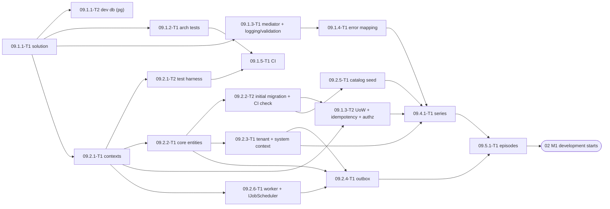
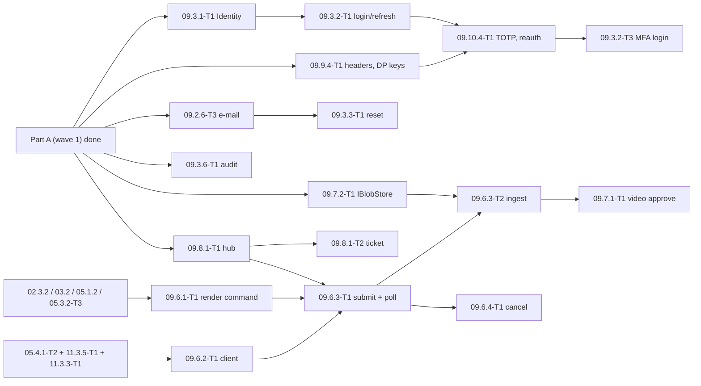

# 09 — Backend API: Tech Lead review, shared decisions and feature index (wave 1 = Part A, wave 2 = Part B)

> Reviews: `../../09-backend-api.md` §4 epics 09.1, 09.2, 09.4.1, 09.5.1, §5.1–5.4, §6, §7 and the 00 contracts they rely on (`../../00-overview.md` §5.1–5.4, §6, §7, §8). Process: `../../00-overview.md` §10.1, step (2) review, then step (3) detailed feature plans (this folder).
> Why this wave: it is the precondition for M1 of plan 02 (`../02-story-writing/README.md` §11 item 3). The other 09 epics (09.3 auth, 09.3.6 audit, 09.6–09.10) get their own waves later, in this folder.
> Reviewed: 2026-09-24 by the Tech Lead. Status: **TL Definition-of-Ready review done (§11): ready with conditions; O1–O3 decided and DoR signed by the owner 2026-09-24**. Verdict: **approve with changes**. The skeleton, CQRS-light rules and tenant model are right. But the plan has **two blockers**:
> - The layer rules forbid what plan 02 already codes against (F01, F02).
> - The pipeline order loses idempotency on a crash and gives 02's locks no transaction (F04).
>
> Legend: ✅ read from source/docs (URL + date) · ⚠️ unverified · [DECISION] · [OPEN] · [INFERENCE].

## 0. How this folder is organised

```
plans/features/09-backend-api/
  README.md                          ← this file: facts, findings, shared decisions D1–D17, task template, sequencing, index, re-estimate
  09.1.1-solution-skeleton/          ← story 09.1.1 (solution, projects, props, dev compose)
  09.1.2-architecture-tests/         ← story 09.1.2
  09.1.3-mediator-pipeline/          ← story 09.1.3 (behaviours, unit of work, idempotency)
  09.1.4-error-mapping/              ← story 09.1.4 (ErrorOr → ProblemDetails, ETag / If-Match helpers)
  09.1.5-ci-pipeline/                ← story 09.1.5
  09.2.1-db-contexts/                ← story 09.2.1 (+ integration-test harness)
  09.2.2-core-schema-migrations/     ← story 09.2.2 (P core tables, migration CI check)
  09.2.3-tenant-isolation/           ← story 09.2.3
  09.2.4-outbox/                     ← story 09.2.4
  09.2.5-seed-data/                  ← story 09.2.5
  09.2.6-worker-hangfire/            ← story 09.2.6
  09.4.1-series-crud/                ← story 09.4.1 (prerequisite of 09.5.1)
  09.5.1-episodes/                   ← story 09.5.1
```

Each feature folder holds `plan.md` (template `00-overview.md` §10.1, sections 1–11) and one `<task-id>-<slug>.md` per task (template §6). Task IDs follow `00-overview.md` §9. They **replace** the matching rows of `09-backend-api.md` §6 (mapping in §8). New tasks get the next free `T<n>` of their story.

## 1. Facts verified for this review

Read on 2026-09-24 from nuget.org (`api.nuget.org/v3-flatcontainer/<id>/index.json` and the package `.nuspec`) and the upstream repositories. Re-check at implementation time.

| # | Fact | Source |
|---|---|---|
| N1 | `Mediator.SourceGenerator` / `Mediator.Abstractions` **3.0.2**, MIT ✅. Message types `ICommand<TResponse>`, `IQuery<TResponse>`; handlers `ICommandHandler<,>`, `IQueryHandler<,>`; `IPipelineBehavior<TMessage,TResponse>` with `ValueTask<TResponse> Handle(TMessage, MessageHandlerDelegate<TMessage,TResponse> next, CancellationToken)` ✅ | github.com/martinothamar/Mediator README §3.1–3.3; GitHub license API |
| N2 | Mediator options are compile-time: `ServiceLifetime` (**default `Singleton`**), `Assemblies`, `PipelineBehaviors` ("ordered array of types used for the pipeline"; the generator adds the DI registrations itself). `CachingMode` exists only from v3.1, which is not a stable release ✅ | Mediator README §3.4 |
| N3 | `ErrorOr` **2.1.1**, MIT ✅. Targets `net10.0`, `net8.0`, `netstandard2.0`, with no dependencies ✅ | nuspec; github.com/error-or/error-or LICENSE.md |
| N4 | `FluentValidation` + `FluentValidation.DependencyInjectionExtensions` **12.1.1**, Apache-2.0 ✅ | nuspec |
| N5 | `Hangfire.Core` / `Hangfire.AspNetCore` **1.8.25**. `LICENSE.md` offers **LGPL v3 or a commercial licence** (GitHub reports NOASSERTION because the licence is multi-licence) ✅. `BackgroundJobClientExtensions` has `Enqueue<T>(…, string queue, Expression…)` overloads ✅ | github.com/HangfireIO/Hangfire LICENSE.md, `src/Hangfire.Core/BackgroundJobClientExtensions.cs` |
| N6 | `Hangfire.PostgreSql` **1.21.1**, LGPLv3 ✅. Targets `netstandard2.0` and depends on `Hangfire.Core ≥ 1.8.0` and `Npgsql ≥ 6.0.11`. The repo moved to `hangfire-postgres/Hangfire.PostgreSql` (last push 2026-03-18). Whether it runs with Npgsql 10 is ⚠️ not verified | nuspec; GitHub API |
| N7 | `Npgsql.EntityFrameworkCore.PostgreSQL` **10.0.3** (PostgreSQL licence) requires `Microsoft.EntityFrameworkCore` `[10.0.4, 11.0.0)` ✅. `Microsoft.EntityFrameworkCore` **10.0.12** MIT ✅. `EFCore.NamingConventions` **10.0.1**, Apache-2.0, requires EF `[10.0.1, 11.0.0)` ✅ | nuspec |
| N8 | `xmin` concurrency: map a `uint` property with `IsRowVersion()` or `[Timestamp]`, and Npgsql maps it to the `xmin` system column ✅ | github.com/npgsql/doc `conceptual/EFCore.PG/modeling/concurrency.md` |
| N9 | EF Core 10 has **named query filters** (several filters per entity, each one can be disabled by name) and complex types mapped with `ComplexProperty(…, b => b.ToJson())` ✅. Npgsql support for complex-type `ToJson()` is ⚠️ not verified | github.com/dotnet/EntityFramework.Docs `ef-core-10.0/whatsnew.md` |
| N10 | `TngTech.ArchUnitNET` + `TngTech.ArchUnitNET.xUnitV3` **0.13.4**, Apache-2.0, repo active (push 2026-09-24) ✅. `NetArchTest.Rules` **1.3.2**, MIT, last release 2021-05-23 ✅ | nuspec; GitHub API |
| N11 | Test stack: `xunit.v3` **4.0.1** Apache-2.0, `Microsoft.AspNetCore.Mvc.Testing` **10.0.12** MIT, `Shouldly` **4.3.0** BSD-3-Clause ✅. No container library: integration tests use the real PostgreSQL 17 named by `NTS_TEST_PG` (owner 2026-09-28, 00 §5.1; 09 W3 CR-35) | nuspec; 00 §5.1 ✅ |
| N12 | Other packages: `Riok.Mapperly` 4.3.1 Apache-2.0, `Serilog.AspNetCore` 10.0.0 Apache-2.0, `Microsoft.AspNetCore.OpenApi` 10.0.12 MIT, `Npgsql` 10.0.3 ✅ | nuspec |
| N13 | .NET 10: runtime 10.0.12, SDK 10.0.401 ✅ (00 §5.1, 2026-09-08). `Guid.CreateVersion7()` (BCL since .NET 9) and `JsonNamingPolicy.SnakeCaseLower` (since .NET 8) ⚠️ from docs knowledge, not re-read | 00 §5.1 |
| N14 | Hangfire recurring jobs are cron-based, and the default `SchedulePollingInterval` is 15 s ⚠️ (not re-read). So a 5-second recurring job is not reliable | [INFERENCE] |

## 2. Findings

Severity: **B** blocker · **H** high · **M** medium · **L** low.

| # | Sev | Where | Finding | Resolution |
|---|---|---|---|---|
| F01 | B | 09.1.1 (09 L58), 00 §5.2 | Domain may have "no package references". But 02 domain methods already return `ErrorOr<Success>`, for example `Episode.RequestStoryGeneration` and `FailStoryGeneration` (02.2.2-T1 L87–90, plan L143). They cannot compile under that rule | [DECISION D1] Domain may reference exactly one package: `ErrorOr` (MIT, no dependencies, N3). Nothing else. The architecture test enforces the allow-list. CR-1 |
| F02 | B | 09.1.1 (L58), 09 §5.1 (L316) | Application may reference only Domain, Mediator.Abstractions, FluentValidation and ErrorOr. But `IAppDbContext` exposes `DbSet<T>` (`db.Episodes.FindAsync`, 09 §5.1; `IAppDbContext.GenerationRuns`, 02.2.2-T1 L128), and queries use `ToListAsync` | [DECISION D1] Application also references `Microsoft.EntityFrameworkCore` (the core package, no provider). `Npgsql*` and `…EntityFrameworkCore.Relational` stay Infrastructure-only (architecture test). CR-1 |
| F03 | H | 09.1.3 | Mediator 3 registers handlers as **singletons** by default (N2), but the handlers take the scoped `IAppDbContext` | [DECISION D4] `options.ServiceLifetime = ServiceLifetime.Scoped` in both composition roots |
| F04 | B | 09.1.3 (L67) | Two problems with the order `… → Idempotency → UnitOfWork`. First, the stored idempotent response is written **outside** the command transaction: if the process crashes between commit and store, the retry runs the paid command a second time. Second, UnitOfWork only calls `SaveChanges`, so there is no ambient transaction for the locks 02 relies on: `pg_advisory_xact_lock` (02 D1/T61) and `LockEpisodeForUpdateAsync` (`SELECT … FOR UPDATE`, 02.4.2-T1 L61) | [DECISION D5/D6] New order: `Logging → Authorization → Validation → UnitOfWork → Idempotency → Audit → handler`. UnitOfWork opens an explicit transaction **before** the handler runs. Idempotency claims its key inside that transaction. CR-2 |
| F05 | H | 09.3.6-T1 (P, 02 CR-3), 09 §7 L543 | `AuditBehavior` has no place in the pipeline. "A rolled-back command leaves no activity row" is only true if audit rows are written inside the command transaction | [DECISION D4] Audit runs inside UnitOfWork, after Idempotency. 09.3.6-T1 fills the slot; this wave reserves it |
| F06 | H | 09 §5.3 (L345) | `OutboxDispatcherJob` is a "recurring 5 s" Hangfire job. Hangfire recurring jobs are cron-based and polled (N14), so 5 s is not reliable, and missed ticks pile up | [DECISION D11] The dispatcher is a Worker `BackgroundService`: a 5 s loop claiming rows `FOR UPDATE SKIP LOCKED`, safe with several Worker instances. CR-3 |
| F07 | H | 00 §6 `outbox_messages` (L305), 09.2.3 (L93) | "`SystemContext(userId)` from the outbox payload; a missing `userId` fails the job" has no column behind it. There is also no retry schedule (`next_attempt_at`), no dead-letter state and no trace context for NFR-09-4 | [DECISION D11] Add columns `user_id` (nullable only for platform events), `next_attempt_at`, `failed_at`, `trace_parent`. CR-4 |
| F08 | H | 09.2.2 (L84–85) | "Every table from 00 §6" in P means about 30 SaaS tables (credits, payments, promos, refunds …) are built in P, and it collides with 02. 02 creates its own tables (`generation_runs`, `story_sources`, `fetch_tasks`, `fact_sheets`, `source_candidates`, `price_versions`, `series_bibles`, `episode_ideas`), but expects 09.2.2 to create `story_versions`, `autopilot_runs`, `series_autopilot_authorizations`, `moderation_events` and `usage_records` (02.8.3 plan L113, 02.2.4-T1 L35, 02.4.1-T1 L85) | [DECISION D9] A table-ownership list: 09.2.2 creates the **P core set**; every other table is created by the migration of the feature that owns it. The credits/payments/promos/refunds tables this finding listed were phase S and are now deleted with plan 12 (DEC 10.14), so only the P set exists (D9 below). CR-5 |
| F09 | M | 09.2.6-T1 (09 §6 L489) | The Worker host depends on 09.10.4-T1 (MFA) only because of the dashboard, so every 02 job waits for auth work | Split: 09.2.6-T1 = host, `IJobScheduler`, recurring jobs, arch test; 09.2.6-T2 = dashboard (after 09.10.4-T1) |
| F10 | M | 09.1.1-T2 (L476), 11.1.1-T1 (11 L184) | Circular dependency: 09.1.1-T2 depends on 11.1, and 11.1.1-T1 depends on 09.1.1 | 09.1.1-T2 = `docker-compose.yml` with **PostgreSQL only**; 11.1.1-T1 extends that file (api, worker, mock-mpt, storage emulator). CR-6 |
| F11 | M | 00 §6 `idempotency_keys` (L306) | The behaviour runs in Application and never sees an HTTP status, so `status_code` cannot be filled; `created_at` is missing | [DECISION D6] Replace `status_code` with `response_type`; add `created_at`. CR-4 |
| F12 | M | 00 §6 `users` (L260) | `email citext unique` duplicates ASP.NET Core Identity's unique `normalized_email` index and needs the `citext` extension | [DECISION D9] Uniqueness comes from Identity's `normalized_email` unique index; no `citext`. CR-4 |
| F13 | M | 09.2.1 (L81), 09 §5.4 | An `xmin` race that `If-Match` does not cover throws `DbUpdateConcurrencyException`, and there is no error code for it | [DECISION D5] UnitOfWork maps it to 409 `concurrency_conflict` (retryable). CR-7 |
| F14 | M | 09.5.1 (L167), 00 §7 | DELETE semantics are open: 00 §7 says "cancelled (user deletes)", 09.5.1 says "assets are scheduled for deletion", and there is no rule for `story_generating` | [DECISION D16] `DELETE` → `cancelled`, hidden from reads (404), `EpisodeCancelled` → asset retention. `rendering` and `story_generating` → 409 `episode_invalid_state`. Hard delete belongs to 13.3.1 |
| F15 | M | 09 §5.4, 02 D9 | `series_conflict` (412) exists, but no series ETag besides the autopilot `sa-` one | [DECISION D15] `"se-<xmin>"` on `GET/PATCH /series/{id}`; `If-Match` required on PATCH |
| F16 | M | 09.5.1 (L165) | Creating an episode in an archived series is not defined | 409 `series_archived` (new code). CR-7 |
| F17 | L | 02 task files | Drift found while pinning names. Test-project names `NightTales.IntegrationTests` (02.6.1-T1, 02.6.2-T1) and `NightTales.ArchitectureTests` (02.2.2-T1) do not exist. 02.5.5-T1 uses `Topic.Fiction` (no such topic, 00 §6) and `Error.NotFound("fact_sheet_required", 409)` | Fixed in the 02 files (D2 names; D7 code-driven mapping; `topic != TrueCrime`) (09 CR-9) |
| F18 | L | 00 §5.4 (L244) | Architecture-test library ⚠️ | [DECISION D1] ArchUnitNET (N10), because NetArchTest's last release is from 2021 |
| F19 | L | 00 §5.1 (L152) | Hangfire licence ⚠️ | Confirmed LGPL-3.0 multi-licence (N5, N6). Owner decision O1 (§10) |
| F20 | L | 00 §5.2 (L172) | `IClock` is listed as an Application port, but 02 domain methods take `IClock` (02.6.3-T1 L32–36, 02.8.1-T1 L51–54) | [DECISION D3] `IClock` lives in `Domain/Common` (a pure interface). Application and Infrastructure use it from there |
| F21 | M | 02 README §11 item 3 | The 02 M1 gate names 09.1, 09.2 and 09.5.1, but 09.5.1 depends on 09.4.1 (09 §6 L505), and the owner cannot use the studio without login (09.3) | This wave includes 09.4.1. 02 M1 **development** runs against the test auth scheme (D13). 02 M1 **exit** also needs auth wave 2: 09.3.1-T1, 09.3.2-T1, 09.3.2-T3, 09.10.4-T1 (TOTP) and 09.3.6-T1 (audit). CR-10 to 02 README |
| F22 | L | 09.2.5 (L102) | The owner seed needs ASP.NET Core Identity (09.3.1-T1), but it sits in the persistence epic | 09.2.5-T1 = catalogs + flags; 09.2.5-T2 = owner seed (after 09.3.1-T1) |

## 3. Shared decisions for all feature plans (contract)

Feature plans and task files MUST use these names exactly. Make any change here first.

**D1 Packages and references [DECISION].**
- Pinned in `Directory.Packages.props`, all at the N1–N12 versions:
  - Mediator 3.0.2
  - ErrorOr 2.1.1
  - FluentValidation 12.1.1
  - EF Core 10.0.12
  - Npgsql EF 10.0.3
  - EFCore.NamingConventions 10.0.1
  - Hangfire.Core / AspNetCore 1.8.25
  - Hangfire.PostgreSql 1.21.1
  - ArchUnitNET 0.13.4
  - xunit.v3 4.0.1 (test projects; `NightTales.TestKit` references `xunit.v3.extensibility.core` 4.0.1, because xunit.v3 makes every referencing project an executable test project) and Microsoft.Testing.Platform as the `dotnet test` runner (`global.json` `test.runner`; xunit.v3 4.x does not run under VSTest on the .NET 10 SDK) (09 W3 CR-36)
  - Mvc.Testing 10.0.12
  - Shouldly 4.3.0
  - Serilog.AspNetCore 10.0.0
  - Microsoft.AspNetCore.OpenApi 10.0.12
  - Newtonsoft.Json 13.0.4, a transitive pin (`CentralPackageTransitivePinningEnabled`): Hangfire.Core 1.8.25 pulls 11.0.1, which NuGetAudit reports as GHSA-5crp-9r3c-p9vr (high) and the build fails on (09 W3 CR-36)
- Reference rules (the architecture test enforces them):

| Project | May reference |
|---|---|
| `NightTales.Domain` | `ErrorOr` only (F01) |
| `NightTales.Application` | Domain, `NightTales.RenderNode.Contract` (11 CR-3), `Mediator.Abstractions`, `FluentValidation`, `ErrorOr`, `Microsoft.EntityFrameworkCore` (core only, F02) |
| `NightTales.RenderNode.Contract` | BCL only (11 CR-3) |
| `NightTales.RenderNode.Server`, `NightTales.MptAdapter`, `NightTales.MockMpt` | per `../11-worker-deployment/README.md` D3; never Domain, Application or Infrastructure (11 CR-3) |
| `NightTales.Infrastructure` | Application, Npgsql EF, NamingConventions, `Microsoft.AspNetCore.Identity.EntityFrameworkCore`, Hangfire.Core + Hangfire.PostgreSql, `Microsoft.Extensions.*` |
| `NightTales.Api` | Application, Infrastructure (composition root only), `Mediator.SourceGenerator`, `Hangfire.AspNetCore` (dashboard, 09.2.6-T2), `Microsoft.AspNetCore.OpenApi`, Serilog |
| `NightTales.Worker` | Application, Infrastructure (composition root only), `Mediator.SourceGenerator`, `Hangfire.AspNetCore` (`AddHangfireServer`) |
| `NightTales.Fetcher.Core` / `NightTales.Fetcher` | as in 02 CR-19 (Domain only / Fetcher.Core only) |

- Tests use hand-written fakes from `NightTales.TestKit`. There is **no mocking library** [DECISION]: 09 §7 says "in-memory fakes of ports".

**D2 Projects and paths [DECISION].** 00 §5.2 layout plus:
- `src/`: `NightTales.Domain`, `NightTales.Application`, `NightTales.Infrastructure`, `NightTales.Api`, `NightTales.Worker`, `NightTales.Fetcher.Core`, `NightTales.Fetcher` (the Fetcher projects are created by 02.5.2-T3; 09.1.1 only reserves the names in the solution filter), `NightTales.RenderNode.Contract` (created empty by 09.1.1-T1), `NightTales.RenderNode.Server`, `NightTales.MptAdapter` (created by 11.3.5-T1/T2); `tools/mock-mpt` (11.1.2-T1) (11 CR-3).
- `tests/`: `NightTales.Domain.UnitTests`, `NightTales.Application.UnitTests`, `NightTales.Infrastructure.UnitTests`, `NightTales.Architecture.Tests`, `NightTales.Api.IntegrationTests` (all DB and HTTP tests, including Worker jobs run in-process), `NightTales.TestKit` (fakes, fixtures, builders; referenced by every test project).
- Feature-owned suites may add `NightTales.AcceptanceTests` / `NightTales.Performance.Tests`; these are excluded from the default `dotnet test` run by the solution filter `NightTales.ci.slnf`.
- Files: `global.json` (SDK `10.0.401`, `rollForward: latestPatch`), `Directory.Build.props`, `Directory.Packages.props`, `.editorconfig`, `NightTales.sln`, `docker-compose.yml` (repo root; the optional e2e/image-smoke path — daily dev uses the native Homebrew `postgresql@17` database from 09.1.1-T2, 09 W3 CR-35).

**D3 Domain primitives (`src/NightTales.Domain/Common/`) [DECISION].**
```csharp
public interface IClock { DateTimeOffset UtcNow { get; } }                 // UTC only (F20)
public interface IDomainEvent { DateTimeOffset OccurredAt { get; } }       // records; payload = ids, enums, small values only
public interface IUserOwned { Guid UserId { get; } }                       // tenant filter marker (D10)
public abstract class Entity { public Guid Id { get; protected init; } }   // Guid.CreateVersion7() in factories, ValueGeneratedNever
public abstract class AggregateRoot : Entity
{
    public uint Version { get; private set; }                              // mapped to xmin (N8)
    public IReadOnlyList<IDomainEvent> DomainEvents { get; }
    protected void Raise(IDomainEvent e);
    public void ClearDomainEvents();
}
```
- Domain methods return `ErrorOr<T>` / `ErrorOr<Success>`, and take either `DateTimeOffset now` or `IClock` (both styles exist in 02; new 09 code passes `now`).
- Domain never reads the clock itself.
- `FakeClock : IClock` (settable, `Advance(TimeSpan)`) lives in `tests/NightTales.TestKit/Time/FakeClock.cs`.
- Infrastructure `SystemClock` returns `DateTimeOffset.UtcNow`.

**D4 Mediator and the pipeline [DECISION].**
- Messages use Mediator's own interfaces, `ICommand<ErrorOr<T>>` and `IQuery<ErrorOr<T>>`; handlers are `sealed`.
- Our markers live in `Application/Abstractions/Messaging/`:
  - `IIdempotentCommand { string? IdempotencyKey { get; } }`
  - `IRequireRole { PlatformRole RequiredRole { get; } }`
  - `[AllowAnonymousRequest]`
- Configuration: `AddMediator(o => { o.ServiceLifetime = ServiceLifetime.Scoped; o.Assemblies = [typeof(ApplicationAssemblyMarker)]; o.PipelineBehaviors = MediatorPipeline.Behaviors; })` in Api **and** Worker (F03). `MediatorPipeline.Behaviors` is the single ordered list (`Application/Behaviors/MediatorPipeline.cs`):
  1. `LoggingBehavior<,>` — all messages
  2. `AuthorizationBehavior<,>` — all messages
  3. `ValidationBehavior<,>` — all messages
  4. `UnitOfWorkBehavior<,>` — commands only
  5. `IdempotencyBehavior<,>` — `IIdempotentCommand` only
  6. `AuditBehavior<,>` — commands with `[Audited]`; the slot is reserved, 09.3.6-T1 implements it
- Behaviours are constrained by `where TResponse : IErrorOr`. They short-circuit with `ErrorOrFactory<TResponse>.From(List<Error>)` (`Application/Common/Errors/ErrorOrFactory.cs`), a cached, compiled conversion per closed type.
- Queries skip steps 4–6.

**D5 UnitOfWork semantics [DECISION].**
- For every `ICommand<…>`, the behaviour runs these steps:
  1. `BeginTransactionAsync(IsolationLevel.ReadCommitted)` on `AppDbContext`, **before** the handler.
  2. `next()`.
  3. If the result is **not** an error: `SaveChangesAsync`, which also runs the outbox interceptor (D11), then commit.
  4. Otherwise: rollback, with no `SaveChanges`.
- Port: `IUnitOfWork { BeginAsync; CommitAsync → ErrorOr<Success>; RollbackAsync }` (`Application/Abstractions/Persistence/`), implemented by `EfUnitOfWork` (09.1.3-T2).
- Handlers never call `SaveChangesAsync` or open transactions. Raw locks (`pg_advisory_xact_lock`, `SELECT … FOR UPDATE`) inside handlers join this transaction.
- `DbUpdateConcurrencyException` → rollback → `Error.Conflict(ErrorCodes.ConcurrencyConflict)` (409 `concurrency_conflict`).
- There is **no** retrying execution strategy (`EnableRetryOnFailure` stays off). A transient DB failure surfaces as 503 `service_unavailable`.
- Commands that must persist a failure (for example "run failed") return success values that describe the failure; they do not return errors.

**D6 Idempotency semantics [DECISION].**
- Table `idempotency_keys`:
  - columns `user_id`, `key` (1–128 printable ASCII), `request_hash` (SHA-256 hex of the message type name + canonical JSON of the command without the key), `response_type`, `response jsonb`, `created_at`, `expires_at` (= created + 24 h);
  - unique `(user_id, key)` (F11).
- `IdempotencyBehavior`, inside the UnitOfWork transaction:
  1. `INSERT … ON CONFLICT (user_id, key) DO NOTHING RETURNING id`.
  2. **No row returned** → read the existing row. A concurrent twin blocks on the unique index until the first transaction ends.
     - Different `request_hash` → 422 `idempotency_key_reused`.
     - Expired → overwrite it and continue.
     - Otherwise → deserialize `response` into the success type and return it, without calling the handler.
  3. **Row returned** → `next()`. On success, store `response`, which commits with the command. On error the transaction rolls back and the key disappears with it, so a retry runs again.
- A missing key on a route that requires one is rejected earlier, at the endpoint: 400 `idempotency_key_required` (D7).
- Cleanup: `IdempotencyKeyCleanupJob`, daily, deletes rows where `expires_at < now − 1 d` (09.1.3-T2 registers it once 09.2.6-T1 exists).

**D7 Errors and HTTP mapping [DECISION].**
- Codes are snake_case string constants in `Application/Common/Errors/ErrorCodes.cs`, a closed `static class`. The HTTP status comes from the **catalogue table keyed by code** (`Api/Http/ErrorCatalogue.cs`, 09 §5.4), **not** from `ErrorType`.
  - `ErrorType` is used only to recognise FluentValidation failures (→ `validation_failed` 400, with `errors` grouped by camelCase field).
  - A code missing from the catalogue fails a unit test.
- Factories: `Error.Conflict(code: ErrorCodes.EpisodeInvalidState, description: "…")` etc. Descriptions are English, safe and never contain content.
- ProblemDetails fields: `type` = `https://nighttales.app/errors/<code>` ⚠️ (host is a placeholder), `title`, `status`, `code`, `traceId`, `errors?`, and the extra metadata keys of the error (for example `retryAfterSeconds`).
- Every 429 whose error metadata has `retryAfterSeconds` also sets the `Retry-After` header (02 CR-20).
- Endpoint helpers (`Api/Http/ResultExtensions.cs`):
  - `ToHttpResult()` → 200; `ToHttpResult(etag)` → 200 with the ETag read **after** commit (D15), the delegate the only source
  - `ToCreatedResult(location, etag)` → 201 + `Location` + `ETag`
  - `ToAcceptedResult(location?)` → 202; the name `ToHttpResult202` in 09 §5.1 is renamed to this
  - `ToNoContentResult()` → 204; `ToNoContentResult(etag)` → 204 with the post-commit ETag of a mutation (D15)
- Endpoint filters (`Api/Http/Filters/`):
  - `RequireIdempotencyKey()` → 400 `idempotency_key_required`
  - `RequireIfMatch()` → 428 `if_match_required`
  - `IfMatchHeader` binder → `string?`, passed into the command
- ETag comparison (strong, exact string) is done in the handler against the aggregate's current value; mismatch → 412 with the resource code.

**D8 Persistence conventions [DECISION].**
- Contexts: `AppDbContext : IdentityDbContext<AppUser, AppRole, Guid>, IAppDbContext` and `ReadDbContext : DbContext, IReadDb`. Both apply the same configurations (`ApplyConfigurationsFromAssembly`) and the same query filters. Only `AppDbContext` owns migrations.
- Naming: `UseSnakeCaseNamingConvention()`. The Identity tables are renamed `users`, `roles`, `user_roles`, `user_claims`, `user_logins`, `user_tokens`, `role_claims`.
- Times are `DateTimeOffset` UTC → `timestamptz`. Npgsql rejects non-zero offsets, and that error is intended.
- Enums are stored as snake_case text with a `CHECK` constraint generated by `builder.HasEnumCheck<TEnum>(column)` (`Persistence/Conventions/EnumCheckExtensions.cs`).
- Ids: UUIDv7 from `Guid.CreateVersion7()` in domain factories; the database never generates ids.
- Concurrency: aggregates map `Version` → `xmin` via `IsRowVersion()` (N8).
- JSON: structured `jsonb` uses EF complex types with `ToJson()` (spike PASSED 2026-09-29 on Npgsql EF 10.0.3 / PostgreSQL 17: round-trip incl. nested `List<string>`, translated JSON-property query, `ExecuteUpdate` on a nested complex property — 09.2.1-T1 Notes; N9 resolved ✅). Opaque payloads only (outbox) use `string`/`JsonDocument` with `HasColumnType("jsonb")` fallback.
  - **(09 W3 CR-44)** 09.2.2-T1's own five structured columns — `series.autopilot_settings`, `story_versions.content`, `story_versions.audit_report`, `autopilot_runs.gate_results` and `feature_flags.rules` — stay `string` + `HasColumnType("jsonb")`. Their typed shapes belong to the tasks that own each document via its own migration; EF also rejects an empty complex type, a `JsonElement` member NREs on save, and a single-string shell writes `{"Json":…}`, which additionally breaks `feature_flags.rules` DEFAULT `'{}'`. The task that owns the persisted document type switches that column to `ComplexProperty(…, b => b.ToJson())` when it lands, keeping the column `jsonb`: 02.8.3-T1 `autopilot_settings` and `gate_results`, 02.2.2-T1 `content` and `audit_report`. `feature_flags.rules` is exempt and stays `string` + `jsonb` permanently: nothing parses it in P — 09.9.2-T2 reads `enabled` only and the `rules` evaluation (06.5.2-T1) is dropped by DEC 10.14 — so DEFAULT `'{}'` survives.
- `IAppDbContext` exposes `DbSet<T>` per aggregate/entity. 09 adds only its own sets; each feature adds its own.
- `IReadDb` exposes `IQueryable<T> Query<T>() where T : class` (no tracking, tenant filter applied); `ReadDbContext.SaveChanges*` throws `InvalidOperationException`.
- Infrastructure-only helpers such as `LockEpisodeForUpdateAsync` (02) are implemented on `AppDbContext` and declared on `IAppDbContext`.
- Audit timestamps (09 W3 CR-38): `Domain/Common/ICreatedAt { DateTimeOffset CreatedAt }` and `IAuditable : ICreatedAt { DateTimeOffset UpdatedAt }` are owned by 09.2.2-T1. Every entity implements `ICreatedAt` (immutable/append-only tables such as `story_versions`, `usage_records` stop there); entities of mutable tables implement `IAuditable`. One EF convention maps `created_at` for every `ICreatedAt` and `updated_at` only for `IAuditable`, both `timestamptz NOT NULL`, and `AuditableSaveChangesInterceptor` (Infrastructure) stamps them from `IClock`: on `Added` → `CreatedAt` **only while it is still `default`**, plus `UpdatedAt` for `IAuditable`; on `Modified` → `UpdatedAt`.
  - A factory that already received `now` keeps working unchanged (the interceptor never overwrites a non-default `CreatedAt`), so the manual stamps stay only where the factory already takes `now`: 09.5.1 `plan.md`:64, 09.2.5-T2, 09.2.6-T3 `EmailMessage.Queue`, 02.2.2-T1.
  - Interceptor order on `AppDbContext`: `AuditableSaveChangesInterceptor` **first**, then `OutboxSaveChangesInterceptor` (09.2.4-T1) — both flush inside the one `SaveChanges`, and the outbox reads `DomainEvents` after the stamps are written.
  - Set-based `ExecuteUpdateAsync` bypasses interceptors, so every such path on an `IAuditable` table sets `UpdatedAt` explicitly with `SetProperty(e => e.UpdatedAt, now)` (09.5.1's asset-retention update, 09.7.3-T1's `deleted_at` sweep); `ExecuteDeleteAsync` needs no stamp.
- PostgreSQL 17 everywhere: native Homebrew `postgresql@17` for dev (`127.0.0.1:5432`, 09.1.1-T2), a `postgres:17` service container for CI/tests, the `postgres:17-alpine` image for the optional compose path, production on the same major ⚠️ (hosting choice 11.2.1; owner decisions O3 and 2026-09-28, 00 §5.1; 09 W3 CR-35).

**D9 Table ownership in P [DECISION, CR-5].**
- The 09.2.2 initial migration `InitialCore` creates, from 00 §6:
  - the Identity tables (D8 names) with the 00 §6 `users` columns (role, status, ui_locale, display_name, two_factor_enabled, last_totp_step, security_stamp, owner_dispute_freeze_until, last_login_at, `email_verified_at timestamptz NULL`) and no `citext` (F12; `email_verified_at` by 09 W3 CR-39); `owner_dispute_freeze_until` is a **shipped column, unused after DEC 10.14** — no P feature reads or writes it;
  - `series`, `episodes`, `story_versions` (base columns);
  - `series_autopilot_authorizations`, `autopilot_runs` (base columns);
  - `moderation_events`, `usage_records` (with the 02 CR-4 `operation` values);
  - `assets`, `voices`, `style_templates`, `feature_flags`;
  - `outbox_messages` (D11), `idempotency_keys` (D6).
- `assets` **index** split (09 W3 CR-40): 09.2.2-T1 owns the column types and `ix_assets_retention_due` is **not** created here — it belongs to 09.7.3-T1's index-only migration (`(retention_until) WHERE deleted_at IS NULL AND retention_until IS NOT NULL`), and 09.2.2's `assets` set carries only `(episode_id)`.
- `OutboxMessage` (the Infrastructure type behind `outbox_messages`) is owned by 09.2.2-T1; 09.2.4-T1 consumes it as **Changed**, never as new (09 W3 CR-41).
- Every other table is created by its owner's migration, expand-only:

| Owner | Tables |
|---|---|
| 02 | `generation_runs`, `story_sources`, `fetch_tasks`, `fact_sheets`, `source_candidates`, `price_versions`, `series_bibles`, `episode_ideas` |
| 09.3.x | `refresh_tokens`, `auth_challenges`, `user_action_tokens` (09.3.2-T1, 09.3.2-T3, 09.3.3-T1), `user_consents` (09.3.1-T1) (09 W2 CR-5); `trusted_devices` was S and is not created (DEC 10.14) |
| 09.2.6-T3 | `email_messages` (09 W2 CR-5) |
| 09.8.1-T2 | `hub_tickets` (09 W2 CR-5) |
| 09.9.4-T1 | `data_protection_keys` (09 W2 CR-5) |
| 09.3.6-T1 | `audit_logs` |
| 09.6.1-T1 | `render_jobs` (09 W2 CR-5) |
| 11.3.3-T1 (11 CR-3) | `worker_nodes` |
| — | `system_settings`, `system_setting_versions` were 09.10.1's (S); that task is deleted by DEC 10.14, so the tables are **not created**. Critical settings stay in `appsettings`/user-secrets |
| 06 | `channel_connections`, `publications`, `platform_quota_usage` |
| 05 | `music_tracks` |
| 13 (P items) | `data_deletion_requests` (13.3.1-T1); `legal_documents` is **not created at all** — its designing task (13.2.2-T1) is deleted by DEC 10.14, and the runtime source of a legal version stays the `LegalDocuments:Current:*` config (13 CR-1) |

- The former S-only tables (`credit_*`, `payments`, `payment_events`, `promo_*`, `refund_requests`, `credit_grant_requests`, `owner_action_requests`, `approval_cancel_tokens`, `system_setting_changes`, `reports`) are **not created at all** — plan 12 and the S tasks that owned them are deleted (DEC 10.14).
- `provider_balance_snapshots` and `provider_topups` are **kept** by DEC 10.14 (the owner's own OpenAI spend runway) but **no task owns them** after 12.8.x was deleted: the columns, the runway alert and the pause gate stay as written in `plans/00-overview.md` §6 and 02.8.3-T4 ("implementation to be re-planned"), and the gap is tracked as STATUS open finding `DEC10.14-1`.
- The initial migration is the only one generated before any feature. Features add one migration each, named `<yyyyMMddHHmm>_<Owner>_<What>`.

**D10 Tenant isolation [DECISION].**
- Every user-owned entity implements `IUserOwned`. The EF named filter `"tenant"` is `e => e.UserId == _currentUserId`, a `Guid?` context field read from `ICurrentUser` at context construction, **parameterized** per query. An unauthenticated context therefore sees no rows.
- `ICurrentUser` (`Application/Abstractions/ICurrentUser.cs`): `Guid? Id`, `bool IsAuthenticated`, `PlatformRole Role`, `ActorType Actor` (`user`/`admin`/`system`).
  - Api implementation: claims (`sub`, `role`); the `role` claim is believed only behind a valid, non-empty `sub`, so a request without a user is `user`/`user` however it is labeled.
  - Worker implementation: `ScopedCurrentUser`, set by `ISystemContext`.
- `ISystemContext.For(Guid userId) : IDisposable` (`Application/Abstractions/ISystemContext.cs`, scoped) sets the scope's `ICurrentUser` to `{ Id = userId, Actor = system }`, **before** any `AppDbContext` is resolved in that scope.
  - Nesting or a second call throws.
  - `Guid.Empty` throws.
  - 02's `SystemContext.For(run.UserId)` reads as a call on the injected `ISystemContext`.
- `IgnoreQueryFilters(["tenant"])` is allowed only in the classes on the architecture-test allow-list (`RetentionSweepJob`, `DataDeletionJob`, `SystemWorkQuery` (the former `CreditReconciliationJob` is deleted with plan 12, DEC 10.14)). The former `Application/Features/Admin/**` permission is **not available in P** (DEC 10.14 — no `Admin` feature folder exists in `src/`); the residual `IgnoreQueryFiltersNamespacePrefix` entry in `tests/NightTales.Architecture.Tests/AllowLists.cs` is dead surface, tracked in STATUS `DEC10.14-2`.
  - Cross-user sweeps read `(id, user_id)` pairs through `ISystemWorkQuery` and process each one under `ISystemContext.For`.
- Other users' rows answer **404 `not_found`**, never 403.

**D11 Outbox [DECISION, CR-3, CR-4].**
- `outbox_messages` columns:
  - `id`, `type` (stable name, below), `payload jsonb`, `user_id` (NOT NULL except for platform events that carry `[PlatformEvent]`);
  - `occurred_at`, `next_attempt_at`, `attempts`, `processed_at`, `failed_at`, `error` (≤ 2,000 chars, safe text), `trace_parent`.
  - Partial index `(next_attempt_at) WHERE processed_at IS NULL AND failed_at IS NULL`.
- Writing: `OutboxSaveChangesInterceptor` (`Persistence/Outbox/`) collects `DomainEvents` from tracked `AggregateRoot`s during `SavingChanges`, adds one row per event in the **same** `SaveChanges`, then clears the events.
  - `type` = the event's `[OutboxEvent("story_approved.v1")]` name. A missing attribute fails the architecture test.
  - `user_id` comes from the aggregate's `IUserOwned.UserId`.
  - `trace_parent` = the current `Activity.Current?.Id`.
- Dispatching: `OutboxDispatcher` is a Worker `BackgroundService`, `Outbox:PollIntervalSeconds` = 5, `Outbox:BatchSize` = 20. Each batch:
  1. Claim rows: `SELECT … WHERE processed_at IS NULL AND failed_at IS NULL AND next_attempt_at <= now() ORDER BY occurred_at LIMIT @n FOR UPDATE SKIP LOCKED`, in a short transaction that bumps `next_attempt_at` by 5 min (a lease).
  2. Handle each message in its **own DI scope** under `ISystemContext.For(user_id)`, calling every `IOutboxHandler<TEvent>` in registration order.
  3. On success: `processed_at = now`.
  4. On exception: `attempts++`, `next_attempt_at = now + min(2^attempts s, 5 min)`; after 10 attempts `failed_at = now` and the dead-letter metric is incremented.
- Handlers are idempotent by contract (at-least-once). `IOutboxHandler<TEvent>` (`Application/Abstractions/Outbox/`): `ValueTask HandleAsync(TEvent e, OutboxContext ctx, CancellationToken ct)`, with `OutboxContext(Guid MessageId, Guid? UserId, int Attempt, DateTimeOffset OccurredAt)`.
- A handler that changes data sends a command through `ISender`, so the pipeline and UnitOfWork apply. A handler that only enqueues calls `IJobScheduler`.
- Metrics: `outbox_lag_seconds` (oldest unprocessed), `outbox_dead_letters_total`.

**D12 Jobs [DECISION].**
- `IJobScheduler` (`Application/Abstractions/Jobs/IJobScheduler.cs`):
  - `string Enqueue<TJob>(Expression<Func<TJob, CancellationToken, Task>> call) where TJob : class, IBackgroundJob`
  - `string Schedule<TJob>(Expression<Func<TJob, CancellationToken, Task>> call, TimeSpan delay)`
  - `void AddOrUpdateRecurring<TJob>(string id, string cron, Expression<Func<TJob, CancellationToken, Task>> call)`
  - `void RemoveRecurringIfExists(string id)`
- Shorthand in 02 (`Enqueue<GenerateStoryJob>(runId)`) means `Enqueue<GenerateStoryJob>((j, ct) => j.RunAsync(runId, ct))`.
- Job classes live in Application `Features/<F>/Jobs/<Name>Job.cs`: plain `sealed` classes implementing the marker `IBackgroundJob`, resolved from DI, with no Hangfire attributes. The `Worker/Jobs/` folder holds only recurring registrations.
- `[JobPolicy(Queue = JobQueue.Default, Retries = 0)]` (Application) is translated by `JobPolicyFilterProvider` (Infrastructure `Jobs/`, a Hangfire `IJobFilterProvider` ⚠️ confirm API) into the queue and an `AutomaticRetryAttribute`. Default when absent: `default` queue, **0** retries.
- Queues: `default`, `render`, `publish`, `email` (09.2.6). Worker counts come from `Jobs:Workers:<queue>`.
- Storage: Hangfire.PostgreSql, same database, schema `hangfire`.
- Ids-only rule: every public method of an `IBackgroundJob` takes only `Guid`, `int`, `long`, enums, `DateTimeOffset`, `CancellationToken`, or a `string` whose parameter name is on the allow-list (`idempotencyKey`, `recurringId`). The architecture test enforces it.
- The Api never schedules jobs: its `IJobScheduler` registration throws. Side effects go through the outbox, and the outbox handlers run in the Worker (09.2.6-T1).
- Recurring jobs are registered at Worker start through `IRecurringJobRegistration` implementations (`AddOrUpdateRecurring` by stable id). Every id that is no longer registered is removed — there is **no prefix exception** (the `manual:` carve-out is dropped, 09 W3 CR-42); a test registers an id in one start and asserts it is gone on the next.
- Config: `Jobs:Workers:<queue>`, `Jobs:QueuePollSeconds` (Hangfire queue poll, 5) and `Jobs:SchedulePollSeconds` (the scheduler's own poll for `Schedule<TJob>` delays) — 09 W3 CR-42.

**D13 Test harness [DECISION].**
- `NightTales.TestKit` holds:
  - `PostgresFixture`: connects to the real PostgreSQL 17 named by `NTS_TEST_PG` — no container is started and no Docker is needed. Missing/blank `NTS_TEST_PG`, or a server that is not major 17, fails the fixture fast with a named error (never a silent skip). It rebuilds a template database once per run and each test class gets `CREATE DATABASE … TEMPLATE nts_template` (09 W3 CR-35).
  - `ApiFactory : WebApplicationFactory<Program>`.
  - `TestAuthHandler`: scheme `Test`; headers `X-Test-User` / `X-Test-Role`; registered **only** by `ApiFactory`.
  - `WorkerHost`: builds the **same** service collection as `Worker/Program.cs` through the `AddWorkerServices` extension (owned by 09.2.6-T1) and has two modes (09 W3 CR-42): **inline** (default) replaces `IJobScheduler` with `InlineJobScheduler`, which runs the job synchronously and records the calls, and starts no Hangfire server; **real-server** (opt-in, `WorkerHost.WithHangfireServer`) adds the Hangfire server with `SchedulePollingInterval = 1 s` for the 09.2.6-T1 enqueue/queue/routing tests only.
  - `FakeClock`, builders (`SeriesBuilder`, `EpisodeBuilder`).
- Integration tests never sleep. They drive time with `FakeClock` and call jobs and dispatcher iterations directly.

**D14 API conventions [DECISION].**
- Base `/api/v1` with Minimal API groups. Each feature implements `IEndpointGroup { void Map(IEndpointRouteBuilder app); }` (`Api/Endpoints/<Feature>Endpoints.cs`), discovered at startup.
- JSON: camelCase properties, enums as snake_case strings (`JsonStringEnumConverter(JsonNamingPolicy.SnakeCaseLower)`), UTC ISO-8601 times.
- Cursor pagination:
  - request `?cursor=&limit=`; `limit` defaults to 20, 1–100, otherwise 400 `validation_failed`;
  - response `{ items, nextCursor }`;
  - the cursor is opaque base64url JSON `{ "c": createdAt, "i": id }`, ordered `(created_at DESC, id DESC)` as a keyset;
  - an invalid cursor → 400 `validation_failed` (field `cursor`).
- The OpenAPI document is generated at build to `src/NightTales.Api/openapi.json` (09.1.5-T1; 09.9.5 owns the contract diff).

**D15 ETags [DECISION].** In addition to 02 D9:
- Episode ETag = `"ep-<episodes.xmin>"`.
- Series ETag = `"se-<series.xmin>"` on `GET/PATCH /series/{id}`. `If-Match` is required on `PATCH /series/{id}` (428 / 412 `series_conflict`).
- Every ETag is returned in the `ETag` header and in the DTO field `etag`.
- `xmin` is assigned at commit, after the handler has returned (D5). Commands therefore return ids, and the endpoint reads the ETag after commit through the async etag delegate of `ToCreatedResult` / `ToHttpResult` (09.1.4-T1, 09.4.1-T1).

**D16 Series and episode domain contract [DECISION].**
- Enums (Domain):
  - `Topic { Ghost, Spiritual, TrueCrime }` with `bool IsFiction(this Topic t) => t != Topic.TrueCrime`
  - `Language { Vi, En }`
  - `Aspect { Landscape, Portrait }`
  - `LengthTier { Short, Standard, Long }`
  - `EpisodeStatus` (00 §7 names: `Draft, StoryGenerating, StoryReview, StoryApproved, Rendering, VideoReview, Ready, Scheduled, Published, Failed, Cancelled`)
  - `PlatformRole { User, Admin, Owner }`
- `Series` (aggregate, `IUserOwned`): `Create(Guid userId, SeriesDraft draft, DateTimeOffset now)`, `Update(SeriesPatch patch, DateTimeOffset now)` (topic change → `series_topic_locked` 409 while `AutopilotEnabled`), `Archive(DateTimeOffset now)`. Events `SeriesCreated`, `SeriesArchived`.
- `Episode` (aggregate, `IUserOwned`):
  - `Create(Guid userId, Guid seriesId, string? title, string brief, LengthTier tier, DateTimeOffset now)` (status `Draft`)
  - `Cancel(DateTimeOffset now)` → `episode_invalid_state` from `StoryGenerating`, `Rendering`, `Cancelled`, `Published`; from any other state → `Cancelled`
- Events (`[OutboxEvent]` names in parentheses):

| Event | Outbox name |
|---|---|
| `EpisodeCreated { EpisodeId, SeriesId, UserId, OccurredAt }` | `episode_created.v1` |
| `EpisodeCancelled { EpisodeId, SeriesId, UserId, PreviousStatus, OccurredAt }` | `episode_cancelled.v1` |
| `SeriesCreated` | `series_created.v1` |
| `SeriesArchived` | `series_archived.v1` |

- 02 adds its own methods to `Episode` in partial files (`Episode.Story.cs` etc.). 09.5.1 owns `Episode.cs`.
- Limits: brief 1–1,000 chars; title ≤ 120 chars (optional); series title 1–120 chars.

**D17 Error codes added by this wave (CR-7).**
- `concurrency_conflict` 409 (D5)
- `series_archived` 409 (F16)
- `series_topic_locked` 409 (D16)
- `episode_conflict` 412 (stale `If-Match` on `DELETE /episodes/{id}`, 09.5.1)
- `service_unavailable` 503 (D5)
- `idempotency_key_required` 400 is already catalogued (02 CR-8)

## 4. Change requests to other files

Tagged `(09 CR-n)` where applied. (This is the wave-1 table; the wave-2 rows are `W2 CR-n` in §B4 and the wave-3 rows — including CR-38…CR-43, applied 2026-09-30 — are `W3 CR-n` in §C4.)

| CR | Target | Change |
|---|---|---|
| CR-1 | 00 §5.2, 09.1.1 | Domain may reference `ErrorOr` only. Application also references `Microsoft.EntityFrameworkCore` (core). Provider packages are Infrastructure-only (F01, F02) |
| CR-2 | 09.1.3, 00 §5.2 (Behaviors line) | Pipeline order `Logging → Authorization → Validation → UnitOfWork → Idempotency → Audit`; UnitOfWork opens the transaction before the handler (F04, F05) |
| CR-3 | 09 §5.3 | `OutboxDispatcherJob` row → `OutboxDispatcher` Worker `BackgroundService`, 5 s loop, `SKIP LOCKED`, 10 attempts with backoff, dead letter (F06) |
| CR-4 | 00 §6 | `outbox_messages` + `user_id`, `next_attempt_at`, `failed_at`, `trace_parent` (F07). `idempotency_keys`: `status_code` → `response_type`, + `created_at` (F11). `users.email`: uniqueness by Identity `normalized_email`, no `citext` (F12) |
| CR-5 | 09.2.2, 00 §6 intro | P core set and table-ownership list (D9); S tables are not created in P (F08) |
| CR-6 | 09 §6 (09.1.1-T2), 11.1.1-T1 | 09.1.1-T2 = PostgreSQL-only `docker-compose.yml`, no dependency on 11.1; 11.1.1-T1 extends it and depends on 09.1.1-T2 (F10) |
| CR-7 | 09 §5.4 | Add `concurrency_conflict` 409, `series_archived` 409, `series_topic_locked` 409, `episode_conflict` 412, `service_unavailable` 503 (D17) |
| CR-8 | 09 §6, §11; 00 §4.1, §13 | Task table replaced by §8 of this file; re-estimate §9 |
| CR-9 | 02 task files | F17 alignments (test-project names, `Topic`, error factory) |
| CR-10 | 02 README §11 item 3 | 02 M1 development: after 09.1, 09.2, 09.4.1, 09.5.1. 02 M1 exit also needs the auth wave (F21) |
| CR-11 | 09.2.6 (L105–109), 09 §6 | 09.2.6 split into T1 host / T2 dashboard (F09); 09.2.5 split into T1 catalogs / T2 owner seed (F22) |
| CR-12 | 02.2.2-T2 (Depends-on row, handler order), 02.2.2 `plan.md` handler order | Superseded order `Authorization → Validation → Idempotency → UnitOfWork` replaced by the D5/D6 order `Logging → Authorization → Validation → UnitOfWork → Idempotency → Audit` (F04). CR-9 had aligned 02 for F17 only |
| CR-13 | 00 §5.1 Database row, 11.5.1, WORKFLOW.md §8.2/§9, 09.1.5 `plan.md` and T1 | Clear the ⚠️ markers resolved by O1–O3: PostgreSQL 17, GitHub Actions |
| CR-14 | 00 §5 diagram, 02.2.2 `plan.md` + T3, 02.6.3 `plan.md`, WORKFLOW.md §6, DIAGRAMS.md §4/§15, 09.1.1/09.2.1 `plan.md`, 09.1.5-T1 | Propagate CR-3 (`OutboxDispatcherJob` → `OutboxDispatcher` `BackgroundService`); the 00 §5 diagram no longer draws Api → Hangfire (the Api only writes the outbox, D12); stale `[OPEN] O3` → decided; 09.1.5-T1 cites 09.1.1-T1 for lock files. `docs/diagrams/04-*.svg` must be re-exported |
| CR-38 | 09 §5.4 (`plans/09-backend-api.md`) | §5.4 cannot supply a plain-401 row: every 401 it lists names a reason (`invalid_credentials`, `mfa_required`, `mfa_token_invalid`, `invalid_mfa_code`, `session_revoked`, `hub_ticket_invalid`, `refresh_token_reused`, `reauth_required`, `mfa_enrolment_required`, `webhook_signature_invalid`), while 09 §4 Epic 09.1 (`09-backend-api.md`:72) requires `Unauthorized` → 401 and `09.1.3-T2`'s `AuthorizationBehavior` returns `Error.Unauthorized(code: ErrorCodes.Unauthorized)` for a default-denied call (`09.1.3-T2`:72, its step 4 lists the code as this wave's). **Add** the row `` | `unauthorized` | 401 | Not authenticated: the pipeline's `AuthorizationBehavior` denies by default (09.1.3-T2) | `` (with the separators escaped when pasted into a table). The code side is already catalogued — `09.1.4-T1` added `ErrorCodes.Unauthorized` and `Status["unauthorized"] = 401` (`ErrorCodes` 161 → 162 constants, `Status` 118 → 119 rows), because the mapper reads the catalogue, not `ErrorType`: an uncatalogued `unauthorized` would answer 500 `internal_error` |
| CR-48 | 00 §6 (`episodes` row), 09.7 `plan.md` §3/§9, 09.7.1-T1 (Outputs, Migration) | `episodes` gains two NULLABLE columns, `ready_at timestamptz` and `video_reject_reason varchar(500)`, written by `Episode.ApproveVideo` / `Episode.RejectVideo` (09.7.1-T1). The task file said "Migration: none" while also adding the two mapped properties, which cannot hold: neither column existed in `InitialCore` or any later migration. 09.7.1-T1 therefore ships one expand-only migration `09_EpisodeVideoReview` (two nullable `AddColumn`, no data change, no backfill). Coordinator auto-pick A, 2026-10-18, deferred owner review; the merge does not ratify it |

## 5. Sequencing



Waiting for other waves: 09.2.5-T2 (after 09.3.1-T1), 09.2.6-T2 (after 09.10.4-T1). The 09.2.3-T2 cross-tenant table was phase S and is deleted by DEC 10.14.

Critical path (computed from the task files' `Depends on`): 09.1.1-T1 → 09.2.1-T1 → 09.2.2-T1 → 09.2.2-T2 → 09.1.3-T2 → 09.4.1-T1 → 09.5.1-T1 ≈ 7.5 d. The whole wave is 16.0 d of P work for one developer, so the path is not the constraint; the order above is. Since 09 W3 CR-47 (2026-10-01), 09.4.1-T1 also waits for 09.3.1-T1 → 09.3.2-T1 (production authentication, 1.5 d raw) before it can merge.

## 6. Task file template

Every `<task-id>-<slug>.md` uses these headings (same as `../02-story-writing/README.md` §6):

```markdown
# <task-id> — <title>

| Story | Size | Area | Depends on | Blocks | Phase / flag |
|---|---|---|---|---|---|

## Goal
One or two sentences: the observable outcome.

## Inputs
README facts (N ids), decisions (D ids), findings (F ids), contracts (00 §, 09 §), outputs of other tasks.

## Design
Exact types and file paths (00 §5.2 layout, D2), signatures, DTOs, SQL/EF mapping, JSON, sequence; decisions local to this task.

## Steps
Numbered implementation steps.

## Outputs
Files created/changed, migrations, config keys, docs.

## Acceptance checks
Checkbox list; each check is a named test, a command, or an observation with its expected result.

## Tests
Unit / integration / manual cases with the test names to create.

## Failure handling and edge cases
Known failure modes → behaviour; rollback.

## Notes
⚠️ items to confirm, [OPEN] questions, links.
```

## 7. Gates

| Gate | Condition |
|---|---|
| 09-W1-ready | ✅ closed 2026-09-24: this README + all 13 feature plans pass DoR (§11), signed by the owner (O1–O3 decided 2026-09-24) |
| 09-skeleton | 09.1.1–09.1.5 merged; CI green on an empty feature set; architecture tests fail on a deliberate violation (demonstrated once, then reverted) |
| 09-persistence | 09.2.1–09.2.4 and 09.2.6-T1 merged; `InitialCore` applies on an empty DB; the outbox crash test passes |
| 02-M1-dev | 09.4.1-T1 + 09.5.1-T1 merged → 02 M1 feature work may start (CR-10) |

## 8. Feature index and task mapping

| Folder | Task files | Replaces 09 §6 row(s) |
|---|---|---|
| `09.1.1-solution-skeleton/` | 09.1.1-T1, 09.1.1-T2 | 09.1.1-T1, 09.1.1-T2 |
| `09.1.2-architecture-tests/` | 09.1.2-T1 | 09.1.2-T1 |
| `09.1.3-mediator-pipeline/` | 09.1.3-T1, 09.1.3-T2 | 09.1.3-T1, 09.1.3-T2 |
| `09.1.4-error-mapping/` | 09.1.4-T1 | 09.1.4-T1 |
| `09.1.5-ci-pipeline/` | 09.1.5-T1 | 09.1.5-T1 |
| `09.2.1-db-contexts/` | 09.2.1-T1, 09.2.1-T2 (new) | 09.2.1-T1 |
| `09.2.2-core-schema-migrations/` | 09.2.2-T1, 09.2.2-T2 | 09.2.2-T1, 09.2.2-T2 |
| `09.2.3-tenant-isolation/` | 09.2.3-T1 | 09.2.3-T1 |
| `09.2.4-outbox/` | 09.2.4-T1 | 09.2.4-T1 |
| `09.2.5-seed-data/` | 09.2.5-T1, 09.2.5-T2 (new) | 09.2.5-T1 |
| `09.2.6-worker-hangfire/` | 09.2.6-T1, 09.2.6-T2 (new) | 09.2.6-T1 |
| `09.4.1-series-crud/` | 09.4.1-T1 | 09.4.1-T1 |
| `09.5.1-episodes/` | 09.5.1-T1 | 09.5.1-T1 |

## 9. Re-estimate

Sizes: XS 0.25 · S 0.5 · M 1 · L 2 (00 §9).

| Task | High-level | Detailed | Why |
|---|---|---|---|
| 09.1.1-T1 | S 0.5 | S 0.5 | — |
| 09.1.1-T2 | XS 0.25 | XS 0.25 | Native dev DB (`tools/dev/db-init.sh`) + optional compose `postgres` service (F10; 09 W3 CR-35) |
| 09.1.2-T1 | S 0.5 | M 1.0 | Package allow-lists, Fetcher isolation, Hangfire confinement, `[OutboxEvent]`, ids-only jobs, handler rules (D1, D11, D12) |
| 09.1.3-T1 | S 0.5 | S 0.5 | — |
| 09.1.3-T2 | S 0.5 | M 1.0 | Explicit transaction, in-transaction idempotency protocol, concurrency mapping, cleanup job (F04, D5, D6) |
| 09.1.4-T1 | S 0.5 | S 0.5 | — |
| 09.1.5-T1 | S 0.5 | S 0.5 | — |
| 09.2.1-T1 | M 1.0 | M 1.0 | — |
| 09.2.1-T2 | — | S 0.5 | New: `PostgresFixture` template DB (`NTS_TEST_PG`; 09 W3 CR-35), `ApiFactory`, `TestAuthHandler`, `WorkerHost` (D13) |
| 09.2.2-T1 | L 2.0 | L 2.0 | Core set only (F08), but full CHECKs and indexes |
| 09.2.2-T2 | M 1.0 | M 1.0 | — |
| 09.2.3-T1 | M 1.0 | M 1.0 | — |
| 09.2.4-T1 | M 1.0 | L 2.0 | Hosted dispatcher, lease/backoff/dead letter, trace propagation, handler registry, crash test (F06, F07) |
| 09.2.5-T1 | S 0.5 | S 0.5 | Catalogs + flags |
| 09.2.5-T2 | — | XS 0.25 | New: owner seed after Identity (F22) |
| 09.2.6-T1 | M 1.0 | M 1.0 | Host without dashboard (F09) |
| 09.2.6-T2 | — | S 0.5 | New: dashboard split out (F09) |
| 09.4.1-T1 | M 1.0 | M 1.0 | — |
| 09.5.1-T1 | M 1.0 | M 1.0 | — |
| **Total** | **12.75** | **16.0** | **+3.25 d raw** (+3.9 buffered) · P 16.0 / S 0 — the former S row (09.2.3-T2, M 1.0) is deleted by DEC 10.14 and is out of this column too |

Plan 09 total, **P only after DEC 10.14**: wave-1 high-level 12.75 (13.75 before the S row `09.2.3-T2` was deleted) → **37.5 d raw / 45.0 buffered** (§9 P 16.0 + B9 P 21.5). The historical wave-1→wave-3 figure of 49.75 → 56.0 raw / 67.2 buffered included the now-deleted S part (18.5 raw / 22.2 buffered) and is kept only as history (git history and DECISIONS §10.14). The pre-drop roll-up in 00 §4.1 (`37.5 | 45.0 | 18.5 | 22.2`) and 00 §13 (`56.0 | 67.2`) is recomputed by the overview owner (W3 CR-43).

Pre-DEC 10.14 roll-up 00 §13 (historical; still counts S items, so the overview owner recomputes it):
- P: 180.75 → 182.75 raw / 216.9 → 219.3 buffered.
- Total: 259.75 → 262.75 / 311.7 → 315.3.
- The former "personal phase ≈ 236.7 person-days ≈ 11.8 months" (00 §13) was an upper bound and is gone with phase S.

The roll-up is applied by CR-8 with this wave, and revised by 09 W2 CR-4 / 09 W3 CR-43 as later waves re-estimated (pending the owner's approval of §10).

## 10. TL decisions and owner decisions

TL decisions are recorded in D1–D17. Three items need the **owner**:

| # | Decision | TL recommendation | Status |
|---|---|---|---|
| O1 | Hangfire (LGPL-3.0 or commercial, N5) and Hangfire.PostgreSql (LGPLv3, N6), used unmodified from NuGet in the owner's self-hosted personal deployment (DEC 10.14: no multi-tenant SaaS) | Accept LGPL-3.0: no fork, no modified copies, package references only. The `IJobScheduler` port keeps the swap cost ≈ 2 d (09 §8) | **decided by the owner 2026-09-24: as recommended** |
| O2 | CI platform (11.5.1 "GitHub Actions ⚠️ or chosen CI"); the repo has no remote yet | GitHub Actions, workflow file `.github/workflows/backend.yml` | **decided by the owner 2026-09-24: as recommended** |
| O3 | PostgreSQL major for dev, CI and production | 17 (Homebrew `postgresql@17` in dev, `postgres:17` in CI/tests, `postgres:17-alpine` for the optional compose path); production on the same major, confirmed with the hosting choice (11.2.1) — 09 W3 CR-35 | **decided by the owner 2026-09-24: as recommended** |

## 11. Definition-of-Ready review (2026-09-24)

**Reviewer:** the Tech Lead. The agent writers failed with `401 Invalid API key`, so there is no independent reviewer pass.
- 4 `plan.md` files were written by agents before the failure (09.1.1, 09.2.1, 09.2.5, 09.5.1). The TL read each one in full and corrected it:
  - `LockEpisodeForUpdateAsync` ownership moved to 02.2.2-T1;
  - the runtime JSON-mapping switch was removed;
  - the `source_finder` flag was closed;
  - the index list and section structure were aligned;
  - `episode_conflict` was added to D17.
- The TL wrote the other 9 plans and all 20 task files.

**Checked by script:**
- 13 plans have the 11 sections of 00 §10.1.
- 20 task files have the template headings, the one-row table, checkboxes and a tests table.
- Sizes equal §9.
- Code fences are balanced.
- Every task id referenced exists (in this folder or in 09 §6).
- The `Depends on` graph has no cycle; critical path §5.

| DoR item (00 §10) | Status |
|---|---|
| User value, Given/When/Then | ✅ from 09 §4, refined per plan §1/§4 |
| Dependencies known | ✅ per task table; external: 09.3.1-T1 (09.2.5-T2), 09.10.4-T1 + 09.3.6-T1 (09.2.6-T2), 09.9.5-T1 |
| Estimate ≤ XL | ✅ largest L (09.2.2-T1, 09.2.4-T1) |
| API contract linked | ✅ 09.4.1 §5, 09.5.1 §5; error codes D7/D17; ETags D15 |
| Detailed plan reviewed by the TL | ✅ this section |

**Verdict: ready with conditions.**
1. ✅ O1–O3 decided by the owner on 2026-09-24 (§10): LGPL-3.0 accepted, GitHub Actions, PostgreSQL 17.
2. The first step of each task that has a spike runs before the rest of that task:
   - 09.2.1-T1: Npgsql complex-type `ToJson()`;
   - 09.2.6-T1: Hangfire.PostgreSql 1.21.1 on Npgsql 10.0.3;
   - 09.1.2-T1: ArchUnitNET call-site visibility.
   A failed spike takes the documented fallback, and the TL records it in D8/D12.
3. A second human reader for 09.2.3 (tenant isolation) and 09.2.4 (outbox), both security-relevant (00 §10.1).
4. Known gap: `AuditBehavior` is a pass-through until 09.3.6-T1 (wave 2). 02 audit rows are therefore not written before wave 2; this is tracked by CR-10 in the 02 M1 exit.

⚠️ To confirm at implementation (none blocks the plan):
- the Mediator `PipelineBehaviors` literal requirement (09.1.3-T1);
- `IJobFilterProvider` registration and the dashboard 404/antiforgery behaviour (09.2.6);
- `HasPendingModelChanges` (09.2.2-T2);
- the EF 10 non-generic named-filter overload (09.2.3-T1);
- `IsDescending` on Npgsql (09.2.2-T1);
- build-time OpenAPI generation (09.1.5-T1).

**Owner sign-off:** ✅ **signed by the owner 2026-09-24**, including the re-estimate in §9 (+3.25 d). The four conditions above stay in force.

---

# Part B — Wave 2 (P): auth, audit, catalog and episode queries, render orchestration, video review, real-time, platform

> Reviews: `../../09-backend-api.md` §4 epics 09.3 (P part), 09.4.2, 09.5.2–09.5.3, 09.6, 09.7, 09.8, 09.9.2 (read side), 09.9.3–09.9.5, 09.10.4-T1, §5.3–§5.6, and the signed consumers in plans 02, 03, 04, 05 and 11 (every citing line, summarised in `agent://Scout09W2`). Reviewed 2026-09-24 by the Tech Lead.
> Status: **owner decisions W2-O1…O5 and the re-estimate accepted 2026-09-24 under the owner's standing approval (B10); writer items + contract, security and performance reviews applied as WT1–WT56 (B10); W2 CR-1…CR-15 applied (B4); TL DoR 2026-09-24: ready with conditions (B11)**.
> Verdict: **approve with changes**. Scope and contracts hold, but: (1) three artefacts that signed plans already call have **no owner** — `SendEmailJob`/e-mail (02.8.2, 02.8.3), `IBlobStore` (02.5.2-T2) and a feature-flag read service (`feature_disabled` in 02.7/02.8.3); (2) 09.5.2-T1's `ICreditLedger` is already implemented by 02.2.2 — the task is redundant; (3) the P phase has **no public sign-up**, yet 09.3.1-T1 (P) is "register + verify"; (4) the render poll cadence (10 s) is below Hangfire's 15 s scheduler poll; (5) the standard resilience handler's 30 s total timeout breaks a video download, and its circuit breaker (10 % of ≥ 100 calls) never opens at P volume; (6) ASP.NET Identity's TOTP accepts a code more than once and stores authenticator keys and recovery codes unprotected.

## B0. Folders of this wave

```
plans/features/09-backend-api/
  09.3-auth/                     ← 09.3.1-T1, 09.3.2-T1, 09.3.2-T3, 09.3.3-T1, 09.10.4-T1
  09.2.6-worker-hangfire/        ← + 09.2.6-T3 (e-mail pipeline; wave-2 addition to the signed folder, W2 CR-7)
  09.3.4-me-limits-audit/        ← 09.3.4-T1, 09.3.5-T1, 09.3.6-T1
  09.4.2-5.3-queries/            ← 09.4.2-T1, 09.5.3-T1
  09.6-render-orchestration/     ← 09.6.1-T1, 09.6.2-T1, 09.6.3-T1, 09.6.3-T2, 09.6.4-T1
  09.7-video-review-storage/     ← 09.7.1-T1, 09.7.2-T1, 09.7.3-T1
  09.8.1-realtime/               ← 09.8.1-T1, 09.8.1-T2
  09.9-platform/                 ← 09.9.2-T2, 09.9.3-T1, 09.9.3-T2, 09.9.4-T1, 09.9.5-T1
```

Same templates as Part A (§6). Task ids replace 09 §6 rows (B8); 09.5.2-T1 is **withdrawn** (WF02); new ids take the next free `T<n>` of their story.

## B1. Facts verified for this wave

| Id | Fact | Source |
|---|---|---|
| W1 | `Microsoft.AspNetCore.Authentication.JwtBearer` and `Microsoft.AspNetCore.DataProtection.EntityFrameworkCore` **10.0.12**, MIT, net10.0; `PersistKeysToDbContext<TContext>()` needs `IDataProtectionKeyContext` | api.nuget.org nuspec; learn.microsoft.com data-protection configuration ✅ 2026-09-24 |
| W2 | OpenTelemetry .NET: Extensions.Hosting and OTLP exporter **1.19.1**, Instrumentation.AspNetCore and .Http **1.19.0** (stable), Apache-2.0; **Instrumentation.EntityFrameworkCore has never had a stable release** (latest `1.19.1-beta.1`) | api.nuget.org indexes ✅ |
| W3 | `Npgsql.OpenTelemetry` **10.0.3** stable, emits PostgreSQL spans (`AddNpgsql()`, "experimental" in the docs title) | api.nuget.org; npgsql.org/doc/diagnostics/tracing ✅ |
| W4 | `Serilog.Sinks.OpenTelemetry` **4.2.0** Apache-2.0; `Serilog.Formatting.Compact` 3.0.0 | api.nuget.org ✅ |
| W5 | `AWSSDK.S3` **4.0.103.4** (v4 line) Apache-2.0; `GetPreSignedUrlRequest.ResponseHeaderOverrides.ContentDisposition` exists; the client method names are ⚠️ not verified | nuspec; aws-sdk-net source ✅ / ⚠️ |
| W6 | Identity: `VerifyTwoFactorTokenAsync`, `GenerateNewTwoFactorRecoveryCodesAsync`, `RedeemTwoFactorRecoveryCodeAsync`, `TokenOptions.DefaultAuthenticatorProvider = "Authenticator"`. **"The user can enter the code multiple times and authenticate successfully before it expires."** | dotnet/aspnetcore `UserManager.cs`, `TokenOptions.cs`; learn.microsoft.com identity-enable-qrcodes ✅ |
| W7 | Identity stores the authenticator key and recovery codes as plain `user_tokens` values unless personal-data protection is configured | ⚠️ from source knowledge (`UserStoreBase.ReplaceCodesAsync` joins codes with `;`) — 09.10.4-T1 step 1 confirms |
| W8 | Built-in rate limiting: `AddRateLimiter`, `PartitionedRateLimiter.Create<HttpContext,string>`, `RejectionStatusCode`, `OnRejected` (sets `Retry-After` by hand) | learn.microsoft.com rate-limit ✅ |
| W9 | `Microsoft.Extensions.Http.Resilience` **10.10.0** MIT; `AddStandardResilienceHandler` defaults: 3 retries exponential + jitter, circuit breaker failure ratio 10 % over min throughput 100 in 30 s, **total timeout 30 s**, attempt timeout 10 s | learn.microsoft.com http-resilience ✅ |
| W10 | `NuGetAuditMode` defaults to `all` for net10.0 projects; `dotnet list package --vulnerable` | learn.microsoft.com NuGet auditing ✅ |
| W11 | oasdiff: Apache-2.0, "detect breaking changes in OpenAPI specs" | github.com/oasdiff/oasdiff ✅ |
| W12 | Hangfire recurring/scheduled jobs are polled every 15 s by default (Part A N14) → a 10 s per-job poll via `Schedule` is not reliable | Part A N14 ⚠️ |
| W13 | 02.2.2 already implements `ICreditLedger` + `MeteringOnlyCreditLedger` (P) and `IBudgetGuard` | `../02-story-writing/02.2.2-generate-story-job/plan.md` U3 L304–316; 02 README D1 ✅ |
| W14 | 02 calls `SendEmailJob` "(09.2.6)" for autopilot alerts and veto notices; 09.2.4's plan says e-mail is "09.3"; no task owns it | 02.8.2 plan L225; 02.8.3-T4 L84; 09.2.4 plan L22 ✅ |
| W15 | 02.5.2-T2 uses `IBlobStore` "(09)"; no 09 task defines it | 02.5.2-T2 L16; 02.5.1 plan L269 ✅ |
| W16 | 02.7/02.8.3 answer 404 `feature_disabled` by flag; 09.9.2 (flags) is S; 09.2.5-T1 seeds `feature_flags` rows | 02.8.3-T2 L104/129; 02.7 plan; 00 §4.1 ✅ |
| W17 | P has one seeded owner and **no public sign-up**; every other auth/settings/admin task of this plan was S and is deleted by DEC 10.14 (only 09.10.4-T1 stayed P) | 00 §4.1 ✅ |

## B2. Findings

| # | Sev | Where | Finding | Resolution |
|---|---|---|---|---|
| WF01 | B | 02.8.2, 02.8.3, 09.2.4 | `SendEmailJob` has no owner; veto e-mails gate publication consent (DECISIONS §10.12: "if it cannot be delivered, no consent is written") | [DECISION BD9] New **09.2.6-T3** e-mail pipeline with a delivery record other features can query |
| WF02 | H | 09.5.2-T1, W13 | The `ICreditLedger` port + metering-only implementation already exist in 02.2.2; the story commands are 02's | [DECISION] 09.5.2-T1 **withdrawn** (−2.0 d); `CreditOperation.Render` is added by 09.6.1-T1 (W2 CR-2) |
| WF03 | H | 02.5.2-T2, W15 | `IBlobStore` is unowned; 09.7.2 and 09.6.3 also need storage | [DECISION BD10] **09.7.2-T1** owns `IBlobStore` + the S3 implementation (M) and the video URL |
| WF04 | M | 02.7, 02.8.3, W16 | No flag read service in P | [DECISION BD13] New **09.9.2-T2** (P): `IFeatureFlags` + `RequireFeature(key)` + `nts-worker flags set` |
| WF05 | H | 09.3.1-T1, W17 | "Register + verify e-mail" in P contradicts "no public sign-up" | [DECISION BD2, W2-O1] 09.3.1-T1 (P) = Identity setup, password policy, closed registration (403 `registration_closed`), `user_consents` writer; register + verify (the S task deleted with phase S, DEC 10.14) are not part of P |
| WF06 | H | 09.3.2-T3, 09.10.4-T1, W6/W7 | Identity TOTP is replayable within its window; authenticator keys and recovery codes are stored unprotected | [DECISION BD4] Own `TotpVerifier` (RFC 6238, ±1 step) with `users.last_totp_step` compare-and-set; authenticator secret protected with Data Protection; recovery codes stored as SHA-256 |
| WF07 | H | 09.6.3, W12 | Poll every 10 s per job via Hangfire `Schedule` cannot hold 10 s | [DECISION BD7] `RenderPollingService` (Worker `BackgroundService`, advisory lock) calls `PollRenderJob.RunAsync(renderJobId)` for every active job every 10 s; `PollRenderJob` keeps its name for 03.4.2-T1 |
| WF08 | H | 09.6.2, W9 | Standard resilience handler: 30 s total timeout kills a large download; CB never opens at P volume; retries on POST | [DECISION BD6] Two clients: `MptRenderClient` (custom pipeline: attempt 10 s, total 30 s, 3 retries only on idempotent calls, CB `MinimumThroughput 5, FailureRatio 1.0, SamplingDuration 60 s`) and `RenderDownloadClient` (no resilience handler, streamed, idle 60 s, cap `Render:DownloadMaxMinutes` 20) |
| WF09 | M | 09.9.3, W2/W3 | 09 names EF Core instrumentation, which is pre-release only | [DECISION BD12] Use `Npgsql.OpenTelemetry` for DB spans; no EF instrumentation package |
| WF10 | M | 09.8.1-T2 | A 60 s single-use ticket needs shared state across Api instances | [DECISION BD11] Table `hub_tickets` (hash, user, expires, used) with a single `UPDATE … WHERE used_at IS NULL` claim |
| WF11 | M | 09.3.3-T1, 00 §6 | Reset/verify tokens "stored hashed and single-use" have no table | [DECISION BD3] Table `user_action_tokens`, kind `password_reset` only — the `email_verify` kind went with the phase-S verify task (DEC 10.14) |
| WF12 | M | 09.3.2, 09.10.4 | With the per-request stamp check in S, revocation in P reaches an access token only at expiry | [DECISION BD3] Owner access token 5 min; logout/reset revoke the family; sensitive routes check the family row (`sid`) live through `IReauthGuard`; residual ≤ 5 min accepted |
| WF13 | M | 09.6.1, 03/05 | The render command chains six signed components (linter, planner, estimator, budget guard, mapper, music selector); 09 sized it M | [DECISION BD5] 09.6.1-T1 L (2.0): `render_jobs` + `RenderJob` aggregate + command |
| WF14 | M | 09.6.3 | Submit/poll and ingest are two separate jobs with different retries, owners (03.4.2 edits both) and failure maps | [DECISION] Split: 09.6.3-T1 (Submit + Poll, L) and new 09.6.3-T2 (Ingest + cleanup, M) |
| WF15 | M | 09.9.4 | Data Protection key ring encryption at rest needs a concrete mechanism | [DECISION BD12] `PersistKeysToDbContext<AppDbContext>()` + `ProtectKeysWithCertificate` with the PFX from secret `DP_KEK` (shared path, 11 D20 H3); no custom crypto |
| WF16 | L | 09.7.2 | The video URL must not leak into logs/Referer and the file name must be safe | [DECISION BD10] Presign 15 min, `Content-Disposition: attachment; filename*=UTF-8''<slug>.mp4` (slug from the episode title, ASCII-folded, ≤ 80 chars); access writes `audit_logs` `episode.video_url_issued` |

## B3. Shared decisions for wave 2 (contract)

**BD1 Ownership map.**

| Artefact | Owner | Consumers |
|---|---|---|
| Identity options, `AppUser` mapping, `Registration:Mode`, `user_consents` + `IConsentWriter` | 09.3.1-T1 | 09.2.5-T2, 13.2.1-T1 |
| `ITokenIssuer` (JWT ES256), `refresh_tokens` + `IRefreshTokenService`, `/auth/login`, `/auth/refresh`, `/auth/logout` | 09.3.2-T1 | every authenticated route, 09.8.1-T2 |
| `auth_challenges`, `/auth/login/mfa` | 09.3.2-T3 | 10 login screen |
| `ITotpVerifier`, `ITotpSecretStore`, recovery codes, `/me/mfa/*`, `/auth/reauth`, `IReauthGuard`, role/session limits | 09.10.4-T1 | 09.3.2-T3, 09.2.6-T2, 02.8.3-T2, 06.1.2 |
| `user_action_tokens`, `/auth/forgot-password`, `/auth/reset-password` | 09.3.3-T1 | — (the verify flow that would have consumed them was phase S, deleted by DEC 10.14) |
| `IEmailSender`, `SendEmailJob`, `email_messages`, `IEmailDeliveryStatus`, templates `Templates/Email/<name>.<locale>.{txt,html}` | 09.2.6-T3 | 09.3.3-T1, 02.8.2-T1, 02.8.3-T4, 06 |
| `GET/PATCH /me` | 09.3.4-T1 | 10 |
| Rate-limit policies `auth`, `paid`, `hub` | 09.3.5-T1 | endpoints of 02, 06, 09 |
| `audit_logs`, `AuditBehavior`, `[Audited]/[NotAudited]`, `IAuditWriter`, arch test | 09.3.6-T1 | 02, 06, 09, 11.3.3-T1 |
| `GET /voices`, `GET /style-templates` | 09.4.2-T1 | 10.4.x, 04.2.3-T1 |
| `GET /episodes/{id}` + `EpisodeDetailDto` + `EpisodeNextActions` | 09.5.3-T1 | 10, 02.3.4-T2 (adds `currentStory`), 03.4.2-T1 (adds `images`) |
| `render_jobs`, `RenderJob`, `RenderEpisodeCommand`, `POST /episodes/{id}/render`, `CreditOperation.Render`, `IRecentMusicQuery` impl | 09.6.1-T1 | 09.6.3, 02.8.3-T1 |
| `IRenderClient`/`MptRenderClient`, `IRenderDownloadClient` | 09.6.2-T1 | 09.6.3-T1/T2 |
| `SubmitRenderJob`, `RenderPollingService`, `PollRenderJob`, `RenderRetryPolicy` | 09.6.3-T1 | 03.4.2-T1 (edits `PollRenderJob`) |
| `IngestRenderOutputJob`, `RenderSucceeded` | 09.6.3-T2 | 03.4.2-T1, 05.5.1-T2, 02.8.2-T1 |
| `DELETE /render-jobs/{id}` (`CancelRenderCommand`) | 09.6.4-T1 | 10 |
| `ApproveVideoCommand(Guid EpisodeId, string? Note)`, `RejectVideoCommand` (WT3) | 09.7.1-T1 | 02.8.2-T1, 10 |
| `IBlobStore`, `S3BlobStore`, `GET /episodes/{id}/video-url` | 09.7.2-T1 | 02.5.2-T2, 09.6.3-T2, 09.7.3-T1, 13.3.1-T1 |
| `RetentionSweepJob` | 09.7.3-T1 | 13 |
| Hub `/hubs/episodes`, `IRealtimeNotifier`, `PgNotifyRealtimeNotifier`, `RealtimeListenerService` | 09.8.1-T1 | 02, 06, 09.6.3 |
| `hub_tickets`, `POST /hubs/ticket` | 09.8.1-T2 | 10.2.4 |
| `IFeatureFlags`, `RequireFeature(key)`, `nts-worker flags` | 09.9.2-T2 | 02.7, 02.8.3, 06 |
| Serilog + OTel wiring, health checks, custom metrics | 09.9.3-T1 | 11.6.2-T1 |
| Redaction processors | 09.9.3-T2 | 11.6.2-T1 (verifies) |
| Security headers, CORS, request limits, Data Protection key ring, `ITokenProtector` | 09.9.4-T1 | 06, 09.10.4-T1 |
| OpenAPI contract diff (`oasdiff`) | 09.9.5-T1 | 10.1.4 |

**BD2 Identity in P [DECISION, W2-O1].** `AddIdentityCore<AppUser>()` + roles + EF stores (Part A D8 tables); `PasswordOptions`: `RequiredLength = 12`, no composition rules; `LockoutOptions.AllowedForNewUsers = false` (no account lockout, 09.3.3); `User.RequireUniqueEmail = true`. `Registration:Mode` ∈ `closed | open` (P: `closed`; WT24); `POST /auth/register` in P → 403 `registration_closed`. `user_consents(user_id, document, version, accepted_at, ip)` + `IConsentWriter.RecordAsync(userId, LegalDocument doc, string version, IPAddress? ip, ct)`.

**BD3 Tokens and sessions [DECISION] (WF11, WF12).**
- Access token: JWT **ES256** (key PEM from secret `nts/<env>/api/JWT_SIGNING_KEY`, `kid` = SHA-256 of the public key, first 16 hex), `iss = "nts-<env>"`, `aud = "nts-api"`, claims `sub`, `role`, `sid` (refresh family id), `amr` (`pwd`, `otp` or `rc`), `iat`, `exp`; lifetime user 15 min, admin/owner **5 min**; `ClockSkew = 30 s`. Never in a URL.
- Refresh token: 32 random bytes base64url; table `refresh_tokens(id, user_id, family_id, token_hash, created_at, last_used_at, expires_at, revoked_at, revoked_reason, replaced_by_id, reauthenticated_at, ip, user_agent)` (00 §6 + `family_id`, `reauthenticated_at`, `ip`, `user_agent`, W2 CR-1). Cookie `__Secure-nts_rt`: `HttpOnly; Secure; SameSite=Strict; Path=/api/v1/auth`. `POST /auth/refresh` also requires `Origin` = `App:PublicOrigin` (CSRF). Rotation on every refresh; a reused token revokes the family → 401 `refresh_token_reused` + audit `account_security` + owner e-mail. Owner/admin: absolute 12 h, idle 30 min; user: 14 days.
- `user_action_tokens(id, user_id, kind, token_hash, created_at, expires_at, used_at)`; one kind, `password_reset` (60 min) — `email_verify` (24 h) was phase S and is deleted (DEC 10.14). Links carry the token in the URL **fragment** (`/reset-password#t=…`), the SPA posts it.
- `IReauthGuard.RequireRecentAsync(TimeSpan window, ct) → ErrorOr<Success>` reads `refresh_tokens.reauthenticated_at` of the caller's `sid` family (live, not the JWT) → 401 `reauth_required`.

**BD4 MFA [DECISION] (WF06).** `ITotpVerifier.VerifyAsync(Guid userId, string code, ct) → ErrorOr<long step>`: RFC 6238 (SHA-1, 6 digits, 30 s, window ±1), `CryptographicOperations.FixedTimeEquals`, then `UPDATE users SET last_totp_step = @step WHERE id = @id AND (last_totp_step IS NULL OR last_totp_step < @step)`; 0 rows → `invalid_mfa_code` (replay). `ITotpSecretStore` keeps the secret Data-Protection-protected (purpose `identity.totp.v1`) in `user_tokens` (`[AspNetUserStore]`, name `totp_secret`). Recovery codes: 10 × 10-char Crockford base32, stored as SHA-256 in `user_tokens` (`recovery_codes`), single use, regenerating replaces all. Enrolment `POST /me/mfa/setup` → secret + `otpauth://` URI; `POST /me/mfa/verify` with a code activates; admin/owner cannot `DELETE /me/mfa`. Until an owner has MFA, login returns `mfa_enrolment_required` with an enrolment-only token (BD3 scope `mfa_enrol`), and every other route answers 404.
- Login: `POST /auth/login` (password) → owner/admin always 401 `mfa_required` `{ mfaToken }` + pre-auth cookie `__Secure-nts_mfa` (5 min); `auth_challenges(id, user_id, token_hash, preauth_cookie_hash, user_agent, ip, attempts, expires_at, used_at)`; `POST /auth/login/mfa` `{ mfaToken, code | recoveryCode }`; 5 wrong codes revoke the challenge (`mfa_token_invalid`); an IP change is audited, not rejected. Unknown e-mail: the hasher still runs on a fixed dummy hash (timing).
- `POST /auth/reauth` `{ password, code }` → sets `reauthenticated_at` on the family; 5 wrong attempts per family revoke it (401 `session_revoked`).

**BD5 Render command [DECISION] (WF13).** Migration `<ts>_09_RenderJobs`: `render_jobs` per 00 §6 + `stage text`, `percent smallint`, `submitted_at`, `next_poll_at`, `cancel_requested_at`, `images_needed int`, index `(status, next_poll_at) WHERE status IN ('submitted','running')`, unique `(episode_id) WHERE status IN ('queued','submitted','running','ingesting')` (one active render per episode). `RenderJob` aggregate: `Create(userId, episodeId, storyVersionId, RenderParamsV1 params, int attempt, now)`, `MarkSubmitted(adapterTaskId, nodeId, now)`, `UpdateProgress(stage, percent, now)` (never decreasing), `MarkIngesting(now)`, `Succeed(now)`, `Fail(code, now)`, `RequestCancel(now)`, `Cancel(now)`; transitions 00 §7. `RenderEpisodeCommand(Guid EpisodeId, string? IfMatch, string IdempotencyKey)` order: episode `story_approved` + ETag → `IStoryRenderInputProvider.GetAsync(approved_story_version_id)` → script ≤ 20,000 code points (`validation_failed`, field `script`) → `RenderKeywordLinter` (409 `keywords_flagged`, 03 D11) → `RenderImagePlanner.Plan` → `IImageCostEstimator.WorstCase` → `IBudgetGuard.CheckAsync` (under the advisory lock, 02 T61) → `MusicSelector.Pick` → `RenderSubmitMapper.BuildParams` → `ICreditLedger.ReserveAsync(…, CreditOperation.Render, renderJobId, bound)` → `RenderJob.Create` + `Episode.RequestRender` → outbox `RenderRequested { RenderJobId, EpisodeId, UserId }` (`render_requested.v1`) → 202 + `Location: /render-jobs/{id}`.

**BD6 Render client [DECISION] (WF08).** `IRenderClient` (Application): `SubmitAsync(WorkerNode node, AdapterSubmitRequestV1 body, ct) → ErrorOr<AdapterAcceptedV1>`, `GetStatusAsync(node, taskId, ct) → ErrorOr<RenderStatusV1>`, `CancelAsync`, `DeleteAsync`. `IRenderDownloadClient.DownloadAsync(node, taskId, RenderOutputKind kind, Stream destination, long maxBytes, ct) → ErrorOr<DownloadResult(long Bytes, string Sha256, string ContentType)>` (streamed with incremental SHA-256, redirects off, `Content-Type` `video/mp4` / `application/x-subrip`, size ≤ `Render:MaxVideoBytes` 2 GiB / `Render:MaxSubtitleBytes` 2 MiB). Both built on `RenderNodeConnectionFactory` (11.3.3-T1) with `RenderNodeJson.Tolerant`. Adapter error codes map: `adapter_capacity_full` → retry after `Retry-After` (11 T6), `adapter_node_unhealthy` → pick again later, `adapter_task_unknown` on a submitted task → `render_lost` (11 T2), `adapter_contract_violation` → job `failed` `render_node_error` + alert (a bug, never retried).

**BD7 Render jobs [DECISION] (WF07, WF14).**
- `SubmitRenderJob.RunAsync(renderJobId)` (queue `render`, `[JobPolicy(Retries = 3)]` for transport errors; **amended (09.6.3-T1, owner 2026-10-18):** every adapter outcome, transient ones included, ends in-job through `IRenderFailureRecorder` (transient submit failure = attempt 1 `render_node_error`, `RenderRetryPolicy` queues attempt 2 at once), so Hangfire retries only carry a failed commit or infrastructure error): skip if `adapter_task_id` set; `INodeSelector.PickAsync` → none: reschedule itself after `RenderNodes:HealthPollSeconds` outside the retry budget, alert after `Render:QueueAlertMinutes` (11 D20 H14); submit; `MarkSubmitted` + `next_poll_at = now + 10 s`.
- `RenderPollingService` (Worker `BackgroundService`, `pg_try_advisory_lock(hashtext('render_poller'))`, tick `Render:PollSeconds` = 10): selects due jobs (index above, ≤ 50 per tick), runs `PollRenderJob.RunAsync(renderJobId)` for each in its own scope under `ISystemContext.For(userId)`, bounded parallelism 4.
- `PollRenderJob`: status → `UpdateProgress` (+ `RenderProgress` via `IRealtimeNotifier`, only when stage/percent changed) → terminal: 03.4.2-T1's order (usage records → classify → fail or ingest) → enqueue `IngestRenderOutputJob` (**amended, 09.6.3-T1, owner 2026-10-18:** `MarkIngesting` + commit, then the Application port `IRenderIngestEnqueuer`; 09.6.3-T1 registers a logging adapter and 09.6.3-T2 replaces it); `now − submitted_at > Render:MaxMinutes` (60) → `render_timeout`.
- `RenderRetryPolicy.ShouldRetry(code, attempt)`: transient = `tts_failed`, `render_assembly_failed`, `render_node_error` (not `contract_violation`), `render_lost`, `render_timeout`, `render_output_invalid`; ≤ 2 automatic retries = new `RenderJob` with `attempt + 1` for the same episode; never `image_moderated`, `story_moderated`, `render_quality_failed`; `image_generation_failed` follows 03 D7's per-outcome `retryable` (WT12).
- `IngestRenderOutputJob.RunAsync(renderJobId)` (`Retries = 5`): download video then subtitles to temp files (`IRenderDownloadClient`), verify sha256 = `output.video.sha256` and sizes (`render_output_invalid`), `IBlobStore.PutAsync` (`media/{userId}/{episodeId}/{renderJobId}/video.mp4`, `…/subtitles.srt`), `assets` rows (idempotent by `storage_key + sha256`, WT9), `RenderQualityEvaluator.Evaluate` → `quality_report` (images merged by 03.4.2-T1 in the same transaction), `final_video_asset_id`, episode → `video_review`, `RenderSucceeded { EpisodeId, RenderJobId }` (`render_succeeded.v1`, 02 CR-23); after commit: adapter `DELETE` (cleanup), temp files removed in `finally`.

**BD8 Cancel [DECISION].** `CancelRenderCommand(Guid RenderJobId)` (`DELETE /render-jobs/{id}`): `queued` → `cancelled` at once; `submitted/running` → `RequestCancel` + adapter `POST …/cancel` (outbox handler), the poller turns MPT's terminal state into `cancelled`; `ingesting` → 409 `episode_invalid_state`; credits refunded (`ICreditLedger.RefundAsync`); episode → `story_approved`.

**BD9 E-mail [DECISION] (WF01).** `IEmailSender.QueueAsync(EmailMessage m, ct)` writes outbox `EmailRequested` (`email_requested.v1`, ids + template name + locale + `ParamsJson` of the template's allow-listed keys); `SendEmailJob.RunAsync(emailMessageId)` (queue `email`, 5 retries) renders `Templates/Email/<template>.<locale>.{txt,html}` (placeholders `{{key}}` HTML-encoded, unknown key = startup error), sends through SMTP with **MailKit** (MIT ⚠️ licence re-check at implementation), TLS required, credentials from secrets. `email_messages(id, user_id, template, locale, to_hash, status queued|sent|failed, attempts, provider_message_id, last_error_code, created_at, sent_at)`; `IEmailDeliveryStatus.GetAsync(id)` for callers that must know (06.2.2-T3 veto notice). Addresses are never logged (hash only).

**BD10 Storage [DECISION] (WF03, WF16).** `IBlobStore` (Application/Abstractions/Storage): `PutAsync(string bucket, string key, Stream content, string contentType, ct) → ErrorOr<BlobInfo(long Bytes, string Sha256)>`, `OpenReadAsync`, `DeleteAsync`, `ExistsAsync`, `CreateReadUrl(bucket, key, TimeSpan ttl, string? downloadFileName) → Uri`. `S3BlobStore` on AWSSDK.S3 4.x (W5), endpoint/credentials from `Storage:*` (shared secrets), buckets from 11 D15 (`nt-media-<env>` etc.), path-style for the dev emulator. `GET /episodes/{id}/video-url` → `{ url, expiresAt }`, TTL 15 min, `Content-Disposition` per WF16, audit row.

**BD11 Real-time [DECISION] (WF10).** Hub `/hubs/episodes` (WebSockets only, `skipNegotiation`), groups `user:{id}`; `IRealtimeNotifier.NotifyAsync(Guid userId, RealtimeEvent e, ct)` → `NOTIFY realtime, '<json ≤ 8 KB: userId, event, ids>'` inside the caller's transaction (sent at commit); `RealtimeListenerService` (one `LISTEN` connection per Api instance, reconnect with backoff 1→30 s, on reconnect clients refetch). `hub_tickets(ticket_hash, user_id, created_at, expires_at, used_at)`; `POST /hubs/ticket` → `{ ticket, expiresAt }` (32 random bytes, 60 s); connect claims with `UPDATE … SET used_at = now() WHERE ticket_hash = @h AND used_at IS NULL AND expires_at > now() RETURNING user_id` → else 401 `hub_ticket_invalid`; `HubTicketCleanupJob` hourly. In P no stamp binding (09.3.2-T2 is dropped by DEC 10.14).

**BD12 Platform [DECISION] (WF09, WF15).** Serilog (compact JSON to stdout + `Serilog.Sinks.OpenTelemetry`), OTel traces/metrics (AspNetCore, HttpClient, `Npgsql.OpenTelemetry`, Hangfire job spans via a filter), OTLP to the 11 D17 collector; `/health/live`, `/health/ready` (DB, storage `ExistsAsync` on a marker, node registry from `INodeHealthCache`). Security headers (HSTS 1 y, `X-Content-Type-Options`, `Referrer-Policy: no-referrer`, `Frame-Options DENY`), CORS = `App:PublicOrigin` only, credentials only on `/api/v1/auth/*`, Kestrel `MaxRequestBodySize` 1 MiB by default (per-endpoint overrides), Data Protection per WF15, `ITokenProtector.Protect(string purposeSuffix, string plaintext)` (purpose `tokens.v1/{connectionId}`). OpenAPI: `oasdiff breaking` against `main` in CI, fails on unversioned breaking changes.

**BD13 Feature flags in P [DECISION] (WF04).** `IFeatureFlags.IsEnabledAsync(string key, ct)` (reads `feature_flags`, cache 30 s, `FeatureFlagsChanged` outbox event evicts); endpoint filter `RequireFeature("youtube_publish")` → 404 `feature_disabled`; `nts-worker flags set <key> on|off` writes the row + audit (`support`, `internal`). The admin write path stays out of P: its phase-S task is deleted by DEC 10.14, and the only write path is the `nts-worker flags` CLI verb.

**BD14 Rate limiting [DECISION].** Policies: `auth` 10 req/min per IP (fixed window) on `/auth/*`; `paid` 30 req/min per user (sliding, 6 segments) on paid POSTs; `hub` 10 tickets/min per user; rejection 429 `rate_limited` with `Retry-After` set in `OnRejected` (W8). IP from the forwarded header only when the request comes from the load balancer's CIDR (`ForwardedHeadersOptions.KnownNetworks`).

**BD15 Audit [DECISION].** Migration `<ts>_09_AuditLogs`: 00 §6 columns + index `(subject_user_id, created_at DESC)`; `[Audited(string action, Category category, Visibility visibility)]` / `[NotAudited(string reason)]`; `AuditBehavior` writes inside the UnitOfWork transaction (Part A D4 slot 6) with `data` from the command's `IAuditData` projection only; `IAuditWriter.WriteAsync(AuditEntry e, ct)` for auth handlers, jobs and CLI verbs (`actor_type = system`, `data.actor = "system:operator"` for operator verbs, 11 T5). Architecture test: every `ICommand` has exactly one of the two attributes.

**BD16 Security and performance rules for this wave [DECISION].**
- Security: no secret, token, story text, e-mail address or IP in logs (hash/redact); all tokens random ≥ 256 bit and stored hashed; constant-time comparisons; cookie flags per BD3; `Origin` check on cookie-authenticated POSTs; presigned URLs ≤ 15 min; ids-only jobs (Part A D12); tenant filter everywhere except the Part A D10 allow-list; 404 for other users' resources.
- Performance: episode detail = one projection query + one render/job query (no N+1); render polling batched (≤ 50 per tick, parallelism 4); downloads streamed (no buffering); LISTEN payload ≤ 8 KB; audit in the same transaction (one insert); rate limiter partitions bounded by key; health endpoints read caches only.

## B4. Change requests (wave 2)

Applied 2026-09-24 under the owner's standing approval; tagged `(09 W2 CR-n)`.

| CR | File(s) | Change |
|---|---|---|
| W2 CR-1 | `plans/00-overview.md` §6 | `refresh_tokens` + `family_id`, `reauthenticated_at`, `ip`, `user_agent`; new tables `user_action_tokens`, `hub_tickets`, `email_messages`, `data_protection_keys`; `render_jobs` + `stage`, `percent`, `submitted_at`, `next_poll_at`, `cancel_requested_at`, `images_needed` |
| W2 CR-2 | `features/02-story-writing/README.md` D1 | `CreditOperation` gains `Render` (`render`), owned by 09.6.1-T1 |
| W2 CR-3 | `plans/09-backend-api.md` | §4 09.3.1 P/S split, 09.5.2 withdrawn, 09.6.2 client/timeouts, 09.6.3 split + polling service, 09.9.3 Npgsql instrumentation; §6 table; §11 estimate |
| W2 CR-4 | `plans/00-overview.md` §4.1/§13 | 09 row and totals (B9) |
| W2 CR-5 | Part A D9 (this README) | table owners: `audit_logs` 09.3.6-T1, `refresh_tokens`/`auth_challenges`/`user_action_tokens` 09.3.x, `user_consents` 09.3.1-T1, `render_jobs` 09.6.1-T1, `hub_tickets` 09.8.1-T2, `email_messages` 09.2.6-T3, `data_protection_keys` 09.9.4-T1 |
| W2 CR-6 | `features/02-story-writing/02.5.1-sources-fetcher/02.5.2-T2-…` | Depends gains 09.7.2-T1 (`IBlobStore`) |
| W2 CR-7 | `09.2.6-worker-hangfire/plan.md` (signed folder) | §10 table gains 09.2.6-T3 (e-mail), wave 2 |
| W2 CR-8 | `features/11-worker-deployment/README.md` §8.1 + 11.3.3-T1 | 11.3.3-T1 depends on 09.3.6-T1 (writes `audit_logs`) |
| W2 CR-9 | Header `Blocks` back-edges in signed files | 09.2.1-T1, 09.2.2-T2, 09.2.4-T1, 09.2.5-T1, 09.2.6-T1, 09.1.3-T2, 09.5.1-T1, 09.1.5-T1, 05.1.2-T1, 05.5.1-T1/T2, 05.3.2-T3, 03.2.1-T1, 03.2.2-T2, 02.2.4-T1, 02.3.2-T1, 02.3.4-T2, 11.1.2-T1, 11.3.3-T1/T2, 11.3.5-T1, 05.4.1-T2, 11.1.1-T2 |
| W2 CR-10 | `features/02-story-writing/02.8.3-cadence-publishing/02.8.3-T3-…` | P reads `YouTube:AuditStatus` via `IOptionsMonitor`; the settings hot-reload task (`DbSettingsProvider`) was S and is deleted by DEC 10.14 (WT27) |
| W2 CR-11 | `plans/09-backend-api.md` §5.4 | `render_worker_unavailable` is Worker-internal (WT7); new `mfa_enrolment_required` 401 (WT21) |
| W2 CR-12 | `plans/09-backend-api.md` §5.4; `features/05-video-assembly-subtitles/` README D10, 05.5 `plan.md`, 05.5.1-T2 | Ingest = 09.6.3-T2 (WT8) |
| W2 CR-13 | `features/03-image-generation/03.4-failures/03.4.2-T1-…` | Job classes under `Application/Features/Rendering/Jobs/` (WT11) |
| W2 CR-14 | `plans/00-overview.md` §6 | `email_messages.params`, `refresh_tokens.reauth_attempts`, `reauth_last_attempt_at`, `render_jobs.reservation_id` (WT17, WT23, WT50) |
| W2 CR-15 | `features/02-story-writing/README.md` §10 T57 | Adds `RenderFailed` (`render_failed.v1`) for 02.8.3-T1's `RenderFailedHandler` (WT28) |

## B5. Sequencing (wave 2)



## B6. Task template

Part A §6.

## B7. Gates

- **09-W2-auth:** owner logs in with password + TOTP, refresh rotates, reuse revokes, reauth guards a sensitive route, reset by e-mail works in the local stack (09.3.x, 09.10.4-T1, 09.2.6-T3).
- **09-W2-render (input to 02/03/05 M1):** `POST /episodes/{id}/render` → mock-mpt → `video_review` with `quality_report` and assets, including one cancel, one lost task and one timeout path in integration tests (09.6.x, 11.1.2).
- **09-W2-platform:** telemetry reaches the collector, redaction test green, the OpenAPI contract gate in CI (09.9.x): the `contract` job of `backend.yml` diffs the PR's document against its base commit (`develop` today — BD12's `main` is stale, `main` is frozen at the initial commit) with a version- and SHA-256-pinned `oasdiff`, and `tools/ci/check-version-rule.py` lets a break inside `/api/v1` pass only with a new `/api/v2` prefix and a major `info.version` bump (09.9.5-T1, BD12/W11).

## B8. Feature index and task mapping (wave 2)

| Folder | Tasks (size) |
|---|---|
| `09.3-auth/` | 09.3.1-T1 (S) · 09.3.2-T1 (M) · 09.3.2-T3 (M) · 09.3.3-T1 (S) · 09.10.4-T1 (M) |
| `09.2.6-worker-hangfire/` | 09.2.6-T3 (M) |
| `09.3.4-me-limits-audit/` | 09.3.4-T1 (S) · 09.3.5-T1 (S) · 09.3.6-T1 (M) |
| `09.4.2-5.3-queries/` | 09.4.2-T1 (S) · 09.5.3-T1 (S) |
| `09.6-render-orchestration/` | 09.6.1-T1 (L) · 09.6.2-T1 (M) · 09.6.3-T1 (L) · 09.6.3-T2 (M) · 09.6.4-T1 (S) |
| `09.7-video-review-storage/` | 09.7.1-T1 (S) · 09.7.2-T1 (M) · 09.7.3-T1 (S) |
| `09.8.1-realtime/` | 09.8.1-T1 (M) · 09.8.1-T2 (S) |
| `09.9-platform/` | 09.9.2-T2 (S) · 09.9.3-T1 (M) · 09.9.3-T2 (S) · 09.9.4-T1 (M) · 09.9.5-T1 (S) |

Withdrawn: 09.5.2-T1 (WF02); the phase-S row 09.3.1-T3 is deleted by DEC 10.14. New: 09.2.6-T3, 09.6.3-T2, 09.9.2-T2.

### B8.1 Canonical task dependencies (wave 2)

| Task | Size | Area | Phase | Depends on | Blocks |
|---|---|---|---|---|---|
| 09.3.1-T1 | S (0.5) | BE | P · M1 | 09.2.2-T2 | 09.2.5-T2, 09.3.2-T1, 13.2.1-T1 (13 CR-5) |
| 09.3.2-T1 | M (1.0) | BE | P · M1 | 09.3.1-T1 | 09.3.2-T3, 09.10.4-T1, 09.3.3-T1, 09.3.4-T1, 09.3.5-T1, 09.8.1-T1, 10.2.1-T1 (10 CR-8), 06.1.2-T1 (06 CR-8), 07.1.2-T1 |
| 09.10.4-T1 | M (1.0) | BE | P · M1 | 09.3.2-T1, 09.9.4-T1 | 09.3.2-T3, 09.2.6-T2, 10.3.3-T3 (10 CR-8), 06.1.2-T1 (06 CR-8) (the 10 CR-40 admin consumers 10.9.4-T2 and 10.9.5-T1 are deleted by DEC 10.14) |
| 09.3.2-T3 | M (1.0) | BE | P · M1 | 09.3.2-T1, 09.10.4-T1 | 10.3.3-T3 (10 CR-8) |
| 09.3.3-T1 | S (0.5) | BE | P · M1 | 09.3.2-T1, 09.2.6-T3 | 10.3.3-T1 (10 CR-8), 06.2.2-T2 (06 CR-8), 10.3.3-T0 |
| 09.2.6-T3 | M (1.0) | BE | P · M1 | 09.2.6-T1, 09.2.4-T1 | 09.3.3-T1, 02.8.2-T1, 02.8.3-T4, 06.1.2-T2, 06.2.2-T2 (06 CR-8), 07.1.2-T2, 07.2.2-T2 |
| 09.3.4-T1 | S (0.5) | BE | P · M1 | 09.3.2-T1, 09.9.2-T2 (soft, `features`; 10 CR-10) | 10.2.6-T1 (10 CR-8) |
| 09.3.5-T1 | S (0.5) | BE | P · M1 | 09.3.2-T1 | 02.2.2-T2 soft |
| 09.3.6-T1 | M (1.0) | BE | P · M1 | 09.1.3-T2, 09.2.4-T1 | 09.2.6-T2, 09.7.3-T1, 11.3.3-T1 |
| 09.4.2-T1 | S (0.5) | BE | P · M1 | 09.2.5-T1; 04.2.2-T2 soft (voice seeder), 04.2.3-T1 soft (preview keys), 03.1.1-T2 soft (`StyleTopicPolicy`) | 10.4.2-T2, 10.4.2-T1 (10 CR-8), 10.4.1-T0 |
| 09.5.3-T1 | S (0.5) | BE | P · M1 | 09.5.1-T1; 09.6.1-T1 soft (render block) | 02.3.4-T2 soft, 10.5.2-T1 (10 CR-8), 06.2.1-T1 (06 CR-8), 10.6.1-T1 (10 CR-15), 10.5.1-T0, 10.6.1-T0, 10.5.4-T0 |
| 09.6.1-T1 | L (2.0) | BE | P · M1 | 09.5.1-T1, 05.1.2-T1, 03.2.1-T1, 03.2.2-T1 (03 CR-17), 05.3.2-T3, 02.3.2-T1, 02.2.4-T1 | 09.6.3-T1, 09.6.4-T1, 03.2.2-T2, 09.5.3-T1 soft, 10.6.1-T2 (10 CR-15) |
| 09.6.2-T1 | M (1.0) | BE | P · M1 | 05.4.1-T2, 05.1.2-T1, 11.1.2-T1, 11.3.3-T1, 11.3.5-T1, 03.2.1-T1 soft (plan types in the submit body) | 09.6.3-T1, 09.6.3-T2 |
| 09.6.3-T1 | L (2.0) | BE | P · M1 | 09.6.1-T1, 09.6.2-T1, 11.3.3-T2, 09.8.1-T1 | 09.6.3-T2, 09.6.4-T1, 03.4.2-T1, 11.6.3-T1, 10.6.1-T1 (10 CR-15) |
| 09.6.3-T2 | M (1.0) | BE | P · M1 | 09.6.3-T1, 09.6.2-T1, 05.5.1-T2, 09.7.2-T1 | 09.7.1-T1, 03.4.2-T1 |
| 09.6.4-T1 | S (0.5) | BE | P · M1 | 09.6.1-T1, 09.6.3-T1 | 10.6.1-T2 (10 CR-15) |
| 09.7.1-T1 | S (0.5) | BE | P · M1 | 09.6.3-T2 | 02.8.2-T1, 02.8.3-T3, 06.2.1-T1 (06 CR-8), 10.6.2-T1 (10 CR-15) |
| 09.7.2-T1 | M (1.0) | BE | P · M1 | 09.2.1-T1, 11.1.1-T2 | 09.6.3-T2, 09.7.3-T1, 02.5.2-T2, 06.2.3-T1, 13.3.1-T1 (06 CR-8), 10.6.2-T1 (10 CR-15), 07.3.1-T1 |
| 09.7.3-T1 | S (0.5) | BE | P · M1 | 09.7.2-T1, 09.3.6-T1 | — |
| 09.8.1-T1 | M (1.0) | BE | P · M1 | 09.2.4-T1, 09.3.2-T1 | 09.8.1-T2, 09.6.3-T1, 06.2.5-T1 (06 CR-8), 07.3.2-T1 |
| 09.8.1-T2 | S (0.5) | BE | P · M1 | 09.8.1-T1 | 09.9.3-T2, 10.2.4-T1 (10 CR-8), 10.2.4-T0 |
| 09.9.2-T2 | S (0.5) | BE | P · M1 | 09.2.5-T1 | 02.8.3-T2 soft, 06.1.2-T1 (06 CR-8) |
| 09.9.3-T1 | M (1.0) | BE | P · M1 | 09.1.1-T1, 09.2.6-T1 | 09.9.3-T2, 11.6.2-T1 |
| 09.9.3-T2 | S (0.5) | BE | P · M1 | 09.9.3-T1, 09.8.1-T2 | — |
| 09.9.4-T1 | M (1.0) | BE | P · M1 | 09.2.1-T1 | 09.10.4-T1, 06.1.2-T1 (06 CR-8), 07.1.2-T1 |
| 09.9.5-T1 | S (0.5) | Ops | P · M1 | 09.1.5-T1 | — |

## B9. Re-estimate (wave 2)

| Area | High-level (09 §6) | Detailed | Why |
|---|---|---|---|
| 09.3 auth (P) | 09.3.1-T1 M, 09.3.2-T1 M, 09.3.2-T3 M, 09.3.3-T1 S = 3.5 | 4.0 (with 09.10.4-T1 moved in, below) | 09.3.1-T1 M → S (WF05) |
| 09.10.4-T1 | M 1.0 | M 1.0 | — |
| 09.2.6-T3 e-mail | — | M 1.0 | new (WF01) |
| 09.3.4/5/6 | S+S+S = 1.5 | 2.0 | audit S → M (arch test, `IAuditWriter`, system writers) |
| 09.4.2, 09.5.3 | 1.0 | 1.0 | — |
| 09.5.2-T1 | L 2.0 | 0 | withdrawn (WF02) |
| 09.6 | M+M+L+S = 4.5 | 6.5 | 09.6.1 M → L (WF13); 09.6.3 split + ingest M (WF14) |
| 09.7 | 1.5 | 2.0 | 09.7.2 S → M (`IBlobStore`, WF03) |
| 09.8.1 | 1.5 | 1.5 | — |
| 09.9 (P part) | 09.9.3-T1 M, T2 S, 09.9.4 M, 09.9.5 S = 3.0 | 3.5 | + 09.9.2-T2 (WF04) |
| **Wave 2 P** | **19.5** | **21.5** | +2.0 d raw |

Plan 09: P only after DEC 10.14 — **37.5 d raw** = §9 P 16.0 + wave-2 P 21.5 (B9). The former S part (18.5 d raw) is deleted with phase S and is not counted; the buffered roll-up (45.0 d) and the 00 §4.1/§13 totals are recomputed by the overview owner (the pre-drop numbers 180.75 → 182.75 P raw and 259.75 → 262.75 total still counted S items).

## B10. Owner decisions and TL rulings (wave 2)

Accepted 2026-09-24 under the owner's standing approval.

| # | Item | TL recommendation → owner answer: **accepted** |
|---|---|---|
| W2-O1 | Registration in P | Closed for good; the verify flow task was deleted with phase S (DEC 10.14) |
| W2-O2 | 09.5.2-T1 | Withdrawn; 02 owns the story commands and the ledger port |
| W2-O3 | Access token algorithm | ES256 with a key in the secret manager |
| W2-O4 | E-mail library | MailKit over SMTP (provider from 11.2.1); licence re-checked at implementation |
| W2-O5 | Re-estimate | Wave 2 P 19.5 → 21.5 d; plan 09 53.0 → 56.0 |

**TL rulings (wave 2; override older feature text).**

| # | Topic | Ruling |
|---|---|---|
| WT1 | 09.4.2-T1 inputs | Soft edges to 04.2.2-T2, 04.2.3-T1, 03.1.1-T2 (applied) |
| WT2 | 09.5.3-T1 reads `render_jobs` | Soft edge 09.6.1-T1; until then the render block is `null` |
| WT3 | Video reject → re-render | `RejectVideoCommand` moves `video_review → story_approved` (target `re_render`) or `→ story_review` (target `story`) and raises `video_rejected.v1`; for `re_render` the Worker's `VideoReRenderHandler` sends `RenderEpisodeCommand` with idempotency key `video-reject-rerender:{messageId}` (outside the reject transaction); the route answers 202 |
| WT4 | Writer of `assets.retention_until` | 09.7.1-T1 approve path: `now + Assets:RetentionDays` (30) |
| WT5 | `Asset` entity | Table + entity from 09.2.2-T1; behaviour methods added by their first writer (09.6.3-T2 creation, 09.7.1-T1 retention, 09.7.3-T1 `MarkDeleted`) |
| WT6 | `ApproveVideoCommand` signature | `ApproveVideoCommand(Guid EpisodeId, string? Note, string? IfMatch = null)`; null = non-HTTP caller (02.8.2-T1) |
| WT7 | `render_worker_unavailable` | Worker-internal outcome (metric + reschedule), never an HTTP response; 09 §5.4 row reworded (W2 CR-11) |
| WT8 | Ingest ownership refs | `render_output_invalid` and "the ingest" are 09.6.3-T2 (W2 CR-12) |
| WT9 | Asset idempotency key | `storage_key + sha256` (the key embeds `renderJobId`); BD7's "render_job_id + sha256" reads this way |
| WT10 | `IRecentMusicQuery` ordering | `render_jobs.id DESC` (UUIDv7) joined through `episodes.series_id` |
| WT11 | Job class location | Part A D12 wins: `Application/Features/Rendering/Jobs/{PollRenderJob,IngestRenderOutputJob}.cs`; 03.4.2-T1's paths follow (W2 CR-13) |
| WT12 | `image_generation_failed` retry | 03 D7's per-outcome `retryable` wins over BD7's list (`RenderRetryPolicy.ShouldRetry(code, attempt, bool? outcomeRetryable)`) |
| WT13 | Flags | `rules jsonb` unused in P; outbox `feature_flags_changed.v1`; cross-instance eviction by `NOTIFY feature_flags_changed` + 30 s TTL |
| WT14 | Platform-wide metric reads | `RenderMetricsQuery` joins the Part A D10 `IgnoreQueryFilters` allow-list (counts only, no rows returned) |
| WT15 | Readiness | Database failure → 503; storage or node registry degraded → 200 with `Degraded` status |
| WT16 | `backend.yml` edits | 09.1.5-T1 owns the file; 09.9.4-T1 and 09.9.5-T1 add jobs/steps to it (no second owner) |
| WT17 | Token-bearing e-mails | Link tokens are **minted at send time** inside `SendEmailJob` by a per-template `IEmailTokenMinter` (reset: creates the `user_action_tokens` row, puts the plaintext only into the SMTP body); outbox payloads and `email_messages.params` never hold a token; `params jsonb` (allow-listed keys) is kept and set to `null` once `sent` |
| WT18 | Unknown JSON members on `PATCH /me` | Per-endpoint strict binding filter, not a global serializer change |
| WT19 | ~~09.3.1-T3 inputs~~ (task deleted by DEC 10.14) | the soft edge to 09.3.3-T1 (`user_action_tokens`) is void |
| WT20 | Session id on the caller | `ICurrentUser` gains `Guid? SessionId` (the `sid` claim; Part A D10 amendment); `IReauthGuard` reads it |
| WT21 | New codes | `mfa_enrolment_required` 401 (owner/admin without MFA); a missing/unknown refresh cookie → 401 `session_revoked` (W2 CR-11) |
| WT22 | MFA challenge ownership | 09.3.2-T1 ships password login for users without MFA; 09.3.2-T3 edits the login handler to create the challenge for MFA users (no interim "pending" service) |
| WT23 | Re-auth failure counter | `refresh_tokens.reauth_attempts`, `reauth_last_attempt_at` (09.3.2-T1 migration; 00 §6, W2 CR-14) |
| WT24 | Registration mode | P: config `Registration:Mode` ∈ `closed | open` (09.10.6's enum); S: the `registration.mode` setting overrides config; no `invite` |
| WT25 | Security alert fan-out | P = audit row + structured log; `ISecurityAlerter` e-mail/pipeline fan-out was S; its `09.10.4-T3` task is deleted by DEC 10.14, so no fan-out ships |
| WT26 | `trusted_devices` | S only |
| WT27 | 02.8.3-T3 → 09.10.3-T1 (S, task deleted by DEC 10.14) | P reads `YouTube:AuditStatus` through `IOptionsMonitor` from the environment (W2 CR-10) |
| WT28 | 02.8.3 needs a failure event | `RenderFailed { EpisodeId, RenderJobId, ErrorCode, Attempt, Final }` (`render_failed.v1`), raised by 09.6.3-T1/T2 when a job ends `failed`; `Final` = no automatic retry follows |
| WT29 | Security writes on error paths (review, B) | Part A D5 applies: auth commands return **success-typed outcomes** (`LoginOutcome`, `RefreshOutcome.ReuseDetected`, `MfaOutcome.WrongCode`, `ReauthOutcome.Failed`) so counters, revocations, audit rows and alert e-mails commit; the endpoint maps them to 401. Integration tests assert the DB state after each 401 |
| WT30 | Reset token at rest (review, H) | WT17 enforced: 09.3.3-T1 queues ids only; `PasswordResetTokenMinter` in 09.2.6-T3 creates the `user_action_tokens` row inside `SendEmailJob`; `link` is not an allow-listed param |
| WT31 | Pending TOTP secret (review, H) | `ITotpVerifier.VerifyAsync(userId, code, TotpSlot slot, ct)`; only `VerifyMfaCommand` uses `Pending`; login and reauth use `Active` |
| WT32 | Re-auth counter (review, H) | Increment `WHERE family_id = @f AND revoked_at IS NULL`; rotation copies `reauth_attempts`/`reauth_last_attempt_at` to the successor |
| WT33 | Idle timeout on the first refresh (review) | The root row sets `last_used_at = created_at` |
| WT34 | Enrolment-only token scope (review) | The fallback authorization policy rejects `scope = mfa_enrol`; the two enrolment routes use policy `MfaEnrolment`; an endpoint-walk test proves every other route answers 404 with that token |
| WT35 | TOTP guessing across challenges (review) | Per user: ≥ 10 wrong codes within 15 min (all challenges + reauth) → `/auth/login` and `/auth/login/mfa` answer 429 `rate_limited` (`Retry-After` 900) for that user; audit `account_security` |
| WT36 | Reuse vs stale cookie (review) | Reuse only when the presented row has `revoked_reason = 'rotated'`; any other revoked row → 401 `session_revoked`, no e-mail |
| WT37 | Live sockets after logout (review) | Every family revocation sends `NOTIFY security` (user id); the hub aborts that user's connections; `Hubs:MaxConnectionMinutes` = the role's access-token lifetime (owner 5, user 15); no stamp cache in P |
| WT38 | Readiness on storage failure (review) | 200 + `Degraded` (WT15); 09.7.2-T1's check fixed |
| WT39 | Interim MFA service | Removed (WT22) |
| WT40 | Forgot-password timing (review, L) | The response is padded to a fixed floor of 300 ms (+ jitter ≤ 50 ms) on both paths |
| WT41 | MFA setup without MFA (review, L) | `POST /me/mfa/setup` and `/verify` need a recent re-auth (password) unless the caller holds the enrolment-only token |
| WT42 | CORS headers (review, L) | Allowed headers include `Authorization` |
| WT43 | TOTP protector (review, L) | `IDataProtectionProvider.CreateProtector("identity.totp.v1")` directly, not through `ITokenProtector` |
| WT44 | `PATCH /me` strict body | Per-endpoint strict binding filter (WT18) |
| WT45 | Ingest transaction (review, H) | `MarkIngesting` + `next_poll_at = null` commit in a short transaction **before** the download; the final writes (assets, report, episode, job, settle, outbox) commit in one short transaction after the upload |
| WT46 | Episode detail on one `DbContext` (review, H) | Queries run sequentially (EF forbids concurrent operations on one context) |
| WT47 | Audit sweep index (review) | `audit_logs` index `(created_at, id)`; the retention sweep deletes by keyset |
| WT48 | Rate-limiter partitions (review) | No `MaxPartitions` claim; 09.3.5-T1 step 1 confirms the built-in idle-limiter cleanup ⚠️; if absent, a size-limited store wraps the limiter |
| WT49 | `render_jobs` ordering | `id DESC` (UUIDv7); no `created_at` index is claimed |
| WT50 | Credit reservation (review, B) | **Deleted with phase S (DEC 10.14).** There is no credit ledger, so `render_jobs.reservation_id` is not created and no `ReserveAsync`/`SettleAsync`/`RefundAsync` call exists (00 §6, W2 CR-14 withdrawn) |
| WT51 | Cancel timing (review, H) | `DELETE /render-jobs/{id}` on `submitted/running` only sets `cancel_requested_at` + outbox; the terminal `cancelled` is recorded by the poller; a job the adapter reports `succeeded` is ingested (no refund step — credit refunds are deleted with phase S, DEC 10.14) |
| WT52 | Ingest retries exhausted (review, H) | On the last attempt the ingest fails the job `render_output_invalid`, applies `RenderRetryPolicy` and raises `RenderFailed` (the former refund step is deleted with phase S, DEC 10.14) |
| WT53 | Episode detail columns (review, H) | Latest job by `id DESC`; job times from `submitted_at`/`finished_at`; asset block from `size_bytes`/`duration_sec` |
| WT54 | `RenderProgress` payload (review, H) | `RealtimeEvent(RealtimeEventName Name, RealtimeIds Ids, RealtimeData? Data)`; `RealtimeData` allows only `stage` (enum) and `percent` (0–100) for `RenderProgress`; NOTIFY body ≤ 8 KB |
| WT55 | Submit vs cancel race (review) | `SubmitRenderJob` takes the job row `FOR UPDATE` before and re-checks after the adapter call; if `cancel_requested_at` is set or the job left `queued`, it calls adapter cancel + delete at once |
| WT56 | Abandoned renders (review) | Ingest stamps `retention_until = now + Assets:UnapprovedRetentionDays` (30); approve re-stamps `now + Assets:RetentionDays` (30) |

## B11. Definition-of-Ready review (wave 2, 2026-09-24)

**Method.** Same as `../11-worker-deployment/README.md` §11.
- Script (`verify_plan.py … "### B8.1"`): all wave-2 `plan.md` files have sections 1–11; all 27 wave-2 task files have the H1, the one-row header, the 9 headings in order and balanced fences; every header equals B8.1; wave-2 total 22.5 d (P 21.5, S 1.0) = B9 = `09-backend-api.md` §11 = `00-overview.md` §4.1 after W2 CR-3/CR-4.
- Dependencies: both directions checked for every edge touching a wave-2 task; 21 asymmetries fixed (W2 CR-9, incl. pre-existing wave-1 ones such as 09.2.3-T1/T2, 09.4.1-T1/03.1.1-T2, 02.6.3-T1), one cycle found and broken (09.6.1-T1 ↔ 03.2.2-T2: 03.2.2-T2 now follows 09.6.1-T1); the union graph of all **205** task nodes has **no cycle**.
- Mermaid: all blocks render (54 → 55 with Part B §B5).
- Drift grep for the superseded wording (`ICreditService` in 09 §5.1 stays a documented 02 CR-2 item; "09.6.3-T1 ingest", `PendingMfaChallengeService` as a live design, `Task.WhenAll` in the episode query, EF Core instrumentation as a dependency, `render_worker_unavailable` as an HTTP 503) — 0 live occurrences.
- Reviews, every finding verified before ruling: writer open items (≈ 45) → WT1–WT27; contract/render review (8), security review (16), performance review (5) → WT28–WT56; applied by three fix agents, re-checked by the script and the drift grep.

**DoR checklist (00 §10)** for 09.3.1 (P part), 09.3.2 (T1, T3), 09.3.3-T1, 09.3.4–09.3.6-T1, 09.2.6-T3, 09.4.2, 09.5.3, 09.6.1–09.6.4, 09.7.1–09.7.3, 09.8.1, 09.9.2-T2, 09.9.3–09.9.5, 09.10.4-T1:

| Criterion | Result |
|---|---|
| User value stated | ✅ each `plan.md` §1 |
| Acceptance in Given/When/Then | ✅ 09 §4; refined as `- [ ]` checks per task |
| Dependencies known | ✅ all resolve; ⚠️ not detailed yet: 06 (publications summary), 10 (screens), 13.3.1-T1 (plan 12 was in this list before DEC 10.14 and is deleted) |
| Estimate ≤ XL | ✅ largest L (09.6.1-T1, 09.6.3-T1) |
| API contract linked | ✅ routes 00 §8, codes 09 §5.4 (W2 CR-11), tables 00 §6 (W2 CR-1/CR-14), events (`render_requested.v1`, `render_succeeded.v1`, `render_failed.v1`, `email_requested.v1`, `feature_flags_changed.v1`) |
| Tests cover the main behaviour | ✅ named xunit tests per task on the Part A D13 harness; security tests assert DB state after each 401 (WT29); endpoint-walk test for the enrolment token (WT34) |

**Findings from this DoR (fixed):** DR-1 cycle 09.6.1-T1 ↔ 03.2.2-T2; DR-2 21 asymmetric edges; DR-3 a P task depending on an S task (02.8.3-T3 → 09.10.3-T1, since deleted by DEC 10.14; W2 CR-10); DR-4 an unbalanced code fence in `09.3.4-me-limits-audit/plan.md`.

**Verdict: Ready, with conditions — accepted 2026-09-24 under the owner's standing approval.** Conditions:
1. First steps that confirm an API before the rest of the task: W5 AWSSDK.S3 4.x presign method names (09.7.2-T1); W7 Identity token storage (09.10.4-T1); built-in rate-limiter idle cleanup (09.3.5-T1, WT48); MailKit licence (09.2.6-T3).
2. Hard gates unchanged: 09.6.2-T1 after 05.4.1-T2 (+ 11.3.5-T1, 11.3.3-T1); 09.6.3-T1 after 11.3.3-T2.
3. Start order (after Part A): {09.3.1-T1 → 09.3.2-T1, 09.9.4-T1} → 09.10.4-T1 → 09.3.2-T3; 09.2.6-T3 → 09.3.3-T1; 09.3.6-T1, 09.7.2-T1, 09.8.1-T1 → T2, 09.9.x, 09.4.2-T1, 09.5.3-T1 in parallel; render chain 09.6.1-T1 (after 02.3.2/03.2.1/05.1.2/05.3.2-T3) and 09.6.2-T1 (after the gates) → 09.6.3-T1 → 09.6.3-T2 → 09.7.1-T1; 09.6.4-T1, 09.7.3-T1.
4. A second human reader for 09.3.2-T1/T3 and 09.10.4-T1 (auth), 09.6.3-T1/T2 (money + state machine), 09.9.4-T1 (keys).

**Residual risk:** plans written by agents, verified by the TL through rulings, a script and targeted reads; the four review passes found 29 real defects, which suggests more remain at the prose level of the ~27 task files — the second-reader condition covers the riskiest ones.

---

# Part C — removed (DEC 10.14)

The wave-3 review (21 phase-S tasks: account security, activity/sessions, admin surface, system settings, owner governance)
is deleted outright with phase S (DECISIONS §10.14, owner 2026-10-21). **None of the deleted Part C ids ever shipped** — for
each id: `git -C <worktree> log --oneline origin/develop --grep=<id>` returned 0 commits (all deleted by DEC 10.14: 09.3.2-T2, 09.3.1-T3, 09.10.1…09.10.3,
09.10.6…09.10.8) — so no task file or folder of Part C survives: `09.3-account-security-s/` is deleted with its `plan.md`.
(The P tasks with adjacent numbers — 09.3.4-T1 #100, 09.3.5-T1 #77, 09.2.6-T3 #82, 09.10.4-T1 #74 — are merged and stay in the
P tables above.) Nothing in Part C is current for a personal-only product,
so the whole part (former §C0–§C11) is gone from this file; git history keeps it.
