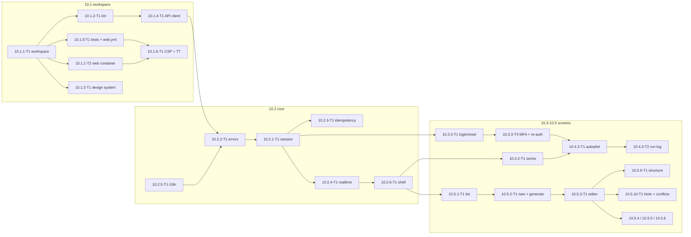

# 10 — Web UI, wave 1 (P: 10.1–10.5): Tech Lead review, shared decisions and feature index

> Reviews: `../../10-web-ui.md` (high-level, M1–M2) — **wave 1 only**: epics 10.1 (workspace), 10.2 (core), the P part of 10.3 (privacy/terms, owner login, reset, MFA), 10.4 (dashboard, series, autopilot) and 10.5 (story review). Wave 2 (10.6 render/video review, 10.7 P publishing, 10.10.2 journeys) and the S items (10.3.2, 10.3.3-T2, 10.8, 10.9, 10.10.1) are not detailed here — they are deleted with phase S by DEC 10.14; 10.7.3 (TikTok) is phase P and keeps its task files (`../README.md` detailing order steps 7 and "after Gate 2").
> Process: `../../00-overview.md` §10.1 step (2) review → step (3) detailed feature plans (this folder).
> Reviewed: 2026-09-24 by the Tech Lead, against the signed contracts of plans 02, 03, 04, 09 (wave 1 + Part B wave 2) and 11, and official vendor pages read the same day (§1 FE-rows).
> Verdict: **approve with changes.** The high-level scope is right, but it predates 09 wave 2: owner login is always MFA, enabling autopilot needs re-auth, registration is closed in P, reset links carry the token in the URL fragment and owner sockets are cut every 5 minutes. It also asks for per-response SSR nonces, which static prerendered pages cannot have, and it names no owner for serving the web app. §2 lists 25 findings; §3 D1–D18 is the contract every feature plan and task file in this folder must use.
> Status: **ready for implementation with conditions** (DoR 2026-09-25, accepted under the owner's standing approval) — see §11.
> Legend: ✅ read from source/docs (URL or file + line, date) · ⚠️ unverified · [DECISION] · [OPEN] · [INFERENCE].

## 0. How this folder is organised

```
plans/features/10-web-ui/
  README.md                          ← this file: facts, findings, decisions D1–D18, CRs, template, gates, index, re-estimate, owner decisions, DoR
  10.1.1-workspace-ci/               ← 10.1.1 workspace + web container, 10.1.2 lint/boundaries, 10.1.5 test tooling + web.yml
  10.1.3-design-api-csp/             ← 10.1.3 design system, 10.1.4 generated client, 10.1.6 CSP + Trusted Types
  10.2.1-session-errors/             ← 10.2.1 session/refresh/guards, 10.2.2 errors, 10.2.3 idempotency
  10.2.4-realtime-i18n-shell/        ← 10.2.4 realtime, 10.2.5 i18n, 10.2.6 shell
  10.3-auth-legal/                   ← 10.3.1-T1 privacy/terms, 10.3.3 login/forgot/reset, 10.3.3-T3 MFA + enrolment + re-auth (P)
  10.4-series-autopilot/             ← 10.4.1 dashboard, 10.4.2 series + pickers, 10.4.3 autopilot tab + run log
  10.5.1-episodes-editor/            ← 10.5.1 list, 10.5.2 new + generate, 10.5.3 editor, 10.5.9 structure, 10.5.10 hints/conflicts, 10.5.3-T2
  10.5.4-versions-research-bible/    ← 10.5.4 versions, 10.5.5 research, 10.5.6 approve/reopen, 10.5.7 bible, 10.5.8 find sources
```

Each feature folder holds `plan.md` (template `00-overview.md` §10.1, sections 1–11) and one `<task-id>-<slug>.md` per task (template §6). Task ids **replace** the wave-1 rows of `10-web-ui.md` §6 (mapping in §8). Every 10.x id already named by plans 02, 03, 04, 09 and 11 is kept (`10.4.2-T1` style grid, `10.4.3-T1`, `10.5.7-T1`, `10.1.4`, `10.1.5`, `10.2.4`); new ids are 10.1.1-T2, 10.3.3-T3, 10.4.2-T2 and 10.4.3-T2.

## 1. Facts verified for this review

**External facts (FE), read 2026-09-24** (scout `agent://Fe10Facts`, spot-checked by the TL; registry facts from `https://registry.npmjs.org/<pkg>/latest`).

| Id | Fact | Source |
|---|---|---|
| FE1 | `@angular/core`, `@angular/material`, `@angular/cdk` latest = **22.2.0**, MIT; core engines accept the **26.x** line (Angular 22 supports the 22.22.3+, 24.x and 26.x lines; the exact `node` range is recorded in 10 CR-43); `zone.js` is an optional peer | npm registry ✅; [angular.dev/reference/versions](https://angular.dev/reference/versions) ✅ |
| FE2 | "Zoneless is the default in Angular v21+ so you do not need to do anything to enable it." | https://angular.dev/guide/zoneless ✅ |
| FE3 | Signal Forms `form()` is badged "stable since v22.0"; the guide still calls reactive forms "a solid choice" where production stability guarantees matter | https://angular.dev/api/forms/signals/form ✅ |
| FE4 | `httpResource` members are tagged `@publicApi 22.0` (stable) | `angular/angular` `packages/common/http/src/resource.ts:45-105` ✅ |
| FE5 | New CLI projects use **Vitest** + jsdom through the builder `@angular/build:unit-test` | https://angular.dev/guide/testing ✅ |
| FE6 | Trusted Types policies used by Angular: `angular`, `angular#bundler`, `angular#unsafe-bypass`, `angular#unsafe-jit`, `angular#unsafe-upgrade` | https://angular.dev/best-practices/security ✅ |
| FE7 | CSP nonce options: `autoCsp`, `ngCspNonce`, `CSP_NONCE`; "Generating a nonce at the origin server is generally discouraged when using a CDN, as responses are frequently cached" | https://angular.dev/best-practices/security ✅ |
| FE8 | Hybrid rendering: `RenderMode.Prerender` per route in `app.routes.server.ts`; `outputMode: 'static'` produces no server | https://angular.dev/guide/ssr ✅ |
| FE9 | `@microsoft/signalr` 10.0.11 MIT; `skipNegotiation` "is available only when the WebSockets transport is the only enabled transport" | npm ✅; `dotnet/AspNetCore.Docs` `aspnetcore/signalr/configuration.md:468` ✅ |
| FE10 | `@jsverse/transloco` 8.4.0 MIT; `@jsverse/transloco-keys-manager` 8.1.1 MIT | npm ✅ |
| FE11 | `angular-eslint` 22.5.0 MIT (devkit `>= 22.0.0 < 23.0.0`, eslint `^9 \|\| ^10`); `eslint-plugin-boundaries` 7.2.0 MIT | npm ✅ |
| FE12 | `ng-openapi-gen` 1.1.0 MIT (Angular-native, no JVM); `@openapitools/openapi-generator-cli` 2.41.0 Apache-2.0 (wraps the Java generator) | npm ✅ |
| FE13 | `@playwright/test` 1.63.0 Apache-2.0; `@axe-core/playwright` 4.13.0 and `axe-core` 4.13.0 **MPL-2.0** (file-level copyleft; allowed — MPL is already accepted for OpenTofu, 11 E11) | npm ✅ |
| FE14 | `diff` (jsdiff) 9.0.0 BSD-3-Clause; `vitest` 5.0.1 MIT; `qrcode` 1.5.4 MIT; `@fontsource/be-vietnam-pro` 5.3.0 OFL-1.1 | npm ✅ |
| FE15 | The runtime image `nginxinc/nginx-unprivileged:1.29-alpine@sha256:0c79d56aee561a1d81c63f00eee5fb5fe29279560cdc55e91425133104c7fbe6` is **Apache-2.0** (image licence label and the upstream `nginx-unprivileged` LICENSE, checked 2026-10-04 in 10.1.1-T2; 10 CR-44) — permissive and compatible with the repo licence policy (no AGPL/RPL/non-commercial). The earlier "BSD-2" wording described the nginx source licence (2-clause BSD, `nginx/nginx` `LICENSE`), not this image variant | image label + `nginxinc/docker-nginx-unprivileged` LICENSE ✅ (2026-10-04) |
| FE16 | CDK drag-drop: the angular.dev guide documents pointer drag only; keyboard reordering is not documented | https://angular.dev/guide/drag-drop ⚠️ (absence of evidence) |

**Contract facts (C) from signed plans.**

| Id | Fact | Source |
|---|---|---|
| C1 | Access token ES256, owner/admin **5 min**, user 15 min, never in a URL; refresh cookie `__Secure-nts_rt` `HttpOnly; Secure; SameSite=Strict; Path=/api/v1/auth`, rotated on every refresh; `POST /auth/refresh` requires `Origin` = `App:PublicOrigin`; owner/admin 12 h absolute, **30 min idle** | 09 README BD3 ✅ |
| C2 | Owner/admin login: `POST /auth/login` → 401 `mfa_required { mfaToken }` + pre-auth cookie `__Secure-nts_mfa` (5 min) → `POST /auth/login/mfa { mfaToken, code \| recoveryCode }`; without TOTP → 401 `mfa_enrolment_required` + enrolment-only token (only `/me/mfa/setup`, `/me/mfa/verify` answer; everything else 404) | 09 BD4, WT21, WT34; 09.3-auth `plan.md` §5 ✅ |
| C3 | `POST /auth/reauth { password, code }` sets `reauthenticated_at`; guarded routes answer 401 `reauth_required`; 5 wrong attempts revoke the family (401 `session_revoked`); ≥ 10 wrong TOTP codes in 15 min → 429 `rate_limited` `Retry-After: 900` on login | 09 BD4, WT35; 09.10.4-T1 ✅ |
| C4 | Reset link `/reset-password#t=<token>` (fragment), 60 min, single use; `POST /auth/forgot-password` always 202 (padded ≥ 300 ms) | 09 BD3, WT40 ✅ |
| C5 | Registration closed in P: `POST /auth/register` → 403 `registration_closed`; the register and verify-email endpoints are withdrawn (their phase-S task 09.3.1-T3 is deleted by DEC 10.14) | 09 W2-O1, BD2 ✅ |
| C6 | WebSocket `/hubs/episodes`, WebSockets only + `skipNegotiation`; ticket HTTP `POST /api/v1/hubs/ticket` → `{ ticket, expiresAt }` (60 s, single use, policy `hub` 10/min/user); 401 `hub_ticket_invalid`; the hub **aborts** a connection after `Hubs:MaxConnectionMinutes` = role token lifetime (owner 5, user 15) and on every family revocation; handshake `Origin` must equal `App:PublicOrigin`. `subscribeEpisode` is a client filter, not a server RPC; transport readiness does not certify future event producers. | 09 BD11, WT37; `HubEndpoints.cs`, `EpisodeHub.cs`; [snapshot/readiness](integration-readiness.md) |
| C7 | Events `EpisodeUpdated`, `RenderProgress { episodeId, renderJobId, stage, percent }`, `PublicationUpdated`, `CreditBalanceChanged` (S); no `AutopilotRunUpdated` and no `SeriesBibleUpdated` in P; clients refetch `GET /episodes/{id}` on events | 00 §8; 02 README §10 T2; 02.6.3 `plan.md` §5; 09.8.1 `plan.md:176` ✅ |
| C8 | Target `EpisodeDetailDto { id, seriesId, title, brief, lengthTier, status, nextActions[], etag, renderJob, finalVideo, publications }` + planned `generation { kind, status, stage, errorCode, startedAt, processingPaused }` + `currentStory { versionId, version, source, etag, content, qualityHints, auditReport, similarityScore, factSheetId, attestation }`. Audited develop has only the basic DTO, no `generation`/`currentStory`, and null render/publication projections; planned extensions wait for their owners. | 09.4.2-5.3 `plan.md` §5, §7; 02 CR-7, T29; [source/readiness](integration-readiness.md) |
| C9 | `story.v1` segments `title`, `hook`, `paragraphs[] { beat, text, keywords, fact_refs }`, `ending`, `description`, `tags`; addressing `title \| hook \| p:<0-based> \| ending \| meta`; 1–2 keywords per segment; title ≤ 100, description ≤ 1,000, tags ≤ 15 × 30 chars (≤ 400 total); segments: short 4–5, standard 20–32, long 40–60 | 02 README D3, D4, D22 ✅ |
| C10 | Story ETag `"sv-<id>"`, fact sheet `"fs-<id>"`, bible `"sb-<version>"`, autopilot `"sa-<xmin>"`, episode `"ep-<xmin>"`; `If-Match` required on story PUT/approve/reopen, fact-sheet PUT/approve, bible PUT, autopilot PUT; 428 `if_match_required`; stale → 412 `story_version_conflict` / `fact_sheet_conflict` / `bible_conflict` / `series_conflict` | 02 D9; 02.3 `plan.md` §4.3; 09 AGENTS ✅ |
| C11 | `PUT /episodes/{id}/story` body `{ content: story.v1 }`; an unchanged body returns the same ETag and no new version; approve body `{ attestation?: { accepted, textVersion } }`; quality hints never disable approve | 02.3 `plan.md` §4–§6 ✅ |
| C12 | Enabling autopilot and accepting its authorization need a re-auth within 5 min; the authorization dialog accepts only after the text is scrolled to the end; the run log refetches on `EpisodeUpdated` and polls every 30 s while the tab is open | 02.8.3-T2; 02.8.3 `plan.md:375, 418` ✅ |
| C13 | `GET /voices` items `{ id, displayName, language, gender, tags, previewUrl }` (`previewUrl` null → no play button, no speed control); `GET /style-templates?topic=` items `{ id, name, topicHint, previewUrl }`; labels are i18n keys `series.style.<name>.label/.hint`; both catalogs are cacheable with ETag, no paging | 04 CR-11/CR-14; 03 CR-7; 09.4.2-T1 ✅ |
| C14 | `GET /episodes?seriesId=&status=&cursor=&limit=` → `{ items: EpisodeListItemDto(id, seriesId, title, status, lengthTier, createdAt, updatedAt, etag), nextCursor }` (numbered pages with `totalCount` pending 10 CR-57); `POST /series/{id}/episodes { title?, brief (1–1,000), lengthTier }` → 201 + `Location` | 09.5.1-T1 ✅ |
| C15 | CORS: policy `spa` (no credentials) + `spa-auth` (credentials, `/api/v1/auth/*` only), origin `App:PublicOrigin`; LB has one API target group and `/hubs/*` WebSockets; DNS `app.<domain>` / `staging.<domain>`; registry already has a `web` repository; `web` compose service sits behind profile `web` "until 10.1.1 defines the image" | 09.9.4-T1; 11.2.2-T1 rows 43–46; 11.1.1-T1:61, 143 ✅ |

## 2. Findings

| # | Sev | Where | Finding | Resolution |
|---|---|---|---|---|
| F01 | H | 10.1.6 | "Per-response SSR nonces" need a server that renders every response; public pages are prerendered and cached, where a nonce is either static or absent (FE7, FE8). A Node SSR server would also add a new attack surface in P for four legal pages | D4: `outputMode: 'static'`, no Node server; a build step hashes every inline script and emits the CSP header; Trusted Types stay |
| F02 | H | 10.1.1, 11.2.2-T1 | Nobody serves the SPA: the LB has only the API target, 11 T25 gives "static hosting" to 11.2.2-T1 but its resource list has none. A separate web origin would also make every authenticated call a CORS preflight (`Authorization` is not a simple header): one extra round trip per call | D3: **same origin** — a `web` container behind the same LB; path rules `/api/*`, `/hubs/*`, `/health/*` → API, default → web (10 CR-1, CR-2) |
| F03 | H | 10.3.3 | The plan reads the reset token from `?token=`; 09 BD3 puts it in the fragment `#t=` so it never reaches logs or `Referer` | D6: fragment only; the page removes it with `history.replaceState` before the POST |
| F04 | H | 10.9.5 (S) | Owner login is always MFA and enabling autopilot needs re-auth (C2, C3, C12), but the MFA step, the enrolment page and the re-auth dialog were planned in the S task 10.9.5-T1. Without them the owner cannot log in or turn autopilot on in P | New **10.3.3-T3** (P, M) shipped; the S admin half (disable MFA, admin redirect) is deleted with phase S (DEC 10.14) |
| F05 | H | 10.3.3-T1 | Registration and e-mail verification are S (C5); the P login task still carries `/verify-email` | Verify page moved to the S task 10.3.2-T1 (deleted with phase S, DEC 10.14); P login maps 403 `registration_closed` nowhere (no register link in P) (10 CR-4) |
| F06 | H | 10.2.1, 10.2.4, 10.4.3 | Idle bypass: a proactive refresh timer, a hub that reconnects every 5 min (C6) or a 30 s poll (C12) refreshes the token from an **idle** tab forever, so the server's 30-min owner idle limit (C1) never fires | D7 activity gate: background work (refresh for reconnect, polling) runs only while the user was active within the role's idle window; otherwise realtime pauses with a "Paused — click to continue" bar |
| F07 | M | 10.2.4 | Owner sockets are aborted every 5 min (C6). The rule "refetch on reconnect" then refetches every open store every 5 min, and the rule "do not reconnect until refresh succeeds" needs a precise trigger because the client cannot tell a backstop abort from a security abort | D8: every close follows one path — `ensureFreshAccessToken()` → new ticket → connect (backoff 1→30 s + jitter); refetch only stores with a live subscription, coalesced per 250 ms; refresh failure ends the session |
| F08 | M | 10.1.5 | E2E: Playwright `storageState` replays the refresh cookie, but the cookie rotates, so the second test triggers reuse detection and revokes the family (C1). TOTP codes are single-use per 30 s step (09 BD4) | D15: per-file login through the UI with a TOTP helper that waits for the next step; one worker for owner specs in P |
| F09 | M | 10.1.1, 10.1.5, §2 T1 | ⚠️ items resolved: zoneless is the default (FE2), Vitest is the default runner (FE5), Signal Forms and `httpResource` are stable (FE3, FE4) | D1 zoneless; D13 typed reactive forms (boring choice with Material), no Signal Forms mixing per feature; D15 Vitest |
| F10 | M | 10.1.4 | Generator not chosen; openapi-generator needs a JVM in CI | D5: `ng-openapi-gen` (FE12) |
| F11 | M | 10.5.9 | CDK keyboard reordering is undocumented (FE16) | D18: drag handle for pointers **and** explicit "Move up/down" buttons + live-region announcement; keyboard never depends on CDK |
| F12 | M | 10.5.2, 10.5.6, 10.2.6 | P is metering-only (02 D1): no quote, cost or balance texts, and `CreditBalanceChanged` is S | D14: P screens have no credit text; the S tasks 10.8.x add them through the named slot `cost-line` in the confirm dialog and the header |
| F13 | M | 10.5.2 | No user cancel route in P (02 T20) | No "Stop" button in P; the generating state shows elapsed time and the failure message for `errorCode` [DECISION] |
| F14 | M | 10.4.3, 10.5.7 | No `AutopilotRunUpdated`/`SeriesBibleUpdated` events (C7) | D17: run log refetch on `EpisodeUpdated` + 30 s visibility-aware poll; bible panel refetches on navigation and after approve |
| F15 | M | 10.4.3 | The veto-window list uses 06 routes (`PATCH`/`DELETE /publications/{id}`, `POST …/consent`), but 06 is not detailed | 10.4.3-T2 codes against 00 §8 routes with soft edges to 06.2.1-T1/06.2.2-T3; the list block ships hidden until `GET /episodes/{id}/publications` exists (flag `youtube_publish`) |
| F16 | M | 10.5.3 | A long story has up to 60 segments (C9); recomputing derived counts or diffs on every keystroke across the whole story is O(n) per key | D18: one signal per segment, `computed` totals, `@for` with a stable `track` key, no deep copies per keystroke |
| F17 | L | 02.3.4-T2, 02.7.2-T2, 04.2.3-T1 | Their Blocks cells name story-level ids (`10.5.x`, `10.5.8`, `10.4.x`) | 10 CR-6, CR-7 replace them with task ids |
| F18 | M | 10.3.1 | Prerender cannot call the API, but `legal_documents.content_url` implies a runtime fetch | D12: legal texts are versioned repo files owned by 13.1.1-T1/13.1.2-T1, turned into structured blocks at build time and rendered without `innerHTML` |
| F19 | L | NFR-10-2 | Angular budgets measure raw bytes; the NFR is gzip | D13: `angular.json` raw budgets + `tools/web/check-gzip-budget.mjs` in `web.yml` |
| F20 | M | 11 T34 | The web origin had no name; 11 proposed `nts/<env>/APP_ORIGIN` and gave it to "10.1.5/10.3.x" | D3: one origin; `App:PublicOrigin` = `https://app.<domain>` (API config) and bucket CORS use the same value |
| F21 | M | 10.2.1 | `returnUrl` is an open-redirect vector | D6: only relative paths starting with a single `/`, no scheme, no `//`, no backslash |
| F22 | M | 10.2.1 | Logout on a shared device must not leave the previous user's data in memory stores or an open socket | D6: `SessionEnded` event → every feature store resets, hub stops, route to `/login` |
| F23 | M | 10.4.2 | Voice/style catalogs are cacheable (C13); a custom client cache would duplicate the HTTP cache and go stale | D13: rely on the browser HTTP cache (ETag/Cache-Control from 09.4.2-T1); no app-level cache beyond the page store |
| F24 | L | 11.1.1-T1 | The `web` port and `web/Dockerfile` path were left open | D3 fixes them (container 8080, compose `127.0.0.1:4200`) (10 CR-2) |
| F25 | M | 10.5.10 | "The user's unsaved text is kept in memory" — writing drafts to `localStorage` would leave story text on shared devices | D18: memory only; the dirty guard protects navigation, nothing is persisted client-side |

## 3. Shared decisions (contract)

**D1 Workspace and toolchain [DECISION] (F09).**
- `web/` at the repo root: Angular **22.2.x** (FE1), standalone only, `strict` + `strictTemplates` + `noUncheckedIndexedAccess`, SCSS, zoneless (default, FE2 — no `zone.js` in `polyfills`), builder `@angular/build:application`, `outputMode: 'static'` (FE8).
- Node **26.10.0** (`^26.10.0`, FE1) in `web/.nvmrc` and `package.json` `engines`; npm with a committed `package-lock.json`; CI uses `npm ci` (10 CR-43). ⚠️ Node 26 is **Current**, not LTS, until its LTS promotion [INFERENCE: ~Oct 2026]; a dependency without Node 26 support is handled case by case (10 CR-43). Exact versions (no `^`) for `@angular/*`, `@angular/material`, `@angular/cdk` (all equal); Dependabot (11.5.3-T3) groups them.
- Path aliases `@core/*`, `@shared/*`, `@features/*` (`tsconfig.json`).
- Server routes (`app.routes.server.ts`): `RenderMode.Prerender` for public pages only (`/vi/privacy`, `/en/privacy`, `/vi/terms`, `/en/terms`; no landing/pricing page in scope — DEC 10.14); every other route `RenderMode.Client` (no server rendering of authenticated screens). The client fallback file name comes from the build output and is recorded in 10.1.1-T1 ⚠️.
- Angular upgrades: patch/minor through Dependabot; a major in a dedicated PR with `ng update` (high-level §8).

**D2 Layout and boundaries [DECISION] (00 §5.3, §5.4).** Exactly the 00 §5.3 tree (`core/`, `shared/{ui,util,api}`, `features/<name>/{domain,data-access,application,ui,feature}`, `<name>.routes.ts`, `index.ts`). Wave-1 features: `public`, `auth`, `dashboard`, `series`, `episodes`. Lint (10.1.2-T1) fails when:
- `domain` imports `@angular/*`, `rxjs` or anything outside `domain` + `@shared/util`;
- `ui` injects a store, repository or `HttpClient` (inputs/outputs only);
- a file outside `features/*/data-access/**` or `core/**/data-access/**` imports `@shared/api` (D5); enforce the full layer dependency table in 10.1.2-T1, not just these examples;
- a feature imports another feature other than through its `index.ts`;
- `any`, non-`OnPush` components, `subscribe()` in components (use `toSignal`/`takeUntilDestroyed`), `bypassSecurityTrust*`, `[innerHTML]`, `document.write`, `eval`/`new Function`, `localStorage`/`sessionStorage` outside `core/prefs` (D6).
Shared cross-feature code lives in `shared/` (pure) or `core/` (singletons); never copy a helper into a second feature.

**D3 Hosting and origin topology [DECISION] (F02, F20, F24).**
- **One origin per environment**: `https://app.<domain>` (prod), `https://staging.<domain>`. The LB (11.2.2-T1/T3) routes `/api/*`, `/hubs/*`, `/health/*` to the API target group and everything else to a **`web` target group**. The SPA calls relative URLs (`/api/v1/...`, `/hubs/episodes`); CORS never applies in the browser; `App:PublicOrigin` (09.9.4-T1) equals this origin.
- **`web` container** (`web/Dockerfile`, multi-stage: `node:26` build → `nginxinc/nginx-unprivileged` digest-pinned runtime, Apache-2.0 per FE15, verified 2026-10-04 in 10.1.1-T2 (10 CR-44; node:26 pin 10 CR-43)): serves `dist/web/browser`, listens on **8080**, non-root, read-only root filesystem (consumers mount `tmpfs` on `/tmp` and `/etc/nginx/conf.d:uid=101,gid=101,mode=0755` — handover to the compose `web` service in 11.1.1-T1 and the deploy in 11.5.1-T1, see 10.1.1-T2 Notes); runs on the two API hosts next to the API container (no new host; 11.5.1-T1 already builds a `web` image).
- nginx rules: `try_files` → prerendered file → client fallback; hashed assets `Cache-Control: public, max-age=31536000, immutable`; HTML `no-cache`; gzip + brotli-static if the image supports it ⚠️ (gzip minimum); `GET /healthz` → 200 (container health only); response headers from D4.
- Dev (native, no Docker — `00 §5.1` "Local dev", owner 2026-09-28; 10 CR-43): the browser origin is **`http://localhost:4200`** on the daily path — `npm start` = `ng serve` (bound to 127.0.0.1) with `proxy.conf.json` → `/api`, `/health` to `http://127.0.0.1:5000` and `/hubs` with `ws: true`. The compose service `web` (profile `web`, `127.0.0.1:4200:8080`, 10 CR-2), whose nginx template proxies `/api`, `/hubs` (WebSocket upgrade) and `/health` to `NTS_API_UPSTREAM` (`http://api:8080`, never the internal 8081) **only when that variable is set**, is kept for the deploy image and for e2e / image smoke only — never a daily-dev requirement; production leaves the variable unset because the LB routes. The dev API sets `App:PublicOrigin = http://localhost:4200` (10 CR-3). ⚠️ `__Secure-` cookies over `http://localhost` are accepted by Chromium and Firefox (localhost is a secure context) — 10.1.1-T2 verifies it; P e2e runs the Chromium project only, Safari is a manual check.
- Runtime config: none needed in P (same origin). CSP media origins come from the container env `NTS_CSP_MEDIA_ORIGINS` (D4).

**D4 CSP, Trusted Types and headers [DECISION] (F01).**
- `tools/web/gen-csp.mjs` (`npm run csp:gen`) runs in the web Dockerfile builder stage right after `ng build` (WR2): it parses every `*.html` in the output, SHA-256-hashes each executable inline `<script>` (JSON `type="application/json"` blocks excluded), **fails** on any inline event-handler attribute or `javascript:` URL, and writes `web/dist/nginx/csp-headers.conf` (one `add_header Content-Security-Policy … always;`, outside the served tree), which the runtime stage installs as an nginx template; nothing generated is committed. `optimization.styles.inlineCritical` is `false` (its `onload` handler would fail this step, WR12).
- Header CSP (every HTML response): `default-src 'none'; script-src 'self' <hashes>; style-src 'self' 'unsafe-inline'; img-src 'self' data: ${NTS_CSP_MEDIA_ORIGINS}; media-src 'self' ${NTS_CSP_MEDIA_ORIGINS}; font-src 'self'; connect-src 'self'; manifest-src 'self'; worker-src 'self'; object-src 'none'; base-uri 'none'; form-action 'self'; frame-ancestors 'none'; require-trusted-types-for 'script'; trusted-types angular angular#bundler nts-sanitizer`. `connect-src 'self'` covers `wss://` to the same host in current browsers ⚠️ confirmed by the 10.1.6-T1 e2e over `wss://` (else add `wss://<host>`).
- `style-src 'unsafe-inline'` [DECISION]: Angular and Material insert `<style>` at runtime and a static cacheable HTML cannot carry a nonce (FE7); risk accepted (CSS injection needs markup injection, which Trusted Types and the sanitizer ban block). Revisit if Angular ships hash-based style CSP for static output.
- `angular#unsafe-bypass` is **not** allowed (no `bypassSecurityTrust*`, D2). The only custom policy is `nts-sanitizer` in `core/security/` (reviewed; currently unused — present so a future need has one place).
- Other headers on every web response: `Referrer-Policy: no-referrer`, `X-Content-Type-Options: nosniff`, `Permissions-Policy: camera=(), microphone=(), geolocation=(), payment=()`, `Cross-Origin-Opener-Policy: same-origin`; HSTS comes from the LB/API rule (09.9.4-T1) and is also set by nginx in Staging/Production.
- Downloads: filenames are built by `shared/util/safe-filename.ts` (strip quotes, `/`, `\`, control characters, trim to 100 chars) — used by wave 2 and S.
- CI: every normal Playwright page, popup and context fails on a `securitypolicyviolation` event or console CSP/Trusted Types error (10.1.6-T1 fixture). Only intentional negative probes run in isolated contexts with narrowly asserted expected violations; they never disable the ordinary journey gate.

**D5 API client and data access [DECISION] (F10).**
- `ng-openapi-gen` (FE12) generates `web/src/app/shared/api/` from the CI artifact `openapi.json` (09.1.5-T1; `ProblemDetails` schema from 09.9.5-T1): `npm run api:gen` (CI) and `npm run api:gen:local -- <path>`. Generated code is committed, formatted, excluded from lint, and a CI step fails when regeneration from the pinned artifact produces a diff.
- Only `features/*/data-access/**` and `core/**/data-access` import `@shared/api`. Each feature's `data-access` implements its `domain` port (abstract class) and maps DTO ↔ model with explicit functions (00 §5.4).
- Repositories return `Promise<T>` (`firstValueFrom`); stores never see `HttpResponse`. Concurrency helpers in `core/http/`: `withIfMatch(etag)`, `readEtag(response)`; idempotency helper D9-adjacent `IdempotencyKeys` (10.2.3-T1).
- Paging helper `shared/util/cursor-page.ts` (`{ items, nextCursor }`, limit ≤ 100) + `core/state/cursor-list.ts` (signal-based load more/in-flight guard) serve cursor-paged endpoints only; catalog `{ items }` responses have no invented cursor. A numbered-pager endpoint (10 CR-57, pending) needs its own helper — page/total state, not `cursor-page`/`cursor-list`.

**D6 Session and authentication [DECISION] (F03, F21, F22).**
- Access token in memory only (`SessionStore` signal); never in `localStorage`/`sessionStorage`/cookies readable by JS (NFR-10-5). `core/prefs` may persist only the UI language before login; from S it also persists a pending `paymentId` written before the checkout top-level navigation and cleared once `/billing/return` resolves to a terminal status (10 CR-36) — still no token, no PII.
- Boot: `provideAppInitializer` calls the memoized `restore()` Promise (`POST /api/v1/auth/refresh`, cookie) once; guards await that Promise. Expected anonymous refresh denial settles anonymous; terminal family codes and transient network/5xx follow 10.2.1-T1's classified failure policy, not blanket success/anonymous fallback.
- Interceptor attaches `Authorization: Bearer` to eligible `/api/v1/**` requests. WR9 is canonical: refresh + retry once only for a non-auth 401 with no code, `unauthenticated` or expired-token challenge; business/MFA/reauth/ticket/terminal-family codes pass to their owner, `/auth/*` never replays. Refresh is single-flight and cross-tab locked (WR10), background work activity-gated (WR11); terminal session end clears all scoped state. Cookies remain unreadable to JS; same-origin requests do not need cross-origin credentials configuration.
- Refresh is on demand: before a request when `expiresAt − now < 30 s`, or on 401. **No timer-driven refresh** (D7).
- `returnUrl` accepted only when it matches `^/(?![/\\])[^\s]*$` and is not an auth page; otherwise `/dashboard`.
- Logout: `POST /auth/logout` → `SessionEnded` (also terminal refresh/family failure): all feature stores reset through `SESSION_SCOPED` providers (root stores register `reset()`), realtime stops, and generation/ownership gates reject stale success/error/finally callbacks. User-initiated logout follows the dirty guard; terminal revocation cannot be deferred by an unsaved-draft prompt.
- Guards await `restore()` Promise; `authChildGuard` rechecks protected child navigation. Enrolment-only `/account/security/mfa-setup` sits outside the full-session shell (`mfaEnrolmentGuard`); only full sessions may start profile/realtime work. Async navigation captures the injector before awaiting; no out-of-context `inject()`. Admin/owner role routes remain S. Reset/verify read `location.hash`, then remove it with `history.replaceState` before API work.

**D7 Activity gate [DECISION] (F06).** `core/session/activity.ts` tracks user input (`pointerdown`, `keydown`, `wheel`, `touchstart`, throttled 1/10 s) and `document.visibilityState`. `isActive()` = input within `idleWindow` (owner/admin 25 min, user 13 days — just below the server limits C1). Rules:
- A refresh that is **not** caused by a user action (hub reconnect, polling) happens only when `isActive()`; otherwise realtime pauses and a `realtime.paused` bar offers "Continue" (a user action → refresh → reconnect → refetch).
- Polling (D17) runs only while the document is visible **and** `isActive()`.
- A user action after the idle window simply sends its request; the server decides (401 → login).

**D8 Realtime [DECISION] (F07; C6, C7).**
- `RealtimeService` (root) owns one `HubConnection`: `withUrl('/hubs/episodes?ticket=<t>', { transport: HttpTransportType.WebSockets, skipNegotiation: true })`, no `accessTokenFactory`, no built-in automatic reconnect (the ticket is single-use).
- Connect = `ensureFreshAccessToken()` → `POST /api/v1/hubs/ticket` → `start()`. Every `onclose` (backstop, security abort, network) follows the **same** path after backoff 1, 2, 4, 8, 16, 30 s + 0–20 % jitter, gated by D7; 401 `hub_ticket_invalid` → one new ticket then backoff; a terminal refresh failure ends the session (no reconnect), while transient failure follows the bounded recovery policy in 10.2.1-T1.
- Events are exposed as typed signals/observables per name; feature stores subscribe through `realtime.subscribeEpisode(episodeId, handler)` (typed `on(name, ids?)` for other events; WR7). On every (re)connect and on `visibilitychange → visible`, the service emits `resync`; only stores with a live subscription refetch, coalesced per store within 250 ms. `RenderProgress` updates the progress signal directly (no refetch); `EpisodeUpdated` triggers a detail refetch (09.8.1 `plan.md:176`). Unknown event names and unknown `stage` values are ignored.
- The token never appears in the hub URL; the ticket is not logged (dev console included).

**D9 Errors [DECISION].** `AppError { code, status, fieldErrors: Record<string, string[]>, retryAfterSec?, traceId?, problem }` built by `AppErrorMapper` (10.2.2-T1) from ProblemDetails; network error → `network_error`; 413 → `payload_too_large`; unknown code → `unknown_error` + `traceId` shown. Every code in 09 §5.4 + 02 D8 used by wave-1 screens has an i18n key `errors.<code>` (vi + en); `detail` is never shown raw. Shared patterns (built once, reused):
- `validation_failed` / `*_invalid_content` → `bindFieldErrors(form, error)` maps `errors` keys (camelCase paths, D22 segment addresses for story) onto controls; unmapped keys go to a form-level alert.
- 412 conflicts → `ConflictDialog` (Reload latest / Save mine as new version / Cancel; keeps the unsaved input in memory until chosen).
- 409 `episode_invalid_state` → refetch the episode, show `errors.episode_invalid_state` with the actions from `nextActions`.
- 428 is a client bug → logged to console in dev, generic message.
- 429 `rate_limited` / `story_generation_limit` → `RetryCountdown` from `Retry-After`; the action stays disabled until 0.

**D10 i18n [DECISION].** Transloco (FE10), languages `vi` (default) and `en`, one scope per feature (`auth`, `series`, `episodes`, `dashboard`, `public`) + `core` + `errors` + `quality` (02 hint copy, WR15); files `web/src/assets/i18n/<scope>/<lang>.json`, lazy per route. Key style `scope.area.item` (camelCase leaves); keys handed over by other plans are used verbatim (`series.style.<name>.label/.hint`, `series.style.trueCrimeNotice`, `voices.tag.<tag>`, `quality.*`, `render.*` (wave 2), 02 copy keys). Language: profile `uiLocale` (`GET /me`) → saved pre-login preference → browser → `vi`. Dates/numbers through `Intl` for `vi-VN`/`en-US`; time zones shown explicitly where the value is a schedule (autopilot). CI (10.2.5-T1): the `vi` and `en` key sets are equal per scope, every key used in code exists (keys-manager `find` + a script), and no hard-coded user-visible literal passes the template lint rule.

**D11 Design system and shared UI [DECISION] (reuse inventory).** Angular Material M3, dark default + light option, tokens once in `shared/ui/theme/`; font Be Vietnam Pro self-hosted from `@fontsource/be-vietnam-pro` (OFL-1.1, FE14; subsets latin + latin-ext + vietnamese, weights 400/500/600); no third-party font/CDN request. Shared components (each with inputs/outputs only, OnPush, a11y notes, component test): `PageHeader`, `EmptyState`, `ErrorState`, `LoadingState` (skeleton), `StatusChip` (episode/run statuses), `ConfirmDialog` (with the `cost-line` slot, D14), `ConflictDialog` (D9), `RetryCountdown`, `CharCounter`, `Stepper` wrapper, `InlineAnnotation` (10.5.10-T1), `SegmentChips`, `DiffView` (10.5.4-T1, `@defer`), `ReauthDialog` (10.3.3-T3), `CopyableCode` (recovery codes), `AudioPreviewButton` (10.4.2-T2). Where a component is built by a feature task, it still goes to `shared/ui/` if a second feature needs it (listed in its task file).

**D12 Public and legal pages [DECISION] (F18).** Prerendered routes `/vi/privacy`, `/en/privacy`, `/vi/terms`, `/en/terms` (P); `<title>`, `description`, canonical and `hreflang` alternates per language; no API call during prerender; no third-party asset. Content: `web/src/content/legal/<prefix>.<version>.<lang>.md` (manifest key -> file prefix: `tos -> terms`, `privacy -> privacy`; 13 CR-34), authored by 13.1.1-T1 (privacy) and 13.1.2-T1 (terms); `tools/web/legal-to-json.mjs` (build time) converts the Markdown subset (headings, paragraphs, lists, links, emphasis) into a typed block list, rejecting raw HTML; `LegalDocumentPage` renders blocks with `@for` — never `innerHTML`. The version string shown on the page equals the version the API records in `user_consents` (13 owns both).

**D13 State, forms and performance [DECISION] (F09, F16, F19, F23).**
- Signal stores per feature (00 §5.1 sample): `@Injectable()` provided by the routed page (or root when session-scoped, D6), `signal` + `computed`, async use-case methods returning `Promise<Result>`, no NgRx.
- Forms: **typed Reactive Forms** with Material; Signal Forms are not mixed in per feature (FE3 noted; a later switch is one workspace-wide PR).
- Every component `OnPush`; `@for` always with `track <stable id>`; `@defer (on viewport | on interaction)` for heavy parts (diff view, QR code, audio preview); every feature lazy (`loadChildren`/`loadComponent`).
- Budgets: `angular.json` initial raw warning 700 kB / error 900 kB [INFERENCE: sized to hold ≤ 250 kB gzip], any component style ≤ 8 kB; `tools/web/check-gzip-budget.mjs` fails `web.yml` when the gzip sum of initial chunks > 250 kB (NFR-10-2).
- No client cache for catalogs (browser HTTP cache honours 09.4.2-T1 ETags); store data lives as long as the page store.
- No polling except D17; no timers without `DestroyRef` cleanup.

**D14 P vs S in the UI [DECISION] (F12).** Wave 1 builds P screens only: no credit amounts, quotes, balance or buy controls (02 D1; `CreditBalanceChanged` is S). `ConfirmDialog` has an optional typed `TemplateRef`/data cost-line contract for service-created dialogs (static use may project); the shell header has a page-owned template registration port, cleared on teardown. The S tasks that would have supplied credit content are deleted by DEC 10.14 (10 CR-4), so P renders no credit content. Planned `GET /me` adds allowlisted `features: string[]` (`source_finder`, `youtube_publish`) via `IFeatureFlags` (10 CR-10, O1); `core/session` exposes `hasFeature(key)`. Mid-session disabled flags answer 404 `feature_disabled`; hide the block/refetch `/me` without reviving ended session state. This profile projection waits for its backend owner; no fabricated feature defaults.

**D15 Testing and CI [DECISION] (F08).**
- Unit/component: Vitest through `@angular/build:unit-test` + jsdom (FE5), TestBed zoneless; hand-written fake repositories implementing the domain ports (`features/*/testing/fake-*.repository.ts`) — no mocking library (same rule as the backend, 09 N10/N11).
- Store tests cover success, `AppError` mapping, ETag conflict, rollback of optimistic state, realtime merge; component tests cover logic-heavy UI (editor, dialogs, pickers); domain/util tests are pure.
- E2E: Playwright (FE13) in `web/e2e/`, real API/PostgreSQL/Worker/storage/mailpit/mock-MPT at approved seams, compose only for CI/image acceptance. `@axe-core/playwright` on visited pages (P WCAG 2.1 AA, S signed WCAG 2.2 upgrade) plus context-wide D4 fixture. Owner helper logs in via UI/enrols TOTP on first run; RFC6238 uses real server-aligned time and waits for unused 30 s step. One login per spec file, owner `workers: 1`, no cross-file rotating-cookie `storageState`; each journey is one independently runnable test with `test.step`, not a dependent serial-test chain.
- `web.yml` (10.1.5-T1, `paths: web/**`): `npm ci` → lint → i18n → pinned `api:gen` drift → unit → build → gzip budget → `gen-csp`; third-party actions SHA-pinned. No duplicate compose e2e: 11.5.1-T1 owns `e2e.yml`, triggered on `web/**` (10 CR-1). Auth/billing/admin-bearing specs explicitly set trace/video off, including failures (WR14); only sanitized diagnostics are uploaded. Nonsensitive specs may retain failure artifacts under that policy.

**D16 Accessibility baseline (every task) [DECISION].** WCAG 2.1 AA on wave-1 screens: every control labelled, visible focus (≥ 3:1), keyboard reachable without traps except modal dialogs (focus trapped, restored on close), `aria-live="polite"` for progress/status changes and "saved" feedback, errors linked with `aria-describedby`, contrast ≥ 4.5:1 in both themes, no information by colour alone (flagged chips carry an icon + text), target size ≥ 24 px, 360 px layout without horizontal scroll, `prefers-reduced-motion` honoured. Each task lists its screen-specific a11y checks; axe runs in its e2e spec. (The S pass 10.10.1 audits everything again.)

**D17 Polling and refresh semantics [DECISION] (F14; C7, C12).** One helper `core/state/visible-poll.ts` (`intervalMs`, runs while `document.visibilityState === 'visible'` and D7 `isActive()`, pauses otherwise, immediate run on return, single in-flight). Uses: autopilot run log 30 s; nothing else in wave 1. The bible panel refetches on navigation and after an approve on the same episode page. Episode pages rely on D8 events + `resync`.

**D18 Story editor model [DECISION] (F11, F16, F25; C9–C11).**
- Domain model `StoryDraft` mirrors `story.v1` exactly (no extra fields on the wire); each segment has a client-only stable key (`crypto.randomUUID()`) for `track` and reordering, dropped when serialising.
- One `WritableSignal` per segment text/keywords; `computed` token counts per segment (D4 token rule: NFC + split on Unicode whitespace) and totals; `isDirty = computed(() => serialize(draft) !== baselineJson)` evaluated on change with a 150 ms debounce.
- Save = explicit "Save version" → `PUT /episodes/{id}/story` `{ content }` + `If-Match: currentStory.etag`; response updates `etag`, `qualityHints`, baseline. No autosave, no `localStorage` (F25).
- Segment addressing helper `shared/util/segment-address.ts` (`title | hook | p:<i> | ending | meta`, parse + format + remap after reorder) is the single implementation used by the editor, hints, annotations, the conflict dialog and the autopilot run-log deep link (`/episodes/:id?segment=p:3`).
- Keyboard reorder never depends on CDK (F11): "Move up/Move down" buttons per paragraph + `LiveAnnouncer`; drag handle (CDK) for pointers; scene chips move with their paragraph; delete → undo snackbar (10 s), then the paragraph is gone from the draft (still recoverable by not saving).
- Dirty guard: `canDeactivate` + `beforeunload` while dirty.
- Rendering story text: text interpolation only; keywords are plain chips; no Markdown.

**D19 Design-first rule [DECISION] (owner rule 2026-09-25).** Every UI feature folder in wave 1 opens with one design task (`<first-story>-T0`, Area `UX`, Depends on `10.1.3-T1` + the folder's key backend contract task (soft)) that produces wireframes + hi-fi mockups for every screen and state in that folder's `plan.md` §6 at 360/768/1280, dark default + light, vi + en, focus order + keyboard path + `aria-live` annotations, built from the D11 tokens/components; deliverable = a design link recorded in `plan.md` §6 plus the owner's approval record, and it is a **hard gate** — every implementation task in the folder lists its `-T0` as a hard `Depends on`. Sizes: S (0.5) for a 1–3-screen folder, M (1.0) for ≥ 4 screens. Non-UI folders (10.1.1 workspace/CI, 10.1.3 design system + generated client + CSP — the design-system foundation every `-T0` depends on — 10.2.1 session/errors, and 10.2.3 idempotency) are exempt: they ship no user-facing screen. §6 of each folder's `plan.md` records the design link/approval under a `Design (owner rule 2026-09-25)` paragraph. Applied 2026-09-25 (10 CR-31); mirrors Part C's SD11 (owner rule already applied there).

### 3.1 Angular implementation-readiness amendment (2026-10-02)

The [implementation roadmap](implementation-roadmap.md) refines the existing 73 tasks in 18 folders: concrete shared ownership/APIs, feature decomposition, task order and behavioral exit evidence. The [backend readiness ledger](integration-readiness.md) separates present wire contracts at audited `develop` SHA `00e7d5d5415579c7df55a66dc2177cbc2e31eb78` from planned owners, populated projections and runtime acceptance. Recheck merged OpenAPI/provenance before integrating each feature; concurrent worktree code is not merged availability.

**D2/D11 ownership clarification.** Layer paths, not `*.component.ts`, define presentation restrictions. Routed feature containers and named shell composition roots may inject stores; shared/feature `ui/` may not inject stores/repositories/HTTP or import generated DTOs. Existing D11/WR4 shared inventory stays shared. A new promoted widget needs two named semantic consumers, one owner, typed readonly inputs/intent outputs and explicit downstream edges; admin-only reuse stays admin-local. No generic form/table DSL, SharedModule or competing state/client stack.

**D5/D13 lifecycle clarification.** Retain generated HttpClient → DTO mapping → Promise domain ports and typed Reactive Forms. Private writable/public readonly signals; replace arrays/maps/objects and derive with `computed`. Effects bridge imperative boundaries with cleanup. Guard awaits the idempotent restore Promise, not a boolean settled signal; capture injected dependencies in a legal DI context. Request/route/session generations reject stale `/me` or entity responses after logout/navigation. Programmatic form changes/server errors notify zoneless templates through a lifecycle-bound event bridge; `bindFieldErrors` preserves local validators under one canonical server namespace and clears stale server errors.

**D11 composition clarification.** Static projection and service-created dialogs differ: dynamic dialogs use typed data/optional `TemplateRef`; routed pages register a scoped header template that is cleared on teardown, not implicit projection through `RouterOutlet`. Required signal inputs are read after binding, not eager field construction. Every kit control retains keyboard/focus/translated accessible-name/state behavior; P contains no credit/billing content.

**D5/D13 performance evidence.** Minimal auth/session operations required by bootstrap may be eager; unrelated generated feature operations, phase-inactive routes and heavy/deferred widgets must remain outside that closure. Use the pinned builder's emitted import graph/static closure, deduplicating shared/vendor chunks; hidden maps are internal artifacts, not public `sourcesContent`. Keep reviewed byte ceilings fixed and the P/R2 route inventory explicit; neither hashed filename guesses nor automatic measured-plus-15% ceiling increases prove a budget. Runtime cold-cache LCP/shell-interactivity protocol belongs to the journey plan; gzip counts cannot close it. Media dimensions/alt/sizes/priority are per surface; no speculative CDN or signed-URL resizing.

**D15/WR14 acceptance evidence.** Inputs change via binding/`setInput`; await `whenStable` rather than routinely force change detection. HTTP testing providers follow HttpClient then HttpClientTesting order; router harness covers pending restore and protected child navigation. Real browser checks cover layout/focus/media/CSP, every new page/context and positive lazy/defer loads; deliberate CSP negatives use an isolated probe mode. Sensitive auth trace/video capture stays off; violation/report evidence omits samples and scrubs query/fragment/userinfo/secrets. P shell/dashboard/series/editor/render have their own a11y checks in P (the former public-site audit task is deleted by DEC 10.14); DPR is not browser zoom, and page clocks do not fake server TOTP.

**Contract preservation.** Angular 22, Node/npm, approved font/tokens, five-layer architecture, typed forms, same-origin clients, hash/header CSP and accepted inline styles remain locked. Preserve WR12/D4 sanitizer policy; currently unused policy is a review-before-use boundary, not authorization for future raw HTML sinks or deletion of approved contracts. `base-uri 'none'` requires no emitted `<base>`, explicit root `APP_BASE_HREF` and deep-link/asset proof, not ignored violations. Source URLs and official GitHub provenance are in the roadmap; moving docs/schema must be checked against installed pins. Mockup captions/actions do not override signed routes/backend scope; the design approval is recorded (deck v2 "Phòng thu", commit `192cc73`, 2026-10-02); missing visual states are implementation reconciliation items, not approval gates.

No task IDs, estimates or phase authorization change: P 41.0 raw days, S 20.0, total 61.0 / 73.2 buffered; P waves 31.5 + 9.5. (Superseded by DEC 10.14: phase S is deleted, so the plan-10 total is the P part plus the TikTok lane — see §C9.) No Angular/backend implementation or runtime API certification is claimed by this planning amendment.

## 4. Change requests

Applied 2026-09-24 under the owner's standing approval; tagged `(10 CR-n)`.

| CR | Target | Change |
|---|---|---|
| 10 CR-1 | `features/11-worker-deployment/11.2-cloud-environments/11.2.2-T1-platform-module.md`, `…/11.4-11.5-storage-cicd/11.5.1-T1-app-deploy-workflow.md`, `features/11-worker-deployment/README.md` D15/T25, `plans/11-worker-deployment.md` §5.1 topology diagram | LB gets a `web` target group (the `web` container on the two API hosts, port 8080) with path rules `/api/*`, `/hubs/*`, `/health/*` → API, default → web; `deploy.yml` deploys the `web` container with the API; T25 reads "10.1.1-T2 builds the image; 11.2.2-T1 owns the LB target and rules" (D3) |
| 10 CR-2 | `features/11-worker-deployment/11.1-local-dev/11.1.1-T1-compose-app-stack.md` | `web` service: build `web/Dockerfile`, `127.0.0.1:4200:8080`, health `GET /healthz`; the [INFERENCE] note is resolved by D3 |
| 10 CR-3 | `features/09-backend-api/09.9-platform/09.9.4-T1-security-hardening.md`, `features/11-worker-deployment/11.4-11.5-storage-cicd/11.4.1-T1-storage-buckets.md` | `App:PublicOrigin` = the single web + API origin (`https://app.<domain>`); in `Development` only, `http://localhost:<port>` is also valid (startup validation); bucket CORS uses the same value (secret/config `APP_ORIGIN` = that origin) (D3, F20) |
| 10 CR-4 (void: the S rows it added are deleted by DEC 10.14) | `plans/10-web-ui.md` | 10.1.6 wording (hash-based CSP, static output), 10.3.3 reset fragment + verify page moved to 10.3.2-T1, new rows 10.1.1-T2, 10.3.3-T3, 10.4.2-T2, 10.4.3-T2, 10.9.5-T1 reduced to XS, §2 T1 and §10 ⚠️ closed (FE1–FE5), cost texts via the D14 slots, §6 sizes (10.1.6-T1 M), §11 estimate |
| 10 CR-5 | `plans/00-overview.md` §4.1 and §13 | plan 10: 45.25 → 48.5 raw (P 30.0 → 33.5, S 15.25 → 15.0); totals P 182.75 → 186.25 / 223.5, S 80.0 → 79.75 / 95.7, all 262.75 → 266.0 / 319.2 |
| 10 CR-6 | `features/02-story-writing/` task headers + README §8.1 | Blocks cells gain the 10.x task ids that depend on them (§8.1); `02.3.4-T2` "10.5.x" and `02.7.2-T2` "10.5.8" become task ids |
| 10 CR-7 | `features/03-image-generation/03.1-style-system/03.1.1-T1-…`, `features/04-voice-proxy/04.2-voice-catalog/04.2.3-T1-…` (+ their §8.1 rows) | 03.1.1-T1 Blocks + `10.4.2-T1`; 04.2.3-T1 "10.4.x picker previews" → `10.4.2-T2` |
| 10 CR-8 | `features/09-backend-api/` task headers + README §8.1 / §B8.1 | Blocks cells gain the 10.x task ids that depend on them (§8.1) |
| 10 CR-9 | `plans/features/README.md` | readiness and index rows for 10 wave 1 |
| 10 CR-11 | `features/02-story-writing/02.3-checkpoint-1/02.3.4-T1-story-quality-checker.md`, `…/02.3-checkpoint-1/plan.md` §6 (web path) | hint bundle path `web/src/assets/i18n/quality/{vi,en}.json`; approve gating per WR6 (blocking hints alone never disable approve; keyword-linter flags do, server-enforced) |
| 10 CR-10 | `features/09-backend-api/09.3.4-me-limits-audit/09.3.4-T1-me-endpoints.md` | `MeDto` gains `IReadOnlyList<string> Features` (enabled keys of the allow-list `source_finder`, `youtube_publish`, read through `IFeatureFlags` from 09.9.2-T2; empty until that task lands) (D14, O1) |
| 10 CR-31 | `10.1.1-workspace-ci/`…`10.7.2-publish/` (8 folders, `-T0` task files, applied here); `plans/10-web-ui.md` §6 + §11 (listed below, **not applied — TL applies**); `plans/00-overview.md` §4.1 (two rows + grand totals, listed below, **not applied — TL applies**) | Design-first retrofit (D19/owner rule 2026-09-25): 8 new `-T0` UI-design tasks — wave 1: `10.2.4-T0` (S), `10.3.3-T0` (M), `10.4.1-T0` (M), `10.5.1-T0` (M), `10.5.4-T0` (M) = +4.5 d; wave 2: `10.6.1-T0` (S), `10.7.1-T0` (S), `10.7.2-T0` (M) = +2.0 d; total **+6.5 d raw**. Each `Depends on` = `10.1.3-T1` (design-system foundation) + a soft backend contract task; `Blocks` = every implementation task in its folder (§8.1/§B8.1 updated in this file). **`plans/10-web-ui.md` §6 (task breakdown) — insert 8 new rows** (format `| Task ID | Task | Area | Size | Depends on |`, after the matching existing story row): `| 10.2.4-T0 | UI design (app shell, nav, language switch, user menu, realtime status) | UX | S | 10.1.3 |` · `| 10.3.3-T0 | UI design (login, MFA, forgot/reset, re-auth, legal pages) | UX | M | 10.1.3 |` · `| 10.4.1-T0 | UI design (dashboard, series editor, autopilot tab, run log, veto list) | UX | M | 10.1.3 |` · `| 10.5.1-T0 | UI design (episode list, new + generate, story editor, conflict, dirty guard) | UX | M | 10.1.3 |` · `| 10.5.4-T0 | UI design (versions/diff, approve & reopen, research page, find sources, bible) | UX | M | 10.1.3 |` · `| 10.6.1-T0 | UI design (render timeline, failure states, video review) | UX | S | 10.1.3 |` · `| 10.7.1-T0 | UI design (channels: connect, callback result, disconnect) | UX | S | 10.1.3 |` · `| 10.7.2-T0 | UI design (publish form, consent, quota wait, publication status, veto-email pages) | UX | M | 10.1.3 |`. **`plans/10-web-ui.md` §11 (estimate summary) — exact old → new:** `| 10.2 Core | 3.75 |` → `| 10.2 Core | 4.25 |` (+0.5 `10.2.4-T0`); `| 10.3 Public + auth | 3.75 |` → `| 10.3 Public + auth | 4.75 |` (+1.0 `10.3.3-T0`; ⚠️ Part C's CR-22 also proposed this row 3.75→4.75 for a **different** reason, the `10.3.1-T0` wave-3 design, which is deleted by DEC 10.14 — CR-22 no longer applies); `| 10.4 Dashboard + series + autopilot | 4.0 |` → `| 10.4 Dashboard + series + autopilot | 5.0 |` (+1.0 `10.4.1-T0`); `| 10.5 Story review | 12.25 |` → `| 10.5 Story review | 14.25 |` (+1.0 `10.5.1-T0` +1.0 `10.5.4-T0`); `| 10.6 Render + video review | 2.5 |` → `| 10.6 Render + video review | 3.0 |` (+0.5 `10.6.1-T0`); `| 10.7 Publishing + channels | 5.0 (incl. 2.0 R2) |` → `| 10.7 Publishing + channels | 6.5 (incl. 2.0 R2) |` (+0.5 `10.7.1-T0` +1.0 `10.7.2-T0`); `| **Total** | **50.0** → with 20 % buffer **60.0** person-days (of which R2: 2.0 raw / 2.4 with buffer; P 35.0, S 15.0; 10 CR-4: was 45.25 / 54.3 — wave 1 re-estimated in `features/10-web-ui/README.md` §9; 10 CR-14: wave 2 +1.5, Part B §B9) |` → `| **Total** | **56.5** → with 20 % buffer **67.8** person-days (of which R2: 2.0 raw / 2.4 with buffer; P 41.5, S 15.0; 10 CR-4: was 45.25 / 54.3 — wave 1 re-estimated in `features/10-web-ui/README.md` §9; 10 CR-14: wave 2 +1.5, Part B §B9; 10 CR-31: +6.5 d design tasks — wave 1 +4.5 (§9), wave 2 +2.0 (§B9), D19/WD11 owner rule 2026-09-25) |`. **`plans/00-overview.md` §4.1 (per-plan table, `10 Web UI` row) — exact old → new:** `| 10 Web UI (10 CR-5: was 30 / 36.0, S 15.25 / 18.3; 10 CR-14: P 33.5 → 35.0) | 35.0 | 42.0 | 15.0 | 18.0 |` → `| 10 Web UI (10 CR-5: was 30 / 36.0, S 15.25 / 18.3; 10 CR-14: P 33.5 → 35.0; 10 CR-31: P 35.0 → 41.5, +6.5 d design tasks, D19/WD11 owner rule 2026-09-25) | 41.5 | 49.8 | 15.0 | 18.0 |`. **`plans/00-overview.md` §4.1 grand-total row — exact old → new** (append before the closing paren and update the four bold numbers): `…; 12 CR-4: S +1.0 → 80.75 / 96.9) | **190.25** | **228.3** | **80.75** | **96.9** |` → `…; 12 CR-4: S +1.0 → 80.75 / 96.9; 10 CR-31: P +6.5 → 196.75 / 236.1) | **196.75** | **236.1** | **80.75** | **96.9** |`. **`plans/00-overview.md` §13-area narrative table, `10 Web UI` milestone row — exact old → new** (line number has drifted since this CR was drafted; locate by the row text, not a line number): `| 10 Web UI | 50.0 | 60.0 | P 35.0 (10 CR-14: wave 2 +1.5): M1 (incl. privacy/terms pages, owner MFA screens; wave 1 re-estimated in \`features/10-web-ui/\` §9, 10 CR-5: was 45.25 / 54.3, P 30.0); S 15.0: M2 (2.0 / 2.4 in R2) |` → `| 10 Web UI | 56.5 | 67.8 | P 41.5 (10 CR-31: wave 1 design +4.5, wave 2 design +2.0, D19/WD11 owner rule 2026-09-25; 10 CR-14: wave 2 +1.5): M1 (incl. privacy/terms pages, owner MFA screens; wave 1 re-estimated in \`features/10-web-ui/\` §9, 10 CR-5: was 45.25 / 54.3, P 30.0); S 15.0: M2 (2.0 / 2.4 in R2) |`. **Same table, grand-total row — exact old → new:** `| **Total** | **271.0** | **325.2** | P 190.25 / 228.3 · S 80.75 / 96.9 (§4.1) (…; 12 CR-4: was 270.0 / 324.0) |` → `| **Total** | **277.5** | **333.0** | P 196.75 / 236.1 · S 80.75 / 96.9 (§4.1) (…; 12 CR-4: was 270.0 / 324.0; 10 CR-31: was 271.0 / 325.2, P 190.25 / 228.3, +6.5 d design tasks D19/WD11) |`. None of these four `.md`-file edits are applied by this folder; the TL applies them and reconciles the `10.3 Public + auth` double-count with Part C CR-22 if that CR lands too. |
| 10 CR-44 | `plans/features/10-web-ui/README.md` (§1 FE15, §3 D3), `10.1.1-workspace-ci/` (`plan.md` D3 fact + unverified list, `10.1.1-T2` Dockerfile row + failure table) | Image licence correction (D6, 2026-10-04): the pinned `nginxinc/nginx-unprivileged:1.29-alpine@sha256:0c79d56aee561a1d81c63f00eee5fb5fe29279560cdc55e91425133104c7fbe6` image label and upstream LICENSE are **Apache-2.0**, not BSD-2 (BSD-2 is the nginx *source* licence); old: `BSD-2 FE15 ⚠️ image variant confirmed in 10.1.1-T2` → new: `Apache-2.0 per FE15, verified 2026-10-04`. Apache-2.0 is permissive and compatible with the repo licence policy (no AGPL/RPL/non-commercial), so no decision changes. Same date: D2 — the documented `docker run --read-only …` could not start, now `--read-only --tmpfs /tmp --tmpfs /etc/nginx/conf.d:uid=101,gid=101,mode=0755` (10.1.1-T2 steps/acceptance, `plan.md` UC-3); D3 — read-only consumers (11.1.1-T1 compose `web`, 11.5.1-T1 deploy) must mount the same two tmpfs (10.1.1-T2 Notes; plan 11 files not edited here) |
| 10 CR-45 | `plans/features/11-worker-deployment/11.1-local-dev/11.1.1-T1-compose-app-stack.md` (Notes), `…/11.4-11.5-storage-cicd/11.5.1-T1-app-deploy-workflow.md` (Notes), `10.4-series-autopilot/10.4.2-T1-series-list-editor.md` (Notes), this README (§4, this row), `STATUS.md` §Plan 10 hand-overs (was §Session 6 plan, archived) | Stage A hand-overs (2026-10-04): `web` container tmpfs `/tmp` + `/etc/nginx/conf.d:uid=101,gid=101,mode=0755` under a read-only rootfs (11.1.1-T1, 11.5.1-T1); e2e auth-artifact redaction before upload (11.5.1-T1); `voices.tag.*` scope placement (10.4.2-T1); backend OpenAPI gaps (dotted `NightTales.Api` tag, no `operationId`, no `ProblemDetails.errors`) and the pinned pre-#121 `web/openapi.json`, recorded in STATUS for the .NET session and the next web task |
| 10 CR-46 | `10.2.1-session-errors/10.2.2-T1-app-error-mapper.md` (Outputs, Notes), `10.3-auth-legal/10.3.3-T1-login-forgot-reset.md` (Notes), `10.5.1-episodes-editor/10.5.10-T1-inline-annotations-quality-hints-412-conflict.md` (Notes), `STATUS.md` §Plan 10 hand-overs | 10.2.2-T1 as built (2026-10-04): `ProblemWire` (generated `ProblemDetails` + local `errors?`) lives in `core/errors/data-access/`; `Result<T>` added to `core/errors` (consumed by 10.3/10.7.1, missing from the task Design); no Transloco config edit (scopes discovered by directory); `web/e2e/errors.spec.ts` moves to 10.3.3-T1 (needs `/login`); `errors.keywords_flagged` leaf blocks `errors.keywords_flagged.rules.<rule>` ([OPEN] at the time; resolved by 10 CR-54 in PR #181, Session 32); `setting_change_pending` 409 not catalogued (10.9.3-T1, deleted by DEC 10.14) |
| 10 CR-47 | `10.2.1-session-errors/10.2.1-T1-session-store.md` (Acceptance, Notes), `10.3-auth-legal/10.3.3-T1-login-forgot-reset.md` (Notes), this README (§4, this row), `STATUS.md` §Plan 10 hand-overs | 10.2.1-T1 as built (2026-10-04): `web/e2e/session.spec.ts` (reload restores, one refresh per burst, server revoke → `/login?returnUrl`, `returnUrl=//evil.example` → `/dashboard`, axe on `/login`, no CSP violation) and the D16 a11y e2e (session-end banner live region, focus to the `/login` heading, 360 px) move to 10.3.3-T1, because no `/login` or `/dashboard` route exists before 10.3.3-T1 / 10.2.6-T1 (`app.routes.ts` is empty); unit specs cover every other Acceptance bullet |
| 10 CR-48 | `10.2.4-realtime-i18n-shell/10.2.4-T1-realtime-service.md` (Acceptance, Notes), `10.5.1-episodes-editor/10.5.2-T1-new-episode-generate-live-state.md` (Notes), this README (§4, this row), `STATUS.md` §Plan 10 hand-overs | 10.2.4-T1 as built (2026-10-04): `web/e2e/realtime.spec.ts` (one UI login through the TOTP helper, open an episode, force a close and a return with `context.setOffline`, one ticket per connect attempt in the network log, no token or ticket in console / request URLs / `localStorage` / `sessionStorage`, one reconnect + one refetch per live subscription, axe clean on the episode page) moves to 10.5.2-T1, because no `/login` route exists before 10.3.3-T1 and no episode page with a `subscribeEpisode` consumer exists before 10.5.2-T1 (`app.routes.ts` is empty); unit specs (`realtime.service.spec.ts`, `signalr-hub-connection.spec.ts`, `hub-ticket.http-repository.spec.ts`, `backoff.spec.ts`, `realtime-subscriptions.spec.ts`) cover every other Acceptance bullet |
| 10 CR-49 | `10.2.1-session-errors/10.2.1-T1-session-store.md` (Notes), `10.3-auth-legal/10.3.1-T1-privacy-terms-pages.md` (Notes), this README (§4, this row), `STATUS.md` | 10.3.1-T1 as built (2026-10-05, owner decision from QA defect D1): the 10.2.1-T1 boot initializer `provideSession()` skips `store.restore()` when the initial `location.pathname` is session-free, so no `/api/**` request is issued while a legal route loads (acceptance check 5). New `SESSION_FREE_PATH` token + `provideSessionFreePaths(predicate)` in `core/session`; `app.config.ts` provides `isSessionFreePublicPath` (exactly `/privacy`, `/terms`, `/{vi,en}/{privacy,terms}`, optional trailing slash). Guards still await the memoized `restore()`, so a later navigation to a protected route restores once; status stays `anonymous` on legal pages. Future session-free public pages add their paths to that predicate (the planned S public pages `10.3.1-T2` were deleted by DEC 10.14) |
| 10 CR-50 | `10.4-series-autopilot/10.4.2-T1-series-list-editor.md` (Notes), `10.4-series-autopilot/10.4.2-T2-voice-picker-preview.md` (Notes), this README (§4, this row), `web/tools/web/i18n-keys.mjs`, `STATUS.md` §Plan 10 hand-overs | Owner decision 2026-10-05 (closes the 10 CR-45 `voices.tag.*` hand-over): the 04 CR-11 keys stay verbatim `voices.tag.<tag>` in a new Transloco scope `voices` (`web/src/assets/i18n/voices/{vi,en}.json`, exactly the 11 tags of 04 README L213), not under `series` (where the runtime key would become `series.voices.tag.*`). Every page that renders tags loads the `voices` scope alongside `series`; `i18n-keys.mjs` pins the handed-over pattern `voices.tag.*` to scope `voices`. Applied by 10.4.2-T2 |
| 10 CR-51 | `10.4-series-autopilot/10.4.2-T1-series-list-editor.md` (Notes), 10.4.3-T1 (scope extension), this README (§4, this row), `web/src/assets/i18n/autopilot/{vi,en}.json`, `ConfirmDialogData` and `ConflictDialogData` | 10.4.2-T1 as built (2026-10-05): the cross-plan key `autopilot.topic_locked` (02.8.3 §6) lives in the new Transloco scope `autopilot`, keeping the runtime key and copy verbatim (precedent 10 CR-50; `core` is at its size budget); 10.4.3-T1 extends the scope. `ConfirmDialogData` gains plain-text `subject?: string` so user titles are not Transloco params (interpolation-loop bug); `ConflictDialogData` gains `traceId?`. |
| 10 CR-52 | `10.3-auth-legal/plan.md` (§6.2, §6.3), `10.3-auth-legal/10.3.3-T3-mfa-enrolment-reauth.md` (Files, Copy keys), `10.7.1-channels/plan.md` (copy-key names), `10.7.1-channels/10.7.1-T1-channels-connect.md` (Copy keys), `10.2.4-realtime-i18n-shell/10.2.5-T1-transloco-scopes.md` (wave-1 scope table), this README (§4, this row) | The shared `ReauthDialog` copy moves from `core.reauth.*` to a new **lazy** `reauth` scope (`web/src/assets/i18n/reauth/{vi,en}.json`) — owner decision 2026-10-05, because `core/{vi,en}.json` is capped at 4 kB raw each (10.2.5-T1 acceptance) and was at 4083/4096 bytes. The dialog declares `provideTranslocoScope('reauth', 'errors')`, the scope is HTTP-loaded and deliberately **not** added to `bundled-translations.ts` (D13: no prerendered route uses it), `ReauthService` reports `reauth.failed`, and `check-i18n.mjs` picks the pair up by directory (no tool or config list to edit). Numbering leaves CR-50 to the concurrent session. |
| 10 CR-53 | `10.5.1-episodes-editor/10.5.10-T1-inline-annotations-quality-hints-412-conflict.md` (Notes), this README (§4, this row), `web/src/app/shared/ui/conflict-dialog/` (`ConflictDialogData`), `STATUS.md` | Coordinator decision 2026-10-14 (S32): `ConflictDialogData` (owner task 10.2.2-T1, extended by 10 CR-51) gains the additive optional `detailHeadingKey?: string` and `detailTexts?: readonly string[]` (pre-translated plain text, rendered by interpolation in its own list, never `innerHTML`). It lists the segments that differ between the draft and the server story ("Đoạn 3, Mở đầu"), which param-free `detailKeys` cannot express. Callers that pass neither field render exactly as before (spec in `conflict-dialog.component.spec.ts`). Applied by 10.5.10-T1 |
| 10 CR-54 | `10.5.1-episodes-editor/10.5.10-T1-inline-annotations-quality-hints-412-conflict.md` (Notes), this README (§4, this row), `web/src/assets/i18n/errors/{vi,en}.json`, `STATUS.md` §Plan 10 hand-overs | Coordinator decision 2026-10-14 (S32), resolves the 10 CR-46 `keywords_flagged` `[OPEN]`: the per-rule copy lives in the `errors` scope as the sibling family `errors.keywordsFlaggedRule.<rule>` (`keyword_name_detected`, `keyword_invalid`, `no_scenes`), next to the string leaf `errors.keywords_flagged` (the leaf is not turned into an object). An unknown rule renders `episodes.editor.keywordFlaggedHint`; the raw rule string is never shown. Also closes C7: `mapHint` neutralises an unknown severity to `advisory` and an unknown kind to `taste`, and drops a malformed hint, instead of failing the whole episode detail with a 502. Applied by 10.5.10-T1 |
| 10 CR-55 | `10.5.4-versions-research-bible/10.5.5-T1-research-page-sources-fact-sheet.md` (Notes, As built), `10.5.4-versions-research-bible/plan.md` §10 item 5, `10.5.4-versions-research-bible/10.5.8-T1-find-sources-suggestions.md` (Notes), `10.5.1-episodes-editor/10.5.3-T2-self-review-issues-corrected-badge-similarity.md` (Notes), `02-story-writing/02.5.1-sources-fetcher/02.5.1-T1-story-sources-fetch-tasks-commands-caps.md` (Notes), `09-backend-api/09.3.4-me-limits-audit/09.3.5-T1-rate-limiting.md` (Notes), this README (§4, this row), `STATUS.md` §Open tasks | 10.5.5-T1 as built (2026-10-15, Session 40, PR #201) — the decisions other files or STATUS carry. (a) **`EPISODE_GATE` is provided on the page components** (`ResearchPageComponent`, `StoryReviewPage`), not on route-level `providers` as plan §10 item 5 settled on 2026-09-24: a route injector is never destroyed, so a route-scoped gate could not be re-read per episode and the editor's one-shot read would never run again; the consumer contract is unchanged (`inject(EPISODE_GATE, { optional: true })`, default `'open'`). (b) **Source fetch-failure copy lives in the `episodes` scope** as `episodes.research.sources.error.<code>` (e.g. `source_blocked_by_robots`, `source_unreachable`), not as `errors.<code>` (D9): the 02 fetch/job codes are `NonHttpCodes` (`ErrorCatalogue.cs:274-278`), `errors.<code>` leaves for them would be orphan keys, and `error-code.spec` forbids that; one leaf per code ships in vi + en. (c) **The PUT fact-sheet body is the pinned `FactSheetContentDto`** (`{ facts: [...] }`), not the task text's `{ content: { facts } }` — the pinned client wins and the repo re-pin was not re-opened; `http-research.repository.spec.ts` asserts the body and `If-Match`. (d) **`ERROR_CODES` gained `spend_cap_reached`** (429), and `unauthenticated` is now an alias of `session_revoked`. Open hand-overs recorded by the same task: the sources `input_truncated` chip needs the flag on `SourceListItemDto` (02 CR), the overlap threshold needs it on `FactItemDto` (plan §10 item 7), source-fetch completion needs an outbox event (02.5.1), the editor gate read costs 4 GETs and `story-review.page.scss` is 4.36 kB against the 4 kB warning (both 10.5.3-T2), and the research refetch fan-out is a perf P4 revisit. Applied by 10.5.5-T1 |
| 10 CR-56 | `plans/00-overview.md` §8, `plans/09-backend-api.md` §10, `plans/10-web-ui.md` §5.2 + §10, `plans/features/09-backend-api/README.md` §3, `10.4-series-autopilot/plan.md` §5 ([OPEN-3]), `design/app-redesign/README.md` §Known gaps, this README (§4, this row), `STATUS.md` §Open tasks | Dashboard data gaps (owner decision 2026-10-22, from the approved UI redesign): the redesigned dashboard needs ten data points the contract cannot supply — **DASH-1** status-strip tile subtitles (trigger/timing), **DASH-2** list-level current step for non-render statuses, **DASH-3** list-level progress percent for those statuses, **DASH-4** run ETA, **DASH-5** run elapsed time (no run start timestamp), **DASH-6** run started-by (autopilot vs owner), **DASH-7** list-level `nextActions` + waiting-since, **DASH-8** aggregated publication schedule across episodes (generalises `10.4-series-autopilot/plan.md` [OPEN-1] from one series to the account), **DASH-9** activity history reloadable after page load, **DASH-10** cancel a run during story generation. Recorded as `[OPEN]` items only: no route, payload or task is decided, so the §5.2 dashboard row keeps `GET /episodes`, `10.4-series-autopilot/plan.md` §5 keeps the five-call `Promise.all`, and §11 is unchanged; plan 09 designs the contract shapes before any dashboard task consumes them. Source: `dashboard.html` and `review-tables.md` §Nguồn dữ liệu (L332–349) of the UI-redesign project `nts-app-ui-redesign-20261021` |
| 10 CR-57 | `plans/00-overview.md` §8, `plans/09-backend-api.md` §4 (09.5.1) + §10, `plans/features/09-backend-api/README.md` D14, `plans/10-web-ui.md` §4 (10.5.1) + §10, `10.5.1-episodes-editor/plan.md` §1, `10.4-series-autopilot/plan.md` §5, `design/app-redesign/README.md` §Known gaps, this README (C14, §3 paging helpers, §4 this row), `STATUS.md` §Open tasks | Numbered pagination for owner-facing list screens (owner decision 2026-10-22): the series list, `/episodes` and every other owner list that shows a pager use **numbered pages with a total** ("Showing 21–40 of 245", pages `1 2 3 … 13`, rows per page 20/50/100, first/prev/next/last) instead of "load more". Today's keyset (`?cursor=&limit=` → `{ items, nextCursor }`, 00 §8) has no total and cannot address page 7. Wire shape **[OPEN]**: (a) offset `?page=&pageSize=` → `{ items, page, pageSize, totalCount }`, or (b) keep the cursor request and add `totalCount` plus a page offset. Tradeoff to settle (09 D14 note): keyset is stable under inserts and needs no `COUNT`; offset paging needs a deterministic total order plus one `COUNT(*)` over the same filtered owner-scoped query, and rows can shift between requests. Caps: `pageSize` keeps 20 default / 1–100; if (a), non-integer or `page < 1` → 400 `validation_failed`; a page past the last one → [OPEN]. Scope of "any other owner list" is [OPEN] (autopilot run log, veto list, DASH-9 activity history). **These texts still describe the current cursor contract and are reconciled when the wire shape lands** (not wrong today, not to be edited piecemeal): `10.5.1-episodes-editor/plan.md` §4/§5/§6 (U1, route row, journey), `10.5.1-T1-episode-list-cursor-paging-filters.md`, `10.4-series-autopilot/plan.md` (§3 store table, §5 route rows, §6 `autopilot.run.loadMore`, §9), `10.4.2-T1-series-list-editor.md`, `10.4.3-T2-autopilot-run-log-calibration-veto.md`, `10.2.4-realtime-i18n-shell/plan.md` + `10.2.6-T1-shell.md` (WR4 `cursor-page`/`cursor-list`), `integration-readiness.md` (series/episodes rows), `09.4.1-series-crud/plan.md` + `09.4.1-T1`, `09.5.1-episodes/plan.md` + `09.5.1-T1`, `09.3.4-me-limits-audit/plan.md` G9, `02.8.3-cadence-publishing/plan.md` UC7 + `02.8.3-T2` (runs list), `10.4.1-T0-ui-design.md` (run-log `loadMore` state row); the helpers `cursor-page`/`cursor-list` are also named, as ownership/reuse references only, in `10.1.2-T1`, `10.1.3-T1` + `10.1.3-design-api-csp/plan.md`, `10.2.1-session-errors/plan.md` and `10.6-render-review/plan.md` F16. No route, payload or task is decided by this row |

## 5. Sequencing



- Backend inputs (hard): 09.1.5-T1 (OpenAPI artifact), 09.1.4-T1, 09.3.2-T1/T3, 09.3.3-T1, 09.3.4-T1, 09.10.4-T1, 09.8.1-T2, 09.4.1-T1, 09.4.2-T1, 09.5.1-T1, 09.5.3-T1, and the 02 command/read-model tasks named in §8.1. Frontend work can start on 10.1 immediately; each screen task needs its backend task merged (or a contract-true fake repository for its component tests, but the e2e acceptance runs against the real API).
- 13.1.1-T1 / 13.1.2-T1 (legal texts) are named ids of the high-level plan 13, not yet detailed; 10.3.1-T1 waits for them (06 + 13 are detailing step 6).

## 6. Task file template

Same as `../02-story-writing/README.md` §6: H1 `# <task-id> — <title>`, then the one-row table `| Story | Size | Area | Depends on | Blocks | Phase / flag |` (cells equal the first six cells of §8.1; the §8.1 `Backend / upstream tasks to run first` column is not part of the task header), then `## Goal`, `## Inputs`, `## Design`, `## Steps`, `## Outputs`, `## Acceptance checks`, `## Tests`, `## Failure handling and edge cases`, `## Notes`. Frontend specifics: **Design** names files under `web/src/app/…`, the store signals and methods, the component inputs/outputs, the routes and the i18n keys; **Acceptance checks** include the e2e scenario, the axe check and both languages; **Notes** list shared components produced or reused (D11).

## 7. Gates

- **10-W1-foundation:** `web.yml` green on a PR (lint, i18n, api:gen drift, unit, build, gzip budget, CSP generation, one e2e smoke with axe + CSP fixture); the `web` image serves the SPA behind the dev compose on `127.0.0.1:4200` with the D4 headers (10.1.x).
- **10-W1-session:** owner logs in with password + TOTP through the UI, reloads (session restored), is signed out after the server revokes the family, reconnects the hub after a backstop close without a refetch storm, and pauses realtime when idle (10.2.x, 10.3.3-T1/T3).
- **10-W1-studio (input to the 02/03 M1 exit):** in the local stack the owner creates a series (voice + style), creates an episode, generates, edits, reorders, saves with a conflict, restores a version, and approves (true-crime path with sources + fact sheet + attestation), all in vi and en, with axe clean (10.4.x, 10.5.x).

## 8. Feature index and task mapping

| Folder | Stories | Tasks (size) |
|---|---|---|
| `10.1.1-workspace-ci/` | 10.1.1, 10.1.2, 10.1.5 | 10.1.1-T1 (S), 10.1.1-T2 (S), 10.1.2-T1 (S), 10.1.5-T1 (S) |
| `10.1.3-design-api-csp/` | 10.1.3, 10.1.4, 10.1.6 | 10.1.3-T1 (M), 10.1.4-T1 (S), 10.1.6-T1 (M) |
| `10.2.1-session-errors/` | 10.2.1, 10.2.2, 10.2.3 | 10.2.2-T1 (S), 10.2.1-T1 (M), 10.2.3-T1 (XS) |
| `10.2.4-realtime-i18n-shell/` | 10.2.4, 10.2.5, 10.2.6 | 10.2.4-T0 (S), 10.2.5-T1 (S), 10.2.4-T1 (M), 10.2.6-T1 (S) |
| `10.3-auth-legal/` | 10.3.1 (P part), 10.3.3 | 10.3.3-T0 (M), 10.3.1-T1 (S), 10.3.3-T1 (M), 10.3.3-T3 (M) |
| `10.4-series-autopilot/` | 10.4.1, 10.4.2, 10.4.3 | 10.4.1-T0 (M), 10.4.2-T2 (S), 10.4.2-T1 (M), 10.4.1-T1 (S), 10.4.3-T1 (M), 10.4.3-T2 (M) |
| `10.5.1-episodes-editor/` | 10.5.1, 10.5.2, 10.5.3, 10.5.9, 10.5.10 | 10.5.1-T0 (M), 10.5.1-T1 (S), 10.5.2-T1 (S), 10.5.3-T1 (L), 10.5.9-T1 (L), 10.5.10-T1 (L), 10.5.3-T2 (XS) |
| `10.5.4-versions-research-bible/` | 10.5.4, 10.5.5, 10.5.6, 10.5.7, 10.5.8 | 10.5.4-T0 (M), 10.5.4-T1 (M), 10.5.6-T1 (S), 10.5.5-T1 (L), 10.5.7-T1 (M), 10.5.8-T1 (S) |

Mapping from `10-web-ui.md` §6: every wave-1 row keeps its id; `10.1.1-T2`, `10.3.3-T3`, `10.4.2-T2`, `10.4.3-T2` are new; `10.1.6-T1` grows S → M; the verify-email page left 10.3.3-T1 for the S task 10.3.2-T1 (deleted with phase S, DEC 10.14).

### 8.1 Canonical task dependencies

All tasks are P · M1. "(soft)" = the task can start with a contract-true fake; the acceptance run needs the real input.

The **Backend / upstream tasks to run first** column is a verbatim projection of direct non-10.x entries in `Depends on`, including all `(soft)` and `(NN CR-n)` tags; it adds no IDs, transitive closure or dependency edges. It applies only to the three canonical README tables (§8.1, §B8.1, §C8.1), not task-file headers or the §6/C6 template. Non-backend cross-plan prerequisites are included as **upstream**, not reclassified as backend: plan 11 includes infrastructure/QA, and plan 13 includes content, frontend and API owners; check the owning task before assignment. `None` = the task has no prerequisites at all (`Depends on` is `—`). `None directly` = no direct non-10.x prerequisite, but it does **not** mean independent: follow the FE prerequisites in `Depends on` for inherited backend requirements. `(soft)` keeps the meaning defined above. P/S/R2 authorization and design gates remain unchanged. This column is not merged/runtime-ready status: before integration, verify merged SHA/OpenAPI and live behavior using [integration readiness](integration-readiness.md).

| Task | Size | Area | Phase | Depends on | Blocks | Backend / upstream tasks to run first |
|---|---|---|---|---|---|---|
| 10.1.1-T1 | S (0.5) | FE | P | — | 10.1.1-T2, 10.1.2-T1, 10.1.5-T1, 10.1.3-T1, 10.1.4-T1, 10.2.5-T1 | None |
| 10.1.1-T2 | S (0.5) | FE + Ops | P | 10.1.1-T1 | 10.1.6-T1, 11.1.1-T1 (soft), 11.2.2-T1 (soft) | None directly; inherited via FE prerequisites |
| 10.1.2-T1 | S (0.5) | FE | P | 10.1.1-T1 | 10.1.4-T1, 10.1.6-T1 | None directly; inherited via FE prerequisites |
| 10.1.5-T1 | S (0.5) | FE + CI | P | 10.1.1-T1, 11.1.1-T1 (soft) | 10.1.6-T1, 11.5.1-T1 (soft), 10.10.2-T1 (10 CR-15) | 11.1.1-T1 (soft) |
| 10.1.3-T1 | M (1.0) | FE | P | 10.1.1-T1 | 10.2.6-T1, 10.3.1-T1, 10.3.3-T1, 10.4.2-T2, 10.7.3-T0, 10.4.1-T0, 10.5.1-T0, 10.6.1-T0, 10.7.1-T0, 10.5.4-T0, 10.2.4-T0, 10.3.3-T0, 10.7.2-T0 | None directly; inherited via FE prerequisites |
| 10.1.4-T1 | S (0.5) | FE | P | 10.1.1-T1, 10.1.2-T1, 09.1.5-T1, 09.9.5-T1 (soft) | 10.2.2-T1, 10.2.1-T1 | 09.1.5-T1, 09.9.5-T1 (soft) |
| 10.1.6-T1 | M (1.0) | FE + Security | P | 10.1.1-T2, 10.1.2-T1, 10.1.5-T1 | 10.3.1-T1, 10.3.3-T3 (10 CR-37) | None directly; inherited via FE prerequisites |
| 10.2.2-T1 | S (0.5) | FE | P | 10.1.4-T1, 10.2.5-T1, 09.1.4-T1 | 10.2.1-T1, 10.3.3-T1, 10.4.2-T2 | 09.1.4-T1 |
| 10.2.1-T1 | M (1.0) | FE + Security | P | 10.1.4-T1, 10.2.2-T1, 09.3.2-T1 | 10.2.3-T1, 10.2.4-T1, 10.2.6-T1, 10.3.3-T1 (10 CR-37) | 09.3.2-T1 |
| 10.2.3-T1 | XS (0.25) | FE | P | 10.2.1-T1 | 10.5.2-T1, 10.6.1-T2 (10 CR-15) | None directly; inherited via FE prerequisites |
| 10.2.4-T0 | S (0.5) | UX | P | 10.1.3-T1, 09.8.1-T2 (soft) | 10.2.5-T1, 10.2.4-T1, 10.2.6-T1 | 09.8.1-T2 (soft) |
| 10.2.5-T1 | S (0.5) | FE | P | 10.2.4-T0, 10.1.1-T1 | 10.2.2-T1, 10.2.6-T1, 10.3.1-T1 | None directly; inherited via FE prerequisites |
| 10.2.4-T1 | M (1.0) | FE | P | 10.2.4-T0, 10.2.1-T1, 09.8.1-T2 | 10.2.6-T1, 10.4.3-T2, 10.5.2-T1, 10.6.1-T1 (10 CR-15) | 09.8.1-T2 |
| 10.2.6-T1 | S (0.5) | FE | P | 10.2.4-T0, 10.1.3-T1, 10.2.1-T1, 10.2.4-T1, 10.2.5-T1, 09.3.4-T1 | 10.4.2-T1, 10.4.1-T1, 10.4.3-T1, 10.5.1-T1, 13.2.1-T1 (13 CR-5), 10.7.1-T1 (10 CR-15) | 09.3.4-T1 |
| 10.3.3-T0 | M (1.0) | UX | P | 10.1.3-T1, 09.3.3-T1 (soft) | 10.3.1-T1, 10.3.3-T1, 10.3.3-T3 | 09.3.3-T1 (soft) |
| 10.3.1-T1 | S (0.5) | FE | P | 10.3.3-T0, 10.1.3-T1, 10.1.6-T1, 10.2.5-T1, 13.1.1-T1, 13.1.2-T1 | 06.5.1-T1 (06 CR-8) | 13.1.1-T1, 13.1.2-T1 |
| 10.3.3-T1 | M (1.0) | FE + Security | P | 10.3.3-T0, 10.1.3-T1, 10.2.1-T1, 10.2.2-T1, 09.3.3-T1 | 10.3.3-T3 | 09.3.3-T1 |
| 10.3.3-T3 | M (1.0) | FE + Security | P | 10.3.3-T0, 10.3.3-T1, 10.1.6-T1, 09.3.2-T3, 09.10.4-T1 | 10.4.3-T1, 10.7.1-T1 (10 CR-15) | 09.3.2-T3, 09.10.4-T1 |
| 10.4.1-T0 | M (1.0) | UX | P | 10.1.3-T1, 09.4.2-T1 (soft) | 10.4.2-T2, 10.4.2-T1, 10.4.1-T1, 10.4.3-T1, 10.4.3-T2 | 09.4.2-T1 (soft) |
| 10.4.2-T2 | S (0.5) | FE | P | 10.4.1-T0, 10.1.3-T1, 10.2.2-T1, 09.4.2-T1, 04.2.3-T1 (soft) | 10.4.2-T1 | 09.4.2-T1, 04.2.3-T1 (soft) |
| 10.4.2-T1 | M (1.0) | FE | P | 10.4.1-T0, 10.2.6-T1, 10.4.2-T2, 09.4.1-T1, 09.4.2-T1, 03.1.1-T1, 03.1.2-T1 (soft) | 10.4.3-T1, 10.5.7-T1 | 09.4.1-T1, 09.4.2-T1, 03.1.1-T1, 03.1.2-T1 (soft) |
| 10.4.1-T1 | S (0.5) | FE | P | 10.4.1-T0, 10.2.6-T1, 10.5.1-T1 | — | None directly; inherited via FE prerequisites |
| 10.4.3-T1 | M (1.0) | FE + Security | P | 10.4.1-T0, 10.2.6-T1, 10.3.3-T3, 10.4.2-T1, 02.8.3-T2 | 10.4.3-T2 | 02.8.3-T2 |
| 10.4.3-T2 | M (1.0) | FE | P | 10.4.1-T0, 10.4.3-T1, 10.2.4-T1, 10.5.3-T1, 02.8.2-T3, 02.8.3-T4 (soft), 06.2.1-T1 (soft), 06.2.2-T3 (soft) | 06.5.1-T1 (06 CR-8), 10.10.2-T1 (10 CR-15) | 02.8.2-T3, 02.8.3-T4 (soft), 06.2.1-T1 (soft), 06.2.2-T3 (soft) |
| 10.5.1-T0 | M (1.0) | UX | P | 10.1.3-T1, 09.5.3-T1 (soft) | 10.5.1-T1, 10.5.2-T1, 10.5.3-T1, 10.5.9-T1, 10.5.10-T1, 10.5.3-T2 | 09.5.3-T1 (soft) |
| 10.5.1-T1 | S (0.5) | FE | P | 10.5.1-T0, 10.2.6-T1, 09.5.1-T1 | 10.4.1-T1, 10.5.2-T1 | 09.5.1-T1 |
| 10.5.2-T1 | S (0.5) | FE | P | 10.5.1-T0, 10.5.1-T1, 10.2.3-T1, 10.2.4-T1, 02.2.2-T2, 02.3.4-T2, 09.5.3-T1 | 10.5.3-T1, 10.6.1-T1 (10 CR-15) | 02.2.2-T2, 02.3.4-T2, 09.5.3-T1 |
| 10.5.3-T1 | L (2.0) | FE | P | 10.5.1-T0, 10.5.2-T1, 02.3.1-T1, 02.3.4-T2 | 10.4.3-T2, 10.5.9-T1, 10.5.10-T1, 10.5.4-T1, 10.5.6-T1, 10.5.5-T1 | 02.3.1-T1, 02.3.4-T2 |
| 10.5.9-T1 | L (2.0) | FE | P | 10.5.1-T0, 10.5.3-T1 | — | None directly; inherited via FE prerequisites |
| 10.5.10-T1 | L (2.0) | FE | P | 10.5.1-T0, 10.5.3-T1, 02.3.4-T1 | 10.5.3-T2, 10.6.1-T2 (10 CR-15) | 02.3.4-T1 |
| 10.5.3-T2 | XS (0.25) | FE | P | 10.5.1-T0, 10.5.10-T1, 02.6.1-T1, 02.6.2-T1 (soft), 02.5.6-T1 | — | 02.6.1-T1, 02.6.2-T1 (soft), 02.5.6-T1 |
| 10.5.4-T0 | M (1.0) | UX | P | 10.1.3-T1, 09.5.3-T1 (soft) | 10.5.4-T1, 10.5.6-T1, 10.5.5-T1, 10.5.7-T1, 10.5.8-T1 | 09.5.3-T1 (soft) |
| 10.5.4-T1 | M (1.0) | FE | P | 10.5.4-T0, 10.5.3-T1, 02.3.4-T2 | 10.5.7-T1 | 02.3.4-T2 |
| 10.5.6-T1 | S (0.5) | FE | P | 10.5.4-T0, 10.5.3-T1, 02.3.2-T1, 02.3.3-T1 | 10.10.2-T1 (10 CR-15) | 02.3.2-T1, 02.3.3-T1 |
| 10.5.5-T1 | L (2.0) | FE | P | 10.5.4-T0, 10.5.3-T1, 02.5.1-T1, 02.5.3-T2, 02.5.4-T1 | 10.5.8-T1 | 02.5.1-T1, 02.5.3-T2, 02.5.4-T1 |
| 10.5.7-T1 | M (1.0) | FE | P | 10.5.4-T0, 10.4.2-T1, 10.5.4-T1, 02.6.3-T1, 02.6.3-T2 | — | 02.6.3-T1, 02.6.3-T2 |
| 10.5.8-T1 | S (0.5) | FE | P | 10.5.4-T0, 10.5.5-T1, 02.7.2-T2 | — | 02.7.2-T2 |

## 9. Re-estimate

| Area | High-level (10 §6/§11) | Detailed | Why |
|---|---|---|---|
| 10.1 workspace + guardrails | 3.5 | 4.5 | +0.5 10.1.1-T2 (web container, same-origin contract, dev proxy — F02); +0.5 10.1.6-T1 (build-time CSP hashes + nginx template + e2e fixture — F01) |
| 10.2 core | 3.75 | 4.25 | +0.5 `10.2.4-T0` UI design (D19); the activity gate (D7) and uniform reconnect (D8) fit inside 10.2.1-T1/10.2.4-T1 |
| 10.3 P part | 1.5 | 3.5 | +1.0 10.3.3-T3 moved from the S task 10.9.5-T1 (since deleted by DEC 10.14) because owner login needs it in P (F04); +1.0 `10.3.3-T0` UI design (D19) |
| 10.4 dashboard + series + autopilot | 2.5 | 5.0 | +0.5 10.4.2-T2 voice picker with audio preview (04 CR-11); +1.0 10.4.3-T2 run log, calibration panel and veto list (02.8.x hand-overs are larger than one M); +1.0 `10.4.1-T0` UI design (D19) |
| 10.5 story review | 12.25 | 14.25 | +1.0 `10.5.1-T0` UI design (D19); +1.0 `10.5.4-T0` UI design (D19) |
| **Wave 1 (P)** | **23.5** | **31.5** | +3.5 d + 4.5 d design (10 CR-31, D19) |
| Plan 10 total | 45.25 (P 30.0, S 15.25) | **43.5** (P 41.0 + 2.5 TikTok lane; every phase-S row is deleted by DEC 10.14) | the pre-drop figure was 56.0 detailed (P 41.0, S 15.0) / buffered 67.2 (10 CR-31: wave 1 +4.5, wave 2 +2.0 design days on top of 48.5; 10 CR-39 fixes a +0.5 arithmetic double-count, P 41.5 → 41.0 = wave 1 31.5 + wave 2 9.5). DEC 10.14 keeps TikTok (2.5, now phase P) and deletes the rest of S, so the live total is 43.5 raw = 52.2 buffered |

## 10. Owner decisions and TL rulings

**Owner decisions** (accepted 2026-09-24 under the owner's standing approval).

| # | Decision | Outcome |
|---|---|---|
| O1 | Feature flags in the SPA (D14) | `GET /me` → `features[]` (10 CR-10); 404 `feature_disabled` handled as "hidden" |
| O2 | Re-estimate wave 1 23.5 → 27.0 d; plan 10 45.25 → 48.5 | Accepted |
| O3 | Same-origin hosting with a `web` container on the API hosts (D3) | Accepted |
| O4 | Hash-based static CSP with `style-src 'unsafe-inline'` (D4) | Accepted |

| O5 | Design-first retrofit (D19): 8 `-T0` tasks, +6.5 d raw across wave 1 (+4.5) and wave 2 (+2.0) | Accepted under the owner's standing approval (2026-09-25) |

**TL rulings** (override older feature text).

| # | Topic | Ruling |
|---|---|---|
| WR1 | Legal pages ownership | `LegalDocumentPage`, `legal-to-json.mjs` and the four prerendered routes are 10.3.1-T1's (D12); 10.1.1-T1 ships `outputMode: 'static'` with `{ path: '**', renderMode: RenderMode.Client }` only |
| WR2 | CSP artefact flow | Builder stage `npm run build && npm run csp:gen` → `web/dist/nginx/csp-headers.conf` (outside the served tree) → `/etc/nginx/templates/includes/csp-headers.conf.template` (envsubst of `NTS_CSP_MEDIA_ORIGINS`); one `add_header Content-Security-Policy … always;`; nothing committed; `csp-hashes.conf` dropped; every header-setting nginx location includes `security-headers.conf` (HTML locations also the CSP include) because a location `add_header` cancels inherited ones |
| WR3 | E2E placement | `web.yml` has no compose/e2e; the Playwright suite (`web/e2e`, `npm run e2e`) runs in 11.5.1-T1's `e2e.yml` (D15) |
| WR4 | Shared component/helper owners (review) | `PageHeader`, `EmptyState`, `ErrorState`, `LoadingState`, `StatusChip`, `ConfirmDialog` (+`cost-line`), `Stepper`, **`CharCounter`**, **`CopyableCode`**, inline-SVG icon components → 10.1.3-T1 · `ConflictDialog`, `RetryCountdown`, `bindFieldErrors`, `FormErrorAlert` → 10.2.2-T1 · `IdempotencyKeys` → 10.2.3-T1 · **`core/state/cursor-list.ts`, `shared/util/cursor-page.ts`, `core/state/visible-poll.ts`** → 10.2.6-T1 · `safe-filename.ts`, `download-blob.ts`, `nts-sanitizer` → 10.1.6-T1 · `ReauthDialog`/`ReauthService` → 10.3.3-T3 · `AudioPreviewButton` → 10.4.2-T2 · `SegmentChips`, `CharCounter` use, `shared/util/segment-address.ts` → 10.5.3-T1 · `InlineAnnotation`, the 412 flow and `keywordFlags` → 10.5.10-T1 · `DiffView` (+ generic `rows` input) and `text-diff.ts` → 10.5.4-T1 · `EPISODE_GATE` → 10.5.5-T1. A consumer that is not downstream of the owner gets an edge (WR5) |
| WR5 | Missing edges (review) | 10.5.7-T1 depends on 10.5.4-T1 (`DiffView`); 10.4.3-T2 depends on 10.5.3-T1 (`segment-address`); 10.3.3-T3 depends on 10.1.6-T1 (`safe-filename`) |
| WR6 | `keywordFlags` single source (review) | The editor store (10.5.10-T1) owns `keywordFlags`/`videoBlocked` and `setKeywordFlags(errors)`; 10.5.6-T1 passes a 409 `keywords_flagged` `errors[]` into it and keeps no copy. Approve is disabled only by: dirty/saving draft, blocking moderation category, unmet true-crime precondition (attestation, `EPISODE_GATE`), or present `keywordFlags` (server-enforced, 03.2.2-T2); `qualityHints` never disable approve (C11). 02.3.4-T1's "UI disables approve while a blocking hint is visible" is superseded (10 CR-11) |
| WR7 | `RealtimeService` API (review) | Canonical = 10.2.4-T1: `on(name, ids?)` and `subscribeEpisode(episodeId, handler)`; consumers use `subscribeEpisode`; D8 wording follows |
| WR8 | `SessionStore` API (review) | Canonical = 10.2.1-T1, extended with `mode: 'full' \| 'enrolment'`, `beginEnrolment(token)`, `logout()` (calls `POST /auth/logout` then ends the session without `returnUrl`) and `anonymousGuard`; in enrolment mode `status` is not `'authenticated'`, so realtime and `GET /me` never start; no client-side `markReauthenticated` (the server owns re-auth state) |
| WR9 | 401 handling (review, B) | The interceptor refreshes + retries once **only** for a 401 with no code, `unauthenticated` or an expired-token challenge on a non-`/auth` route; `reauth_required`, `invalid_credentials`, `invalid_mfa_code`, `mfa_token_invalid`, `mfa_enrolment_required`, `hub_ticket_invalid`, `refresh_token_reused`, `session_revoked` pass through to the caller (never replayed); `/auth/*` is never retried |
| WR10 | Cross-tab refresh (review, H) | Every refresh runs inside `navigator.locks.request('nts-refresh', …)` and re-checks the token after acquiring it, so two tabs never present the same rotating cookie (C1 reuse detection) |
| WR11 | Background vs user refresh (review) | Requests carry an `HttpContext` flag `USER_ACTION` (set by store methods called from UI events); a 401 on a request without the flag refreshes only when `isActive()` (D7), otherwise realtime/polling pause |
| WR12 | Critical CSS and icons (review, B/H) | `optimization.styles.inlineCritical: false` (its `onload` handler would fail `csp:gen`); no `MatIconRegistry` SVG sets (need `bypassSecurityTrustResourceUrl` and the `angular#components` policy) — icons are inline-`<svg>` components from 10.1.3-T1; TT header allows exactly `angular`, `angular#bundler`, `nts-sanitizer` |
| WR13 | nginx details (review) | HTML responses (including `try_files` hits in `location /`) get `Cache-Control: no-cache`; `ENV NTS_CSP_MEDIA_ORIGINS=""` in the Dockerfile and a start-up script rejects `;`, quotes and non-origin tokens; HSTS: `security-headers.conf` is a template with `NTS_HSTS` (empty in dev) owned by 10.1.1-T2; `/hubs/` access-log lines drop the query string |
| WR14 | E2E auth helper (review) | Retries on `invalid_mfa_code`; the enrolled TOTP secret lives only in a git-ignored run file `web/e2e/.auth/owner-totp.json` deleted in global teardown; traces/videos off for auth specs; no in-app test hooks (`page.route`/`page.clock` only); the 30 s poll and the veto tick are tested with `page.clock` |
| WR15 | Errors and i18n (review) | Remove the invented `story_conflict`; `series_conflict` is in the 412 set; D10 gains scope `quality` at `web/src/assets/i18n/quality/<lang>.json` (02.3.4-T1 path changed by 10 CR-11) |
| WR17 | SignalR method names | Client registers the 00 §8 PascalCase names (09.8.1 `plan.md:170`); the snake_case `event` of the NOTIFY payload (`plan.md:82`) is mapped by the Api listener; the client may tolerate the alias; `MeDto.Features` exists (10 CR-10 applied) |
| WR16 | Perf items (review) | Veto countdown tick = 1 min, visibility-gated; the bible page wraps the diff region in `@defer (on viewport)`; the proposal banner reads the proposing episode title with one `GET /episodes/{proposedFromEpisodeId}` when a proposal exists (fallback copy on 404); no test asserts template source |

## 11. Definition-of-Ready review (2026-09-25)

**Method.** Same as `../11-worker-deployment/README.md` §11.
- Script (`verify_plan.py … 10-web-ui`): all 8 `plan.md` files have sections 1–11; all 32 task files have the H1, the one-row header, the 9 headings in order and balanced fences; every header equals §8.1; total 27.0 d = §9 = `10-web-ui.md` §11 wave-1 rows = `00-overview.md` §4.1 after 10 CR-5; whole-repo graph 237 tasks, **0 cycles**; the only warnings are ids of plans not yet detailed (06, 13, 10 wave 2/S).
- Three review passes (contract, security, performance/reuse) found 36 defects (14 + 13 + 6, plus 3 found by the writers); each was verified on disk by the TL and resolved by rulings WR4–WR17 and a fix round applied by the folder owners; spot checks on disk confirm the fixes (`inlineCritical: false`, `navigator.locks`, `setKeywordFlags`, `CopyableCode` owner, `visible-poll` owner, `DiffRow`).
- Mermaid: the README block and the updated 11 topology diagram render (mermaid 11, headless browser).
- CRs 10 CR-1…CR-11 applied and swept (`apps/web`, `?token=`, "per-response SSR nonces", `story_conflict`, old totals).

| DoR item (00 §10) | Status |
|---|---|
| User value stated | ✅ each `plan.md` §1 |
| Acceptance criteria | ✅ observable checkboxes in every task (8–17 each), e2e + axe + vi/en per screen |
| Dependencies known | ✅ §8.1; ⚠️ not detailed yet: 13.1.1-T1 / 13.1.2-T1 (hard, 10.3.1-T1), 06.2.1-T1 / 06.2.2-T3 (soft, 10.4.3-T2) — named ids of the high-level plans, detailing step 6 |
| Estimate ≤ XL | ✅ largest L (2.0) |
| API contract linked | ✅ C1–C15 and the 02/03/04/09 task ids per task; gaps are [OPEN] items below |
| Detailed plan reviewed by TL | ✅ plus three independent agent review passes (verified findings, not self-review only) |

**Verdict: ready for implementation with conditions** (accepted 2026-09-25 under the owner's standing approval).

**Conditions.**
1. First-step confirmations inside the named tasks (each already an [OPEN] with a fallback): nginx-unprivileged digest and envsubst template behaviour (10.1.1-T2); `__Secure-nts_rt` over `http://localhost` in Chromium/Firefox (10.1.1-T2); client fallback file name and empty route array (10.1.1-T1); `connect-src 'self'` covering `wss://` (10.1.6-T1, else `wss://<host>`); ng-openapi-gen 1.1.0 option names (10.1.4-T1); Material 22 M3 SCSS entry and `@fontsource` subsets (10.1.3-T1); angular-eslint rule names (10.1.2-T1).
2. Backend catalogue gaps to close before the consuming task starts (CR requests, owner = named backend task): 401 `unauthenticated` in 09 §5.4 (09.3.4-T1 uses it; client maps it to `errors.session_revoked` meanwhile); the 400 `errors` key format for story segments (02.3.1-T1: `p:3` vs `paragraphs[3].keywords`; the mapper accepts both); `SeriesListItemDto` field list (09.4.1-T1); whether source-fetch completion raises `EpisodeUpdated` (02.5.1-T1; manual refresh fallback); a series-scoped publications read for the veto list (06, detailing step 6; per-episode hydration capped at 20 rows until then).
3. 10.3.1-T1 starts only after 13.1.1-T1 / 13.1.2-T1 deliver the legal texts.
4. Second human reader before merge for 10.2.1-T1 (401 matrix, refresh lock), 10.1.6-T1 (CSP/Trusted Types) and 10.3.3-T3 (MFA enrolment, recovery codes, re-auth).

**Residual risk:** plans written by agents; the review passes found 36 real defects, concentrated in cross-folder ownership and session handling, which suggests more remain at the prose level of the ~550 KB of task text — condition 4 covers the riskiest tasks, and each task's acceptance checks are observable in the running stack.


---

# Part B — Wave 2 (P: 10.6, 10.7 P, 10.10.2)

> Reviews: `../../10-web-ui.md` 10.6.1, 10.6.2, 10.7.1, 10.7.2, 10.7.4, 10.10.2 (P). 10.7.3 (TikTok, R2) and every S item stay out. Reviewed 2026-09-25 against the signed 09 wave 2 (render, review, storage), 05 (quality report, sub-stages), 03 (image outcomes), 06 (publishing, YR1–YR27) and the wave-1 contract above (D1–D18, WR1–WR17 still apply).
> Verdict: **approve with changes** (WB findings below). Status: **ready for implementation with conditions** (DoR 2026-09-25) — see §B11.

## B0. Folders

```
plans/features/10-web-ui/
  10.6-render-review/   ← 10.6.1-T1 timeline, 10.6.1-T2 make video + cancel, 10.6.2-T1 video review
  10.7.1-channels/      ← 10.7.1-T1 channels page (connect, callback result, disconnect)
  10.7.2-publish/       ← 10.7.2-T1 publish form + consent, 10.7.4-T1 status widgets + cancel, 10.7.4-T2 veto e-mail pages
  10.10.2-journeys/     ← 10.10.2-T1 Playwright owner journeys
```

## B1. Facts (contract, from signed plans)

| Id | Fact | Source |
|---|---|---|
| WC1 | `POST /episodes/{id}/render` + `If-Match` (episode ETag) + `Idempotency-Key` → 202 + `Location: /render-jobs/{id}`; one active render per episode; `DELETE /render-jobs/{id}` (queued → cancelled at once; submitted/running → cancel requested, refund at terminal; ingesting → 409) | 09.6.1-T1:116-146; 09 BD8, WT51 ✅ |
| WC2 | `RenderProgress { episodeId, renderJobId, stage, percent }`, guaranteed stages `queued|running|ingesting`, finer `voice|subtitles|images|assembling|checking`; only on change | 00 §8; 09 BD7, WT54; 05 CR-9 ✅ |
| WC3 | `render_worker_unavailable` is Worker-internal (never an HTTP code); a job waits `queued` until a node is free | 09 WT7 ✅ |
| WC4 | `POST /episodes/{id}/video/approve { note? }` + `If-Match`; `POST …/video/reject { reason, target: story|re_render }` → `story_review` or 202 with a re-render sent by the Worker | 09.7.1-T1; 09 WT3, WT6 ✅ |
| WC5 | `GET /episodes/{id}/video-url` → `{ url, expiresAt }` (TTL 15 min, audited, `Content-Disposition` safe filename) | 09.7.2-T1:72-108 ✅ |
| WC6 | `render_jobs.quality_report` = `render-quality.v1` with `hints` (`subtitle_sync_suspect`, `subtitle_cues_long`, `music_none`) and `images` (03 D7: skipped/moderated scenes, `scenes_trimmed`/`scenes_sparse`); failure codes `render_quality_failed`, `image_moderated`, `image_generation_failed`, `render_*` | 05 README D10; 03 D7, CR-7 ✅ |
| WC7 | Audited `RenderJobSummaryDto` already declares `ErrorCode`/`Hints` alongside render status/progress fields; do not invent a missing-schema blocker. The current episode handler returns a null `renderJob` projection, so populated quality/error state still waits for render/image owners. | `src/NightTales.Application/Features/Episodes/Queries/GetEpisode/RenderJobSummaryDto.cs:33–45`; [snapshot/readiness](integration-readiness.md) |
| WC8 | Publishing: `POST /channels/youtube/connect` (re-auth, legal gate) → `{ authorizationUrl }`; callback redirects to `/channels?connected=youtube` or `/channels?error=<oauth_state_invalid|oauth_denied|oauth_exchange_failed|channel_already_connected>`; `DELETE /channels/{id}`; `POST /episodes/{id}/publications` → `PublicationDto` (+ `preAudit`, `requestedPrivacy`, 06 CR-11); `POST /publications/{id}/consent { consentTextVersion }` + `If-Match` `"pu-<xmin>"`; `PATCH`, `DELETE`; `GET /publishing/youtube/eta` → `{ available, nextSlotAt }`; `POST /publications/cancel-by-link { publicationId, token }`; approve-now link `/publications/approve#p=&e=`; `PublicationUpdated` ids `{ publicationId, episodeId }` | 06 README D3, D6, D7, D10, D13, YR3, YR8, YR9; 06.2.2-T4 ✅ |
| WC9 | Consent text `pc.v1` vi/en is embedded in the API (`Templates/Consent/pc.v1.<locale>.md`); the form must send the version it displayed | 06 README D7 ✅ |
| WC10 | E2E runs in 11.5.1-T1's `e2e.yml` against compose + mock-mpt (`MOCK_IMAGE_REPORT` scenarios, 03.4.3-T2); Google is faked by `FakeGoogleServer` only in .NET tests | WR3; 11.5.1-T1; 06 D19 ✅ |

## B2. Findings

| # | Sev | Where | Finding | Resolution |
|---|---|---|---|---|
| WB1 | H | 10.6.2 | The review page must show quality hints and the failure reason, but `RenderJobSummaryDto` has neither (WC7) | 10 CR-12: 09.5.3-T1 adds `ErrorCode` and `Hints` (from `quality_report.hints` + 03's image hints) to `RenderJobSummaryDto` — same projection, no new query |
| WB2 | M | 10.6.1 | "Waiting for a free studio slot" is keyed on `render_worker_unavailable`, which never reaches the client (WC3) | WD2: show the waiting copy while `status = queued` and `submittedAt = null` for more than 30 s |
| WB3 | H | 10.6.2 | A signed URL cached past `expiresAt` fails mid-playback | WD4: fetch on demand, refresh at `expiresAt − 60 s` while the page is visible and on the player's `error` event; never persist it |
| WB4 | M | 10.7.2 | The consent text must be the exact version the server checks | WD6: the form renders the API's `pc.v1` text (served with the publication or a text endpoint — [OPEN] O-W1) and sends that version; 400 `consent_text_outdated` reloads the text |
| WB5 | M | 10.7.1 | The callback result arrives as a query string on a full page load; the SPA must not keep it in history or show it twice | WD5: read `connected`/`error` once, show the result, `history.replaceState` to `/channels` |
| WB6 | M | 10.7.4 | The veto e-mail links land on pages that the wave-1 router does not have: a public cancel page with a token in the fragment and an owner approve page | 10.7.4-T2 (new) |
| WB7 | M | 10.10.2 | The high-level journey starts at register → verify, which does not exist in P (closed registration) | WD8: P journeys start at owner login (enrolled TOTP); the S journey task 10.10.2-T2 is deleted with phase S (DEC 10.14) |
| WB8 | L | 03.2.2-T2 header | Blocks cell names the story "10.5" | 10 CR-13: → `10.5.10-T1, 10.6.1-T2` |

## B3. Decisions (wave 2)

**WD1 Placement.** All wave-2 screens live in the `episodes` feature (render/review) and a new `publishing` feature (`channels`, publish form, status, veto pages), same five folders (D2); the episode page (10.5.2-T1) routes by status to the story editor, the render timeline or the review page.

**WD2 Render timeline.** Guaranteed stages from `renderJob.status`/`stage` + `RenderProgress` (D8, updated in place, no refetch); sub-steps shown under "Rendering" only for known finer values; unknown stages ignored; elapsed time from `submittedAt`; waiting copy per WB2; failure states from `renderJob.errorCode` (10 CR-12) with copy keys `errors.<code>` and actions from `nextActions` (reopen, re-make); `image_moderated` names the scenes (`renderJob.images`) and offers "Edit scenes" (`POST …/story/reopen`, 10.5.6-T1). Leaving the page is fine; returning refetches the detail.

**WD3 Make video + cancel.** Button enabled only by `nextActions` containing `render` **and** no `keywordFlags` (10.5.10-T1 WR6); confirm dialog (no cost text in P, D14); `POST …/render` with the episode ETag and an `IdempotencyKeys` intent (10.2.3-T1); 409 `keywords_flagged` → `setKeywordFlags(errors)`; 412 → refetch + retry prompt. Cancel (`DELETE /render-jobs/{id}`) with a confirm; "Cancelling…" until the terminal event.

**WD4 Video review.** `<video>` with `preload="metadata"`, source from `GET …/video-url` requested when the page opens; refresh per WB3; download = the same URL with `download` attribute (server sets the safe filename); hints as advisory notes; skipped scenes banner (03 CR-7); actions from `nextActions`: approve (`If-Match`, optional note), reject (reason required, target `story` or `re_render`), both through `ConfirmDialog`.

**WD5 Channels.** List (`GET /channels`), connect → `POST /channels/youtube/connect` (reuses `ReauthDialog` on 401 `reauth_required` and `LegalAcceptanceDialog` on 409 `legal_acceptance_required`, then retries once) → `window.location.assign(authorizationUrl)` (top-level navigation; the `__Host-nts_oauth` cookie is set by that API response, 06 YR10); callback result per WB5; disconnect explains revoke + 7-day deletion + the Google permissions link (DECISIONS §10.6) and confirms.

**WD6 Publish form.** Fields title (≤ 100, no `<>`), description (≤ 5,000 UTF-8 bytes, live byte counter), tags (G4 count ≤ 500 and ≤ 15 × 30), privacy (disabled when `preAudit`), optional schedule (local time → UTC ISO; only with privacy public per 06 YR/G3 rules — the form explains), read-only "Altered or synthetic content: Yes"; create → consent step showing `pc.v1` text with channel and time → `POST …/consent` with `If-Match` + version; quota wait shows `nextSlotAt` from the ETA endpoint. Client validation mirrors the server rules in `features/publishing/domain/youtube-metadata-rules.ts` (single implementation, unit-tested against 06's examples).

**WD7 Status + veto pages.** Episode page and dashboard show each publication's state (`PublicationUpdated` → refetch `GET /episodes/{id}/publications`); cancel before upload (`DELETE` + `If-Match`); after upload a YouTube Studio link. `/publications/cancel` (public, prerender-free client route, reads `#p=&t=`, `history.replaceState`, one confirm click → `POST /publications/cancel-by-link`, generic invalid message); `/publications/approve` (authenticated; reads `#p=&e=`, loads `GET /episodes/{e}/publications`, shows the preview, "Approve now" → consent with `If-Match`).

**WD8 Journeys (10.10.2-T1, P).** Specs in `web/e2e/journeys/`: owner login + first-run TOTP enrolment; series → episode → generate (mock OpenAI? — the compose stack uses the 02 fake text client ⚠️ [OPEN] O-W2) → edit → approve → make video (mock-mpt success, `image_moderated`, `render_quality_failed` scenarios) → review → approve video; true-crime path (sources + fact sheet + attestation); ETag conflict; autopilot tab + run log; publish with consent against a stub publishing backend (06 upload is not exercised in the browser — the Api's publication state is driven by a test-only seam **outside** the SPA ⚠️ O-W3); axe + CSP fixtures on every page (D15, WR14).

**WD9 Performance.** Timeline updates from `RenderProgress` without refetch; review page lazy-loads the player chunk (`@defer`); URL refresh timer only while visible (D7/D17); publication list fetched per episode (no N+1 across episodes on the dashboard: the dashboard uses `publications` summary from the episode list? — no field exists; the dashboard shows only the per-episode summary on detail pages [DECISION]).

**WD10 Security.** Signed URLs never logged or stored; the cancel page runs without a session and never calls an authenticated route; fragment tokens removed from the URL before any request; OAuth navigation only to the URL returned by the API and only when its origin is `https://accounts.google.com` (allow-list check); no third-party script on any wave-2 page.

**WD11 Design-first rule [DECISION] (owner rule 2026-09-25).** Each wave-2 UI folder opens with a design task (`10.6.1-T0` S, `10.7.1-T0` S, `10.7.2-T0` M) that produces wireframes + hi-fi mockups for every screen and state in WD2–WD7 at 360/768/1280, dark + light, vi + en, focus order + keyboard path + `aria-live` annotations, built from the D11 tokens/components; deliverable = a design link in `plan.md` §6 plus the owner's approval record, hard-gating every implementation task in the folder (mirrors Part A D19 and Part C SD11). `10.10.2-journeys` is exempt (no new screen, ST-3 precedent). Applied 2026-09-25 (10 CR-31).

## B4. Change requests (wave 2)

| CR | Target | Change |
|---|---|---|
| 10 CR-12 | `features/09-backend-api/09.4.2-5.3-queries/09.5.3-T1-episode-detail.md` (+ plan §5) | `RenderJobSummaryDto` adds `string? ErrorCode` and `IReadOnlyList<string> Hints` (from `quality_report.hints` + 03's image hints), same projection (WB1) |
| 10 CR-13 | `features/03-image-generation/03.2-keyword-quality/03.2.2-T2-…` header | Blocks `10.5 (…)` → `10.5.10-T1, 10.6.1-T2` |
| 10 CR-14 | `plans/10-web-ui.md` §6/§11, `plans/00-overview.md` §4.1/§13 | wave-2 re-estimate (§B9); new rows 10.6.1-T2, 10.7.4-T2 |
| 10 CR-15 | task headers of 03/05/06/09/11 | Blocks back-edges for the wave-2 hard dependencies (§B8.1) |
| 10 CR-16 | `features/02-story-writing/02.2-story-writer/02.2.1-T2-…`, `02.4.1-T1-…` | `OpenAI:BaseUrl` option (refused non-default in Production) for the e2e stub (WT-W1) |
| 10 CR-17 | `features/06-youtube-posting/06.2.1-publication-consent/06.2.2-T1-…` | `GET /publications/consent-text?locale=` (WT-W3) |
| 10 CR-18 | `features/11-worker-deployment/11.4-11.5-storage-cicd/11.5.1-T1-app-deploy-workflow.md` | `e2e.yml` uses `docker-compose.e2e.yml` (profile `e2e`: `openai-stub`), sets `OpenAI__BaseUrl`, runs `nts-worker flags set youtube_publish on`, `NTS_E2E_TARGET=container`; 10.10.2-T1's global setup seeds the channel row (WT-W1, WT-W4) |
| 10 CR-20 | `10.4-series-autopilot/plan.md` + `10.4.3-T2-…` | the veto-list `PublicationRepository.consent/cancel` send `If-Match` (`pu-` ETag) and the `pc.v1` version (06 D7, YR9); `features/publishing` reuses this one client (no second repository) |
| 10 CR-21 | `features/09-backend-api/09.7-video-review-storage/09.7.2-T1-…`, `features/11-worker-deployment/11.1-local-dev/11.1.1-T1-…`, `…/11.5.1-T1-…` | `Storage:PublicServiceUrl` presign endpoint; `NTS_CSP_MEDIA_ORIGINS` set in compose `web`, e2e override and deploy (WT-W11) |
| 10 CR-19 | `10.4-series-autopilot/10.4.3-T1-…`, `10.2.4-realtime-i18n-shell/10.2.6-T1-…` | autopilot enable handles 409 `legal_acceptance_required` with `LegalAcceptanceDialog` (WT-W5); Channels nav entry is P (WT-W6) |

| 10 CR-31 | `10.6-render-review/`, `10.7.1-channels/`, `10.7.2-publish/` (3 `-T0` task files); `plans/10-web-ui.md` §6 + §11; `plans/00-overview.md` §4.1 rows (P total) | Design-first retrofit, wave-2 half (WD11/owner rule 2026-09-25): `10.6.1-T0` (S), `10.7.1-T0` (S), `10.7.2-T0` (M) = +2.0 d; full change listed once in Part A §4 10 CR-31 (this row cross-references it — same CR id, one combined entry in §9/§B9 below) |

## B8. Feature index (wave 2)

| Folder | Tasks (size) |
|---|---|
| `10.6-render-review/` | 10.6.1-T0 (S), 10.6.1-T1 (M), 10.6.1-T2 (S), 10.6.2-T1 (M) |
| `10.7.1-channels/` | 10.7.1-T0 (S), 10.7.1-T1 (M) |
| `10.7.2-publish/` | 10.7.2-T0 (M), 10.7.2-T1 (M), 10.7.4-T1 (S), 10.7.4-T2 (S) |
| `10.10.2-journeys/` | 10.10.2-T1 (L) |

### B8.1 Canonical task dependencies (wave 2)

| Task | Size | Area | Phase | Depends on | Blocks | Backend / upstream tasks to run first |
|---|---|---|---|---|---|---|
| 10.6.1-T0 | S (0.5) | UX | P · M1 | 10.1.3-T1, 09.5.3-T1 (soft) | 10.6.1-T1, 10.6.1-T2, 10.6.2-T1 | 09.5.3-T1 (soft) |
| 10.6.1-T1 | M (1.0) | FE | P · M1 | 10.6.1-T0, 10.5.2-T1, 10.2.4-T1, 09.5.3-T1, 09.6.3-T1 | 10.6.1-T2, 10.6.2-T1 | 09.5.3-T1, 09.6.3-T1 |
| 10.6.1-T2 | S (0.5) | FE | P · M1 | 10.6.1-T0, 10.6.1-T1, 10.5.10-T1, 10.2.3-T1, 09.6.1-T1, 09.6.4-T1 | — | 09.6.1-T1, 09.6.4-T1 |
| 10.6.2-T1 | M (1.0) | FE | P · M1 | 10.6.1-T0, 10.6.1-T1, 09.7.1-T1, 09.7.2-T1, 03.4.2-T1 (soft), 05.5.1-T2 (soft) | 10.7.2-T1, 10.10.2-T1 | 09.7.1-T1, 09.7.2-T1, 03.4.2-T1 (soft), 05.5.1-T2 (soft) |
| 10.7.1-T0 | S (0.5) | UX | P · M1 | 10.1.3-T1, 06.1.2-T1 (soft) | 10.7.1-T1 | 06.1.2-T1 (soft) |
| 10.7.1-T1 | M (1.0) | FE + Security | P · M1 · flag `youtube_publish` | 10.7.1-T0, 10.2.6-T1, 10.3.3-T3, 13.2.1-T1, 06.1.2-T1, 06.1.2-T2, 06.4.1-T1 | 10.7.2-T1, 06.5.1-T1, 10.7.3-T1 (10 CR-37) | 13.2.1-T1, 06.1.2-T1, 06.1.2-T2, 06.4.1-T1 |
| 10.7.2-T0 | M (1.0) | UX | P · M1 | 10.1.3-T1, 06.2.1-T1 (soft) | 10.7.2-T1, 10.7.4-T1, 10.7.4-T2 | 06.2.1-T1 (soft) |
| 10.7.2-T1 | M (1.0) | FE | P · M1 · flag `youtube_publish` | 10.7.2-T0, 10.7.1-T1, 10.6.2-T1, 06.2.1-T1, 06.2.2-T1, 06.3.1-T1 | 10.7.4-T1, 06.5.1-T1 | 06.2.1-T1, 06.2.2-T1, 06.3.1-T1 |
| 10.7.4-T1 | S (0.5) | FE | P · M1 · flag `youtube_publish` | 10.7.2-T0, 10.7.2-T1, 06.2.5-T1, 06.2.6-T1 | 10.7.4-T2, 06.5.1-T1, 10.7.3-T2 (10 CR-37) | 06.2.5-T1, 06.2.6-T1 |
| 10.7.4-T2 | S (0.5) | FE + Security | P · M1 · flag `youtube_publish` | 10.7.2-T0, 10.7.4-T1, 06.2.2-T2, 06.2.2-T4 | 10.10.2-T1 | 06.2.2-T2, 06.2.2-T4 |
| 10.10.2-T1 | L (2.0) | FE + QA | P · M1 | 10.6.2-T1, 10.7.4-T2, 10.5.6-T1, 10.4.3-T2, 10.1.5-T1, 11.5.1-T1 | — | 11.5.1-T1 |

## B9. Re-estimate (wave 2)

| Area | High-level P | Detailed | Why |
|---|---|---|---|
| 10.6 render + review | 2.0 | 3.0 | +0.5 10.6.1-T2 (make-video action, keyword gate, cancel); +0.5 `10.6.1-T0` UI design (WD11) |
| 10.7 P publishing | 2.0 | 4.5 | +0.5 10.7.1-T1 S → M (re-auth + legal gate + callback handling); +0.5 10.7.4-T2 (veto e-mail pages, WB6); +0.5 `10.7.1-T0` + 1.0 `10.7.2-T0` UI design (WD11) |
| 10.10.2 journeys | 2.0 | 2.0 | P journeys only (WB7) |
| **Wave 2 P** | **6.0** | **9.5** | +1.5 + 2.0 d design (10 CR-31, WD11) |
| Plan 10 | 48.5 (P 33.5) | **43.5** (P 41.0 + 2.5 TikTok lane; DEC 10.14 deletes every S row) | the pre-drop figure was 56.0 detailed (P 41.0, S 15.0) / buffered 67.2 (10 CR-31: +6.5 design days total across both waves; 10 CR-39 fixes a +0.5 arithmetic double-count, P 41.5 → 41.0). DEC 10.14 keeps only the TikTok lane (2.5, now phase P), so the live total is 43.5 raw = 52.2 buffered |

## B10. Owner decisions and TL rulings (wave 2)

| # | Decision | Outcome |
|---|---|---|
| W-O1 | Re-estimate wave 2 6.0 → 7.5, plan 10 48.5 → 50.0 | Accepted (standing approval) |

| W-O2 | Design-first retrofit (WD11): 3 `-T0` tasks, +2.0 d raw, wave 2 P 7.5 → 9.5 | Accepted under the owner's standing approval (2026-09-25) |

**TL rulings (wave 2).**

| # | Topic | Ruling |
|---|---|---|
| WT-W1 | E2E text generation (O-W2) | E2E runs without OpenAI: 10.10.2-T1 ships `web/e2e/stubs/openai-stub.mjs` (Node `http`, canned `story.v1`/review/moderation responses keyed by request shape), started as compose service `openai-stub` (profile `e2e`); the Api/Worker get `OpenAI__BaseUrl=http://openai-stub:8090/v1`. 02.2.1-T2 and 02.4.1-T1 read `OpenAI:BaseUrl` (default `https://api.openai.com/v1`; a non-default value is refused in Production) (10 CR-16) |
| WT-W2 | E2E publishing (O-W3) | Browser journeys stop at `scheduled` + cancel (no Google call from the stack); uploads are covered by 06's .NET tests with `FakeGoogleServer`. `youtube_publish` is switched on for the e2e stack with `nts-worker flags set` |
| WT-W4 | E2E channel row | The e2e global setup inserts one `active` YouTube connection for the owner with `web/e2e/seed/youtube-channel.sql` (token columns NULL, fixed `external_account_id`), run via `docker compose exec postgres psql` from 10.10.2-T1's setup — no test-only code path in the Api/Worker; publish journeys then create, consent and cancel against it (WT-W2) |
| WT-W5 | Legal gate UI owner | `LegalAcceptanceDialog` + store live in `features/account` (13.2.1-T1) and are exported through `@features/account/index.ts`; the **calling page** opens it on 409 `legal_acceptance_required` and retries once: channels page (10.7.1-T1) and the autopilot tab (10.4.3-T1, enabling autopilot, 13 CR-2); `AppErrorMapper` only maps the code (10 CR-19) |
| WT-W6 | Channels nav | The shell's `NAV_ITEMS` gets a `Channels` entry gated by `hasFeature('youtube_publish')`, appended by 10.7.1-T1 (10.2.6-T1's note listing Channels as S is superseded) |
| WT-W7 | E2E source fetching | The e2e stack starts no `fetcher` profile and has no internet egress; journeys produce the `fetched` source state with a `page.route` response; real fetching is covered by 02.5.2's own suites |
| WT-W8 | Video URL refresh timer | 10.6.2-T1 may use the `visible-poll` helper for the signed-URL refresh at `expiresAt − 60 s` (a timed refresh, not state polling); publication status has no poll (events + resync only) |
| WT-W9 | Publish journey timing | E2E publish journeys always set `publishAt ≥ now + 1 day` (queue time = `publishAt − PublishLeadMinutes`, far beyond the run) and cancel before it; with NULL seed tokens an accidental upload fails the publication instead of calling Google |
| WT-W10 | Episode page mount | `features/episodes/feature/story-review.page.ts` (10.5.3-T1) is the only episode page; 10.6.1-T1/10.6.2-T1 add the `rendering`/`video_review` branches, 10.7.4-T1 adds its own `ready`/`scheduled`/`published` publication branch — one `@case` edit per task |
| WT-W11 | Signed media origin (review, H) | Presigned read URLs use `Storage:PublicServiceUrl` (browser-reachable, 09.7.2-T1, 10 CR-21); every environment sets the web container's `NTS_CSP_MEDIA_ORIGINS` to that origin plus the `nt-public-<env>` origin (compose `web`, the e2e override, deploy); `media-src` is never widened beyond it |
| WT-W12 | Cancel page (review) | The interceptor never attaches `Bearer` (and never refreshes) for `POST /publications/cancel-by-link`; the app's boot refresh may still run; J7's cancel runs in a fresh browser context; after `consent_text_outdated` the approve page reloads and shows the text and waits for an explicit click (no automatic retry) |
| WT-W13 | Link allow-lists (review) | `externalUrl` rendered only for `https://` hosts `www.youtube.com`, `youtu.be`, `studio.youtube.com`; the OAuth navigation also requires path `/o/oauth2/v2/auth` and `redirect_uri` = the same-origin callback |
| WT-W14 | `OpenAI:BaseUrl` (review) | A non-default value is accepted only in `Development` (the e2e stack runs Development); elsewhere it must equal the default (10 CR-16 tightened) |
| WT-W15 | Seeded cancel token (review) | If J7 seeds a `publication_cancel` token, global setup mints it at run time and passes only its hash through `psql -v`; nothing token-like is committed |
| WT-W3 | Consent text source (O-W1) | `GET /publications/consent-text?locale=` → `{ version, text }` (06.2.2-T1 adds it; served from the embedded `pc.v1` files) (10 CR-17) |

## B11. Definition-of-Ready review (wave 2, 2026-09-25)

- Script (`verify_plan.py … 10-web-ui "### B8.1"`): 4 wave-2 `plan.md` files with sections 1–11 (10.10.2 headings normalised by the TL); 8 task files with the H1, header, 9 headings; headers equal §B8.1; wave-2 total 7.5 d = §B9 = `10-web-ui.md` §11 after 10 CR-14 = `00-overview.md` §4.1; repo graph 275 tasks, **0 cycles** (03.2.2-T2 back-edges made soft, 10 CR-13).
- Two review passes (contract 5, security 7 findings) verified on disk and resolved by rulings WT-W1…WT-W15 and CRs 10 CR-12…CR-21 (09.5.3-T1 `ErrorCode`/`Hints`, 03.2.2-T2, 02.2.1-T2/02.4.1-T1 `OpenAI:BaseUrl`, 06.2.2-T1 consent-text route, 10.4 If-Match, 11.1.1-T1/11.5.1-T1 e2e + CSP media origin, 09.7.2-T1 `PublicServiceUrl`); spot checks: episode page path `story-review.page.ts` everywhere (0 `story-review-page` hits), no publication polling, override path `web/e2e/docker-compose.e2e.yml` in 11.5.1-T1.

| DoR item | Status |
|---|---|
| User value, acceptance (e2e + axe + vi/en), estimate ≤ XL | ✅ |
| Dependencies known | ✅ §B8.1 (all upstream tasks detailed) |
| Contract linked | ✅ WC1–WC10, WD1–WD10, WT-W rulings |
| Reviewed | ✅ TL + two independent passes |

**Verdict: ready for implementation with conditions** (accepted 2026-09-25 under the owner's standing approval). **Conditions:** (1) the `[OPEN]` CR proposals listed in each folder's §10 (e.g. 10.7.2 CR-W2/W3/W5/W6/W8, 10.10.2 O-W4…O-W11) are settled when the consuming task starts, each has a stated fallback; (2) 10.10.2-T1 runs only after the 11.5.1-T1 e2e changes (10 CR-18) and the `openai-stub` exist; (3) second human reader for 10.7.1-T1 (OAuth navigation) and 10.7.4-T2 (public cancel page).

---

# Part C — reduced to TikTok only (DEC 10.14)

> **Owner decision 2026-10-21 (DECISIONS §10.14): phase S is dropped and its plans are deleted.** Of the former wave-3 part
> (§C0–§C11, 25 files over seven folders: public signup and CAPTCHA, the landing/pricing pages, billing/credits/wallet, admin
> users/approvals/moderation, owner governance and settings pages, SaaS journeys and the public-site a11y pass) **only
> 10.7.3 (the TikTok post screen) survives**, now **phase P**. Everything else is deleted outright; git history keeps the old text.
> An earlier draft of this note kept four task files as "delivered" (`10.3.1-T2`, `10.8.2-T1`, `10.9.3-T1`, `10.10.1-T2`); they are deleted by DEC 10.14, because they
> import the dropped surfaces (pricing, wallet, admin settings, public-site audit) and, verified 2026-10-21, **none of them has a
> commit on `origin/develop`** — so they are deleted too.
> Plan 12 (billing and credits) is deleted with it, and the owner never charges anyone: viewers watch free.

## C8.1 Canonical tasks that remain

| Task | Size | Area | Phase / flag | Depends on | Blocks |
|---|---|---|---|---|---|
| 10.7.3-T0 | S (0.5) | UX | P · R2 | 10.1.3-T1, 07.2.1-T1 (soft) | 10.7.3-T1, 10.7.3-T2 |
| 10.7.3-T1 | M (1.0) | FE | P · R2 · flag `tiktok_publish` | 10.7.3-T0, 07.1.2-T1, 07.1.2-T2 (soft), 10.7.1-T1, 07.2.1-T1 | 10.7.3-T2, 07.4.1-T1 |
| 10.7.3-T2 | M (1.0) | FE | P · R2 · flag `tiktok_publish` | 10.7.3-T0, 10.7.3-T1, 07.2.1-T1, 07.2.2-T1 (soft), 07.3.1-T1 (soft), 07.3.2-T1 (soft), 10.7.4-T1 | 07.4.1-T1 |

The other four rows this table used to carry (`10.3.1-T2`, `10.8.2-T1`, `10.9.3-T1`, `10.10.1-T2`) are deleted by DEC 10.14: none
of them has a commit on `origin/develop`.

## C9. Re-estimate

| Area | Detailed | Why |
|---|---|---|
| 10.7.3 TikTok (R2) | **2.5** | 10.7.3-T0 0.5 design + 10.7.3-T1 1.0 + 10.7.3-T2 1.0; the L task is split into two M with the same total |
| **Total (kept rows)** | **2.5 raw** | plan 10's former S total (20.0 raw / 24.0 buffered) is deleted with phase S (DEC 10.14) and is no longer counted; so are the four never-shipped task files mentioned above |

## C7. Gates for the remaining work

- Every remaining 10.7.3 task follows SD11 (its `10.7.3-T0` deck must be approved by the owner before implementation) and SD12
  (WCAG 2.2 AA + per-route budget). **Open item:** the per-route budget still has a script name only — `web/package.json`
  `budget:gzip` points at `tools/web/check-gzip-budget.mjs`, which does not exist in the repo (verified 2026-10-21) because the
  task that would have written it (`10.10.1-T2`) is deleted by DEC 10.14. The TL must give the budget script an owner before a
  new lazy chunk ships.
- No billing, signup, CAPTCHA or admin-user gate survives: those screens no longer exist.
