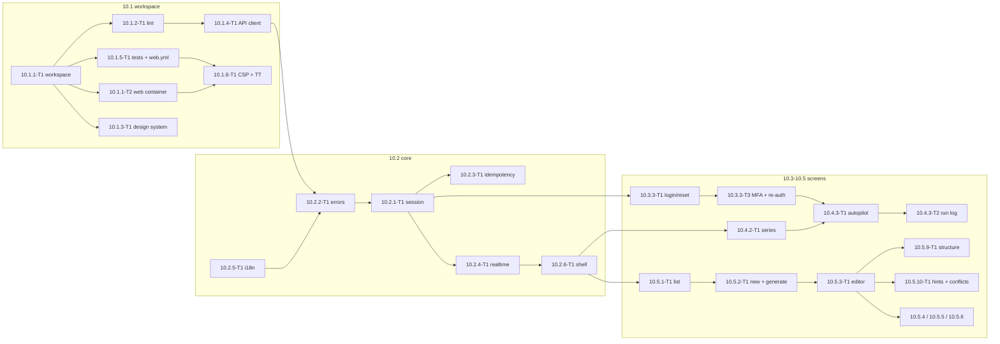

# 10 — Web UI, wave 1 (P: 10.1–10.5): Tech Lead review, shared decisions and feature index

> Reviews: `../../10-web-ui.md` (high-level, M1–M2) — **wave 1 only**: epics 10.1 (workspace), 10.2 (core), the P part of 10.3 (privacy/terms, owner login, reset, MFA), 10.4 (dashboard, series, autopilot) and 10.5 (story review). Wave 2 (10.6 render/video review, 10.7 P publishing, 10.10.2 journeys) and all S items (10.3.1-T2, 10.3.2, 10.3.3-T2, 10.7.3, 10.8, 10.9, 10.10.1) are not detailed here (`../README.md` detailing order steps 7 and "after Gate 2").
> Process: `../../00-overview.md` §10.1 step (2) review → step (3) detailed feature plans (this folder).
> Reviewed: 2026-09-24 by the Tech Lead, against the signed contracts of plans 02, 03, 04, 09 (wave 1 + Part B wave 2) and 11, and official vendor pages read the same day (§1 FE-rows).
> Verdict: **approve with changes.** The high-level scope is right, but it predates 09 wave 2: owner login is always MFA, enabling autopilot needs re-auth, registration is closed in P, reset links carry the token in the URL fragment and owner sockets are cut every 5 minutes. It also asks for per-response SSR nonces, which static prerendered pages cannot have, and it names no owner for serving the web app. §2 lists 25 findings; §3 D1–D18 is the contract every feature plan and task file in this folder must use.
> Status: **ready for implementation with conditions** (DoR 2026-09-25, accepted under the owner's standing approval) — see §11.
> Legend: ✅ read from source/docs (URL or file + line, date) · ⚠️ unverified · [DECISION] · [OPEN] · [INFERENCE].

## 0. How this folder is organised

```
plans/features/10-web-ui/
  README.md                          ← this file: facts, findings, decisions D1–D18, CRs, template, gates, index, re-estimate, owner decisions, DoR
  10.1.1-workspace-ci/               ← 10.1.1 workspace + web container, 10.1.2 lint/boundaries, 10.1.5 test tooling + web.yml
  10.1.3-design-api-csp/             ← 10.1.3 design system, 10.1.4 generated client, 10.1.6 CSP + Trusted Types
  10.2.1-session-errors/             ← 10.2.1 session/refresh/guards, 10.2.2 errors, 10.2.3 idempotency
  10.2.4-realtime-i18n-shell/        ← 10.2.4 realtime, 10.2.5 i18n, 10.2.6 shell
  10.3-auth-legal/                   ← 10.3.1-T1 privacy/terms, 10.3.3 login/forgot/reset, 10.3.3-T3 MFA + enrolment + re-auth (P)
  10.4-series-autopilot/             ← 10.4.1 dashboard, 10.4.2 series + pickers, 10.4.3 autopilot tab + run log
  10.5.1-episodes-editor/            ← 10.5.1 list, 10.5.2 new + generate, 10.5.3 editor, 10.5.9 structure, 10.5.10 hints/conflicts, 10.5.3-T2
  10.5.4-versions-research-bible/    ← 10.5.4 versions, 10.5.5 research, 10.5.6 approve/reopen, 10.5.7 bible, 10.5.8 find sources
```

Each feature folder holds `plan.md` (template `00-overview.md` §10.1, sections 1–11) and one `<task-id>-<slug>.md` per task (template §6). Task ids **replace** the wave-1 rows of `10-web-ui.md` §6 (mapping in §8). Every 10.x id already named by plans 02, 03, 04, 09 and 11 is kept (`10.4.2-T1` style grid, `10.4.3-T1`, `10.5.7-T1`, `10.1.4`, `10.1.5`, `10.2.4`); new ids are 10.1.1-T2, 10.3.3-T3, 10.4.2-T2 and 10.4.3-T2.

## 1. Facts verified for this review

**External facts (FE), read 2026-09-24** (scout `agent://Fe10Facts`, spot-checked by the TL; registry facts from `https://registry.npmjs.org/<pkg>/latest`).

| Id | Fact | Source |
|---|---|---|
| FE1 | `@angular/core`, `@angular/material`, `@angular/cdk` latest = **22.2.0**, MIT; core engines accept the **26.x** line (Angular 22 supports the 22.22.3+, 24.x and 26.x lines; the exact `node` range is recorded in 10 CR-43); `zone.js` is an optional peer | npm registry ✅; [angular.dev/reference/versions](https://angular.dev/reference/versions) ✅ |
| FE2 | "Zoneless is the default in Angular v21+ so you do not need to do anything to enable it." | https://angular.dev/guide/zoneless ✅ |
| FE3 | Signal Forms `form()` is badged "stable since v22.0"; the guide still calls reactive forms "a solid choice" where production stability guarantees matter | https://angular.dev/api/forms/signals/form ✅ |
| FE4 | `httpResource` members are tagged `@publicApi 22.0` (stable) | `angular/angular` `packages/common/http/src/resource.ts:45-105` ✅ |
| FE5 | New CLI projects use **Vitest** + jsdom through the builder `@angular/build:unit-test` | https://angular.dev/guide/testing ✅ |
| FE6 | Trusted Types policies used by Angular: `angular`, `angular#bundler`, `angular#unsafe-bypass`, `angular#unsafe-jit`, `angular#unsafe-upgrade` | https://angular.dev/best-practices/security ✅ |
| FE7 | CSP nonce options: `autoCsp`, `ngCspNonce`, `CSP_NONCE`; "Generating a nonce at the origin server is generally discouraged when using a CDN, as responses are frequently cached" | https://angular.dev/best-practices/security ✅ |
| FE8 | Hybrid rendering: `RenderMode.Prerender` per route in `app.routes.server.ts`; `outputMode: 'static'` produces no server | https://angular.dev/guide/ssr ✅ |
| FE9 | `@microsoft/signalr` 10.0.11 MIT; `skipNegotiation` "is available only when the WebSockets transport is the only enabled transport" | npm ✅; `dotnet/AspNetCore.Docs` `aspnetcore/signalr/configuration.md:468` ✅ |
| FE10 | `@jsverse/transloco` 8.4.0 MIT; `@jsverse/transloco-keys-manager` 8.1.1 MIT | npm ✅ |
| FE11 | `angular-eslint` 22.5.0 MIT (devkit `>= 22.0.0 < 23.0.0`, eslint `^9 \|\| ^10`); `eslint-plugin-boundaries` 7.2.0 MIT | npm ✅ |
| FE12 | `ng-openapi-gen` 1.1.0 MIT (Angular-native, no JVM); `@openapitools/openapi-generator-cli` 2.41.0 Apache-2.0 (wraps the Java generator) | npm ✅ |
| FE13 | `@playwright/test` 1.63.0 Apache-2.0; `@axe-core/playwright` 4.13.0 and `axe-core` 4.13.0 **MPL-2.0** (file-level copyleft; allowed — MPL is already accepted for OpenTofu, 11 E11) | npm ✅ |
| FE14 | `diff` (jsdiff) 9.0.0 BSD-3-Clause; `vitest` 5.0.1 MIT; `qrcode` 1.5.4 MIT; `@fontsource/be-vietnam-pro` 5.3.0 OFL-1.1 | npm ✅ |
| FE15 | nginx source licence is the 2-clause BSD text | `nginx/nginx` `LICENSE` ✅ |
| FE16 | CDK drag-drop: the angular.dev guide documents pointer drag only; keyboard reordering is not documented | https://angular.dev/guide/drag-drop ⚠️ (absence of evidence) |

**Contract facts (C) from signed plans.**

| Id | Fact | Source |
|---|---|---|
| C1 | Access token ES256, owner/admin **5 min**, user 15 min, never in a URL; refresh cookie `__Secure-nts_rt` `HttpOnly; Secure; SameSite=Strict; Path=/api/v1/auth`, rotated on every refresh; `POST /auth/refresh` requires `Origin` = `App:PublicOrigin`; owner/admin 12 h absolute, **30 min idle** | 09 README BD3 ✅ |
| C2 | Owner/admin login: `POST /auth/login` → 401 `mfa_required { mfaToken }` + pre-auth cookie `__Secure-nts_mfa` (5 min) → `POST /auth/login/mfa { mfaToken, code \| recoveryCode }`; without TOTP → 401 `mfa_enrolment_required` + enrolment-only token (only `/me/mfa/setup`, `/me/mfa/verify` answer; everything else 404) | 09 BD4, WT21, WT34; 09.3-auth `plan.md` §5 ✅ |
| C3 | `POST /auth/reauth { password, code }` sets `reauthenticated_at`; guarded routes answer 401 `reauth_required`; 5 wrong attempts revoke the family (401 `session_revoked`); ≥ 10 wrong TOTP codes in 15 min → 429 `rate_limited` `Retry-After: 900` on login | 09 BD4, WT35; 09.10.4-T1 ✅ |
| C4 | Reset link `/reset-password#t=<token>` (fragment), 60 min, single use; `POST /auth/forgot-password` always 202 (padded ≥ 300 ms) | 09 BD3, WT40 ✅ |
| C5 | Registration closed in P: `POST /auth/register` → 403 `registration_closed`; register + verify-email are S (09.3.1-T3) | 09 W2-O1, BD2 ✅ |
| C6 | Hub `/hubs/episodes`, WebSockets only + `skipNegotiation`; `POST /hubs/ticket` → `{ ticket, expiresAt }` (60 s, single use, policy `hub` 10/min/user); 401 `hub_ticket_invalid`; the hub **aborts** a connection after `Hubs:MaxConnectionMinutes` = role token lifetime (owner 5, user 15) and on every family revocation; handshake `Origin` must equal `App:PublicOrigin` | 09 BD11, WT37; 09.8.1 `plan.md` §8 ✅ |
| C7 | Events `EpisodeUpdated`, `RenderProgress { episodeId, renderJobId, stage, percent }`, `PublicationUpdated`, `CreditBalanceChanged` (S); no `AutopilotRunUpdated` and no `SeriesBibleUpdated` in P; clients refetch `GET /episodes/{id}` on events | 00 §8; 02 README §10 T2; 02.6.3 `plan.md` §5; 09.8.1 `plan.md:176` ✅ |
| C8 | `EpisodeDetailDto { id, seriesId, title, brief, lengthTier, status, nextActions[], etag, renderJob, finalVideo, publications }` + `generation { kind, status, stage, errorCode, startedAt, processingPaused }` + `currentStory { versionId, version, source, etag, content, qualityHints, auditReport, similarityScore, factSheetId, attestation }` | 09.4.2-5.3 `plan.md` §5, §7; 02 CR-7, T29 ✅ |
| C9 | `story.v1` segments `title`, `hook`, `paragraphs[] { beat, text, keywords, fact_refs }`, `ending`, `description`, `tags`; addressing `title \| hook \| p:<0-based> \| ending \| meta`; 1–2 keywords per segment; title ≤ 100, description ≤ 1,000, tags ≤ 15 × 30 chars (≤ 400 total); segments: short 4–5, standard 20–32, long 40–60 | 02 README D3, D4, D22 ✅ |
| C10 | Story ETag `"sv-<id>"`, fact sheet `"fs-<id>"`, bible `"sb-<version>"`, autopilot `"sa-<xmin>"`, episode `"ep-<xmin>"`; `If-Match` required on story PUT/approve/reopen, fact-sheet PUT/approve, bible PUT, autopilot PUT; 428 `if_match_required`; stale → 412 `story_version_conflict` / `fact_sheet_conflict` / `bible_conflict` / `series_conflict` | 02 D9; 02.3 `plan.md` §4.3; 09 AGENTS ✅ |
| C11 | `PUT /episodes/{id}/story` body `{ content: story.v1 }`; an unchanged body returns the same ETag and no new version; approve body `{ attestation?: { accepted, textVersion } }`; quality hints never disable approve | 02.3 `plan.md` §4–§6 ✅ |
| C12 | Enabling autopilot and accepting its authorization need a re-auth within 5 min; the authorization dialog accepts only after the text is scrolled to the end; the run log refetches on `EpisodeUpdated` and polls every 30 s while the tab is open | 02.8.3-T2; 02.8.3 `plan.md:375, 418` ✅ |
| C13 | `GET /voices` items `{ id, displayName, language, gender, tags, previewUrl }` (`previewUrl` null → no play button, no speed control); `GET /style-templates?topic=` items `{ id, name, topicHint, previewUrl }`; labels are i18n keys `series.style.<name>.label/.hint`; both catalogs are cacheable with ETag, no paging | 04 CR-11/CR-14; 03 CR-7; 09.4.2-T1 ✅ |
| C14 | `GET /episodes?seriesId=&status=&cursor=&limit=` → `{ items: EpisodeListItemDto(id, seriesId, title, status, lengthTier, createdAt, updatedAt, etag), nextCursor }`; `POST /series/{id}/episodes { title?, brief (1–1,000), lengthTier }` → 201 + `Location` | 09.5.1-T1 ✅ |
| C15 | CORS: policy `spa` (no credentials) + `spa-auth` (credentials, `/api/v1/auth/*` only), origin `App:PublicOrigin`; LB has one API target group and `/hubs/*` WebSockets; DNS `app.<domain>` / `staging.<domain>`; registry already has a `web` repository; `web` compose service sits behind profile `web` "until 10.1.1 defines the image" | 09.9.4-T1; 11.2.2-T1 rows 43–46; 11.1.1-T1:61, 143 ✅ |

## 2. Findings

| # | Sev | Where | Finding | Resolution |
|---|---|---|---|---|
| F01 | H | 10.1.6 | "Per-response SSR nonces" need a server that renders every response; public pages are prerendered and cached, where a nonce is either static or absent (FE7, FE8). A Node SSR server would also add a new attack surface in P for four legal pages | D4: `outputMode: 'static'`, no Node server; a build step hashes every inline script and emits the CSP header; Trusted Types stay |
| F02 | H | 10.1.1, 11.2.2-T1 | Nobody serves the SPA: the LB has only the API target, 11 T25 gives "static hosting" to 11.2.2-T1 but its resource list has none. A separate web origin would also make every authenticated call a CORS preflight (`Authorization` is not a simple header): one extra round trip per call | D3: **same origin** — a `web` container behind the same LB; path rules `/api/*`, `/hubs/*`, `/health/*` → API, default → web (10 CR-1, CR-2) |
| F03 | H | 10.3.3 | The plan reads the reset token from `?token=`; 09 BD3 puts it in the fragment `#t=` so it never reaches logs or `Referer` | D6: fragment only; the page removes it with `history.replaceState` before the POST |
| F04 | H | 10.9.5 (S) | Owner login is always MFA and enabling autopilot needs re-auth (C2, C3, C12), but the MFA step, the enrolment page and the re-auth dialog sit in 10.9.5-T1 (S). Without them the owner cannot log in or turn autopilot on in P | New **10.3.3-T3** (P, M); 10.9.5-T1 keeps only S items (disable MFA for users, admin redirect) and shrinks to XS (10 CR-4) |
| F05 | H | 10.3.3-T1 | Registration and e-mail verification are S (C5); the P login task still carries `/verify-email` | Verify page moves to 10.3.2-T1 (S); P login maps 403 `registration_closed` nowhere (no register link in P) (10 CR-4) |
| F06 | H | 10.2.1, 10.2.4, 10.4.3 | Idle bypass: a proactive refresh timer, a hub that reconnects every 5 min (C6) or a 30 s poll (C12) refreshes the token from an **idle** tab forever, so the server's 30-min owner idle limit (C1) never fires | D7 activity gate: background work (refresh for reconnect, polling) runs only while the user was active within the role's idle window; otherwise realtime pauses with a "Paused — click to continue" bar |
| F07 | M | 10.2.4 | Owner sockets are aborted every 5 min (C6). The rule "refetch on reconnect" then refetches every open store every 5 min, and the rule "do not reconnect until refresh succeeds" needs a precise trigger because the client cannot tell a backstop abort from a security abort | D8: every close follows one path — `ensureFreshAccessToken()` → new ticket → connect (backoff 1→30 s + jitter); refetch only stores with a live subscription, coalesced per 250 ms; refresh failure ends the session |
| F08 | M | 10.1.5 | E2E: Playwright `storageState` replays the refresh cookie, but the cookie rotates, so the second test triggers reuse detection and revokes the family (C1). TOTP codes are single-use per 30 s step (09 BD4) | D15: per-file login through the UI with a TOTP helper that waits for the next step; one worker for owner specs in P |
| F09 | M | 10.1.1, 10.1.5, §2 T1 | ⚠️ items resolved: zoneless is the default (FE2), Vitest is the default runner (FE5), Signal Forms and `httpResource` are stable (FE3, FE4) | D1 zoneless; D13 typed reactive forms (boring choice with Material), no Signal Forms mixing per feature; D15 Vitest |
| F10 | M | 10.1.4 | Generator not chosen; openapi-generator needs a JVM in CI | D5: `ng-openapi-gen` (FE12) |
| F11 | M | 10.5.9 | CDK keyboard reordering is undocumented (FE16) | D18: drag handle for pointers **and** explicit "Move up/down" buttons + live-region announcement; keyboard never depends on CDK |
| F12 | M | 10.5.2, 10.5.6, 10.2.6 | P is metering-only (02 D1): no quote, cost or balance texts, and `CreditBalanceChanged` is S | D14: P screens have no credit text; the S tasks 10.8.x add them through the named slot `cost-line` in the confirm dialog and the header |
| F13 | M | 10.5.2 | No user cancel route in P (02 T20) | No "Stop" button in P; the generating state shows elapsed time and the failure message for `errorCode` [DECISION] |
| F14 | M | 10.4.3, 10.5.7 | No `AutopilotRunUpdated`/`SeriesBibleUpdated` events (C7) | D17: run log refetch on `EpisodeUpdated` + 30 s visibility-aware poll; bible panel refetches on navigation and after approve |
| F15 | M | 10.4.3 | The veto-window list uses 06 routes (`PATCH`/`DELETE /publications/{id}`, `POST …/consent`), but 06 is not detailed | 10.4.3-T2 codes against 00 §8 routes with soft edges to 06.2.1-T1/06.2.2-T3; the list block ships hidden until `GET /episodes/{id}/publications` exists (flag `youtube_publish`) |
| F16 | M | 10.5.3 | A long story has up to 60 segments (C9); recomputing derived counts or diffs on every keystroke across the whole story is O(n) per key | D18: one signal per segment, `computed` totals, `@for` with a stable `track` key, no deep copies per keystroke |
| F17 | L | 02.3.4-T2, 02.7.2-T2, 04.2.3-T1 | Their Blocks cells name story-level ids (`10.5.x`, `10.5.8`, `10.4.x`) | 10 CR-6, CR-7 replace them with task ids |
| F18 | M | 10.3.1 | Prerender cannot call the API, but `legal_documents.content_url` implies a runtime fetch | D12: legal texts are versioned repo files owned by 13.1.1-T1/13.1.2-T1, turned into structured blocks at build time and rendered without `innerHTML` |
| F19 | L | NFR-10-2 | Angular budgets measure raw bytes; the NFR is gzip | D13: `angular.json` raw budgets + `tools/web/check-gzip-budget.mjs` in `web.yml` |
| F20 | M | 11 T34 | The web origin had no name; 11 proposed `nts/<env>/APP_ORIGIN` and gave it to "10.1.5/10.3.x" | D3: one origin; `App:PublicOrigin` = `https://app.<domain>` (API config) and bucket CORS use the same value |
| F21 | M | 10.2.1 | `returnUrl` is an open-redirect vector | D6: only relative paths starting with a single `/`, no scheme, no `//`, no backslash |
| F22 | M | 10.2.1 | Logout on a shared device must not leave the previous user's data in memory stores or an open socket | D6: `SessionEnded` event → every feature store resets, hub stops, route to `/login` |
| F23 | M | 10.4.2 | Voice/style catalogs are cacheable (C13); a custom client cache would duplicate the HTTP cache and go stale | D13: rely on the browser HTTP cache (ETag/Cache-Control from 09.4.2-T1); no app-level cache beyond the page store |
| F24 | L | 11.1.1-T1 | The `web` port and `web/Dockerfile` path were left open | D3 fixes them (container 8080, compose `127.0.0.1:4200`) (10 CR-2) |
| F25 | M | 10.5.10 | "The user's unsaved text is kept in memory" — writing drafts to `localStorage` would leave story text on shared devices | D18: memory only; the dirty guard protects navigation, nothing is persisted client-side |

## 3. Shared decisions (contract)

**D1 Workspace and toolchain [DECISION] (F09).**
- `web/` at the repo root: Angular **22.2.x** (FE1), standalone only, `strict` + `strictTemplates` + `noUncheckedIndexedAccess`, SCSS, zoneless (default, FE2 — no `zone.js` in `polyfills`), builder `@angular/build:application`, `outputMode: 'static'` (FE8).
- Node **26.10.0** (`^26.10.0`, FE1) in `web/.nvmrc` and `package.json` `engines`; npm with a committed `package-lock.json`; CI uses `npm ci` (10 CR-43). ⚠️ Node 26 is **Current**, not LTS, until its LTS promotion [INFERENCE: ~Oct 2026]; a dependency without Node 26 support is handled case by case (10 CR-43). Exact versions (no `^`) for `@angular/*`, `@angular/material`, `@angular/cdk` (all equal); Dependabot (11.5.3-T3) groups them.
- Path aliases `@core/*`, `@shared/*`, `@features/*` (`tsconfig.json`).
- Server routes (`app.routes.server.ts`): `RenderMode.Prerender` for public pages only (P: `/vi/privacy`, `/en/privacy`, `/vi/terms`, `/en/terms`; S adds landing/pricing); every other route `RenderMode.Client` (no server rendering of authenticated screens). The client fallback file name comes from the build output and is recorded in 10.1.1-T1 ⚠️.
- Angular upgrades: patch/minor through Dependabot; a major in a dedicated PR with `ng update` (high-level §8).

**D2 Layout and boundaries [DECISION] (00 §5.3, §5.4).** Exactly the 00 §5.3 tree (`core/`, `shared/{ui,util,api}`, `features/<name>/{domain,data-access,application,ui,feature}`, `<name>.routes.ts`, `index.ts`). Wave-1 features: `public`, `auth`, `dashboard`, `series`, `episodes`. Lint (10.1.2-T1) fails when:
- `domain` imports `@angular/*`, `rxjs` or anything outside `domain` + `@shared/util`;
- `ui` injects a store, repository or `HttpClient` (inputs/outputs only);
- a file outside `data-access` imports `@shared/api`;
- a feature imports another feature other than through its `index.ts`;
- `any`, non-`OnPush` components, `subscribe()` in components (use `toSignal`/`takeUntilDestroyed`), `bypassSecurityTrust*`, `[innerHTML]`, `document.write`, `eval`/`new Function`, `localStorage`/`sessionStorage` outside `core/prefs` (D6).
Shared cross-feature code lives in `shared/` (pure) or `core/` (singletons); never copy a helper into a second feature.

**D3 Hosting and origin topology [DECISION] (F02, F20, F24).**
- **One origin per environment**: `https://app.<domain>` (prod), `https://staging.<domain>`. The LB (11.2.2-T1/T3) routes `/api/*`, `/hubs/*`, `/health/*` to the API target group and everything else to a **`web` target group**. The SPA calls relative URLs (`/api/v1/...`, `/hubs/episodes`); CORS never applies in the browser; `App:PublicOrigin` (09.9.4-T1) equals this origin.
- **`web` container** (`web/Dockerfile`, multi-stage: `node:26` build → `nginxinc/nginx-unprivileged` digest-pinned runtime, BSD-2 FE15 ⚠️ image variant confirmed in 10.1.1-T2 (10 CR-43)): serves `dist/web/browser`, listens on **8080**, non-root, read-only root filesystem; runs on the two API hosts next to the API container (no new host; 11.5.1-T1 already builds a `web` image).
- nginx rules: `try_files` → prerendered file → client fallback; hashed assets `Cache-Control: public, max-age=31536000, immutable`; HTML `no-cache`; gzip + brotli-static if the image supports it ⚠️ (gzip minimum); `GET /healthz` → 200 (container health only); response headers from D4.
- Dev (native, no Docker — `00 §5.1` "Local dev", owner 2026-09-28; 10 CR-43): the browser origin is **`http://localhost:4200`** on the daily path — `npm start` = `ng serve` (bound to 127.0.0.1) with `proxy.conf.json` → `/api`, `/health` to `http://127.0.0.1:5000` and `/hubs` with `ws: true`. The compose service `web` (profile `web`, `127.0.0.1:4200:8080`, 10 CR-2), whose nginx template proxies `/api`, `/hubs` (WebSocket upgrade) and `/health` to `NTS_API_UPSTREAM` (`http://api:8080`, never the internal 8081) **only when that variable is set**, is kept for the deploy image and for e2e / image smoke only — never a daily-dev requirement; production leaves the variable unset because the LB routes. The dev API sets `App:PublicOrigin = http://localhost:4200` (10 CR-3). ⚠️ `__Secure-` cookies over `http://localhost` are accepted by Chromium and Firefox (localhost is a secure context) — 10.1.1-T2 verifies it; P e2e runs the Chromium project only, Safari is a manual check.
- Runtime config: none needed in P (same origin). CSP media origins come from the container env `NTS_CSP_MEDIA_ORIGINS` (D4).

**D4 CSP, Trusted Types and headers [DECISION] (F01).**
- `tools/web/gen-csp.mjs` (`npm run csp:gen`) runs in the web Dockerfile builder stage right after `ng build` (WR2): it parses every `*.html` in the output, SHA-256-hashes each executable inline `<script>` (JSON `type="application/json"` blocks excluded), **fails** on any inline event-handler attribute or `javascript:` URL, and writes `web/dist/nginx/csp-headers.conf` (one `add_header Content-Security-Policy … always;`, outside the served tree), which the runtime stage installs as an nginx template; nothing generated is committed. `optimization.styles.inlineCritical` is `false` (its `onload` handler would fail this step, WR12).
- Header CSP (every HTML response): `default-src 'none'; script-src 'self' <hashes>; style-src 'self' 'unsafe-inline'; img-src 'self' data: ${NTS_CSP_MEDIA_ORIGINS}; media-src 'self' ${NTS_CSP_MEDIA_ORIGINS}; font-src 'self'; connect-src 'self'; manifest-src 'self'; worker-src 'self'; object-src 'none'; base-uri 'none'; form-action 'self'; frame-ancestors 'none'; require-trusted-types-for 'script'; trusted-types angular angular#bundler nts-sanitizer`. `connect-src 'self'` covers `wss://` to the same host in current browsers ⚠️ confirmed by the 10.1.6-T1 e2e over `wss://` (else add `wss://<host>`).
- `style-src 'unsafe-inline'` [DECISION]: Angular and Material insert `<style>` at runtime and a static cacheable HTML cannot carry a nonce (FE7); risk accepted (CSS injection needs markup injection, which Trusted Types and the sanitizer ban block). Revisit if Angular ships hash-based style CSP for static output.
- `angular#unsafe-bypass` is **not** allowed (no `bypassSecurityTrust*`, D2). The only custom policy is `nts-sanitizer` in `core/security/` (reviewed; currently unused — present so a future need has one place).
- Other headers on every web response: `Referrer-Policy: no-referrer`, `X-Content-Type-Options: nosniff`, `Permissions-Policy: camera=(), microphone=(), geolocation=(), payment=()`, `Cross-Origin-Opener-Policy: same-origin`; HSTS comes from the LB/API rule (09.9.4-T1) and is also set by nginx in Staging/Production.
- Downloads: filenames are built by `shared/util/safe-filename.ts` (strip quotes, `/`, `\`, control characters, trim to 100 chars) — used by wave 2 and S.
- CI: every Playwright spec fails on a `securitypolicyviolation` event or a console CSP/Trusted Types error (10.1.6-T1 fixture).

**D5 API client and data access [DECISION] (F10).**
- `ng-openapi-gen` (FE12) generates `web/src/app/shared/api/` from the CI artifact `openapi.json` (09.1.5-T1; `ProblemDetails` schema from 09.9.5-T1): `npm run api:gen` (CI) and `npm run api:gen:local -- <path>`. Generated code is committed, formatted, excluded from lint, and a CI step fails when regeneration from the pinned artifact produces a diff.
- Only `features/*/data-access/**` and `core/**/data-access` import `@shared/api`. Each feature's `data-access` implements its `domain` port (abstract class) and maps DTO ↔ model with explicit functions (00 §5.4).
- Repositories return `Promise<T>` (`firstValueFrom`); stores never see `HttpResponse`. Concurrency helpers in `core/http/`: `withIfMatch(etag)`, `readEtag(response)`; idempotency helper D9-adjacent `IdempotencyKeys` (10.2.3-T1).
- Paging helper `shared/util/cursor-page.ts` (`{ items, nextCursor }`, limit ≤ 100) + `core/state/cursor-list.ts` (signal-based "load more" with in-flight guard) reused by every list.

**D6 Session and authentication [DECISION] (F03, F21, F22).**
- Access token in memory only (`SessionStore` signal); never in `localStorage`/`sessionStorage`/cookies readable by JS (NFR-10-5). `core/prefs` may persist only the UI language before login; from S it also persists a pending `paymentId` written before the checkout top-level navigation and cleared once `/billing/return` resolves to a terminal status (10 CR-36) — still no token, no PII.
- Boot: `provideAppInitializer` calls `POST /api/v1/auth/refresh` (cookie) once; guarded routes wait for it. 401 → anonymous.
- Interceptor: attaches `Authorization: Bearer` to `/api/v1/**` except `/auth/login*`, `/auth/refresh`, `/auth/forgot-password`, `/auth/reset-password`; on 401 (`session_revoked`, expired token) runs **one** shared refresh (single-flight promise; concurrent 401s wait) and retries the original request **once**; refresh failure → `SessionEnded` → `/login?returnUrl=`. `withCredentials` is not needed (same origin); cookies are never read by JS.
- Refresh is on demand: before a request when `expiresAt − now < 30 s`, or on 401. **No timer-driven refresh** (D7).
- `returnUrl` accepted only when it matches `^/(?![/\\])[^\s]*$` and is not an auth page; otherwise `/dashboard`.
- Logout: `POST /auth/logout` → `SessionEnded` (also on refresh failure and on `refresh_token_reused`): all feature stores reset through `SESSION_SCOPED` providers (root-level stores register a `reset()`), realtime stops, the router goes to `/login`, in-memory story drafts are discarded after the dirty guard asked.
- Guards: `authGuard` (session), `mfaEnrolmentGuard` (enrolment-only token → only `/account/security/mfa-setup`), `roleGuard` (admin/owner routes are S). Reset/verify pages read tokens from `location.hash` then `history.replaceState(null, '', location.pathname)` before calling the API.

**D7 Activity gate [DECISION] (F06).** `core/session/activity.ts` tracks user input (`pointerdown`, `keydown`, `wheel`, `touchstart`, throttled 1/10 s) and `document.visibilityState`. `isActive()` = input within `idleWindow` (owner/admin 25 min, user 13 days — just below the server limits C1). Rules:
- A refresh that is **not** caused by a user action (hub reconnect, polling) happens only when `isActive()`; otherwise realtime pauses and a `realtime.paused` bar offers "Continue" (a user action → refresh → reconnect → refetch).
- Polling (D17) runs only while the document is visible **and** `isActive()`.
- A user action after the idle window simply sends its request; the server decides (401 → login).

**D8 Realtime [DECISION] (F07; C6, C7).**
- `RealtimeService` (root) owns one `HubConnection`: `withUrl('/hubs/episodes?ticket=<t>', { transport: HttpTransportType.WebSockets, skipNegotiation: true })`, no `accessTokenFactory`, no built-in automatic reconnect (the ticket is single-use).
- Connect = `ensureFreshAccessToken()` → `POST /hubs/ticket` → `start()`. Every `onclose` (backstop, security abort, network) follows the **same** path after backoff 1, 2, 4, 8, 16, 30 s + 0–20 % jitter, gated by D7; 401 `hub_ticket_invalid` → one new ticket then backoff; a refresh failure ends the session (no reconnect).
- Events are exposed as typed signals/observables per name; feature stores subscribe through `realtime.subscribeEpisode(episodeId, handler)` (typed `on(name, ids?)` for other events; WR7). On every (re)connect and on `visibilitychange → visible`, the service emits `resync`; only stores with a live subscription refetch, coalesced per store within 250 ms. `RenderProgress` updates the progress signal directly (no refetch); `EpisodeUpdated` triggers a detail refetch (09.8.1 `plan.md:176`). Unknown event names and unknown `stage` values are ignored.
- The token never appears in the hub URL; the ticket is not logged (dev console included).

**D9 Errors [DECISION].** `AppError { code, status, fieldErrors: Record<string, string[]>, retryAfterSec?, traceId?, problem }` built by `AppErrorMapper` (10.2.2-T1) from ProblemDetails; network error → `network_error`; 413 → `payload_too_large`; unknown code → `unknown_error` + `traceId` shown. Every code in 09 §5.4 + 02 D8 used by wave-1 screens has an i18n key `errors.<code>` (vi + en); `detail` is never shown raw. Shared patterns (built once, reused):
- `validation_failed` / `*_invalid_content` → `bindFieldErrors(form, error)` maps `errors` keys (camelCase paths, D22 segment addresses for story) onto controls; unmapped keys go to a form-level alert.
- 412 conflicts → `ConflictDialog` (Reload latest / Save mine as new version / Cancel; keeps the unsaved input in memory until chosen).
- 409 `episode_invalid_state` → refetch the episode, show `errors.episode_invalid_state` with the actions from `nextActions`.
- 428 is a client bug → logged to console in dev, generic message.
- 429 `rate_limited` / `story_generation_limit` → `RetryCountdown` from `Retry-After`; the action stays disabled until 0.

**D10 i18n [DECISION].** Transloco (FE10), languages `vi` (default) and `en`, one scope per feature (`auth`, `series`, `episodes`, `dashboard`, `public`) + `core` + `errors` + `quality` (02 hint copy, WR15); files `web/src/assets/i18n/<scope>/<lang>.json`, lazy per route. Key style `scope.area.item` (camelCase leaves); keys handed over by other plans are used verbatim (`series.style.<name>.label/.hint`, `series.style.trueCrimeNotice`, `voices.tag.<tag>`, `quality.*`, `render.*` (wave 2), 02 copy keys). Language: profile `uiLocale` (`GET /me`) → saved pre-login preference → browser → `vi`. Dates/numbers through `Intl` for `vi-VN`/`en-US`; time zones shown explicitly where the value is a schedule (autopilot). CI (10.2.5-T1): the `vi` and `en` key sets are equal per scope, every key used in code exists (keys-manager `find` + a script), and no hard-coded user-visible literal passes the template lint rule.

**D11 Design system and shared UI [DECISION] (reuse inventory).** Angular Material M3, dark default + light option, tokens once in `shared/ui/theme/`; font Be Vietnam Pro self-hosted from `@fontsource/be-vietnam-pro` (OFL-1.1, FE14; subsets latin + latin-ext + vietnamese, weights 400/500/600); no third-party font/CDN request. Shared components (each with inputs/outputs only, OnPush, a11y notes, component test): `PageHeader`, `EmptyState`, `ErrorState`, `LoadingState` (skeleton), `StatusChip` (episode/run statuses), `ConfirmDialog` (with the `cost-line` slot, D14), `ConflictDialog` (D9), `RetryCountdown`, `CharCounter`, `Stepper` wrapper, `InlineAnnotation` (10.5.10-T1), `SegmentChips`, `DiffView` (10.5.4-T1, `@defer`), `ReauthDialog` (10.3.3-T3), `CopyableCode` (recovery codes), `AudioPreviewButton` (10.4.2-T2). Where a component is built by a feature task, it still goes to `shared/ui/` if a second feature needs it (listed in its task file).

**D12 Public and legal pages [DECISION] (F18).** Prerendered routes `/vi/privacy`, `/en/privacy`, `/vi/terms`, `/en/terms` (P); `<title>`, `description`, canonical and `hreflang` alternates per language; no API call during prerender; no third-party asset. Content: `web/src/content/legal/<prefix>.<version>.<lang>.md` (manifest key -> file prefix: `tos -> terms`, `privacy -> privacy`; 13 CR-34), authored by 13.1.1-T1 (privacy) and 13.1.2-T1 (terms); `tools/web/legal-to-json.mjs` (build time) converts the Markdown subset (headings, paragraphs, lists, links, emphasis) into a typed block list, rejecting raw HTML; `LegalDocumentPage` renders blocks with `@for` — never `innerHTML`. The version string shown on the page equals the version the API records in `user_consents` (13 owns both).

**D13 State, forms and performance [DECISION] (F09, F16, F19, F23).**
- Signal stores per feature (00 §5.1 sample): `@Injectable()` provided by the routed page (or root when session-scoped, D6), `signal` + `computed`, async use-case methods returning `Promise<Result>`, no NgRx.
- Forms: **typed Reactive Forms** with Material; Signal Forms are not mixed in per feature (FE3 noted; a later switch is one workspace-wide PR).
- Every component `OnPush`; `@for` always with `track <stable id>`; `@defer (on viewport | on interaction)` for heavy parts (diff view, QR code, audio preview); every feature lazy (`loadChildren`/`loadComponent`).
- Budgets: `angular.json` initial raw warning 700 kB / error 900 kB [INFERENCE: sized to hold ≤ 250 kB gzip], any component style ≤ 8 kB; `tools/web/check-gzip-budget.mjs` fails `web.yml` when the gzip sum of initial chunks > 250 kB (NFR-10-2).
- No client cache for catalogs (browser HTTP cache honours 09.4.2-T1 ETags); store data lives as long as the page store.
- No polling except D17; no timers without `DestroyRef` cleanup.

**D14 P vs S in the UI [DECISION] (F12).** Wave 1 builds the P screens only. No credit amounts, quotes, balance or buy buttons in P (02 D1; `CreditBalanceChanged` is S). `ConfirmDialog` exposes an optional projected `cost-line` slot, and the shell header an optional `header-end` slot; S tasks 10.8.1-T1/10.8.3-T1 fill them (10 CR-4 records this in the high-level plan). Feature flags: `GET /me` gains `features: string[]` = the enabled keys of an allow-list (`source_finder`, `youtube_publish`) read through `IFeatureFlags` (10 CR-10, O1); `core/session` exposes `hasFeature(key)`; a flag switched off mid-session still answers 404 `feature_disabled`, which the block handles by hiding itself and refetching `/me`.

**D15 Testing and CI [DECISION] (F08).**
- Unit/component: Vitest through `@angular/build:unit-test` + jsdom (FE5), TestBed zoneless; hand-written fake repositories implementing the domain ports (`features/*/testing/fake-*.repository.ts`) — no mocking library (same rule as the backend, 09 N10/N11).
- Store tests cover success, `AppError` mapping, ETag conflict, rollback of optimistic state, realtime merge; component tests cover logic-heavy UI (editor, dialogs, pickers); domain/util tests are pure.
- E2E: Playwright (FE13) in `web/e2e/`, against the compose stack (11.1.1-T1: api, worker, postgres, storage, mailpit, mock-mpt) with the `web` profile; `@axe-core/playwright` check on every page visited (WCAG 2.1 AA tags), plus the D4 CSP fixture. Owner auth helper: log in through the UI, enrol TOTP on first run (reads the manual key from the page), compute codes with a local RFC 6238 helper (Node `crypto`), wait for the next 30 s step when the current one was used; one login per spec file (`test.describe.serial` + `beforeAll`), `workers: 1` for the owner project; **never** reuse `storageState` across files (rotating refresh cookie).
- `web.yml` (10.1.5-T1, `paths: web/**`): `npm ci` → lint → i18n check → `api:gen` drift check → unit tests → build → gzip budget → `gen-csp`; third-party actions pinned by SHA (11.5.3-T1 reviews). **No compose e2e in `web.yml`**: the Playwright suite (`web/e2e`, `npm run e2e`, config + fixtures owned by 10.1.5-T1) runs in 11.5.1-T1's `e2e.yml` job `e2e`, which already triggers on `web/**` (one stack start per PR, no duplicate CI) (10 CR-1); trace/video on failure are uploaded as artifacts there.

**D16 Accessibility baseline (every task) [DECISION].** WCAG 2.1 AA on wave-1 screens: every control labelled, visible focus (≥ 3:1), keyboard reachable without traps except modal dialogs (focus trapped, restored on close), `aria-live="polite"` for progress/status changes and "saved" feedback, errors linked with `aria-describedby`, contrast ≥ 4.5:1 in both themes, no information by colour alone (flagged chips carry an icon + text), target size ≥ 24 px, 360 px layout without horizontal scroll, `prefers-reduced-motion` honoured. Each task lists its screen-specific a11y checks; axe runs in its e2e spec. (The S pass 10.10.1 audits everything again.)

**D17 Polling and refresh semantics [DECISION] (F14; C7, C12).** One helper `core/state/visible-poll.ts` (`intervalMs`, runs while `document.visibilityState === 'visible'` and D7 `isActive()`, pauses otherwise, immediate run on return, single in-flight). Uses: autopilot run log 30 s; nothing else in wave 1. The bible panel refetches on navigation and after an approve on the same episode page. Episode pages rely on D8 events + `resync`.

**D18 Story editor model [DECISION] (F11, F16, F25; C9–C11).**
- Domain model `StoryDraft` mirrors `story.v1` exactly (no extra fields on the wire); each segment has a client-only stable key (`crypto.randomUUID()`) for `track` and reordering, dropped when serialising.
- One `WritableSignal` per segment text/keywords; `computed` token counts per segment (D4 token rule: NFC + split on Unicode whitespace) and totals; `isDirty = computed(() => serialize(draft) !== baselineJson)` evaluated on change with a 150 ms debounce.
- Save = explicit "Save version" → `PUT /episodes/{id}/story` `{ content }` + `If-Match: currentStory.etag`; response updates `etag`, `qualityHints`, baseline. No autosave, no `localStorage` (F25).
- Segment addressing helper `shared/util/segment-address.ts` (`title | hook | p:<i> | ending | meta`, parse + format + remap after reorder) is the single implementation used by the editor, hints, annotations, the conflict dialog and the autopilot run-log deep link (`/episodes/:id?segment=p:3`).
- Keyboard reorder never depends on CDK (F11): "Move up/Move down" buttons per paragraph + `LiveAnnouncer`; drag handle (CDK) for pointers; scene chips move with their paragraph; delete → undo snackbar (10 s), then the paragraph is gone from the draft (still recoverable by not saving).
- Dirty guard: `canDeactivate` + `beforeunload` while dirty.
- Rendering story text: text interpolation only; keywords are plain chips; no Markdown.

**D19 Design-first rule [DECISION] (owner rule 2026-09-25).** Every UI feature folder in wave 1 opens with one design task (`<first-story>-T0`, Area `UX`, Depends on `10.1.3-T1` + the folder's key backend contract task (soft)) that produces wireframes + hi-fi mockups for every screen and state in that folder's `plan.md` §6 at 360/768/1280, dark default + light, vi + en, focus order + keyboard path + `aria-live` annotations, built from the D11 tokens/components; deliverable = a design link recorded in `plan.md` §6 plus the owner's approval record, and it is a **hard gate** — every implementation task in the folder lists its `-T0` as a hard `Depends on`. Sizes: S (0.5) for a 1–3-screen folder, M (1.0) for ≥ 4 screens. Non-UI folders (10.1.1 workspace/CI, 10.1.3 design system + generated client + CSP — the design-system foundation every `-T0` depends on — 10.2.1 session/errors, and 10.2.3 idempotency) are exempt: they ship no user-facing screen. §6 of each folder's `plan.md` records the design link/approval under a `Design (owner rule 2026-09-25)` paragraph. Applied 2026-09-25 (10 CR-31); mirrors Part C's SD11 (owner rule already applied there).

## 4. Change requests

Applied 2026-09-24 under the owner's standing approval; tagged `(10 CR-n)`.

| CR | Target | Change |
|---|---|---|
| 10 CR-1 | `features/11-worker-deployment/11.2-cloud-environments/11.2.2-T1-platform-module.md`, `…/11.4-11.5-storage-cicd/11.5.1-T1-app-deploy-workflow.md`, `features/11-worker-deployment/README.md` D15/T25, `plans/11-worker-deployment.md` §5.1 topology diagram | LB gets a `web` target group (the `web` container on the two API hosts, port 8080) with path rules `/api/*`, `/hubs/*`, `/health/*` → API, default → web; `deploy.yml` deploys the `web` container with the API; T25 reads "10.1.1-T2 builds the image; 11.2.2-T1 owns the LB target and rules" (D3) |
| 10 CR-2 | `features/11-worker-deployment/11.1-local-dev/11.1.1-T1-compose-app-stack.md` | `web` service: build `web/Dockerfile`, `127.0.0.1:4200:8080`, health `GET /healthz`; the [INFERENCE] note is resolved by D3 |
| 10 CR-3 | `features/09-backend-api/09.9-platform/09.9.4-T1-security-hardening.md`, `features/11-worker-deployment/11.4-11.5-storage-cicd/11.4.1-T1-storage-buckets.md` | `App:PublicOrigin` = the single web + API origin (`https://app.<domain>`); in `Development` only, `http://localhost:<port>` is also valid (startup validation); bucket CORS uses the same value (secret/config `APP_ORIGIN` = that origin) (D3, F20) |
| 10 CR-4 | `plans/10-web-ui.md` | 10.1.6 wording (hash-based CSP, static output), 10.3.3 reset fragment + verify page moved to 10.3.2-T1, new rows 10.1.1-T2, 10.3.3-T3, 10.4.2-T2, 10.4.3-T2, 10.9.5-T1 reduced to XS, §2 T1 and §10 ⚠️ closed (FE1–FE5), cost texts via the D14 slots, §6 sizes (10.1.6-T1 M), §11 estimate |
| 10 CR-5 | `plans/00-overview.md` §4.1 and §13 | plan 10: 45.25 → 48.5 raw (P 30.0 → 33.5, S 15.25 → 15.0); totals P 182.75 → 186.25 / 223.5, S 80.0 → 79.75 / 95.7, all 262.75 → 266.0 / 319.2 |
| 10 CR-6 | `features/02-story-writing/` task headers + README §8.1 | Blocks cells gain the 10.x task ids that depend on them (§8.1); `02.3.4-T2` "10.5.x" and `02.7.2-T2` "10.5.8" become task ids |
| 10 CR-7 | `features/03-image-generation/03.1-style-system/03.1.1-T1-…`, `features/04-voice-proxy/04.2-voice-catalog/04.2.3-T1-…` (+ their §8.1 rows) | 03.1.1-T1 Blocks + `10.4.2-T1`; 04.2.3-T1 "10.4.x picker previews" → `10.4.2-T2` |
| 10 CR-8 | `features/09-backend-api/` task headers + README §8.1 / §B8.1 | Blocks cells gain the 10.x task ids that depend on them (§8.1) |
| 10 CR-9 | `plans/features/README.md` | readiness and index rows for 10 wave 1 |
| 10 CR-11 | `features/02-story-writing/02.3-checkpoint-1/02.3.4-T1-story-quality-checker.md`, `…/02.3-checkpoint-1/plan.md` §6 (web path) | hint bundle path `web/src/assets/i18n/quality/{vi,en}.json`; approve gating per WR6 (blocking hints alone never disable approve; keyword-linter flags do, server-enforced) |
| 10 CR-10 | `features/09-backend-api/09.3.4-me-limits-audit/09.3.4-T1-me-endpoints.md` | `MeDto` gains `IReadOnlyList<string> Features` (enabled keys of the allow-list `source_finder`, `youtube_publish`, read through `IFeatureFlags` from 09.9.2-T2; empty until that task lands) (D14, O1) |
| 10 CR-31 | `10.1.1-workspace-ci/`…`10.7.2-publish/` (8 folders, `-T0` task files, applied here); `plans/10-web-ui.md` §6 + §11 (listed below, **not applied — TL applies**); `plans/00-overview.md` §4.1 (two rows + grand totals, listed below, **not applied — TL applies**) | Design-first retrofit (D19/owner rule 2026-09-25): 8 new `-T0` UI-design tasks — wave 1: `10.2.4-T0` (S), `10.3.3-T0` (M), `10.4.1-T0` (M), `10.5.1-T0` (M), `10.5.4-T0` (M) = +4.5 d; wave 2: `10.6.1-T0` (S), `10.7.1-T0` (S), `10.7.2-T0` (M) = +2.0 d; total **+6.5 d raw**. Each `Depends on` = `10.1.3-T1` (design-system foundation) + a soft backend contract task; `Blocks` = every implementation task in its folder (§8.1/§B8.1 updated in this file). **`plans/10-web-ui.md` §6 (task breakdown) — insert 8 new rows** (format `| Task ID | Task | Area | Size | Depends on |`, after the matching existing story row): `| 10.2.4-T0 | UI design (app shell, nav, language switch, user menu, realtime status) | UX | S | 10.1.3 |` · `| 10.3.3-T0 | UI design (login, MFA, forgot/reset, re-auth, legal pages) | UX | M | 10.1.3 |` · `| 10.4.1-T0 | UI design (dashboard, series editor, autopilot tab, run log, veto list) | UX | M | 10.1.3 |` · `| 10.5.1-T0 | UI design (episode list, new + generate, story editor, conflict, dirty guard) | UX | M | 10.1.3 |` · `| 10.5.4-T0 | UI design (versions/diff, approve & reopen, research page, find sources, bible) | UX | M | 10.1.3 |` · `| 10.6.1-T0 | UI design (render timeline, failure states, video review) | UX | S | 10.1.3 |` · `| 10.7.1-T0 | UI design (channels: connect, callback result, disconnect) | UX | S | 10.1.3 |` · `| 10.7.2-T0 | UI design (publish form, consent, quota wait, publication status, veto-email pages) | UX | M | 10.1.3 |`. **`plans/10-web-ui.md` §11 (estimate summary) — exact old → new:** `| 10.2 Core | 3.75 |` → `| 10.2 Core | 4.25 |` (+0.5 `10.2.4-T0`); `| 10.3 Public + auth | 3.75 |` → `| 10.3 Public + auth | 4.75 |` (+1.0 `10.3.3-T0`; ⚠️ Part C's pending CR-22 also proposes this row 3.75→4.75 for a **different** reason, `10.3.1-T0` wave-3 design — if both CRs are applied the TL must combine to 5.75, not overwrite); `| 10.4 Dashboard + series + autopilot | 4.0 |` → `| 10.4 Dashboard + series + autopilot | 5.0 |` (+1.0 `10.4.1-T0`); `| 10.5 Story review | 12.25 |` → `| 10.5 Story review | 14.25 |` (+1.0 `10.5.1-T0` +1.0 `10.5.4-T0`); `| 10.6 Render + video review | 2.5 |` → `| 10.6 Render + video review | 3.0 |` (+0.5 `10.6.1-T0`); `| 10.7 Publishing + channels | 5.0 (incl. 2.0 R2) |` → `| 10.7 Publishing + channels | 6.5 (incl. 2.0 R2) |` (+0.5 `10.7.1-T0` +1.0 `10.7.2-T0`); `| **Total** | **50.0** → with 20 % buffer **60.0** person-days (of which R2: 2.0 raw / 2.4 with buffer; P 35.0, S 15.0; 10 CR-4: was 45.25 / 54.3 — wave 1 re-estimated in `features/10-web-ui/README.md` §9; 10 CR-14: wave 2 +1.5, Part B §B9) |` → `| **Total** | **56.5** → with 20 % buffer **67.8** person-days (of which R2: 2.0 raw / 2.4 with buffer; P 41.5, S 15.0; 10 CR-4: was 45.25 / 54.3 — wave 1 re-estimated in `features/10-web-ui/README.md` §9; 10 CR-14: wave 2 +1.5, Part B §B9; 10 CR-31: +6.5 d design tasks — wave 1 +4.5 (§9), wave 2 +2.0 (§B9), D19/WD11 owner rule 2026-09-25) |`. **`plans/00-overview.md` §4.1 (per-plan table, `10 Web UI` row) — exact old → new:** `| 10 Web UI (10 CR-5: was 30 / 36.0, S 15.25 / 18.3; 10 CR-14: P 33.5 → 35.0) | 35.0 | 42.0 | 15.0 | 18.0 |` → `| 10 Web UI (10 CR-5: was 30 / 36.0, S 15.25 / 18.3; 10 CR-14: P 33.5 → 35.0; 10 CR-31: P 35.0 → 41.5, +6.5 d design tasks, D19/WD11 owner rule 2026-09-25) | 41.5 | 49.8 | 15.0 | 18.0 |`. **`plans/00-overview.md` §4.1 grand-total row — exact old → new** (append before the closing paren and update the four bold numbers): `…; 12 CR-4: S +1.0 → 80.75 / 96.9) | **190.25** | **228.3** | **80.75** | **96.9** |` → `…; 12 CR-4: S +1.0 → 80.75 / 96.9; 10 CR-31: P +6.5 → 196.75 / 236.1) | **196.75** | **236.1** | **80.75** | **96.9** |`. **`plans/00-overview.md` §13-area narrative table, `10 Web UI` milestone row — exact old → new** (line number has drifted since this CR was drafted; locate by the row text, not a line number): `| 10 Web UI | 50.0 | 60.0 | P 35.0 (10 CR-14: wave 2 +1.5): M1 (incl. privacy/terms pages, owner MFA screens; wave 1 re-estimated in \`features/10-web-ui/\` §9, 10 CR-5: was 45.25 / 54.3, P 30.0); S 15.0: M2 (2.0 / 2.4 in R2) |` → `| 10 Web UI | 56.5 | 67.8 | P 41.5 (10 CR-31: wave 1 design +4.5, wave 2 design +2.0, D19/WD11 owner rule 2026-09-25; 10 CR-14: wave 2 +1.5): M1 (incl. privacy/terms pages, owner MFA screens; wave 1 re-estimated in \`features/10-web-ui/\` §9, 10 CR-5: was 45.25 / 54.3, P 30.0); S 15.0: M2 (2.0 / 2.4 in R2) |`. **Same table, grand-total row — exact old → new:** `| **Total** | **271.0** | **325.2** | P 190.25 / 228.3 · S 80.75 / 96.9 (§4.1) (…; 12 CR-4: was 270.0 / 324.0) |` → `| **Total** | **277.5** | **333.0** | P 196.75 / 236.1 · S 80.75 / 96.9 (§4.1) (…; 12 CR-4: was 270.0 / 324.0; 10 CR-31: was 271.0 / 325.2, P 190.25 / 228.3, +6.5 d design tasks D19/WD11) |`. None of these four `.md`-file edits are applied by this folder; the TL applies them and reconciles the `10.3 Public + auth` double-count with Part C CR-22 if that CR lands too. |

## 5. Sequencing



- Backend inputs (hard): 09.1.5-T1 (OpenAPI artifact), 09.1.4-T1, 09.3.2-T1/T3, 09.3.3-T1, 09.3.4-T1, 09.10.4-T1, 09.8.1-T2, 09.4.1-T1, 09.4.2-T1, 09.5.1-T1, 09.5.3-T1, and the 02 command/read-model tasks named in §8.1. Frontend work can start on 10.1 immediately; each screen task needs its backend task merged (or a contract-true fake repository for its component tests, but the e2e acceptance runs against the real API).
- 13.1.1-T1 / 13.1.2-T1 (legal texts) are named ids of the high-level plan 13, not yet detailed; 10.3.1-T1 waits for them (06 + 13 are detailing step 6).

## 6. Task file template

Same as `../02-story-writing/README.md` §6: H1 `# <task-id> — <title>`, then the one-row table `| Story | Size | Area | Depends on | Blocks | Phase / flag |` (cells equal §8.1), then `## Goal`, `## Inputs`, `## Design`, `## Steps`, `## Outputs`, `## Acceptance checks`, `## Tests`, `## Failure handling and edge cases`, `## Notes`. Frontend specifics: **Design** names files under `web/src/app/…`, the store signals and methods, the component inputs/outputs, the routes and the i18n keys; **Acceptance checks** include the e2e scenario, the axe check and both languages; **Notes** list shared components produced or reused (D11).

## 7. Gates

- **10-W1-foundation:** `web.yml` green on a PR (lint, i18n, api:gen drift, unit, build, gzip budget, CSP generation, one e2e smoke with axe + CSP fixture); the `web` image serves the SPA behind the dev compose on `127.0.0.1:4200` with the D4 headers (10.1.x).
- **10-W1-session:** owner logs in with password + TOTP through the UI, reloads (session restored), is signed out after the server revokes the family, reconnects the hub after a backstop close without a refetch storm, and pauses realtime when idle (10.2.x, 10.3.3-T1/T3).
- **10-W1-studio (input to the 02/03 M1 exit):** in the local stack the owner creates a series (voice + style), creates an episode, generates, edits, reorders, saves with a conflict, restores a version, and approves (true-crime path with sources + fact sheet + attestation), all in vi and en, with axe clean (10.4.x, 10.5.x).

## 8. Feature index and task mapping

| Folder | Stories | Tasks (size) |
|---|---|---|
| `10.1.1-workspace-ci/` | 10.1.1, 10.1.2, 10.1.5 | 10.1.1-T1 (S), 10.1.1-T2 (S), 10.1.2-T1 (S), 10.1.5-T1 (S) |
| `10.1.3-design-api-csp/` | 10.1.3, 10.1.4, 10.1.6 | 10.1.3-T1 (M), 10.1.4-T1 (S), 10.1.6-T1 (M) |
| `10.2.1-session-errors/` | 10.2.1, 10.2.2, 10.2.3 | 10.2.2-T1 (S), 10.2.1-T1 (M), 10.2.3-T1 (XS) |
| `10.2.4-realtime-i18n-shell/` | 10.2.4, 10.2.5, 10.2.6 | 10.2.4-T0 (S), 10.2.5-T1 (S), 10.2.4-T1 (M), 10.2.6-T1 (S) |
| `10.3-auth-legal/` | 10.3.1 (P part), 10.3.3 | 10.3.3-T0 (M), 10.3.1-T1 (S), 10.3.3-T1 (M), 10.3.3-T3 (M) |
| `10.4-series-autopilot/` | 10.4.1, 10.4.2, 10.4.3 | 10.4.1-T0 (M), 10.4.2-T2 (S), 10.4.2-T1 (M), 10.4.1-T1 (S), 10.4.3-T1 (M), 10.4.3-T2 (M) |
| `10.5.1-episodes-editor/` | 10.5.1, 10.5.2, 10.5.3, 10.5.9, 10.5.10 | 10.5.1-T0 (M), 10.5.1-T1 (S), 10.5.2-T1 (S), 10.5.3-T1 (L), 10.5.9-T1 (L), 10.5.10-T1 (L), 10.5.3-T2 (XS) |
| `10.5.4-versions-research-bible/` | 10.5.4, 10.5.5, 10.5.6, 10.5.7, 10.5.8 | 10.5.4-T0 (M), 10.5.4-T1 (M), 10.5.6-T1 (S), 10.5.5-T1 (L), 10.5.7-T1 (M), 10.5.8-T1 (S) |

Mapping from `10-web-ui.md` §6: every wave-1 row keeps its id; `10.1.1-T2`, `10.3.3-T3`, `10.4.2-T2`, `10.4.3-T2` are new; `10.1.6-T1` grows S → M; the verify-email page leaves 10.3.3-T1 for 10.3.2-T1 (S).

### 8.1 Canonical task dependencies

All tasks are P · M1. "(soft)" = the task can start with a contract-true fake; the acceptance run needs the real input.

| Task | Size | Area | Phase | Depends on | Blocks |
|---|---|---|---|---|---|
| 10.1.1-T1 | S (0.5) | FE | P | — | 10.1.1-T2, 10.1.2-T1, 10.1.5-T1, 10.1.3-T1, 10.1.4-T1, 10.2.5-T1 |
| 10.1.1-T2 | S (0.5) | FE + Ops | P | 10.1.1-T1 | 10.1.6-T1, 11.1.1-T1 (soft), 11.2.2-T1 (soft) |
| 10.1.2-T1 | S (0.5) | FE | P | 10.1.1-T1 | 10.1.4-T1, 10.1.6-T1 |
| 10.1.5-T1 | S (0.5) | FE + CI | P | 10.1.1-T1, 11.1.1-T1 (soft) | 10.1.6-T1, 11.5.1-T1 (soft), 10.10.2-T1 (10 CR-15), 10.10.1-T1 (10 CR-37) |
| 10.1.3-T1 | M (1.0) | FE | P | 10.1.1-T1 | 10.2.6-T1, 10.3.1-T1, 10.3.3-T1, 10.4.2-T2, 10.3.1-T0, 10.7.3-T0, 10.9.1-T0 (10 CR-37), 10.4.1-T0, 10.5.1-T0, 10.6.1-T0, 10.7.1-T0, 10.5.4-T0, 10.2.4-T0, 10.8.1-T0, 10.3.3-T0, 10.7.2-T0 |
| 10.1.4-T1 | S (0.5) | FE | P | 10.1.1-T1, 10.1.2-T1, 09.1.5-T1, 09.9.5-T1 (soft) | 10.2.2-T1, 10.2.1-T1 |
| 10.1.6-T1 | M (1.0) | FE + Security | P | 10.1.1-T2, 10.1.2-T1, 10.1.5-T1 | 10.3.1-T1, 10.3.3-T3, 10.3.1-T2, 10.3.3-T2 (10 CR-37) |
| 10.2.2-T1 | S (0.5) | FE | P | 10.1.4-T1, 10.2.5-T1, 09.1.4-T1 | 10.2.1-T1, 10.3.3-T1, 10.4.2-T2, 13.2.1-T2 |
| 10.2.1-T1 | M (1.0) | FE + Security | P | 10.1.4-T1, 10.2.2-T1, 09.3.2-T1 | 10.2.3-T1, 10.2.4-T1, 10.2.6-T1, 10.3.3-T1, 10.3.2-T1 (10 CR-37) |
| 10.2.3-T1 | XS (0.25) | FE | P | 10.2.1-T1 | 10.5.2-T1, 10.6.1-T2 (10 CR-15), 10.8.1-T1 |
| 10.2.4-T0 | S (0.5) | UX | P | 10.1.3-T1, 09.8.1-T2 (soft) | 10.2.5-T1, 10.2.4-T1, 10.2.6-T1 |
| 10.2.5-T1 | S (0.5) | FE | P | 10.2.4-T0, 10.1.1-T1 | 10.2.2-T1, 10.2.6-T1, 10.3.1-T1 |
| 10.2.4-T1 | M (1.0) | FE | P | 10.2.4-T0, 10.2.1-T1, 09.8.1-T2 | 10.2.6-T1, 10.4.3-T2, 10.5.2-T1, 10.6.1-T1 (10 CR-15) |
| 10.2.6-T1 | S (0.5) | FE | P | 10.2.4-T0, 10.1.3-T1, 10.2.1-T1, 10.2.4-T1, 10.2.5-T1, 09.3.4-T1 | 10.4.2-T1, 10.4.1-T1, 10.4.3-T1, 10.5.1-T1, 13.2.1-T1 (13 CR-5), 10.7.1-T1 (10 CR-15), 13.1.4-T1 (10 CR-27 fix), 10.9.1-T1 (10 CR-37) |
| 10.3.3-T0 | M (1.0) | UX | P | 10.1.3-T1, 09.3.3-T1 (soft) | 10.3.1-T1, 10.3.3-T1, 10.3.3-T3 |
| 10.3.1-T1 | S (0.5) | FE | P | 10.3.3-T0, 10.1.3-T1, 10.1.6-T1, 10.2.5-T1, 13.1.1-T1, 13.1.2-T1 | 06.5.1-T1 (06 CR-8), 10.3.1-T2 (10 CR-37), 13.1.4-T1 |
| 10.3.3-T1 | M (1.0) | FE + Security | P | 10.3.3-T0, 10.1.3-T1, 10.2.1-T1, 10.2.2-T1, 09.3.3-T1 | 10.3.3-T3, 10.3.3-T2 (10 CR-37) |
| 10.3.3-T3 | M (1.0) | FE + Security | P | 10.3.3-T0, 10.3.3-T1, 10.1.6-T1, 09.3.2-T3, 09.10.4-T1 | 10.4.3-T1, 10.7.1-T1 (10 CR-15), 10.9.4-T1, 10.9.3-T1, 10.9.5-T1 (10 CR-40) |
| 10.4.1-T0 | M (1.0) | UX | P | 10.1.3-T1, 09.4.2-T1 (soft) | 10.4.2-T2, 10.4.2-T1, 10.4.1-T1, 10.4.3-T1, 10.4.3-T2 |
| 10.4.2-T2 | S (0.5) | FE | P | 10.4.1-T0, 10.1.3-T1, 10.2.2-T1, 09.4.2-T1, 04.2.3-T1 (soft) | 10.4.2-T1 |
| 10.4.2-T1 | M (1.0) | FE | P | 10.4.1-T0, 10.2.6-T1, 10.4.2-T2, 09.4.1-T1, 09.4.2-T1, 03.1.1-T1, 03.1.2-T1 (soft) | 10.4.3-T1, 10.5.7-T1 |
| 10.4.1-T1 | S (0.5) | FE | P | 10.4.1-T0, 10.2.6-T1, 10.5.1-T1 | — |
| 10.4.3-T1 | M (1.0) | FE + Security | P | 10.4.1-T0, 10.2.6-T1, 10.3.3-T3, 10.4.2-T1, 02.8.3-T2 | 10.4.3-T2 |
| 10.4.3-T2 | M (1.0) | FE | P | 10.4.1-T0, 10.4.3-T1, 10.2.4-T1, 10.5.3-T1, 02.8.2-T3, 02.8.3-T4 (soft), 06.2.1-T1 (soft), 06.2.2-T3 (soft) | 06.5.1-T1 (06 CR-8), 10.10.2-T1 (10 CR-15) |
| 10.5.1-T0 | M (1.0) | UX | P | 10.1.3-T1, 09.5.3-T1 (soft) | 10.5.1-T1, 10.5.2-T1, 10.5.3-T1, 10.5.9-T1, 10.5.10-T1, 10.5.3-T2 |
| 10.5.1-T1 | S (0.5) | FE | P | 10.5.1-T0, 10.2.6-T1, 09.5.1-T1 | 10.4.1-T1, 10.5.2-T1 |
| 10.5.2-T1 | S (0.5) | FE | P | 10.5.1-T0, 10.5.1-T1, 10.2.3-T1, 10.2.4-T1, 02.2.2-T2, 02.3.4-T2, 09.5.3-T1 | 10.5.3-T1, 10.6.1-T1 (10 CR-15) |
| 10.5.3-T1 | L (2.0) | FE | P | 10.5.1-T0, 10.5.2-T1, 02.3.1-T1, 02.3.4-T2 | 10.4.3-T2, 10.5.9-T1, 10.5.10-T1, 10.5.4-T1, 10.5.6-T1, 10.5.5-T1, 10.8.5-T1 (10 CR-34) |
| 10.5.9-T1 | L (2.0) | FE | P | 10.5.1-T0, 10.5.3-T1 | — |
| 10.5.10-T1 | L (2.0) | FE | P | 10.5.1-T0, 10.5.3-T1, 02.3.4-T1 | 10.5.3-T2, 10.6.1-T2 (10 CR-15) |
| 10.5.3-T2 | XS (0.25) | FE | P | 10.5.1-T0, 10.5.10-T1, 02.6.1-T1, 02.6.2-T1 (soft), 02.5.6-T1 | — |
| 10.5.4-T0 | M (1.0) | UX | P | 10.1.3-T1, 09.5.3-T1 (soft) | 10.5.4-T1, 10.5.6-T1, 10.5.5-T1, 10.5.7-T1, 10.5.8-T1 |
| 10.5.4-T1 | M (1.0) | FE | P | 10.5.4-T0, 10.5.3-T1, 02.3.4-T2 | 10.5.7-T1 |
| 10.5.6-T1 | S (0.5) | FE | P | 10.5.4-T0, 10.5.3-T1, 02.3.2-T1, 02.3.3-T1 | 10.10.2-T1 (10 CR-15) |
| 10.5.5-T1 | L (2.0) | FE | P | 10.5.4-T0, 10.5.3-T1, 02.5.1-T1, 02.5.3-T2, 02.5.4-T1 | 10.5.8-T1 |
| 10.5.7-T1 | M (1.0) | FE | P | 10.5.4-T0, 10.4.2-T1, 10.5.4-T1, 02.6.3-T1, 02.6.3-T2 | — |
| 10.5.8-T1 | S (0.5) | FE | P | 10.5.4-T0, 10.5.5-T1, 02.7.2-T2 | — |

## 9. Re-estimate

| Area | High-level (10 §6/§11) | Detailed | Why |
|---|---|---|---|
| 10.1 workspace + guardrails | 3.5 | 4.5 | +0.5 10.1.1-T2 (web container, same-origin contract, dev proxy — F02); +0.5 10.1.6-T1 (build-time CSP hashes + nginx template + e2e fixture — F01) |
| 10.2 core | 3.75 | 4.25 | +0.5 `10.2.4-T0` UI design (D19); the activity gate (D7) and uniform reconnect (D8) fit inside 10.2.1-T1/10.2.4-T1 |
| 10.3 P part | 1.5 | 3.5 | +1.0 10.3.3-T3 moved from 10.9.5-T1 (S) because owner login needs it in P (F04); 10.9.5-T1 S 0.5 → XS 0.25; +1.0 `10.3.3-T0` UI design (D19) |
| 10.4 dashboard + series + autopilot | 2.5 | 5.0 | +0.5 10.4.2-T2 voice picker with audio preview (04 CR-11); +1.0 10.4.3-T2 run log, calibration panel and veto list (02.8.x hand-overs are larger than one M); +1.0 `10.4.1-T0` UI design (D19) |
| 10.5 story review | 12.25 | 14.25 | +1.0 `10.5.1-T0` UI design (D19); +1.0 `10.5.4-T0` UI design (D19) |
| **Wave 1 (P)** | **23.5** | **31.5** | +3.5 d + 4.5 d design (10 CR-31, D19) |
| Plan 10 total | 45.25 (P 30.0, S 15.25) | **56.0** (P 41.0, S 15.0) | buffered 67.2 (10 CR-31: wave 1 +4.5, wave 2 +2.0 design days on top of 48.5; 10 CR-39 fixes a +0.5 arithmetic double-count, P 41.5 → 41.0 = wave 1 31.5 + wave 2 9.5) |

## 10. Owner decisions and TL rulings

**Owner decisions** (accepted 2026-09-24 under the owner's standing approval).

| # | Decision | Outcome |
|---|---|---|
| O1 | Feature flags in the SPA (D14) | `GET /me` → `features[]` (10 CR-10); 404 `feature_disabled` handled as "hidden" |
| O2 | Re-estimate wave 1 23.5 → 27.0 d; plan 10 45.25 → 48.5 | Accepted |
| O3 | Same-origin hosting with a `web` container on the API hosts (D3) | Accepted |
| O4 | Hash-based static CSP with `style-src 'unsafe-inline'` (D4) | Accepted |

| O5 | Design-first retrofit (D19): 8 `-T0` tasks, +6.5 d raw across wave 1 (+4.5) and wave 2 (+2.0) | Accepted under the owner's standing approval (2026-09-25) |

**TL rulings** (override older feature text).

| # | Topic | Ruling |
|---|---|---|
| WR1 | Legal pages ownership | `LegalDocumentPage`, `legal-to-json.mjs` and the four prerendered routes are 10.3.1-T1's (D12); 10.1.1-T1 ships `outputMode: 'static'` with `{ path: '**', renderMode: RenderMode.Client }` only |
| WR2 | CSP artefact flow | Builder stage `npm run build && npm run csp:gen` → `web/dist/nginx/csp-headers.conf` (outside the served tree) → `/etc/nginx/templates/includes/csp-headers.conf.template` (envsubst of `NTS_CSP_MEDIA_ORIGINS`); one `add_header Content-Security-Policy … always;`; nothing committed; `csp-hashes.conf` dropped; every header-setting nginx location includes `security-headers.conf` (HTML locations also the CSP include) because a location `add_header` cancels inherited ones |
| WR3 | E2E placement | `web.yml` has no compose/e2e; the Playwright suite (`web/e2e`, `npm run e2e`) runs in 11.5.1-T1's `e2e.yml` (D15) |
| WR4 | Shared component/helper owners (review) | `PageHeader`, `EmptyState`, `ErrorState`, `LoadingState`, `StatusChip`, `ConfirmDialog` (+`cost-line`), `Stepper`, **`CharCounter`**, **`CopyableCode`**, inline-SVG icon components → 10.1.3-T1 · `ConflictDialog`, `RetryCountdown`, `bindFieldErrors`, `FormErrorAlert` → 10.2.2-T1 · `IdempotencyKeys` → 10.2.3-T1 · **`core/state/cursor-list.ts`, `shared/util/cursor-page.ts`, `core/state/visible-poll.ts`** → 10.2.6-T1 · `safe-filename.ts`, `download-blob.ts`, `nts-sanitizer` → 10.1.6-T1 · `ReauthDialog`/`ReauthService` → 10.3.3-T3 · `AudioPreviewButton` → 10.4.2-T2 · `SegmentChips`, `CharCounter` use, `shared/util/segment-address.ts` → 10.5.3-T1 · `InlineAnnotation`, the 412 flow and `keywordFlags` → 10.5.10-T1 · `DiffView` (+ generic `rows` input) and `text-diff.ts` → 10.5.4-T1 · `EPISODE_GATE` → 10.5.5-T1. A consumer that is not downstream of the owner gets an edge (WR5) |
| WR5 | Missing edges (review) | 10.5.7-T1 depends on 10.5.4-T1 (`DiffView`); 10.4.3-T2 depends on 10.5.3-T1 (`segment-address`); 10.3.3-T3 depends on 10.1.6-T1 (`safe-filename`) |
| WR6 | `keywordFlags` single source (review) | The editor store (10.5.10-T1) owns `keywordFlags`/`videoBlocked` and `setKeywordFlags(errors)`; 10.5.6-T1 passes a 409 `keywords_flagged` `errors[]` into it and keeps no copy. Approve is disabled only by: dirty/saving draft, blocking moderation category, unmet true-crime precondition (attestation, `EPISODE_GATE`), or present `keywordFlags` (server-enforced, 03.2.2-T2); `qualityHints` never disable approve (C11). 02.3.4-T1's "UI disables approve while a blocking hint is visible" is superseded (10 CR-11) |
| WR7 | `RealtimeService` API (review) | Canonical = 10.2.4-T1: `on(name, ids?)` and `subscribeEpisode(episodeId, handler)`; consumers use `subscribeEpisode`; D8 wording follows |
| WR8 | `SessionStore` API (review) | Canonical = 10.2.1-T1, extended with `mode: 'full' \| 'enrolment'`, `beginEnrolment(token)`, `logout()` (calls `POST /auth/logout` then ends the session without `returnUrl`) and `anonymousGuard`; in enrolment mode `status` is not `'authenticated'`, so realtime and `GET /me` never start; no client-side `markReauthenticated` (the server owns re-auth state) |
| WR9 | 401 handling (review, B) | The interceptor refreshes + retries once **only** for a 401 with no code, `unauthenticated` or an expired-token challenge on a non-`/auth` route; `reauth_required`, `invalid_credentials`, `invalid_mfa_code`, `mfa_token_invalid`, `mfa_enrolment_required`, `hub_ticket_invalid`, `refresh_token_reused`, `session_revoked` pass through to the caller (never replayed); `/auth/*` is never retried |
| WR10 | Cross-tab refresh (review, H) | Every refresh runs inside `navigator.locks.request('nts-refresh', …)` and re-checks the token after acquiring it, so two tabs never present the same rotating cookie (C1 reuse detection) |
| WR11 | Background vs user refresh (review) | Requests carry an `HttpContext` flag `USER_ACTION` (set by store methods called from UI events); a 401 on a request without the flag refreshes only when `isActive()` (D7), otherwise realtime/polling pause |
| WR12 | Critical CSS and icons (review, B/H) | `optimization.styles.inlineCritical: false` (its `onload` handler would fail `csp:gen`); no `MatIconRegistry` SVG sets (need `bypassSecurityTrustResourceUrl` and the `angular#components` policy) — icons are inline-`<svg>` components from 10.1.3-T1; TT header allows exactly `angular`, `angular#bundler`, `nts-sanitizer` |
| WR13 | nginx details (review) | HTML responses (including `try_files` hits in `location /`) get `Cache-Control: no-cache`; `ENV NTS_CSP_MEDIA_ORIGINS=""` in the Dockerfile and a start-up script rejects `;`, quotes and non-origin tokens; HSTS: `security-headers.conf` is a template with `NTS_HSTS` (empty in dev) owned by 10.1.1-T2; `/hubs/` access-log lines drop the query string |
| WR14 | E2E auth helper (review) | Retries on `invalid_mfa_code`; the enrolled TOTP secret lives only in a git-ignored run file `web/e2e/.auth/owner-totp.json` deleted in global teardown; traces/videos off for auth specs; no in-app test hooks (`page.route`/`page.clock` only); the 30 s poll and the veto tick are tested with `page.clock` |
| WR15 | Errors and i18n (review) | Remove the invented `story_conflict`; `series_conflict` is in the 412 set; D10 gains scope `quality` at `web/src/assets/i18n/quality/<lang>.json` (02.3.4-T1 path changed by 10 CR-11) |
| WR17 | SignalR method names | Client registers the 00 §8 PascalCase names (09.8.1 `plan.md:170`); the snake_case `event` of the NOTIFY payload (`plan.md:82`) is mapped by the Api listener; the client may tolerate the alias; `MeDto.Features` exists (10 CR-10 applied) |
| WR16 | Perf items (review) | Veto countdown tick = 1 min, visibility-gated; the bible page wraps the diff region in `@defer (on viewport)`; the proposal banner reads the proposing episode title with one `GET /episodes/{proposedFromEpisodeId}` when a proposal exists (fallback copy on 404); no test asserts template source |

## 11. Definition-of-Ready review (2026-09-25)

**Method.** Same as `../11-worker-deployment/README.md` §11.
- Script (`verify_plan.py … 10-web-ui`): all 8 `plan.md` files have sections 1–11; all 32 task files have the H1, the one-row header, the 9 headings in order and balanced fences; every header equals §8.1; total 27.0 d = §9 = `10-web-ui.md` §11 wave-1 rows = `00-overview.md` §4.1 after 10 CR-5; whole-repo graph 237 tasks, **0 cycles**; the only warnings are ids of plans not yet detailed (06, 13, 10 wave 2/S).
- Three review passes (contract, security, performance/reuse) found 36 defects (14 + 13 + 6, plus 3 found by the writers); each was verified on disk by the TL and resolved by rulings WR4–WR17 and a fix round applied by the folder owners; spot checks on disk confirm the fixes (`inlineCritical: false`, `navigator.locks`, `setKeywordFlags`, `CopyableCode` owner, `visible-poll` owner, `DiffRow`).
- Mermaid: the README block and the updated 11 topology diagram render (mermaid 11, headless browser).
- CRs 10 CR-1…CR-11 applied and swept (`apps/web`, `?token=`, "per-response SSR nonces", `story_conflict`, old totals).

| DoR item (00 §10) | Status |
|---|---|
| User value stated | ✅ each `plan.md` §1 |
| Acceptance criteria | ✅ observable checkboxes in every task (8–17 each), e2e + axe + vi/en per screen |
| Dependencies known | ✅ §8.1; ⚠️ not detailed yet: 13.1.1-T1 / 13.1.2-T1 (hard, 10.3.1-T1), 06.2.1-T1 / 06.2.2-T3 (soft, 10.4.3-T2) — named ids of the high-level plans, detailing step 6 |
| Estimate ≤ XL | ✅ largest L (2.0) |
| API contract linked | ✅ C1–C15 and the 02/03/04/09 task ids per task; gaps are [OPEN] items below |
| Detailed plan reviewed by TL | ✅ plus three independent agent review passes (verified findings, not self-review only) |

**Verdict: ready for implementation with conditions** (accepted 2026-09-25 under the owner's standing approval).

**Conditions.**
1. First-step confirmations inside the named tasks (each already an [OPEN] with a fallback): nginx-unprivileged digest and envsubst template behaviour (10.1.1-T2); `__Secure-nts_rt` over `http://localhost` in Chromium/Firefox (10.1.1-T2); client fallback file name and empty route array (10.1.1-T1); `connect-src 'self'` covering `wss://` (10.1.6-T1, else `wss://<host>`); ng-openapi-gen 1.1.0 option names (10.1.4-T1); Material 22 M3 SCSS entry and `@fontsource` subsets (10.1.3-T1); angular-eslint rule names (10.1.2-T1).
2. Backend catalogue gaps to close before the consuming task starts (CR requests, owner = named backend task): 401 `unauthenticated` in 09 §5.4 (09.3.4-T1 uses it; client maps it to `errors.session_revoked` meanwhile); the 400 `errors` key format for story segments (02.3.1-T1: `p:3` vs `paragraphs[3].keywords`; the mapper accepts both); `SeriesListItemDto` field list (09.4.1-T1); whether source-fetch completion raises `EpisodeUpdated` (02.5.1-T1; manual refresh fallback); a series-scoped publications read for the veto list (06, detailing step 6; per-episode hydration capped at 20 rows until then).
3. 10.3.1-T1 starts only after 13.1.1-T1 / 13.1.2-T1 deliver the legal texts.
4. Second human reader before merge for 10.2.1-T1 (401 matrix, refresh lock), 10.1.6-T1 (CSP/Trusted Types) and 10.3.3-T3 (MFA enrolment, recovery codes, re-auth).

**Residual risk:** plans written by agents; the review passes found 36 real defects, concentrated in cross-folder ownership and session handling, which suggests more remain at the prose level of the ~550 KB of task text — condition 4 covers the riskiest tasks, and each task's acceptance checks are observable in the running stack.


---

# Part B — Wave 2 (P: 10.6, 10.7 P, 10.10.2)

> Reviews: `../../10-web-ui.md` 10.6.1, 10.6.2, 10.7.1, 10.7.2, 10.7.4, 10.10.2 (P). 10.7.3 (TikTok, R2) and every S item stay out. Reviewed 2026-09-25 against the signed 09 wave 2 (render, review, storage), 05 (quality report, sub-stages), 03 (image outcomes), 06 (publishing, YR1–YR27) and the wave-1 contract above (D1–D18, WR1–WR17 still apply).
> Verdict: **approve with changes** (WB findings below). Status: **ready for implementation with conditions** (DoR 2026-09-25) — see §B11.

## B0. Folders

```
plans/features/10-web-ui/
  10.6-render-review/   ← 10.6.1-T1 timeline, 10.6.1-T2 make video + cancel, 10.6.2-T1 video review
  10.7.1-channels/      ← 10.7.1-T1 channels page (connect, callback result, disconnect)
  10.7.2-publish/       ← 10.7.2-T1 publish form + consent, 10.7.4-T1 status widgets + cancel, 10.7.4-T2 veto e-mail pages
  10.10.2-journeys/     ← 10.10.2-T1 Playwright owner journeys
```

## B1. Facts (contract, from signed plans)

| Id | Fact | Source |
|---|---|---|
| WC1 | `POST /episodes/{id}/render` + `If-Match` (episode ETag) + `Idempotency-Key` → 202 + `Location: /render-jobs/{id}`; one active render per episode; `DELETE /render-jobs/{id}` (queued → cancelled at once; submitted/running → cancel requested, refund at terminal; ingesting → 409) | 09.6.1-T1:116-146; 09 BD8, WT51 ✅ |
| WC2 | `RenderProgress { episodeId, renderJobId, stage, percent }`, guaranteed stages `queued|running|ingesting`, finer `voice|subtitles|images|assembling|checking`; only on change | 00 §8; 09 BD7, WT54; 05 CR-9 ✅ |
| WC3 | `render_worker_unavailable` is Worker-internal (never an HTTP code); a job waits `queued` until a node is free | 09 WT7 ✅ |
| WC4 | `POST /episodes/{id}/video/approve { note? }` + `If-Match`; `POST …/video/reject { reason, target: story|re_render }` → `story_review` or 202 with a re-render sent by the Worker | 09.7.1-T1; 09 WT3, WT6 ✅ |
| WC5 | `GET /episodes/{id}/video-url` → `{ url, expiresAt }` (TTL 15 min, audited, `Content-Disposition` safe filename) | 09.7.2-T1:72-108 ✅ |
| WC6 | `render_jobs.quality_report` = `render-quality.v1` with `hints` (`subtitle_sync_suspect`, `subtitle_cues_long`, `music_none`) and `images` (03 D7: skipped/moderated scenes, `scenes_trimmed`/`scenes_sparse`); failure codes `render_quality_failed`, `image_moderated`, `image_generation_failed`, `render_*` | 05 README D10; 03 D7, CR-7 ✅ |
| WC7 | `RenderJobSummaryDto(RenderJobId, Status, Stage, Percent, Attempt, ImagesNeeded, SubmittedAt, FinishedAt)` (+ `images` from 03.4.2-T1) — **no** error code and **no** quality hints today | 09.4.2-5.3 `plan.md:168-171` ✅ |
| WC8 | Publishing: `POST /channels/youtube/connect` (re-auth, legal gate) → `{ authorizationUrl }`; callback redirects to `/channels?connected=youtube` or `/channels?error=<oauth_state_invalid|oauth_denied|oauth_exchange_failed|channel_already_connected>`; `DELETE /channels/{id}`; `POST /episodes/{id}/publications` → `PublicationDto` (+ `preAudit`, `requestedPrivacy`, 06 CR-11); `POST /publications/{id}/consent { consentTextVersion }` + `If-Match` `"pu-<xmin>"`; `PATCH`, `DELETE`; `GET /publishing/youtube/eta` → `{ available, nextSlotAt }`; `POST /publications/cancel-by-link { publicationId, token }`; approve-now link `/publications/approve#p=&e=`; `PublicationUpdated` ids `{ publicationId, episodeId }` | 06 README D3, D6, D7, D10, D13, YR3, YR8, YR9; 06.2.2-T4 ✅ |
| WC9 | Consent text `pc.v1` vi/en is embedded in the API (`Templates/Consent/pc.v1.<locale>.md`); the form must send the version it displayed | 06 README D7 ✅ |
| WC10 | E2E runs in 11.5.1-T1's `e2e.yml` against compose + mock-mpt (`MOCK_IMAGE_REPORT` scenarios, 03.4.3-T2); Google is faked by `FakeGoogleServer` only in .NET tests | WR3; 11.5.1-T1; 06 D19 ✅ |

## B2. Findings

| # | Sev | Where | Finding | Resolution |
|---|---|---|---|---|
| WB1 | H | 10.6.2 | The review page must show quality hints and the failure reason, but `RenderJobSummaryDto` has neither (WC7) | 10 CR-12: 09.5.3-T1 adds `ErrorCode` and `Hints` (from `quality_report.hints` + 03's image hints) to `RenderJobSummaryDto` — same projection, no new query |
| WB2 | M | 10.6.1 | "Waiting for a free studio slot" is keyed on `render_worker_unavailable`, which never reaches the client (WC3) | WD2: show the waiting copy while `status = queued` and `submittedAt = null` for more than 30 s |
| WB3 | H | 10.6.2 | A signed URL cached past `expiresAt` fails mid-playback | WD4: fetch on demand, refresh at `expiresAt − 60 s` while the page is visible and on the player's `error` event; never persist it |
| WB4 | M | 10.7.2 | The consent text must be the exact version the server checks | WD6: the form renders the API's `pc.v1` text (served with the publication or a text endpoint — [OPEN] O-W1) and sends that version; 400 `consent_text_outdated` reloads the text |
| WB5 | M | 10.7.1 | The callback result arrives as a query string on a full page load; the SPA must not keep it in history or show it twice | WD5: read `connected`/`error` once, show the result, `history.replaceState` to `/channels` |
| WB6 | M | 10.7.4 | The veto e-mail links land on pages that the wave-1 router does not have: a public cancel page with a token in the fragment and an owner approve page | 10.7.4-T2 (new) |
| WB7 | M | 10.10.2 | The high-level journey starts at register → verify, which does not exist in P (closed registration) | WD8: P journeys start at owner login (enrolled TOTP); S journeys are 10.10.2-T2 later |
| WB8 | L | 03.2.2-T2 header | Blocks cell names the story "10.5" | 10 CR-13: → `10.5.10-T1, 10.6.1-T2` |

## B3. Decisions (wave 2)

**WD1 Placement.** All wave-2 screens live in the `episodes` feature (render/review) and a new `publishing` feature (`channels`, publish form, status, veto pages), same five folders (D2); the episode page (10.5.2-T1) routes by status to the story editor, the render timeline or the review page.

**WD2 Render timeline.** Guaranteed stages from `renderJob.status`/`stage` + `RenderProgress` (D8, updated in place, no refetch); sub-steps shown under "Rendering" only for known finer values; unknown stages ignored; elapsed time from `submittedAt`; waiting copy per WB2; failure states from `renderJob.errorCode` (10 CR-12) with copy keys `errors.<code>` and actions from `nextActions` (reopen, re-make); `image_moderated` names the scenes (`renderJob.images`) and offers "Edit scenes" (`POST …/story/reopen`, 10.5.6-T1). Leaving the page is fine; returning refetches the detail.

**WD3 Make video + cancel.** Button enabled only by `nextActions` containing `render` **and** no `keywordFlags` (10.5.10-T1 WR6); confirm dialog (no cost text in P, D14); `POST …/render` with the episode ETag and an `IdempotencyKeys` intent (10.2.3-T1); 409 `keywords_flagged` → `setKeywordFlags(errors)`; 412 → refetch + retry prompt. Cancel (`DELETE /render-jobs/{id}`) with a confirm; "Cancelling…" until the terminal event.

**WD4 Video review.** `<video>` with `preload="metadata"`, source from `GET …/video-url` requested when the page opens; refresh per WB3; download = the same URL with `download` attribute (server sets the safe filename); hints as advisory notes; skipped scenes banner (03 CR-7); actions from `nextActions`: approve (`If-Match`, optional note), reject (reason required, target `story` or `re_render`), both through `ConfirmDialog`.

**WD5 Channels.** List (`GET /channels`), connect → `POST /channels/youtube/connect` (reuses `ReauthDialog` on 401 `reauth_required` and `LegalAcceptanceDialog` on 409 `legal_acceptance_required`, then retries once) → `window.location.assign(authorizationUrl)` (top-level navigation; the `__Host-nts_oauth` cookie is set by that API response, 06 YR10); callback result per WB5; disconnect explains revoke + 7-day deletion + the Google permissions link (DECISIONS §10.6) and confirms.

**WD6 Publish form.** Fields title (≤ 100, no `<>`), description (≤ 5,000 UTF-8 bytes, live byte counter), tags (G4 count ≤ 500 and ≤ 15 × 30), privacy (disabled when `preAudit`), optional schedule (local time → UTC ISO; only with privacy public per 06 YR/G3 rules — the form explains), read-only "Altered or synthetic content: Yes"; create → consent step showing `pc.v1` text with channel and time → `POST …/consent` with `If-Match` + version; quota wait shows `nextSlotAt` from the ETA endpoint. Client validation mirrors the server rules in `features/publishing/domain/youtube-metadata-rules.ts` (single implementation, unit-tested against 06's examples).

**WD7 Status + veto pages.** Episode page and dashboard show each publication's state (`PublicationUpdated` → refetch `GET /episodes/{id}/publications`); cancel before upload (`DELETE` + `If-Match`); after upload a YouTube Studio link. `/publications/cancel` (public, prerender-free client route, reads `#p=&t=`, `history.replaceState`, one confirm click → `POST /publications/cancel-by-link`, generic invalid message); `/publications/approve` (authenticated; reads `#p=&e=`, loads `GET /episodes/{e}/publications`, shows the preview, "Approve now" → consent with `If-Match`).

**WD8 Journeys (10.10.2-T1, P).** Specs in `web/e2e/journeys/`: owner login + first-run TOTP enrolment; series → episode → generate (mock OpenAI? — the compose stack uses the 02 fake text client ⚠️ [OPEN] O-W2) → edit → approve → make video (mock-mpt success, `image_moderated`, `render_quality_failed` scenarios) → review → approve video; true-crime path (sources + fact sheet + attestation); ETag conflict; autopilot tab + run log; publish with consent against a stub publishing backend (06 upload is not exercised in the browser — the Api's publication state is driven by a test-only seam **outside** the SPA ⚠️ O-W3); axe + CSP fixtures on every page (D15, WR14).

**WD9 Performance.** Timeline updates from `RenderProgress` without refetch; review page lazy-loads the player chunk (`@defer`); URL refresh timer only while visible (D7/D17); publication list fetched per episode (no N+1 across episodes on the dashboard: the dashboard uses `publications` summary from the episode list? — no field exists; the dashboard shows only the per-episode summary on detail pages [DECISION]).

**WD10 Security.** Signed URLs never logged or stored; the cancel page runs without a session and never calls an authenticated route; fragment tokens removed from the URL before any request; OAuth navigation only to the URL returned by the API and only when its origin is `https://accounts.google.com` (allow-list check); no third-party script on any wave-2 page.

**WD11 Design-first rule [DECISION] (owner rule 2026-09-25).** Each wave-2 UI folder opens with a design task (`10.6.1-T0` S, `10.7.1-T0` S, `10.7.2-T0` M) that produces wireframes + hi-fi mockups for every screen and state in WD2–WD7 at 360/768/1280, dark + light, vi + en, focus order + keyboard path + `aria-live` annotations, built from the D11 tokens/components; deliverable = a design link in `plan.md` §6 plus the owner's approval record, hard-gating every implementation task in the folder (mirrors Part A D19 and Part C SD11). `10.10.2-journeys` is exempt (no new screen, ST-3 precedent). Applied 2026-09-25 (10 CR-31).

## B4. Change requests (wave 2)

| CR | Target | Change |
|---|---|---|
| 10 CR-12 | `features/09-backend-api/09.4.2-5.3-queries/09.5.3-T1-episode-detail.md` (+ plan §5) | `RenderJobSummaryDto` adds `string? ErrorCode` and `IReadOnlyList<string> Hints` (from `quality_report.hints` + 03's image hints), same projection (WB1) |
| 10 CR-13 | `features/03-image-generation/03.2-keyword-quality/03.2.2-T2-…` header | Blocks `10.5 (…)` → `10.5.10-T1, 10.6.1-T2` |
| 10 CR-14 | `plans/10-web-ui.md` §6/§11, `plans/00-overview.md` §4.1/§13 | wave-2 re-estimate (§B9); new rows 10.6.1-T2, 10.7.4-T2 |
| 10 CR-15 | task headers of 03/05/06/09/11 | Blocks back-edges for the wave-2 hard dependencies (§B8.1) |
| 10 CR-16 | `features/02-story-writing/02.2-story-writer/02.2.1-T2-…`, `02.4.1-T1-…` | `OpenAI:BaseUrl` option (refused non-default in Production) for the e2e stub (WT-W1) |
| 10 CR-17 | `features/06-youtube-posting/06.2.1-publication-consent/06.2.2-T1-…` | `GET /publications/consent-text?locale=` (WT-W3) |
| 10 CR-18 | `features/11-worker-deployment/11.4-11.5-storage-cicd/11.5.1-T1-app-deploy-workflow.md` | `e2e.yml` uses `docker-compose.e2e.yml` (profile `e2e`: `openai-stub`), sets `OpenAI__BaseUrl`, runs `nts-worker flags set youtube_publish on`, `NTS_E2E_TARGET=container`; 10.10.2-T1's global setup seeds the channel row (WT-W1, WT-W4) |
| 10 CR-20 | `10.4-series-autopilot/plan.md` + `10.4.3-T2-…` | the veto-list `PublicationRepository.consent/cancel` send `If-Match` (`pu-` ETag) and the `pc.v1` version (06 D7, YR9); `features/publishing` reuses this one client (no second repository) |
| 10 CR-21 | `features/09-backend-api/09.7-video-review-storage/09.7.2-T1-…`, `features/11-worker-deployment/11.1-local-dev/11.1.1-T1-…`, `…/11.5.1-T1-…` | `Storage:PublicServiceUrl` presign endpoint; `NTS_CSP_MEDIA_ORIGINS` set in compose `web`, e2e override and deploy (WT-W11) |
| 10 CR-19 | `10.4-series-autopilot/10.4.3-T1-…`, `10.2.4-realtime-i18n-shell/10.2.6-T1-…` | autopilot enable handles 409 `legal_acceptance_required` with `LegalAcceptanceDialog` (WT-W5); Channels nav entry is P (WT-W6) |

| 10 CR-31 | `10.6-render-review/`, `10.7.1-channels/`, `10.7.2-publish/` (3 `-T0` task files); `plans/10-web-ui.md` §6 + §11; `plans/00-overview.md` §4.1 rows (P total) | Design-first retrofit, wave-2 half (WD11/owner rule 2026-09-25): `10.6.1-T0` (S), `10.7.1-T0` (S), `10.7.2-T0` (M) = +2.0 d; full change listed once in Part A §4 10 CR-31 (this row cross-references it — same CR id, one combined entry in §9/§B9 below) |

## B8. Feature index (wave 2)

| Folder | Tasks (size) |
|---|---|
| `10.6-render-review/` | 10.6.1-T0 (S), 10.6.1-T1 (M), 10.6.1-T2 (S), 10.6.2-T1 (M) |
| `10.7.1-channels/` | 10.7.1-T0 (S), 10.7.1-T1 (M) |
| `10.7.2-publish/` | 10.7.2-T0 (M), 10.7.2-T1 (M), 10.7.4-T1 (S), 10.7.4-T2 (S) |
| `10.10.2-journeys/` | 10.10.2-T1 (L) |

### B8.1 Canonical task dependencies (wave 2)

| Task | Size | Area | Phase | Depends on | Blocks |
|---|---|---|---|---|---|
| 10.6.1-T0 | S (0.5) | UX | P · M1 | 10.1.3-T1, 09.5.3-T1 (soft) | 10.6.1-T1, 10.6.1-T2, 10.6.2-T1 |
| 10.6.1-T1 | M (1.0) | FE | P · M1 | 10.6.1-T0, 10.5.2-T1, 10.2.4-T1, 09.5.3-T1, 09.6.3-T1 | 10.6.1-T2, 10.6.2-T1 |
| 10.6.1-T2 | S (0.5) | FE | P · M1 | 10.6.1-T0, 10.6.1-T1, 10.5.10-T1, 10.2.3-T1, 09.6.1-T1, 09.6.4-T1 | — |
| 10.6.2-T1 | M (1.0) | FE | P · M1 | 10.6.1-T0, 10.6.1-T1, 09.7.1-T1, 09.7.2-T1, 03.4.2-T1 (soft), 05.5.1-T2 (soft) | 10.7.2-T1, 10.10.2-T1 |
| 10.7.1-T0 | S (0.5) | UX | P · M1 | 10.1.3-T1, 06.1.2-T1 (soft) | 10.7.1-T1 |
| 10.7.1-T1 | M (1.0) | FE + Security | P · M1 · flag `youtube_publish` | 10.7.1-T0, 10.2.6-T1, 10.3.3-T3, 13.2.1-T1, 06.1.2-T1, 06.1.2-T2, 06.4.1-T1 | 10.7.2-T1, 06.5.1-T1, 10.7.3-T1 (10 CR-37) |
| 10.7.2-T0 | M (1.0) | UX | P · M1 | 10.1.3-T1, 06.2.1-T1 (soft) | 10.7.2-T1, 10.7.4-T1, 10.7.4-T2 |
| 10.7.2-T1 | M (1.0) | FE | P · M1 · flag `youtube_publish` | 10.7.2-T0, 10.7.1-T1, 10.6.2-T1, 06.2.1-T1, 06.2.2-T1, 06.3.1-T1 | 10.7.4-T1, 06.5.1-T1, 13.5.1-T1 (10 CR-38) |
| 10.7.4-T1 | S (0.5) | FE | P · M1 · flag `youtube_publish` | 10.7.2-T0, 10.7.2-T1, 06.2.5-T1, 06.2.6-T1 | 10.7.4-T2, 06.5.1-T1, 10.7.3-T2 (10 CR-37) |
| 10.7.4-T2 | S (0.5) | FE + Security | P · M1 · flag `youtube_publish` | 10.7.2-T0, 10.7.4-T1, 06.2.2-T2, 06.2.2-T4 | 10.10.2-T1 |
| 10.10.2-T1 | L (2.0) | FE + QA | P · M1 | 10.6.2-T1, 10.7.4-T2, 10.5.6-T1, 10.4.3-T2, 10.1.5-T1, 11.5.1-T1 | 10.10.2-T2 |

## B9. Re-estimate (wave 2)

| Area | High-level P | Detailed | Why |
|---|---|---|---|
| 10.6 render + review | 2.0 | 3.0 | +0.5 10.6.1-T2 (make-video action, keyword gate, cancel); +0.5 `10.6.1-T0` UI design (WD11) |
| 10.7 P publishing | 2.0 | 4.5 | +0.5 10.7.1-T1 S → M (re-auth + legal gate + callback handling); +0.5 10.7.4-T2 (veto e-mail pages, WB6); +0.5 `10.7.1-T0` + 1.0 `10.7.2-T0` UI design (WD11) |
| 10.10.2 journeys | 2.0 | 2.0 | P journeys only (WB7) |
| **Wave 2 P** | **6.0** | **9.5** | +1.5 + 2.0 d design (10 CR-31, WD11) |
| Plan 10 | 48.5 (P 33.5) | **56.0** (P 41.0, S 15.0) | buffered 67.2 (10 CR-31: +6.5 design days total across both waves; 10 CR-39 fixes a +0.5 arithmetic double-count, P 41.5 → 41.0) |

## B10. Owner decisions and TL rulings (wave 2)

| # | Decision | Outcome |
|---|---|---|
| W-O1 | Re-estimate wave 2 6.0 → 7.5, plan 10 48.5 → 50.0 | Accepted (standing approval) |

| W-O2 | Design-first retrofit (WD11): 3 `-T0` tasks, +2.0 d raw, wave 2 P 7.5 → 9.5 | Accepted under the owner's standing approval (2026-09-25) |

**TL rulings (wave 2).**

| # | Topic | Ruling |
|---|---|---|
| WT-W1 | E2E text generation (O-W2) | E2E runs without OpenAI: 10.10.2-T1 ships `web/e2e/stubs/openai-stub.mjs` (Node `http`, canned `story.v1`/review/moderation responses keyed by request shape), started as compose service `openai-stub` (profile `e2e`); the Api/Worker get `OpenAI__BaseUrl=http://openai-stub:8090/v1`. 02.2.1-T2 and 02.4.1-T1 read `OpenAI:BaseUrl` (default `https://api.openai.com/v1`; a non-default value is refused in Production) (10 CR-16) |
| WT-W2 | E2E publishing (O-W3) | Browser journeys stop at `scheduled` + cancel (no Google call from the stack); uploads are covered by 06's .NET tests with `FakeGoogleServer`. `youtube_publish` is switched on for the e2e stack with `nts-worker flags set` |
| WT-W4 | E2E channel row | The e2e global setup inserts one `active` YouTube connection for the owner with `web/e2e/seed/youtube-channel.sql` (token columns NULL, fixed `external_account_id`), run via `docker compose exec postgres psql` from 10.10.2-T1's setup — no test-only code path in the Api/Worker; publish journeys then create, consent and cancel against it (WT-W2) |
| WT-W5 | Legal gate UI owner | `LegalAcceptanceDialog` + store live in `features/account` (13.2.1-T1) and are exported through `@features/account/index.ts`; the **calling page** opens it on 409 `legal_acceptance_required` and retries once: channels page (10.7.1-T1) and the autopilot tab (10.4.3-T1, enabling autopilot, 13 CR-2); `AppErrorMapper` only maps the code (10 CR-19) |
| WT-W6 | Channels nav | The shell's `NAV_ITEMS` gets a `Channels` entry gated by `hasFeature('youtube_publish')`, appended by 10.7.1-T1 (10.2.6-T1's note listing Channels as S is superseded) |
| WT-W7 | E2E source fetching | The e2e stack starts no `fetcher` profile and has no internet egress; journeys produce the `fetched` source state with a `page.route` response; real fetching is covered by 02.5.2's own suites |
| WT-W8 | Video URL refresh timer | 10.6.2-T1 may use the `visible-poll` helper for the signed-URL refresh at `expiresAt − 60 s` (a timed refresh, not state polling); publication status has no poll (events + resync only) |
| WT-W9 | Publish journey timing | E2E publish journeys always set `publishAt ≥ now + 1 day` (queue time = `publishAt − PublishLeadMinutes`, far beyond the run) and cancel before it; with NULL seed tokens an accidental upload fails the publication instead of calling Google |
| WT-W10 | Episode page mount | `features/episodes/feature/story-review.page.ts` (10.5.3-T1) is the only episode page; 10.6.1-T1/10.6.2-T1 add the `rendering`/`video_review` branches, 10.7.4-T1 adds its own `ready`/`scheduled`/`published` publication branch — one `@case` edit per task |
| WT-W11 | Signed media origin (review, H) | Presigned read URLs use `Storage:PublicServiceUrl` (browser-reachable, 09.7.2-T1, 10 CR-21); every environment sets the web container's `NTS_CSP_MEDIA_ORIGINS` to that origin plus the `nt-public-<env>` origin (compose `web`, the e2e override, deploy); `media-src` is never widened beyond it |
| WT-W12 | Cancel page (review) | The interceptor never attaches `Bearer` (and never refreshes) for `POST /publications/cancel-by-link`; the app's boot refresh may still run; J7's cancel runs in a fresh browser context; after `consent_text_outdated` the approve page reloads and shows the text and waits for an explicit click (no automatic retry) |
| WT-W13 | Link allow-lists (review) | `externalUrl` rendered only for `https://` hosts `www.youtube.com`, `youtu.be`, `studio.youtube.com`; the OAuth navigation also requires path `/o/oauth2/v2/auth` and `redirect_uri` = the same-origin callback |
| WT-W14 | `OpenAI:BaseUrl` (review) | A non-default value is accepted only in `Development` (the e2e stack runs Development); elsewhere it must equal the default (10 CR-16 tightened) |
| WT-W15 | Seeded cancel token (review) | If J7 seeds a `publication_cancel` token, global setup mints it at run time and passes only its hash through `psql -v`; nothing token-like is committed |
| WT-W3 | Consent text source (O-W1) | `GET /publications/consent-text?locale=` → `{ version, text }` (06.2.2-T1 adds it; served from the embedded `pc.v1` files) (10 CR-17) |

## B11. Definition-of-Ready review (wave 2, 2026-09-25)

- Script (`verify_plan.py … 10-web-ui "### B8.1"`): 4 wave-2 `plan.md` files with sections 1–11 (10.10.2 headings normalised by the TL); 8 task files with the H1, header, 9 headings; headers equal §B8.1; wave-2 total 7.5 d = §B9 = `10-web-ui.md` §11 after 10 CR-14 = `00-overview.md` §4.1; repo graph 275 tasks, **0 cycles** (03.2.2-T2 back-edges made soft, 10 CR-13).
- Two review passes (contract 5, security 7 findings) verified on disk and resolved by rulings WT-W1…WT-W15 and CRs 10 CR-12…CR-21 (09.5.3-T1 `ErrorCode`/`Hints`, 03.2.2-T2, 02.2.1-T2/02.4.1-T1 `OpenAI:BaseUrl`, 06.2.2-T1 consent-text route, 10.4 If-Match, 11.1.1-T1/11.5.1-T1 e2e + CSP media origin, 09.7.2-T1 `PublicServiceUrl`); spot checks: episode page path `story-review.page.ts` everywhere (0 `story-review-page` hits), no publication polling, override path `web/e2e/docker-compose.e2e.yml` in 11.5.1-T1.

| DoR item | Status |
|---|---|
| User value, acceptance (e2e + axe + vi/en), estimate ≤ XL | ✅ |
| Dependencies known | ✅ §B8.1 (all upstream tasks detailed) |
| Contract linked | ✅ WC1–WC10, WD1–WD10, WT-W rulings |
| Reviewed | ✅ TL + two independent passes |

**Verdict: ready for implementation with conditions** (accepted 2026-09-25 under the owner's standing approval). **Conditions:** (1) the `[OPEN]` CR proposals listed in each folder's §10 (e.g. 10.7.2 CR-W2/W3/W5/W6/W8, 10.10.2 O-W4…O-W11) are settled when the consuming task starts, each has a stated fallback; (2) 10.10.2-T1 runs only after the 11.5.1-T1 e2e changes (10 CR-18) and the `openai-stub` exist; (3) second human reader for 10.7.1-T1 (OAuth navigation) and 10.7.4-T2 (public cancel page).

---

# Part C — Wave 3 (S: public signup, marketing, billing, admin, TikTok, accessibility)

_Scope: the S items of plan 10 in `plans/00-overview.md:101` — 10.3.1-T2 landing/pricing, 10.3.2 register, 10.3.3-T2 CAPTCHA, 10.7.3 TikTok (R2), all of 10.8, 10.9.1–10.9.4, 10.10.1 accessibility pass. Part A decisions D1–D18 and Part B rulings WT-W1…WT-W15 stay in force; this part extends them._

## C0. Folders

Every wave-3 UI feature starts with a **UI design task `<story>-T0`** (owner rule, 2026-09-25 — SD11): wireframes + hi-fi mockups in the design tool, all states, breakpoints 360/768/1280, vi+en text length, dark/light, focus order + a11y notes, using the D11 design-system tokens/components; the design is linked from the feature `plan.md` §6 and approved by the owner before any implementation task in that folder starts (hard dependency). `10.10.1-*` is exempt: it audits implemented screens and produces no new UI (ST-3).

```
plans/features/10-web-ui/
  10.3-public-signup/       ← 10.3.1-T0 design (M), 10.3.1-T2 landing + pricing (S), 10.3.2-T1 register + verify-email (S), 10.3.3-T2 CAPTCHA widget + progressive delay (XS)
  10.7.3-tiktok-post/       ← 10.7.3-T0 design (S), 10.7.3-T1 connect + creator-info + account states (M), 10.7.3-T2 post composer + upload status + private-only copy (M)
  10.8-billing-account/     ← 10.8.1-T0 design (M), 10.8.1-T1 packages/checkout/return/ledger (M), 10.8.3-T1 wallet/history/receipts/refund/low-balance (M), 10.8.4-T1 bank QR + paused states (S), 10.8.2-T1 account settings/export/deletion (M), 10.8.5-T1 activity + episode History + sessions (M)
  10.9-admin-core/          ← 10.9.1-T0 design (M), 10.9.1-T1 admin area 6 screens + feature flags (L), 10.9.4-T1 user list + detail tabs + dialogs (M), 10.9.4-T2 approvals/role hierarchy/credit-grant queue/payment approval (M)
  10.9-admin-ops/           ← 10.9.2-T1 admin billing (packages, promos, review queue, refunds) + funding (M), 10.9.3-T1 owner settings + worker nodes (M), 10.9.3-T2 pending-change banner + public cancel-request page (S)
  10.10.1-a11y/             ← 10.10.1-T1 audit harness + public/auth/billing/account screens (S), 10.10.1-T2 admin/publishing screens + per-route budgets (S)
```

**`10.3-public-signup/`** — the only unauthenticated surfaces of the product: prerendered landing and pricing (SEO, `hreflang`, sitemap), registration + verify-email, and the CAPTCHA widget that `captcha_required` reveals. Implements D12 (prerender content, no API call while prerendering), D6 (token from the fragment, in-memory access token) and SD2/SD3/SD4/SD5. Traps: the D4 CSP has no third-party origin and **no `frame-src`** (FC1), pricing data cannot be fetched during prerender (FC2), an existing e-mail must be indistinguishable (09:570).

**`10.7.3-tiktok-post/`** — the R2 TikTok screen family inside `features/publishing` (same feature as the wave-2 channels/publish pages, no cross-feature import): connect + creator-info + re-auth, then the composer that creates a TikTok publication and follows its upload status. Implements SD10 and reuses 10.7.1-T1's channel repository and 10.7.4-T1's status widgets. Traps: an unaudited client posts **private-only** (00:99), composer options come from `GET /channels/{id}/tiktok/creator-info` (07:58), nothing is uploaded by the browser (07.3.1-T1 does it server-side).

**`10.8-billing-account/`** — money and identity screens: credit packages + checkout + provider return page + ledger, wallet/payment history/receipts/refund request/low-balance banner, bank-QR checkout and paused-processing states, account settings + export + deletion, activity timeline + episode History tab + sessions ("this wasn't me"). Implements SD6/SD9, D14 (cost-line/header-end slots, `CreditBalanceChanged`), D17 (`visible-poll`). Traps: never grant from a return URL (FC3), `Idempotency-Key` on checkout (FC7), `payments.status` machine 12:224-236 including `pending_approval`, no client-side credit arithmetic.

**`10.9-admin-core/`** — the admin shell and the operator's daily screens: `/admin` with users, render jobs, usage, moderation, quota, reports + feature flags, user list/detail with action dialogs, and the approval surfaces (owner-action pending list, credit-grant queue, payment `pending_approval`, role-hierarchy action hiding). Implements SD7, D6 `roleGuard`, step-up re-auth via `ReauthDialog` (10.3.3-T3). Traps: 202 codes are not errors (`owner_action_pending`, `owner_action_disputed`, `setting_change_pending`, `grant_requires_approval`), `reauth_required` is a 401 with a 5-minute window (09:426), admin-on-admin actions return 404, the admin chunk must never enter the initial bundle (FC8).

**`10.9-admin-ops/`** — admin billing + owner settings: credit packages/promo codes/needs-review payments/refund requests/funding page, integration settings with test/versions/rollback and secret re-entry, worker nodes, and the critical-setting pending-change banner with the public cancel-request page that owner e-mails link to. Implements SD7/SD8. Traps: the cancel-link token must never be logged or put in a query string (00:370, 09:298-299), secrets are write-only (re-entry, never displayed), rollback and cancellation need step-up re-auth.

**`10.10.1-a11y/`** — the WCAG 2.2 AA audit pass (harness + manual script + per-screen matrix) and the per-lazy-route budget check over all wave-3 screens. Implements SD12. Traps: D16 currently pins WCAG **2.1** AA and axe `wcag2a/aa` tags (CR-23), and the D13 budget script only guards the **initial** bundle today (FC8).

## C1. Facts (contract, from signed plans)

_Scope line, decisions and routes were read on disk 2026-09-25; vendor facts carry a URL and read date._

| Id | Fact | Source |
|---|---|---|
| SC1 | Scope of this part = the plan-10 S items in the scope line: `10.3.1-T2` landing/pricing, `10.3.2` register, `10.3.3-T2` CAPTCHA, `10.7.3` TikTok, all of `10.8`, `10.9.1–10.9.4`, `10.10.1` accessibility pass. Everything else in plan 10 is P (already detailed). | `plans/00-overview.md:101` ✅ |
| SC2 | Estimate authority for plan 10: `P 35.0 / 42.0`, `S 15.0 / 18.0`, with the parenthetical "S 15.25 / 18.3" — the row contradicts itself. Area rows: 10.3 Public + auth 3.75, 10.8 Billing + account 4.5, 10.9 Admin 6.75; total row "S 15.0: M2 (2.0 / 2.4 in R2)". Summing the S-marked rows of §6 = 15.25 (10.9.5-T1 XS counted as P per the scope line at the time; **resolved by 10 CR-40** — `10.9.5-T1` is now detailed as S in `10.9-admin-core/` and counted in the S total). | `plans/00-overview.md:116`, `plans/00-overview.md:458`, `plans/10-web-ui.md:448,453,454,456` ✅ |
| SC3 | §6 rows for this slice (id, size): 10.3.1-T2 S, 10.3.2-T1 S, 10.3.3-T2 XS, 10.7.3-T1 L (R2), 10.8.1-T1 M, 10.8.2-T1 M, 10.8.3-T1 M, 10.8.4-T1 S, 10.8.5-T1 M, 10.9.1-T1 L, 10.9.2-T1 M, 10.9.3-T1 M, 10.9.3-T2 S, 10.9.4-T1 M, 10.9.4-T2 M, 10.10.1-T1 M; §6 dependency column is plan-level (`10.3.1-T1`, `12`, `13`, `09.3.6`, `09.9.1`, `07`). | `plans/10-web-ui.md:354-396` ✅ |
| SC4 | Auth routes: `POST /auth/register`, `/auth/login`, `/auth/login/mfa`, `/auth/refresh`, `/auth/logout`, `/auth/verify-email`, `/auth/forgot-password`, `/auth/reset-password`, `/auth/reauth`; `POST /me/mfa/setup`, `/me/mfa/verify`, `/me/mfa/recovery-codes`, `DELETE /me/mfa`. | `plans/00-overview.md:359` ✅ |
| SC5 | Account routes: `GET/PATCH /me`, `GET /me/legal`, `POST /me/legal/accept`, `GET /me/activity`, `GET /me/sessions`, `DELETE /me/sessions/{id}`, `POST /me/sessions/revoke-all`, `POST /me/export`, `GET /me/exports/{id}`, `POST /me/delete`, `GET /episodes/{id}/activity`. | `plans/00-overview.md:360` ✅ |
| SC6 | Billing routes: `GET /credits/balance` (total, free vs purchased, next expiry), `GET /credits/ledger`, `GET /billing/quote`, `GET /billing/packages`, `POST /billing/checkout` (package id, optional promoCode), `POST /billing/promo/redeem`, `GET /billing/payments`, `GET /billing/payments/{id}`, `GET /billing/payments/{id}/receipt`, `POST /billing/payments/{id}/refund-request`, `POST /billing/webhooks/{provider}`. | `plans/00-overview.md:365` ✅ |
| SC7 | Channels route for TikTok: `GET /channels/{id}/tiktok/creator-info`; connect is the generic `POST /channels/{platform}/connect` → OAuth URL, callback `GET /channels/{platform}/callback`; `channel_connections.platform` ∈ (`youtube`,`tiktok`); `feature_flags.key` examples `youtube_publish`, `tiktok_publish`. | `plans/00-overview.md:289,308,363` ✅ |
| SC8 | Admin routes (area): `GET /admin/users`, `POST /admin/users/{id}/credits|suspend`, `GET /admin/render-jobs` + `POST …/retry|cancel`, `GET /admin/usage`, `GET /admin/moderation`, `GET /admin/quota`, `GET /admin/reports`, `PATCH /admin/feature-flags/{key}`, credit-packages/promo-codes CRUD, `GET /admin/payments?status=needs_review` + `POST /admin/payments/{id}/resolve`, refund-requests approve/reject, `GET /admin/funding` + balance-snapshots/topups — i.e. exactly the six operator screens of 10.9.1-T1 plus the flag toggle. | `plans/00-overview.md:367` ✅ |
| SC9 | Owner settings + nodes: `GET /admin/settings`, `PUT /admin/settings/{integration}`, `POST …/test`, `GET …/versions`, `POST …/rollback/{version}`, `GET/POST /admin/worker-nodes`, `PATCH /admin/worker-nodes/{id}` (drain/activate/key). | `plans/00-overview.md:368` ✅ |
| SC10 | User admin routes: `GET /admin/users/{id}`, `POST …/unsuspend|sessions/revoke|resend-verification|force-password-reset|delete`, `POST …/mfa/reset` (owner), `PATCH …/role` (owner; promotion to owner or owner-on-owner → 202 time-locked owner action). | `plans/00-overview.md:369` ✅ |
| SC11 | Approvals + public cancel link: `GET/POST /admin/settings/changes…`, `GET /admin/owner-actions?status=pending` + `approve|cancel`, `GET /admin/credit-grant-requests?status=pending` + `approve|reject`, `POST /admin/payments/{id}/resolve/approve|reject`; **public, no login, outside `/admin`, rate-limited per IP: `POST /security/cancel-links/{kind}/{id}` with the recipient's token in the body** (09.10.8). Critical settings PUT/rollback, owner-on-owner actions, promotion to owner and grants above the cap return **202** with `setting_change_pending`, `owner_action_pending` or `grant_requires_approval`. | `plans/00-overview.md:370` ✅ |
| SC12 | `approval_cancel_tokens` = (request_kind `setting_change`/`owner_action`, request_id, recipient_user_id, token_hash, expires_at, used_at), **one single-use token per e-mail recipient**, expiry = the change's `apply_after`; the token is validated before any status lookup. | `plans/00-overview.md:313`, `plans/09-backend-api.md:298-299` ✅ |
| SC13 | Client-facing codes this slice renders: `captcha_required` 400 (3 failures per account+IP/device; progressive delay each further failure), `breached_password` → 400 on register/reset, `forbidden` 403, `reauth_required` 401 (password + TOTP within 5 min), `tiktok_reauth_required` 409, `legal_acceptance_required` 409 + `errors.documents`, `setting_change_not_pending` / `owner_action_not_pending` 409, `owner_action_pending` / `owner_action_disputed` / `setting_change_pending` / `grant_requires_approval` = **202 body codes**, `self_grant_forbidden` / `grant_target_forbidden` 403, `rate_limited` 429. | `plans/09-backend-api.md:380,388,396,418,426,430,431,437,570`; `plans/00-overview.md:370` ✅ |
| SC14 | CAPTCHA provider **decided**: Cloudflare Turnstile (09 W3-O2, superseding the `[OPEN]` at `plans/09-backend-api.md:602`). The verify side is 09.3.3-T2; the widget shows after 400 `captcha_required` (always shown on register when `registration.mode = open`), 400 `captcha_invalid` → widget reset + cleared field, 503 `captcha_unavailable` on `/auth/register` is **fail-closed** — a retry/`RetryCountdown`, never a token-less submit (09 W3 CR-34); every other CAPTCHA route (login/forgot/reauth) fails open and may submit without a token; tokens are single-use and ≤ 300 s; `captchaToken` is the body field. | Lead09S IRC 2026-09-25 (09 README Part C §C3.x) ⚠️ W3-O2 not yet read on disk |
| SC15 | Registration acceptance cannot use `/me/legal/accept` (session-authenticated): `POST /me/legal/accept {"tos","privacy"}` accepts only current versions, all-or-nothing → `LegalAcceptanceDto`, and `GET /me/legal` needs a session — which is why register carries the consents in its own body (SC30). | `plans/features/13-compliance/13.1-legal-acceptance/plan.md:15,71,122`, `plans/00-overview.md:360` ✅ |
| SC16 | Legal document versions are build-time client content (`web/src/content/legal/<prefix>.<version>.<lang>.md` (manifest key -> file prefix: `tos -> terms`, `privacy -> privacy`; 13 CR-34), converted by `tools/web/legal-to-json.mjs`) and the version shown equals the version the API records — so the register page reads versions from the same content, not from an API. | Part A D12 (`plans/features/10-web-ui/README.md:100-201`) ✅ |
| SC17 | Payment state machine (server): `pending → needs_review` (amount/currency mismatch, unmatched QR transfer) `→ pending_approval` (grant above [DECISION] 1,000 credits or own account) `→ paid` with lots granted, else `failed`; `payments.status` gained `pending_approval` + `resolve_requested_by`; admin resolve uses `grant_expected` / `grant_partial`. Webhook grant is skipped and the payment becomes `needs_review` when amount/currency differ; re-fetch by provider id before granting is ⚠️ provider-dependent. | `plans/12-billing-credits.md:100-108,224-236,397` ✅ |
| SC18 | No payment provider is named anywhere in the plans: checkout/webhook are provider-agnostic (`{provider}` path segment), and the bank-transfer QR flow is "if the chosen provider supports bank-transfer QR with payment notifications ⚠️". | `plans/00-overview.md:365`, `plans/12-billing-credits.md:167,354` ✅ |
| SC19 | TikTok creator info returns nickname, avatar, `privacy_level_options`, interaction availability, `max_video_post_duration_sec` and whether direct post is available; 07 backend tasks: connect/callback/disconnect + re-auth and client pinning (07.1.2-T1/T2), creator-info endpoint (07.2.1-T1), server-side validation + consent text versions (07.2.2-T1), init + chunked upload + rate limiter (07.3.1-T1), status poll job (07.3.2-T1); the **audit evidence task 07.4.1-T1 depends on 10.7.3** (this screen). | `plans/07-tiktok-posting.md:58,112-121` ✅ |
| SC20 | An unaudited TikTok client may only post privately, and the inbox-upload path only creates a draft the creator finishes in the TikTok app — TikTok stays in S/R2, Direct Post from an unaudited client is private-only. | `plans/00-overview.md:99` (with TikTok doc links) ✅ |
| SC21 | Part A contract that wave 3 extends: D1 (Angular 22/zoneless/`outputMode: static`, prerender for public pages only, "S adds landing/pricing"), D2 (feature layering + lint rules), D4 (exact CSP header, `require-trusted-types-for 'script'`, `trusted-types angular angular#bundler nts-sanitizer`, `frame-src` absent, "no third-party script on any wave-2 page", CSP-violation e2e fixture), D6 (`roleGuard` is S, `returnUrl` allow-list, fragment-token pages), D9 (ErrorOr → `AppError`), D10 (Transloco scopes + CI key equality), D11 (shared component inventory), D13 (budgets: initial 250 kB gzip, style ≤ 8 kB), D14 (`header-end` / `cost-line` slots, `hasFeature`, `CreditBalanceChanged` is S), D15 (Vitest fakes, Playwright + axe on every page), D16 (WCAG 2.1 AA baseline), D17 (`visible-poll`). | Part A §3 (`plans/features/10-web-ui/README.md:100-201`) ✅ |
| SC22 | Turnstile (the most likely CAPTCHA vendor) requires its origins in CSP: `script-src`, `frame-src` and `style-src` must include `https://challenges.cloudflare.com`; it supports nonces and `strict-dynamic`; pre-clearance mode additionally needs `connect-src 'self'`; the `api.js` URL is fixed. Free-of-charge and privacy/licence suitability for this product are **not** verified here. | https://developers.cloudflare.com/turnstile/reference/content-security-policy/ (read 2026-09-25) ✅ |
| SC24 | 13 (handed over by Lead13S, 2026-09-25) owns and 10 only consumes: cookie notice 13.1.4-T1 (essential cookies only, inventory-driven, mounted in the shell); register 18+ checkbox 13.2.3-T1 (blocking, API 400 `age_attestation_required`); post-login blocking re-acceptance 13.2.1-T2 (driven by `pendingAcceptance` in the login response / `GET /me/legal`); DSAR `POST /me/export` 202 + `Idempotency-Key`, max 1/24 h, `GET /me/exports/{id}` status page with fresh pre-signed links ≤ 15 min (13.3.3-T1); deletion status page from `GET /me/deletion-requests` — a **new route** (13 CR-8) — 13.3.2-T1; public report form at `/vi/report` + `/en/report` (not bare `/report`), prerendered, CAPTCHA from 09.3.3-T2, `POST /reports` (13.3.4-T1); admin views `GET /admin/reports` + `PATCH /admin/reports/{id}` (resolve/dismiss + note, new) and `GET /admin/deletion-requests` (new) (13.3.4-T1, 13.3.2-T1). | Lead13S IRC 2026-09-25 (peer contract message) ⚠️ ids not yet on disk |
| SC25 | 08 (Lead08S, 2026-09-25) adds `/admin/kpis` (08.1.1-T2, mounts in the 10.9.1-T1 admin shell) and `/help` (08.3.1-T2, public). 10 owns no platform-KPI dashboard, no help/FAQ page and no cookie notice. | Lead08S IRC 2026-09-25 (peer contract message) ⚠️ ids not yet on disk |
| SC26 | 12's frozen wire for 10.8 (Lead12, 12 README §3.1 = `plans/features/12-billing-credits/README.md:209,212,229`): `GET /credits/ledger` → `{ items: CreditLedgerEntryDto[], nextCursor }` with `CreditLedgerEntryDto { id, createdAt, kind, amount, operation, episodeId, title, groupId, quoted, charged, released, usage }` and **one UI line per `groupId`** (= reservation id); `GET /billing/quote?operation=story_generate\|fact_sheet\|render&episodeId=` → `{ operation, tier, maxCredits, typicalCredits\|null, balanceAfter, priceVersion }` (`story_review`/`story_revision` → 400); `POST /billing/checkout` + `Idempotency-Key`, body `{ packageId, promoCode?, method?, invoiceInfo?: { companyName, taxCode, address } }` → `CheckoutSessionDto { paymentId, provider, method, amount, currency, checkoutUrl\|null, bankQr\|null, expiresAt }`; `GET /billing/payments/{id}` (+ `refundEligible`, `refundableCredits`, `refundRequest`); `GET /billing/payments/{id}/receipt` → `text/html` inline (no PDF — the page prints); `POST /billing/payments/{id}/refund-request { reason }`; error codes `insufficient_credits` 402, `spend_cap_reached` 429, `promo_invalid`/`promo_expired`/`package_below_cost` 400, `promo_exhausted`/`promo_already_used`/`refund_not_eligible`/`payment_invalid_state`/`payment_expired`/`grant_request_not_pending` 409, `account_under_review` 403. Return URL = `<PublicOrigin>/billing/return?paymentId={id}&orderCode={orderCode}`; only `paymentId` is reliable; pending payments expire 30 min after checkout (status `failed` + `payment_expired`). Bank QR comes from `{ qrPayload, bankName, accountNumber, accountName, amount, orderCode }` and is **never** composed client-side. `CreditBalanceChanged` carries `{ userId }` only. Pause: `GET /episodes/{id}` / `EpisodeUpdated` carry `processingPaused = provider_funds_exhausted` (12 README:405), reservation stays open. | Lead12 IRC 2026-09-25 + `plans/features/12-billing-credits/README.md:209,212,229,405` ✅ |
| SC27 | 12/09 admin-billing back-edge ids (Lead12, frozen): `/admin/credit-packages` → 12.7.1-T1; `/admin/promo-codes` → 12.7.2-T1 (admin list + emergency `active=false`) and 12.7.2-T2 (owner-only create/patch); `/admin/payments?status=needs_review` + resolve → 12.3.5-T1, approve/reject → 12.3.5-T2; `/admin/refund-requests` → 12.7.5-T1; `/admin/users/{id}/credits` → 12.5.1-T1, `/admin/credit-grant-requests` → 12.5.1-T2; `/admin/funding` → 12.8.1-T1, topups → 12.8.2-T1, resume → 12.8.3-T1; `/admin/usage` → 12.5.2-T1; user side: `/credits/balance` + `/credits/ledger` → 12.2.2-T1 (+ 12.6.1-T1 expiry, 12.6.3-T1 low balance), `/billing/quote` → 12.1.3-T1, `/billing/checkout` → 12.3.2-T1 (+ 12.7.4-T1 bank QR), `/billing/payments*` + receipt → 12.7.3-T1, refund-request → 12.7.5-T1. | Lead12 IRC 2026-09-25 ✅ |
| SC28 | 07's TikTok contract (Lead07): consent `GET /publications/consent-text?locale=vi\|en&variant=music\|branded` → `{ version, text }` (07 CR-2 adds `variant` to 00 §8), versions `tt.v1.music` / `tt.v1.branded`, sent as `consentTextVersion` in `POST /publications/{id}/consent` with `If-Match: "pu-<xmin>"`, mismatch → 400 `consent_text_outdated`; transfer is **`PULL_FROM_URL` only** — 07.3.1-T1 mints a ≥ 2 h presigned URL and TikTok pulls, so the browser uploads nothing and shows no progress from our side; connect re-auth is **401 `reauth_required`**, while `tiktok_reauth_required` is a **publication `error_code`** (copy key `errors.tiktok.reauthRequired`) for a connection whose grant died; create-time codes 400 `tiktok_invalid_post_settings`, 400 `tiktok_video_too_long`, 409 `tiktok_cannot_post_now`, 429 `tiktok_creator_cap`, plus 409 `channel_already_connected` for a duplicate account — a denied `video.publish` scope never reaches JSON: `GET /channels/tiktok/callback` answers `302 /channels?error=tiktok_scope_missing` with no connection row and no alert (07 F25); compose body = 06 body + optional `tiktok: { disableComment, disableDuet, disableStitch, disclosureEnabled, brandOrganic, brandedContent }`, `title` **is** the caption (≤ 2200 UTF-16 code units), `description`/`tags`/`publishAt` must be null, unaudited clients may only use `privacy = SELF_ONLY`, interactions default false and must be disabled when `commentDisabled`/`duetDisabled`/`stitchDisabled` return true, `is_aigc = true` always, branded content cannot be `SELF_ONLY`; 07.4.1-T1 depends on **10.7.3-T2**. | Lead07 IRC 2026-09-25 ✅ |
| SC30 | 09's frozen S wire (Lead09S, 09 README Part C §C3.1–C3.7): `POST /auth/register` body `{ email, password, consents: [{ document: "tos"\|"privacy"\|"age_18", version }], inviteCode?, uiLocale?, captchaToken? }` — exactly one `tos` and one `privacy` acceptance, `age_18` arrives with 13's CR-11, `inviteCode` is required when `registration.mode = invite`, 403 `registration_closed` when the mode is `closed`; `captchaToken` also on `/auth/login`, `/auth/login/mfa`, `/auth/forgot-password`, `/auth/reauth`; the public cancel page is `<origin>/cancel-request#kind=<setting_change\|owner_action>&id=<uuid>&token=<token>` (fragment only, `history.replaceState`, no Bearer, `Referrer-Policy: no-referrer`, no third-party assets; 06's page stays `/publications/cancel#p=…&t=…`); admin: `GET /admin/reports` + `PATCH /admin/reports/{id}` body `{ status, note }` (reporter e-mail masked, raw address owner-only) and read-only `GET /admin/deletion-requests` are **09.9.1-T1**; `PATCH /admin/feature-flags/{key}` is **09.9.2-T1** and requires `If-Match` (`ETag "ff-<xmin>"`), 404 for an unknown key; DTOs `ActivityItemDto(occurredAt, category, messageKey, params, targetType, targetId, actorLabel, reason, ip, device)`, `SessionDto(id, createdAt, lastUsedAt, expiresAt, ip, userAgent, deviceLabel, isCurrent)`, `AdminPageDto<T> { items, nextCursor }`. | Lead09S IRC 2026-09-25 ✅ |
| SC31 | 06's frozen S wire for the admin screens (Lead06S, 06 README §B3 D25/D26/D27, 06 CR-19): `GET /api/v1/admin/quota` (admin/owner + MFA; 404 `feature_disabled` when `youtube_publish` is off) → `AdminQuotaDto(DateOnly QuotaDay, int Used, int Limit, int Available, DateTimeOffset NextResetAt, int QueueLength, IReadOnlyList<AdminQuotaUserDto> Users)` with `AdminQuotaUserDto(Guid UserId, string DisplayName, int UploadsToday, int UploadsLimit, bool Overridden, DateTimeOffset? EarliestScheduledAt)` — `users` = top 20 by `uploadsToday`, counts + display name only, no titles/episode/channel ids; `GET /api/v1/admin/youtube/clients` → `{ activeClientId, clients[]{ clientId, displayName, active, connections, activeConnections, lastConnectedAt, inUse } }`, and removing a client in 09.10 settings answers 409 `oauth_client_in_use` with `{ clientId, connections }`; per-user quota control `PUT /api/v1/admin/users/{userId}/quota-limit` body `{ uploadsPerDay: 1..100, reason: 3..500 chars }` → 204 and `DELETE` the same path → 204 (back to the default 3/day), 400 `validation_failed`, 404 `not_found`, 403 `forbidden`; flag rollout `PATCH /api/v1/admin/feature-flags/youtube_publish` body `{ enabled, rules: { rollout: "off"\|"admins"\|"list"\|"percent"\|"all", userIds: [], percentage: 0..100, since, note } \| null }`, unknown `rollout` → 400 `validation_failed` (wire names camelCase, 09 D14). 06 owns the backend tasks 06.1.2-T3, 06.3.2-T1, 06.3.3-T1, 06.5.2-T1. | Lead06S IRC 2026-09-25 ✅ |
| SC29 | Prerequisites already detailed (all have files) and therefore depended on, not re-opened: 10.1.3-T1 (Material M3 theme + UI kit), 10.1.5-T1 (gzip budget + Playwright/e2e config), 10.1.6-T1 (CSP + Trusted Types fixture), 10.2.1-T1 (session store), 10.2.3-T1 (`IdempotencyKeys`), 10.2.6-T1 (shell + `header-end`/`NAV_ITEMS`), 10.3.1-T1 (privacy/terms + `legal-to-json.mjs`), 10.3.3-T1 (login/forgot/reset), 10.3.3-T3 (`ReauthDialog`), 13.2.1-T1 (`LegalAcceptanceDialog`, `GET/POST /me/legal`). | `ls plans/features/10-web-ui/*/`, `plans/features/13-compliance/13.1-legal-acceptance/` ✅ |

## C2. Findings (wave 3)

| # | Sev | Where | Finding | Resolution |
|---|---|---|---|---|
| FC1 | **B** | 10.3.3-T2, 13.3.4-T1 | The D4 CSP cannot load a CAPTCHA widget today: `script-src 'self' <hashes>` has no third-party origin and no `'strict-dynamic'` (so an Angular-injected `<script>` is blocked), `default-src 'none'` with **no `frame-src`** blocks the widget iframe (Turnstile needs `https://challenges.cloudflare.com` in `script-src`/`frame-src`/`style-src`, SC22), and D4 states "no third-party script on any wave-2 page". `require-trusted-types-for 'script'` may additionally reject the vendor's sink unless the vendor ships a policy we allow-list ⚠️ unverified. | SD4 (as amended by 09 W3 CR-34): the widget script is loaded **on demand** by `core/security/turnstile-loader.ts` (idempotent, Trusted-Types-compatible) from `CaptchaWidget`'s first mount on the CAPTCHA-bearing routes — **never** a static tag in `index.html`, so `/cancel-request` never requests `challenges.cloudflare.com`; `tools/web/gen-csp.mjs` gains a `CAPTCHA_ORIGINS` constant that adds exactly `script-src`/`frame-src`/`style-src` origins (pre-clearance mode is off → `connect-src` unchanged), and 10.1.6-T1's CSP fixture gains register/login specs that fail on any `securitypolicyviolation`. If Trusted Types turns out to block the vendor (ST-2), the vendor is re-chosen or a self-hosted challenge is used — never a `bypassSecurityTrust*` or a relaxed TT header. |
| FC2 | **H** | 10.3.1-T2 | Prerendered landing/pricing is defined by SEO, but D12 forbids API calls during prerender and `GET /billing/packages` is an authenticated user route (SC6, 12 README §3.1), so a prerendered pricing page cannot show live prices; the HTML is also shared by all users (`no-cache`). | SD2/SD3: prerender `/<lang>/`, `/<lang>/pricing`, `/<lang>/report`, legal pages; `/` is a prerendered language redirect (`Intl` + `vi` default, `history.replaceState` to `/<lang>/`); each page ships `<title>`, `description`, canonical + `hreflang` alternates, `og:` tags and no third-party asset; `web/public/sitemap.xml` + `robots.txt` are static; **pricing tiers come from `web/src/content/pricing/<lang>.json`** (marketing structure, no prices of record) and the real package list is shown only inside `/billing` after hydration. |
| FC3 | **H** | 10.8.1-T1, 10.8.4-T1 | A provider return page is reachable with arbitrary query params; granting credits from it (or showing success before the server says `paid`) is a money bug. 12's frozen wire returns `checkoutUrl \| null` **and** `bankQr \| null` with `paymentId` (12 README:212,229), so the SPA never sees a grant. | SD6: `checkoutUrl` → top-level navigation (`window.location.assign`, same rule as WD5); `bankQr` → the QR card (no redirect) rendered **verbatim from the server payload**; the pending `paymentId` is written to `core/prefs` before navigation and the return page accepts it from the query **or** `core/prefs`, ignoring every other provider param; it then `visible-poll`s `GET /billing/payments/{id}` (D17, backoff 2/4/8/15 s, stop on `paid\|failed\|needs_review\|pending_approval`, "check payment history" after ~2 min) and never POSTs, never derives a balance, maps `payment_expired`/`payment_invalid_state`. |
| FC4 | **H** | 10.9.1-T1/T2, 10.9.2-T1, 10.9.3-T1/T2, 10.9.4-T1/T2 | Admin screens are the highest-value surface and the plan's own routing note (`canMatch`: admin or owner **and MFA enrolled**; `/admin/settings` owner-only with its own chunk, `plans/10-web-ui.md:313-314`) is not yet a task contract; 202 codes look like failures, and `reauth_required` is a 401 with a 5-minute window (09:426). | SD7: `features/admin/admin.routes.ts` with two `canMatch` guards (`adminGuard`: role admin\|owner + MFA enrolled; `ownerGuard`: owner) and the settings subtree in its **own lazy chunk**; a shared `StepUp` helper opens `ReauthDialog` (10.3.3-T3) on 401 `reauth_required` and retries the same request **once**; 202 bodies (`setting_change_pending`, `owner_action_pending`, `owner_action_disputed`, `grant_requires_approval`) render a pending banner, not an error; 409 `*_not_pending` = "already handled" + refetch; 403 `forbidden`/`account_under_review`/`self_grant_forbidden`/`grant_target_forbidden` are mapped copy; no optimistic UI on credits, roles or payments; nothing admin is prerendered or in the initial bundle. |
| FC5 | **H** | 10.9.3-T2 | Owner e-mails link to a public cancellation page whose token is a bearer credential; `approval_cancel_tokens` are single-use, per recipient, expiring at `apply_after` (SC12), and the endpoint is `POST /security/cancel-links/{kind}/{id}` with the token in the **body** (00:370). | SD8: public client route `/cancel-request#kind=<setting_change\|owner_action>&id=<uuid>&token=<token>` (SC30) — fragment only, read once then `history.replaceState`, one explicit confirm, `POST` once, generic copy for unknown/used/expired, token never logged or put in a query string, `Referrer-Policy: no-referrer`, no third-party assets, no `Bearer` and no refresh for this call (WT-W12 rules), works logged-out **and** logged-in, rate-limit copy from 429. |
| FC6 | **H** | 10.3.2-T1 | Registration must be indistinguishable for an existing e-mail (09:570), carry the three consents incl. the 18+ attestation (13.2.3-T1), support the invite-code mode and the closed mode, and handle the Turnstile outcomes; the wire is frozen by 09 (SC30) but the register page's field list was not. | SD5: the signed body (SC30) with `consents[]`, `inviteCode?`, `uiLocale?`, `captchaToken?`; success → neutral "check your e-mail" page (same copy for new and existing), no auto-login; `breached_password` binds to the password control, `captcha_required` reveals the widget, `captcha_invalid` resets it, `captcha_unavailable` on register is fail-closed (retry/`RetryCountdown`, no token-less submit — 09 W3 CR-34), `rate_limited`/`registration_closed`/invite errors show their own copy; verify-email reads the token from the fragment then `history.replaceState` (D6). |
| FC7 | **M** | 10.8.1-T1, 10.8.3-T1, 10.8.2-T1 | Money/ledger screens are easy to get wrong: double-submit creates two payments, a client-side credit sum drifts from the ledger, and the ledger's reservation rows (`quoted/charged/released` per `groupId`) would render as noise instead of one line. | `IdempotencyKeys` (10.2.3-T1) on `POST /billing/checkout`, `/billing/promo/redeem`, `/me/export` and `/billing/payments/{id}/refund-request`; the balance card renders `{ total, free, purchased, nextExpiry }` verbatim from `GET /credits/balance`; the ledger groups by `groupId` and shows one row per reservation with its `quoted/charged/released` and `operation` (12 README:209); `CreditBalanceChanged { userId }` (09 WT54) triggers a refetch only. |
| FC8 | **M** | 10.10.1-T2 | D13's `tools/web/check-gzip-budget.mjs` guards only the **initial** chunk, but wave 3 adds the biggest chunks in the app (`/admin/**` with the settings subtree, `/billing`, the QR library, plus the CAPTCHA script on every page). | SD12: the script gains a per-lazy-route budget table (initial stays 250 kB gzip) plus an assertion that no admin/billing chunk is referenced by the initial bundle; heavy widgets (`qrcode`, receipt view, diff/QR/timeline detail panels) load behind `@defer`; the CAPTCHA script is `async defer` and only instantiates on demand. |
| FC9 | **M** | 10.10.1-T1/T2 | D16 pins **WCAG 2.1 AA** and axe tags `wcag2a/aa`, while the S pass is required to reach **2.2 AA** — the two 2.2 criteria that bite here (dragging alternatives, focus not obscured) and 24 px target size are not in the current tag set. | CR-23 upgrades D16 for wave-3 screens to WCAG 2.2 AA: axe tags `wcag2a`,`wcag2aa`,`wcag21a`,`wcag21aa`,`wcag22aa` on every spec; the manual script in 10.10.1-T1 adds keyboard-only, focus-visible, zoom 200 %, 360 px, `prefers-reduced-motion`, screen-reader name/role/value and dragging-alternative checks per screen (admin tables and the CAPTCHA widget's iframe a11y are manual-only — axe cannot see inside a third-party frame). |
| FC10 | **M** | all S tasks | New screens need new Transloco scopes and ~20 new error keys in vi **and** en (12's and 13's codes: `insufficient_credits`, `spend_cap_reached`, `promo_invalid`, `promo_expired`, `promo_exhausted`, `promo_already_used`, `refund_not_eligible`, `payment_invalid_state`, `payment_expired`, `grant_request_not_pending`, `account_under_review`, `package_below_cost`, `age_attestation_required`, `captcha_required`, `breached_password`, `forbidden`, `reauth_required`, `tiktok_reauth_required`, `setting_change_pending`, `owner_action_pending`, `owner_action_disputed`, `grant_requires_approval`, `*_not_pending`). | SD13: scopes `billing`, `account`, `admin`, `tiktok` (new) + existing `public`, `auth`, `errors`, `core`; every code above gets `errors.<code>` in both languages; CI key-set equality (10.2.5-T1) covers the new scopes; **marketing copy is content** (`content/pricing/<lang>.json`), not i18n keys; all new strings are written to allow −30 %/+50 % length change (vi is longer than en) and are checked in the design deliverable. |
| FC11 | **M** | 10.8.5-T1 | The activity/session screens touch other users' privacy-adjacent data: `audit_logs` rows carry a `visibility` (User/Admin), and the sessions list shows a trusted-device badge whose trust must die with the session. | SD9: the account screens call only `GET /me/activity` and `GET /episodes/{id}/activity` (never ask for admin visibility); the sessions list renders `GET /me/sessions` fields verbatim (no raw IP/UA beyond the DTO), revoking a session removes that device's trust (10-web-ui.md:312) and "this wasn't me" = `POST /me/sessions/revoke-all` + a link to password reset; the timeline uses `cursor-page.ts` (D5). |
| FC12 | **M** | 10.9.1-T1, 10.9.2-T1 | 10.9.1-T1 is a single L task over the six operator screens (00:367) **plus** the feature-flag toggle and now 13's two new admin views (`PATCH /admin/reports/{id}`, `GET /admin/deletion-requests`, SC24); admin aggregates are server-side and a naive client would N+1 or aggregate in the browser. | CR-24 splits it into 10.9.1-T1 (shell + `ADMIN_NAV_ITEMS` + users + render-jobs + usage + flags) and 10.9.1-T2 (moderation + quota + reports resolve + deletion requests), 2.0 d unchanged; every admin table pages server-side through `cursor-page.ts`/query params (no client aggregation), detail panels are `@defer`ed, and the flag list is read from `GET /me`/admin routes with `PATCH /admin/feature-flags/{key}` (audited, optimistic toggle rolled back on error). |
| FC13 | **M** | 10.7.3-T1/T2 | An unaudited TikTok client posts **private-only** (`privacy = SELF_ONLY`, 00:99, SC28) and the composer's consent text, option set and interaction flags are server-owned; a screen that offers public privacy, uploads from the browser or shows a fake transfer progress is either wrong or a policy breach. | SD10: all options come from `GET /channels/{id}/tiktok/creator-info` (`privacy_level_options`, duration, interaction availability, direct-post availability, 07:58) with a persistent "private until the TikTok audit passes" notice; **no upload UI and no progress bar** (transfer is `PULL_FROM_URL`: 07.3.1-T1 mints the URL, TikTok pulls); the builder sends `tiktok.{disableComment,disableDuet,disableStitch,disclosureEnabled,brandOrganic,brandedContent}`, `title` as the caption (≤ 2200 UTF-16 code units), null description/tags/publishAt, disables interactions the creator info reports as off, and shows the consent text for the selected disclosure variant before the Post button (mismatch → 400 `consent_text_outdated`); reconnect on 401 `reauth_required` (connect) or the publication `tiktok_reauth_required` state (FC18); status from `PublicationUpdated` (ids only); the whole area is gated by `tiktok_publish`; 07.4.1-T1 depends on 10.7.3-T2. |
| FC14 | **L** | 10.3.3-T2, 10.8.3-T1, 10.3.1-T2 | Third-party licence/privacy and cost: the CAPTCHA vendor sees end-user traffic and its licence/privacy suitability is an `[OPEN]` in 09 (09:602); a QR library must not be a CDN script; receipts are `text/html` (12) so printing must not pull in a PDF library. | SD15: Turnstile (or the chosen vendor) is documented with licence + privacy terms + the data it receives, decided by ST-2 with the owner before 10.3.3-T2 starts; the QR encoder is a self-hosted MIT library (`qrcode`) behind `@defer`; the receipt opens the API's `text/html` response in a new tab and prints with `window.print()`; no analytics/ads/CDN/font third party on any public page (`default-src 'none'`). |
| FC15 | **L** | all S tasks | Observability: the S screens add no client telemetry, so a failure must be diagnosable from the UI itself, and admin actions must be auditable on the server side (not by client logging). | Every S screen surfaces `traceId` on `unknown_error` and never logs tokens/QR payloads/receipt bodies; admin mutations rely on the server `audit_logs` (`[Audited]`, 09.3.6-T1) and show the resulting state after a refetch; the CI signals for this slice are the CSP fixture, the per-route budget check and the axe specs. |
| FC16 | **L** | 10.3.3-T2, 10.10.1-T2 | The rest of the plan verifies itself with axe, which cannot inspect a cross-origin challenge iframe, and an admin data table is the classic a11y trap in this codebase (sorting, filters, row actions). | 10.10.1-T2 adds a manual matrix (keyboard-only ordering, focus order in modals, table header/`aria-sort`, empty/loading error announcements, target size 24 px) and 10.3.3-T2 lists widget-specific checks (iframe `title`, error state, keyboard path, `aria-live` for the countdown) with a documented fallback if the vendor's widget is not keyboard-usable (offer the e-mail/OTP-free path the API allows). |
| FC17 | **M** | estimates | The plan-10 S estimate is inconsistent in three places: `00-overview.md:116` says `S 15.0 / 18.0` with the parenthetical "S 15.25 / 18.3", `plans/10-web-ui.md:456` says "S 15.0", and the S rows of §6 add up to 15.25 — before the design-first rule adds 3.5 d. | CR-22 sets the S figures to **18.75 raw / 22.5 buffered** everywhere (`00 §4.1` two rows + totals, `plans/10-web-ui.md:456`), with the delta explained as +3.5 d of design tasks (SD11) and the known 15.0/15.25 typo corrected to 15.25 pre-design. |
| FC18 | **M** | 10.7.3-T1/T2 | `tiktok_reauth_required` is defined twice, differently: 09:418 lists it as a **409** ("user must reconnect"), while 07 defines connect re-auth as **401 `reauth_required`** and `tiktok_reauth_required` as a **publication `error_code`** copy key (SC28). A screen coded against only one of them silently loses the reconnect affordance. | ST-6: the SPA reads `error_code`/`code` generically — a 401 `reauth_required` on connect opens `ReauthDialog` + one retry, and any publication `tiktok_reauth_required` (from the DTO or the channel `status = expired`) renders the reconnect card; CR-29 aligns 09:418 with 07 so the two lists cannot drift again. |

## C3. Decisions (wave 3)

**SD1 Placement and routes.** Wave 3 adds three features to D2's list — `billing`, `account`, `admin` — and extends `public` (landing/pricing/CAPTCHA widget) and `publishing` (TikTok connecting + composer, so no cross-feature import). Route table (the four rows marked `→` are fixed by `plans/10-web-ui.md:305-314`; the rest are [DECISION]):

| Route | Feature | Data | States to design/implement |
|---|---|---|---|
| `/` → redirect | `public` | none (client language pick) | prerendered redirect to `/<lang>/` |
| `/<lang>/`, `/<lang>/pricing`, `/<lang>/report`, `/<lang>/help`, `/<lang>/privacy`, `/<lang>/terms` | `public` (+13/08 pages) | none during prerender | static, hydrated CTAs |
| `/register`, `/verify-email` | `auth` | `POST /auth/register`, `/auth/verify-email` | form, captcha, submitting, neutral "check your e-mail", verified/expired/resent |
| `/billing` → `/billing/wallet`, `/billing/payments`, `/billing/payments/:id` | `billing` | `/billing/*`, `/credits/*` | packages, promo, redirecting, confirming, ledger, wallet, history, receipt, refund, low balance, paused |
| `/billing/return` | `billing` | `GET /billing/payments/{id}` | confirming (poll), paid, pending approval, needs review, failed/expired |
| `/account`, `/account/activity`, `/account/security` | `account` | `/me*`, `/me/activity`, `/me/sessions*` | form, export pending/done, deletion pending, timeline empty/filtered, sessions |
| `/cancel-request` | `public` | `POST /security/cancel-links/{kind}/{id}` | confirm, done, unknown/expired/used |
| `/admin` → `/admin/users`, `/admin/users/:id`, `/admin/render-jobs`, `/admin/usage`, `/admin/moderation`, `/admin/quota`, `/admin/reports`, `/admin/deletion-requests`, `/admin/flags` | `admin` | `/admin/*` | tables (filter/paging/empty/error), detail tabs, dialogs |
| `/admin/billing/{packages,promos,payments,refunds,funding}` | `admin` | `/admin/credit-packages`, `/admin/promo-codes`, `/admin/payments?status=needs_review`, `/admin/refund-requests`, `/admin/funding` | tables, resolve dialogs, funding snapshots |
| `/admin/settings`, `/admin/settings/nodes` | `admin` (owner-only chunk) | `/admin/settings*`, `/admin/worker-nodes*` | cards, test, versions, rollback, pending change, locked-by-environment |
| `/admin/approvals` | `admin` (owner-only chunk) | `/admin/settings/changes`, `/admin/owner-actions`, `/admin/credit-grant-requests` | pending lists, approve/cancel, disputed, objection_recorded |
| `/episodes/:id/publish/tiktok` (R2) | `publishing` | creator-info, publications | creator blocked, form, consent, submitted, status |

Nav: each task appends its own entry (WT-W6 precedent) — shell `NAV_ITEMS` gains `Help` (08.3.1-T2), `Billing` (10.8.1-T1), `Account` (10.8.2-T1), `TikTok` under `hasFeature('tiktok_publish')` (10.7.3-T1) and `Admin` for role admin\|owner (10.9.1-T1); the admin shell renders `ADMIN_NAV_ITEMS` from `features/admin/nav/admin-nav.ts` — `AdminNavItem { path, labelKey, icon, roles: ('admin'\|'owner')[], feature?: string }` (08.1.1-T2 appends `/admin/kpis`).

**SD2 Public routes and SEO [DECISION].** `app.routes.server.ts` prerenders exactly `/<lang>/`, `/<lang>/pricing`, `/<lang>/privacy`, `/<lang>/terms`, `/<lang>/report`, `/<lang>/help`, `/<lang>/content-policy` (13 CR-27: file+manifest+row published by 13.1.3-T1; not on 10.3.1-T2, which is landing/pricing only) (`lang` ∈ `vi`,`en`; legal pages are P 10.3.1-T1, `/help` 08.3.1-T2, `/report` 13.3.4-T1, `/content-policy` 13.1.3-T1 — this part owns the prerender list, the `/` redirect and the sitemap). `/` is prerendered and redirects client-side to the saved/browser language (`vi` default). Every public page ships `<title>`, `description`, `<link rel="canonical">`, `hreflang` alternates + `x-default`, `og:` tags, and no third-party asset; `web/public/sitemap.xml` lists all seven per language and `robots.txt` disallows `/admin`, `/account`, `/billing`, `/cancel-request`. **No API call runs during prerender** (D12) and no authenticated shell is rendered server-side (D1).

**SD3 Pricing data [DECISION].** `GET /billing/packages` is an authenticated route, so the public pricing page must not depend on it (FC2): tiers + copy live in `web/src/content/pricing/<lang>.json` (structure and feature comparison only — **no prices of record are invented**; the owner supplies the numbers when the page is built), each tier links to `/register` and to `/billing` for signed-in users; the real package list, promo field and checkout live only in `/billing`. Any price shown on the landing page must also exist in `GET /billing/packages` (asserted by the 10.3.1-T2 e2e against the API in the compose stack).

**SD4 CAPTCHA widget, CSP delta and runtime config [DECISION].** Provider-agnostic: `core/security/captcha-provider.ts` declares `interface CaptchaProvider { readonly siteKey: string; render(el: HTMLElement, opts): Promise<{ token: string }>; reset(): void }` with `turnstile.provider.ts` as the implementation (**vendor fixed: Cloudflare Turnstile, 09 W3-O2**) and `reset()` wired to 400 `captcha_invalid` (reset widget + clear the token field) with 503 `captcha_unavailable` **fail-closed on register** (retry, no token-less submit) and fail-open on login/forgot/reauth (SC14, 09 W3 CR-34); `shared/ui/captcha-widget.ts` is the OnPush, inputs/outputs-only component (inputs `siteKey`/`visible`/`resetKey`, outputs `token`/`expired`/`error`/`heightChange`), exported from `@shared/ui`; no store and no `HttpClient` in the component (D2). Loading: **on demand** via `core/security/turnstile-loader.ts` — an idempotent loader that injects the fixed `https://challenges.cloudflare.com/turnstile/v0/api.js` URL through a Trusted-Types policy scoped to exactly that URL, called only from `CaptchaWidget`'s first mount on the CAPTCHA-bearing routes; **no static tag in `index.html`**, so `/cancel-request` never requests the origin (09 W3 CR-34). CSP delta produced by `tools/web/gen-csp.mjs` from a `CAPTCHA_ORIGINS` constant: `script-src` += `https://challenges.cloudflare.com`, add `frame-src https://challenges.cloudflare.com`, `style-src` += the same origin; pre-clearance mode is **off** (`connect-src` unchanged); `require-trusted-types-for 'script'` and the `trusted-types` allow-list stay as they are unless the vendor proves to need more (then ST-2 re-opens the vendor choice, never a relaxed header). Public runtime config: the web container entrypoint writes `assets/runtime-config.json` (`{ captchaSiteKey }`, `no-store`) from the `NTS_CAPTCHA_SITE_KEY` env var — same pattern as `NTS_CSP_MEDIA_ORIGINS`, read once by `core/config/runtime-config.ts` at boot; **public values only, never a secret** (D3 addendum, CR-28).

**SD5 Register, CAPTCHA and verification [DECISION].** `POST /auth/register` body **exactly** `{ email, password, consents: [{ document: "tos"|"privacy"|"age_18", version }], inviteCode?, uiLocale?, captchaToken? }` (09.3.1-T1/T3, SC30; `uiLocale` = the current Transloco language so the verify e-mail matches). Fields: e-mail, password (rules mirrored in `shared/util/password-rules.ts`, single implementation), confirm, the three consent checkboxes (18+ from 13.2.3-T1; the versions come from the same content files the API records, SC16), an `inviteCode` field shown only when the server reports `registration.mode = invite`, and the `CaptchaWidget` (always present when the mode is `open`, otherwise revealed after 400 `captcha_required`; never pre-loaded). `registration_closed` (403) and `inviteCode` errors render as neutral form-level copy. `breached_password` binds to the password control; `rate_limited` shows `RetryCountdown`; an existing e-mail produces the same neutral page as a new one; success never auto-logs in. `/verify-email` reads `#token=` then `history.replaceState` (D6) and renders verified / expired / invalid / resent. The same widget is reused by 13.3.4-T1's report page and by the login/MFA pages (10.3.3-T1/T3) via the `captchaToken` field.

**SD6 Billing, wallet, checkout, return [DECISION].** All names are frozen by 12 (SC26); the screens only render them. `/billing`: package cards from `GET /billing/packages`, optional promo (`POST /billing/promo/redeem`), optional invoice info, `GET /billing/quote` only where a pre-action cost is shown (`story_generate|fact_sheet|render`), then `POST /billing/checkout` with `IdempotencyKeys` → either `checkoutUrl` (top-level navigation, pending `paymentId` saved to `core/prefs` first) or `bankQr` (QR card rendered verbatim from `{ qrPayload, bankName, accountNumber, accountName, amount, orderCode }`). `/billing/return` accepts `paymentId` from the query or `core/prefs`, ignores every other param (`orderCode` is informational), polls `GET /billing/payments/{id}` with `visible-poll` (2/4/8/15 s backoff) and **stops at the checkout `expiresAt`** (30 min after checkout → `failed`/`payment_expired`), renders `paid` / `pending_approval` / `needs_review` / `failed` distinctly and never claims success before `paid`. `/billing/wallet` shows `GET /credits/balance` (`{ total, free, purchased, nextExpiry }`) + `GET /credits/ledger` **one row per `groupId`** (reservation line with `quoted/charged/released/usage`, then its `operation`); `/billing/payments/:id` shows `refundEligible`/`refundableCredits`/`refundRequest`, requests a refund with `{ reason }` + `Idempotency-Key`, and opens the receipt (`text/html`) in a new tab for `window.print()`. `CreditBalanceChanged { userId }` → refetch balance/ledger only. Low-balance banner data comes from 12.6.3-T1 and the `cost-line` slot (D14) shows quotes, never client arithmetic.

**SD7 Admin area [DECISION].** Two `canMatch` guards: `adminGuard` (role admin\|owner **and** MFA enrolled) for `/admin/**`, `ownerGuard` for the `/admin/settings` + `/admin/approvals` subtree, which is a **separate lazy chunk** never loaded for admins (`plans/10-web-ui.md:313-314`). Every mutation is authorized server-side; the client hides actions the role hierarchy forbids (10.9.4-T2) and never assumes it succeeded. 401 `reauth_required` → `ReauthDialog` (10.3.3-T3) → retry the same call **once**; 403 `forbidden`/`account_under_review`/`self_grant_forbidden`/`grant_target_forbidden` show mapped copy; 202 bodies `setting_change_pending`, `owner_action_pending`, `owner_action_disputed`, `grant_requires_approval` render a pending banner with the apply time and the cancel/approve affordances (not an error, and never an optimistic state change); 409 `setting_change_not_pending`/`owner_action_not_pending`/`grant_request_not_pending` = "already handled" + refetch. Tables: server-side paging/filtering through `cursor-page.ts`/query params, `aria-sort` headers, row actions in a menu with confirm dialogs; detail panels `@defer`ed. Flags: `/admin/flags` lists `GET /admin/feature-flags` keys with an optimistic toggle rolled back on failure, `PATCH /admin/feature-flags/{key}`; `youtube_publish`/`tiktok_publish` rows show the rollout state (06.5.2 S); the toggle sends the full `{ enabled, rules }` body with `If-Match: "ff-<xmin>"` (rollout `off|admins|list|percent|all`, SC31) and treats 404 as "flag removed" + refetch. `/admin/quota` renders `AdminQuotaDto` verbatim (SC31: `QuotaDay`, `Used`, `Limit`, `Available`, `NextResetAt`, `QueueLength`, `Users[]` = top 20 with counts + display name only) plus the per-user quota dialog `PUT/DELETE /admin/users/{userId}/quota-limit` (`uploadsPerDay` 1–100, `reason` 3–500 chars, 204 back to the default); `/admin/settings` renders the YouTube client card from `GET /admin/youtube/clients` (`activeClientId`, per-client `connections`/`activeConnections`/`lastConnectedAt`/`inUse`) and turns 409 `oauth_client_in_use` into a blocking dialog naming the connection count. No admin route is prerendered and no admin data is in the public bundle.

**SD8 Public cancel-request page [DECISION].** Client-only route `/cancel-request#kind=<setting_change|owner_action>&id=<uuid>&token=<token>` (exactly as 09 sends it, SC30): fragment read once then `history.replaceState` (D6/WD7 pattern), one explicit confirm button, `POST /security/cancel-links/{kind}/{id}` with `{ token }` (00:370), success/`unknown`/`used`/`expired` copy that reveals nothing about the request, token never logged or echoed, no `Authorization` header **and no refresh** for this call (WT-W12 rules), works logged out and logged in, and shows the 429 rate-limit copy. Row must be safe to open from a phone browser (360 px, no zoom).

**SD9 Account screens [DECISION].** `/account`: profile → `GET/PATCH /me`; locale → `uiLocale` (D10); export → `POST /me/export` 202 + `Idempotency-Key` (max 1/24 h, 429 copy when repeated), status page from `GET /me/exports/{id}` with **fresh pre-signed links refreshed at expiry (≤ 15 min)** (13.3.3-T1); deletion → the 13.3.2-T1 flow with the `GET /me/deletion-requests` status page (13 CR-8). `/account/activity`: `GET /me/activity` cursor list (icon per `kind`, entity deep links, filtered-empty state) + the episode History tab reusing `GET /episodes/{id}/activity`; never requests admin visibility (FC11). `/account/security`: `GET /me/sessions` list with the trusted-device badge, `DELETE /me/sessions/{id}` (removes that device's trust), `POST /me/sessions/revoke-all` as "this wasn't me" + a link to password reset, and the P MFA pages (10.3.3-T3) beside it. DTOs are rendered verbatim (SC30): `SessionDto(id, createdAt, lastUsedAt, expiresAt, ip, userAgent, deviceLabel, isCurrent)` — the current session is badged and never offered for revocation — and `ActivityItemDto(occurredAt, category, messageKey, params, targetType, targetId, actorLabel, reason, ip, device)` whose label is `t('activity.' + messageKey, params)` with `activity.unknown` as fallback; admin list payloads are `AdminPageDto<T> { items, nextCursor }`.

**SD10 TikTok (R2) [DECISION].** Area gated by `feature_flags.tiktok_publish` (nav entry + routes + copy). `10.7.3-T1`: connect from the channels page (`POST /channels/tiktok/connect` → top-level navigation; 401 `reauth_required` → `ReauthDialog` + retry), connection card with `status` (a dead grant = `expired` → reconnect card, `tiktok_reauth_required`), and `GET /channels/{id}/tiktok/creator-info` cached per page (nickname, avatar, `privacy_level_options`, interaction availability, `max_video_post_duration_sec`, direct-post availability). `10.7.3-T2`: composer on `/episodes/:id/publish/tiktok` — caption = `title` (≤ 2200 UTF-16 code units, live counter), disclosure variant selection (`music`/`branded`) that fetches `GET /publications/consent-text?locale=&variant=` and displays it **before** the Post button, then `POST /episodes/{id}/publications` with `tiktok: { disableComment, disableDuet, disableStitch, disclosureEnabled, brandOrganic, brandedContent }` (description/tags/publishAt null, `privacy = SELF_ONLY` as the only option with the "private until the audit passes" notice, interactions forced off when the creator info says so, `is_aigc` always on, branded content never `SELF_ONLY`), then `POST /publications/{id}/consent { consentTextVersion }` + `If-Match: "pu-<xmin>"` (400 `consent_text_outdated` → refetch text, new explicit click, no auto-retry) — **no upload UI, no progress bar** (07 uses `PULL_FROM_URL`; 07.3.1-T1 mints the URL and TikTok pulls), status from `PublicationUpdated` ids → refetch `GET /episodes/{id}/publications`; error copy for 400 `tiktok_invalid_post_settings`/`tiktok_video_too_long`, 409 `tiktok_cannot_post_now`/`channel_already_connected`, 429 `tiktok_creator_cap`; the connect callback result is read from the query once then `history.replaceState` (WD5) and covers `oauth_state_invalid`, `oauth_denied`, `oauth_exchange_failed`, `channel_already_connected` and `tiktok_scope_missing` (the last arrives as a `302` redirect, never JSON — 07 F25).

**SD11 Design-first rule [DECISION] (owner rule 2026-09-25).** Each UI folder opens with a design task (`10.3.1-T0` M, `10.7.3-T0` S, `10.8.1-T0` M, `10.9.1-T0` M — M for marketing and admin per the rule) that produces, in the project design tool, wireframes + hi-fi mockups for **every screen and state** listed in SD1 (loading, empty, error, success, permission-denied, pending/success-with-approval) at 360/768/1280, vi+en text, dark+light, focus order, keyboard path and a11y notes, built from the D11 tokens/components; `10.3.1-T0`'s scope is extended (13 CR-24) to the cookie notice (13.1.4-T1), the 18+ age-gate step (13.2.3-T1) and the `/vi|en/report` page incl. its CAPTCHA states (13.3.4-T1); deliverable = a design link recorded in the feature `plan.md` §6 and **owner approval before implementation starts**; every implementation task in that folder lists its `-T0` as a hard dependency. `10.10.1-*` is exempt (audits implemented screens, produces no UI — ST-3, C6 clarified). C11's DoR checklist gains "approved design linked".

**SD12 Accessibility and budgets [DECISION].** Wave-3 screens target **WCAG 2.2 AA** (CR-23 upgrades D16): axe runs in every spec with tags `wcag2a`, `wcag2aa`, `wcag21a`, `wcag21aa`, `wcag22aa`; 10.10.1-T1 owns the harness + the manual script (keyboard-only, focus visible/trapped/restored, focus not obscured, `aria-live` announcements, contrast both themes, 200 % zoom, 360 px, `prefers-reduced-motion`, dragging alternatives, redundant entry) and audits public/auth/billing/account screens, 10.10.1-T2 audits admin/publishing screens and adds the per-lazy-route budget table to `tools/web/check-gzip-budget.mjs` (initial ≤ 250 kB gzip unchanged; admin/billing/TikTok chunks budgeted separately and asserted absent from the initial bundle). Every implementing task carries its own screen-specific axe spec (D15/D16) — the 10.10.1 pass is the cross-screen audit, not the only coverage.

**SD13 i18n [DECISION].** Transloco scopes: `public`, `auth` exist; add `billing`, `account`, `admin`, `tiktok`; error copy stays in `errors` and gains a key for **every** code in FC10 plus `errors.tiktok.*` (07's copy keys). Key style `scope.area.item`; vi is the default and every key exists in both languages (CI equality from 10.2.5-T1 covers the new scopes); server-provided dynamic text (consent texts, receipts, error `detail`) is never a key; marketing copy lives in `content/<area>/<lang>.json`; server-emitted activity labels are rendered as `activity.<messageKey>` (SC30) with `activity.unknown` as fallback, and the CI key check fails when a `messageKey` the server can emit (09.3.6-T2 catalogue) has no key in either language; the design deliverable shows each screen in both languages (vi labels are the length worst case).

**SD14 Reuse inventory (do not rebuild) [DECISION].** `shared/ui/*` (D11) incl. `ConfirmDialog` + `cost-line`, `ReauthDialog`, `RetryCountdown`, `ErrorState`/`EmptyState`/`LoadingState`, `StatusChip`, `CharCounter`; `core/http` `withIfMatch`/`readEtag`/`IdempotencyKeys` (10.2.3-T1); `shared/util/cursor-page.ts` + `core/state/cursor-list.ts`; `core/state/visible-poll.ts` (D17); `shared/util/safe-filename.ts` for downloads; `AppErrorMapper` + `bindFieldErrors` (D9); `LegalAcceptanceDialog` (13.2.1-T1, exported from `@features/account`); the `header-end` slot (D14); `gen-csp.mjs`; the CSP fixture (10.1.6-T1); the i18n key-set check (10.2.5-T1); the `web` compose service + Playwright fixtures (10.1.5-T1); `tools/web/legal-to-json.mjs` for content→JSON. New shared code created by wave 3 must be added to `shared/`/`core/`, never copied into a second feature (D2 lint).

**SD15 Third-party, licence and cost [DECISION].** CAPTCHA vendor: free tier only, documented licence + privacy terms + the data leaving the browser, **approved by the owner before 10.3.3-T2 starts** (ST-2, `[OPEN]` from 09:602); QR encoder: self-hosted MIT library (`qrcode`) behind `@defer` — no CDN, no vendor script; receipt: the API's `text/html` in a new tab + `window.print()`, no PDF library; public pages ship no analytics/ads/fonts/CDN; no new paid service is introduced by this part, and the only per-request cost added is the CAPTCHA verification (server side, 09.3.3-T2).

**SD16 Realtime and polling [DECISION].** Existing hub only (D8): `CreditBalanceChanged { userId }` → refetch balance + ledger (no client arithmetic, no toast); `PublicationUpdated` ids → refetch publications (TikTok status, SD10); no new hub events in this part. Polling is allowed **only** through `core/state/visible-poll.ts` and only where a server state must be watched: `/billing/return` (payment status, capped at the checkout `expiresAt`) and `/me/exports/{id}` (export readiness, capped 10 min) — everything else refetches on navigation/`resync`/user action (D17).

## C4. Change requests (wave 3)

Proposed 2026-09-25 by the wave-3 TL; the TL applies them (no other file was edited here).

| CR | Target | Change (old → new) |
|---|---|---|
| 10 CR-22 | `plans/00-overview.md` §4.1 rows 116 + 458, §13 totals; `plans/10-web-ui.md` §11 rows 448/453/454/456 | Row 116: `... S 15.25 / 18.3; 10 CR-14: P 33.5 → 35.0) | 35.0 | 42.0 | 15.0 | 18.0 |` → `... ; 10 CR-14: P 33.5 → 35.0; 10 CR-22: S +3.5 design) | 35.0 | 42.0 | 18.75 | 22.5 |`. Row 458: `S 15.0: M2 (2.0 / 2.4 in R2)` → `S 18.75 (10 CR-22: +3.5 design tasks; the S 15.0/15.25 typo corrected): M2 (2.0 / 2.4 in R2)`. `plans/10-web-ui.md:448/453/454`: `| 10.3 Public + auth | 3.75 |` → `4.75`, `| 10.8 Billing + account | 4.5 |` → `5.5`, `| 10.9 Admin | 6.75 |` → `7.75`, and the 10.7 R2 row gains `+0.5 (10.7.3-T0)`. Row 456: `P 35.0, S 15.0` → `P 35.0, S 18.75`; `**Total** | **50.0** → with 20 % buffer **60.0**` → `**53.5** → **64.2**`. `00 §13`/§4.1 grand totals: +3.5 raw / +4.2 buffered (TL applies to the current text). |
| 10 CR-23 | `plans/features/10-web-ui/README.md` Part A D16 | `WCAG 2.1 AA on wave-1 screens` → `WCAG 2.1 AA on wave-1 screens; WCAG 2.2 AA from wave 3 (10 CR-23), axe tags wcag2a, wcag2aa, wcag21a, wcag21aa, wcag22aa` |
| 10 CR-24 | `plans/10-web-ui.md` §6 + §8 + §11 | New rows: `10.3.1-T0 UI design (public marketing + auth) | UX | M`, `10.7.3-T0 UI design (TikTok) | UX | S`, `10.8.1-T0 UI design (billing + account) | UX | M`, `10.9.1-T0 UI design (admin) | UX | M`. Splits (totals unchanged): `| 10.7.3-T1 | TikTok post screen (R2) | FE | L | 07 |` → `| 10.7.3-T1 | TikTok connect + creator info (R2) | FE | M | 10.7.3-T0, 07 |` + `| 10.7.3-T2 | TikTok post composer + status (R2) | FE | M | 10.7.3-T1, 07 |`; `| 10.10.1-T1 | Accessibility pass + axe in e2e | FE | M | all screens |` → `10.10.1-T1 (harness + public/auth/billing/account, S)` + `10.10.1-T2 (admin/publishing + budgets, S)`; `| 10.9.1-T1 | Admin area (6 screens) | FE | L | 09.9.1 |` → `10.9.1-T1 (shell + users + render-jobs + usage + flags, M)` + `10.9.1-T2 (moderation + quota + reports + deletion requests, M)`. Route row 310: `| `/report` | public (prerendered; CAPTCHA and rate limit; built in 13.3.4-T1) |` → `| `/vi/report`, `/en/report` | public (prerendered; CAPTCHA and rate limit; built in 13.3.4-T1) |`. Dependency cells for the new/split rows as in §C8.1. |
| 10 CR-25 | 09 task files (owner Lead09S) | Back-edges in `Blocks`: 09.3.1-T2 → `10.3.2-T1`; 09.3.3-T2 → `10.3.3-T2`; 09.3.6-T2 + 09.3.7-T1 → `10.8.5-T1`; 09.9.1-T1 → `10.9.1-T1, 10.9.1-T2, 10.9.4-T1`; 09.9.2-T1 → `10.9.1-T1`; 09.10.2-T1 → `10.9.3-T1`; 09.10.5-T1 → `10.9.4-T1`; 09.10.4-T1 + 09.10.4-T2 → `10.9.4-T2`; 09.10.8-T1 → `10.9.3-T2`. Acceptances to add: 09.3.1-T1/T3 cover `registration.mode = invite\|open\|closed` + `inviteCode` + `registration_closed` copy hooks; 09.3.6-T2 publishes its `messageKey` catalogue (the i18n CI check needs it, SD13). |
| 10 CR-26 | 12 task headers (owner Lead12, ids frozen) | Back-edges in `Blocks`: 12.2.2-T1 → `10.8.1-T1, 10.8.3-T1`; 12.1.3-T1 → `10.8.1-T1`; 12.3.2-T1 → `10.8.1-T1`; 12.7.4-T1 → `10.8.4-T1`; 12.7.3-T1 → `10.8.3-T1`; 12.6.3-T1 → `10.8.3-T1`; 12.7.1-T1, 12.7.2-T1, 12.7.2-T2, 12.7.5-T1, 12.5.1-T1, 12.5.1-T2, 12.8.1-T1, 12.8.2-T1, 12.8.3-T1, 12.5.2-T1 → `10.9.2-T1` (and 12.5.1-T1/-T2, 12.3.5-T1/-T2 → `10.9.4-T2`). |
| 10 CR-27 | 13/08/07 task headers | ~~13.1.4-T1 `Blocks` += `10.2.6-T1`~~ **corrected (TechLead advisory): milestone inversion — the P shell must exist before the S cookie notice mounts into it, so instead 13.1.4-T1 `Depends on` += `10.2.6-T1` and 13.1.4-T1's `Blocks` drops `10.2.6-T1`; applied on this side, `10.2.6-T1`'s own `Blocks` gains `13.1.4-T1` (10.2.4-realtime-i18n-shell/10.2.6-T1-shell.md, done)**; 13.2.3-T1 + 13.2.1-T2 `Blocks` += `10.3.2-T1`; 13.3.3-T1 + 13.3.2-T1 `Blocks` += `10.8.2-T1`; 08.1.1-T2 `Depends on` = `10.9.1-T0, 10.9.1-T1`; 08.3.1-T2 `Depends on` += `10.3.1-T2` (prerender list + sitemap); 13.3.4-T1 `Depends on` += `10.3.3-T2` (the report form mounts the widget); 07.4.1-T1 `Depends on`: `10.7.3` → `10.7.3-T1, 10.7.3-T2`. |
| 10 CR-28 | Part A D3 + D4, `10.1.6-T1-csp-trusted-types.md` | D3: `Runtime config: none needed in P (same origin).` → `Runtime config: none needed in P (same origin); from S the web container writes a public assets/runtime-config.json (NTS_CAPTCHA_SITE_KEY) read once at boot (10 CR-28).` D4 header CSP: add `frame-src https://challenges.cloudflare.com` and `https://challenges.cloudflare.com` in `script-src`/`style-src` via `gen-csp.mjs`'s `CAPTCHA_ORIGINS`; the sentence `no third-party script on any wave-2 page` → `no third-party script on any page, except the Cloudflare Turnstile script (10 CR-28)`. 10.1.6-T1 acceptance: the register and login specs assert no `securitypolicyviolation` with the widget mounted, and the Trusted Types check runs with the widget present. |
| 10 CR-29 | `plans/09-backend-api.md:418` | `| `channel_reauth_required`, `tiktok_reauth_required` | 409 | User must reconnect |` → `| `channel_reauth_required` | 409 | User must reconnect |` plus a note in the publication error list that `tiktok_reauth_required` is a **publication `error_code`** copy key (07 contract, SC28). |
| 10 CR-30 | `plans/00-overview.md` §8 (reference only) | `GET /publications/consent-text?locale=` → `GET /publications/consent-text?locale=&variant=music\|branded` (07 CR-2); recorded here so the TikTok composer and 06's publish form read one route list. |
| 10 CR-38 | `10.7.2-publish/10.7.2-T1-youtube-publish-form-consent-quota.md` (P-signed) | `Blocks` += `13.5.1-T1` (13 README:381 lists `13.5.1-T1 Depends 10.7.2-T1 (soft)` — the evidence-pack task reads a published-YouTube-publication signal; back-edge only, no content change to 10.7.2-T1) |
| 10 CR-32 | `features/09-backend-api/09.9-platform/09.9.2-T1-*.md` (owner Lead09S) | add `GET /admin/feature-flags` (list route; only `PATCH /admin/feature-flags/{key}` was pinned) so 10.9.1-T1's flags screen has a source list, `If-Match` unchanged on the PATCH |
| 10 CR-33 | `plans/10-web-ui.md:235` | reconcile the high-level plan's `/security/cancel-change` naming with the frozen S wire `POST /security/cancel-links/{kind}/{id}` + client route `/cancel-request` (SC30/SD8) — the high-level line is stale, this file is the frozen contract |
| 10 CR-34 | `10.5.1-episodes-editor/10.5.3-T1-story-editor-…md` header + `@case` list (P-signed) | `Blocks` += `10.8.5-T1`; add an `@case` mount point for the episode History tab (`10.8.5-T1` registers the tab into this page, mirrors WT-W10's one-`@case`-per-task convention) |
| 10 CR-35 | `10.7.1-channels/10.7.1-T1-channels-connect.md` (P-signed) | `ChannelResult`/error-mapping additively gains the TikTok connect codes (`tiktok_scope_missing` via the `302` callback path, `channel_already_connected`) alongside the existing YouTube codes — same DTO shape, no breaking change, so 10.7.3-T1 reuses one channels store/repository (no second one) |
| 10 CR-36 | Part A D6 (`core/prefs`) | D6's persisted-prefs list ("only the UI language before login") gains one more key: a pending `paymentId` written before the checkout top-level navigation and cleared once `/billing/return` resolves to a terminal status (FC3/ST-8) — still no token, no PII |
| 10 CR-37 | Wave-1/2 P task-file headers (same plan, owned by their writers) | `verify_plan.py` asymmetries within `plans/features/10-web-ui/`: `Blocks` += `10.3.1-T0` on `10.1.3-T1, 13.1.1-T1, 13.1.2-T1`; `Blocks` += `10.3.1-T2` on `10.1.6-T1, 10.3.1-T1`; `Blocks` += `10.3.2-T1` on `10.2.1-T1`; `Blocks` += `10.3.3-T2` on `10.3.3-T1, 10.1.6-T1`; `Blocks` += `10.7.3-T0` on `10.1.3-T1`; `Blocks` += `10.7.3-T1` on `10.7.1-T1`; `Blocks` += `10.7.3-T2` on `10.7.4-T1`; `Blocks` += `10.9.1-T0` on `10.1.3-T1`; `Blocks` += `10.9.1-T1` on `10.2.6-T1`; `Blocks` += `10.10.1-T1` on `10.1.5-T1`. |
| 10 CR-39 | `plans/features/10-web-ui/README.md` §9 (`:335`), §B9 (`:519`), §C9 (`:811`) | Arithmetic correction: §9/§B9's "Plan 10 total" row stated `P 41.5`, but wave 1's detailed P (§9 `:334`, 31.5) + wave 2's detailed P (§B9 `:518`, 9.5) = **41.0**, not 41.5 — the wave-2 re-estimate (10 CR-14) had added its `+1.5` on top of a high-level `6.5` while the actual detailed wave-2 total was `7.5` (`+1.0` vs `6.5`), so pre-retrofit P was `34.5`, not `35.0`; the `+6.5` design-day retrofit (10 CR-31) was then applied on top of the wrong base. Fixed to `P 41.0` (`56.0` combined with the then-current `S 15.0`, buffered `67.2`) in both §9 and §B9; carried into §C9's closing paragraph as `P 41.0` |
| 10 CR-40 | `plans/features/10-web-ui/10.9-admin-core/` (new `10.9.5-T1` task file + `plan.md` §1/§6/§10), `plans/features/10-web-ui/10.10.2-journeys/` (new `10.10.2-T2` task file + `plan.md` §1/§10), this file's §C8/§C8.1/§C9, `plans/10-web-ui.md` §6/§11 | Two gaps closed: (a) `10.9.5-T1` (XS 0.25, "MFA disable for users, admin/owner redirect to enrolment before `/admin`", `plans/10-web-ui.md:409`) was priced in the high-level plan and referenced by §C9's 10.9 row ("6.75 incl. 10.9.5-T1") but had no task file and was not in §C8.1 — now detailed in `10.9-admin-core/`, counted as **S** (not P, correcting the prior "counted as P" placeholder in §C9's closing paragraph); back-edges added to `10.9.1-T0`/`10.3.3-T3` (`Blocks`) and `10.10.1-T2` (`Depends`). (b) `10.10.2-T2` — the S-slice journeys WB7/WD8 promised ("S journeys are 10.10.2-T2 later", `../README.md:442`) but never planned — added to `10.10.2-journeys/` (M 1.0), depending on `10.10.2-T1, 10.3.2-T1, 10.8.1-T1, 10.9.1-T1, 10.9.4-T2, 10.10.1-T1 (soft)`; back-edges added to those five hard dependencies. Re-estimate: S `18.75 + 0.25 + 1.0 = ` **20.0** raw / 24.0 buffered (§C9); combined with 10 CR-39's `P 41.0`, plan 10 = **61.0 raw / 73.2 buffered** |
| 10 CR-43 | `plans/features/10-web-ui/README.md` (§1 FE1, §3 D1/D3), `10.1.1-workspace-ci/` (`10.1.1-T1`, `10.1.1-T2`, `plan.md`), `10.1.3-design-api-csp/` (`plan.md` FE1, `10.1.4-T1`, `10.1.6-T1`), `10.4-series-autopilot/` (`plan.md` F1, `10.4.2-T2`), `10.10.2-journeys/` (`plan.md`, `10.10.2-T1`) | Node runtime pin **24 LTS → 26.10.0** per the owner decision of 2026-09-28 (`plans/00-overview.md` §5.1 "Local dev", `DECISIONS.md` §10.13): `engines.node` `^24.15.0` → `^26.10.0`, `.nvmrc` `24.15.0` → `26.10.0`, `node:24`/`node:24-bookworm-slim` → `node:26`/`node:26-bookworm-slim`, `node:24-alpine` → `node:26-alpine` (digest pin ⚠️ unchanged), and CI `actions/setup-node` keeps reading `web/.nvmrc` (now 26.10.0). Angular 22's engines range (`^22.22.3 \|\| ^24.15.0 \|\| ^26.0.0`, `DECISIONS.md` §10.13) already accepts the 26.x line, so FE1 records "accepts the 26.x line" instead of the old-version literals. 10 CR-43 also states the native-dev reading of D3: `ng serve` + `web/proxy.conf.json` is the daily path, the `web` Dockerfile/compose profile stay for the deploy image and e2e / image smoke, and `web/e2e/docker-compose.e2e.yml` stays CI-only (e2e). No size change. |

## C5. Sequencing

1. **Design first (hard gate).** `10.3.1-T0`, `10.7.3-T0`, `10.8.1-T0`, `10.9.1-T0` start as soon as 10.1.3-T1 (theme + UI kit) exists, in parallel; each needs its feature's upstream contract (12.3/12.6 for billing, 09.9.1 for admin, 07.1.2/07.2 for TikTok) and ends with **owner approval of the design link** before any implementation task in that folder starts (SD11).
2. **M2 — identity and marketing.** 10.3.1-T2 (after 10.3.1-T1; owns the prerender list, `/` redirect, sitemap, `/help` + `/report` paths) → 10.3.2-T1 (needs 09.3.1-T2/T3, 13.2.3-T1; opens registration) → 10.3.3-T2 (needs 10.3.3-T1 + 09.3.3-T2 + the CAPTCHA CSP delta from CR-28; reused by login/MFA/report pages).
3. **M2 — billing and account.** 10.8.1-T1 (12.3.2-T1, 12.7.1-T1, 12.1.3-T1) → 10.8.4-T1 (12.7.4-T1, 12.8.3-T1) → 10.8.3-T1 (12.7.3-T1, 12.6.1-T1, 12.6.3-T1) → 10.8.2-T1 (13.3.3-T1, 13.3.2-T1) → 10.8.5-T1 (09.3.6-T2, 09.3.7-T1). Account and billing can run in parallel with the admin group.
4. **M2 — admin.** 10.9.1-T1 (09.9.1-T1, 09.9.2-T1) → 10.9.4-T1 (09.10.5-T1, 10.3.3-T3) → 10.9.4-T2 (09.10.4-T1/T2, 12.5.1-T2, 12.3.5-T2) → 10.9.2-T1 (12.7.1-T1, 12.7.2-T1/T2, 12.3.5-T1, 12.7.5-T1, 12.8.1-T1/12.8.2-T1/12.8.3-T1, 12.5.2-T1) → 10.9.3-T1 (09.10.2-T1) → 10.9.3-T2 (09.10.8-T1).
5. **M2 — audit last.** 10.10.1-T1 after all public/auth/billing/account screens, 10.10.1-T2 after the admin screens; both are release gates for M2 together with the per-route budget table.
6. **R2 — TikTok.** 07.1.2-T1/T2 + 07.2.1-T1/T2 + 07.3.1-T1/T2 land first, `tiktok_publish` (06.5.2) exists, then 10.7.3-T1 → 10.7.3-T2 → 07.4.1-T1 (audit evidence). Nothing in R2 blocks the M2 exit.

## C6. Task file template

Same as the wave-1/wave-2 task files (e.g. `10.6-render-review/10.6.2-T1-video-review.md`) and `../02-story-writing/README.md` §6: H1 `# <id> — <title>`, blank line, `| Story | Size | Area | Depends on | Blocks | Phase / flag |` with `Story` = the **story id** (e.g. `10.3.1`, not the task id `10.3.1-T2`) matching the 06/09/10 wave-1–2 convention, and the row's other cells equal to §C8.1, then `## Goal`, `## Inputs`, `## Design`, `## Steps`, `## Outputs`, `## Acceptance checks`, `## Tests`, `## Failure handling and edge cases`, `## Notes`.

Wave-3 additions: `Depends on` always names the folder's design task `<story>-T0` (hard, SD11) **except `10.10.1-T1`/`10.10.1-T2`**, which are exempt from the `-T0` rule (ST-3: they audit implemented screens and ship no new UI, so their `Story` cell is still `10.10.1` but they carry no design dependency); `## Inputs` links the approved design; `## Design` covers routes/DTO fields/codes quoted from §C1/§C3, every screen state from SD1, breakpoints 360/768/1280, dark/light, i18n keys vi+en; `## Tests` lists component/store unit tests with `fake-*` repositories (D15), an axe spec with the WCAG 2.2 tags (SD12), a CSP-violation assertion on any page that mounts the CAPTCHA widget (FC1), the per-route budget assertion for new lazy chunks (FC8), and for money paths an idempotency (double-submit) test. `-T0` design tasks use the same shape; their `## Outputs` are the design file link, screen/state inventory and the owner approval record.

## C7. Gates

| Gate | Criteria |
|---|---|
| Design gate (per folder) | `-T0` design covers every screen/state in SD1 at all three breakpoints, both languages, both themes, with a11y annotations, built from D11 tokens; owner approval recorded in `plan.md` §6. No implementation task starts before this. |
| M2 entry | Gate 2 decision passed; 09's register/CAPTCHA/session/admin endpoints deployed; 12's ledger + checkout + admin billing endpoints deployed; 13's legal acceptance + export/deletion live; staging origin serves the SPA from the `web` image. |
| M2 exit | Registration → verify → login works in the compose stack with Turnstile mounted and zero CSP violations; a sandbox checkout reaches `paid` through the return page without any client-side grant, and `expired`/`pending_approval`/`needs_review` render their own states; ledger shows one line per reservation; `/cancel-request` cancels a pending setting change from a logged-out browser; admin screens enforce role + step-up server-side (verified with a non-owner token); 10.10.1-T1/T2 complete (axe `wcag22aa` on every route, manual matrix signed, per-route budgets enforced); i18n key sets equal in vi/en incl. `errors.*` and `activity.*`. |
| R2 entry | TikTok app approved for the intended client type + `tiktok_publish` flag available; 07's connect/creator-info/create/consent endpoints deployed. |
| R2 exit | Connect + re-auth, composer with `SELF_ONLY`-only privacy and the consent variants, and status from `PublicationUpdated` work end-to-end against the real TikTok sandbox where available, otherwise against 07's stubs; 07.4.1-T1 can record its screencast. |

## C8. Feature index (wave 3)

| Folder | Tasks (size) | One writer agent each; design owner = the folder's `-T0` |
|---|---|---|
| `10.3-public-signup/` | 10.3.1-T0 (M), 10.3.1-T2 (S), 10.3.2-T1 (S), 10.3.3-T2 (XS) | 10.3.1-T0 |
| `10.7.3-tiktok-post/` | 10.7.3-T0 (S), 10.7.3-T1 (M), 10.7.3-T2 (M) | 10.7.3-T0 |
| `10.8-billing-account/` | 10.8.1-T0 (M), 10.8.1-T1 (M), 10.8.3-T1 (M), 10.8.4-T1 (S), 10.8.2-T1 (M), 10.8.5-T1 (M) | 10.8.1-T0 |
| `10.9-admin-core/` | 10.9.1-T0 (M), 10.9.1-T1 (M), 10.9.1-T2 (M), 10.9.4-T1 (M), 10.9.4-T2 (M), 10.9.5-T1 (XS) | 10.9.1-T0 |
| `10.9-admin-ops/` | 10.9.2-T1 (M), 10.9.3-T1 (M), 10.9.3-T2 (S) | 10.9.1-T0 (owned by `10.9-admin-core`) |
| `10.10.1-a11y/` | 10.10.1-T1 (S), 10.10.1-T2 (S) | none (ST-3) |
| `10.10.2-journeys/` | 10.10.2-T2 (M) | none (ST-3, exempt — no new screen) |

25 task files, 7 folders. `10.7.3-T1`/`10.10.1-T1`/`10.9.1-T1` are split (CR-24) with the high-level totals unchanged; the four `-T0` design tasks are new (SD11); `10.9.5-T1` (10 CR-40) is detailed here as the S-marked task the high-level plan already priced (`plans/10-web-ui.md:409`), and `10.10.2-T2` (10 CR-40) is a new S-slice journey task added to the existing `10.10.2-journeys/` folder (its P sibling `10.10.2-T1` is owned by Part B).

### C8.1 Canonical task dependencies

| Task | Size | Area | Phase | Depends on | Blocks |
|---|---|---|---|---|---|
| 10.3.1-T0 | M (1.0) | UX | S · M2 | 10.1.3-T1, 13.1.1-T1, 13.1.2-T1 | 10.3.1-T2, 10.3.2-T1, 10.3.3-T2, 13.1.4-T1, 13.2.3-T1, 13.3.4-T1 |
| 10.3.1-T2 | S (0.5) | FE + SEO | S · M2 | 10.3.1-T0, 10.3.1-T1, 10.1.6-T1, 13.1.3-T1 (13 CR-27) | 10.3.2-T1 (soft), 10.10.1-T1, 08.3.1-T2 |
| 10.3.2-T1 | S (0.5) | FE | S · M2 | 10.3.1-T0, 10.3.1-T2 (soft), 10.2.1-T1, 09.3.1-T2, 13.2.3-T1, 13.2.1-T2 | 10.3.3-T2, 10.10.1-T1, 10.10.2-T2 |
| 10.3.3-T2 | XS (0.25) | FE + Security | S · M2 | 10.3.1-T0, 10.3.2-T1, 10.3.3-T1, 09.3.3-T2, 10.1.6-T1 | 10.10.1-T1, 13.3.4-T1 (soft) |
| 10.7.3-T0 | S (0.5) | UX | S · R2 | 10.1.3-T1, 07.2.1-T1 (soft) | 10.7.3-T1, 10.7.3-T2 |
| 10.7.3-T1 | M (1.0) | FE | S · R2 · flag `tiktok_publish` | 10.7.3-T0, 07.1.2-T1, 07.1.2-T2 (soft), 10.7.1-T1, 06.5.2-T1, 07.2.1-T1 | 10.7.3-T2, 07.4.1-T1 |
| 10.7.3-T2 | M (1.0) | FE | S · R2 · flag `tiktok_publish` | 10.7.3-T0, 10.7.3-T1, 07.2.1-T1, 07.2.2-T1 (soft), 07.3.1-T1 (soft), 07.3.2-T1 (soft), 10.7.4-T1 | 07.4.1-T1 |
| 10.8.1-T0 | M (1.0) | UX | S · M2 | 10.1.3-T1, 12.2.2-T1, 12.3.2-T1 | 10.8.1-T1, 10.8.2-T1, 10.8.3-T1, 10.8.4-T1, 10.8.5-T1 |
| 10.8.1-T1 | M (1.0) | FE | S · M2 | 10.8.1-T0, 12.3.2-T1, 12.7.4-T1, 12.1.3-T1, 10.2.3-T1 | 10.8.3-T1, 10.8.4-T1, 10.10.1-T1, 10.10.2-T2 |
| 10.8.3-T1 | M (1.0) | FE | S · M2 | 10.8.1-T0, 10.8.1-T1, 12.2.2-T1, 12.7.3-T1, 12.6.1-T1, 12.6.3-T1 | 10.10.1-T1 |
| 10.8.4-T1 | S (0.5) | FE + Payments | S · M2 | 10.8.1-T0, 10.8.1-T1, 12.7.4-T1, 12.8.3-T1 (soft) | 10.10.1-T1 |
| 10.8.2-T1 | M (1.0) | FE | S · M2 | 10.8.1-T0, 13.3.3-T1, 13.3.2-T1, 13.2.1-T1 | 10.10.1-T1 |
| 10.8.5-T1 | M (1.0) | FE | S · M2 | 10.8.1-T0, 09.3.6-T2, 09.3.7-T1, 10.5.3-T1 (10 CR-34) | 10.10.1-T1 |
| 10.9.1-T0 | M (1.0) | UX | S · M2 | 10.1.3-T1, 09.9.1-T1 | 10.9.1-T1, 10.9.1-T2, 10.9.2-T1, 10.9.3-T1, 10.9.4-T1, 10.9.4-T2, 08.1.1-T2, 10.9.5-T1 |
| 10.9.1-T1 | M (1.0) | FE + Security | S · M2 | 10.9.1-T0, 10.2.6-T1, 09.9.1-T1, 09.9.2-T1, 13.3.4-T1, 13.3.2-T1 | 10.9.1-T2, 10.9.2-T1, 10.9.4-T1, 10.10.1-T2, 08.1.1-T2, 10.10.2-T2 |
| 10.9.1-T2 | M (1.0) | FE + Security | S · M2 | 10.9.1-T0, 10.9.1-T1, 09.9.1-T1, 06.3.3-T1, 13.3.4-T1, 13.3.2-T1 | 10.10.1-T2 |
| 10.9.4-T1 | M (1.0) | FE + Security | S · M2 | 10.9.1-T0, 10.9.1-T1, 09.10.5-T1, 10.3.3-T3 | 10.9.4-T2, 10.10.1-T2 |
| 10.9.4-T2 | M (1.0) | FE + Security | S · M2 | 10.9.1-T0, 10.9.4-T1, 09.10.4-T1, 09.10.4-T2, 12.5.1-T2, 12.3.5-T2 | 10.10.1-T2, 10.10.2-T2 |
| 10.9.5-T1 | XS (0.25) | FE + Security | S · M2 | 10.9.1-T0, 10.3.3-T3, 09.10.4-T1 | 10.10.1-T2 |
| 10.9.2-T1 | M (1.0) | FE | S · M2 | 10.9.1-T0, 10.9.1-T1, 12.7.1-T1, 12.7.2-T1, 12.7.2-T2, 12.3.5-T1, 12.7.5-T1, 12.8.1-T1, 12.8.2-T1, 12.8.3-T1, 12.5.2-T1 | 10.10.1-T2 |
| 10.9.3-T1 | M (1.0) | FE + Security | S · M2 | 10.9.1-T0, 09.10.2-T1, 10.3.3-T3, 06.1.2-T3 | 10.9.3-T2, 10.10.1-T2 |
| 10.9.3-T2 | S (0.5) | FE + Security | S · M2 | 10.9.3-T1, 09.10.8-T1 | 10.10.1-T2 |
| 10.10.1-T1 | S (0.5) | FE + QA | S · M2 | 10.3.1-T2, 10.3.2-T1, 10.3.3-T2, 10.8.1-T1, 10.8.2-T1, 10.8.3-T1, 10.8.4-T1, 10.8.5-T1, 10.1.5-T1 | 10.10.1-T2, 08.1.1-T2 (soft), 10.10.2-T2 (10 CR-40) |
| 10.10.1-T2 | S (0.5) | FE + QA | S · M2 | 10.10.1-T1, 10.9.1-T1, 10.9.1-T2, 10.9.2-T1, 10.9.3-T1, 10.9.3-T2, 10.9.4-T1, 10.9.4-T2, 10.9.5-T1 | — |
| 10.10.2-T2 | M (1.0) | QA | S · M2 | 10.10.2-T1, 10.3.2-T1, 10.8.1-T1, 10.9.1-T1, 10.9.4-T2, 10.10.1-T1 (soft) | — |

Cross-plan ids in `Depends on` (09.3.1-T2, 09.3.3-T2, 09.3.6-T2, 09.3.7-T1, 09.9.1-T1, 09.9.2-T1, 09.10.2-T1, 09.10.4-T1/T2, 09.10.5-T1, 09.10.8-T1, 06.1.2-T3, 06.3.3-T1, 06.5.2, 07.*, 12.*, 13.*, 10.1.*/10.2.*/10.3.1-T1/10.3.3-*) are frozen in §C1 (SC26–SC31) or come from the high-level plan and from 13/08's own §B8.1 tables (13.1.4-T1/13.2.3-T1/13.3.4-T1 → 10.3.1-T0; 13.2.1-T2 → 10.3.2-T1; 13.3.4-T1/13.3.2-T1 → 10.9.1-T1/T2; 08.1.1-T2 → 10.9.1-T0/T1, 10.10.1-T1 soft), reconciled 2026-09-25 (ST-11); `06.5.2`/`09.3.7-T1` ids are confirmed by the owning slices (Lead06S, Lead09S).

## C9. Re-estimate (wave 3)

| Area | §6 S rows | §11 area row | Detailed | Why |
|---|---|---|---|---|
| 10.3 Public + auth (S part) | 1.25 (10.3.1-T2 0.5, 10.3.2-T1 0.5, 10.3.3-T2 0.25) | 3.75 incl. P | **2.25** | +1.0 `10.3.1-T0` design (landing/pricing + register + widget states) |
| 10.7.3 TikTok (R2) | 2.0 | 2.0 | **2.5** | +0.5 `10.7.3-T0` design; L split into two M with the same total |
| 10.8 Billing + account | 4.5 | 4.5 | **5.5** | +1.0 `10.8.1-T0` design (five screens incl. QR + return states) |
| 10.9 Admin | 6.75 | 6.75 | **7.75** | +1.0 `10.9.1-T0` design; the L task splits into two M with the same total; +0.25 `10.9.5-T1` (now detailed here, 10 CR-40 — no longer counted as P) |
| 10.10.1 Accessibility | 1.0 | 1.0 | **1.0** | M split into two S; no design (ST-3) |
| 10.10.2 Journeys (S) | 0 (not in §6/§11) | 0 (not in §6/§11) | **1.0** | New `10.10.2-T2` SaaS journeys (register/legal/18+/sandbox billing/render + admin actions), added per 10 CR-40 — not previously planned |
| **Total S** | **15.25** | **15.0** (stated) | **20.0** | +3.5 design (owner rule 2026-09-25) + the 0.25 stated-vs-real correction + 0.25 `10.9.5-T1` (10 CR-40) + 1.0 `10.10.2-T2` (10 CR-40) |

Buffered: 20.0 × 1.2 = **24.0** (was 18.0/18.3/22.5). Plan 10: **50.0 → 61.0 raw / 73.2 buffered** (`plans/10-web-ui.md:456`), combining this part's **10 CR-22** (S +3.5 design) and **10 CR-40** (`10.9.5-T1` detailed as S +0.25, `10.10.2-T2` added +1.0) with the wave-1/2 **10 CR-31** retrofit (P +6.5 design) and **10 CR-39** (arithmetic fix, P 41.5 → 41.0, `56.0`/`67.2`) into one final row: **P 41.0 + S 20.0 = 61.0 raw / 73.2 buffered** — `00 §4.1` row and grand totals per all four CRs (TL applies as one combined edit). `10.9.5-T1` (XS 0.25) is now detailed in this part (10 CR-40) and counted as **S**, not P. Task sizes: 20 implementation/split tasks + 4 design tasks = 25 files (was 18+4=23, +2 for `10.9.5-T1`/`10.10.2-T2`, 10 CR-40); no task exceeds L (2.0).

## C10. Owner decisions and TL rulings (wave 3)

Owner decisions — every one is **accepted under the owner's standing approval (2026-09-25)**:

| # | Decision | Outcome |
|---|---|---|
| S-O1 | Design before implementation for every wave-3 UI folder: four `-T0` design tasks (3.5 d) with owner approval as a hard gate | Accepted (standing approval) |
| S-O2 | Re-estimate the S slice 15.25 → 18.75 raw / 22.5 buffered; plan 10 → 53.5 / 64.2 | Accepted (standing approval) |
| S-O3 | Cloudflare Turnstile as the CAPTCHA vendor, including the CSP widening it requires (`script-src`/`frame-src`/`style-src` += `https://challenges.cloudflare.com`), with the licence/privacy note settled before 10.3.3-T2 starts | Accepted (standing approval; vendor fixed by 09 W3-O2) |
| S-O4 | The public pricing page shows tier structure from checked-in content and no live prices (packages are authenticated); the owner supplies any figures before the page ships | Accepted (standing approval) |
| S-O5 | TikTok stays R2, privacy `SELF_ONLY` only, with the "private until the audit passes" notice | Accepted (standing approval) |

**TL rulings (wave 3).**

| # | Topic | Ruling |
|---|---|---|
| ST-1 | Pricing page data (FC2) | Tiers + copy come from `web/src/content/pricing/<lang>.json`; live packages/prices only inside `/billing`; no price is invented — the page renders placeholders until the owner provides numbers, and any published price must also exist in `GET /billing/packages` (asserted by 10.3.1-T2's e2e) |
| ST-2 | CAPTCHA CSP and Trusted Types (FC1) | On-demand `api.js` load via `turnstile-loader.ts` (Trusted-Types-compatible, idempotent) from `CaptchaWidget`'s first mount — **no static tag in `index.html`**, never requested on `/cancel-request` (09 W3 CR-34); `gen-csp.mjs` emits the CAPTCHA origins, pre-clearance off; if Turnstile cannot run under `require-trusted-types-for 'script'`, 09 is re-consulted and the vendor or challenge changes — the TT header and the hash-based `script-src` are never relaxed, and `bypassSecurityTrust*` stays banned |
| ST-3 | Design exemption | `10.10.1-T1/T2` produce no new UI (audit + budget only) and are exempt from the `-T0` rule; every other wave-3 folder has its design task |
| ST-4 | Admin shell and split (FC12) | `10.9.1-T1` owns the shell, `ADMIN_NAV_ITEMS` and the users/render-jobs/usage/flags screens; `10.9.1-T2` owns moderation/quota/reports/deletion-requests (CR-24); nav contract as in SD1 so other plans append entries |
| ST-5 | Public cancel page (FC5) | Fragment token only (`kind`/`id`/`token`), one confirm, no `Bearer`, **no refresh** and no token in any log/query string, `Referrer-Policy: no-referrer`, no third-party asset on the page (extends WT-W12) |
| ST-6 | `tiktok_reauth_required` conflict (FC18) | Connect re-auth is 401 `reauth_required` (step-up) and `tiktok_reauth_required` is a publication `error_code`/copy key; the SPA maps both to one reconnect affordance, and 10 CR-29 aligns 09:418 with 07 |
| ST-7 | Public runtime config (FC1/SD4) | The web container writes `assets/runtime-config.json` (`{ captchaSiteKey }`, `no-store`) from env, read once at boot; public values only — secrets stay in 09.10 settings (D3 addendum, 10 CR-28) |
| ST-8 | Payment return (FC3) | `paymentId` is the only trusted parameter (`core/prefs` fallback before the top-level navigation, per Lead12), polling stops at the checkout `expiresAt` (30 min → `failed`/`payment_expired`), no client grant, no optimistic balance |
| ST-9 | 06 admin wire (SC31) | The quota screen/dialog, the YouTube client card and the flag rollout body are rendered verbatim from 06's D25/D26/D27 names; `oauth_client_in_use` is a blocking dialog, `feature_disabled` on `/admin/quota` hides the screen with an explanation (flag off) |
| ST-10 | Public route set (SD2) | `/` redirect, the six prerendered paths per language (privacy/terms from 10.3.1-T1, `/help` from 08.3.1-T2, `/report` from 13.3.4-T1), sitemap + `robots.txt` are owned by 10.3.1-T2; 08/13 add their pages by depending on it, not by editing `app.routes.server.ts` themselves |
| ST-11 | Cross-plan §C8.1 reconciliation (TechLead advisory) | Reconciled against 13/08's own already-written §B8.1 tables (not only Lead07's 3): `10.3.1-T0` Blocks gains `13.1.4-T1, 13.2.3-T1, 13.3.4-T1` (13 D19 hard design gate); `10.3.2-T1` Depends gains `13.2.1-T2`; `10.3.3-T2` Blocks marks `13.3.4-T1` `(soft)`; `10.9.1-T1`/`10.9.1-T2` Depends gain `13.3.4-T1, 13.3.2-T1`; `10.9.1-T0`/`10.9.1-T1` Blocks and `10.10.1-T1` Blocks gain `08.1.1-T2` (soft on 10.10.1-T1). Applied to both §C8.1 and the 23 task-file headers in the same pass |
| ST-12 | 07's TikTok graph (Lead07, final) | `10.7.3-T1` Depends gains `07.2.1-T1` **hard** (T1 directly calls creator-info) and `07.1.2-T2` **(soft)**; `10.7.3-T1` Blocks gains `07.4.1-T1` **hard** (the audit screencast needs the finished connect screen, not just the composer); `10.7.3-T0` marks `07.2.1-T1` `(soft)`; `10.7.3-T2` marks `07.2.2-T1`/`07.3.1-T1`/`07.3.2-T1` `(soft)`. Declined: `07.2.2-T1` as a dependency of `10.7.3-T1` (T1 is connect+creator-info only, does not touch publication creation/validation) |
| ST-13 | Naming/DTO drift flagged, not yet resolved | (a) SC19's prose used snake_case JSON field names for TikTok creator-info; 07's actual DTO is camelCase (09 D14 convention) — SD10/SC19 read as camelCase, SC19's wording is informal prose only, no code depends on the snake_case spelling. (b) `feature_disabled` 404 (this file, D14/O1) vs a 403 used elsewhere in 07's routes for a disabled flag is a real drift between plans — flagged to Lead07/Lead09S, not resolved here; this file's screens treat both as "hidden, refetch `/me`" so either code is handled. (c) SD1's R2 route `/episodes/:id/publish/tiktok` is a full page, while 10.7.2-T1 (P, YouTube) mounts publishing as an `@case` panel on the episode page — TikTok is deliberately a separate route, not a mounted panel, because R2/flag-gating and the `SELF_ONLY`-only notice need their own URL to link from the connect card |
| ST-14 | Unfrozen surfaces (open, tracked) | `/billing/packages` (list vs detail), `/billing/ledger`, `/account/export`, `/account/deletion` are convenience names used in prose (SD1/SD6/SD9) for routes already covered by `/billing` and `/account` — no new route is created; `GET /me`'s full field list beyond `features[]`/`uiLocale` (D10/D14) is not enumerated here and is read verbatim, never destructured against an assumed shape; `AdminUsageRowDto`/`moderation_events`/owner-action row members are read verbatim from the admin endpoints (SC/09 own the shape) — no client-side field list is hard-coded in this README |
| ST-15 | Provenance flags carried forward | SC14's Turnstile-as-vendor fact is sourced from an IRC message (09 W3-O2), not yet confirmed by reading 09's README on disk — kept ⚠️ until a task-file cross-check; 12 README §3.1's `FundingOverviewDto` field list (funding admin screen, 10.9.2-T1) is noted by Lead12 as possibly incomplete — this file renders it verbatim and does not invent missing fields |
| ST-16 | S total correction and gap closure (10 CR-39/CR-40) | The §9/§B9 "Plan 10 total" `P 41.5` was an arithmetic double-count (wave 1 `31.5` + wave 2 `9.5` = `41.0`, not `41.5`); fixed by 10 CR-39. `10.9.5-T1` and `10.10.2-T2` were priced/promised but never detailed; both are now task files (10 CR-40), moving `10.9.5-T1`'s 0.25 d from the P placeholder into the S total. Final: **P 41.0 + S 20.0 = 61.0 raw / 73.2 buffered** |

## C11. Definition-of-Ready review (wave 3)

Checklist additions for this part (SD11): every UI folder has an **approved design linked** from its `plan.md` §6 before implementation, and every implementation task's header names its `-T0`.

- Script (`verify_plan.py … 10-web-ui "### C8.1"`, 2026-09-25): 25 canonical tasks, S 20.0 raw d = §C9 = `00-overview.md` §4.1's 10 S column (24.0 buffered); headers equal §C8.1; 0 ERR, 0 cycles. Plan 10 total 61.0 / 73.2 (10 CR-39 arithmetic fix P 41.5 → 41.0; 10 CR-40 added the missing `10.9.5-T1` + `10.10.2-T2` files).
- Security review (shared pass with 09 wave 3, verified on disk): Turnstile loads on demand only on CAPTCHA routes — never a static tag in `index.html`, never on `/cancel-request` (W3 CR-34); register stays fail-closed on `captcha_unavailable` (no token-less resubmit); the receipt opens via fetch-as-blob so the bearer header is attached (10 CR-42); the low-balance banner computes from `GET /credits/balance` + `GET /billing/quote` per 12.6.3-T1's contract (10 CR-41).

| DoR item (00 §10) | Status |
|---|---|
| User value stated | ✅ each `plan.md` §1 |
| Acceptance criteria | ✅ observable checkboxes per task incl. axe `wcag22aa` and per-route budgets |
| Dependencies known | ✅ §C8.1 reconciled against 13/08/09/12/06/07 (ST-11) |
| Estimate ≤ XL | ✅ largest L split per CR-24 |
| API contract linked | ✅ §C1/§C3, SD1–SD15 |
| Detailed plan reviewed by TL | ✅ + security pass |

**Verdict: ready for implementation with conditions** (accepted 2026-09-25 under the owner's standing approval).

**Conditions.**
1. SD11 design gate: no wave-3 implementation task starts before its folder's `-T0` design is approved and linked.
2. Second human reader for 10.9.4-T2 (approvals UI), 10.9.3-T2 (cancel page), 10.3.3-T2 (CAPTCHA loader/CSP), 10.8.1-T1 (checkout flow).
3. The e2e S journeys (10.10.2-T2) run against the compose stack with the sandbox provider before M2 exit.
