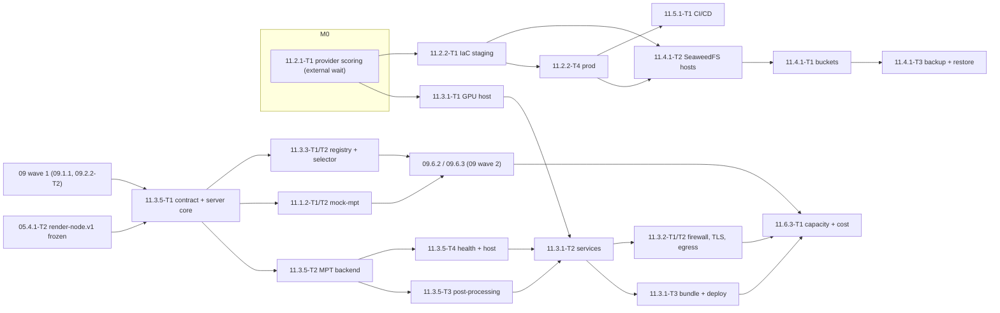

# 11 — Environments, Render Node, `mpt-adapter`, CI/CD and Operations: Tech Lead review, shared decisions and feature index

> Reviews: `../../11-worker-deployment.md` (high-level, M0 → M1; P except 11.2.3 and 11.5.3-T2). Process: `../../00-overview.md` §10.1, step (2) review → step (3) detailed feature plans (this folder).
> Reviewed: 2026-09-24 by the Tech Lead, against MPT 1.3.7 source (`/private/tmp/mptsrc/MoneyPrinterTurbo-main`, not proven equal to the pin `3d5f4e42`), VieNeu `c1390abb` source, the signed contracts of plans 01–05 and 09 wave 1, and official vendor pages read the same day (§1 E-rows). Feature plans: 7 folders, 7 `plan.md` + 32 task files, written 2026-09-24. Status: **owner decisions O1–O6 and the re-estimate 17.75 → 23.0 d raw (P 21.5) accepted 2026-09-24 under the owner's standing approval (§10); four review passes (contract, operations, security, performance) applied as T39–T73 / D20; CR-1…CR-14 applied (§4); TL DoR 2026-09-24: ready with conditions (§11)**.
> Verdict: **approve with changes**. The scope is right (local stack without a GPU, one reproducible GPU node, private render network, pinned TLS, CI/CD, backups, monitoring, capacity numbers). But the high-level plan was written before plans 03–05 turned `mpt-adapter` into the platform's most detailed contract, and before the node's GPU stack was read. Six things change: (1) the adapter was sized L (2 d) for a contract that now has 7 routes, a durable store, idempotency, capacity, a lost-task rule, cancel, on-node loudness normalisation, a five-source health and the D15 security rules — it is split into four tasks (5.0 d); (2) the adapter language is chosen (.NET 10) and one **server core** is shared by the real adapter and mock-mpt, with one **contract library** shared with the backend client, so `render-node.v1` is implemented once in C#; (3) MPT's own GPU image (CUDA 12.1 + cuDNN 8) cannot run the faster-whisper its lock pins (ctranslate2 4.7.1 needs cuDNN 9) — the node installs cuBLAS/cuDNN 9 as locked wheels and asserts whisper on CUDA; (4) P needs a production environment, which the high-level plan only created in the S task 11.2.3; (5) 09.10 (settings in the DB) is S, so in P node keys come from the secret manager; (6) three recommended tools are AGPL (MinIO, Grafana, Renovate) and one GitHub feature needs a paid plan for private repos.
> Legend: ✅ read from source/docs (file + line or URL, date) · ⚠️ unverified · [DECISION] · [OPEN] · [INFERENCE].

## 0. How this folder is organised

```
plans/features/11-worker-deployment/
  README.md                       ← this file: facts, findings, shared decisions D1–D20, CRs, template, gates, index, re-estimate, owner decisions, DoR
  11.1-local-dev/                 ← stories 11.1.1 (Compose), 11.1.2 (mock-mpt on the shared server core)
  11.2-cloud-environments/        ← stories 11.2.1 (provider scoring), 11.2.2 (IaC staging + prod, fetcher subnet, SignalR LB), 11.2.3 (S: separate prod account)
  11.3.1-render-node/             ← stories 11.3.1 (host, GPU stack, services, bundle/deploy), 11.3.2 (firewall, TLS, egress, keys), 11.3.4 (node cleanup)
  11.3.3-registry-dispatch/       ← story 11.3.3 (`worker_nodes`, health poller, node selector)
  11.3.5-mpt-adapter/             ← story 11.3.5 (contract library + server core, MPT backend, post-processing, health/host)
  11.4-11.5-storage-cicd/         ← stories 11.4.1 (buckets), 11.5.1 (app + node CI/CD), 11.5.2 (secrets), 11.5.3 (supply chain)
  11.6-operations/                ← stories 11.6.1 (backups + drill), 11.6.2 (telemetry + alerts), 11.6.3 (capacity + cost)
```

Each feature folder holds `plan.md` (template `00-overview.md` §10.1, sections 1–11) and one `<task-id>-<slug>.md` per task (template §6). Task ids **replace** the task table in `11-worker-deployment.md` §6 (mapping in §8). Every id named by plans 01–05 and 09 is kept; where a task is split, the id keeps the part other plans depend on and the new part takes the next free `T<n>` (§8.1 lists the header cells that move, CR-4/CR-6/CR-7/CR-11).

## 1. Facts verified for this review

**Source facts (K), read 2026-09-24.**

| Id | Fact | Source |
|---|---|---|
| K1 | MPT's GPU image is `FROM nvidia/cuda:12.1.1-cudnn8-runtime-ubuntu22.04` ("includes CUDA 12.1 + cuDNN 8") | MPT `Dockerfile.gpu:1-2` ✅ |
| K2 | MPT's lock pins `faster-whisper 1.1.0` and `ctranslate2 4.7.1`; it contains **no** `nvidia-*` CUDA wheels (only `onnxruntime`) | MPT `uv.lock:685-702, 784-794, 1806` ✅ |
| K3 | MPT finds ffmpeg through `ffmpeg_path` (config) → sets `IMAGEIO_FFMPEG_EXE`; otherwise moviepy uses `imageio-ffmpeg 0.6.0`'s bundled binary. The Mac binds it with `IMAGEIO_FFMPEG_EXE` in the start scripts and leaves `ffmpeg_path` unset (01 M7, 01.2.2-T1 step 5) | MPT `app/config/config.py:588-590`, `uv.lock:1201`; 01 README M7 ✅ |
| K4 | MPT's whisper model is a **process-wide singleton**, loaded lazily on the first subtitle job, from `<mpt root>/models/whisper-<model_size>/model.bin` if that file exists, else by size name through Hugging Face. A load error is logged and `create()` returns `None` (silent subtitle failure, 05 F-row) | MPT `app/services/subtitle.py:16-60` ✅ |
| K5 | MPT's `root_dir()` is the realpath of the package; `storage/tasks`, `resource/songs`, `resource/fonts` are created under it with `os.makedirs` | MPT `app/utils/utils.py:89-135` ✅ |
| K6 | VieNeu's `cuda` extra = `torch==2.8.0`, `torchaudio==2.8.0` from the PyTorch `cu128` index (`uv sync --extra cuda`) | VieNeu `pyproject.toml:19-22, 94-125` ✅ |
| K7 | VieNeu's GPU image is `nvidia/cuda:12.8.0-runtime-ubuntu24.04` with Python 3.12, `uv sync --frozen --no-dev --extra cuda` | VieNeu `docker/Dockerfile.gpu` ✅ |
| K8 | VieNeu GPU (RTX 3060 12 GB, bf16): 16 real-time streams by default; VRAM 0.9 GB idle, 1.1 GB peak at 16 streams | VieNeu `docs/streaming.md:25-31` ✅ |
| K9 | MPT `requires-python = ">=3.11"`; the Mac pins 3.11 (01 M7) | MPT `pyproject.toml:13` ✅ |

**External facts (E), read 2026-09-24** (two scout passes; URLs and quotes in `agent://LicenceCiFacts`, `agent://GpuDotnetFacts`; spot-checked by the TL).

| Id | Fact | Source |
|---|---|---|
| E1 | faster-whisper GPU needs cuBLAS for CUDA 12 and cuDNN 9; latest ctranslate2 supports only CUDA 12 + cuDNN 9 (cuDNN 8 needs ctranslate2 4.4.0); Linux option `pip install nvidia-cublas-cu12 nvidia-cudnn-cu12==9.*` with `LD_LIBRARY_PATH` set before Python starts | github.com/SYSTRAN/faster-whisper README ✅ |
| E2 | faster-whisper benchmark (large-v2, RTX 3070 Ti, CUDA 12.4): fp16 beam 5 → 4,525 MB; int8 → 2,926 MB; `batch_size=8` fp16 → 6,090 MB. No large-v3 / turbo VRAM row | same README ✅ |
| E3 | CUDA 12.8 GA needs Linux driver ≥ 570.26 | docs.nvidia.com CUDA toolkit release notes, Table 4 ✅ |
| E4 | NVENC's driver floor is only in the Video Codec SDK release notes; whether Ubuntu's `ffmpeg` package has `h264_nvenc` is **not** confirmed by an official source | docs.nvidia.com Video Codec SDK 13.0 ⚠️ |
| E5 | SignalR needs sticky sessions unless every client uses WebSockets only with `SkipNegotiation` | learn.microsoft.com `signalr/scale` (aspnetcore-10.0) ✅ |
| E6 | `SocketsHttpHandler.SslOptions.RemoteCertificateValidationCallback`; `X509Certificate.GetCertHashString(HashAlgorithmName)` (.NET 5+) | learn.microsoft.com API ✅ |
| E7 | Kestrel `MaxRequestBodySize` default 30,000,000 bytes | learn.microsoft.com API ✅ |
| E8 | `dotnet publish -r linux-x64 --self-contained` ships the runtime; none needed on the host | learn.microsoft.com `dotnet-publish` ✅ |
| E9 | Npgsql `NpgsqlConnection.WaitAsync` + `Notification` event (LISTEN/NOTIFY) | npgsql.org API ✅ |
| E10 | PostgreSQL 17 PITR = base backup + continuous WAL archive | postgresql.org/docs/17/continuous-archiving ✅ |
| E11 | Licences: OpenTofu MPL-2.0; SeaweedFS, adobe/S3Mock, versitygw, LocalStack community Apache-2.0; Mailpit MIT; Prometheus, Alertmanager, OpenTelemetry Collector (+contrib), Jaeger Apache-2.0; cosign, syft Apache-2.0; Microsoft.Data.Sqlite MIT, SQLitePCLRaw Apache-2.0; NVIDIA container toolkit Apache-2.0 | each repo's LICENSE ✅ |
| E12 | **AGPL-3.0:** MinIO (community edition now source-only, no binaries), Garage, Grafana, Renovate | each repo's LICENSE/README ✅ |
| E13 | GitHub OIDC needs `permissions: id-token: write` | docs.github.com OIDC ✅ |
| E14 | GitHub **Free** can configure environments only for **public** repos; Pro (user) or Team (org) needed for environments on private repos | docs.github.com manage-environments ✅ |
| E15 | Secrets are not passed to workflows triggered from forks (except `GITHUB_TOKEN`); `pull_request_target` is privileged | docs.github.com events + secure-use ✅ |
| E16 | Dependabot version updates support `uv`, `nuget`, `npm`, `docker`, `github-actions` | docs.github.com supported ecosystems ✅ |
| E17 | Secret scanning runs free on public repos; organization-owned private repos need GitHub Secret Protection (Team/Enterprise). User-owned private repos: ⚠️ not stated in the quote | docs.github.com secret-scanning ✅ / ⚠️ |
| E18 | `.NET 10 System.Text.Json` option to reject duplicate JSON properties (`AllowDuplicateProperties = false`) | ⚠️ from docs knowledge, not re-read — confirm in 11.3.5-T1 step 1; fallback: a `Utf8JsonReader` pre-scan |

**Plan facts (P) the review relies on.**

| Id | Fact | Source |
|---|---|---|
| P1 | `render-node.v1`: 7 routes, errors, `render-status.v1`, `render-node-health.v1`, lost/capacity/cancel rules, D15 S1–S8 / P1–P7; adapter port 8090 and durable store "⚠️ final in 11.3.5" (05 T33) | `../05-video-assembly-subtitles/README.md` D4, D5, D15, §10 T33 ✅ |
| P2 | The image relay runs **inside** the adapter process on `127.0.0.1:8091`, registered at submit and released at cleanup; 03.4.3-T1 is written ".NET-flavoured" (`ImageRelay:*` keys, `ImageRelay/` folder) and depends on 11.3.5-T1 | 03 README D5, D6, D12; 03.4.3-T1 ✅ |
| P3 | Proxy: Python 3.12 FastAPI, loopback `127.0.0.1:8001`, `proxy-health.v1` embedded unchanged as `tts_proxy`; node unit `vieneu-proxy.service` with paths "⚠️ until 11.3.1"; proxy CI "[OPEN → 11: node CI]" | 04 README D1, D8, D13, D14 ✅ |
| P4 | 09.10 (settings in the DB, encrypted keys) is **S** except 09.10.4-T1; P reads configuration from the environment/secret manager | 00 §4.1 S list; DECISIONS §10.12 ✅ |
| P5 | 09 §5.6 adapter key rotation says "drain the node → change the key → …"; 05 D15 S3 added `ADAPTER_API_KEY_NEXT`, which makes the drain unnecessary | 09 §5.6 L482; 05 D15 S3 ✅ |
| P6 | Wire DTOs are planned in Application: `AdapterSubmitRequestV1`, `MptSubmitFields` (05.1.2-T1), `RenderCheckV1` (05.5.1-T2), `ImageReportV1` (03) under `src/NightTales.Application/Abstractions/Rendering/`; `ImagePlanSummary` is Domain. Domain may reference only ErrorOr; Application only Domain + listed packages | 05.1.2-T1 L24-33; 05.5.1-T2 L23; 09 README D1 ✅ |
| P7 | `worker_nodes` columns in 00 §6 include `api_key_ciphertext`, `api_key_hint`, `tls_cert_sha256`; 09 D9 gives the table to "09.10.1 / 11" | 00 §6 L311; 09 README D9 ✅ |
| P8 | Separate OpenAI organizations/projects for production and staging; node image key in its own project (image models only, hard budget) | DECISIONS §10.5, §10.11 ✅ |
| P9 | Hangfire recurring jobs are cron-based with a 15 s polling default; a sub-minute recurring job is not reliable → 09 uses a `BackgroundService` for the outbox | 09 README N14, D11 ✅ |
| P10 | The hub accepts WebSockets only (`skipNegotiation`); Worker → Api notifications via PostgreSQL NOTIFY | 09 §4 09.8.1 ✅ |
| P11 | The fetcher container/network table is 02.5.2-T3's; 11.2.2-T2 implements and tests it (no storage egress, T43) | 02 README D10; 02.5.2-T3 ✅ |
| P12 | High-level estimate 17.75 d (P 16.25, S 1.5); P total 175.5 d | 11 §11; 00 §4.1 ✅ |
| P13 | The Mac trial numbers are a baseline only; NFR-05-1 (≤ 20 min for a 10-min video) is measured on the GPU node by plan 11 | 05 D15 P7; 01 R4 ✅ |

## 2. Findings

| # | Sev | Where | Finding | Resolution |
|---|---|---|---|---|
| F01 | B | 11.3.5 | The adapter was sized L (2 d) before 03/04/05 fixed its contract: 7 routes, durable store, idempotency by body hash, capacity 429, lost-task rule, cancel that releases the image plan, D9 post-processing with `--normalize`, health from five sources with a cached assets job, TLS, key rotation window, auth throttle, 2 MiB cap, fixed messages | [DECISION D5–D7] Four tasks: 11.3.5-T1 contract + server core (L), T2 MPT backend (M), T3 post-processing + outputs (M), T4 health + host (M) = 5.0 d |
| F02 | H | 11.3.5, 03 [OPEN], 05 T33 | Adapter language open; mock-mpt is .NET (W3); the backend client is .NET → `render-node.v1` would be written three times in two languages | [DECISION D3, O1] .NET 10. `NightTales.RenderNode.Contract` (DTOs) used by Application, the adapter and the mock; `NightTales.RenderNode.Server` (routes, auth, limits, validator, store seam, idempotency, capacity) used by both hosts. The fixtures are replayed once per host |
| F03 | H | P6, 09 D1 | The wire DTOs live in Application; a node binary must not reference Application (EF Core, Mediator, FluentValidation, domain releases) | [DECISION D4] Move them to the leaf project `NightTales.RenderNode.Contract` (no package dependencies); Application references it; `ImagePlanSummary` (Domain) is mapped to `ImagePlanV1` (CR-3, CR-4, CR-5) |
| F04 | B | 11.3.1, K1, K2, E1 | MPT's GPU image (CUDA 12.1 + cuDNN 8) cannot run the ctranslate2 4.7.1 its lock pins (needs cuDNN 9). With no CUDA wheels in MPT's lock, whisper on the node would fail at the first subtitle job — and K4 makes that failure silent | [DECISION D9] No containers on the node; NVIDIA driver ≥ 570.26 (E3, also covers VieNeu's cu128 torch, K6); cuBLAS 12 + cuDNN 9 from a locked uv project `worker-node/cuda-libs/`, exposed to MPT only through `LD_LIBRARY_PATH` in `mpt.service`; `gpu-smoke.sh` loads the whisper model on `cuda` before the node is activated |
| F05 | H | 11.3.1, K4 | With `HF_HUB_OFFLINE=1` (needed so nothing downloads at render time) MPT only finds the model at `<root>/models/whisper-large-v3-turbo/model.bin`; otherwise it fails silently | [DECISION D9] Provisioning places the model there (symlink to `/var/lib/nts/models/`), sha256-verified from the carry-over list; `gpu-smoke.sh` loads that path before every activation (the adapter reports, it does not warm up; T20) |
| F06 | H | 11.3.1, K3, 05 D15 P5 | On the node MPT would use imageio-ffmpeg's bundled binary unless `IMAGEIO_FFMPEG_EXE` is set, while the proxy and `render_check.py` use the system ffmpeg; the P5 codec check would test the wrong binary | [DECISION D9] One ffmpeg on the node: `/usr/bin/ffmpeg` (apt, version pinned); `mpt.service` sets `IMAGEIO_FFMPEG_EXE=/usr/bin/ffmpeg`; the adapter's P5 check runs that binary; `NTS_MPT_VIDEO_CODEC = libx264` until 11.6.3 proves `h264_nvenc` (E4 ⚠️) |
| F07 | H | 11.3.1, K5 | MPT writes `storage/`, `resource/songs` and `models/` under its own root, so the code dir cannot be read-only and a release swap would lose task dirs | [DECISION D8] Release dirs are read-only; `storage`, `resource/songs`, `models`, `config.toml` are symlinks into `/var/lib/nts/…`, created by the installer per release |
| F08 | H | 11.2.2, 11.2.3, DECISIONS §10.12 | P runs the studio in the cloud, but the only production task is 11.2.3 (S). Two always-on environments with a GPU node each would double the largest fixed cost for one owner | [DECISION D15, O2] New 11.2.2-T4 (P): `prod` from the same IaC module in the same account. `staging` has **no** GPU node by default (renders against mock-mpt); a staging node is created on demand from the same scripts for node upgrades. 11.2.3 (S) moves prod to its own account |
| F09 | H | 11.3.3, P4, P7 | In P there is no settings UI (09.10 is S), so `worker_nodes.api_key_ciphertext` has no writer and nodes have no registration path | [DECISION D13] P nodes are declared in configuration (`RenderNodes:Nodes`), upserted by `WorkerNodeSeeder` at Worker start; keys come from the secret manager (`RENDER_NODE_<NAME>_API_KEY`); `api_key_ciphertext`/`api_key_hint` stay null in P; the S settings UI later becomes the writer |
| F10 | M | 11.3.3, P9 | "Pull health every 30 s" cannot be a Hangfire recurring job | [DECISION D13] `NodeHealthPoller` is a Worker `BackgroundService` (like `OutboxDispatcher`), guarded by a PostgreSQL advisory lock so a second Worker instance does not double-poll |
| F11 | M | 11 §6 | 11.3.3-T1 "depends on 09.6.3", while 09.6.3's `SubmitRenderJob` needs the node selector → circular | [DECISION] 11.3.3-T1/T2 depend on 09 wave 1 and 11.3.5-T1 only; 09.6.2-T1/09.6.3-T1 depend on them (CR-3) |
| F12 | M | 11.3.3 | "Picks the node with most free slots" ignores health freshness and flapping | [DECISION D13] Dispatchable = `state = active` ∧ last pull ≤ 90 s ago ∧ HTTP 200 ∧ `capacity.accepting` ∧ free slots > 0; `down` after 2 min without a successful pull, back to `active` after 2 consecutive good pulls; `draining` is operator-only |
| F13 | M | 11.3.3, 09.6.2 | The pinned-TLS `HttpClient` per node is needed by both the health poller (11.3.3) and `MptRenderClient` (09.6.2) | [DECISION D13] `RenderNodeConnectionFactory` (Infrastructure, 11.3.3-T1) owns base URL + pinned certificate + key header; 09.6.2-T1 builds `MptRenderClient` on it (CR-3) |
| F14 | H | 11.3.2, 11 FR | "Egress allow-list: only api.openai.com …" cannot be enforced with IP firewalls; an egress proxy adds a new component | [DECISION D11] Per-unit systemd `IPAddressDeny=any` + `IPAddressAllow=127.0.0.1 ::1` (D20 H4) for MPT, VieNeu and the proxy (they need no network: offline models, loopback relay/proxy); nftables denies node → app subnet (new connections), metadata `169.254.0.0/16` and every port except 443/53/123 outbound; only the adapter (relay → OpenAI, fixed host in code) and the music sync (storage) reach port 443. FQDN egress rules are used if 11.2.1 finds the provider supports them (⚠️) |
| F15 | M | 11.3.2, D15 S1 | The pinned certificate needs a generation, storage and rotation procedure | [DECISION D11] Self-signed ECDSA P-256 per node, 397 days, made by `make-adapter-cert.sh` at provisioning; fingerprint = SHA-256 of the DER certificate (`GetCertHashString(SHA256)`, E6) printed once and put in `RenderNodes:Nodes[i]:TlsCertSha256`; rotation = drain → new cert → config → activate |
| F16 | M | 11 §5.2, E12 | Suggested local storage emulator "e.g. MinIO" and self-hosted Grafana are AGPL; Renovate is AGPL | [DECISION D14, D16, D17] SeaweedFS (Apache-2.0) as the S3 emulator, Mailpit (MIT), Dependabot (GitHub-native), OpenTelemetry Collector + Prometheus-compatible storage/alerting (Apache-2.0) or a hosted backend chosen in 11.2.1; no self-hosted AGPL component |
| F17 | H | 11.5.1, E14 | "Prod environment with required reviewers" needs GitHub Pro/Team for a private repo | [DECISION D16, O4] The repo stays private on **GitHub Pro** (owner account); price not asserted ⚠️. Fallback without Pro: prod deploy only by `workflow_dispatch` from `main`, OIDC trust bound to that workflow + ref |
| F18 | H | 11.3.1, 11.5.1 | No path exists for a new adapter/MPT/proxy version to reach a node: nodes never accept connections from the app network, and CI should not hold SSH into the render network | [DECISION D12, O5] Versioned node bundle built by CI (`nts-node-<version>.tar.zst` + `SHA256SUMS`); the operator installs it over the VPN/bastion with `nts-node deploy`: drain → copy → verify → install release dir → swap `current` → restart → `gpu-smoke.sh` + adapter health → activate; rollback = previous `current` |
| F19 | M | 11.3.5, 05 D4 | Every Worker poll (10 s per job) and health pull (30 s per node) would hit MPT if the adapter proxied them | [DECISION D6] The adapter's own `MptTaskPoller` (2 s per active task) is the only MPT reader; `GET /v1/renders/{id}` and `/v1/health` read the store and caches only |
| F20 | M | 11.3.5, 05 D9, P13 | Post-processing (two loudness passes + AAC encode) competes with MPT for CPU; no concurrency or timeout is defined | [DECISION D6] `Adapter:CheckConcurrency` (default 1), `Adapter:CheckTimeoutSeconds` (default 900, re-set from the 05.5.2-T1 wall times and 11.6.3), timeout → `render_node_error` detail `check_timeout` |
| F21 | M | 11.6.2, D4 | GPU utilisation must reach dashboards, but nodes never push and no metrics route exists in `render-node.v1` | [DECISION D7] Additive `render-node.v1` change: health gains `gpu { util_pct, mem_used_mb, mem_total_mb, temp_c, sampled_at }` from a 15 s `nvidia-smi` cache; the Worker exports it as metrics (CR-4) |
| F22 | M | 11.5.1, 04 D14 | Proxy tests, `render_check.py --self-test`, `check_fixtures.py` and shell scripts have no CI | [DECISION D16] New 11.5.1-T2: `node.yml` workflow (pytest, self-tests, fixture checks, shellcheck, adapter self-contained publish, bundle build) |
| F23 | M | 11.5.3, 00 §4.1 | 11.5.3-T2 mixes P items (Dependabot, lock hashes) with S items (signing, SBOM) | [DECISION] 11.5.3-T2 = signing + SBOM (S, id kept as 00 names it); new 11.5.3-T3 (P) = Dependabot + lock-hash enforcement; weight pins are verified in 11.3.1-T1 |
| F24 | M | 09 §5.6, P5 | 09's adapter key rotation still drains the node | CR-3: rotate with `ADAPTER_API_KEY_NEXT` (05 D15 S3): set NEXT on the node → restart adapter → change the Worker's key → remove the old value; no drain |
| F25 | M | 11.1.2, 05 D14 | "Canned 10-second MP4 per aspect" — binary media must not be committed (05 D14) | [DECISION D14] The mock image build generates them with `ffmpeg -f lavfi` in a build stage; the mock's tests generate their own |
| F26 | M | 11 FR-11-2, 05 D15 S1 | mock-mpt is plain HTTP; nothing stops a production Worker from being configured with an `http://` node | [DECISION D13] `RenderNodeConnectionFactory` refuses `http://` base URLs and a missing `TlsCertSha256` unless `ASPNETCORE_ENVIRONMENT = Development`; a unit test asserts it |
| F27 | L | 11.6.1 | Backups: KEK stored separately; adapter state needs no backup (lost rule) | [DECISION D17] Stated in 11.6.1-T1; node disks are rebuilt, never restored |
| F28 | M | 11.3.1, K8, E2 | GPU size is unstated; one whisper model (K4 singleton, ≈ 4.5 GB fp16 for large-v2, E2) + VieNeu ≈ 1.1 GB (K8) + NVENC/ffmpeg | [DECISION] 11.2.1 requires ≥ 16 GB VRAM, prefers 24 GB [INFERENCE: turbo ≤ large-v2 memory]; 11.6.3 records the measured peak |

## 3. Shared decisions for all feature plans (contract)

Feature plans and task files MUST use these names exactly. Make any change here first.

**D1 Scope, phases and environments [DECISION, O2].**
- P: everything except 11.2.3-T1 and 11.5.3-T2 (S). **Phase 1 is local only, phase 2 publishes to the internet (owner 2026-09-30, 11 CR-18):** phase 1 = 11.1.x (native dev stack, mock-mpt), 11.3.3 (node registry/dispatch, against the local node), 11.3.5 (render-node adapter); every cloud, GPU-host, storage-host, secret-manager, deploy, backup, telemetry and capacity task (11.2.1-T1, 11.2.2, 11.3.1, 11.3.2, 11.3.4, 11.4.1, 11.5.1, 11.5.2-T1, 11.5.3-T1, 11.5.3-T3 (its deps are 11.5.1 and 11.3.1-T1), 11.6.1-T1, 11.6.2-T1, 11.6.3-T1) is phase 2. Phase-1 consumers of 11.4.1-T1 buckets (03.1.2-T1, 04.2.3-T1, 05.3.2-T2) use the local SeaweedFS of 11.1.1-T2 and re-run against the cloud buckets in phase 2; 10.10.2-T1 runs its suite locally until `e2e.yml` (11.5.1-T1) lands; 13.4.2-T1 (YouTube audit) is phase 2 because the form needs public policy URLs.
- Environments in P (only `dev` in phase 1): `dev` (native `tools/dev/up.sh` on the developer machine, Compose optional; D14, 11 CR-16), `staging` (cloud, no GPU node by default, mock-mpt as its render node), `prod` (cloud, one GPU node). All three from the same code; `staging` and `prod` from one OpenTofu module with per-environment variables. Separate OpenAI projects per environment (P8): `nts-text-<env>` and `nts-images-<env>` (image models only, hard budget).
- A staging GPU node is created on demand (`nts-node provision --env staging`) for node upgrades and destroyed after the rehearsal.

**D2 Ownership map [DECISION].**

| Artefact | Owner task | Consumers |
|---|---|---|
| `tools/dev/{up.sh,down.sh}` (primary dev path: native Homebrew services + `dotnet run` + optional `ng serve`) and the optional `docker-compose.yml` services `api`, `worker`, `web` (profile `web`), `.env.example` | 11.1.1-T1 (extends 09.1.1-T2) | every developer, 11.5.1-T1 e2e (CI only) |
| Native `seaweedfs`/`mailpit` loopback processes + their optional compose services `mail` (Mailpit), `storage` (SeaweedFS) + `tools/dev/storage-init.sh` | 11.1.1-T2 | 04.2.3-T1, 03.1.2-T1, 05.3.2-T2 (local runs), 09.7.2 |
| Compose service `fetcher` (profile `fetcher`; compose variant only) | 02.5.2-T3 (adds it to the 11.1.1-T1 file) | 02.5.2-T4 |
| `src/NightTales.RenderNode.Contract/` (project file reserved by 09.1.1-T1, CR-3; render-node types) | 11.3.5-T1 (status, health, errors, codes); moved-in types keep their owners: 05.1.2-T1 (`AdapterSubmitRequestV1`, `MptSubmitFields`, `ImagePlanV1`), 05.5.1-T2 (`RenderCheckV1`), 03.4.3-T1 (`ImageReportV1`, consumed by 03.4.2-T1) | Application (09.6.x), `NightTales.RenderNode.Server`, adapter, mock |
| `src/NightTales.RenderNode.Server/` | 11.3.5-T1 | `NightTales.MptAdapter`, `tools/mock-mpt` |
| `src/NightTales.MptAdapter/` (host, MPT backend, post-processing, health) | 11.3.5-T2, T3, T4; `ImageRelay/` by 03.4.3-T1 | node bundle |
| `tools/mock-mpt/` (`NightTales.MockMpt`) | 11.1.2-T1, T2; `Images/` by 03.4.3-T2 | Compose, 09/10 tests, staging |
| `worker_nodes` migration, `WorkerNode` entity, `WorkerNodeSeeder`, `RenderNodeConnectionFactory`, `NodeHealthPoller`, `nts-worker nodes` verbs | 11.3.3-T1 | 09.6.2-T1, 09.6.3-T1, 11.3.1-T3 |
| `INodeSelector`, dispatch rules, node metrics | 11.3.3-T2 | 09.6.3-T1, 11.6.2-T1 |
| `worker-node/host/` (host setup, `cuda-libs/`, `gpu-smoke.sh`, layout) | 11.3.1-T1 | 11.3.1-T2 |
| `worker-node/systemd/*.service|*.timer`, `worker-node/env/*.env.example`, `worker-node/bin/install-release.sh` | 11.3.1-T2 (the proxy unit file stays 04.1.5-T1's, paths fixed by CR-6) | 11.3.1-T3 |
| `worker-node/bin/nts-node` (provision / deploy / rollback / drain), bundle layout | 11.3.1-T3 | operator, 11.6.3-T1 |
| `worker-node/net/nftables.conf`, `make-adapter-cert.sh`, port-scan + egress tests | 11.3.2-T1, T2 | 11.6.3-T1, audits |
| `nts-cleanup.service/.timer` + `worker-node/bin/cleanup-orphans.py` | 11.3.4-T1 | node |
| `infra/` OpenTofu module + `envs/{staging,prod}` | 11.2.2-T1 (module + staging), 11.2.2-T4 (prod) | 11.5.1-T1 |
| `.github/workflows/{backend,web,e2e,deploy,node}.yml`, `.github/dependabot.yml` | 09.1.5-T1 (`backend.yml`; creates `dependabot.yml` with `nuget` + `github-actions`), 10.1.5 (`web.yml`), 11.5.1-T1 (`e2e.yml`, `deploy.yml`), 11.5.1-T2 (`node.yml`), 11.5.3-T3 (extends `dependabot.yml` with `npm`, `uv`, `docker`; T23) | CI |
| `src/NightTales.Api/Dockerfile`, `src/NightTales.Worker/Dockerfile` | 11.1.1-T1 (T24) | Compose, `deploy.yml` |
| `web/Dockerfile`, web serving | 10.1.1-T2 (image, nginx, CSP headers), 11.2.2-T1 (LB `web` target group + path rules, T25; 10 CR-1) | Compose profile `web`, `deploy.yml` |
| `docs/runbooks/{secrets-rotation,node-deploy,restore-drill,key-leak}.md` | 11.5.2-T1, 11.3.1-T3, 11.6.1-T1, 11.3.2-T2 | 08 §5.3 |

**D3 Render-node stack [DECISION, O1].**
- .NET 10 (SDK 10.0.401, 09 D1 versions), `sealed`, nullable, warnings as errors (00 §5.4). Hosts publish `-r linux-x64 --self-contained` (E8); no .NET runtime on the node.
- Projects and allowed references (enforced by `NightTales.Architecture.Tests`, CR-3):

| Project | May reference |
|---|---|
| `NightTales.RenderNode.Contract` | nothing but the BCL (`System.Text.Json`) |
| `NightTales.Application` | + `NightTales.RenderNode.Contract` (in addition to 09 D1) |
| `NightTales.RenderNode.Server` | Contract, `Microsoft.AspNetCore.App` (framework reference) |
| `NightTales.MptAdapter` | Server, Contract, `Microsoft.Data.Sqlite` (MIT, E11), `Serilog.AspNetCore` (09 N12) |
| `NightTales.MockMpt` (`tools/mock-mpt`) | Server, Contract |

- None of the four may reference Domain, Application or Infrastructure. The adapter carries no business rule: it translates the contract, measures, and reports.
- Tests: `tests/NightTales.RenderNode.Tests` (core + fixture replay against an in-memory backend), `tests/NightTales.MptAdapter.Tests` (fake MPT via `TestServer`, real SQLite, real `render_check.py` only in a `Category=Node` subset), `tests/NightTales.MockMpt.Tests` (mock modes, 03.4.3-T2 adds its tests here). All three are in `NightTales.ci.slnf`.

**D4 Contract library `NightTales.RenderNode.Contract` [DECISION].** Namespace `NightTales.RenderNode.Contract`. Records, `[JsonPropertyName]` snake_case, fields exactly as 05 D4/D9 and 03 D6 (the fixtures are the truth).
- Moved in (owners unchanged, CR-4/CR-5): `AdapterSubmitRequestV1`, `MptSubmitFields`, `ImagePlanV1(int MaxImages, IReadOnlyList<string> PromptSha256)` (replaces the use of Domain `ImagePlanSummary` in the wire type; `RenderSubmitMapper` maps it), `RenderCheckV1` (+ nested records), `ImageReportV1` (+ nested).
- New (11.3.5-T1): `RenderStatusV1`, `RenderOutputV1` (`Video`, `Subtitles?`, `NarrationSeconds`), `RenderFileV1` (`Bytes`, `Sha256`, `Cues?`), `RenderOutcomeV1` (`Code`, `Detail`, `Message`), `MptStateV1`, `RenderNodeHealthV1` (+ `CapacityV1`, `MptHealthV1`, `ImageRelayHealthV1`, `AssetsHealthV1`, `DiskHealthV1`, `GpuHealthV1`, `AdapterInfoV1`; `TtsProxy` is a `JsonElement` kept byte-for-byte, read through `ProxyHealthView.From(JsonElement)` → `(bool Ok, IReadOnlyList<string> Reasons)`), `AdapterErrorV1` (`Error { Code, Message, Errors[] }`), `AdapterAcceptedV1` (`TaskId`, `State`), constants `AdapterErrorCodes`, `RenderOutcomeCodes` (05 D5), `RenderStates`, `RenderStages`, `NodeHealthReasons`, `OutcomeMessages` (the fixed D15 S4 sentence per code).
- `RenderNodeJson.Strict` (deserialize with `JsonUnmappedMemberHandling.Disallow`, duplicate properties rejected, E18): used by the server for submit bodies and by all fixture tests. `RenderNodeJson.Tolerant` (unknown members ignored): used by the Worker for status/health, so additive v1 changes never break a running Worker.

**D5 Server core `NightTales.RenderNode.Server` [DECISION].** `app.MapRenderNodeV1(options)` maps exactly the 05 D4 routes plus a fallback → 404 `adapter_route_not_found`.
- Order per request (05 D15 S2): `ApiKeyMiddleware` (exactly one `x-api-key`; constant-time compare against `ApiKey` and, when set, `ApiKeyNext`; failure → 401 `adapter_unauthorized`; > `AuthFailuresPerMinute` (10) per source address → 429 `adapter_auth_throttled` with `Retry-After: 60`) → body limit `MaxBodyBytes` = 2,097,152 (Kestrel limit set per endpoint, E7; 413 `adapter_body_too_large`) → `RenderNodeJson.Strict` parse → `SubmitValidator` (05 D3 order: key set → types → fixed values; first failing group → 400 `adapter_contract_violation` with `errors[{field, rule}]`). `{task_id}` must parse as a UUID before any lookup, else 404 `adapter_task_unknown`.
- Seams (interfaces the hosts implement): `IRenderBackend` (`SubmitAsync(RenderTaskRecord, MptSubmitFields, ct) → ErrorOr<BackendAccepted>`, `CancelAsync`, `DeleteAsync → ErrorOr<Deleted>` (`adapter_task_busy` while running), `OpenOutputAsync(taskId, OutputKind) → ErrorOr<OutputFile(Stream, long Length, string Sha256, string ContentType)>`); `ITaskStore` (`SqliteTaskStore` in the adapter, `InMemoryTaskStore` in the mock); `INodeHealthSource` (`GetAsync(ct) → RenderNodeHealthV1`, cached, never computed per request); `IImagePlanSink` (`Register(taskId, ImagePlanV1)`, `Release(taskId)`, `BuildReport(taskId) → ImageReportV1?`; the adapter binds 03.4.3-T1's relay, the mock binds `MockImageReport`).
- `RenderTaskRecord(Guid TaskId, Guid RenderJobId, string BodySha256, string? BackendTaskId, DateTimeOffset SubmittedAt, DateTimeOffset? BackendStartedAt, string State, string Stage, int Percent, bool CancelRequested, RenderOutcomeV1? Outcome, RenderOutputV1? Output, JsonElement? Check, JsonElement? Images, DateTimeOffset? FinishedAt, DateTimeOffset? CleanedAt)`.
- Submit: sha256 of the **raw** body bytes. Same `render_job_id` + same hash → 200 with the stored `{task_id, state}`; other hash → 409 `adapter_idempotency_conflict`. `CapacityGate` (one `SemaphoreSlim(1)` around "count non-terminal + insert") → 429 `adapter_capacity_full` + `Retry-After: 30`. Health not ok → 503 `adapter_node_unhealthy`. Then `IImagePlanSink.Register`, strip `image_plan`, `IRenderBackend.SubmitAsync`; → 202.
- Status: store only. `percent` never decreases; 100 only in a terminal state; `images`/`check` as stored. Never node paths, MPT URIs, script, terms or prompts (05 D4).
- Outputs: served only for `succeeded` and not cleaned: `/video` → `video/mp4`, `Content-Length`, `X-Content-SHA256` from `output.video.sha256` (never re-hashed, 05 D15 P3), streamed, no range processing, no redirects; `/subtitles` → 404 `adapter_output_absent` when `output.subtitles = null`.
- Cancel: idempotent 202; terminal → 200 no-op; sets `cancel_requested`, calls `IImagePlanSink.Release`, `IRenderBackend.CancelAsync`.
- Delete: 204 after `IRenderBackend.DeleteAsync` + `IImagePlanSink.Release`; the store row keeps `cleaned_at` for 7 days (idempotent re-delete → 204), then is purged.
- Server options `RenderNodeServer:{ApiKey, ApiKeyNext, MaxBodyBytes, AuthFailuresPerMinute, MaxConcurrentTasks}`.

**D6 Adapter host and MPT backend `NightTales.MptAdapter` [DECISION].**
- Listeners: HTTPS `Adapter:ListenAddress` (the node's private address) : `Adapter:Port` = **8090** (final, closes 05 T33) with `/etc/nts/tls/adapter.crt` + `adapter.key`; the relay's loopback listener `127.0.0.1:8091` (03 D5). Kestrel refuses to start if `ListenAddress` is `0.0.0.0` or public [DECISION].
- Store: SQLite `/var/lib/nts/adapter/tasks.db` (WAL, one table `tasks` = `RenderTaskRecord`), closes 05 T33. The store survives adapter restarts; a lost store means Worker polls get 404 → the Worker's `adapter_task_unknown` handling = `render_lost` (09.6.3).
- `MptClient`: `http://127.0.0.1:8080`, `x-api-key: NTS_MPT_API_KEY`, `x-task-id: <task_id>` (05 C3), sets `n_threads = Adapter:MptThreads` (default `max(1, floor(cores ÷ max_concurrent_tasks))`, 05 D15 P6), timeouts connect 2 s / read 30 s.
- `MptTaskPoller` (`BackgroundService`, every `Adapter:PollSeconds` = 2 per non-terminal task): maps MPT `state`/`progress` → D4 `state`/`stage`/`percent`; lost rule: MPT 404 for a submitted task, or MPT's process start (`systemctl show mpt.service -p ExecMainStartTimestamp`, read at start and after every MPT connection error) is newer than the task's `backend_started_at` → `failed` / `render_lost`; failure mapping `failed_stage` → 05 D5 code with `detail` = stage and `message` = `OutcomeMessages[code]` (MPT's raw error text stays in the journal only, S4).
- On MPT complete → `stage = checking` → `PostProcessor` (D6a) → `succeeded` with `output` from the check, or `failed` `render_node_error` (`check_timeout`, `check_failed`). A `cancel_requested` task never reaches `succeeded`: on MPT's terminal state it becomes `cancelled` and its task dir is removed at once (05 D4).
- **D6a Post-processing.** `/usr/bin/python3.12 /opt/nts/current/worker-node/checks/render_check.py run --task-dir <task dir> --aspect <a> --subtitles on|off --normalize --out <task dir>/render-check.json` (list arguments, no shell), under `Adapter:CheckConcurrency` (1) and `Adapter:CheckTimeoutSeconds` (900; process killed on timeout). The adapter reads `render-check.json`, stores it as `check`, serves `final-1.norm.mp4`, and takes sizes/hashes from `check.output` (05 D9, D15 P2/P3). Exit 1 (input unreadable) → `failed` `render_node_error` detail `check_failed` with the report attached; exit 2 → same + ops alert reason in the journal.
- Config (env of `mpt-adapter.service`, .NET `__` separators): `Adapter__ListenAddress`, `Adapter__Port` (8090), `Adapter__DataDir` (`/var/lib/nts/adapter`), `Adapter__MptBaseUrl` (`http://127.0.0.1:8080`), `Adapter__MptRoot` (`/opt/nts/current/mpt`), `Adapter__MptThreads`, `Adapter__PollSeconds` (2), `Adapter__CheckConcurrency` (1), `Adapter__CheckTimeoutSeconds` (900), `Adapter__AssetsRefreshSeconds` (600, 05 D15 P1), `Adapter__GpuSampleSeconds` (15), `Adapter__FfmpegPath` (`/usr/bin/ffmpeg`), `Adapter__VideoCodec` (= `NTS_MPT_VIDEO_CODEC`), `Adapter__ProxyHealthUrl` (`http://127.0.0.1:8001/health`), `RenderNodeServer__ApiKey` (= `ADAPTER_API_KEY`), `RenderNodeServer__ApiKeyNext` (= `ADAPTER_API_KEY_NEXT`), `RenderNodeServer__MaxConcurrentTasks` (= `NTS_MPT_MAX_CONCURRENT`), `NTS_MPT_API_KEY`, `NODE_OPENAI_IMAGE_KEY`, `ImageRelay__*` (03.4.3-T1 keys, CR-5). Startup: every key ≥ 32 chars; `ApiKey` ≠ `ApiKeyNext` ≠ `NTS_MPT_API_KEY` ≠ `NTS_PROXY_API_KEY` ≠ `NODE_OPENAI_IMAGE_KEY` (05 D15 S3, exit 2 naming the variables, never values).

**D7 Health `render-node-health.v1` [DECISION; additive to 05 D4, CR-4].**
- Sources, each cached with its own timestamp; `GET /v1/health` only reads the caches: MPT (`GET /ping` + authenticated `GET /api/v1/tasks?page=1&page_size=1`, every 15 s); proxy (`GET 127.0.0.1:8001/health`, every 15 s, body kept as `JsonElement`); relay (in process); assets (`check-fonts.sh`, `check-music.sh --json`, every 600 s and on change, single-flight, 05 D15 P1); disk (`statvfs` on `/var/lib/nts/mpt/storage`, every 15 s); GPU (`nvidia-smi --query-gpu=utilization.gpu,memory.used,memory.total,temperature.gpu --format=csv,noheader,nounits`, every 15 s); codec (`<FfmpegPath> -hide_banner -encoders` contains `Adapter:VideoCodec`, at start, 05 D15 P5).
- New block: `"gpu": { "ok": true, "util_pct": 37, "mem_used_mb": 6120, "mem_total_mb": 24564, "temp_c": 61, "sampled_at": "…Z" }`; `nvidia-smi` failure → `gpu.ok = false`, reason `gpu_unavailable` (added to `NodeHealthReasons`). A source older than 3 × its interval counts as failed.
- `status = "ok"` iff `reasons = []`; HTTP 200/503 as 05 D4. The Worker's dispatch rule is D13.

**D8 Node host layout [DECISION] (closes 04 D13 ⚠️ and 05 T18).**
- OS Ubuntu 24.04 LTS x86_64 (VieNeu's own GPU base, K7; Python 3.12 from the OS for stdlib tools; MPT's 3.11 and VieNeu's 3.12 via `uv python install`, versions from `worker-node/pins.env`).
- Users (no login shell): `nts-mpt`, `nts-vieneu`, `nts-proxy`, `nts-adapter`; group `nts-render` = {`nts-mpt`, `nts-adapter`}.
- Code: `/opt/nts/releases/<bundle_version>/{mpt, vieneu, proxy, adapter, worker-node, seed, venvs/{mpt,vieneu,proxy,cuda-libs}}`, root-owned, read-only; `/opt/nts/current` → the active release.
- State: `/var/lib/nts/{mpt/storage, mpt/config.toml, music/songs, models, hf, adapter, relay}`. Per release the installer creates the symlinks `mpt/storage → /var/lib/nts/mpt/storage`, `mpt/resource/songs → /var/lib/nts/music/songs`, `mpt/models → /var/lib/nts/models`, `mpt/config.toml → /var/lib/nts/mpt/config.toml` (F07). `mpt/storage/tasks` is `nts-mpt:nts-render 2770` (setgid) so the adapter can read task dirs and write `final-1.norm.mp4`.
- Env files: `/etc/nts/{mpt,vieneu,vieneu-proxy,adapter,music-sync}.env`, `0640 root:<service user>`, written by `nts-node provision|deploy` from the secret manager (D15); never in the bundle. `render-mpt-config.py --profile node --env-file /etc/nts/mpt.env --out /var/lib/nts/mpt/config.toml` (05 T18 closed).
- Logs: journald only, `MaxRetentionSec=7day` (03 D12); no log shipping from nodes.

**D9 GPU and media stack [DECISION] (F04–F06, F28).**
- NVIDIA driver from Ubuntu's `nvidia-driver-570-server` (or newer) ≥ 570.26 (E3), version pinned in `worker-node/host/pins.env` (`NVIDIA_DRIVER`; separate from the signed 13-key `worker-node/pins.env` of 01 D2, T21); no CUDA toolkit on the host.
- VieNeu: `uv sync --frozen --no-dev --extra cuda --extra watermark` into `venvs/vieneu` (K6/K7; `watermark` per 01 CR-13 / DEC-7, verified by the `Audio watermarking initialized (Perth)` log line); PyTorch's CUDA 12.8 libraries come with the wheels.
- faster-whisper: `worker-node/cuda-libs/pyproject.toml` pins `nvidia-cublas-cu12` and `nvidia-cudnn-cu12` 9.x with `uv.lock` hashes; installed into `venvs/cuda-libs`; `mpt.service` sets `LD_LIBRARY_PATH=/opt/nts/current/venvs/cuda-libs/lib/python3.11/site-packages/nvidia/cublas/lib:/opt/nts/current/venvs/cuda-libs/lib/python3.11/site-packages/nvidia/cudnn/lib` (E1; through `current`, so a rollback also rolls back the libraries; the venv uses MPT's Python 3.11, T22). MPT's own venv stays exactly MPT's lock.
- Whisper model: `large-v3-turbo` (05 D2) files at `/var/lib/nts/models/whisper-large-v3-turbo/` (from the carry-over revision + sha256), `HF_HUB_OFFLINE=1` and `HF_HOME=/var/lib/nts/hf` in `mpt.service` and `vieneu.service`.
- ffmpeg: `/usr/bin/ffmpeg` (apt, version pinned in `worker-node/host/pins.env` as `FFMPEG_APT`); `IMAGEIO_FFMPEG_EXE=/usr/bin/ffmpeg` in `mpt.service`; the proxy's `FFMPEG_PATH` and the adapter's `FfmpegPath` point to the same file. `NTS_MPT_VIDEO_CODEC=libx264` in P until 11.6.3 records an `h264_nvenc` run that passes 05 D10 and is faster.
- `worker-node/host/gpu-smoke.sh` (01 D9 conventions): `nvidia-smi` ok; VieNeu venv `torch.cuda.is_available()`; MPT venv loads `WhisperModel("/var/lib/nts/models/whisper-large-v3-turbo", device="cuda", compute_type=<NTS_WHISPER_COMPUTE>)` with the unit's `LD_LIBRARY_PATH`; ffmpeg has the configured encoder; prints VRAM used. Exit 0/1/2.
- GPU: ≥ 16 GB VRAM required, 24 GB preferred (F28); one GPU per node.

**D10 systemd units [DECISION].** Files in `worker-node/systemd/` (proxy unit: `worker-node/proxy/systemd/vieneu-proxy.service`, 04.1.5-T1, paths per CR-6).

| Unit | User | Network | Notes |
|---|---|---|---|
| `vieneu.service` | `nts-vieneu` | `IPAddressDeny=any`, `IPAddressAllow=127.0.0.1 ::1` (D20 H4) | `VIENEU_MAX_STREAMS` ≥ `NTS_MPT_MAX_CONCURRENT` (04 D5), binds 127.0.0.1:8000 |
| `vieneu-proxy.service` | `nts-proxy` | same | 04 D13; `After=vieneu.service` |
| `mpt.service` | `nts-mpt` | same | `ExecStartPre=` config render, `--check --profile node`, `check-fonts.sh`, `check-music.sh`; `IMAGEIO_FFMPEG_EXE`, `LD_LIBRARY_PATH`, `HF_HUB_OFFLINE=1`; `After=vieneu-proxy.service` |
| `mpt-adapter.service` | `nts-adapter` | loopback + Worker CIDR inbound; outbound per D11 | `After=mpt.service`; `ReadWritePaths=/var/lib/nts/adapter /var/lib/nts/relay /var/lib/nts/mpt/storage/tasks` |
| `nts-cleanup.service` + `.timer` | `nts-adapter` | none | hourly (11.3.4-T1) |
| `nts-music-sync.service` | `nts-adapter` | 443 to storage only | run by `nts-node deploy` and on a catalog change (05.3.2-T2) |

All units: `Restart=on-failure`, `NoNewPrivileges=yes`, `ProtectSystem=strict`, `ProtectHome=yes`, `PrivateTmp=yes`, `ReadWritePaths=` only the D8 state dirs of that service, `EnvironmentFile=/etc/nts/<unit>.env`.

**D11 Network, TLS and keys [DECISION] (F14, F15, 05 D15 S1/S3/S7).**
- Provider firewall (IaC) + nftables on the node (`worker-node/net/nftables.conf`): inbound only SSH from the VPN/bastion range and TCP 8090 from the Worker subnet; outbound new connections only to TCP 443, UDP/TCP 53 (provider resolver), UDP 123; drop to the app subnet, the fetcher subnet and `169.254.0.0/16` (after provisioning). Egress FQDN rules if the provider has them (11.2.1 ⚠️).
- Tests: external port scan (`nmap -Pn -p- <node public IP>` from outside → only 22 or nothing), from the node: app subnet ports, PostgreSQL, storage private endpoint, metadata → all fail; `curl https://api.openai.com` as `nts-adapter` → ok; the same as `nts-mpt` → fails (systemd IP deny); `ss -ltn` shows 8090 on the private address only and 8000/8001/8080/8091 on 127.0.0.1.
- TLS: `make-adapter-cert.sh` → ECDSA P-256, 397 days, CN = node name, SAN = private IP; key `0600 nts-adapter`; prints `sha256=<hex upper, no colons>` of the DER cert (`GetCertHashString(HashAlgorithmName.SHA256)`, E6). The Worker compares case-insensitively; rotation = drain → new cert → update config → activate.
- Keys per node (all in the secret manager, D15 names): `ADAPTER_API_KEY` (+ `ADAPTER_API_KEY_NEXT` during rotation), `NTS_MPT_API_KEY`, `NTS_PROXY_API_KEY`, `VIENEU_API_KEY`, `NODE_OPENAI_IMAGE_KEY` (project `nts-images-<env>`), `NTS_MUSIC_READ_KEY`/`NTS_MUSIC_READ_SECRET` (read-only, prefix `music/`, 05 D15 S7). Rotation of the adapter key: set NEXT on the node → restart adapter → change `RENDER_NODE_<NAME>_API_KEY` for the Worker → restart Worker → move NEXT to current, clear NEXT → restart adapter (no drain, F24).

**D12 Node release and deploy [DECISION, O5].**
- Bundle `nts-node-<version>.tar.zst` (`<version>` = `<yyyymmdd>-<git sha 7>`): `mpt/` (checkout at `MPT_COMMIT`, no `.git`), `vieneu/` (at `VIENEU_COMMIT`), `proxy/`, `adapter/` (self-contained publish), `worker-node/`, `seed/`, locks for every venv, `MANIFEST.json` (versions, pins, file list with sha256) and `SHA256SUMS`. Built by `node.yml` (11.5.1-T2) as a workflow artifact and a GitHub release asset; never contains env files, keys or models.
- `worker-node/bin/nts-node` (Bash, 01 D9 conventions), run by the operator over the VPN/bastion:
  - `provision --env <env> --node <name>`: host setup (11.3.1-T1) + first deploy.
  - `deploy --env <env> --node <name> --bundle <file>`: verify `SHA256SUMS` → `nts-worker nodes set-state <name> draining` → wait until `active_tasks = 0` (timeout 90 min) → copy → `install-release.sh` (extract to `releases/<version>`, `uv sync --frozen` per venv with `UV_PROJECT_ENVIRONMENT`, symlinks D8, `mpt-upgrade-diff.py` when `MPT_COMMIT` changed (05.1.1-T1), `sync-music.sh`) → swap `current` → restart units in order → `gpu-smoke.sh` → adapter health 200 → `set-state active`. Any failure → rollback.
  - `rollback`: previous `current`, restart, smoke, activate. Releases kept: 3.
  - `drain` / `activate`: thin wrappers over `nts-worker nodes set-state`.

**D13 Registry and dispatch [DECISION] (F09–F13, F26).**
- Migration `<ts>_11_WorkerNodes` (owner 11.3.3-T1, CR-3 to 09 D9): 00 §6 columns; `name` unique; `state` check (`active`, `draining`, `down`); in P `api_key_ciphertext`/`api_key_hint` are null.
- Configuration (Worker): `RenderNodes:Nodes:[{ Name, BaseUrl, Capacity, TlsCertSha256, GpuModel }]`; keys `RENDER_NODE_<NAME>_API_KEY` (upper snake of `Name`) from the secret manager. `WorkerNodeSeeder` upserts by `name` at Worker start (state of an existing row untouched; a row missing from config → `down`, never deleted).
- `RenderNodeConnectionFactory.Create(WorkerNode) → HttpClient`: base URL, `x-api-key`, `SocketsHttpHandler` with `SslOptions.RemoteCertificateValidationCallback` accepting exactly the pinned SHA-256 (E6), `AllowAutoRedirect = false`, `PooledConnectionLifetime = 5 min`; refuses `http://` or a missing pin unless `ASPNETCORE_ENVIRONMENT = Development` (F26).
- `NodeHealthPoller` (Worker `BackgroundService`, every `RenderNodes:HealthPollSeconds` = 30, timeout 5 s, under `pg_try_advisory_lock(hashtext('node_health_poller'))`): stores `last_heartbeat_at` on HTTP 200 **or** 503 with a valid body (the node answered), keeps the last health in memory (`INodeHealthCache`); `active` → `down` after `RenderNodes:DownAfterSeconds` = 120 without a valid answer; `down` → `active` after 2 consecutive valid answers; `draining` is changed only by an operator.
- `INodeSelector.PickAsync(ct) → ErrorOr<WorkerNode>`: dispatchable = `state = active` ∧ health age ≤ `RenderNodes:HealthStaleSeconds` (90) ∧ HTTP 200 (so `tts_proxy`, `image_relay`, `assets`, `disk`, `gpu`, codec are all ok) ∧ `capacity.accepting` ∧ free slots = `min(capacity, health.max_concurrent_tasks) − count(render_jobs in submitted|running on the node)` > 0; highest free slots wins, ties by `name`. None → `render_worker_unavailable` (09 §5.4, job stays queued). Drift alert when `health.active_tasks ≠` the derived count for 3 pulls.
- CLI verbs of the Worker binary (`nts-worker` = `NightTales.Worker` with arguments, no web listener): `nodes list`, `nodes set-state <name> active|draining`, writing `audit_logs` with actor `system:operator` (09.3.6-T1).
- Metrics (OTel, 09.9.3 conventions): `render_node_up{node}`, `render_node_free_slots{node}`, `render_node_gpu_util_pct{node}`, `render_node_gpu_mem_used_bytes{node}`, `render_node_disk_used_pct{node}`, `render_node_gpu_temp_celsius{node}`, `render_node_health_reasons_total{node,reason}` (local reason `node_unreachable` when no valid answer, T26), `render_node_active_tasks_drift_total{node}`, `render_node_cert_expiry_days{node}` (D20 H12), `render_dispatch_unavailable_total`; relay metrics from terminal `images.v1` reports and health: `image_calls_total{status,error_code}`, `image_relay_rejections_total{code}`, `image_relay_tokens_available{node}` (no `/metrics` route on the node; `image_relay_wait_seconds` stays node-local, T27).

**D14 Local development [DECISION] (F16, F25; 11 CR-16).**
- **Primary path — native on macOS, no Docker.** `tools/dev/up.sh` (Bash 3.2, `set -euo pipefail`, idempotent, 01 D9 script conventions) starts/checks the Homebrew `postgresql@17` service (`127.0.0.1:5432`, started/initialised through 09.1.1-T2's `tools/dev/db-init.sh`), `seaweedfs` and `mailpit` binaries as its own loopback processes, never the stock `brew services` (T12) - `seaweedfs` (S3 gateway `127.0.0.1:8333`, volume server 8084 off MPT 8080, Apache-2.0, E11) and `mailpit` (SMTP `127.0.0.1:1025`, UI/API `127.0.0.1:8025`, MIT), then runs `api`, `worker` and `mock-mpt` with `dotnet run` (.NET SDK 10.0.401) on `127.0.0.1` — Api public 5000 + internal 8081 (T10), Worker health 8082, mock 8090 — and, with `--web`, `ng serve` for the web app (plan 10). `tools/dev/down.sh` stops what `up.sh` started and never discards dev data unless `--volumes`. Both paths expose the same health endpoints (`/health/live`, `/health/ready`, mock `/v1/health`); no behaviour depends on Docker.
- **Optional Compose variant (e2e / image smoke in CI; never required for daily dev).** `docker-compose.yml` (09.1.1-T2's file): `postgres` (09), `api`, `worker`, `web` (profile `web`, after 10.1.1), `mock-mpt`, `storage` (`chrislusf/seaweedfs` image, `server -s3`, digest-pinned), `mail` (`axllent/mailpit`, digest-pinned), `fetcher` (profile `fetcher`, 02.5.2-T3). Every port bound to `127.0.0.1`; health checks on every service; `depends_on: condition: service_healthy`. 11.5.1-T1's `e2e.yml` is the only place it is required (Docker is available on the CI runner).
- `.env.example` documents every variable with a safe dev value; no real secret is needed; `.env` is git-ignored (root `.gitignore` already ignores `.env*`).
- Buckets created by `tools/dev/storage-init.sh` (idempotent): `nt-media-dev`, `nt-public-dev`, `nt-music-dev` with the D15 prefixes.
- mock-mpt: `http://127.0.0.1:8090` in the native path (11.1.2-T1) and `http://mock-mpt:8090` in the compose variant only; env `MOCK_API_KEY`, `MOCK_RENDER_SECONDS` (default 20), `MOCK_FAIL_RATE`, `MOCK_FAIL_MODE`, `MOCK_IMAGE_REPORT`, `MOCK_VIDEO_SECONDS`, `MOCK_MAX_CONCURRENT` (default 2); canned `landscape.mp4`/`portrait.mp4` (10 s, h264/aac, 1920×1080 / 1080×1920) generated in the image build with `ffmpeg -f lavfi` (never committed); canned SRT generated from the submit's `video_script` (one cue per sentence over the canned duration). The Development Worker registers it as node `mock` with `http://` (allowed only in Development, F26).

**D15 Cloud environments and IaC [DECISION, O2].**
- OpenTofu (MPL-2.0, E11), state in the `pg` backend (locking through PostgreSQL advisory locks ✅ OpenTofu docs) in database `nts_tofu` on the env's managed PostgreSQL; `infra/bootstrap` creates that instance and database with local state kept encrypted in the owner's offline store (T76, replaces the object-storage state, 11 CR-15); one module `infra/modules/platform` and `infra/envs/{staging,prod}`; the GPU node is a separate module `infra/modules/render-node` instantiated per node (count 0 in staging by default).
- Resources per env: network with subnets `app`, `render`, `fetcher` (02 D10), `storage` (T77), managed PostgreSQL 17 with PITR (09 O3, E10; created by `infra/bootstrap`, referenced by the platform module, T83), the storage host `storage-<env>` and the backup host `storage-backup-<env>` with their block volumes (D21; buckets `nt-media-<env>`, `nt-public-<env>`, `nt-music-<env>` (prefixes `music/`, `music-evidence/`, 05 D8/S7) and `nt-backup-<env>` are created on them by 11.4.1-T1, not by IaC), container registry, API ×2 + Worker ×1 + fetcher ×1 hosts (containers), HTTPS load balancer with WebSockets (11.2.2-T3) plus the host `media.<domain>` / `media.staging.<domain>` routed to the storage gateway (D21), DNS `app.<domain>`, `staging.<domain>`, VPN/bastion access.
- Secret manager names (provider-native, one path per env, `nts/<env>/<NAME>`): bootstrap `DB_CONNECTION`, `JWT_SIGNING_KEY`, `DP_KEK` (Data Protection key-encryption key), `STORAGE_ACCESS_KEY`/`STORAGE_SECRET_KEY`, `FETCHER_API_TOKEN`, `OPENAI_API_KEY` (text, project `nts-text-<env>`), `SMTP_PASSWORD`, `YOUTUBE_CLIENT_SECRET` (06), `TIKTOK_CLIENT_SECRET` (07 CR-10), `RENDER_NODE_<NAME>_API_KEY`; node-side D11 names. Integration secrets are env values in P (09.10 is S). **[11 CR-17]** these are *logical* paths: when the finalist's secret manager cannot hold a `/` in a name (Azure Key Vault accepts only `[0-9A-Za-z-]`), the physical name is `nts-<env>-<scope>-<name>` with the logical path kept in the secret's tags — the 11.2.1-T1 record in `DECISIONS.md` §10.4.1 holds the mapping.

**D16 CI/CD and supply chain [DECISION, O4] (F17, F22, F23).**
- GitHub Actions on a private repo with GitHub Pro (O4). Every third-party action pinned by commit SHA; `permissions:` minimal per job; `pull_request` workflows get no secrets and there is no `pull_request_target` (E15).
- Workflows: `backend.yml` (09.1.5-T1, + 09.2.2-T2 migrations job), `web.yml` (10.1.5), `e2e.yml` (compose up, e2e against mock-mpt, 11.5.1-T1), `node.yml` (11.5.1-T2), `deploy.yml` (on `main`: build images `api`, `worker`, `fetcher`, `web`, `mock-mpt` tagged `sha-<git sha>` + digest, push, run migration bundle `nts-migrate` against staging, roll out staging, smoke; job `prod` in environment `production` with required reviewer = owner: migration bundle → rollout → post-deploy smoke; OIDC to environment-scoped cloud roles, E13).
- Rollout: API rolling (2 instances, `/health/ready` gate); Worker stop → start (Hangfire and the outbox resume); migrations expand-only before rollout (09 NFR-09-6).
- Dependabot (`.github/dependabot.yml`): `nuget`, `npm`, `uv` (each `worker-node/*` project), `docker`, `github-actions`, weekly, grouped (E16). Lock enforcement: `dotnet restore --locked-mode`, `npm ci`, `uv sync --frozen` in every CI job.
- S (11.5.3-T2): cosign keyless signing + syft SBOM per image and per node bundle, deploy verifies.

**D17 Operations [DECISION] (F27).**
- Backups: managed PITR, WAL retention 7 days, daily snapshots retained 30 days; `nt-media-<env>` copied continuously to `nt-backup-<env>` on the separate backup host by `weed filer.backup` (11.4.1-T3); deleted objects age out of the versioned, locked backup 30 days after their delete (D21, T79, 11 CR-15); daily provider snapshots of the primary storage volume retained 7 days (backup volume not snapshotted, T87); `DP_KEK` exported once to the owner's offline store (never in DB backups). Monthly restore drill into a scratch DB, then re-apply `data_deletion_requests` completed after the backup time (13.3.1-T1), timed (`docs/runbooks/restore-drill.md`); the same drill downloads 10 media objects from `nt-backup-<env>` with `NTS_OPS_READ` to the operator Mac and compares sha256 with the primary copies, writing nothing to any bucket (T93).
- Telemetry: apps export OTLP to an OpenTelemetry Collector in the app network; backend (storage, dashboards, alerts) chosen in 11.2.1 among provider-native or hosted options; never a self-hosted AGPL component (E12). Node metrics come only through the Worker (D13), node logs stay on the node.
- Alerts (thresholds owned by 08 §5.2; initial values here): API 5xx > 2 % 5 min; outbox lag > 30 s (D20 H21); any node `down` > 5 min; `render_dispatch_unavailable_total` rising 15 min; render failure share > 20 % per 24 h; disk ≥ 80 % (warning) / 85 % (`disk_low`); GPU temp > 85 °C; relay `invalid_api_key` or quota codes (03 hand-over); OpenAI cost/day above the budget line; YouTube quota > 80 %; the 02.8.2/02.8.3 autopilot alerts.
- Capacity test (11.6.3-T1): 20 renders (vi/en, 5–15 min, both aspects) at concurrency 1, 2, 4 on the prod node before public autopilot; records wall time per D4 stage, GPU/CPU/RAM/VRAM peaks, failures, and compute cost/video = node price per hour ÷ videos per hour (price from the dated 11.2.1 page). Results → DECISIONS §10.4, 12.1.1, and the final `NTS_MPT_MAX_CONCURRENT`, `Adapter:CheckTimeoutSeconds`, codec.

**D18 Test kit [DECISION].**
- Fixture replay: every `worker-node/contract/fixtures/*.json` (05 D14) round-trips through `RenderNodeJson.Strict` in `NightTales.RenderNode.Tests`; the server core's responses for scripted backend states equal the status/health fixtures (JSON equality ignoring timestamps listed per fixture).
- `FakeMptServer` (`tests/NightTales.MptAdapter.Tests`, `TestServer`) scripts MPT states, 404s, restarts (start time jumps), failed stages, slow responses.
- Node checks run in CI (`node.yml`) where possible and on the node in `gpu-smoke.sh` / `nts-node deploy`; nothing GPU-bound runs in CI.
- Security tests: auth on every route (401), throttle (429), body cap (413), duplicate keys (400), UUID guard (404), `http://` refused outside Development, certificate pin mismatch refused, key-equality startup exit 2.

**D19 Security and performance rules for this plan [DECISION].** Built into D5–D17; listed for the review.
- S1 No node port is reachable from the internet; only 8090 from the Worker subnet (D11). S2 MPT/VieNeu/proxy have no network beyond loopback (D10). S3 Pinned TLS on every Worker → node call, `http://` only in Development (D13). S4 Keys distinct, rotated without downtime, never in argv, logs or bundles (D6, D11, D12). S5 Env files `0640`, state dirs owned per service (D8). S6 CI without secrets on PRs, SHA-pinned actions, OIDC deploys, required reviewer for prod (D16). S7 Node logs (content) never leave the node; adapter logs ids/hashes/codes only (D8, 03 D12). S8 The adapter's download serves only known task ids; the Worker never follows URLs from bodies (05 D4).
- Q1 Status/health never touch MPT or run checks per request (D5, D7). Q2 Post-processing bounded by concurrency and timeout (D6a). Q3 Streams, never whole-file buffers (D5, 05 D15 P3). Q4 One whisper model per node process (K4); GPU memory checked at provisioning (D9). Q5 Health poller single-instance (advisory lock) and `HttpClient` pooling (D13). Q6 Staging without a GPU node (D1).

**D20 Review hardening [DECISION] (contract, operations, security and performance reviews 2026-09-24, T39–T73).** These rules extend D5–D17; where they differ, D20 wins.

*Security*
- **H1 Deploy dependencies (T43).** `install-release.sh` reuses a venv from the previous release when the lock's sha256 is unchanged (`cp -al`); when a lock changed, `nts-node deploy` opens a **deploy egress window**: a temporary nftables set that lets root reach TCP 443 of `pypi.org`, `files.pythonhosted.org`, `download.pytorch.org`, `github.com`, `objects.githubusercontent.com` (resolved at deploy start), removed by a `trap` at exit and recorded in the deploy evidence. Services never get that window.
- **H2 Staging render node (T44).** Staging runs `ASPNETCORE_ENVIRONMENT=Staging`, never Development. mock-mpt in staging serves HTTPS on 8090 with its own self-signed certificate, pinned in the staging `RenderNodes:Nodes` config like a real node. `http://` stays Development-only (F26).
- **H3 Per-service network and roles (T45, T46).** Hosts get their own security groups: `api-sg`, `worker-sg`, `fetcher-sg`. Node port 8090 accepts only `worker-sg`. Secret paths are per service: `nts/<env>/api/<NAME>`, `nts/<env>/worker/<NAME>`, `nts/<env>/fetcher/<NAME>`, `nts/<env>/shared/<NAME>` (only `DB_CONNECTION`, `DP_KEK`, `STORAGE_*`, read by api and worker; the storage hosts' role reads `STORAGE_*` by exact name, T94), `nts/<env>/node/<name>/<NAME>` (T51), `nts/<env>/storage/<NAME>` (storage-only identities `BACKUP_ACCESS_KEY`, `NTS_CANARY_WRITE`, `NTS_OPS_READ`, `NTS_BACKUP_PROBE`; T91/T95). The API role cannot read `worker/*` or `node/*`. Tests: API host → node 8090 fails; the API role reading `nts/<env>/worker/RENDER_NODE_…` fails. 11.2.2-T1 creates the API and Worker hosts; the fetcher host and its role belong to 11.2.2-T2 only.
- **H4 Loopback-only units (T47).** MPT, VieNeu and the proxy use `IPAddressAllow=127.0.0.1 ::1` (not `localhost`, which also admits the resolver stub 127.0.0.53). The deny test runs inside the unit's sandbox: `systemd-run --wait -p User=<user> -p IPAddressDeny=any -p IPAddressAllow="127.0.0.1 ::1" …` (DNS lookup and 443 both fail).
- **H5 Music sync user (T48, T73).** New user `nts-music` runs `nts-music-sync.service`; nftables allows TCP 443 for `meta skuid nts-music` only to the storage endpoint's IP set. `/var/lib/nts/music/songs` is `nts-music:nts-render 2750` (MPT reads through group `nts-render`). `/etc/nts/music-sync.env` is `0640 root:nts-music`. The adapter's any-host 443 (relay → OpenAI, host fixed in code) is an accepted residual risk.
- **H6 Bundle provenance (T49).** Release assets are published only by `node.yml` runs on `refs/heads/main` (no tag releases). `MANIFEST.json` carries `ref`, `git_sha`, `run_id`. `nts-node deploy` refuses a bundle whose `ref` is not `refs/heads/main`, and compares the tarball sha256 with the digest of the GitHub release asset that the operator fetches over HTTPS before copying (not with the bundle's own `SHA256SUMS` only).
- **H7 Deploy trust (T50).** GitHub environments `staging` and `production` allow deployment branch `main` only; each cloud role's OIDC trust requires `job_workflow_ref = <owner>/<repo>/.github/workflows/deploy.yml@refs/heads/main` and the environment claim.
- **H8 Key rotation through the secret manager (T52).** Rotation writes NEXT/current in the secret manager and runs `nts-node sync-env --node <name>`, which regenerates `/etc/nts/*.env`; nobody edits env files by hand. `nts-node deploy` asserts env file content = secret manager (sha256 compare, values never printed).
- **H9 Backups and previews (T53, T54; amended by T74).** 11.4.1-T3 owns the `nt-media-<env>` → `nt-backup-<env>` copy (`weed filer.backup` to the SeaweedFS instance on `storage-backup-<env>`, D21) with a put + delete-marker replication credential and object lock on `nt-backup-<env>` (SeaweedFS object lock ✅, enabled at bucket creation with versioning; T79). Preview uploads use an operator key `NTS_PREVIEW_WRITE_KEY`/`_SECRET` (Keychain `nts.preview.write`) limited to `voice-previews/` and `style-previews/` put; the app key has no write on `nt-public-<env>`; uploads use a conditional put (`If-None-Match: *`, SeaweedFS ✅ atomic compare-and-create, 412 when the key exists).
- **H10 Metadata endpoint (T55, T69).** Every host runs with IMDS disabled, or IMDSv2 with hop limit 1 where the provider needs it at boot; the fetcher host adds a `DOCKER-USER` drop to `169.254.169.254`; the node nftables drop stays.
- **H11 CI secrets (T56).** Values fetched in CI are masked (`::add-mask::`) at once and passed through the environment, never argv; the migration bundle reads `ConnectionStrings__Postgres` from the environment in CI/cloud (11 CR-14 to 09.2.2-T2).
- **H12 Certificate expiry (T57).** The pin callback also checks the certificate's `NotAfter`; metric `render_node_cert_expiry_days{node}` and an alert at 30 days.
- **H13 Fetcher probe (T58).** The egress probe sidecar runs on the fetcher host with `--network container:<fetcher>`.

*Performance and operations*
- **H14 Re-dispatch (T60).** `render_worker_unavailable` from `INodeSelector` is not an error: `SubmitRenderJob` reschedules itself after `RenderNodes:HealthPollSeconds` while the job is `queued`, outside the outbox retry budget; after `Render:QueueAlertMinutes` (360) in `queued` an ops alert fires (11 CR-3 to 09.6.3).
- **H15 Capacity method (T61, T62).** One discarded warm-up render before cell 1; cell 1 includes 2 renders at the maximum script length (20,000 code points, 05 D3); `Adapter:CheckTimeoutSeconds` = 2 × the longest measured `checking` time.
- **H16 Disk (T63).** Every disk figure (`used_pct`, `task_dir_free_bytes`, `disk_low`, `render_node_disk_used_pct`) comes from one `statvfs` on `/var/lib/nts/mpt/storage`.
- **H17 Unit paths (T64).** `mpt.service`: `ReadWritePaths=/var/lib/nts/mpt /var/lib/nts/hf/mpt`, `ReadOnlyPaths=/var/lib/nts/music/songs /var/lib/nts/models`; `vieneu.service`: `ReadWritePaths=/var/lib/nts/hf/vieneu`; each Python service has its own `HF_HOME` (`/var/lib/nts/hf/<service>`).
- **H18 Deploy order and units (T65).** `mpt-upgrade-diff.py` runs on the extracted tree **before** `install-release.sh`; every deploy and rollback installs the release's unit files into `/etc/systemd/system/`, runs `systemd-analyze verify`, then `daemon-reload`.
- **H19 Node CI coverage (T66, T68).** `node.yml` triggers on `worker-node/**`, `src/NightTales.RenderNode.*/**`, `src/NightTales.MptAdapter/**`, `tools/mock-mpt/**`, `tests/NightTales.{RenderNode,MptAdapter,MockMpt}.Tests/**`, `infra/**`, `tools/ops/**`, `seed/**`; an always-running `node-gate` job is the required status check; shellcheck covers `worker-node/{bin,host,net,storage}/*.sh`, `infra/checks/*.sh`, `tools/ops/*.sh`; Python helpers (`infra/scoring/score.py`, `worker-node/checks/capacity_run.py`) run their `--self-test`.
- **H20 Bucket policy owner (T67).** 11.4.1-T1 applies its policies through the `infra/modules/platform` storage resources (it depends on 11.2.2-T1), not 11.2.2-T2.
- **H21 Alerts (T70, T72).** 11.6.2-T1 asserts arrival of every D13 metric incl. `render_node_gpu_temp_celsius` and `render_node_active_tasks_drift_total`, adds a drift rule (warn after 3 pulls) and the cert-expiry rule (H12); outbox lag pages at **30 s** (09 §8 owns the metric).

**D21 Object storage: self-hosted SeaweedFS in every environment [DECISION, owner O7 2026-09-27] (replaces "managed S3-compatible storage", 11 §3 W6).**
- **Engine.** SeaweedFS (Apache-2.0, E11) `chrislusf/seaweedfs` pinned by digest, the same image in dev, staging and prod; upgrades go through Dependabot's `docker` ecosystem and a staging soak. Applications keep talking the S3 API through the S3 gateway: `IBlobStore`/`S3BlobStore` (09.7.2-T1), the storage CLI (`worker-node/storage/README.md`), `make_previews.py` and the music sync need no code change, only endpoint + credentials. No managed object storage and no AWS account is used.
- **Topology per env.** `storage-<env>`: one VM in its own `storage` subnet (T77) running `weed server -s3` (master + volume + filer + S3 gateway) as containers, data on an attached block volume `/var/lib/nts/seaweedfs` (XFS, provider-encrypted, `prevent_destroy`), security group `storage-sg`. `storage-backup-<env>`: a second VM in another availability zone (or location where the provider has no zones) with its own volume and the same image, holding only `nt-backup-<env>`, DNS `storage-backup-<env>.internal`. Staging and prod never share a host or a volume.
- **Sizing.** `-master.volumeSizeLimitMB=1024` and `-volume.max` = floor(0.8 × volume GB); the default 30 GB volume size exhausted the slots on the dev run (`No writable volumes`, 2026-09-27, 04.2.3-T1 rehearsal). Initial volume 200 GB on `storage-prod`, 50 GB staging, backup = primary size; resized from the D17 disk alert (≥ 80 %) by IaC.
- **Network and TLS (T77, T78).** The S3 gateway serves TLS only: `-s3.port=8333 -s3.cert.file=… -s3.key.file=…` with `-s3.port.https` unset (✅ at the pin 2026-09-27: setting `-s3.port.https=8333` next to the default `-s3.port` 8333 is fatal at start; the shape above logs `Start Seaweed S3 API Server … at https port 8333`). Compose publishes it on the host's private address as **TCP 443** (`<private-ip>:443:8333`), so every client uses `https://storage-<env>.internal` (port 443) and the node rules stay "outbound 443 only" (D11, H5). `storage-sg` allows: 443 from `api-sg`, `worker-sg`, the render subnet (music read, 11.3.2-T2) and the LB; filer 8888/18888 from `storage-backup-sg` only (`filer.backup -filerProxy`, so no volume port is opened); metrics 9327 from `worker-sg` only (OTel Collector, T16); 22 and 443 from the VPN/bastion range (operator installs, `apply-buckets.sh`, preview/music uploads, restores; T86); nothing from `fetcher-sg` (02 CR-1: the fetcher has no storage route). `storage-backup-sg` allows only 22 and 443 from the VPN/bastion range and 9327 from `worker-sg` (T86). Master 9333, volume 8080/18080 and admin stay host-local. `security.toml` sets `[jwt.signing]` for volume writes. The LB routes `media.<domain>` (prod) / `media.staging.<domain>` (staging) to the gateway with methods `GET`/`HEAD` only (presigned reads, public `nt-public-<env>`); writes never cross the LB. `Storage:ServiceUrl` = `https://storage-<env>.internal`, `Storage:PublicServiceUrl` = `https://media.<domain>` / `https://media.staging.<domain>`, `Storage:ForcePathStyle=true` in every env (T75). TLS trust (T81): an internal root CA (provider private CA, else an owner-generated offline root) issues `storage-<env>.internal` and `storage-backup-<env>.internal`; the root is installed in the OS trust store of every host and node by IaC/bootstrap and mounted into containers; the operator Mac uses `AWS_CA_BUNDLE`/`REQUESTS_CA_BUNDLE` (a path, not a secret). No client pins a certificate.
- **Identities.** `s3.json` identities per D15 credential (`STORAGE_ACCESS_KEY` app, `NTS_MUSIC_WRITE_KEY`, `NTS_PREVIEW_WRITE_KEY`, node music read-only, `BACKUP_ACCESS_KEY` `Write` on `nt-backup-<env>` only, never `BypassGovernanceRetention`/`Admin`; SeaweedFS cannot separate `DeleteObjectVersion` from `Write`, so the object lock is the guard, T88; `NTS_CANARY_WRITE` put on `nt-media-<env>/_canary/` only, T85; `NTS_OPS_READ` `Read`/`List` on `nt-backup-<env>` for the operator restore proof, T91; `NTS_BACKUP_PROBE` `Read` on `nt-backup-<env>/nt-media-<env>/_canary/*` for the lag gauge, T95; `NTS_OPS_ADMIN` only during an operator apply window, T92) with bucket/prefix-scoped actions; anonymous `Read` only on `nt-public-<env>`. The file, `security.toml` and `replication.toml` are rendered on the host from the secret manager by `worker-node/storage/sync-identities.sh` (`0600`, atomic, same pattern as H8, values never in argv or output, T82); no admin identity is used by applications.
- **Buckets and lifecycle.** 11.4.1-T1 creates buckets, policies, CORS, SSE-S3 bucket default and lifecycle rules through the S3 API (idempotent script), not IaC resources. Expiry (`tmp/` 1 day on `nt-media-<env>`; `nt-backup-<env>` `NoncurrentVersionExpiration` 29 days, T79/T87 ⚠️ verified in 11.4.1-T1 step 1) uses SeaweedFS S3 lifecycle (`Expiration.Days` + `Filter.Prefix` ✅), executed by `weed admin` + one `weed worker` container on each host (daily detection ✅ default 1440 min); retention of video/audio assets stays the 09.7.3-T1 sweep.
- **Backups (T79, T80).** `weed filer.backup -filer=storage-<env>.internal:8888 -filerPath=/buckets/nt-media-<env> -filerProxy -doDeleteFiles=true` with `[sink.s3] is_incremental = false` (✅ flags and sink default at the pin; `true` drops deletes and date-prefixes keys, T85; resumable continuous replication; after a backup-volume loss or rebuild it is started once with `-initialSnapshot`, T89) runs on `storage-backup-<env>` (11.4.1-T3) and writes through its `sink.s3` to `https://storage-backup-<env>.internal`, bucket `nt-backup-<env>`, with `BACKUP_ACCESS_KEY`. `nt-backup-<env>` has versioning + object lock (default retention GOVERNANCE 29 days) and `NoncurrentVersionExpiration` 29 days, no current-version expiry: a live object stays backed up for as long as it lives; a primary delete becomes a delete marker, and the data leaves the backup within 30 days of the delete (29 d + daily lifecycle detection; DECISIONS §10, 13 window; T87). Daily provider snapshots of the **primary** volume only (7 days); the backup volume is not snapshotted, so no tier holds deleted media past 30 days (T87). `filer.meta.backup` is not used.
- **Observability.** `weed server -metricsPort=9327` on both hosts scraped by the OTel Collector (T16). `filer.backup` has no metrics port (✅ pin), so backup lag is a canary: `nts-storage-canary.timer` on `storage-<env>` puts `nt-media-<env>/_canary/heartbeat` every 5 min with `NTS_CANARY_WRITE`; `check-storage-host.sh --metrics` on `storage-backup-<env>` (timer, 5 min) pushes `nts_backup_lag_seconds` = now − `LastModified` of the backup copy over OTLP/HTTP to the collector (`worker-sg` allows 4318 from `storage-backup-sg`, T85); 11.6.2-T1 adds alerts: gateway 5xx > 1 % 5 min, `nts_backup_lag_seconds` > 900, no writable volumes, volume disk ≥ 80 %/85 % (D17).
- **Ownership.** 11.2.2-T1 creates both VMs, volumes, `storage-sg`/`storage-backup-sg` and DNS (live gateway, bucket and media-route checks belong to 11.4.1-T2/T1, T90); 11.4.1-T2 installs SeaweedFS on them (compose + systemd, TLS, `sync-identities.sh`, admin/worker, metrics); 11.4.1-T1 owns buckets, policies, `identities.template.json`, credentials, CORS and lifecycle; 11.4.1-T3 starts `filer.backup` and proves lifecycle + media restore (T80); 11.6.1-T1 asserts the copy and runs the drill; 11.6.2-T1 the alerts.

## 4. Change requests to other files

Applied 2026-09-24 under the owner's standing approval. Each edited text is tagged `(11 CR-n)`.

| CR | File(s) | Change |
|---|---|---|
| CR-1 | `plans/11-worker-deployment.md` | Header, §2 (F01–F28 summary), stories 11.3.1/11.3.3/11.3.5 wording, §6 task table = this README §8, §10 hand-over boxes ticked, §11 estimate 23.0 / 27.6 (P 21.5, S 1.5) |
| CR-2 | `plans/00-overview.md` | §4.1 row 11 + totals (P 175.5 → 180.75 raw / 210.6 → 216.9 buffered; all 254.5 → 259.75 / 305.4 → 311.7); §13 lanes and months; §5.2 layout gains `NightTales.RenderNode.Contract`, `NightTales.RenderNode.Server`, `NightTales.MptAdapter`; §6 `worker_nodes` note (P: key from the secret manager, ciphertext null) |
| CR-3 | `plans/09-backend-api.md`, `features/09-backend-api/README.md` D1/D2/D9, `09.1.1-T1` | 09.1.1-T1 reserves `src/NightTales.RenderNode.Contract` (empty project, BCL only) and the three test/host names in the solution filter; D1 reference rules (D3 table); D9 `worker_nodes` owner = 11.3.3-T1; 09.6.2 builds `MptRenderClient` on `RenderNodeConnectionFactory` and Contract DTOs (`RenderNodeJson.Tolerant`); 09.6.3 depends on 11.3.3-T2 (`INodeSelector`); §5.6 adapter key rotation without drain (F24) |
| CR-4 | `features/05-video-assembly-subtitles/` README D1/D4 + 05.1.2-T1, 05.5.1-T2, 05.1.1-T1/T2, 05.2.2-T1, 05.3.1-T1, 05.3.2-T2, 05.5.1-T1, `05.1-render-config/plan.md`, `05.5-quality-trial/plan.md` | Wire DTOs move to `NightTales.RenderNode.Contract` (`ImagePlanV1`); health `gpu` block + reason `gpu_unavailable` (additive v1); port 8090 and SQLite store final (T33 closed); env file `/etc/nts/mpt.env` (T18 closed); `IMAGEIO_FFMPEG_EXE` rule; Blocks cells `11.3.1-T1` → `11.3.1-T2`, `11.3.5-T1` → `11.3.5-T3`/`T4` |
| CR-5 | `features/03-image-generation/` README D5/D6, 03.4.3-T1, 03.4.3-T2, `03.4-failures/plan.md` | Language .NET confirmed (closes the [OPEN]); relay in `src/NightTales.MptAdapter/ImageRelay/`, bound through `IImagePlanSink`; env `ImageRelay__*` + `NODE_OPENAI_IMAGE_KEY` in `/etc/nts/adapter.env`; `ImageReportV1` in the Contract project; mock report bound through `IImagePlanSink` in `tools/mock-mpt` |
| CR-6 | `features/04-voice-proxy/` README D13/D14, 04.1.4-T1, 04.1.5-T1, `04.1.3-voices-health-packaging/plan.md` | Node paths fixed: venv `/opt/nts/current/venvs/proxy`, `EnvironmentFile=/etc/nts/vieneu-proxy.env`; Blocks `11.3.5-T1` → `11.3.5-T4`, `11.3.1` → `11.3.1-T2`; proxy CI = `node.yml` (11.5.1-T2) closes "[OPEN → 11: node CI]" |
| CR-7 | `features/01-environment-setup/01.3.3-carry-over/01.3.3-T1-write-carry-over.md`, `plan.md` | Blocks `11.5.3-T2` → `11.5.3-T3`; the node secret-manager column uses the D11/D15 names instead of "TBD (11.5.2)"; CARRY-OVER stays the source until 11.3.1-T1 lands, then `worker-node/pins.env` + D8 are the source |
| CR-8 | `DECISIONS.md` §10.4, §10.9 | GPU facts (K1/K2/E1/E3, ≥ 16 GB VRAM); licences accepted/rejected (E11/E12); `mpt-adapter` in .NET 10; GitHub Pro for environments on a private repo (E14) |
| CR-9 | `DIAGRAMS.md` §19, `WORKFLOW.md` §8.2 (+ SVG `docs/diagrams/19-ci-cd.svg`) | "signed, SBOM" marked S; node bundle lane (`node.yml` → release asset → `nts-node deploy`) |
| CR-10 | `features/02-story-writing/02.5.1-sources-fetcher/02.5.2-T3-fetcher-host-container-network.md`, `02.5.1-sources-fetcher/plan.md` | The compose file is owned by 11.1.1-T1; 02.5.2-T3 adds only the `fetcher` service under profile `fetcher` (replaces "coordinate"); the egress test runs from the fetcher's network namespace (T14) |
| CR-11 | Header `Blocks` cells of signed tasks | 09.1.1-T1 (+ 11.3.5-T1), 09.2.2-T2 (+ 11.3.3-T1), 09.1.5-T1 (+ 11.5.1-T1, 11.5.1-T2), 04.1.5-T1 (11.3.1 → 11.3.1-T2), 05.4.1-T1 soft none; 01.3.3-T1/T2 keep 11.3.1-T1 |
| CR-12 | — | (not used: `.github/dependabot.yml` stays 09.1.5-T1's, T23) |
| CR-13 | `features/04-voice-proxy/04.2-voice-catalog/04.2.3-T1-…`, `04.2-voice-catalog/plan.md`, `features/03-image-generation/03.1-style-system/03.1.2-T1-…`, `03.1-style-system/plan.md` | Depends `11.4.1` → `11.4.1-T1`; storage CLI + credential rule from `worker-node/storage/README.md` (11.4.1-T1); preview uploads with the operator key `NTS_PREVIEW_WRITE_*` (D20 H9) |
| CR-14 | `features/09-backend-api/09.2.2-core-schema-migrations/09.2.2-T2-initial-migration-and-ci-check.md` | In CI/cloud the migration bundle reads the connection from the environment (masked), `--connection` only locally (D20 H11) |
| CR-15 | `plans/00-overview.md` §5.1, `DECISIONS.md` §5/§10, `plans/11-worker-deployment.md` (W6, FR-11-3, 11.4.1, §5.2, §5.6, §6, §11), `features/11-worker-deployment/11.2-cloud-environments/{plan.md, 11.2.1-T1-…, 11.2.2-T1-…, 11.2.2-T4-…, 11.2.3-T1-…}`, `features/09-backend-api/09.7-video-review-storage/{plan.md (BD10), 09.7.2-T1-…}` (T75), `features/03-image-generation/03.1-style-system/03.1.2-T1-…`, `11.4-11.5-storage-cicd/{plan.md, 11.4.1-T1-…}`, new `11.4.1-T2-seaweedfs-storage-hosts.md`, new `11.4.1-T3-storage-backup-restore.md` (T80), `11.6-operations/{plan.md, 11.6.1-T1-…}`, `11.6.2-T1-…`, `plans/features/README.md`, `WORKFLOW.md` | Self-hosted SeaweedFS in every env (D21, O7, T74-T95); +1.0 d P (11.4.1-T2 0.5 + 11.4.1-T3 0.5, T80) |
| CR-16 | `plans/11-worker-deployment.md` (§1, §2 W6, §3 FR-11-1, §4 Epic 11.1, §5.2, §5.3, §6, §7, §9, §10), `features/11-worker-deployment/README.md` (D1, D2, D14, §7, T10–T12, T32, T33), `11.1-local-dev/{plan.md, 11.1.1-T1-…, 11.1.1-T2-…, 11.1.2-T1-…, 11.1.2-T2-…}`, `11.4-11.5-storage-cicd/11.5.1-T1-…`, `11.2-cloud-environments/{plan.md, 11.2.2-T2-…}`, `11.3.3-registry-dispatch/{plan.md, 11.3.3-T1-…, 11.3.3-T2-…}`, `11.4-11.5-storage-cicd/11.4.1-T1-…`, `11.4-11.5-storage-cicd/11.4.1-T3-…`; `features/02-story-writing/02.5.1-sources-fetcher/{plan.md §5.2, 02.5.2-T2}` (internal 8081 bind from `Fetcher:Internal:ListenAddress`, loopback by default) | **Local development runs natively on macOS, no Docker** (owner 2026-09-28, 00 §5.1): FR-11-1 and 11.1.1-T1/T2 are rewritten around `tools/dev/up.sh`/`down.sh` (Homebrew `postgresql@17`/`seaweedfs`/`mailpit` on `127.0.0.1` + `dotnet run` for api/worker/mock-mpt + `ng serve` behind a flag); `docker-compose.yml` becomes optional (e2e / image smoke, required only by `e2e.yml` on the runner); mock-mpt runs natively on `127.0.0.1:8090` (the `expose`-only rule stays for the compose variant); `Testcontainers` is dropped in favour of real PostgreSQL 17 (`PostgresFixture`, `NTS_TEST_PG`). No estimate change (D14, 11 CR-16) |
| CR-17 | `features/11-worker-deployment/README.md` D15 (secret-manager names), `DECISIONS.md` §10.4.1 | **Azure Key Vault cannot host the D15 logical path.** A Key Vault secret name accepts only `[0-9A-Za-z-]`, so `nts/<env>/<scope>/<NAME>` is not a creatable name. Recorded mapping (11.2.1-T1, 2026-09-29): physical name `nts-<env>-<scope>-<name>` (lowercased, `/` and `_` → `-`; `nts-<env>-node-<node>-<name>` for node keys) with the D15 logical path carried in the secret's tags as `nts:logical-path`. Every consumer (`11.5.2-T1` values, `11.2.2-T1` paths) keeps referring to the logical path; only the provider mapping changes. The rule is provider-neutral: any secret manager that rejects `/` needs the same mapping — Azure Key Vault (`[0-9A-Za-z-]`) and GCP Secret Manager (letters, digits, `-`, `_`; ✅ cloud.google.com/secret-manager/docs/creating-and-accessing-secrets, 2026-09-29) both do; AWS Secrets Manager accepts `/` and needs none |
| CR-18 | this README D1 + §8.1, 22 moved task headers (21 on 2026-09-30 + 11.5.3-T3 in the follow-up), dependent headers 03.1.2-T1, 04.2.3-T1, 05.3.2-T2, 10.10.2-T1, 13.4.2-T1, `plans/00-overview.md` §4.1, `DECISIONS.md` §10.4.1/§10.13, `STATUS.md` | **Phase 1 local, phase 2 deploy (owner 2026-09-30).** Deployment tasks move to phase 2; P/S split and estimates unchanged (scheduling only). | Applied 2026-09-30 |

## 5. Sequencing



- M0: 11.2.1-T1 at M0 start (external wait, 00 §13).
- M1 order: 11.3.5-T1 (after 05.4.1-T2 and 09.1.1-T1) → {11.1.2-T1, 11.3.3-T1, 11.3.5-T2} → 11.3.5-T3/T4 → 11.3.1-T2 → 11.3.1-T3 → 11.6.3-T1. In parallel: 11.1.1-T1/T2 (after 09.1.1-T2), 11.2.2-T1 → T4 → 11.5.1-T1, 11.4.1-T2 → 11.4.1-T1 → 11.4.1-T3 (T80, 11 CR-15).

## 6. Task file template

Same as `../02-story-writing/README.md` §6:

```markdown
# <task-id> — <title>

| Story | Size | Area | Depends on | Blocks | Phase / flag |
|---|---|---|---|---|---|

## Goal
## Inputs
## Design
## Steps
## Outputs
## Acceptance checks
## Tests
## Failure handling and edge cases
## Notes
```

## 7. Gates

- **11-M0:** 11.2.1-T1 decision recorded in DECISIONS (provider, region, GPU type, dated prices).
- **11-local (input to 09 wave 2 and 10 e2e):** `tools/dev/up.sh` on a fresh clone reaches healthy for every service (the Compose variant runs the same check in `e2e.yml`, CI only); mock-mpt serves every D14 fixture and every D5 mode (11.1.1-T1/T2, 11.1.2-T1/T2) (11 CR-16).
- **11-node (input to 05-M1 and 03.4.3):** on the prod node: `gpu-smoke.sh` exit 0; adapter health 200 with `gpu`, `tts_proxy`, `image_relay`, `assets` ok; the D14 fixtures replay green against the real adapter; port scan and egress tests green; one trial story rendered through the adapter passes 05 D10 (11.3.1-T1…T3, 11.3.2-T1/T2, 11.3.5-T1…T4).
- **11-M1 (M1 exit rows of 11 §9):** staging deploys automatically, prod by approval; migrations as a separate step; backups + one restore drill timed; capacity + cost recorded; alerts firing in a drill (11.5.x, 11.6.x).

## 8. Feature index and task mapping

| Folder | Stories | Tasks (size) |
|---|---|---|
| [`11.1-local-dev/`](11.1-local-dev/plan.md) | 11.1.1, 11.1.2 | 11.1.1-T1 (S) · 11.1.1-T2 (S) · 11.1.2-T1 (S) · 11.1.2-T2 (S) |
| [`11.2-cloud-environments/`](11.2-cloud-environments/plan.md) | 11.2.1, 11.2.2, 11.2.3 | 11.2.1-T1 (S) · 11.2.2-T1 (M) · 11.2.2-T2 (S) · 11.2.2-T3 (XS) · 11.2.2-T4 (S) · 11.2.3-T1 (M, S-phase) |
| [`11.3.1-render-node/`](11.3.1-render-node/plan.md) | 11.3.1, 11.3.2, 11.3.4 | 11.3.1-T1 (M) · 11.3.1-T2 (M) · 11.3.1-T3 (M) · 11.3.2-T1 (S) · 11.3.2-T2 (S) · 11.3.4-T1 (S) |
| [`11.3.3-registry-dispatch/`](11.3.3-registry-dispatch/plan.md) | 11.3.3 | 11.3.3-T1 (M) · 11.3.3-T2 (S) |
| [`11.3.5-mpt-adapter/`](11.3.5-mpt-adapter/plan.md) | 11.3.5 | 11.3.5-T1 (L) · 11.3.5-T2 (M) · 11.3.5-T3 (M) · 11.3.5-T4 (M) |
| [`11.4-11.5-storage-cicd/`](11.4-11.5-storage-cicd/plan.md) | 11.4.1, 11.5.1, 11.5.2, 11.5.3 | 11.4.1-T1 (S) · 11.4.1-T2 (S, 11 CR-15) · 11.4.1-T3 (S, 11 CR-15, T80) · 11.5.1-T1 (M) · 11.5.1-T2 (S) · 11.5.2-T1 (S) · 11.5.3-T1 (S) · 11.5.3-T2 (S, S-phase) · 11.5.3-T3 (XS) |
| [`11.6-operations/`](11.6-operations/plan.md) | 11.6.1, 11.6.2, 11.6.3, 11.6.4 | 11.6.1-T1 (S) · 11.6.2-T1 (M) · 11.6.3-T1 (M) · 11.6.4-T1 (S, 09 W3 CR-6) |

Mapping from the high-level §6: 11.1.2-T1 M → S (the contract lives in the server core); 11.2.2-T4 new; 11.3.1-T1 L → T1 M (host) + T2 M (services) + T3 M (bundle/deploy, new); 11.3.3-T1 M → T1 M + T2 S (new); 11.3.5-T1 L → T1 L + T2/T3/T4 M (new); 11.5.1-T2 new; 11.5.3-T2 keeps signing/SBOM (S), new 11.5.3-T3 (P).

### 8.1 Canonical task dependencies

Source of truth for every task header's `Depends on` / `Blocks` cells.

| Task | Size | Area | Phase | Depends on | Blocks |
|---|---|---|---|---|---|
| 11.1.1-T1 | S (0.5) | Ops | P · M1 | 09.1.1-T2 | 11.1.1-T2, 11.1.2-T1, 11.5.1-T1; 02.5.2-T3 soft |
| 11.1.1-T2 | S (0.5) | Ops | P · M1 | 11.1.1-T1 | 11.5.1-T1, 09.7.2-T1 (09 W2 CR-9) |
| 11.1.2-T1 | S (0.5) | BE | P · M1 | 05.4.1-T2, 11.3.5-T1, 11.1.1-T1; 03.4.1-T1 soft (mock shapes) | 11.1.2-T2, 03.4.3-T2, 09.6.2-T1 (09 W2 CR-9) |
| 11.1.2-T2 | S (0.5) | BE | P · M1 | 11.1.2-T1 | 11.5.1-T1; 09.6.3-T1 soft |
| 11.2.1-T1 | S (0.5) | BA | P · phase 2 (CR-18) | — | 11.2.2-T1, 11.3.1-T1, 11.5.2-T1, 11.6.2-T1 |
| 11.2.2-T1 | M (1.0) | Ops | P · phase 2 (CR-18) | 11.2.1-T1 | 11.2.2-T2, 11.2.2-T3, 11.2.2-T4, 11.3.2-T1, 11.4.1-T2 (11 CR-15), 11.5.1-T1, 11.5.2-T1 |
| 11.2.2-T2 | S (0.5) | Ops | P · phase 2 (CR-18) | 11.2.2-T1, 02.5.2-T3 | — |
| 11.2.2-T3 | XS (0.25) | Ops | P · phase 2 (CR-18) | 11.2.2-T1 | — |
| 11.2.2-T4 | S (0.5) | Ops | P · phase 2 (CR-18) | 11.2.2-T1, 11.5.2-T1 | 11.5.1-T1, 11.6.1-T1, 11.2.3-T1, 11.4.1-T2 (11 CR-15) |
| 11.2.3-T1 | M (1.0) | Ops | S · M2 | 11.2.2-T4, 11.5.3-T1 | — |
| 11.3.1-T1 | M (1.0) | Ops | P · phase 2 (CR-18) | 11.2.1-T1, 01.3.3-T1, 01.3.3-T2 | 11.3.1-T2, 11.5.3-T3 |
| 11.3.1-T2 | M (1.0) | Ops | P · phase 2 (CR-18) | 11.3.1-T1, 11.3.5-T3, 11.3.5-T4, 04.1.5-T1, 05.1.1-T2, 05.2.2-T1, 05.3.1-T1, 05.3.2-T2 | 11.3.1-T3, 11.3.2-T1, 11.3.4-T1 |
| 11.3.1-T3 | M (1.0) | Ops | P · phase 2 (CR-18) | 11.3.1-T2, 11.5.1-T2, 11.3.3-T1 | 11.6.3-T1, 11.5.3-T2 |
| 11.3.2-T1 | S (0.5) | Ops | P · phase 2 (CR-18) | 11.3.1-T2, 11.2.2-T1 | 11.3.2-T2 |
| 11.3.2-T2 | S (0.5) | Ops | P · phase 2 (CR-18) | 11.3.2-T1, 11.4.1-T1 | 11.6.3-T1 |
| 11.3.4-T1 | S (0.5) | Ops | P · phase 2 (CR-18) | 11.3.1-T2, 11.3.5-T2 | — |
| 11.3.3-T1 | M (1.0) | BE | P · M1 | 09.2.2-T2, 11.3.5-T1, 09.3.6-T1 (09 W2 CR-8) | 11.3.3-T2, 11.3.1-T3, 09.6.2-T1, 12.8.3-T3 |
| 11.3.3-T2 | S (0.5) | BE | P · M1 | 11.3.3-T1 | 09.6.3-T1, 11.6.2-T1 |
| 11.3.5-T1 | L (2.0) | BE | P · M1 | 05.4.1-T2, 09.1.1-T1 | 11.3.5-T2, 11.1.2-T1, 11.3.3-T1, 11.5.1-T2, 03.4.3-T1, 09.6.2-T1 |
| 11.3.5-T2 | M (1.0) | BE | P · M1 | 11.3.5-T1 | 11.3.5-T3, 11.3.5-T4, 11.3.4-T1 |
| 11.3.5-T3 | M (1.0) | BE | P · M1 | 11.3.5-T2, 05.5.1-T1 | 11.3.1-T2 |
| 11.3.5-T4 | M (1.0) | BE | P · M1 | 11.3.5-T2, 04.1.4-T1, 05.2.2-T1, 05.3.1-T1 | 11.3.1-T2 |
| 11.4.1-T1 | S (0.5) | Ops | P · phase 2 (CR-18) | 11.4.1-T2 | 11.3.2-T2, 05.3.2-T2, 04.2.3-T1, 03.1.2-T1, 11.4.1-T3, 11.6.1-T1 |
| 11.4.1-T2 | S (0.5) | Ops | P · phase 2 (CR-18) | 11.2.2-T1, 11.2.2-T4, 11.5.2-T1 | 11.4.1-T1, 11.4.1-T3, 11.6.2-T1 |
| 11.4.1-T3 | S (0.5) | Ops | P · phase 2 (CR-18) | 11.4.1-T1, 11.4.1-T2 | 11.6.1-T1, 11.6.2-T1 |
| 11.5.1-T1 | M (1.0) | Ops | P · phase 2 (CR-18) | 09.1.5-T1, 11.1.1-T1, 11.1.1-T2, 11.1.2-T2, 11.2.2-T1, 11.2.2-T4 | 11.5.3-T1, 11.5.3-T2, 11.5.3-T3, 10.10.2-T1 (10 CR-15), 08.2.1-T2 |
| 11.5.1-T2 | S (0.5) | Ops | P · phase 2 (CR-18) | 09.1.5-T1, 11.3.5-T1 | 11.3.1-T3, 11.5.3-T2, 11.5.3-T3 |
| 11.5.2-T1 | S (0.5) | Ops | P · phase 2 (CR-18) | 11.2.1-T1, 11.2.2-T1 | 11.2.2-T4, 11.4.1-T2 (11 CR-15), 11.6.4-T1 (09 W3 CR-6) |
| 11.5.3-T1 | S (0.5) | Ops | P · phase 2 (CR-18) | 11.5.1-T1 | 11.2.3-T1 |
| 11.5.3-T2 | S (0.5) | Ops | S · M2 | 11.5.1-T1, 11.5.1-T2, 11.3.1-T3 | — |
| 11.5.3-T3 | XS (0.25) | Ops | P · phase 2 (CR-18) | 11.5.1-T1, 11.5.1-T2, 11.3.1-T1; 01.3.3-T1 soft (lock list) | — |
| 11.6.1-T1 | S (0.5) | Ops | P · phase 2 (CR-18) | 11.2.2-T4, 11.4.1-T1, 11.4.1-T3 (11 CR-15); 13.3.1-T1 soft | 13.3.2-T2 |
| 11.6.2-T1 | M (1.0) | Ops | P · phase 2 (CR-18) | 11.2.1-T1, 11.3.3-T2, 09.9.3-T1, 11.4.1-T2, 11.4.1-T3 (11 CR-15) | 08.4.3-T1 (08 CR-5), 09.10.4-T3 (`ISecurityAlerter` → 11.6.2 pipeline, 09 W3 CR-18), 08.2.2-T1, 08.2.1-T1, 08.1.1-T1, 12.3.3-T2, 12.5.1-T2, 07.3.3-T1 |
| 11.6.3-T1 | M (1.0) | Ops/BA | P · phase 2 (CR-18) | 11.3.1-T3, 11.3.2-T2, 09.6.3-T1 | 12.1.1 soft, 12.1.1-T1 |
| 11.6.4-T1 | S (0.5) | Ops | S · M2 | 11.5.2-T1 | 09.10.7-T1, 08.2.2-T2 |

External ids not detailed yet: 09.6.2-T1, 09.6.3-T1, 09.9.3 (09 wave 2), 10.1.5 (`web.yml`, soft input to 11.5.1-T1), 13.3.1-T1 (13), 12.1.1 (12). Each is a named story/task in its high-level plan.

## 9. Re-estimate

| Epic | High-level | Detailed | Why |
|---|---|---|---|
| 11.1 Local dev | 2.5 | 2.0 | mock-mpt reuses the server core (−0.5) |
| 11.2 Cloud environments | 3.25 (P 2.25, S 1.0) | 3.75 (P 2.75, S 1.0) | prod in P (+0.5, F08) |
| 11.3 GPU node + adapter | 6.5 | 11.0 | adapter 2.0 → 5.0 (F01); node host/services/deploy 2.0 → 3.0 (F04–F07, F18); registry 1.0 → 1.5 (F09–F13) |
| 11.4 Storage | 0.5 | 1.5 | self-hosted SeaweedFS hosts, TLS, identities, lifecycle runner, `filer.backup` (+1.0: 11.4.1-T2 0.5 + 11.4.1-T3 0.5, O7, 11 CR-15, T80) |
| 11.5 CI/CD + secrets | 2.5 (P 2.0, S 0.5) | 3.25 (P 2.75, S 0.5) (row corrected, T84) | node CI + bundle (+0.5, F22); Dependabot/locks split out (+0.25, F23); signing stays S |
| 11.6 Ops foundation | 2.5 | 3.0 (P 2.5, S 0.5) | +0.5 S (11.6.4-T1, 09 W3 CR-6: `nts-admin` job image for the S break-glass verb 09.10.7-T1) |
| **Total** | **17.75** (P 16.25) | **24.5** (P 22.5, S 2.0) → buffered **29.4** (P 27.0, S 2.4) | +5.25 d P (11 CR-2), +0.5 d S (09 W3 CR-6), +1.0 d P (11 CR-15) |

The increase is real work that the signed plans 03–05 already assume exists (D4/D15 behaviours, relay host, node guards). Cutting it would move it back into 09.6 or leave the contract unimplemented.

## 10. Owner decisions

All answered 2026-09-24 by the owner's standing approval ("approve all DoR, follow the TL suggestions"). Recorded here as TL recommendation = owner answer.

| # | Item | TL recommendation → owner answer (2026-09-24): **accepted** |
|---|---|---|
| O1 | `mpt-adapter` language | .NET 10 with the shared Contract + Server projects (D3); mock-mpt on the same core |
| O2 | Environments in P | `dev`, `staging` (no GPU node by default, on-demand node for upgrades), `prod` (one GPU node), same account in P; separate account in S (11.2.3) |
| O3 | Re-estimate | 17.75 → 23.0 d raw (P 16.25 → 21.5), buffered 27.6 |
| O4 | GitHub plan | Private repo on GitHub Pro for environments + required reviewers (E14); price not asserted |
| O5 | Node deploy path | Operator-run `nts-node deploy` over VPN/bastion from a CI-built, hashed bundle; CI has no SSH into the render network |
| O6 | Telemetry backend | OpenTelemetry Collector + a provider-native or hosted backend chosen in 11.2.1; no self-hosted AGPL |
| O7 | Object storage in staging/prod | Self-hosted SeaweedFS in every env, no managed S3 (owner 2026-09-27; D21, T74-T95, +1.0 d P) |

**TL rulings (override older feature text).**

| # | Topic | Ruling |
|---|---|---|
| T1 | Duplicate-key rejection (E18) | Use the built-in STJ option if 11.3.5-T1 step 1 confirms it in .NET 10; else a `Utf8JsonReader` pre-scan over the ≤ 2 MiB body. Same error either way |
| T2 | Lost store vs lost task | A Worker status poll that gets 404 `adapter_task_unknown` for a job whose `adapter_task_id` is set → `render_lost` (09.6.3, CR-3) |
| T3 | `worker_nodes.capacity` vs node `max_concurrent_tasks` | The selector uses the minimum of both (D13); config drift is visible in `nodes list` |
| T4 | NVENC | Off in P until 11.6.3 proves it (F06, E4) |
| T5 | Operator actor in `audit_logs` (11.3.3 open item) | `actor_type = 'system'`, `data.actor = 'system:operator'`, action `render_node.state_changed`, category `support`, visibility `internal` — within 09.3.6-T1's row shape, no new column |
| T6 | Selector race (two picks, one last slot) | No reservation: the adapter's `CapacityGate` is authoritative; `SubmitRenderJob` treats 429 `adapter_capacity_full` as "pick again after `Retry-After`", not a failure (09.6.3) |
| T7 | Unnamed 90 s window | `RenderNodes:HealthStaleSeconds` = 90 (D13) |
| T8 | `worker_nodes.capacity` bounds | 1–8 (= `NTS_MPT_MAX_CONCURRENT` range, 05 D2) |
| T9 | Seeder with a missing `RENDER_NODE_<NAME>_API_KEY` | Worker start fails (exit 2, variable name only) outside Development |
| T10 | Api/Worker ports (11.1 open item; 11 CR-16) | Native: Api binds `127.0.0.1:5000` (public) + `127.0.0.1:8081` (internal, avoids the Mac's MPT on 8080, 01 D4), Worker health `127.0.0.1:8082`, mock `127.0.0.1:8090`. Compose variant: containers listen on 8080 (public) and 8081 (internal, 02 D10); Compose publishes only `127.0.0.1:5000 → 8080`; 8081 stays on the compose network; Worker health 8082 inside the container. Same ports, same endpoints in both paths |
| T11 | New mock names (11 CR-16) | `MOCK_FIXTURE` (serve one named D14 fixture), `__fail_<mode>__` keywords, `tools/dev/storage-init.sh` defaulting to the host `aws` CLI (Homebrew `awscli` or `uvx --from awscli`, Apache-2.0 ✅ — no Docker needed) with the pinned `amazon/aws-cli` helper image as the Docker-available fallback — accepted |
| T12 | Emulator ports and digests (11 CR-16) | Upstream default ports (Mailpit 1025/8025, SeaweedFS 8333/9333) ⚠️, used natively and in the compose variant alike. Natively `up.sh` runs both binaries itself with explicit loopback binds (the stock `brew services` definitions take no flags and bind every interface; SeaweedFS volume server moved to 8084 off MPT's 8080, `-master.volumeSizeLimitMB=64`); Homebrew formula versions pinned in `docs/dev-setup.md` and compose digests filled at implementation ⚠️ |
| T13 | Prod OpenAI projects | Created in P by 11.2.2-T4 (`nts-text-prod`, `nts-images-prod`); 11.2.3-T1 (S) moves accounts and adds OAuth projects only |
| T14 | Fetcher egress probe (image has no shell) | Run from a debug sidecar sharing the fetcher's network namespace in the fetcher subnet; 02.5.2-T3's "from inside the container" reads "from the fetcher's network namespace" (11 CR-10) |
| T15 | OpenTofu state locking | **Superseded by T76 (`pg` backend).** Was: provider locking if available; otherwise single writer: only `deploy.yml`/the operator runs `tofu apply`, with the lease object of 11.2.2-T1 |
| T16 | OTel Collector placement | Container on the Worker host (no extra host) |
| T17 | Subtitle bytes/sha256 | The adapter hashes `subtitle.srt` once (1 MiB chunks) in 11.3.5-T3; `cues` from `check.subtitles.cues` |
| T18 | `mpt` snapshot in status | `RenderTaskRecord` gains `MptLastSnapshot` (store column `mpt_json`) (11.3.5-T1) |
| T19 | `mpt.commit` source | From the bundle `MANIFEST.json` at adapter start |
| T20 | Whisper warm-up | Only `gpu-smoke.sh` loads the model (every deploy/activation); the adapter never warms up |
| T21 | Host pins | `worker-node/host/pins.env` (`NVIDIA_DRIVER`, `FFMPEG_APT`, `UBUNTU_RELEASE`); the signed `worker-node/pins.env` keeps its 13 keys |
| T22 | `LD_LIBRARY_PATH` | Fixed in `mpt.service` through `/opt/nts/current/…` (D9); cuda-libs venv on Python 3.11 |
| T23 | `.github/dependabot.yml` | Created by 09.1.5-T1 (signed); 11.5.3-T3 extends it — no second owner |
| T24 | Api/Worker Dockerfiles | 11.1.1-T1 |
| T25 | Web static / CDN | 10.1.1-T2 builds the `web` image (nginx, same origin); 11.2.2-T1 owns the LB `web` target group and path rules; no CDN in P (10 CR-1) |
| T26 | Unreachable node reason | Worker-local label `node_unreachable` (never a wire reason) |
| T27 | Relay metrics | No metrics route on the node (keeps 05 D4's 7 routes); derived by the Worker from terminal `images.v1` reports and health (D13) |
| T28 | GPU temperature metric | `render_node_gpu_temp_celsius{node}` from health `gpu.temp_c` (D13) |
| T29 | Scripts named by the writers | Accepted as local conventions: `worker-node/host/{provision-host.sh,sync-venvs.sh,pins.env}`, `worker-node/net/make-adapter-cert.sh`, `worker-node/storage/{check-buckets.sh,policies/,README.md}`, `worker-node/bin/{build-node-bundle.sh,check-secrets.sh}`, `infra/checks/*.sh`, `infra/scoring/*`, `tools/ops/*`, `worker-node/checks/capacity_run.py` |
| T30 | `nts-node` → Worker CLI | `--worker-cmd` (operator-supplied command that runs `nts-worker` in the Worker container, e.g. the provider's exec); `--no-drain` records a "not drained" evidence line |
| T31 | RPO/RTO | NFR-11-3 targets (≤ 15 min / ≤ 4 h) are the drill's pass line |
| T32 | `MOCK_RENDER_SECONDS` floor | ≥ 1 s; test fixtures use 1; dev default 20 (native and compose, 11 CR-16) |
| T33 | Mock fixture delivery (11 CR-16) | Native run reads `worker-node/contract/fixtures/` in the working tree; read-only bind mount in the compose variant; `COPY` into the image for CI/staging |
| T34 | Storage names from 11.4.1-T1 | `tmp/` prefix in `nt-media-<env>` (lifecycle 1 day), `worker-node/storage/`, secrets `nts/<env>/APP_ORIGIN`, `NTS_MUSIC_WRITE_KEY`/`_SECRET`, `BACKUP_ACCESS_KEY`/`_SECRET` — accepted |
| T35 | `.github/CODEOWNERS` | Created by 09.1.2-T1; 11.5.3-T1 appends `.github/workflows/**` and `infra/**` (no second owner) |
| T36 | Secret scanning on a user-owned private repo (E17 ⚠️) | 11.5.2-T1 verifies availability at setup; if absent, the local pre-push scanner from 01 is the P scan (licence re-checked then) |
| T37 | Where the provider decision is recorded | DECISIONS §10.4 |
| T38 | Second capacity run | If 11.6.3-T1 changes codec or concurrency, a 5-render confirmation run at the new values is part of the same task (inside its buffer) |
| T39 | Dev mock pin (review) | `worker_nodes.tls_cert_sha256` is nullable with `CHECK ((tls_cert_sha256 IS NULL AND base_url LIKE 'http://%') OR tls_cert_sha256 ~ '^[0-9A-F]{64}$')`; the factory still refuses a null pin outside Development (F26) |
| T40 | Health staleness (review) | Only periodic sources go stale (3 × interval); start-only sources (codec, config) are judged by their probe result |
| T41 | Compose endpoints (review) | Containers use service names (`http://storage:8333`, `mail:1025`); loopback values only for host-side tools |
| T42 | Assets probe paths (review) | `/opt/nts/current/worker-node/bin/check-{fonts,music}.sh --mpt-root /opt/nts/current/mpt` (05.2.2-T1/05.3.1-T1 own the scripts) |
| T43–T73 | Review findings: contract 7 (T39–T42 + D20), operations 10, security 16, performance 5 | Resolved by D20 H1–H21. Map: Sec#1→H2, #2→H3, #3→H3, #4→H1, #5→H4, #6→H5, #7→H6, #8→H7, #9→H3, #10→H8, #11→H9, #12→H9, #13→H10, #14→H11, #15→H12, #16→H13; Perf#1→T20 row fix in 11.3.1-T1, #2→H14, #3/#4→H15, #5→H16; Ops#1→H17, #2→H18, #3→H19, #4→H20, #5→H19, #6→H10, #7→H5, #8→H21, #9→H9, #10→H21; contract review: T39–T42, temp gauge owner 11.3.3-T2, drift counter owner 11.3.3-T1, api port note |
| T74 | Storage in staging/prod (owner O7, 2026-09-27) | Self-hosted SeaweedFS per D21 replaces managed S3-compatible storage. 11.2.1-T1 hard gates change: no object-storage product is scored; instead block volumes attachable to a VM with encryption at rest, snapshots and a published GB-month price, two availability zones (or locations) for `storage-backup-<env>`, and a published internet egress price for `media.<domain>` downloads. H9's "provider replication" is superseded by `weed filer.backup` (11.4.1-T3, T80) |
| T75 | Presign endpoint | Presigned GET URLs are signed against `Storage:PublicServiceUrl` = `https://media.<domain>` (09.7.2-T1's presign-only client); the LB passes `Host` unchanged and allows only `GET`/`HEAD`, so a presigned URL cannot write. Path-style addressing everywhere (`Storage:ForcePathStyle=true` in all envs, 09 BD10 amended by 11 CR-15) because the gateway has no per-bucket DNS |
| T76 | OpenTofu state without object storage | `pg` backend in `nts_tofu` (T15's lease object is dropped: the backend locks); `infra/bootstrap` holds only the PostgreSQL instance + `nts_tofu`, local state encrypted with OpenTofu state encryption ⚠️ (verified in 11.2.2-T1 step 1) and kept offline by the owner |
| T77 | Storage host placement and client port (CR15R-3, CR15R-4, TL 2026-09-27) | The storage hosts live in their own `storage` subnet, not `app`, so the node rule "drop to the app subnet" (D11) and H5 stay unchanged. The gateway is published on the private address as TCP 443 (container 8333), so nodes keep "outbound 443 only". `fetcher-sg` is never a `storage-sg` source (02 CR-1; 11.2.2-T2 egress test) |
| T78 | Gateway flags and storage-sg ports (CR15R-1, CR15R-2, TL 2026-09-27) | Measured at the pinned digest: `-s3.port.https=8333` with the default `-s3.port` 8333 exits fatally; `-s3.port=8333 -s3.cert.file -s3.key.file` serves TLS only. `filer.backup` runs with `-filerProxy`, so only filer 8888/18888 open to `storage-backup-sg`; metrics 9327 open to `worker-sg` for the collector. Everything else stays host-local |
| T79 | Backup retention semantics (CR15R-6, CR15R-7, CR15R-9, TL 2026-09-27) | `filer.backup -filerPath=/buckets/nt-media-<env> -doDeleteFiles=true`; `nt-backup-<env>` versioning on + object lock GOVERNANCE 30 days at creation + `NoncurrentVersionExpiration` 30 days, no current-version `Expiration`. A live object is kept; a deleted one ages out 30 days after its delete. `BACKUP_ACCESS_KEY` = `PutObject` + `DeleteObject` (delete markers only), never `DeleteObjectVersion`/bypass. SeaweedFS support for `NoncurrentVersionExpiration` ⚠️ is verified on dev compose in 11.4.1-T1 step 1; if unsupported, the TL rules before 11.4.1-T3 starts |
| T80 | 11.4.1-T1/T2 execution cycle (CR15R-8, CR15R-12, TL 2026-09-27) | Split without re-estimate: 11.4.1-T2 (S 0.5) installs hosts, TLS, `sync-identities.sh`, admin/worker and metrics in staging and prod (Depends 11.2.2-T1, 11.2.2-T4, 11.5.2-T1); 11.4.1-T1 then creates buckets, `identities.template.json` and lifecycle rules; new 11.4.1-T3 (S 0.5, after T1 and T2) runs the delete-propagation check, starts `filer.backup`, proves the lifecycle job and the media restore. 11.6.1-T1 depends on T3 |
| T81 | Internal TLS trust (CR15R-10, CR15R-14, TL 2026-09-27) | No certificate pinning. An internal root (provider private CA, else an owner-generated offline root) issues `storage-<env>.internal` and `storage-backup-<env>.internal`; IaC/bootstrap installs the root in every host and node trust store and mounts it into containers (.NET, aws CLI and Python then need no code change); the operator Mac sets `AWS_CA_BUNDLE`/`REQUESTS_CA_BUNDLE` to the root file. The backup sink uses `https://storage-backup-<env>.internal` |
| T82 | Secret-bearing storage config (CR15R-15, TL 2026-09-27) | `sync-identities.sh` renders `s3.json`, `security.toml` and `replication.toml` from the secret manager (atomic, `0600`, values never in argv/ps/output); its acceptance covers all three |
| T83 | PostgreSQL instance ownership (CR15R-11, CR15R-13, TL 2026-09-27) | `infra/bootstrap` (applied once per env, its own encrypted offline local state) creates the env's managed PostgreSQL 17 instance and `nts_tofu`; `modules/platform` references it (`R`) and creates only the app database/roles. Staging media host is `media.staging.<domain>` (D15), prod `media.<domain>` |
| T84 | §9 row arithmetic (CR15R-17, TL 2026-09-27) | 11.5 is 3.25 (P 2.75, S 0.5) by task sum; high-level §11 11.6 is 3.0 (P 2.5, S 0.5). Totals unchanged (24.5, P 22.5 / 27.0) |
| T85 | Backup sink mode and lag source (CR15RR-1, CR15RR-2, TL 2026-09-27) | At the pin `[sink.s3] is_incremental` defaults to `false`; `true` writes under `yyyy-mm-dd/` and never propagates deletes, so the shipped `replication.toml` sets `false`. `filer.backup` has no `-metricsPort`: lag = age of the backup copy of `nt-media-<env>/_canary/heartbeat` (written every 5 min by `nts-storage-canary.timer` with the put-only `NTS_CANARY_WRITE`), pushed as `nts_backup_lag_seconds` over OTLP/HTTP 4318 to the collector (D21 Observability). The gauge reads the backup copy with `NTS_BACKUP_PROBE` (T95, was `NTS_OPS_READ` under T91; `BACKUP_ACCESS_KEY` cannot `GET`). Canary churn is accepted: one overwrite per 5 min leaves ≤ ~8,400 locked noncurrent versions of a few bytes in `nt-backup-<env>` (29 d); the 09.7.3-T1 sweep is database-driven and never lists buckets, so `_canary/` needs no exclusion |
| T86 | Operator access and backup-host ingress (CR15RR-3, CR15RR-4, TL 2026-09-27) | `storage-sg`: + 22/443 from the VPN/bastion range. `storage-backup-sg`: 22/443 from the VPN/bastion range, 9327 from `worker-sg`, nothing else. `worker-sg`: + 4318 from `storage-backup-sg` (T85). The fetcher still has no path (T77) |
| T87 | Deletion window across tiers (CR15RR-5, TL 2026-09-27) | Supersedes T79's 30 d: object lock GOVERNANCE 29 d and `NoncurrentVersionExpiration` 29 d, so with daily lifecycle detection a deleted object leaves `nt-backup-<env>` within 30 days. The backup volume is not snapshotted (the primary volume keeps 7-day snapshots, under the 30-day promise). DECISIONS §10 and 13 §"backups within 30 days of deletion" hold without change |
| T88 | Where the backup delete guard lives (CR15RR-8, TL 2026-09-27) | SeaweedFS identity actions have no `DeleteObjectVersion` (`Write` covers it; ✅ binary strings show `s3:DeleteObject`, `s3:PutObject`, `s3:BypassGovernanceRetention` only; ⚠️ bucket-policy behaviour verified in 11.4.1-T1 step 1). The guard is the object lock: no identity gets `BypassGovernanceRetention` or `Admin` (sole exception: the time-boxed `NTS_OPS_ADMIN` apply window, T92), and a locked version (< 29 d) cannot be removed. Accepted residual risk: after 29 d the backup key could delete old versions of long-lived objects; the key exists only on `storage-backup-<env>` (`0600`), which has no inbound from app hosts, and the primary data + 7-day primary snapshots remain. Acceptance tests "backup key cannot delete a locked version" instead of "cannot `DeleteObjectVersion`" |
| T89 | Backup re-seed (CR15RR-7, TL 2026-09-27) | After a backup-volume loss, rebuild or rollback, start `filer.backup` once with `-initialSnapshot` (✅ pin: walks `-filerPath`, re-seeds the destination, overwrites the checkpoint), then restart without it |
| T90 | Acceptance placement (CR15RR-6, CR15RR-9, CR15RR-10, TL 2026-09-27) | 11.2.2-T1 acceptance checks only infrastructure (hosts, volumes, SG matrix in the plan JSON, DNS, CA root, LB route object); T2 proves TLS + `aws s3api list-buckets` with `NTS_OPS_ADMIN` (T92); T1 proves head-bucket and `GET https://media.staging.<domain>/nt-public-staging/<key>`. Path-style URLs always carry the bucket (`…/nt-public-<env>/style-previews/…`). The database `prevent_destroy` guard and teardown live in `infra/bootstrap`; `infra/envs/<env>` guards only the storage volumes |
| T91 | Storage identity secrets and restore reader (Rr15Cloud, Rr15Consumers open items, TL 2026-09-27) | The storage-only identities (`BACKUP_ACCESS_KEY`, `NTS_CANARY_WRITE`, `NTS_OPS_READ`) live at `nts/<env>/storage/<NAME>`; no api/worker/fetcher/node role can read `storage/*`. Keys with a client elsewhere keep their paths (`shared/STORAGE_*`, music, preview, node keys); the storage hosts' role gets read on those exact names so `sync-identities.sh` renders one `s3.json` (no copies). The restore leg uses the named `NTS_OPS_READ` identity (the T85 lag gauge moved to `NTS_BACKUP_PROBE`, T95) (`Read`/`List` on `nt-backup-<env>`, no write), never `BACKUP_ACCESS_KEY`. 11.2.2-T1 creates the path and role binding; 11.4.1-T1 creates the values |
| T92 | Operator admin identity (RR15V-1, TL 2026-09-27) | `NTS_OPS_ADMIN` (`Admin`) at `nts/<env>/storage/NTS_OPS_ADMIN`/`_SECRET`, used from the operator Mac over the VPN for `apply-buckets.sh` (bucket create incl. object lock), `head-bucket` and `list-buckets`. It is rendered into `s3.json` only by `sync-identities.sh --with-admin` for an apply window and removed by the next plain `sync-identities.sh`; `check-storage-host.sh` fails while it is present outside a window. This is the one, time-boxed exception to T88's "no `Admin`" (governance-locked versions are removable only while the window is open, by the owner) |
| T93 | Restore leg writes nothing (RR15V-2, TL 2026-09-27) | The object-restore proof downloads one backed-up object with `NTS_OPS_READ` to the operator Mac (scratch dir, deleted after) and compares sha256 with the primary copy; no scratch bucket or prefix is written. A real restore into `nt-media-<env>` is an incident action with `NTS_OPS_ADMIN` (T92), documented in the runbook, not in acceptance |
| T94 | Storage-host secret reads (RR15V-3, RR15V-4, TL 2026-09-27) | The storage hosts' role reads `nts/<env>/storage/*` plus these exact names: `shared/STORAGE_ACCESS_KEY`/`_SECRET_KEY`, `NTS_MUSIC_WRITE_KEY`/`_SECRET`, `NTS_MUSIC_READ_KEY`/`_SECRET`, `NTS_PREVIEW_WRITE_KEY`/`_SECRET`; the `security.toml` `[jwt.signing]` key is `nts/<env>/storage/SEAWEEDFS_JWT_SIGNING_KEY`. `sync-identities.sh` also renders `0600` env files for `NTS_CANARY_WRITE` (on `storage-<env>`) and `NTS_BACKUP_PROBE` (on `storage-backup-<env>`, lag gauge; was `NTS_OPS_READ`, amended by T95). Each pair is `<NAME>` + `<NAME>_SECRET` (e.g. `BACKUP_ACCESS_KEY` / `BACKUP_ACCESS_KEY_SECRET`); `BACKUP_SECRET_KEY` is not used |
| T95 | Lag gauge reader scope (TL advisory, 2026-09-27) | The 5-min `--metrics` timer on `storage-backup-<env>` holds its key continuously, so it gets its own identity `NTS_BACKUP_PROBE` (`nts/<env>/storage/NTS_BACKUP_PROBE` + `_SECRET`): `Read` on `nt-backup-<env>/nt-media-<env>/_canary/*` only (HEAD/GetObject), no `List`, no write; the prefix carries the sink directory because `filer.backup` writes under `/nt-media-<env>` (11.4.1-T3), so the backup key is `nt-backup-<env>/nt-media-<env>/_canary/heartbeat`; same prefix-scoped pattern as `NTS_CANARY_WRITE` (T85). `sync-identities.sh` renders its `0600` env file on `storage-backup-<env>` instead of `NTS_OPS_READ`. `NTS_OPS_READ` stays the operator's drill-time reader (restore proof, T93) and is never rendered on a host. Amends T85, T91, T94 |

## 11. Definition-of-Ready review (2026-09-24)

**Method.** Same as `../05-video-assembly-subtitles/README.md` §11.
- Script (`verify_plan.py`): all 7 `plan.md` have sections 1–11 in order; all 32 task files have the H1, the one-row header table and the 9 headings in order, balanced fences; every header equals §8.1 (size, Depends, Blocks); total 23.0 d = §9 = `11-worker-deployment.md` §11 = `00-overview.md` §4.1/§13 after CR-2 (P 180.75 / 216.9).
- Dependencies: both directions checked for every edge that touches a plan 11 task (three asymmetries fixed: 03.4.1-T1 → 11.1.2-T1 soft, 01.3.3-T1 → 11.5.3-T3 soft, and the 05.1.1-T1 text hand-over); the union graph of all **178** task nodes has **no cycle** (the plan 02 cycle is gone after 02 CR-24).
- All 54 mermaid blocks in 24 files render (mermaid 11, headless browser); `docs/diagrams/19-ci-cd.svg` re-exported after CR-9.
- CR tags counted per CR (CR-1 … CR-14, CR-12 unused); drift grep for the superseded wording (`IPAddressAllow=localhost`, "language per 11.3.5", "Paths are ⚠️ until 11.3.1", "TBD (11.5.2)", "outbox lag > 60", the adapter warm-up, `11.3.1-T1`/`11.3.5-T1` in the moved Blocks cells) — 0 left outside history rows.
- Four review passes, every finding verified on disk before it was ruled: contract (7), operations (10), security (16), performance (5) → T39–T73 and D20 H1–H21, applied by three fix agents and re-checked by the script and the drift grep.

**DoR checklist (`00-overview.md` §10), per story** (11.1.1, 11.1.2, 11.2.1–11.2.3, 11.3.1–11.3.5, 11.4.1, 11.5.1–11.5.3, 11.6.1–11.6.3):

| Criterion | Result |
|---|---|
| User value stated | ✅ Each `plan.md` §1 restates the story and its acceptance |
| Acceptance in Given/When/Then | ✅ In `11-worker-deployment.md` §4; refined per task as observable `- [ ]` checks |
| Dependencies known | ✅ All resolve. ⚠️ Not detailed yet: 09.6.2-T1, 09.6.3-T1, 09.9.3 (09 wave 2), 10.1.5 (10), 13.3.1-T1 (13), 12.1.1 (12) — see condition 3 |
| Estimate ≤ XL | ✅ Largest task is L (11.3.5-T1, 2.0 d) |
| API contract / UI linked | ✅ `render-node.v1` (05 D4 + D20 additions), `NightTales.RenderNode.Contract` types (D4), `worker_nodes` (00 §6, D13), CLI verbs (D12, D13); no UI in P (node admin UI is S, 09.9.1/09.10) |
| Tests cover the main behaviour | ✅ Named tests per task: fixture replay (D18), `FakeMptServer`, deny/egress/port-scan scripts, units tests, restore drill, alert drill; GPU-bound checks run on the node (`gpu-smoke.sh`), never in CI |

**Findings from this review (fixed):**
- **DR-1: asymmetric edges** — 03.4.1-T1 and 01.3.3-T1 named plan 11 tasks in `Blocks` without a matching `Depends` (now soft edges); 05.1.1-T1's text hand-over no longer names a task id.
- **DR-2: a typo id** (`05.3.3-T2` → `05.3.2-T2`) in 11.3.1-T2.
- **DR-3: the plan 02 cycle** reported by the plan 05 DoR is fixed by 02 CR-24 (port-first `IFactSheetGuard`), applied under the owner's standing approval; the whole-graph check is now cycle-free.

**Verdict: Ready, with conditions — accepted 2026-09-24 under the owner's standing approval.** Conditions (not gaps in the plans):
1. Gates that stay as planned tasks:
   - 11.3.5-T1 starts only after 05.4.1-T2 (hard gate, unchanged) and confirms E18 (duplicate JSON keys) in step 1 (T1).
   - 11.3.1-T1 confirms at the node: driver/CUDA versions, cuDNN 9 wheel resolution, whisper `large-v3-turbo` on `cuda`, ffmpeg package version, whether `h264_nvenc` exists (E4 ⚠️, T4).
   - 11.2.1-T1 must record, with dated official pages: GPU (≥ 16 GB), managed PostgreSQL 17 + PITR, block volumes (encryption, snapshots, GB-month price) in two zones and internet egress price (T74), IMDS controls, FQDN egress support, secret manager, registry, telemetry backend; a missing hard criterion blocks 11.2.2-T1.
   - O4: GitHub Pro (or the fallback) before 11.5.1-T1 sets up environments.
2. Start order:
   - **M0:** 11.2.1-T1 at M0 start (external wait).
   - **M1, open now after their named inputs:** 11.1.1-T1/T2 (after 09.1.1-T2); 11.3.5-T1 (after 05.4.1-T2 and 09.1.1-T1) → 11.3.5-T2 → T3/T4; 11.1.2-T1/T2; 11.3.3-T1/T2 (after 09.2.2-T2); 11.5.1-T2; 11.2.2-T1 → T3, T4, 11.5.2-T1 → {11.4.1-T2 (after T4) → 11.4.1-T1 → 11.4.1-T3, 11.5.1-T1 → 11.5.3-T1/T3}; 11.3.1-T1 → T2 → T3; 11.3.2-T1/T2; 11.3.4-T1; 11.6.1-T1.
   - **Wait for detailed plans:** 11.2.2-T2 (after 02.5.2-T3, signed), 11.6.2-T1 (09.9.3, 09 wave 2), 11.6.3-T1 (09.6.3-T1, 09 wave 2); 11.5.1-T1's web jobs soft-wait for 10.1.5. S: 11.2.3-T1, 11.5.3-T2 after Gate 2.
3. ⚠️ To confirm at implementation: emulator ports/digests (T12), `amazon/aws-cli` and any scanner licence (T11, T36), provider-specific state locking (T15), conditional put support (D20 H9), secret scanning on a user-owned private repo (E17).

**Residual risk:** agent review passes plus TL verification of each finding and a scripted structure/graph/drift check; the prose of 31 task files was written by agents and read selectively by risk (adapter core, node network, CI trust, deploy). A second human reader is recommended for 11.3.5-T1 (the server core both hosts share), 11.3.2-T2 (node egress and keys) and 11.5.3-T1 (CI trust), because a mistake there is silent until exploited.
