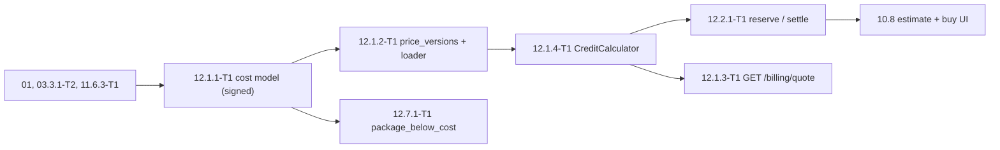

# 12.1 — Pricing: cost model, price versions, quote and CreditCalculator

> Refines `../../12-billing-credits.md` (S · M2) §4 Epic 12.1, §5.7 (credit formula + bound rules), §6.
> Contract: `../README.md` — facts §1, findings F14/F17/F20, decisions **D1, D3, D4, D5, D10, D16, D17, D18**, routes/DTOs §3.1, sequencing §5, template §6, gates §7, canonical rows **§8.1**, rulings BR1–BR32.
> Consumed by `../12.2-ledger/`, `../12.6-lots-expiry/`, `../12.7-packages-promos/` (12.7.1-T1), `../12.5-admin-minting/` (12.5.2-T1), `../12.8-funding/` (12.8.4-T1), 10 S (`GET /billing/quote`). Fed by 01, 03.3.1-T2, 03.2.1-T1, 11.6.3-T1, 02.2.4-T1, 09.2.2-T1, 12.3.1-T1 (soft).
> Legend ✅ on disk · ⚠️ unverified · [DECISION] · [OPEN] · [INFERENCE]. Status: detailed plan 2026-09-25, **nothing implemented**; 4 tasks / 2.5 d raw, one route, no job, no UI, no vendor call.

## 1. Scope

Turn measurements into money and make the number the user sees the number the ledger moves: one pure Domain function (`CreditCalculator`, D3), one versioned price table (`price_versions`, D4) carrying the credit parameters, one read-only quote endpoint.

| In scope | Out of scope |
|---|---|
| 12.1.1-T1 cost model from measurements: cost per operation × tier, the parameter hand-off (`credit_usd`, `margin`, `fee_rate`, `fx_buffer`, `gpu_s_per_video_min`, floors), signed document + read-only SQL | Tax/VAT, e-invoice, provider fees (13; 12.3.1-T1) |
| 12.1.2-T1 `price_versions`: credit columns, loader, validator, seeder, activation by `active_from` | `credit_ledger`, `price_version` on reserve rows (12.2.1-T1) |
| 12.1.3-T1 `GET /billing/quote` + `QuoteDto` | The Angular estimate/buy UI and its copy (10.8.x) |
| 12.1.4-T1 `CreditCalculator`, the Domain value types, the `usage_records` → `UsageItem` mapping | `usage_records` writers (02 D14, 03 D8); `ReserveAsync`/`SettleAsync` (12.2.1-T1); spend caps (12.4.1-T1, `IBudgetGuard`) |

**Acceptance (restated).** Given a signed cost model and an active `price_versions` row, when a command reserves, when a job settles and when the UI asks for a quote, then all three derive from the **same** `CreditCalculator` output, `charge ≤ reserve`, `charge ≥ floor`, rounding happens once per job, the GPU item is `gpu_s_per_video_min × actual output minutes` (never wall time), and no USD rate or margin value leaves the API.

**Boundary rules.** (1) `IPriceCatalog`/`price_versions` are extended, never duplicated (D1, 02 T49). (2) `CreditCalculator` is pure Domain — no `DbContext`/`HttpClient`/clock/config (arch-tested). (3) `GET /billing/quote` is the only route here. (4) No job, queue, metric or alert rule (BR9/D17). (5) Nothing here sits behind `billing_enabled`: the quote is read-only and must work in the closed beta where credits are admin-granted (CR-3 flags only money-mutating routes). [DECISION]

## 2. Confirmed facts

| Id | Fact (only what this folder needs) | Source |
|---|---|---|
| C1/C2, C7 | `price_versions` is 00 §6:320 (`version`, `active_from`, `rates`, `limits`); money `numeric(12,6)` USD, credits `bigint`, ids UUIDv7, `timestamptz`, `xmin`; every table already has `id`/`created_at` (+`updated_at` where mutable) — never re-add them; S-only tables are not created in P; the P subset is created by **02.2.4-T1** seeded from `OpenAi:Pricing`/`:Limits`, and the credit columns arrive with 12.1.2 (M2) | 00 §6 L262/L320 ✅; 09 D9; 02 F35/T49/T55/CR-2 ✅ |
| C5/C8, C10–C12 | `ICreditLedger.ReserveAsync(userId, CreditOperation, Guid referenceId, UsageBound, ct)` and `UsageBound`/`CostBound` are 02 D1's (port name fixed by 02 CR-2); `usage_records` is written only by `IUsageMeter` (02 D14), `operation ∈ story, story_review, story_revision, fact_sheet, image, tts, render, bible_proposal, idea, source_find, moderation` (02 CR-4); `UnitOfWorkBehavior` is the only `SaveChangesAsync` caller; migrations are `<ts>_<NN>_<Name>` (`_09_RenderJobs`); seeds land through a seeder (`StyleTemplateSeeder`, 09.2.5-T1); exactly one of `[Audited]`/`[NotAudited]`/`[AllowAnonymousRequest]` per handler (09.3.6-T1); codes are closed constants in `ErrorCodes.cs` resolved through `ErrorCatalogue.cs` — request validation is `validation_failed` 400 with `errors` keyed by camelCase field | 02 D1/D14/CR-2/CR-4 ✅; 09 D11/§5.1, BD5, 09.2.5-T1, 09.3.6-T1, L187–L190 ✅ |
| D3, D4 | Frozen calculator shapes (see §3.1): `Cost`, `CostBoundUsd`, `Credits`, `Reserve`, `Charge`, rounding once per job; `credit_usd` (1 credit = US$0.01 of **price** [O-2]), `margin`, `fee_rate`, `fx_buffer`, `gpu_s_per_video_min`, `floors` per operation × tier, the 03 D8 image-rate shape; a reserve stores its version and is charged with it | README D3, D4, O-2 ✅ |
| D5, D10, D16, D17/F20 | Two independent caps (platform USD `IBudgetGuard` (P); per-user credits 12.4.1-T1) — 12.1 only supplies the numbers; config sections fixed `Credit`/`Payment`/`Funding` (02 owns `Budget:…`); one `IFxRateProvider.CurrentAsync()` (latest `provider_topups.fx_rate`, fallback `Credit:FxUsdVndFallback`) while `fx_buffer` stays a `price_versions` parameter — the formula never reads the FX rate itself; indexes and metrics are pinned, so this folder adds no metric, alert rule or pipeline (11.6.2-T1 is the only alert path) | README D5/D10/D16/D17/F20/F21 ✅ |
| 03, 02 CR-6, 11.6.3-T1 | `RenderImagePlanner` (03.2.1-T1): `ClipSeconds = 10`, `SpareShare = 0.15`, `TierMaxMinutes` 1/8/15 ⇒ image caps **6/48/90**; `rates.image[model]` = `{text_in_per_1m, image_in_per_1m, image_out_per_1m, tokens_per_image{aspect:quality}, tokens_per_image_p95{…}}` with the 6,000-token placeholder until 03.3.1-T2; `story_generate` worst case = writer + review + one revision + **review #2**, each at its `max_output_tokens`; 11.6.3-T1 gives GPU seconds per finished-video minute and node cost/hour ⇒ `gpu_s_per_video_min`, `rates.gpu.perSecondUsd = cost/hour ÷ 3600 ÷ concurrency` (soft dep); 09.2.2-T1 (core schema/migrations) is a hard dep; `fee_rate` ⚠️ placeholder until 12.3.1-T1 | 03 D8/CR-4 ✅; 02 CR-6/T11 ✅; 11 README L267/§8.1 ✅; 09 §8.1 ✅; README O-1 ✅ |

⚠️ **Dual-source note — resolved (BR25 / 12 CR-17).** 02's `RunContext` carries `int PriceVersion` (02 D14/D21) while README D4/BR25 fix `price_versions.version` as **text** (00 §6:320) and `usage_records.price_version` as text too; D2 names `PriceVersionVersion`. The ruling: 02's `RunContext.PriceVersion` **int → string**, filed as **12 CR-17** against `features/02-story-writing/` 02.2.4-T1 + 02.6's `RunContext` DTO (“no other 02 change”); 12.1.2-T1 records the mapping, and this folder never renames the column, never forks the port and never edits 02. [DECISION]

## 3. Domain and data

### 3.1 Types (Domain `Pricing/`, pure)

```csharp
public sealed record PriceVersionRates(IReadOnlyDictionary<string, TextRates> Text,
    IReadOnlyDictionary<string, ImageRates> Image, decimal GpuPerSecondUsd, decimal WebSearchCallUsd);
public sealed record TextRates(decimal InputPer1M, decimal CachedInputPer1M, decimal OutputPer1M);        // 02's shape
public sealed record ImageRates(decimal TextInPer1M, decimal ImageInPer1M, decimal ImageOutPer1M,
    IReadOnlyDictionary<ImageCell, long> TokensPerImage, IReadOnlyDictionary<ImageCell, long> TokensPerImageP95);
public readonly record struct ImageCell(Aspect Aspect, ImageQuality Quality);
public sealed record PriceVersionParameters(PriceVersionVersion Version, decimal CreditUsd, decimal Margin,
    decimal FeeRate, decimal FxBuffer, decimal GpuSecondsPerVideoMinute, IReadOnlyDictionary<OperationTier, long> Floors);
public readonly record struct OperationTier(CreditOperation Operation, LengthTier Tier);
public readonly record struct OperationFloor(long Credits);
public readonly record struct PriceVersionVersion(string Value);                                          // "2026-10-01.1"

public static class CreditCalculator   // static, pure, exactly D3's five members + K
{
    public static decimal Cost(IReadOnlyList<UsageItem> actual, PriceVersionRates rates);
    public static decimal CostBoundUsd(UsageBound bound, PriceVersionRates rates);
    public static long    Credits(decimal usd, PriceVersionParameters p);                                 // ceil(usd × K ÷ credit_usd)
    public static long    Reserve(UsageBound bound, PriceVersionParameters p, OperationFloor floor);      // max(floor, Credits(CostBoundUsd))
    public static long    Charge(long reserve, IReadOnlyList<UsageItem> actual, PriceVersionParameters p, OperationFloor floor); // min(reserve, max(floor, Credits(Cost)))
    public static decimal K(PriceVersionParameters p) => (1 + p.FxBuffer) / ((1 - p.Margin) * (1 - p.FeeRate));
}
```

`UsageItem`/`UsageBound`/`CostBound` stay 02's types; `CreditOperation` is 02's enum (`StoryGenerate`, `FactSheet`, `Render` priced; `StoryReview`/`StoryRevision` are not separately priced); `LengthTier` is 02's `short|standard|long`. Money is `decimal` end to end, ÷1,000,000 happens inside `Cost`/`CostBoundUsd`, the single `Math.Ceiling` is in `Credits`, and `K` is never rounded before the ceiling. [DECISION]

### 3.2 `price_versions` after 12.1.2 (00 §6:320 + the M2 columns)

```sql
-- 12.1.2-T1 · migration "<ts>_12_PriceVersionsCreditColumns" (additive, BR20: this task owns the name)
ALTER TABLE price_versions
  ADD COLUMN credit_usd          numeric(12,6) NOT NULL DEFAULT 0.010000,
  ADD COLUMN margin              numeric(12,6) NOT NULL DEFAULT 0.600000,
  ADD COLUMN fee_rate            numeric(12,6) NOT NULL DEFAULT 0.030000,   -- ⚠️ placeholder until 12.3.1-T1
  ADD COLUMN fx_buffer           numeric(12,6) NOT NULL DEFAULT 0.050000,
  ADD COLUMN gpu_s_per_video_min numeric(12,6) NOT NULL DEFAULT 0,
  ADD COLUMN floors              jsonb         NOT NULL DEFAULT '{}';
ALTER TABLE price_versions
  ADD CONSTRAINT ck_price_versions_credit_usd CHECK (credit_usd > 0),
  ADD CONSTRAINT ck_price_versions_margin     CHECK (margin >= 0 AND margin < 1),
  ADD CONSTRAINT ck_price_versions_fee_rate   CHECK (fee_rate >= 0 AND fee_rate < 1),
  ADD CONSTRAINT ck_price_versions_fx_buffer  CHECK (fx_buffer >= 0),
  ADD CONSTRAINT ck_price_versions_gpu_rate   CHECK (gpu_s_per_video_min >= 0);
CREATE INDEX ix_price_versions_active_from ON price_versions (active_from DESC);   -- GetActive(at)
```

- `rates.gpu` carries the per-GPU-second USD from 11.6.3-T1; `gpu_s_per_video_min` is a **column** because the bound rule multiplies it (§5 step 5). The seeder derives `rates.gpu.perSecondUsd` (§3.3) so the calculator never divides at runtime.
- `floors` shape: `{ "story_generate": {"short":5,"standard":5,"long":8}, "fact_sheet": {…}, "render": {"short":20,"standard":50,"long":90} }` — keys are the `CreditOperation` snake_case wire values (02 D1) × `LengthTier`; a missing cell fails `PriceVersionValidator` at boot.
- `DEFAULT`s exist only so the migration is additive on a table that may hold P rows; the seeder writes the real values and the validator rejects an **active** row still carrying `gpu_s_per_video_min = 0`. Rows are **immutable/append-only** — a price change is a new row with a new `active_from`; 00 §8 has no edit route and none is added. [DECISION]

### 3.3 Ports, loader, seeder

```csharp
// Application/Abstractions/Pricing/IPriceCatalog.cs — 02.2.4-T1 owns the file; this folder ADDS members only
PriceVersion GetActive(DateTimeOffset at);                                                              // existing (02)
Task<PriceVersionParameters> GetParametersAsync(PriceVersionVersion version, CancellationToken ct);     // NEW
Task<PriceVersionParameters> GetActiveParametersAsync(DateTimeOffset at, CancellationToken ct);         // NEW
```

- `PriceVersionCache` (Infrastructure, `IMemoryCache`, 60 s TTL + seeder-driven invalidation) caches the active row **as pure Domain value types** — the same cache 02's path uses, extended, never a second one. [DECISION]
- `ICreditQuoteReadModel.TypicalCreditsAsync(CreditOperation, LengthTier, ct) → ErrorOr<long?>` (Application, `IXxxReadModel` naming per 09) — the quote's aggregate read, Infrastructure-implemented, cached 60 s. [INFERENCE on the name]
- `IFxRateProvider.CurrentAsync()` (Application port in the Pricing abstractions) is **declared by 12.1.2-T1** (BR31) with an **options-backed** implementation (fallback option `Credit:FxUsdVndFallback`, D10/D16); the **DB-backed** implementation (latest `provider_topups.fx_rate`, D16) is **12.8.2-T1** and replaces the registration — no new dependency edge, hence no cycle. `MinimumPricePerCreditVnd(priceVersion, fxRate)` is declared by 12.1.1/12.1.2 (BR32) and consumed by 12.7.1-T1's `package_below_cost`.
- `PriceVersionSeeder` (09.2.5-T1 pattern) reads `Credit:Pricing` (D10's `Credit` section) plus 02's rate blocks, derives `rates.gpu.perSecondUsd = gpuNodeCostUsdPerHour ÷ 3600 ÷ gpuRenderConcurrency`, inserts with `ON CONFLICT (version) DO NOTHING`, is idempotent, never updates a row, and invalidates the cache. Key names inside `Credit:Pricing` (`ActiveVersion`, `Versions`, `version → {activeFrom, creditUsd, margin, feeRate, fxBuffer, gpuSecondsPerVideoMinute, gpuNodeCostUsdPerHour, gpuRenderConcurrency, floors}`) are this folder's [DECISION]; the section name is D10's.

### 3.4 Invariants

| I | Invariant | Enforced by |
|---|---|---|
| I1 | Exactly one active version exists at every instant and passes `PriceVersionValidator` | boot validation (hard failure) + the daily `CreditReconciliationJob` (12.2.3-T1) asserts it |
| I2 | `charge ≤ reserve` whenever the metered usage respects the §5 bounds | `Charge` clamps; a real overrun alerts (12.2.1-T1) instead of charging above the quote |
| I3 | `charge ≥ floors[operation][tier]` and `reserve ≥ floors[…]` | `Reserve`/`Charge` `max(floor, …)` |
| I4 | Rounding happens once per job | `Credits` is the only `Math.Ceiling` in `Domain/Pricing/` (arch/grep test) |
| I5 | No USD rate, margin or `K` leaves the API | `QuoteDto` carries credits/tier/version only (§5) |
| I6 | `price_versions` rows are never updated or deleted | no `UPDATE`/`DELETE` path exists; append-only by construction |

## 4. Use cases

| UC | Actor | Trigger → steps | Result |
|---|---|---|---|
| UC-1 | Owner + TL (BA) | measurements from 01/03.3.1-T2/11.6.3-T1 exist → run the read-only SQL → fill the cost model → compute `K`/floors/worst-case reserve → check margin ≥ 60 % → sign → hand over the parameter table | signed `docs/ops/pricing/cost-model.md` + the values 12.1.2-T1 seeds; gate `12-measure` passes |
| UC-2 | Platform (seeder) | version prepared → `Credit:Pricing` block → deploy → seeder inserts → boot validation → `active_from` passes | old reserves keep their version; new jobs quote with the new one |
| UC-3 | Creator | opens the estimate surface → `GET /billing/quote?operation=…&episodeId=…` | "up to N, usually about M"; nothing is charged |
| UC-4 | Paid command (12.2.4-T1) | validates → `UsageBoundFactory` builds the bound → `Reserve(...)` → `ICreditLedger.ReserveAsync(…, bound, ct)` | reserve + version on the ledger row; overspend needs an alert, not luck |
| UC-5 | Settle path (12.2.1-T1) | finished/failed → `usage_records` by `reservation_id` → `Cost` → `Charge(reserve, actual, …)` → settle + release (ledger rows `settle = −charged`, `release = +reserve`, BR18) | charged = actual, floor-clamped, ≤ reserve; failure/cancel refunds in full |



Strict order inside the folder: **12.1.1-T1 → 12.1.2-T1 → 12.1.4-T1 → 12.1.3-T1** (12.1.3-T1 depends on 12.1.2-T1 **and** 12.1.4-T1 per §8.1).

## 5. API and events

**Route (frozen by 00 §8 L365 / README §3.1).** `GET /api/v1/billing/quote?operation={story_generate|fact_sheet|render}&episodeId={uuid}`

```
200 QuoteDto { operation, tier, maxCredits, typicalCredits|null, balanceAfter, priceVersion }
```

- `maxCredits` = `Reserve(bound, parameters, floors[operation][tier])` — the same call and the same bound helper the reserve path uses (12.2.4-T1).
- `typicalCredits` = median (not mean) charge of the last 50 settled reservations of the same `(operation, tier)`; `null` when < 50 samples (BR25); one set-based aggregate read, 30-day window, cached 60 s; no `user_id` selected. [DECISION]
- `balanceAfter` = current derived balance − `maxCredits`, **possibly negative** (the UI compares it to 0 and shows the shortfall). [DECISION]
- `tier` from the episode for all three operations; without `episodeId` (`story_generate`/`fact_sheet` only) it falls back to `standard` and the response states it; `render` **requires** `episodeId`. [DECISION]
- Auth: policy `All` (authenticated), rate policy `auth`, `[NotAudited]`, **not** behind `billing_enabled`; `episodeId` goes through the tenant filter (a foreign episode is 404). No payload beyond the six fields (I5) — no USD cost, rate, margin or `K`.
- Errors (all pre-existing, C11/README §5.3): `validation_failed` 400 (unknown/missing `operation`; `story_review`/`story_revision`, which are included in `story_generate` and have no own price; missing `episodeId` for `render`), `not_found` 404, `service_unavailable` 503 (**no active valid version** — fail closed, never a default price). [DECISION]
- **No event**: the quote reads and never writes; `credit_balance_changed.v1`/`CreditBalanceChanged` and `payment_paid.v1` belong to 12.2/12.3 (D17), and a version change is a deploy action, not an event. [DECISION]

**Formula (plan §5.7 — the contract the calculator implements).** (1) per item: text `(input − cached) × r_in + cached × r_cached + output × r_out`; image `text_tokens × r_text_in + image_tokens × r_image_in + output_tokens × r_image_out`, or `tokens_per_image[aspect:quality] × r_image_out` with `estimated = true` when the provider reported no usage; render `gpu_s_per_video_min × output_minutes × r_gpu`. (2) `C = Σ cost` over the reservation's `usage_records`. (3) `credits(C) = ceil(C × K ÷ credit_usd)`, `K = (1 + fx_buffer) / ((1 − margin) × (1 − fee_rate))`, rounded **once**. (4) `charged = min(reserve, max(floor, credits(C)))`; the **ledger rows** are `settle = −charged` and `release = +reserve` (the whole hold, exactly, written together in the same transaction, BR18) — the balance effect of the pair is `−charged` — while `returned = reserve − charged` is the **derived DTO value**, never a row. (5) `reserve = max(floor, credits(C_max))` with the hard bounds: text input ≤ UTF-8 bytes of the assembled prompt; output ≤ `limits.max_output_tokens` per step (`story_generate` = writer + review + revision + review #2, 02 CR-6); images ≤ `RenderImagePlanner.MaxTerms` (read, never recomputed — 6/48/90); GPU seconds ≤ `TierMaxMinutes × 60 × gpu_s_per_video_min × 1.5` capped by the render timeout.

## 6. UI

**No UI task exists in this folder and none is added** (owner rule 2026-09-25: UI work needs an approved `<story>-T0 — UI design`; this folder has none, so it creates none). Each task file repeats its own consumer line:

| API surface | Consumer (10 S) | Note |
|---|---|---|
| `GET /billing/quote` | 10.5.6 (episode estimate), 10.6.1 (render cost line) — "up to N credits, usually about M" | the API returns numbers only; `billing.quote.*` copy belongs to 10's i18n files |
| `CreditBalanceDto` header widget, `CreditBalanceChanged` | 10.8.x | 12.2.2-T1 owns the route; the quote must agree with the balance it shows |
| `GET /admin/usage`, `/admin/funding` | 10.9 admin shell | 12.5.2-T1 / 12.8.1-T1 own those; 12.1.1-T1's parameters feed the `marginPct` they render |

The quote is numeric, so nothing here needs a locale string; formatting (vi-VN/en-US) is 10's (D18) and the `/admin` tables' a11y contract is 10.1.3's.

## 7. Jobs and integrations

| Item | Owner | Note |
|---|---|---|
| Jobs | **none in this folder** | 12 registers no queue and 12.1 registers no job (BR9); the daily `CreditReconciliationJob` (12.2.3-T1) carries I1's check as one of its assertions — cross-folder, no new job here |
| Seeder | `PriceVersionSeeder` at the migration/deploy step (09.2.5-T1 pattern) | idempotent; a boot configuration error, never a silent default |
| Measurement inputs (P, available) | 01, 03.3.1-T2 (`tokens_per_image`/`_p95` per aspect:quality), 11.6.3-T1 (`gpu_s_per_video_min`, node cost/hour) | 12.1.1-T1 reads them only |
| Payment fee · FX · outbound calls | 12.3.1-T1 (soft); `IFxRateProvider.CurrentAsync()` (**declared by 12.1.2-T1** with an options-backed implementation, BR31; DB-backed implementation 12.8.2-T1; read by 12.8.4-T1's margin alert and by 12.7.1-T1's `package_below_cost`); none | `fee_rate` starts as a stated placeholder ⚠️ and is re-seeded as a **new version** once a provider is chosen; `fx_buffer` stays a `price_versions` parameter; 12.1 makes no HTTP call to any provider |

## 8. Security and privacy

| Topic | Rule |
|---|---|
| Disclosure | The API exposes credits only; rates, `margin`, `fee_rate`, `fx_buffer` and `K` stay server-side (I5). `docs/ops/pricing/cost-model.md` is internal and never published (13 owns the user-facing pricing text) |
| Authorization | Quote authenticated; episode resolved through the tenant filter; no cross-user data. `typicalCredits` is a platform-wide **aggregate** — no `user_id` selected, cached or returned. [DECISION] |
| Audit | Reads are `[NotAudited]`; a `price_versions` change is recorded by its own row + `DECISIONS.md` (12 CR-10) — there is no admin route to audit. [DECISION] |
| Secrets | None added: rate tables are business data; no key/token/provider secret is read here |
| Input validation | `operation` is an allow-list enum; `episodeId` must parse and resolve inside the tenant; the client can never supply a price, a credit amount or a bound — the number is not client-influenced |
| Logging / observability | `LogInformation("pricing.quote {Operation} {Tier} {MaxCredits} {Version}")`; **no new metric or alert rule** (D17/F21 keep the list closed) — this folder's observability is the boot validation failure and 12.2.3-T1's assertions; no PII, no new DP purpose, no key-ring change |
| i18n | Nothing user-visible but numbers; D18's vi/en receipt rules apply to 12.7.3-T1, not here |

## 9. Test plan

| Project | Coverage |
|---|---|
| `NightTales.Domain.UnitTests` | `CreditCalculatorTests`: §5.7 worked examples (story ⇒ floor 5 dominates, `Credits = 2`; Standard render ⇒ `Cost $0.708`, `Reserve 203`, `Charge 192`, `returned 11` (derived, BR18)); one ceiling only; floor dominance; `charge ≤ reserve` sweep (deterministic pseudo-random, fixed seed, no new library); per-item kinds (text with cache; image with and without usage; render GPU = `gpu_s_per_video_min × output_minutes`, with a regression test that passes a `gpuSeconds` differing from wall time); decimal exactness at `credit_usd = 0.01`; bounds 6/48/90, `TierMaxMinutes` 1/8/15, ×1.5; `K` at zero `margin`/`fee_rate`/`fx_buffer`; guards (`credit_usd = 0`, `margin = 1`, negative `usd`, negative bound, `long` overflow ⇒ named domain error, never a zero). Plus `UsageItemMapperTests` (field-by-field, `estimated` propagation) |
| `NightTales.Application.UnitTests` | `GetQuoteHandlerTests` with hand-written `IPriceCatalog`/`ICreditQuoteReadModel`/episode-lookup fakes from `NightTales.TestKit`: `maxCredits` = `Reserve` for the same bound; `typicalCredits` null < 50 samples (BR25) and median otherwise; both 400 cases; missing `episodeId` for `render`; foreign episode 404; `balanceAfter` arithmetic (incl. negative); 503 with no valid version. `PriceVersionValidatorTests`: one test per rejection rule plus one accepting a complete version |
| `NightTales.Api.IntegrationTests` (Testcontainers) | migration applies on a fresh DB **and** on a DB holding the P subset (pre-insert one P-only row), leaving the six columns, five CHECKs and the index; seeder idempotency (run twice ⇒ one row per version, no update of an edited row); `GET /billing/quote` end-to-end for the three operations with §5's status codes; `priceVersion` equals the active row's `version` and follows an `active_from` flip; the raw body contains no `usd\|margin\|feeRate\|fxBuffer\|k` key; the same-number assertion against a real reserve; no write on a 200 |
| `NightTales.Architecture.Tests` | `Domain/Pricing/` references no EF/HTTP/`IConfiguration`/`IClock` (purity); `Math.Ceiling` appears once in the namespace (I4); `IPriceCatalog`'s exact member set (a second catalog interface fails); the quote handler carries exactly one of the three attributes and is `[NotAudited]` |

## 10. Tasks and re-estimate

| Task | Size | Area | Phase | Depends on | Blocks |
|---|---|---|---|---|---|
| 12.1.1-T1 | M (1.0) | BA | S · M2 | 01, 03.3.1-T2, 11.6.3-T1 | 12.1.2-T1 (soft), 12.7.1-T1 (soft), 12.8.4-T1 (soft) |
| 12.1.2-T1 | S (0.5) | BE | S · M2 | 12.1.1-T1 (soft), 09.2.2-T1, 02.2.4-T1 | 12.1.3-T1, 12.1.4-T1, 12.7.1-T1, 12.3.2-T1 |
| 12.1.3-T1 | S (0.5) | BE | S · M2 | 12.1.2-T1, 12.1.4-T1 | 10.8.1-T1 (10/08 CR-hand-off) |
| 12.1.4-T1 | S (0.5) | BE | S · M2 | 12.1.2-T1, 02.2.4-T1 | 12.1.3-T1, 12.2.1-T1, 12.2.4-T1, 12.5.2-T1 |

Rows are README §8.1 verbatim and are also the dependency header of each task file. Estimate **2.5 d raw** (1.0 + 0.5 + 0.5 + 0.5) — unchanged from the high-level §11 epic row and README §9 (no S→M bump here).

## 11. Rollout

1. **Gate `12-measure` first:** no public price before 12.1.1-T1 is signed and 01 + 03.3.1-T2 + 11.6.3-T1 exist (README §7); until then the beta runs on admin-granted credits with the quote hidden (10 D14 forbids credit text in P).
2. **Order:** 12.1.1-T1 (the only task that can start before 12.1.2-T1) → 12.1.2-T1 (needs 09.2.2-T1 + 02.2.4-T1) → 12.1.4-T1 → 12.1.3-T1.
3. **Deploy:** `_12_PriceVersionsCreditColumns` is additive (BR20) — columns + CHECKs + one index — and runs with the M2 deploy; the seeder runs immediately after; a missing or invalid active version is a **hard startup failure** (fail closed). Rollback = the previous app version with the columns left in place; values are re-seeded, never hand-edited.
4. **Before public prices:** margin ≥ 60 % on measured costs (gate `12-payments-sandbox`), `fee_rate` re-seeded from the chosen provider (12.3.1-T1), `gpu_s_per_video_min > 0` from 11.6.3-T1 — otherwise the active version is rejected at boot.
5. **No flag, no job, no event:** `billing_enabled` (CR-3) gates only money-mutating routes; 12.1 adds no queue, metric, alert rule or outbox event (D17/BR9).
6. **Hand-off:** the parameter table plus README §8.1's four rows are what 12.2-ledger consumes; any change to the §5 formula goes through `../README.md` §3 first (BR15).
7. **DoR contract edges:** BR25 (`price_versions.version` and `usage_records.price_version` are text; 02's `RunContext.PriceVersion` int → string = **12 CR-17**, filed against 02.2.4-T1 and never applied from this folder); BR31 (`IFxRateProvider.CurrentAsync()` declared by 12.1.2-T1 with an options-backed implementation, DB-backed one in 12.8.2-T1, read by 12.8.4-T1 — no new edge, no cycle); BR32 (`MinimumPricePerCreditVnd(priceVersion, fxRate)` declared by 12.1.1/12.1.2 and consumed by 12.7.1-T1: `priceVnd ÷ (credits + bonusCredits) ≥ MinimumPricePerCreditVnd(priceVersion, fxRate)` ⇒ 400 `package_below_cost`); BR20 (`<ts>_12_PriceVersionsCreditColumns` is 12.1.2-T1's alone and the CR-13 index set is not added here); the §5 quote rules of BR25 (`episodeId` for `render` only, missing/unsupported ⇒ 400 `validation_failed`, projected `balanceAfter`, `typicalCredits` null under 50 samples).
