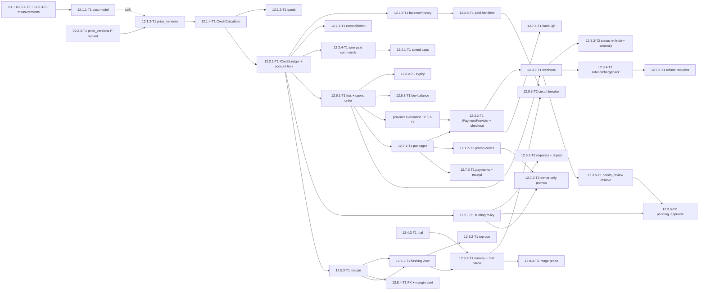

# 12 — Credits, Pricing and Payments (S): Tech Lead review, shared decisions and feature index

> Reviews: `../../12-billing-credits.md` (high-level, 00 §4.1 **S**, 24.0 d raw) — **all of plan 12 is S** (M2), so this folder details the complete plan; there is no P slice. Read "M1" in the high-level plan as M2 (00 §4.1: "Where a plan names M1 for an S item (for example 12 ledger, legal drafts), read M2").
> Reviewed: 2026-09-25 by the Tech Lead against the signed consumers (`00-overview.md` §6/§7/§8, 02 D1/D2/D14 + CR-2/CR-4/CR-6, 09 wave 1+2, 11.6.2-T1/11.6.3-T1, 13 compliance) and official payment-provider pages read the same day (§1 P-rows).
> Verdict: **approve with changes.** The high-level plan is sound on the ledger, lots, minting and funding; it is thin exactly where money leaves and re-enters the platform: webhook delivery semantics (at-least-once, concurrent duplicates), the pending-payment lifetime, who owns the FX rate, the paused-job interaction with the refund/reconciliation sweeps, and the fact that `payments`/`credit_ledger` are tenant-filtered while the webhook runs without a user. §2 findings F01–F22, §3 D1–D18 is the contract.
> Status: **ready for implementation with conditions** (§11 DoR is written by the TL after the folders land).
> Legend: ✅ read from source/docs (URL + date, or file + line) · ⚠️ unverified · [DECISION] · [OPEN] · [INFERENCE].

## 0. How this folder is organised

```
plans/features/12-billing-credits/
  README.md                        ← facts, findings F01–F22, decisions D1–D18, CRs, template, gates, index, re-estimate, owner decisions, DoR
  12.1-pricing/                    ← 12.1.1-T1 cost model, 12.1.2-T1 price_versions, 12.1.3-T1 quote, 12.1.4-T1 CreditCalculator
  12.2-ledger/                     ← 12.2.1-T1 reserve/settle/release/refund, 12.2.2-T1 balance+history, 12.2.3-T1 reconciliation, 12.2.4-T1 wire into paid commands
  12.6-lots-expiry/                ← 12.6.1-T1 lots+spend order, 12.6.2-T1 CreditExpiryJob, 12.6.3-T1 low-balance nudge
  12.3-payments/                   ← 12.3.1-T1 provider evaluation, 12.3.2-T1 IPaymentProvider+checkout, 12.3.3-T1 webhook, 12.3.3-T2 status re-fetch+anomaly, 12.3.4-T1 refund/chargeback
  12.3.5-review-refunds/           ← 12.3.5-T1 needs_review resolve, 12.3.5-T2 pending_approval, 12.7.5-T1 user refund requests
  12.4-limits-trial/               ← 12.4.1-T1 spend caps, 12.4.2-T1 trial grant, 12.5.2-T1 margin query
  12.5-admin-minting/              ← 12.5.1-T1 grants+MintingPolicy, 12.5.1-T2 grant requests+digest, 12.7.2-T2 owner-only promo control
  12.7-packages-promos/            ← 12.7.1-T1 packages, 12.7.2-T1 promo codes, 12.7.3-T1 history+receipt, 12.7.4-T1 bank QR
  12.8-funding/                    ← 12.8.1-T1 funding view, 12.8.2-T1 top-ups+set-aside, 12.8.3-T1 runway/trial pause, 12.8.3-T2 circuit breaker, 12.8.3-T3 image probe, 12.8.4-T1 FX+margin alert
```

Each folder holds `plan.md` (00 §10.1 sections 1–11) and one task file per task. **Keep every id the high-level §6 table defines** (35 tasks); no new ids, no renames — 02, 03, 09, 10, 11 and 13 already reference several of them (02 CR-2/CR-4/CR-6, 03 D8, 09 §5.4, 11.6.3-T1, 13.1.2-T1).

**Folder briefs.**

- `12.1-pricing/` — turns measurements into money. Implements D3 (CreditCalculator: one pure Domain function used by quote, reserve, charge) and D4 (`price_versions` columns incl. the credit parameters added at M2; the P subset `version/active_from/rates/limits` already exists from 02.2.4-T1 through `IPriceCatalog` — extend it, never create a second catalog port). Traps: the render GPU item is `gpu_s_per_video_min × actual output minutes` (ffprobe), never wall time; the story reserve is writer + review + revision + **review #2** (02 CR-6); images bound = `RenderImagePlanner` cap, read, not recomputed (03 CR-4); rounding happens once per job.
- `12.2-ledger/` — the append-only ledger and the only place that may move credits. Implements D2 (row lock on `credit_accounts`, one ledger row per lot, idempotency keys, no negative balance) and replaces 02's P `MeteringOnlyCreditLedger` with `CreditService` (D1). Traps: never a session-level advisory lock across EF work (F02); settle reads `usage_records` by `reservation_id` (02 D14 owns the writer) and a late usage row is platform loss, not a second charge (F25); the stale-reserve sweep is per-operation (F09) and must skip paused jobs (F08).
- `12.6-lots-expiry/` — what credits *are*: source, expiry, spend order, liability. Implements D6 (`source_rank` order, release/refund back to the same lots, dead lots re-removed) and D7 (`CreditExpiryJob`, notices). Traps: a partial lot expiry during an open reserve (F06); `expire` rows never make the sum negative; trial 30 d / purchased+bonus 12 months (⚠️ lawyer, 13).
- `12.3-payments/` — provider port, checkout, webhooks, refunds/chargebacks. Implements D8 (`IPaymentProvider`), D9 (webhook mechanics: raw body, HMAC, timestamp tolerance, claim-then-act, always-200 after claim) and D10 (options/secrets). Traps: at-least-once delivery with concurrent duplicates (F01); signature and amount must both be verified before a lot exists (F12); nothing is granted without a re-fetched `paid` when a status API exists (plan §12.3.3); no vendor SDK — hand-rolled HMAC keeps AGPL/non-commercial licences out (F18).
- `12.3.5-review-refunds/` — the human path for odd money. Implements D12 (resolve actions + approval gate, `VoidPaymentLotsAsync` shared with refunds) and the FR-12-14 refund arithmetic. Traps: the resolving admin may never approve their own resolve (F07); `grant_partial` rounds **down**; a chargeback flags the account, a refund does not (plan §12.3.4); both void **every** lot of the payment, bonus included.
- `12.4-limits-trial/` — abuse and unit economics backstops. Implements D5 (per-user credit cap at M2 on top of 02's P platform-USD `IBudgetGuard`) and D11 (margin query: revenue from `payments`, never credits × price — F15). Traps: the trial idempotency key `grant:trial:{userId}` is shared with the deferred grant in 12.8.3; disposable-domain/device checks stay a simple list + rate limit (plan §12.4.2); margin must report the `estimated` share of cost.
- `12.5-admin-minting/` — the "one compromised admin cannot print money" contract. Implements D13 (`MintingPolicy`: actor ≠ target, target role, rolling 24 h cap under a transaction-scoped advisory lock, exposure from promo codes and approved resolves) and the owner approval + digest. Traps: `pg_try_advisory_xact_lock`, not a session lock (F02); the cap counts promo exposure `value × max_redemptions` and each increase (plan §12.7.2); the digest job also expires undecided requests at 7 days.
- `12.7-packages-promos/` — catalogue and offers, admin-editable without deploy. Implements D4 (`price_versions` floors drive `package_below_cost`), D14 (promo validation order + row locks) and the receipt/QR wire shapes for 10 S. Traps: a payment carries at most one promo (partial unique `promo_redemptions(payment_id) WHERE payment_id IS NOT NULL`); bonus credits are granted only after `paid` (F16); receipt is HTML (no server PDF library — F19).
- `12.8-funding/` — sales must fund the API *before* it runs out. Implements D15 (runway from snapshots − cost since; top-up by set-aside gap; FX from the last top-up), D16 (circuit breaker: `OpenAiErrorClassifier`, MPT error-text mapping, two probes on resume, 12 h cancel, `processingPaused`) and D17 (alerts through 11.6.2-T1 only). Traps: the paused-queue refund interaction (F08); a text probe passing while the node's image project is unfunded must keep the flag open with a distinct reason; auto-reload is a *documented* owner decision, not an API call.

## 1. Facts verified for this review

**Repo contract facts (C).** Every ✅ row was read on disk 2026-09-25.

| Id | Fact | Source |
|---|---|---|
| C1 | Tables and columns are fixed by 00 §6: `credit_accounts` (:`319`, PK `user_id`), `credit_ledger` (:`295`), `credit_lots` (:`296`), `credit_packages` (:`297`), `promo_codes` (:`298`), `promo_redemptions` (:`299`), `payments` (:`300`), `payment_events` (:`301`), `refund_requests` (:`302`), `provider_balance_snapshots` (:`303`), `provider_topups` (:`304`), `credit_grant_requests` (:`314`), `price_versions` (:`320`), `usage_records` (:`294`), `idempotency_keys` (:`318`), `system_setting_changes` (critical settings incl. payment), `feature_flags` (`youtube_publish`/`tiktok_publish`), `audit_logs.category` includes `billing` | `plans/00-overview.md` §6 ✅ |
| C2 | Money conventions: `numeric(12,6)` USD, credits `bigint`, `id uuid` UUIDv7, `timestamptz`, optimistic concurrency via `xmin`, soft delete only per retention; S-only tables are **not** created in P (09 D9) | 00 §6 (L262) ✅; `features/09-backend-api/README.md` D9 |
| C3 | Credits flow: reserve (max) → settle (actual) + release (difference) → refund on failure; "never let balance go below zero"; `processingPaused` (null or `provider_funds_exhausted`) is carried by `GET /episodes/{id}` and `EpisodeUpdated`; `story_generating → draft \| story_review` on failed/cancelled/paused > 12 h with credits refunded; `rendering → story_approved` on failed/cancelled | 00 §7 (L346), §8 (L355) ✅ |
| C4 | Routes already fixed in 00 §8: the Credits/Billing row (L365 — `GET /credits/balance`, `GET /credits/ledger`, `GET /billing/quote`, `GET /billing/packages`, `POST /billing/checkout`, `POST /billing/promo/redeem`, `GET /billing/payments`, `GET /billing/payments/{id}`, `GET /billing/payments/{id}/receipt`, `POST /billing/payments/{id}/refund-request`, `POST /billing/webhooks/{provider}`), the Admin row (L367 — `POST /admin/users/{id}/credits`, `GET /admin/usage`, `GET/POST /admin/credit-packages`, `PATCH /admin/credit-packages/{id}`, `GET/POST /admin/promo-codes`, `PATCH /admin/promo-codes/{id}`, `GET /admin/payments?status=needs_review`, `POST /admin/payments/{id}/resolve`, `GET /admin/refund-requests`, `POST /admin/refund-requests/{id}/approve\|reject`, `GET /admin/funding`, `POST /admin/funding/balance-snapshots`, `POST /admin/funding/topups`, `POST /admin/funding/resume`) and the Admin-approvals row (L370 — `GET /admin/credit-grant-requests?status=pending`, `…/approve`, `…/reject`, `POST /admin/payments/{id}/resolve/approve\|reject`) | 00 §8 ✅ |
| C5 | `ICreditLedger` is 02's port (name fixed by 02 CR-2, not `ICreditService`): `ReserveAsync(userId, CreditOperation op, Guid referenceId, UsageBound bound, ct) → ErrorOr<ReservationId>`, `SettleAsync(reservationId, ct)` (actual cost read from `usage_records` by reservation), `RefundAsync(reservationId, reason, ct)`; P implementation `MeteringOnlyCreditLedger` returns a reservation id, never rejects, writes no ledger rows; `CreditOperation` members PascalCase (`StoryGenerate`, `FactSheet`, `BibleProposal`, `Idea`, `SourceFind`, `Render`) with snake_case wire values | `features/02-story-writing/README.md` D1 ✅ (L113–L124) |
| C6 | `IBudgetGuard.CheckAsync(CostBound, ct)` is P and owns the **platform** USD caps `Budget:MaxPlatformCostUsdPerDay` (default $3) / `:PerMonth` ($40), 429 `spend_cap_reached`, under `pg_advisory_xact_lock(hashtext('budget_guard'))` | 02 README D1 (L119–L124) ✅ |
| C7 | `price_versions` P subset (`version`, `active_from`, `rates` incl. `web_search_call`, `limits` = `max_output_tokens` per step/tier) is created in P by **02.2.4-T1** via `IPriceCatalog`; the credit columns (`credit_usd`, `margin`, `fee_rate`, `fx_buffer`, `gpu_s_per_video_min`, image/GPU rates, `floors`) arrive with 12.1.2 (M2) | 02 README F35, T49, T55, CR-2 ✅; 00 §6 L320 ✅ |
| C8 | 02 D14 owns the metering writer: `IUsageMeter.RecordAsync(UsageItem)` writes one `usage_records` row per provider call in its **own** transaction (a failed job keeps its cost); `usage_records.operation` values include `story`, `story_review`, `story_revision`, `fact_sheet`, `image`, `tts`, `render`, `bible_proposal`, `idea`, `source_find`, `moderation` (02 CR-4). `usage_records` is kept on episode deletion with `episode_id` nulled | 02 README D14, F34, CR-4 ✅; 00 §6 L294 ✅ |
| C9 | The pause reason `provider_funds_exhausted` already exists in P as a value of `generation_runs.pause_reason` (02 D2, check constraint) and is raised by 03.4.2-T1's `ProviderFundsExhausted { Source = "image" }` | 02 README D2 ✅; plan 12 §10 hand-over from 03 ✅ |
| C10 | 09 surfaces to reuse: `[JobPolicy(Queue = JobQueue.Default, Retries = 0)]` translated by `JobPolicyFilterProvider` (default queue, **0** retries when absent); `ISystemWorkQuery.PendingAsyncT` (pinned, returns `(id, user_id)` pairs, never extended) then per-row `ISystemContext.For(userId)`; `UnitOfWorkBehavior` is the only `SaveChangesAsync` caller; exactly one of `[Audited]`/`[NotAudited]`/`[AllowAnonymousRequest]` per command (arch test 09.3.6-T1); `idempotency_keys` (09 D6); `outbox_messages` (+`user_id`, `next_attempt_at`, `failed_at`, `trace_parent`, 09 CR-4); `IEmailSender.QueueAsync`, `IRealtimeNotifier` (`RealtimeData` reserved for `RenderProgress`, WT54); `IBlobStore`; rate policies `auth`/`paid`/`hub`; `xmin` ETags (`ep-`, `se-`, `sa-`, `pu-`) | `features/09-backend-api/README.md` D5/D6/D11/D15, N8, W17, WT54 ✅ |
| C11 | Error codes live in `Application/Common/Errors/ErrorCodes.cs` + the `Api/Http/ErrorCatalogue.cs` table keyed by code (status comes from the catalogue, not `ErrorType`); 09 §5.4 has already been extended twice (`concurrency_conflict`, `series_*`, `episode_conflict`, `service_unavailable`; 06 YR5 codes) | 09 README §3 (L187), CR-7, W2 CR-11 ✅; 06 README YR5 ✅ |
| C12 | Jobs: Hangfire, recurring jobs register only while their feature flag is on (06 D1 pattern); ids-only job arguments (09.2.6); a batch job dispatches **one command per row** through `ISender` so a failing row never rolls back others (06 YR26); delayed-job tests split into a recording `IJobScheduler` fake + a direct `RunAsync` (06 YR27) | 09 README D11/§5.1 ✅; 06 README D1, YR26, YR27 ✅ |
| C13 | Alerts: thresholds are 11.6.2-T1's (D5 of 08: 11.6.2-T1's values are authoritative in P; 08 §5.2 is revisited with 08.2 in S); there is **one** alert pipeline — no plan may invent a second one; 11.6.3-T1 produces the GPU cost per video used by 12.1.1 (soft dependency) | `features/11-worker-deployment/README.md` L265-267, 410-437 ✅; `features/08-90-day-operations/README.md` D5 ✅ |
| C14 | 12 is consumed by 10 S: 10's D14 forbids **any** credit amount or quote text in P and reserves the `header-end`/`cost-line` slots and the Channels/Billing/Account/Admin nav entries for 10.7–10.9 (S); 10.8.x owns credits/quote/buy/checkout and the `CreditBalanceChanged` realtime handling; `GET /billing/quote` is explicitly deferred to S (10.5.1 F2/O2) | `features/10-web-ui/README.md` (via 10.5.1 `plan.md:284`, 10.2.4 `plan.md:128`, 10.4 `plan.md:18`, 10.7.2 `plan.md:14`) ✅ |
| C15 | 13 owns the legal texts; 13.1.1-T1/13.1.2-T1 (privacy/terms drafts) are P, acceptance is 13.2.1-T1 (`ILegalAcceptance.EnsureCurrentAsync`), versions semver-like with `manifest.json` as the one source. Credit expiry, the refund window and the bonus-credit deduction must appear in the terms (plan 12 §12.6.2/§12.7.5) — CR-6 | `features/13-compliance/README.md` D1, D3 ✅ |
| C16 | 00 §4.1 S column for 12 is **24.0 d raw / 28.8 buffered**; the plan's §11 epic table sums to 24.0 ✅ and its §6 lists 35 tasks | 00 §4.1 (L440, L454-467) ✅; `12-billing-credits.md` §6/§11 ✅ |

**Payment-provider facts (P), read 2026-09-25.** These inform the checklist in 12.3.1-T1; **no choice is made here** — the provider stays [OPEN] and everything below is ⚠️ for our business type until the evaluation task scores official pages.

| Id | Fact | Source |
|---|---|---|
| P1 | `https://docs.payos.money/*` now serves **CrissCross** documentation: "CrissCross is cross-border payments infrastructure … for businesses expanding into Africa" and "As your Merchant of Record, CrissCross owns the local payment provider relationships, domestic acquiring, and regulatory compliance"; coverage lists African and Middle-East markets only | `https://docs.payos.money/core-concepts-webhooks` → served `docs.crisscross.money` ✅ (read 2026-09-25) |
| P2 | Webhook mechanics on that platform: each delivery carries `svix-id` / `svix-timestamp` / `svix-signature`; signature = HMAC-SHA256 over `${id}.${timestamp}.${rawBody}`, base64, version prefix `v1,`, **raw body required** ("any modification, even whitespace, invalidates"), constant-time comparison, timestamp tolerance (example 300 s); at-least-once with retries (5 s → 5 min → 30 min → 2 h → 5 h → 10 h → 10 h, ~28 h) and manual replay/bulk-replay that deliberately re-delivers already-processed events; dedupe must be an **atomic claim** on `svix-id` before any side effect ("a separate check-then-mark leaves a race where both copies pass the check and process the event twice") | same page ✅ (read 2026-09-25) — that page is the CrissCross scheme, not a Vietnamese gateway one (see P5) |
| P3 | A Vietnamese gateway SDK/doc set exists and is official: VNPay (`docs.vnpay333.com`, SHA512-HMAC over sorted params with `vnp_TmnCode` + `vnp_HashSecret`, refund API present but **restricted in sandbox**, refunds 3–8 days domestic / 15–30 days international) and MoMo (`developers.momo.vn/v3/docs/payment/api/other/signature` — HMAC_SHA256 signature, RSA for payload encryption; refund API with a ≥ 30 s call timeout) | search-mediated only ⚠️ (pages not read by the TL; 12.3.1-T1 must read them) |
| P5 | The real payOS documentation (`payos.vn/docs/…`) is reported to sign the **sorted `data` fields** with a shared checksum key (not a raw-body Svix-style HMAC) and to expose payment status but **no refund endpoint** ⚠️ (reported to the TL, pages not read) — so (a) the signature algorithm in D9 stays [OPEN] per provider until 12.3.1-T1 reads primary pages, and (b) a provider without a refund API is a valid outcome: the manual bank-refund fallback in D12 applies | advisor note + payOS vendor docs ⚠️ (2026-09-25) |
| P4 | OpenAI prepaid balance is not a spending cutoff (short negative balances occur), purchased credits expire after 1 year and are non-refundable, the balance is capped by trust tier, auto-reload exists (threshold / restore-to / optional monthly limit) | plan 12 B7/B8 ✅ (carried from DECISIONS §4/§10.5); the balance-**read** API question stays ⚠️ [OPEN] |

## 2. Findings

| # | Sev | Where | Finding | Resolution |
|---|---|---|---|---|
| F01 | **B** | 12.3.3 | "processed once" is asserted but not designed for the real delivery contract: webhooks arrive **at least once**, two copies can arrive **concurrently**, and providers offer manual replay/bulk-replay of already-processed events (P2). A check-then-act guard (`if payment.status == pending`) lets both copies through and a **double grant** follows | D9: claim first — `INSERT INTO payment_events (provider, provider_event_id, …) ON CONFLICT DO NOTHING RETURNING id`; no claim ⇒ `200` no-op without touching `payments`; the whole grant runs in the same transaction, additionally guarded by `credit_ledger.idempotency_key = purchase:{paymentId}` / `bonus:{paymentId}` (F24). Tests: two concurrent identical deliveries grant once |
| F02 | **B** | 12.2.1, 12.5.1, 02 T61 | Two concurrency mechanisms are in play (row lock on `credit_accounts`; advisory locks for budget/minting) and the high-level plan does not say which is transaction- or session-scoped. A `pg_advisory_lock` held across EF work can be released on a different pooled connection, and lock ordering between `credit_accounts`, `promo_codes` and `payments` is undefined (deadlock) | D2: **all** money mutations take `SELECT … FROM credit_accounts WHERE user_id = @u FOR UPDATE`; advisory locks are **transaction-scoped** only — `pg_advisory_xact_lock(hashtext('budget_guard'))` (02's rule, keep) and `pg_try_advisory_xact_lock(hashtext('nts:credit_mint:' \|\| @actorId))` (false ⇒ 409 `grant_in_progress`); global lock order pinned `credit_accounts` → `promo_codes` → `payments` → `credit_lots`; no `pg_advisory_lock` anywhere in 12 |
| F03 | **H** | 12.2.1 | Settle/refund have no state guard: a retried settle after refunden, a settle after the reconciliation sweep refunded the row, or a settle/refund pair from two racing job deliveries can move credits twice or resurrect a closed reservation | D2: each reservation's ledger rows are addressed by idempotency keys `reserve:{referenceId}`, `settle:{reservationId}`, `release:{reservationId}`, `refund:{reservationId}` (unique index) and the aggregate enforces `reserved → settled \| refunded` once; a command that finds no open reservation by `reference_id` ends with `reservation_missing` (metric + alert, **no** charge) |
| F04 | **H** | 12.2.1, 12.6.1 | "Balance never below zero" is an invariant with no enforcement point: balance is a derived `SUM(amount)` and the lock is only taken on the write path, so a manual SQL fix, a negative `adjust` or a voiding race can leave a negative account that the next job happily spends against | D2/D6: `CHECK (remaining >= 0 AND remaining <= amount)` and `CHECK (expires_at > created_at)` on `credit_lots`; every negative movement goes through `ICreditLedger` (no direct SQL); `CreditReconciliationJob` alerts on any negative `SUM(amount)` per user and on `SUM(remaining) ≠ SUM(amount)`; a negative `adjust` that would cross zero is rejected 409 `insufficient_credits` and reported in the digest instead |
| F05 | **H** | 12.6.1, FR-12-11 | The spend order "soonest expiry first, free before purchased **at equal expiry**" is not expressible with the columns listed in 00 §6 (`source` is text) and a reserve that spans lots must be reconstructible for the release path; without a pinned ordering and a pinned `lot_id` on each row, refunds return to the wrong lots and liability/refund arithmetic breaks | D6: order by `(expires_at ASC, source_rank ASC, id ASC)` where `source_rank` is a Domain mapping over the existing `source` column (`trial 0 · promo 1 · bonus 2 · adjust 3 · purchase 4`) — no new column; one `credit_ledger` row **per lot** carrying `lot_id`, so `release`/`refund` return to exactly those lots and the FR-12-14 arithmetic (`purchased remaining − bonus already spent`) is a query, not a guess; the per-lot ledger keys are lot-scoped (BR19) |
| F06 | **H** | 12.6.1 | The "released credits to an expired/voided lot are removed again" rule is right but incomplete: a lot can be **partially** expired at release time (an hour of the lot expired while the job ran), and the re-removal must also handle a lot voided by a chargeback **between** reserve and settle | D6: on release/refund, for each `lot_id`: still live ⇒ return; expired ⇒ return and immediately write `expire:{lotId}:{reservationId}` for the same amount; voided ⇒ same with `void:{paymentId}:{lotId}`; a lot whose `expires_at <= now` is never left spendable. Tests cover all three |
| F07 | **H** | 12.5.1, 12.3.5, 12.7.2 | The minting rules are strong on *grants* but two money paths escape them: (a) an admin can buy a package with a large `bonus_credits` themselves (self-dealing through the catalogue), and (b) `POST /admin/users/{id}/credits` **losing** the 24 h cap check under concurrency is exactly the case the advisory lock exists for — the high-level plan says "rolling 24 h cap with advisory lock" but not which lock, or that the sum must be computed inside the same transaction as the insert | D13: `MintingPolicy.EvaluateAsync(actorId, targetUserId, amount, ct)` runs **inside** the grant transaction, after `pg_try_advisory_xact_lock`, and returns `Allowed \| NeedsRequest \| Rejected(code)`; the cap = direct grants + approved `grant_expected`/`grant_partial` (by the same actor) + promo exposure (`value × max_redemptions`, counted once and per increase); `ResolvePaymentCommand` calls it too; **new**: a package purchase by an `admin`/`owner` account raises `billing.admin_self_purchase` in the anomaly job and the digest (C, fix in 12.3.3-T2 + 12.5.1-T2) |
| F08 | **B** | 12.8.3, 12.2.3, 12.4.1 | The paused-dispatch state and the sweeps contradict each other: while `provider_funds_exhausted` is open, paid commands reserve and stay `queued` (plan §12.8.3), but `CreditReconciliationJob` refunds "reserves older than 24 h without settle/refund" and jobs older than 12 h are cancelled+refunded — and a *resumed* queue would then dispatch a job whose reserve was already refunded (**free provider spend**), or refuse a job whose credits were taken | D15: a held row is marked (`generation_runs.pause_reason` / `render_jobs` equivalent, C9) and both sweeps **skip** reservations whose owning run/job is non-terminal; on resume, dispatch re-checks the reservation is still open (`ICreditLedger.GetOpenReservationAsync`) and a missing reservation cancels the job instead of dispatching it; the 12 h cancel writes `refund:{reservationId}` exactly once |
| F09 | **H** | 12.2.3 | One stale threshold (24 h) for every operation is wrong for `render`: a Long render can sit in the queue (`Render:QueueAlertMinutes` = 360) plus render plus ingest, and the nightly job would refund a job that is still running — then the settle arrives for a closed reservation (F03) | D4/D2: per-operation stale margins — `story_generate`/`fact_sheet` 24 h, `render` 72 h — and the sweep only touches reservations whose owning row is **terminal** (`generation_runs.status ∈ failed/cancelled/succeeded`, render job `succeeded/failed/cancelled`) or whose owner is gone; anything else is alerted, never refunded |
| F10 | **H** | 12.2.2, 12.3.3, 12.3.4 | `payments`, `credit_ledger`, `credit_lots`, `refund_requests` and `promo_redemptions` are user data and must be tenant-filtered (09.2.3) — but the webhook path runs with **no** user, and 09's rule is that a global query without a scope loads **0 rows silently**, which would make every webhook look like "payment not found" while the money is real | D2/D9: the webhook, the sync job, the sweep jobs and the admin resolve path run under `ISystemContext.For(userId)` after resolving the payment by `provider_payment_id` through a pinned system query (`IPaymentLookupQuery`, single member, never extended); every user-facing query is `IUserOwned` with the tenant filter; `credit_accounts` is registered as user-owned or explicitly excluded from the filter with a comment — decided in 12.2.1-T1 and asserted by a test that a foreign user gets 404 |
| F11 | **H** | 12.3.3, 09.9.3 | The webhook is the only anonymous, unauthenticated write into money state: it needs an explicit posture — size cap, content-type, provider allow-list, no trust in any header except the signature, no raw body in logs (bank account names, buyer e-mail are PII), and non-2xx must not be returned for a *processing* outcome (the provider would retry a valid event forever) | D9: `POST /billing/webhooks/{provider}` is `[AllowAnonymousRequest]` (exactly one attribute, 09.3.6-T1), rate policy `auth`, body ≤ 64 KiB read as bytes (`Request.Body` before model binding — no model-bound JSON on this route), `provider` ∈ configured allow-list else 404, bad signature ⇒ 401 `webhook_signature_invalid` + alert, processing outcome (`paid`/`needs_review`/`ignored`) ⇒ 200, only transport/DB failure ⇒ 5xx; logs carry ids only; `payment_events.payload` keeps the body, the log line does not |
| F12 | **H** | 12.3.3, 12.3.5 | Amount/currency mismatch is handled, but the grant path still trusts the provider's amount *if a status API is unavailable* (plan §12.3.3). Two unchecked consequences: (a) an integer overflow/units bug (VND has no decimals; a provider may send cents) silently grants 100×, (b) `provider_payment_id` collisions or a reused order code grant a second time | D8/D9: `CheckoutRequest` carries `amountMinorUnits` (VND integer, USD minor) and the adapter normalises explicitly; `ProviderPayment.AmountMinorUnits` must equal `payments.amount` **and** `Currency` must match `payments.currency`, else `needs_review`; amounts above 10× the package price go straight to `needs_review` + owner alert; `provider_payment_id` uniqueness violation ⇒ alert + `needs_review`, never a grant |
| F13 | **M** | 12.3.3, 00 §6 `payments` | A `pending` payment never expires. The plan only reconciles via `PaymentStatusSyncJob` "if a status API is available ⚠️"; with cash/QR or a provider without a status API, a buyer who paid and never got a webhook keeps a `pending` row forever and no credits — the exact support case the whole design exists to prevent | D8/D15 + **CR-1**: add `payments.expires_at` (checkout + 30 min) and `payments.paid_at`; `PaymentStatusSyncJob` (10 min) covers pending rows with `provider_payment_id`, rows without a provider id and older than 30 min become `failed` `payment_expired` (e-mail to the user, alert when a webhook for the same `order_code` arrives later → `needs_review`); the admin list shows `expires_at`; a webhook whose `provider_payment_id` **and** `order_code` match no payment row is recorded in `payment_events` with `payment_id = NULL`, alerted, and answered 200 — a valid-but-unknown event is never turned into a payment row and never returns 5xx (P2 retry/replay) |
| F14 | **M** | 12.8.4, 12.8.2 | "`fx_usd_vnd` (config, updated at each top-up from the actual rate paid)" mixes a config key with a DB fact: appsettings cannot be updated by a task, and the margin report must use the **paid** rate, not a guessed one | D15: the effective FX rate = `provider_topups.fx_rate` of the latest row (`ORDER BY paid_at DESC, created_at DESC LIMIT 1`), fallback option `Credit:FxUsdVndFallback` (validated at boot) when no top-up exists; `package_below_cost` and the margin report read one `IFxRateProvider.CurrentAsync()`; `fx_buffer` still lives in `price_versions`; the funding view shows the rate's source and date |
| F15 | **M** | 12.5.2, 12.8.2 | "Revenue (at package price)" is not the money collected (bonus credits, promos and refunds break it) and `usage_records` mixes `estimated` rows and unpriced operations; a margin number built this way will be wrong in exactly the direction that matters | D11: revenue = `SUM(payments.amount → USD at that payment's rate)` for `paid`/`partially_refunded` (net of refunds) in the window; cost = `SUM(usage_records.cost_usd)` + the GPU share, with an `estimated` sub-total and a `platform_loss` sub-total (settle cap hits, negative-balance writes, late usage rows); margin % = (revenue − cost) / revenue; one grouped query per (day, operation), no N+1 |
| F16 | **M** | 12.7.2 | Promo limits: `max_redemptions` under a `promo_codes` row lock and `per_user_limit` under the user's `credit_accounts` lock are both required, but (a) the two locks must be taken in the global order (F02) and (b) a `fixed_credits` redemption has `payment_id = NULL`, so the partial unique `promo_redemptions(payment_id) WHERE payment_id IS NOT NULL` does **not** stop a double redeem of a payment-less code | D14: redeem takes `credit_accounts` first, then `promo_codes`; the payment-less path inserts `promo_redemptions(…, payment_id = NULL)` and re-counts that user's rows for the code inside the transaction (the lock is the guard); checkout passes the code through and writes exactly one redemption on `paid`; a payment carries at most one promo |
| F17 | **M** | 12.1.3, 12.7.3, 12.7.5 | The user-visible money surface is vi+en and must match the legal texts: expiry rules, the refund window, the bonus-deduction rule and the receipt's business details are shown in the UI and the receipt, but the plan only says "shown on the pricing page and in the terms (13)" | D18: 12 ships `i18n/vi.json` + `en.json` keys (`billing.*`) with an English fallback, and the receipt renders in the user's `ui_locale` with `vi-VN`/`en-US` number and date formats and VND/USD formatting; **CR-6** makes 13.1.2-T1's terms state credit expiry (purchased+bonus 12 months, trial 30 days, promo per code), the 14-day refund window and the bonus-credit deduction; a startup/manifest check keeps the UI key set and the terms version in step |
| F18 | **M** | 12.3.1, licences | Provider SDKs are the fastest way to import a licence the project forbids (locked rule: no AGPL/RPL/non-commercial). VNPay/MoMo SDK licences are unverified ⚠️ and Vietnamese gateway repos on GitHub are frequently unlicensed | D8: **no vendor SDK in the repository**. `IPaymentProvider` is implemented with `HttpClient` + `System.Security.Cryptography` (HMAC) + `System.Text.Json` only; the evaluation checklist (§5.4 of the plan) gains rows "SDK licence (if any) ✅/⚠️ + is it needed?" and "signature scheme + refund API + status API verified on **primary** pages (P5)"; anything non-permissive is rejected regardless of convenience |
| F19 | **L** | 12.7.3 | "an HTML/PDF receipt" implies a server-side PDF library. The usual .NET choices are AGPL-ish or revenue-licensed (licence rule) and add a native/browser dependency to a Worker that has none | D18: **CR-2** — the route returns `text/html; charset=utf-8` with `Content-Disposition: inline`; the user prints to PDF from the browser (the receipt is print-styled with `@media print`); no PDF library is added in this plan; if a real PDF is later required it is a new task with a licence review |
| F20 | **L** | 12.3.3-T2, 12.5.2 | Two new query classes run on a schedule/behind an admin page: the anomaly baseline (hourly buckets over 7 days) and the margin report (per day × operation). Unindexed, they are sequential scans on the two biggest tables in the schema | D17: pin indexes `payments (status, created_at)`, `payments (provider, provider_payment_id)` (already unique), `payments (order_code)` (unique), `payment_events (payment_id)`, `credit_ledger (user_id, created_at DESC, id DESC)`, `credit_ledger (reference_type, reference_id)`, `credit_lots (user_id, expires_at) WHERE voided_at IS NULL`, `credit_lots (payment_id)`, `refund_requests (status, created_at)`, `promo_redemptions (promo_code_id, user_id)`, `credit_grant_requests (status, requested_at)`, `provider_topups (paid_at DESC)`, `usage_records (user_id, operation, created_at)`, plus (CR-13) `credit_lots (expires_at, id) WHERE voided_at IS NULL` (global expiry sweep), `usage_records (created_at, operation)` (also 08.1.1-T1's 7/30-day windows), `ux_provider_topups (provider, reference)`, `ix_provider_snapshots (provider, recorded_at DESC)` and `credit_ledger (created_by, created_at) WHERE created_by IS NOT NULL` (minting-cap lookups); the anomaly query is bounded to 8 days and computed in SQL (no per-row loop) |
| F21 | **M** | all | Observability: 12 introduces the only money-critical background jobs; without metrics and a routing rule, an open circuit breaker or a stuck webhook is invisible until a user complains. Also the digest's "credits minted" is the owner's anti-fraud control, so a silent failure is a security failure | D17: metrics `billing_webhook_received_total{provider,result}`, `billing_webhook_signature_invalid_total`, `billing_payments_needs_review_total`, `billing_credits_minted_total{actor}`, `billing_credit_grant_pending`, `billing_openai_runway_days`, `billing_balance_liability_credits`, `billing_reservation_missing_total`, `billing_provider_loss_total`; alerts ride the existing 11.6.2-T1 pipeline (`billing_openai_runway_days < 7` warn, `< 3` critical, `provider_funds_exhausted` open ⇒ P1, `billing_webhook_signature_invalid_total > 0` ⇒ security alert); the digest job's failure pages the owner (no new pipeline) |
| F22 | **L** | 12.3.5-T2 | `pending_approval` payments can linger forever: an owner never decides, the buyer has money taken and no credits, and nothing re-asks | D12: `pending_approval` rows alert owners immediately, re-alert daily while pending (and appear in the minted digest), and are **never** auto-granted; a resolve note is mandatory; after 7 days the row is listed as overdue in the funding/digest view for a manual decision or a manual bank refund |
| F23 | **H** | 12.3.4, 12.3.5 | `account_under_review` is a 403 on paid commands with **no storage**: nothing records who was flagged, why, or when it was cleared, so the flag can only be set by hand and never audited | BR26: `credit_accounts.review_required_at` + `review_note` (**CR-14**) are written by 12.3.4-T1 on a chargeback and cleared by the owner-only `POST /admin/users/{id}/review/clear { note }` (12.3.4-T1, re-auth, `[Audited]` `billing.review_cleared`); an unreviewed account keeps returning 403 and is listed in the minted digest |
| F24 | **H** | 12.6.1, D2 | Per-lot movements with a **reservation-level** idempotency key only (`settle:{reservationId}`) cannot be replayed safely: a retried write can settle lot A twice while lot B stays held, and a release can credit the wrong lot | BR19: every per-lot row is keyed `reserve:{referenceId}:{lotId}`, `settle|release|refund:{reservationId}:{lotId}`, `expire:{lotId}:{reservationId?}`, `void:{paymentId}:{lotId}`; the reservation-level truth is the aggregate state (BR4), never a second key |
| F25 | **M** | 12.2.1, 02 D14 | `usage_records` are written in their **own** transaction (02 D14) and can land after a settle (async/server-side), so a late row either re-charges the user or its cost is lost; `estimated = true` rows also enter the charge path | BR18/BR30: settle snapshots the reservation's `usage_records` at `settled_at`; later rows are attributed to `credit_ledger (reference_type = 'platform_loss')` and reported as `platformLossUsd`, never re-charged; `estimated` rows feed the margin `estimatedCostUsd` sub-total |
| F26 | **M** | 12.2.3, 12.8.3 | The paused/hold state has no home for render jobs (`generation_runs.pause_reason` exists, a render row equivalent does not), so the stale sweep cannot tell a held job from an orphan and refunds a job that is about to be dispatched | BR29: the hold is **derived** — `queued` ∧ flag `provider_funds_exhausted` open ∧ `GetOpenReservationAsync` returns an open reservation; `Credit:HoldCancelHours` (12) cancels + refunds after that; **no new `render_jobs` column** is added or invented |

## 3. Shared decisions (contract)

Feature plans and task files MUST use these names exactly. Change this section first.

**D1 Phase, slices and P reuse [DECISION].** All 35 tasks are **S · M2**; there is no P task in this folder and no P build of the ledger. Reuse (do not rebuild): `ICreditLedger` port + `CreditOperation` + `UsageBound`/`CostBound` + `IBudgetGuard` + `spend_cap_reached` + 02's `MeteringOnlyCreditLedger` (02 D1) — 12.2.1-T1 **replaces the port implementation** (register `CreditService` instead of `MeteringOnlyCreditLedger`; the port shape grows by three members, D2) and 12.4.1-T1 adds the per-user credit cap **on top of** the P platform-USD caps; `price_versions` and `IPriceCatalog` (02.2.4-T1) are extended, never duplicated; `usage_records`/`IUsageMeter` (02 D14) stay the only cost writer; `IBudgetGuard.CheckAsync` keeps its `pg_advisory_xact_lock(hashtext('budget_guard'))` rule (02 T61) — 12 must not take a second platform-budget lock.

**D2 Ledger contract [DECISION] (F02, F03, F04, F09, F10).**

```
// Application port ICreditLedger — the three existing members keep 02 D1's exact shapes.
Task<ErrorOr<ReservationId>> ReserveAsync(Guid userId, CreditOperation operation, Guid referenceId, UsageBound bound, CancellationToken ct);
Task<ErrorOr<SettleResult>>  SettleAsync(ReservationId reservationId, CancellationToken ct);           // reads usage_records by reservation_id
Task<ErrorOr<Success>>       RefundAsync(ReservationId reservationId, string reason, CancellationToken ct);
// added by 12.2.1-T1 / 12.6.1-T1 (M2):
Task<ErrorOr<LotId>>         GrantAsync(Guid userId, CreditLotSource source, long amount, DateTimeOffset expiresAt, CreditGrantReference reference, CancellationToken ct);
Task<ErrorOr<Success>>       AdjustAsync(Guid userId, long negativeAmount, string reason, CreditGrantReference reference, CancellationToken ct);  // negative admin adjustments only (12 CR-5); consumes lots in spend order, one `adjust` row per lot (BR19)
Task<ErrorOr<Success>>       ExpireAsync(LotId lotId, CancellationToken ct);
Task<ErrorOr<Success>>       VoidPaymentLotsAsync(Guid paymentId, string reason, CancellationToken ct);
Task<ErrorOr<ReservationSnapshot>> GetOpenReservationAsync(Guid referenceId, CancellationToken ct);    // dispatch gate, 12.8.3-T2
```

- Reads: `GetBalanceQuery { UserId }` (12.2.2-T1) returns the balance DTO; the admin user-detail bundle (09.10.5-T1) reuses the **same** query with an explicit `UserId` under the admin policy — no second read port. An above-the-cap grant returns **202** with `{ creditGrantRequestId }` (a success, not an error code — there is no `grant_requires_approval` code).
- `SettleResult(long Charged, long Released)`: **`Charged` = C (the charge); `Released` = reserve − charged (the net difference the user gets back — 11 for the plan's 203/192 render, 0 for the story) — while the `release` ledger row carries `+R` per lot (BR18).** The `SettleResult`/DTO values are derived; the rows are not, so `+R` must never be put into `Released` and `203` must never appear in a UI cost line. `CreditLotSource ∈ { Trial, Bonus, Promo, Purchase, Adjust }`; `ReservationSnapshot(ReservationId Id, Guid UserId, CreditOperation Operation, long Amount, PriceVersionVersion PriceVersion, ReservationState State, IReadOnlyList<LotConsumption> Lots)`; `LotConsumption(LotId LotId, long Amount)`.
- **Locking:** every movement takes `SELECT … FROM credit_accounts WHERE user_id = @u FOR UPDATE` (row exists for every user; created lazily on first grant) **inside the command transaction**; lots and ledger rows change under it. Global lock order: `credit_accounts` → `promo_codes` → `payments` → `credit_lots` → `credit_grant_requests`. Advisory locks are transaction-scoped only: `pg_advisory_xact_lock(hashtext('budget_guard'))` (02) and `pg_try_advisory_xact_lock(hashtext('nts:credit_mint:' || @actorId))` (12.5.1-T1, false ⇒ 409 `grant_in_progress`). **No session-level `pg_advisory_lock` in 12** — EF returns pooled connections per command (F02).
- **Sign convention (BR18) — one convention, identical in 12.2, 12.4, 12.6 and 12.8.** `credit_ledger.amount` is signed **from the user's balance view**: `grant`/`bonus`/`purchase` **positive**; `reserve` = **−R** (the reserve); `settle` = **−C** (the charge, `C = min(R, max(floor, credits(actual)))`); `release` = **+R** (the whole hold, exactly, no rounding — written only together with `settle`, in the same transaction); `refund` = **+R** with **no** `settle` row; `expire` = **−remaining**; `adjust` = signed. Per reservation: `SUM(amount)` = **−R** while open, **−C** once settled, **0** once refunded. UI/DTO values are derived per reservation group, never per row: `quoted = Σ|reserve|`, `charged = Σ|settle|`, `returned = quoted − charged` (or `= quoted` when refunded).
- **Idempotency keys on `credit_ledger.idempotency_key` (unique), lot-scoped (BR19):** `reserve:{referenceId}:{lotId}`, `settle:{reservationId}:{lotId}`, `release:{reservationId}:{lotId}`, `refund:{reservationId}:{lotId}`, `expire:{lotId}` (daily sweep) / `expire:{lotId}:{reservationId}` (release-time re-removal, BR19), `void:{paymentId}:{lotId}`, `adjust:{grantRequestId}:{lotId}` (negative `AdjustAsync`, one row per consumed lot), and the payment/grant-scoped `grant:trial:{userId}`, `grant:adjust:{grantRequestId}`, `grant:promo:{promoRedemptionId}`, `purchase:{paymentId}`, `bonus:{paymentId}`, `refund:{paymentId}:overpay`. A duplicate insert is a **no-op** (`ON CONFLICT DO NOTHING`), never a second movement.
- **Spend order (FR-12-11):** `ORDER BY expires_at ASC, source_rank ASC, id ASC`, `source_rank`: `trial 0 · promo 1 · bonus 2 · adjust 3 · purchase 4`; skip `expires_at <= now()` and `voided_at IS NOT NULL`; one ledger row per lot with `lot_id`; release/refund return to the **same** `lot_id`s and re-remove what died meanwhile (D6).
- **Reservation lifecycle:** `open → settled | refunded` exactly once (a settle after refund or a second settle ends as `reservation_missing`, metric + alert, no movement).
- **Stale sweep** (12.2.3-T1): daily, per-operation margin (24 h for `story_generate`/`fact_sheet`, 72 h for `render`), skips non-terminal owning rows and held (paused) rows (F08/F09), refunds only terminal orphans, alerts on every refund it performs.

**D3 CreditCalculator (Domain, pure, no I/O) [DECISION].**

```
decimal  Cost(IReadOnlyList<UsageItem> actual, PriceVersionRates rates);
decimal  CostBoundUsd(UsageBound bound, PriceVersionRates rates);
long     Credits(decimal usd, PriceVersionParameters p);                  // ceil(C × k ÷ credit_usd), k = (1+fx_buffer)/((1−margin)×(1−fee_rate))
long     Reserve(UsageBound bound, PriceVersionParameters p, OperationFloor floor);   // max(floor, Credits(CostBoundUsd(bound)))
long     Charge(long reserve, IReadOnlyList<UsageItem> actual, PriceVersionParameters p, OperationFloor floor); // min(reserve, max(floor, Credits(Cost(actual))))
```

Rounding happens **once per job**; `UsageItem` is the row shape 02 D14 writes (`operation`, counts, `estimated`); the render GPU item = `gpu_s_per_video_min × output_minutes` (ffprobe) × `r_gpu`, **never** wall time; `OperationFloor` = `price_versions.floors[operation][tier]`.

**D4 Price versions and packages [DECISION] (F14, C7).** `price_versions` (00 §6:320) keeps `version` (text, e.g. `2026-10-01.1`), `active_from`, `rates` (text per model per 1M in/cached/out; image per model/quality/aspect incl. `text_in_per_1m`, `image_in_per_1m`, `image_out_per_1m`, `tokens_per_image`, `tokens_per_image_p95`; GPU per second), `limits` (`max_output_tokens` per call type, images per minute), `floors` (per operation × tier), `credit_usd` (1 credit = US$0.01 of price [DECISION]), `margin`, `fee_rate`, `fx_buffer`, `gpu_s_per_video_min`. A new version activates by timestamp; a reserve stores its version and the job is charged with it. `credit_packages` prices are VND (int) + optional USD and are validated against the cost floor of the **current** version and FX rate ⇒ 400 `package_below_cost`.

**D5 Spend caps and trial [DECISION] (C6).** Two independent caps: platform USD (`IBudgetGuard`, P, `Budget:MaxPlatformCostUsdPerDay` $3 / `:PerMonth` $40, 429 `spend_cap_reached`) and per-user credits (M2, `Credit:MaxCreditsPerUserPerDay` default 5,000, same code + `retryAfterSeconds` at the next UTC midnight). Both alert admins at 80 %. Trial: one-time `GrantAsync(source = Trial, expiresAt = now + 30 d)` with `grant:trial:{userId}`, after e-mail verification; the amount is the owner-editable settings key `registration.trial.credits` (09.10.6-T1, validated 0…10000) — `Credit:TrialCredits` is only the seed/fallback value, blocked by a disposable-domain list + IP/device rate limit; the flag `trial_grants_paused` (CR-3) is written by 12.8.3-T1 and read here so 12.4.2-T1 needs no free-text assumption (BR31); when the funding pause is open the grant is deferred through outbox `trial_grant_requested.v1 { userId }` and applied by `FundingRunwayJob` at runway ≥ 3 d (same idempotency key ⇒ exactly once).

**D6 Lots, expiry, voiding [DECISION] (F05, F06).**

- `credit_lots` columns exactly as 00 §6:296 (`user_id, source, amount, remaining, expires_at, payment_id, voided_at`) + `CHECK (remaining >= 0 AND remaining <= amount)`; **CR-1** adds `source` value set pinned as the five above and a `voided_reason text NULL`.
- Expiry: purchased + bonus **12 months** from payment, trial **30 days**, promo per code (`promo_codes` carries it in `valid_to` for grants) ⚠️ lawyer check before launch (13). `CreditExpiryJob` (daily) writes `expire:{lotId}` for `remaining` of lots with `expires_at <= now` and `voided_at IS NULL`; a lot expiring within 30 days gets one e-mail + in-app notice.
- Voiding: refund/chargeback voids **every** lot with that `payment_id` (purchase + bonus + promo bonus) — `voided_at = now()` plus a negative `adjust` row removing `remaining`; balance never below zero (a shortfall is `billing_provider_loss_total` + alert).
- `GET /credits/balance` → total, free vs purchased, next expiry (amount + date), computed from live lots (never a cached column in M2).

**D7 Jobs [DECISION] (B/C12).** All 12 jobs run on `JobQueue.Default` (no new queue is registered — CR-3 keeps 11.1.2/11.5.1's queue lists unchanged), each with `[JobPolicy(Queue = JobQueue.Default, Retries = …)]`, `[DisableConcurrentExecution]` for the sweeps, ids-only arguments, and per-row commands dispatched through `ISender`:

| Job | Cadence | Retries | Notes |
|---|---|---|---|
| `PaymentStatusSyncJob` | every 10 min | 3 | pending rows with a provider id; also expires `pending` rows past `expires_at` (F13). Skips silently when the provider has no status API (capability flag). Registered **independently of `billing_enabled`** (BR17) |
| `PaymentAnomalyJob` | every 15 min, for 24 h after any applied `system_setting_changes` row with `integration = 'payment'` | 3 | compares paid count/amount per hour with the same hours of the previous 7 days; alerts > 3× baseline, > 3 purchases by one user in 1 h, or an admin/owner self-purchase |
| `CreditExpiryJob` | daily 03:00 server-local | 1 | `expire:{lotId}` rows + 30-day notices |
| `LowBalanceNotifierJob` | daily | 1 | banner data is computed on read; this only sends the ≤ 1-per-7-days e-mail (opt-out honoured) |
| `FundingRunwayJob` | hourly | 3 | runway, alerts, trial pause/resume, deferred trial grants, 12 h held-job cancel |
| `CreditReconciliationJob` | daily 04:00 | 1 | stale reserves (D2), negative balances, `SUM(remaining) ≠ SUM(amount)`, `payment_events` failures |
| `CreditsMintedDigestJob` | daily 08:00 server-local | 1 | owner digest (grants per actor, resolves, promo redemptions, top 10 recipients, pending + overdue requests); expires `credit_grant_requests` older than 7 days |
| `CreditGrantRequestApplyJob` | every 15 min | 1 | single-owner promo activation: applies `credit_grant_requests` rows with `status = pending` and `activates_at <= now` (BR27), one command per row, `grant:adjust:{grantRequestId}` idempotency; a cancelled request (cancel link, 09.10.8-T1, kind `credit_grant_request`) is skipped |

**D8 `IPaymentProvider` port and adapter [DECISION] (F12, F18).**

```
Capabilities { Card, Wallet, BankQr, StatusApi, RefundApi } Capabilities { get; }
Task<ErrorOr<CheckoutSession>> CreateCheckoutAsync(CheckoutRequest request, CancellationToken ct);      // hosted page or QR details
Task<ErrorOr<ProviderPayment>> GetPaymentAsync(string providerPaymentId, CancellationToken ct);         // status re-fetch, server-side only
Task<ErrorOr<RefundResult>>    RefundAsync(RefundRequest request, string idempotencyKey, CancellationToken ct);
ErrorOr<WebhookEvent>          ParseAndVerifyAsync(ReadOnlyMemory<byte> rawBody, IReadOnlyDictionary<string,string> headers);
```

`CheckoutRequest(Guid PaymentId, string OrderCode, long AmountMinorUnits, string Currency, string ReturnUrl, string? CancelUrl, ProviderMethod Method, string Description)` (`ReturnUrl = <PublicOrigin>/billing/return?paymentId={id}&orderCode={orderCode}`; the response field is `CheckoutUrl`, never `redirectUrl`); `CheckoutSession(string? CheckoutUrl, BankQrDetails? BankQr, DateTimeOffset ExpiresAt)`; `BankQrDetails(string QrPayload, string BankName, string AccountNumber, string AccountName, long AmountMinorUnits, string OrderCode)`; `ProviderPayment(string ProviderPaymentId, long AmountMinorUnits, string Currency, ProviderPaymentStatus Status, DateTimeOffset? PaidAt)`; `ProviderPaymentStatus ∈ { Pending, Paid, Failed, Refunded, PartiallyRefunded, Unknown }` (`Unknown` ⇒ `needs_review`); `RefundRequest(Guid RefundRequestId, string ProviderPaymentId, long AmountMinorUnits, string Currency, string Reason)`; `RefundResult(string ProviderRefundId, ProviderRefundStatus Status)`; `WebhookEvent(string ProviderEventId, string Type, string? ProviderPaymentId, string? OrderCode, long? AmountMinorUnits, string? Currency, DateTimeOffset OccurredAt, string RawPayloadJson)`. Base URLs and secrets come from settings (never from a webhook body); VND amounts are **integers** (`AmountMinorUnits` = VND for VND, cents for USD) and the adapter normalises explicitly. No vendor SDK (F18). `FakePaymentProvider` in `NightTales.TestKit` (hand-written, no mocking library, 09 D/§3) drives every test.

**D9 Webhook mechanics [DECISION] (F01, F11).**

- `POST /billing/webhooks/{provider}`: `[AllowAnonymousRequest]` exactly once; rate policy `auth`; body read as raw bytes (≤ 64 KiB) before any binding; `provider` from the configured allow-list else 404.
- Verify: the **algorithm is provider-specific and [OPEN]** until 12.3.1-T1 reads the chosen provider primary pages — a Svix-style HMAC-SHA256 over `${eventId}.${timestamp}.${rawBody}` (base64, `v1,` prefix, P2) is one shape, a checksum computed over **sorted fields** (payOS, P5) is another. What is **fixed** is the invariant our handler must satisfy: the raw bytes exactly as received (never a re-serialised body), constant-time comparison, a replay window (signature timestamp and/or `eventId` tolerance, default 300 s) and the claim-then-act order below. Same rule for refunds: with no refund endpoint the manual fallback of D12 applies.
- Invalid signature ⇒ 401 `webhook_signature_invalid` + security alert + `payment_events(signature_valid = false)` row; **never** 5xx (the provider would keep retrying a forged event).
- **Claim then act:** `INSERT INTO payment_events (provider, provider_event_id, payment_id, type, signature_valid, payload) ON CONFLICT (provider, provider_event_id) DO NOTHING RETURNING id` — no claim ⇒ return 200 `{ received: true }` **without touching `payments`**. Grant work happens inside that transaction, additionally guarded by the ledger idempotency keys (D2).
- Outcomes: signature ok + `paid` + amount/currency match + status re-fetch agrees ⇒ `purchase:{paymentId}` + `bonus:{paymentId}` rows and lots (expiry D6), `payments.status = paid`, `paid_at`, `payment_paid.v1` outbox, realtime `CreditBalanceChanged { userId }` (ids only) ⇒ 200. Any mismatch, unknown status, re-fetch disagreement, provider error after retry or > 30 min ⇒ `needs_review` + alert ⇒ 200. Processing/DB failure ⇒ 5xx so the provider retries.
- Replays after success (manual/bulk replay, P2) are no-ops by the claim; `payment_events` keeps every raw event.

**D10 Options, config and secrets [DECISION].** `CreditOptions` (section `Credit`): `MaxCreditsPerUserPerDay` 5000, `FxUsdVndFallback`, `TrialCredits` (seed only — the effective amount is `registration.trial.credits`, D5), `TrialExpiryDays` 30, `PurchasedExpiryMonths` 12, `LowBalanceEmailEveryDays` 7, `StaleReserveHoursStory` 24, `StaleReserveHoursRender` 72, `MintCapPerActorPer24h` 2000, `ResolveApprovalThresholdCredits` 1000, `PromoExposureApprovalHours` 24, `ResolveApprovalHours` 24 (F13 fix — sole-owner time-lock fallback for a parked resolve, mirrors `PromoExposureApprovalHours`). `PaymentOptions` (section `Payment`): `ActiveProvider`, `Providers` (base URLs + capability flags), `WebhookTimestampToleranceSeconds` 300, `CheckoutExpiryMinutes` 30, `StatusSyncMinutes` 10, `AnomalyWindowHours` 24, `AnomalyBaselineDays` 7, `AnomalyFactor` 3, `ReturnUrlBase`. `FundingOptions` (section `Funding`): `WarnRunwayDays` 7, `CriticalRunwayDays` 3, `MaxPrefundBurnDays` 60, `SetAsideTopUpDays` 14, `FixedMonthlyCostUsd`, `AutoReloadMonthlyLimitUsd`. Config keys already owned by 02: `Budget:MaxPlatformCostUsdPerDay`, `Budget:MaxPlatformCostUsdPerMonth`. Secrets (11 D15 pattern, Keychain + `nts/<env>/api/…`, never in the DB or logs): `PAYMENT_PROVIDER_SECRET`, `PAYMENT_WEBHOOK_SECRET`, `OPENAI_API_KEY` (existing), `OPENAI_ADMIN_KEY` (only if a balance API is ever verified — ⚠️ [OPEN]).

**D11 Margin, revenue and set-aside [DECISION] (F15).** `GET /admin/usage?from=&to=&operation=` → per day × operation: `jobs`, `creditsCharged`, `revenueUsd` (payments, net of refunds, at that payment's FX), `costUsd`, `estimatedCostUsd`, `platformLossUsd`, `marginPct`. `GET /admin/funding` → `{ lastBalanceUsd, lastBalanceAt, estimatedBalanceUsd, burn7dUsd, runwayDays, outstandingCredits, outstandingCostUsd, revenue7dUsd, revenue30dUsd, fixedMonthlyCostUsd, fxUsdVnd, fxRateSource, fxRateDate, autoReloadMonthlyLimitUsd }` (`fxRateSource` names the origin — `topup`\|`fallback`; `fxRateDate` is the top-up date or null, BR31); revenue uses each payment's own rate: `payments.fx_usd_vnd` (CR-15), never the current rate (BR8); `POST /admin/funding/topups` → the weekly set-aside report (`revenue`, `setAside = revenue × costShare` where `costShare = 1 − margin`, `actualCost`, `actualTopUps`, `gap`). Snapshot entry is manual ([DECISION] until a supported balance API is verified ⚠️) and the estimated balance = last snapshot − recorded cost since + top-ups since.

**D12 Admin money actions and approval [DECISION] (F07, F22).** `POST /admin/users/{id}/credits { amount, reason }` → within cap: `adjust`/`grant` row with `created_by` + lot (`source = adjust`, expiry 12 months) + `audit_logs`, 200; own account ⇒ 403 `self_grant_forbidden`; `admin`/`owner` target ⇒ 403 `grant_target_forbidden` (owners may grant to admins, never to themselves); above cap ⇒ `credit_grant_requests` row + 202 with its id + owner alert; negative amounts are uncapped but audited and digested. `GET/POST /admin/credit-grant-requests`, `…/approve|reject` (owner, different person where two owners exist, decision note, 7-day expiry, `audit_logs`, 409 `grant_request_not_pending` on a decided row). Resolve: `POST /admin/payments/{id}/resolve { action: grant_expected | grant_partial | mark_failed, note }`; above `ResolveApprovalThresholdCredits` or a self-account resolve ⇒ `pending_approval` + no lots + owner approval via `POST /admin/payments/{id}/resolve/approve|reject`; `grant_partial` credits = `floor(received ÷ package price per credit)` rounded **down**; owner approvals and `POST /admin/funding/resume` require `IReauthGuard.RequireRecentAsync(5 min)`. Refund requests: `POST /billing/payments/{id}/refund-request { reason }` within 14 days (FR-12-14) → refundable = remaining purchased of that payment − bonus of that payment already spent; admin `approve` calls the provider refund (idempotency key `refund:{refundRequestId}`) then `VoidPaymentLotsAsync`, `reject` stores a reason + e-mail; when `Capabilities.RefundApi` is false the approval records a **manual** refund (`provider_refund_id` null, note + bank reference) and lot voiding happens on the operator confirmation rather than on approve ⚠️ [OPEN until the provider is chosen]; no review flag for a normal refund, chargeback sets the account flag (`account_under_review` = 403 for paid commands until an admin clears it).

**D13 MintingPolicy [DECISION] (F07).** `MintingPolicy.EvaluateAsync(Guid actorId, Guid targetUserId, long amount, MintingSource source, CancellationToken ct) → Allowed | NeedsRequest | Rejected(ErrorCode)`; called inside the write transaction **after** `pg_try_advisory_xact_lock(hashtext('nts:credit_mint:' || @actorId))` (false ⇒ 409 `grant_in_progress`, retryable). Cap window = rolling 24 h; sum = direct `grant`/`adjust` positives by the actor + `grant_expected`/`grant_partial` resolves by the actor + promo exposure (`value × max_redemptions` counted once per code and only for the increase on a PATCH, per plan §12.7.2). `UpsertPromoCodeCommand` (owner-only; admins may only set `active = false`) and `ResolvePaymentCommand` call the same policy. Call sites are exactly 12.5.1-T1 (grant), 12.3.5-T1/-T2 (resolve) and 12.7.2-T2 (promo create/patch) — 12.7.2-T1 must never call it (BR32) Above the cap, promo codes are saved `active = false` with a `credit_grant_requests` row (source `promo_code`) and — with a single owner — activate via `activates_at = now + 24 h` + an e-mailed cancel link (`user_action_tokens` kind `credit_grant_approval`, 09.3.3-T1).

**D14 Promo codes [DECISION] (F16).** `promo_codes` columns as 00 §6:298; `kind ∈ bonus_percent | fixed_credits`; validation returns `promo_invalid` / `promo_expired` / `promo_exhausted` / `promo_already_used` (400/400/409/409) in that order; `bonus_percent` requires a paid purchase and is not counted as minting exposure; `fixed_credits` is redeemed by `POST /billing/promo/redeem { code }` or granted to a code added at checkout; `max_redemptions` under the `promo_codes` row lock, `per_user_limit` re-counted for that user inside the transaction under the `credit_accounts` lock; at most one promo per payment (partial unique `promo_redemptions(payment_id) WHERE payment_id IS NOT NULL`); bonus credits are granted **only** on `paid`, as a `source = promo` lot bound to that `payment_id`.

**D15 Circuit breaker and funding pause [DECISION] (F08, C3, C9).**

- Trip: `OpenAiErrorClassifier` sees `credit_balance_exhausted` (Polly must **not** retry it), **or** `PollRenderJob` maps an MPT task failure whose error text contains that code ⚠️ (confirm MPT keeps the text in the 05 spike), **or** ≥ 3 renders fail at the image stage within 10 min **and** a 1-token paid probe confirms. Trip sets flag `provider_funds_exhausted` (09.9.1 flag store + cache invalidation) and raises a P1 alert.
- While open: a paid command returns **202**, the credits are reserved, the job is created `queued` with `pause_reason = provider_funds_exhausted`, and **nothing** is dispatched to OpenAI or MPT; `GET /episodes/{id}` and `EpisodeUpdated` carry `processingPaused = provider_funds_exhausted`; the UI copy is "Processing is paused. Your credits are reserved, not charged yet" (10.8.4). Running jobs that fail while open are refunded and the episode moves per 00 §7 (`story_generating → draft | story_review`, `rendering → story_approved`).
- Resume: `POST /admin/funding/resume` (owner, re-auth) requires a 1-token text probe **and** a 1-image probe through one healthy node (12.8.3-T3; the node's image key/project is funded separately — a text-only pass keeps the flag open with reason `node_image_project_unfunded` + alert); then the flag closes and queued jobs dispatch **in order**, each re-checking its reservation (F08). Jobs still queued 12 h after the trip are cancelled, refunded (`refund:{reservationId}` once) and e-mailed.
- Trial: runway < 7 d warn, < 3 d critical **and** trial grants paused; users verifying e-mail meanwhile get a deferred `trial_grant_requested.v1` applied when runway ≥ 3 d. Sales always continue (sales fund the top-up). Reminder: OpenAI credits are non-refundable and expire after 1 year, so the balance is kept ≥ 14 days of forecast burn, topped up weekly by the set-aside gap, never pre-funded beyond ~60 days, with auto-reload ✅ enabled on the production organization with a monthly limit tied to the 30-day forecast [DECISION, plan §5.5].

**D16 FX [DECISION] (F14).** Effective rate = latest `provider_topups.fx_rate` (fallback `Credit:FxUsdVndFallback`); the margin report and `package_below_cost` read `IFxRateProvider.CurrentAsync()`; a new top-up updates it implicitly (no config write, no task to run); a margin below 50 % on any package for 7 days raises a price-review alert (12.8.4-T1).

**D17 Observability, indexes, reuse [DECISION] (F20, F21, C10).** Metrics and alert routing as in F21, always through 11.6.2-T1 (no second pipeline). Indexes as in F20, created in the migrations of D18. Reuse, never re-invent: `UnitOfWorkBehavior` (one `SaveChangesAsync` per command), `ISystemWorkQuery.PendingAsyncT` for sweeps + per-user `ISystemContext.For`, `[OutboxEvent]` + `outbox_messages`, `IEmailSender`/template catalog (`credit_low_balance`, `credit_expiring`, `refund_decided`, `payment_receipt`, `trial_granted`, `payment_needs_review`, `funding_runway_critical`, `credits_minted_digest`, `grant_request_decided`), `IRealtimeNotifier` (ids only), `xmin` ETags (`"pm-<xmin>"` payments, `"pc-<xmin>"` promo codes, `"cp-<xmin>"` credit packages, `"fr-<xmin>"` credit grant requests) with `If-Match` required on every admin `PATCH`, rate policies `auth`/`paid`, `IReauthGuard`, `audit_logs` from `[Audited]`. Outbox event names: `payment_paid.v1 { paymentId, userId, credits, bonusCredits, amount, currency, status }`, `payment_needs_review.v1 { paymentId, userId, expectedAmount, receivedAmount }`, `refund_completed.v1 { refundRequestId, paymentId, userId, status }`, `credit_balance_changed.v1 { userId }`, `trial_grant_requested.v1 { userId }`, `credit_grant_requested.v1 { requestId, actorId, targetUserId, amount }`, `provider_funds_exhausted.v1 { source, openedAt }`, `provider_funds_resumed.v1 { resumedAt, dispatched }`.

**D18 i18n, receipts, accessibility, legal [DECISION] (F17, F19, C15).** vi + en feature files (`billing.packages.*`, `billing.checkout.*`, `billing.payments.*`, `billing.history.*`, `billing.refund.*`, `billing.promo.*`, `billing.errors.*`, `billing.receipt.*`, `admin.billing.*`), English fallback; receipt = `text/html` (no server PDF, CR-2), print-styled, in `ui_locale`, with VND/USD and locale date formatting, business name/tax code/address from settings, and no PII beyond the buyer's own; the pricing page states the expiry and refund rules; **CR-6** adds the credit expiry, refund window and bonus-deduction clauses to 13.1.2-T1's terms; every money screen meets the a11y contract of 10.1.3 (focus order, labels, no colour-only status) and both locales render the final receipt.

### 3.1 Routes and DTOs 10 S consumes (frozen names)

| Route | Verb | DTO (fields as written) | Notes for 10 S |
|---|---|---|---|
| `/credits/balance` | GET | `CreditBalanceDto { total, free, purchased, nextExpiry: { amount, expiresAt } \| null }` | header widget; always on (not behind `billing_enabled`). `free` = Σ `remaining` of lots with `source ∈ {trial, promo, bonus, adjust}`; `purchased` = Σ `remaining` of `source = purchase` (live lots only, BR29) |
| `/credits/ledger` | GET | `{ items: CreditLedgerEntryDto[], nextCursor }`; `CreditLedgerEntryDto { id, createdAt, kind, amount, operation, episodeId, title, groupId, quoted, charged, released, usage: { inputTokens, cachedInputTokens, outputTokens, imageCount, gpuSeconds, estimated } }` | one UI line per `groupId` (= reservation id); cursor `?cursor=&limit=` (max 100) |
| `/billing/quote` | GET | `QuoteDto { operation, tier, maxCredits, typicalCredits \| null, balanceAfter, priceVersion }` | `?operation=story_generate\|fact_sheet\|render&episodeId=`; `story_review`/`story_revision` ⇒ 400; `episodeId` is **required for `render` only** (missing/wrong ⇒ 400 `validation_failed`); `balanceAfter` is a **projected** balance and may be negative (show "insufficient"); `typicalCredits` is null under 50 settled samples (BR25) |
| `/billing/packages` | GET | `{ items: CreditPackageDto[] }`; `CreditPackageDto { id, code, nameVi, nameEn, credits, bonusCredits, priceVnd, priceUsd \| null, sortOrder }` | VND prices are integers. Owned by **12.7.1-T1** (read model); 12.3.2-T1 does not mount this route (BR32). A save below the floor ⇒ 400 `package_below_cost` with `priceVnd ÷ (credits + bonusCredits) ≥ MinimumPricePerCreditVnd(priceVersion, fxRate)` where that value is declared by 12.1.1/12.1.2 (BR32) |
| `/billing/checkout` | POST | body `{ packageId, promoCode?, method?, invoiceInfo?: { companyName, taxCode, address } }` + `Idempotency-Key` ⇒ `CheckoutSessionDto { paymentId, provider, method, amount, currency, checkoutUrl \| null, bankQr: { qrPayload, bankName, accountNumber, accountName, amount, orderCode } \| null, expiresAt }` | 409 `payment_invalid_state` if the payment already exists for that key; 400 `promo_*`; 400 `payment_method_unavailable` when `method = bank_qr` and the active provider's `Capabilities.BankQr` is false — **fail-closed**, never a silent card fallback (BR32) |
| `/billing/promo/redeem` | POST | body `{ code }` ⇒ `{ creditsGranted, balance }` | `fixed_credits` only; `promo_*` codes |
| `/billing/payments` | GET | `{ items: PaymentDto[], nextCursor }`; `PaymentDto { id, createdAt, packageCode, amount, currency, method, status, credits, bonusCredits, receiptAvailable }` | status values exactly as 00 §6 `payments.status` |
| `/billing/payments/{id}` | GET | `PaymentDetailDto` = `PaymentDto` + `{ orderCode, providerPaymentId \| null, invoiceInfo \| null, refundRequest: { id, credits, amount, status } \| null, refundEligible, refundableCredits }` | `refundEligible`/`refundableCredits` are computed by **12.7.5-T1** (`IRefundEligibility`) and rendered by 12.7.3-T1 (soft edge, BR32) |
| `/billing/payments/{id}/receipt` | GET | `text/html; charset=utf-8`, `Content-Disposition: inline` | print-styled, `ui_locale` (D18) |
| `/billing/payments/{id}/refund-request` | POST | body `{ reason }` ⇒ `RefundRequestDto { id, credits, amount, status }` | 409 `refund_not_eligible`; 403 `account_under_review` |
| `/billing/webhooks/{provider}` | POST | provider payload ⇒ `{ received: true }` | server-to-server only; 10 S never calls it |
| `/admin/payments?status=needs_review` | GET | `{ items: AdminPaymentDto[], nextCursor }`; `AdminPaymentDto { id, createdAt, user: { id, email }, expectedAmount, receivedAmount, currency, method, orderCode, providerPaymentId, providerEvents: [{ id, type, receivedAt, signatureValid }], expiresAt, resolveRequestedBy, status }` | admin list + resolve dialog |
| `/admin/payments/{id}/resolve` (+ `/approve`, `/reject`) | POST | `{ action: grant_expected \| grant_partial \| mark_failed, note }` ⇒ 200 `AdminPaymentDto` \| 202 `{ creditGrantRequestId }` (approval path) | 409 `payment_already_resolved` |
| `/admin/credit-packages` (+ `/{id}`) | GET/POST/PATCH | `CreditPackageInput { code, nameVi, nameEn, credits, bonusCredits, priceVnd, priceUsd?, active, sortOrder }` | PATCH needs `If-Match`; 400 `package_below_cost` |
| `/admin/promo-codes` (+ `/{id}`) | GET/POST/PATCH | `PromoCodeInput { code, kind, value, validFrom, validTo, maxRedemptions, perUserLimit, minPackageId?, active }` | POST/PATCH owner-only (403 `forbidden` for admins; `active = false` allowed) |
| `/admin/credit-grant-requests` (+ `/{id}/approve\|reject`) | GET/POST | `CreditGrantRequestDto { id, targetUser, amount, reason, source, promoCodeId?, requestedBy, status, activatesAt \| null, requestedAt }` | owner queue; 409 `grant_request_not_pending` |
| `/admin/users/{id}/credits` | POST | `{ amount, reason }` ⇒ 200 or 202 `{ creditGrantRequestId }` | 403 `self_grant_forbidden` / `grant_target_forbidden` |
| `/admin/refund-requests` (+ `/{id}/approve\|reject`) | GET/POST | `RefundRequestDto` + `{ user, payment }` | approve calls the provider refund (idempotent) |
| `/admin/funding`, `/admin/funding/balance-snapshots`, `/admin/funding/topups`, `/admin/funding/resume` | GET/POST | `FundingOverviewDto` (D11), `BalanceSnapshotInput { balanceUsd, note }`, `TopUpInput { provider, amountUsd, amountVnd, fxRate, paidAt, reference }` | `resume` requires owner + re-auth and returns the probe result (`{ flag, textProbe, imageProbe, reason? }`) |
| `/admin/usage` | GET | `{ items: MarginRowDto[] }`; `MarginRowDto { day, operation, jobs, creditsCharged, revenueUsd, costUsd, estimatedCostUsd, platformLossUsd, marginPct }` | `?from=&to=&operation=`; `MarginRowDto` also carries `packageCode \| null`, `fxRateUsed`, `fxRateDate`, and `marginPct` is **nullable** (null when revenue = 0 — never a div-by-zero) (BR30) |

**Checkout wire (12 CR-9 with 10 S).** The checkout response fields are exactly `{ paymentId, provider, method, amount, currency, checkoutUrl | null, bankQr | null, expiresAt }` — there is no `redirectUrl` field. The API sets the provider return URL to `<PublicOrigin>/billing/return?paymentId={id}&orderCode={orderCode}` (query parameters; the page ignores every other provider parameter, never trusts a status in the URL and reads `GET /billing/payments/{id}` until the status is `paid`/`failed`/`needs_review`/`pending_approval`, or stops at `expiresAt`). `Idempotency-Key` is **required** on `POST /billing/checkout` and `POST /billing/promo/redeem` (00 §8). `GET /billing/packages` is authenticated (no feature flag) — the public pricing page stays static per 10 S SD3. Error codes 10 S maps: `insufficient_credits` 402, `spend_cap_reached` 429, `payment_provider_error` 502, `webhook_signature_invalid` 401, `package_not_found` 404, `package_below_cost` 400, `promo_invalid`/`promo_expired` 400, `promo_exhausted`/`promo_already_used` 409, `refund_not_eligible` 409, `payment_invalid_state` 409, `payment_expired` 409, `payment_already_resolved` 409, `grant_request_not_pending` 409, `grant_in_progress` 409, `account_under_review` 403, `self_grant_forbidden` 403, `grant_target_forbidden` 403, `forbidden` 403.

## 4. Change requests

Proposed 2026-09-25; the Tech Lead applies them. Tagged `(12 CR-n)` in the target files.

| CR | Target | Change (old → new) |
|---|---|---|
| 12 CR-1 | `plans/00-overview.md` §6 `payments` row (L300) | old `\| payments \| user_id, provider, provider_payment_id (unique), method (card/wallet/bank_qr), amount, currency, status (…), package_id, credits, bonus_credits, price_version, promo_code_id, order_code (unique), resolve_requested_by, invoice_info jsonb, raw jsonb \|` → new: append `expires_at timestamptz, paid_at timestamptz` before the `resolve_requested_by` column, and extend the Notes cell with "`expires_at` = checkout + 30 min (12.3.3, F13); `paid_at` = the verified payment time" |
| 12 CR-2 | `plans/00-overview.md` §8 Credits/Billing row (L365) | old `GET /billing/payments/{id}/receipt` → new `GET /billing/payments/{id}/receipt` (`text/html; charset=utf-8`, `Content-Disposition: inline`; the user prints to PDF — no server-side PDF library, 12 F19) |
| 12 CR-2b | `plans/00-overview.md` §6 `credit_lots` row (L296) | old `\| credit_lots \| user_id, source (trial/bonus/promo/purchase/adjust), amount, remaining, expires_at, payment_id, voided_at \| Spend order, expiry and voiding on refund/chargeback (12.6, 12.3.4) \|` → new: append `voided_reason` to the columns and `CHECK (remaining >= 0 AND remaining <= amount)` to the Notes cell |
| 12 CR-3 | `plans/00-overview.md` §6 `feature_flags` row + `features/09-backend-api/README.md` (flag write API, 09.9.1) + `features/11-worker-deployment/` (job queues) | add flag key `billing_enabled` (default **false**) that gates **payment creation only**: `POST /billing/checkout`, `POST /billing/promo/redeem` and the buy UI (closed beta runs on admin-granted credits). It must **never** gate `POST /billing/webhooks/{provider}`, `GET /billing/payments*` / `{id}/receipt`, `POST /billing/payments/{id}/refund-request` or the `PaymentStatusSyncJob` / `PaymentAnomalyJob` / `CreditReconciliationJob` registrations — providers retry and replay deliveries for ~28 h and offer manual/bulk replay (P2), so a flipped flag would silently drop a paid event and trap money (BR17); also add flag key `trial_grants_paused` (written by 12.8.3-T1 after the runway drops below 3 days, read by 12.4.2-T1 — BR31); state that 12 registers **no new job queue** (all jobs on `JobQueue.Default`) |
| 12 CR-4 | `plans/12-billing-credits.md` §11 + `plans/00-overview.md` §4.1 (12 row, L440/L454) + `plans/00-overview.md` §13 totals | re-estimate 12 S: **24.0 → 25.0 d raw** (buffered 28.8 → **30.0**), per §9: 12.3.3-T2 S→M and 12.8.3-T2 S→M. Apply in **four** places, keeping them equal: `plans/12-billing-credits.md` §11 (12 total 24.0 → 25.0, buffered → 30.0), `plans/00-overview.md` §4.1's S-scope row for 12 (L118 `24 \| 28.8` → `25 \| 30.0`) and its totals row (L462 `24.0 \| 28.8` → `25.0 \| 30.0`), plus the **S subtotal and grand-total cells** in the same tables (L120, L464), which rise by +1.0 raw / +1.2 buffered (`270.0 \| 324.0` → `271.0 \| 325.2`); re-sum them whenever a later change alters a 12 task size |
| 12 CR-5 | `features/02-story-writing/README.md` D1 (L118) + 02.2.4-T1 | old "P implementation `MeteringOnlyCreditLedger` … The 12 ledger replaces it at M2" → new: keep the sentence but add the replacement registration rule: at M2 the DI registration switches from `MeteringOnlyCreditLedger` to `CreditService`; `ICreditLedger` gains `GrantAsync`, `AdjustAsync`, `ExpireAsync`, `VoidPaymentLotsAsync`, `GetOpenReservationAsync` (12 README D2); callers compiled against the port do not change |
| 12 CR-6 | `features/13-compliance/` 13.1.2-T1 (terms) + 13 README D1 | terms must state: credit expiry (purchased + bonus 12 months, trial 30 days, promo per code), the 14-day refund window for unused purchased credits, and that bonus credits of a refunded payment already spent are deducted from the refund (FR-12-14) |
| 12 CR-7 | `features/09-backend-api/` §5.4 / `plans/09-backend-api.md` §5.4 | add codes: `payment_expired` 409, `payment_invalid_state` 409, `grant_in_progress` 409, `payment_already_resolved` 409, `payment_method_unavailable` 400 (bank QR not supported by the active provider, fail-closed), `refund_request_not_pending` 409 (BR28 — do **not** reuse `refund_not_eligible`) (the rest of 12 §5.3 is already in 09 §5.4: `insufficient_credits` 402, `spend_cap_reached` 429, `payment_provider_error` 502, `webhook_signature_invalid` 401, `package_not_found` 404, `package_below_cost` 400, `promo_invalid`/`promo_expired` 400, `promo_exhausted`/`promo_already_used`/`refund_not_eligible`/`grant_request_not_pending` 409, `account_under_review`/`self_grant_forbidden`/`grant_target_forbidden`/`forbidden` 403) |
| 12 CR-8 | `features/11-worker-deployment/README.md` 11.6.2-T1 (acceptance list) | add the billing metric/alert rules of F21 (`billing_openai_runway_days`, `billing_webhook_signature_invalid_total`, `billing_credits_minted_total`, `billing_payments_needs_review_total`, `billing_reservation_missing_total`, `billing_spend_cap_hits_total{scope}`, `billing_credit_cap_reached_total`, `billing_held_jobs_cancelled_total`; plus the rule keys `billing_price_review_required` (any package below 50 % margin for 7 days) and `billing_held_jobs_cancelled_total` (12 h held-job cancel e-mail); P1 on an open `provider_funds_exhausted`) |
| 12 CR-9 | `features/10-web-ui/README.md` + 10.8.x (S, not yet detailed) | 10 S consumes exactly the routes/DTOs of this README §3.1 (checkout response has `checkoutUrl`, never `redirectUrl`; the provider return URL is `<PublicOrigin>/billing/return?paymentId={id}&orderCode={orderCode}`, and the SPA may store the pending `paymentId` in `core/prefs` as a fallback — only `paymentId` may be relied on); `Idempotency-Key` required on checkout and promo/redeem; `GET /billing/packages` authenticated; the client may render `bankQr.qrPayload` verbatim with a self-hosted MIT QR library behind `@defer`; `CreditBalanceChanged` carries `{ userId }` only (ids-only realtime, matching 09 WT54); no credit text or quote in P stays as 10 D14 |
| 12 CR-10 | `DECISIONS.md` §4/§10.5 | record: 1 credit = US$0.01 of **price** [DECISION]; the payment provider and its licence/webhook facts (12.3.1-T1 output, dated); the FX rule (latest `provider_topups.fx_rate`); the funding model (top-up by set-aside gap, ≥ 14 days burn, ≤ ~60 days pre-funding) |
| 12 CR-11 | `features/09-backend-api/` 09.3.6-T1 (arch test) + 09.2.6 | the `[PaidOperation]` arch test (a handler marked `[PaidOperation]` must call `ICreditLedger.ReserveAsync`) lives in `NightTales.Architecture.Tests`; the webhook endpoint is the only `[AllowAnonymousRequest]` route that writes money state |
| 12 CR-12 | `features/08-90-day-operations/` CR-11 + `plans/00-overview.md` §6 | (a) the shared index `usage_records (user_id, operation, created_at)` — already pinned in this README (D17/F20) — serves 08.1.1-T1's 7/30-day cost windows: install it once, 08 references it instead of adding its own; (b) `users.email_verified_at` (from 09's registration flow, 09.3.1-T1) is required by 12.4.2-T1 (trial credits fire on e-mail verification and must be idempotent per user); (c) no CR is needed for `usage_records.created_at` / `users.created_at` / `episodes.created_at` — 00 §6's preamble (L262) already gives every table `id`, `created_at` and `updated_at` where mutable |
| 12 CR-13 | `plans/00-overview.md` §6 (Notes/indexes) | add the billing index set, one owner each: `credit_lots (expires_at, id) WHERE voided_at IS NULL` (12.6.2-T1), `usage_records (created_at, operation)` (12.5.2-T1, shared with 08.1.1-T1), `credit_ledger (created_by, created_at) WHERE created_by IS NOT NULL` (12.5.1-T1), `ux_provider_topups (provider, reference)` (12.8.2-T1), `ix_provider_snapshots (provider, recorded_at DESC)` (12.8.1-T1) |
| 12 CR-14 | `plans/00-overview.md` §6 `credit_accounts` row + §8 Admin row | add `review_required_at timestamptz NULL`, `review_note text NULL` (F23) and the owner-only route `POST /admin/users/{id}/review/clear` (body `{ note }`, re-auth, `[Audited]` `billing.review_cleared`) |
| 12 CR-15 | `plans/00-overview.md` §6 (`promo_codes`, `credit_grant_requests`, `refund_requests`, `payments`, `credit_accounts`) | add `promo_codes.created_by`, `credit_grant_requests.target_payment_id` (nullable; set for the `promo_code` and resolve sources), `refund_requests.bank_reference` (nullable, ⚠️[OPEN] until a provider without a refund API is chosen), `payments.fx_usd_vnd` (numeric(12,6), the rate actually paid — revenue is computed at the payment's own rate, BR8/BR31), `credit_accounts.low_balance_opt_out boolean NOT NULL DEFAULT false` (BR23) |
| 12 CR-16 | `plans/00-overview.md` §8 Credits/Billing + Admin rows | add `PATCH /credits/preferences` (body `{ lowBalanceOptOut }`, always on, never behind `billing_enabled`) and `POST /admin/refund-requests/{id}/confirm` (body `{ bankReference }`, admin, for the manual-refund path of 12.7.5-T1, BR28) |
| 12 CR-17 | `features/02-story-writing/` 02.2.4-T1 + 02.6 the `RunContext` DTO | `price_versions.version` is **text** (00 §6:320, D4) and `usage_records.price_version` is text too, so 02's `RunContext.PriceVersion` int becomes **string** (BR25); no other 02 change |
| 12 CR-18 | `plans/00-overview.md` §6 `payment_events` row (L301) | old `\| payment_events \| provider, provider_event_id (unique), payment_id, type, signature_valid, payload jsonb, processed_at, error \|` → new: `payment_id` becomes **`payment_id NULL`** (nullable) — same precedent as the existing `promo_redemptions.payment_id (nullable for fixed-credit codes)` at 00 §6:299; a signature-valid webhook whose `provider_payment_id`/`order_code` matches no `payments` row is still recorded (F11/F13/D9), so the claim insert must accept an unresolved event (BR34) |
| 12 CR-19 | `features/05-video-assembly-subtitles/` 05.4.1-T2 (`render-node.v1`) + `features/11-worker-deployment/` 11.3.5-T1 (`mpt-adapter`) | add a probe-only route `POST /v1/probe-image` on the adapter's public HTTPS interface (same auth/cert pinning as the existing routes) so 12.8.3-T3's resume image probe can prove the node's own OpenAI project/key is funded without submitting a full render job; until accepted, 12.8.3-T3 ships fail-closed (`probe_route_unavailable`, never a fabricated pass) — accepted, applied by 05 T67 (2026-09-27) |
| 12 CR-20 | `features/02-story-writing/` (paid generation job dispatch) + `features/09-backend-api/09.6.3-T1` (render submit **and** `PollRenderJob`'s resume-poll — both live in this task file) | 12.8.3-T2's circuit breaker reads the flag `provider_funds_exhausted` at the top of **all three** dispatch paths (one-line gate each, no new logic) before submitting to OpenAI/MPT or resuming a poll dispatch; 02's existing Polly non-retry policy for `credit_balance_exhausted` is asserted by a 12.8.3-T2 test, not re-implemented |
| 12 CR-21 | `plans/00-overview.md` §6 `payments` row (L300) | `amount` is VND, which has no subunits; the general "`numeric(12,6)` USD" convention (§6 preamble, L262) must not govern this column — change its type to **`bigint`** (matching `credit_packages.price_vnd`, already `bigint`) so a payment ≥ 1,000,000 ₫ does not overflow `numeric(12,6)`'s 999,999.999999 ceiling. Every VND-denominated amount this plan touches (`payments.amount`, checkout/webhook/refund amount fields) follows the same rule; non-VND columns (`payments.fx_usd_vnd`, `price_versions.*`, `provider_topups.amount_usd`) keep `numeric(12,6)` unchanged |
| 12 CR-22 | `plans/00-overview.md` §8 "Admin — approvals" row (L375) | minor residual gap found verifying F07/D12: the row already carries `GET /admin/credit-grant-requests?status=pending`, `POST /admin/credit-grant-requests/{id}/approve`, `POST /admin/credit-grant-requests/{id}/reject`, `POST /admin/payments/{id}/resolve/approve` and `POST /admin/payments/{id}/resolve/reject` (added by 09 W3 CR-5) — add the one still-missing route, `POST /admin/credit-grant-requests` (12.5.1-T2's direct above-cap filing, `{ targetUserId, amount, reason }` ⇒ 201 `CreditGrantRequestDto`), inserted immediately after the existing `GET /admin/credit-grant-requests?status=pending` |
| 12 CR-23 | `12.2-ledger/12.2.1-T1` + `12.2-ledger/12.2.2-T1` + `12.6-lots-expiry/12.6.1-T1` | GrantAsync is positive-lots only; negative admin adjustments are `AdjustAsync` (consumes lots in spend order, one `adjust` row per lot, no lot created — resolves the GrantAsync/12.6.1-T1 contradiction); 12.2.2-T1 AC1 corrected to soonest-expiry-first (free=0, purchased=80). |
| 12 CR-24 | `12.2-ledger/12.2.1-T1` | `insufficient_credits` pinned at **402** everywhere (was 409 for the negative-adjust case). |
| 12 CR-25 | `12.6-lots-expiry/12.6.1-T1` + `12.6-lots-expiry/plan.md` | `free`/`purchased` buckets: `adjust` counts as **free** (matches frozen §3.1 CreditBalanceDto note; was misclassified as purchased). |
| 12 CR-26 | `12.8-funding/12.8.3-T2` | `CreditReconciliationJob` held-row exemption applies **only while `provider_funds_exhausted` is open** — otherwise every pre-dispatch `queued` row would escape the 72 h stale sweep. |
| 12 CR-27 | `12.8-funding/12.8.3-T2` | Held-job cancel refund is per-lot `refund:{reservationId}:{lotId}` (BR19); a reservation-level key would drop every lot after the first. |
| 12 CR-28 | `12.3.5-review-refunds/12.3.5-T2` | `credit_grant_requests` is BR2's last member — locked **after** `credit_accounts`, never before (the earlier wording inverted the pinned order). |
| 12 CR-29 | `12.5-admin-minting/12.5.1-T2` + `12.3.5-review-refunds/12.3.5-T2` | `CreditsMintedDigestJob` never expires a request whose payment is still `pending_approval` (expiry would strand the payment with no approve/reject path, F22). |
| 12 CR-30 | `12.3.5-review-refunds/12.3.5-T2` | Sole-owner fallback: a `pending_approval` resolve request gets `activates_at = now() + Credit:ResolveApprovalHours` and `CreditGrantRequestApplyJob` applies it as `system:time-lock` (same mechanism as 12.7.2-T2) — a sole owner is never a dead end. |

## 5. Sequencing



**Order and rationale.** (1) Pricing needs measurements (12.1.1-T1 gates public prices; 01, 03.3.1-T2, 11.6.3-T1 are P and available). (2) Ledger before anything that spends: 12.2.1-T1 → 12.2.4-T1 (handlers) → 12.4.1-T1 (caps). (3) Lots (12.6.1-T1) before the grant paths (webhook, trial, admin, promo) so refunds/liability exist from the first credit. (4) Provider evaluation 12.3.1-T1 **starts in M0/M1** (merchant onboarding lead time ⚠️) and blocks 12.3.2-T1 / 12.7.4-T1; the port and the fake let 12.3.2-T1 be built against a contract-true fake while onboarding runs. (5) Promotion and minting ride the same cap machinery (12.5.1-T1 before 12.7.2-T2 and 12.3.5-T2). (6) Funding is last in code but first in operational risk: 12.8.1-T1 needs 12.5.2-T1's cost/revenue rows.

## 6. Task file template

Same as `../02-story-writing/README.md` §6: H1 title, then a one-row table `| Story | Size | Area | Depends on | Blocks | Phase / flag |` that must equal this README's §8.1 row exactly, then the headings **Goal, Inputs, Design, Steps, Outputs, Acceptance checks, Tests, Failure handling and edge cases, Notes** in that order, with ≥ 8 observable acceptance checks and balanced fences. Every design name (tables, columns, routes, DTO fields, error codes, job names, options keys, events, idempotency keys) comes from §2/§3 of this README — no local synonyms.

## 7. Gates

| Gate | Criteria |
|---|---|
| **12-measure** | 01 (machine + cost capture), 03.3.1-T2 (images per aspect/quality) and 11.6.3-T1 (GPU seconds per output minute + node cost/hour) exist; 12.1.1-T1's spreadsheet is signed; no public price is shown before this (plan B1) |
| **12-ledger** (staging, plan §9 M1) | reserve/settle/release/refund live; 20 parallel reserves never overdraw; lots + spend order + refund-to-same-lot proven; every paid job reserves and settles or refunds; beta credits are admin-granted; reconciliation and expiry jobs run green for 7 days |
| **12-minting** | cap + approval + digest demonstrated with two actors: self-grant 403, admin target 403, 24 h cap forces a `credit_grant_requests` row under parallel grants, resolve > 1,000 credits needs a second owner, promo exposure counted |
| **12-payments-sandbox** (M2 exit, plan §9 M2) | provider chosen with dated official facts; sandbox checkout end-to-end (card, and bank QR if the provider supports it); webhook replay/bad-signature/mismatch paths pass; receipt renders in both locales; refund request → provider refund → lots voided; funding view shows runway; a fake `credit_balance_exhausted` trips and clears the circuit breaker; margin ≥ 60 % on measured costs before public prices |
| **12-ui-gate** | 12 has **no** `-T0` task (backend-only). The screens that consume §3.1 cannot start implementation before **`10.8.1-T0`** (user billing: packages, checkout, payments, refund request, balance/ledger) and **`10.9.1-T0`** (admin: payments resolve, packages, promo codes, grants, refunds, funding, usage) are owner-approved with wireframes for every state at 360/768/1280 in vi+en and dark/light (owner rule 2026-09-25, BR22) |
| **12-funding-ops** (before public sales) | owner recorded a real top-up, the set-aside report matches the bank, alerts fire at 7/3 days, auto-reload monthly limit documented, staging and production use separate OpenAI projects (plan §5.5) |

**External lead time:** merchant onboarding (documents, bank verification, contract, sandbox → production approval) can take weeks ⚠️ and is not verified per provider — 12.3.1-T1 therefore starts in M0/M1 and the application is filed the day a provider is chosen; the sandbox gate is not allowed to wait for it.

## 8. Feature index and task mapping

| Folder | Tasks (size) |
|---|---|
| [`12.1-pricing/`](12.1-pricing/plan.md) | 12.1.1-T1 (M) · 12.1.2-T1 (S) · 12.1.3-T1 (S) · 12.1.4-T1 (S) |
| [`12.2-ledger/`](12.2-ledger/plan.md) | 12.2.1-T1 (L) · 12.2.2-T1 (S) · 12.2.3-T1 (S) · 12.2.4-T1 (S) |
| [`12.6-lots-expiry/`](12.6-lots-expiry/plan.md) | 12.6.1-T1 (L) · 12.6.2-T1 (S) · 12.6.3-T1 (S) |
| [`12.3-payments/`](12.3-payments/plan.md) | 12.3.1-T1 (S) · 12.3.2-T1 (M) · 12.3.3-T1 (M) · 12.3.3-T2 (M) · 12.3.4-T1 (S) |
| [`12.3.5-review-refunds/`](12.3.5-review-refunds/plan.md) | 12.3.5-T1 (S) · 12.3.5-T2 (XS) · 12.7.5-T1 (S) |
| [`12.4-limits-trial/`](12.4-limits-trial/plan.md) | 12.4.1-T1 (S) · 12.4.2-T1 (S) · 12.5.2-T1 (M) |
| [`12.5-admin-minting/`](12.5-admin-minting/plan.md) | 12.5.1-T1 (M) · 12.5.1-T2 (S) · 12.7.2-T2 (S) |
| [`12.7-packages-promos/`](12.7-packages-promos/plan.md) | 12.7.1-T1 (S) · 12.7.2-T1 (M) · 12.7.3-T1 (S) · 12.7.4-T1 (M) |
| [`12.8-funding/`](12.8-funding/plan.md) | 12.8.1-T1 (M) · 12.8.2-T1 (S) · 12.8.3-T1 (S) · 12.8.3-T2 (M) · 12.8.3-T3 (XS) · 12.8.4-T1 (S) |

Folder sizes: 4 + 4 + 3 + 5 + 3 + 3 + 3 + 4 + 6 = **35 tasks**; §8.1 total 25.0 d raw (§9).

### 8.1 Canonical task dependencies

"(soft)" = can start against a contract-true fake (or an interface declared by the other task); the acceptance run needs the real artefact. Sizes are this README's re-estimate (§9).

Only tasks whose deliverable is a **gated** route carry the `billing_enabled` flag — order creation: 12.3.2-T1 (checkout), 12.7.4-T1 (bank-QR orders). Never flagged (BR17): 12.3.3-T1 (webhook), 12.3.4-T1 (refund/chargeback), 12.3.5-T1/-T2 (admin resolve), 12.7.3-T1 (history/receipt), 12.7.5-T1 (refund requests) and every funding/job task.

**Migration ownership (BR20) — one text per table, written by the named task only:** `_12_CreditAccounts` + `_12_CreditLedger` + `_12_CreditLots` → 12.2.1-T1 · `_12_PriceVersionsCreditColumns` → 12.1.2-T1 · `_12_CreditPackages` → 12.7.1-T1 · `_12_Promo` → 12.7.2-T1 · `_12_Payments` → 12.3.2-T1 · `_12_PaymentEvents` → 12.3.3-T1 · `_12_CreditGrantRequests` → **12.5.1-T1** · `_12_RefundRequests` → 12.7.5-T1 · `_12_ProviderFunding` → 12.8.1-T1. New indexes per 12 CR-13 land in the migration of the task named there.

**UI gates (BR22):** 12 is backend-only and has no `-T0`; the design gate for its consumers is `10.8.1-T0` (user screens) and `10.9.1-T0` (admin screens) — see §7 `12-ui-gate`. Cross-plan back-edges for every row above are listed under “Cross-plan back-edges” and proposed as 12 CR-11.

| Task | Size | Area | Phase | Depends on | Blocks |
|---|---|---|---|---|---|
| 12.1.1-T1 | M (1.0) | BA | S · M2 | 01, 03.3.1-T2, 11.6.3-T1 | 12.1.2-T1 (soft), 12.7.1-T1 (soft), 12.8.4-T1 (soft) |
| 12.1.2-T1 | S (0.5) | BE | S · M2 | 12.1.1-T1 (soft), 09.2.2-T1, 02.2.4-T1 | 12.1.3-T1, 12.1.4-T1, 12.7.1-T1, 12.3.2-T1 |
| 12.1.3-T1 | S (0.5) | BE | S · M2 | 12.1.2-T1, 12.1.4-T1 | 10.8.1-T1 (10/08 CR-hand-off) |
| 12.1.4-T1 | S (0.5) | BE | S · M2 | 12.1.2-T1, 02.2.4-T1 | 12.1.3-T1, 12.2.1-T1, 12.2.4-T1, 12.5.2-T1 |
| 12.2.1-T1 | L (2.0) | BE | S · M2 | 12.1.4-T1, 09.2.1-T1 | 12.2.2-T1, 12.2.3-T1, 12.2.4-T1, 12.3.3-T1, 12.3.4-T1, 12.3.5-T1, 12.4.1-T1, 12.4.2-T1, 12.5.1-T1, 12.5.2-T1, 12.6.1-T1, 12.8.3-T2 |
| 12.2.2-T1 | S (0.5) | BE | S · M2 | 12.2.1-T1 | 09.10.5-T1 (soft, `GetBalanceQuery` for admin user detail) (09 W3 CR-13), 10.8.3-T1, 10.8.1-T0 (10/08 CR-hand-off) |
| 12.2.3-T1 | S (0.5) | BE | S · M2 | 12.2.1-T1, 09.2.6-T1 | — |
| 12.2.4-T1 | S (0.5) | BE | S · M2 | 12.2.1-T1, 12.1.4-T1, 02.2.2-T3, 09.6.1-T1 | 12.8.3-T2 |
| 12.6.1-T1 | L (2.0) | BE | S · M2 | 12.2.1-T1 | 12.3.3-T1, 12.3.4-T1, 12.3.5-T1, 12.5.1-T1, 12.6.2-T1, 12.6.3-T1, 12.7.2-T1, 12.7.5-T1, 10.8.3-T1 (10/08 CR-hand-off) |
| 12.6.2-T1 | S (0.5) | BE | S · M2 | 12.6.1-T1, 09.2.6-T1, 13.1.2-T1 (12 CR-6) | — |
| 12.6.3-T1 | S (0.5) | BE | S · M2 | 12.6.1-T1, 09.2.6-T3 | 10.8.3-T1 (10/08 CR-hand-off) |
| 12.3.1-T1 | S (0.5) | BA | S · M2 | — | 12.3.2-T1, 12.7.4-T1 |
| 12.3.2-T1 | M (1.0) | BE + Security | S · M2 · flag `billing_enabled` | 12.3.1-T1, 12.1.2-T1, 12.7.1-T1 | 12.3.3-T1, 12.7.2-T1 (soft), 12.7.3-T1, 12.7.4-T1 (soft), 10.8.1-T1, 10.8.1-T0 (10/08 CR-hand-off) |
| 12.3.3-T1 | M (1.0) | BE + Security | S · M2 | 12.3.2-T1, 12.2.1-T1, 12.6.1-T1 | 12.3.3-T2, 12.3.4-T1, 12.3.5-T1, 12.5.2-T1, 12.7.3-T1, 12.7.4-T1, 12.7.5-T1 |
| 12.3.3-T2 | M (1.0) | BE | S · M2 | 12.3.3-T1, 09.10.2-T1, 11.6.2-T1 (soft) | 12.5.1-T2 (soft), 08.2.2-T1 (08 W3 CR-hand-off) |
| 12.3.4-T1 | S (0.5) | BE | S · M2 | 12.3.3-T1, 12.2.1-T1, 12.6.1-T1 | 12.7.5-T1 |
| 12.3.5-T1 | S (0.5) | BE | S · M2 | 12.3.3-T1, 12.2.1-T1, 12.6.1-T1, 12.5.1-T1 | 12.3.5-T2, 10.9.2-T1 (10/08 CR-hand-off) |
| 12.3.5-T2 | XS (0.25) | BE | S · M2 | 12.3.5-T1, 12.5.1-T1 | 10.9.4-T2 (10/08 CR-hand-off) |
| 12.4.1-T1 | S (0.5) | BE | S · M2 | 12.2.1-T1, 02.2.2-T2 | — |
| 12.4.2-T1 | S (0.5) | BE | S · M2 | 12.2.1-T1, 09.3.1-T1, 09.10.6-T1 (soft, `registration.trial.credits` owner-editable source of truth) (09 W3 CR-13) | 12.8.3-T1 |
| 12.5.1-T1 | M (1.0) | BE + Security | S · M2 | 12.2.1-T1, 12.6.1-T1, 09.9.1-T1, 09.10.4-T1 | 12.3.5-T2, 12.5.1-T2, 12.7.2-T2, 12.3.5-T1 (12 CR-31) |
| 12.5.1-T2 | S (0.5) | BE | S · M2 | 12.5.1-T1, 09.2.6-T3, 11.6.2-T1 (soft), 12.3.3-T2 (soft) | 09.10.5-T1 (soft) (09 W3 CR-13), 10.9.4-T2 (10/08 CR-hand-off) |
| 12.5.2-T1 | M (1.0) | BE | S · M2 | 12.2.1-T1, 12.1.4-T1, 12.3.3-T1, 02.2.4-T1 | 12.8.1-T1, 12.8.4-T1, 08.1.1-T1, 10.9.2-T1 (10/08 CR-hand-off) |
| 12.7.1-T1 | S (0.5) | BE | S · M2 | 12.1.2-T1, 12.1.1-T1 (soft) | 12.3.2-T1, 12.7.2-T1, 10.9.2-T1 (10/08 CR-hand-off) |
| 12.7.2-T1 | M (1.0) | BE | S · M2 | 12.7.1-T1, 12.6.1-T1, 12.3.2-T1 (soft) | 12.7.2-T2, 10.9.2-T1 (10/08 CR-hand-off) |
| 12.7.2-T2 | S (0.5) | BE + Security | S · M2 | 12.7.2-T1, 12.5.1-T1, 09.3.3-T1 | 10.9.2-T1 (10/08 CR-hand-off) |
| 12.7.3-T1 | S (0.5) | BE | S · M2 | 12.3.2-T1, 12.3.3-T1, 12.7.5-T1 (soft) | 10.8.3-T1 (10/08 CR-hand-off) |
| 12.7.4-T1 | M (1.0) | BE | S · M2 · flag `billing_enabled` | 12.3.1-T1, 12.3.2-T1, 12.3.3-T1 | 10.8.1-T1, 10.8.4-T1 (10/08 CR-hand-off) |
| 12.7.5-T1 | S (0.5) | BE | S · M2 | 12.3.4-T1, 12.6.1-T1, 12.3.3-T1 | 12.7.3-T1 (soft), 10.9.2-T1 (10/08 CR-hand-off) |
| 12.8.1-T1 | M (1.0) | BE | S · M2 | 12.5.2-T1, 02.2.4-T1 | 12.8.2-T1, 12.8.3-T1, 12.8.4-T1, 10.9.2-T1 (10/08 CR-hand-off) |
| 12.8.2-T1 | S (0.5) | BE | S · M2 | 12.8.1-T1 | 12.8.4-T1, 10.9.2-T1 (10/08 CR-hand-off) |
| 12.8.3-T1 | S (0.5) | BE | S · M2 | 12.8.1-T1, 12.4.2-T1, 09.9.1-T1, 09.10.6-T1 (soft, `registration.trial.credits` owner-editable source of truth) (09 W3 CR-13) | 12.8.3-T2, 12.8.3-T3, 09.10.3-T1 (soft, `IPaidDispatchGate` degraded-start check) (09 W3 CR-13), 08.2.2-T1 (08 W3 CR-hand-off), 10.9.2-T1 (10/08 CR-hand-off), 10.8.4-T1 |
| 12.8.3-T2 | M (1.0) | BE | S · M2 | 12.8.3-T1, 12.2.1-T1, 12.2.4-T1, 09.6.3-T1, 05.4.1-T2 (soft) | — |
| 12.8.3-T3 | XS (0.25) | BE | S · M2 | 12.8.3-T1 (soft), 11.3.3-T1, 05.4.1-T2 | — |
| 12.8.4-T1 | S (0.5) | BE | S · M2 | 12.1.1-T1 (soft), 12.5.2-T1, 12.8.1-T1, 12.8.2-T1 | — |

**Cross-plan back-edges wanted on other plans' task headers (12 CR-11):** `02.2.4-T1` Blocks `12.1.2-T1`; `02.2.2-T2` Blocks `12.4.1-T1`; `09.2.1-T1` Blocks `12.2.1-T1`; `09.2.2-T1` Blocks `12.1.2-T1`; `09.2.6-T1` Blocks `12.2.3-T1`, `12.6.2-T1`; `09.3.1-T1` Blocks `12.4.2-T1`; `09.3.3-T1` Blocks `12.7.2-T2`; `02.2.2-T3` (story commands; 09.5.2-T1 withdrawn, 09 W2 CR-3) + `09.6.1-T1` Block `12.2.4-T1`; `09.6.3-T1` Blocks `12.8.3-T2`; `09.9.1-T1` Blocks `12.5.1-T1`, `12.8.3-T1`; `09.10.2-T1` Blocks `12.3.3-T2`; `09.10.4-T1` Blocks `12.5.1-T1`; `11.3.3-T1` Blocks `12.8.3-T3`; `11.6.2-T1` serves `12.3.3-T2`, `12.5.1-T2` (CR-8); `13.1.2-T1` Blocks `12.6.2-T1` (CR-6); `03.3.1-T2` + `11.6.3-T1` Block `12.1.1-T1`.

**Further cross-plan back-edges applied (09 W3 CR-13, 2026-09-25):** `12.4.2-T1` and `12.8.3-T1` gain `Depends on: 09.10.6-T1` (soft); `12.5.1-T2` and `12.2.2-T1` gain `Blocks: 09.10.5-T1` (soft); `12.8.3-T1` also gains `Blocks: 09.10.3-T1` (soft, `IPaidDispatchGate`). Reciprocals on the 09 side (09.10.6-T1 Blocks, 09.10.3-T1 Depends, 09.10.5-T1 Depends) were already present in `09-backend-api/README.md` §C8.1.

## 9. Re-estimate

| Epic (plan 12 §11) | High-level | Detailed | Why |
|---|---|---|---|
| 12.1 Pricing model | 2.5 | 2.5 | unchanged (1.0 + 0.5 + 0.5 + 0.5) |
| 12.2 Ledger | 3.5 | 3.5 | unchanged (2.0 + 0.5 + 0.5 + 0.5) |
| 12.3 Payments | 4.25 | **4.75** | 12.3.3-T2 S → **M** (+0.5): the anomaly baseline (hourly buckets over 7 days, admin self-purchase rule), the 24 h watcher on `system_setting_changes(integration='payment')`, status re-fetch with retry → `needs_review` escalation and the pending-expiry path (F07, F13, F20) |
| 12.4 Limits + abuse | 1.0 | 1.0 | unchanged |
| 12.5 Admin + reporting | 2.5 | 2.5 | unchanged |
| 12.6 Wallet: lots, expiry, low balance | 3.0 | 3.0 | unchanged |
| 12.7 Packages, promos, receipts, refunds | 4.0 | 4.0 | unchanged |
| 12.8 Funding the AI providers | 3.25 | **3.75** | 12.8.3-T2 S → **M** (+0.5): flag lifecycle across three dispatch paths, held-row tracking, reservation re-check on resume, 12 h cancel, MPT error-text mapping and the two-probe resume ordering (F08) |
| **Total** | **24.0** | **25.0** → buffered **30.0** | **CR-4** |

No task exceeds XL; the two L tasks (12.2.1-T1, 12.6.1-T1) are the ledger and the lot engine, and both are the reason the estimate cannot be squeezed further. The high-level plan's §6 task list is fully covered: 35 tasks in, 35 tasks out, ids unchanged (verified by the DoR script when the folders land).

## 10. Owner decisions and TL rulings

**Owner decisions** — each **accepted under the owner's standing approval (2026-09-25)**; no question is left open for the owner at this stage.

| # | Decision | Outcome |
|---|---|---|
| O-1 | Payment provider stays [OPEN] until 12.3.1-T1 scores 2–4 candidates from dated official pages; the chosen provider is recorded in `DECISIONS.md`; no vendor SDK enters the repo (licence rule, F18) | Accepted |
| O-2 | 1 credit = US$0.01 of **price**; per-operation floors per tier (Short ≤ 1 min, Standard ≤ 8 min, Long ≤ 15 min); rounding once per job | Accepted |
| O-3 | Trial credits = one short episode; trial lots 30 days; purchased + bonus lots 12 months; refund window 14 days; bonus credits of a refunded payment already spent are deducted (⚠️ lawyer check before launch, 13.6) | Accepted |
| O-4 | Minting caps: 2,000 credits per actor per rolling 24 h (grants + approved resolves + promo exposure), resolve approval threshold 1,000 credits, single-owner promo activation via a 24 h time-lock with an e-mailed cancel link, negative adjustments uncapped but audited and digested | Accepted |
| O-5 | Funding: warn at runway < 7 days, critical < 3 days (trial pause, sales continue); keep ≥ 14 days of burn, top up weekly by the set-aside gap, never pre-fund beyond ~60 days (OpenAI credits expire after 1 year and are non-refundable ✅); auto-reload enabled on production with a monthly limit tied to the 30-day forecast; balance entered manually until a supported balance API is verified ⚠️ | Accepted |
| O-6 | Re-estimate 12 S: 24.0 → **25.0 d raw** (buffered 30.0) — 12 CR-4 | Accepted |
| O-7 | Feature flag `billing_enabled` (default **false**): the closed beta runs with admin-granted credits and no live checkout; the flag gates **only order creation** (checkout, promo/redeem, buy UI) — the webhook, payment reads/receipts, refund requests and the payment funding jobs stay on so a replay or a pre-flip payment is still settled (BR17) | Accepted |
| O-8 | Receipts are HTML rendered for printing (no server-side PDF library) — 12 CR-2 | Accepted |

**TL rulings (BR).**

| # | Topic | Ruling |
|---|---|---|
| BR1 | Webhook idempotency (F01, **B**) | Claim first: `INSERT INTO payment_events (provider, provider_event_id, …) ON CONFLICT DO NOTHING RETURNING id`; no claim ⇒ 200 with no side effect. A check-then-act guard is forbidden (two concurrent deliveries of the same event would double-grant) |
| BR2 | Locking (F02, **B**) | Money mutations take the `credit_accounts` row lock inside the command transaction; advisory locks are transaction-scoped only (`pg_advisory_xact_lock(hashtext('budget_guard'))` from 02; `pg_try_advisory_xact_lock(hashtext('nts:credit_mint:' \|\| @actorId))` here, false ⇒ 409 `grant_in_progress`); lock order `credit_accounts` → `promo_codes` → `payments` → `credit_lots` → `credit_grant_requests` (extended 2026-09-25 — a request row decides an approval outcome and must never be locked ahead of the account, F11 fix); no `pg_advisory_lock` (session-scoped) anywhere in 12 |
| BR3 | Port growth (D1, 12 CR-5) | `ICreditLedger` keeps 02's three signatures and gains `GrantAsync`, `ExpireAsync`, `VoidPaymentLotsAsync`, `GetOpenReservationAsync`; at M2 the DI registration switches `MeteringOnlyCreditLedger` → `CreditService`; no caller signature changes |
| BR4 | Reservation lifecycle (F03) | `open → settled \| refunded` exactly once, enforced by the ledger idempotency keys; a command that finds no open reservation ends `reservation_missing` (metric + alert, no movement) |
| BR5 | Stale reserves (F08, F09) | Sweep margin per operation (24 h story/fact sheet, 72 h render); only terminal owning rows; held (paused) rows are never swept; a resumed dispatch re-checks the reservation and cancels instead of dispatching when it is gone |
| BR6 | Promo side effects (D14) | Promo bonus/redemption work rides `payment_paid.v1` in 12.7.2-T1's handler, so checkout never depends on the promo task (no cycle); checkout validates through `IPromoValidator`, which 12.3.2-T1 declares and 12.7.2-T1 implements |
| BR7 | FX (F14, D16) | One `IFxRateProvider.CurrentAsync()`; source = latest `provider_topups.fx_rate`, fallback option; the margin report and `package_below_cost` read it; `fx_buffer` stays a `price_versions` parameter |
| BR8 | Revenue definition (F15, D11) | Revenue = collected amount per payment converted at that payment's rate, net of refunds; bonus credits and promo credits are never revenue; cost includes the `estimated` and `platform_loss` sub-totals |
| BR9 | Job queues (D7, 12 CR-3) | All 12 jobs run on `JobQueue.Default`; no new queue is registered; sweeps use `[DisableConcurrentExecution]`; ids-only arguments; per-row commands through `ISender` |
| BR10 | Webhook posture (F11, D9) | `[AllowAnonymousRequest]` exactly once, rate policy `auth`, ≤ 64 KiB raw body read before binding, provider allow-list, 401 on a bad signature, 200 for every processing outcome, 5xx only for transport/DB failure, ids-only logs; the route is never behind `billing_enabled` (BR17) |
| BR11 | Pending lifetime (F13, 12 CR-1) | `payments.expires_at` = checkout + 30 min; `PaymentStatusSyncJob` expires pending rows without a webhook; a late webhook for an expired order goes to `needs_review` |
| BR12 | Receipt (F19, 12 CR-2) | HTML only, print-styled, `ui_locale`; no PDF library is added by this plan |
| BR13 | Self-dealing (F07) | An `admin`/`owner` buying a credit package is reported by `PaymentAnomalyJob` and listed in the minted digest; a package with a bonus above `credits` is rejected at save |
| BR14 | Held rows (F08, C3, C9) | The pause reason is `generation_runs.pause_reason = provider_funds_exhausted` (P value already constrained); episodes and `EpisodeUpdated` carry `processingPaused` (00 §8); a held row's reservation is never expired by the sweep |
| BR15 | Frozen names for writers | Every folder's `plan.md` and task files use §3's tables/columns/ports/routes/DTO fields/jobs/options/events/idempotency keys verbatim; §3.1 is the frozen list 10 S consumes (12 CR-9) |
| BR16 | Provider onboarding | 12.3.1-T1's evaluation starts in M0/M1 and the application is filed the day a provider is chosen; the sandbox gate does not wait for onboarding; provider facts are recorded with URL + read date |
| BR17 | Flag scope (advisor review) | `billing_enabled` gates **order creation only** (`POST /billing/checkout`, `POST /billing/promo/redeem`, buy UI). Always on regardless of the flag: `POST /billing/webhooks/{provider}` (settles only payments that already exist; unmatched events are logged + alerted + 200, never a new row), `GET /billing/payments*` and the receipt, `POST /billing/payments/{id}/refund-request` (unwinding money is never blocked — it has its own eligibility checks and admin approval), and the `PaymentStatusSyncJob` / `PaymentAnomalyJob` / `CreditReconciliationJob` registrations: provider retries/replays last ~28 h (P2), so a flip off would drop a paid event and leave the buyer without credits. `GET /credits/*` and `GET /billing/quote` are always on (10 S D14) |
| BR18 | Ledger sign convention (mandatory, M1) | See D2: reserve −R, settle −C, release **+R** (exactly, written only with settle), refund +R (no settle), grant/bonus/purchase +, expire −remaining, adjust ±; per reservation `SUM(amount)` ∈ {−R open, −C settled, 0 refunded}; DTO values are **derived per reservation group** (`quoted`, `charged`, `returned`). The same wording appears verbatim in 12.2, 12.4, 12.6 and 12.8 — a folder that restates it differently is wrong |
| BR19 | Lot-scoped ledger keys (12.6 R-1, F24) | `reserve:{referenceId}:{lotId}`, `settle\|release\|refund:{reservationId}:{lotId}`, `void:{paymentId}:{lotId}`; grant/payment-scoped keys keep their D2 form; reservation-level truth is the aggregate state (BR4). **Two explicit expiry forms, never one:** `expire:{lotId}` written by the daily `CreditExpiryJob` sweep (no reservation in scope) and `expire:{lotId}:{reservationId}` written by release-time re-removal inside a reservation (F06). Collapsing them into one key would make the second write a no-op under the unique index and leave credits returned into an expired lot spendable |
| BR20 | Migration ownership (mandatory, M2) | `_12_CreditAccounts` + `_12_CreditLedger` + `_12_CreditLots` → 12.2.1-T1; `_12_PriceVersionsCreditColumns` → 12.1.2-T1; `_12_CreditPackages` → 12.7.1-T1; `_12_Promo` → 12.7.2-T1; `_12_Payments` → 12.3.2-T1; `_12_PaymentEvents` → 12.3.3-T1; **`_12_CreditGrantRequests` → 12.5.1-T1 only** (12.3.5-T1/-T2 consume the table and must not claim it); `_12_RefundRequests` → 12.7.5-T1; `_12_ProviderFunding` → 12.8.1-T1 |
| BR21 | Dangling findings (mandatory, M3) | F23–F26 exist in §2 and are referenced by id (F23 account review, F24 lot-scoped keys, F25 late usage, F26 render hold); every **local** `Fnn` reference resolves to a §2 row, and references to another plan's findings keep that plan prefix (e.g. `02 F35`) |
| BR22 | UI design gate (mandatory, M4) | 12 is backend-only: **no `-T0` task in any 12 folder**. The design gate for the UI consumers is `10.8.1-T0` (user billing screens) and `10.9.1-T0` (admin screens) — named in §7 (`12-ui-gate`) and §8.1; no 10.8.x/10.9.x implementation task may start before its own T0 |
| BR23 | Low-balance threshold, notices, opt-out (12.6 R-2/R-4/O-12) | the threshold is `price_versions.floors['render']['standard']` of the active version read through `IPriceCatalog` (no new option); keys `billing.lowBalance.*`, `billing.creditExpiring.*`, `billing.lowBalance.optOut`; the opt-out is `credit_accounts.low_balance_opt_out` (CR-15) toggled by `PATCH /credits/preferences` (CR-16) — no `users` column and no 09 route |
| BR24 | Expiry sweep index (12.6 R-5) | global `credit_lots (expires_at, id) WHERE voided_at IS NULL` (CR-13); the sweep is not per-user |
| BR25 | Price version type and quote rules (12.1) | `price_versions.version` is **text** (00 §6:320) and so is `usage_records.price_version`; 02's `RunContext.PriceVersion` becomes string (CR-17); `GET /billing/quote`: `episodeId` required for `render` only, `balanceAfter` is projected (may be negative), missing/unsupported input ⇒ 400 `validation_failed`, `typicalCredits` null under 50 samples |
| BR26 | Account review storage (12.3 G-1, F23) | `credit_accounts.review_required_at`/`review_note` (CR-14) are set by 12.3.4-T1 on a chargeback and cleared by the owner-only `POST /admin/users/{id}/review/clear` owned by **12.3.4-T1**; config section is `Payment:` (D10). New edge: **12.3.3-T2 Blocks `12.5.1-T2` (soft)** — the digest consumes the anomaly output |
| BR27 | Grant requests and promo exposure (12.5) | one `credit_grant_requests` row per grant, idempotency `grant:adjust:{grantRequestId}`; columns per CR-15; `CreditGrantRequestApplyJob` (D7) applies `activates_at <= now`; cancel-link kind `credit_grant_request` (09.10.8-T1); above-cap **promo save** answers **200** with `active = false` + `creditGrantRequestId`, while the grant route keeps **202** |
| BR28 | Payment lookup and refund paths (12.3.5) | `IPaymentLookupQuery` is frozen with exactly three members — `ByIdAsync`, `ByProviderPaymentIdAsync`, `ByOrderCodeAsync` — and is never extended; new code `refund_request_not_pending` (CR-7); overpayment idempotency `refund:{paymentId}:overpay`; the manual refund is confirmed by `POST /admin/refund-requests/{id}/confirm { bankReference }` (CR-16) with `refund_requests.bank_reference` (CR-15), ⚠️[OPEN] until a provider without a refund API is chosen |
| BR29 | Port member split and DTO semantics (12.2) | 12.2.1-T1 declares and implements `ReserveAsync`, `SettleAsync`, `RefundAsync`, `GrantAsync`, `AdjustAsync`, `GetOpenReservationAsync`; 12.6.1-T1 adds `ExpireAsync`, `VoidPaymentLotsAsync` (additive, same interface); `CreditBalanceDto.free`/`purchased` are the lot-source sums of D6; the render hold is **derived** (`queued` ∧ flag open ∧ open reservation, `Credit:HoldCancelHours` = 12) — no new `render_jobs` column (F26) |
| BR30 | Margin report and loss attribution (12.4) | `MarginRowDto` gains `packageCode \| null`, `fxRateUsed`, `fxRateDate`; `marginPct` is nullable when revenue = 0; `platformLossUsd` is derived from `credit_ledger` rows with `reference_type = 'platform_loss'` (settle-cap hits, negative-balance writes, late usage, void shortfalls) — no new table; metrics `billing_spend_cap_hits_total{scope}`, `billing_credit_cap_reached_total`; the rate-limit attribute on the 09 verification endpoint is 09's to own |
| BR31 | Funding view, FX, alerts (12.8) | `FundingOverviewDto` gains `fxRateDate` and revenue uses `payments.fx_usd_vnd` (CR-15, BR8); flag `trial_grants_paused` (CR-3) written by 12.8.3-T1 and read by 12.4.2-T1; alert keys `billing_price_review_required`, `billing_held_jobs_cancelled_total` (CR-8); `IFxRateProvider.CurrentAsync()` is declared in **12.1.2-T1** with an options-backed implementation and the DB-backed one in 12.8.2-T1 — no new edge, so no cycle; indexes per CR-13 |
| BR32 | 12.7 DoR items (DoR-1…14) | `IPromoValidator` frozen as `ValidateAsync(string code, Guid userId, Guid packageId, long amountMinorUnits, ct) → ErrorOr<PromoValidation(Guid PromoCodeId, PromoKind Kind, long BonusCredits, long BonusPercent)>` (declared 12.3.2-T1, implemented 12.7.2-T1); unsupported `bank_qr` ⇒ 400 `payment_method_unavailable` (fail-closed, CR-7); `GET /billing/packages` belongs to **12.7.1-T1** and 12.3 must drop its claim; `payment_receipt` is sent by 12.7.3-T1 through 09.2.6-T3; `refundEligible`/`refundableCredits` belong to 12.7.5-T1 with the new edge **12.7.3-T1 Depends `12.7.5-T1` (soft)**; `bankQr` is **never** persisted in `payments.raw` (derived from `order_code` + provider account config); the floor formula is `priceVnd ÷ (credits + bonusCredits) ≥ MinimumPricePerCreditVnd(priceVersion, fxRate)` declared by 12.1.1/12.1.2; `IMintingPolicy` call sites are 12.5.1-T1, 12.3.5-T1/-T2, 12.7.2-T2 only; 12.7.4-T1 stays M (1.0) with QR-session + `needs_review` scope only (the duplicate matcher is withdrawn) |
| BR35 | Residual gap: outbox retry window vs. `PendingAsync`'s open-request exclusion (12.4.2, 12.8.3) | The deferred-trial-grant sweep (`FundingRunwayJob`, 12.8.3-T1) and the outbox consumer for `trial_grant_requested.v1` can both miss a request for up to the sweep's hourly cadence if the outbox delivery is mid-retry when `trial_grants_paused` clears — bounded at ≤ 1 h, self-healing on the next tick, no double-grant (the shared idempotency key `grant:trial:{userId}` prevents that). Accepted as a residual risk, not a defect to close in this round; revisit only if a real gap is observed in staging |
| BR33 | `credit_grant_requests.source` values (12.3.5, 12.5) | 00 §6:314 constrains `source` to **`admin_grant` \| `promo_code`**. The resolve path therefore writes `source = admin_grant` and is distinguished by `credit_grant_requests.target_payment_id` (CR-15); the promo path writes `promo_code`. A Domain enum member such as `MintingSource.Resolve` is fine **in code**, but its persisted value is `admin_grant` — never a literal `payment_resolve`/`resolve`, which would violate the check constraint and break the approve/reject path at runtime |
| BR34 | `payment_events.payment_id` nullability (12.3.3-T1) | D9/F11/F13 require recording **every** signature-valid event, including one whose `provider_payment_id`/`order_code` matches no `payments` row (logged + alerted + 200, never a new payment row) — so `payment_events.payment_id` must be nullable, exactly like the existing precedent `promo_redemptions.payment_id (nullable for fixed-credit codes)` (00 §6:299). **CR-18** marks it so. 12.3.3-T1 resolves the payment (by `ByProviderPaymentIdAsync`/`ByOrderCodeAsync`) *before* the claim insert and binds the result — `NULL` on no match — never blocking the claim on resolution failure |

## 11. Definition-of-Ready review

- Script (`verify_plan.py … 12-billing-credits`, 2026-09-25): 35 canonical tasks, 25.0 raw d = §9 = `00-overview.md` §4.1's 12 S row (30.0 buffered); every task file has the H1, the one-row header and the 9 headings; headers equal §8.1; 0 ERR, 0 cycles.
- Money-path review (RevS12, 16 findings, all verified on disk): `payments.amount` → `bigint` (VND overflow, 12 CR-21); the resolve path now shares `MintingPolicy` + the per-actor advisory lock (F07 fix); per-lot refund keys (12 CR-27); `GrantAsync`/`AdjustAsync` split (12 CR-23); `insufficient_credits` pinned 402 (12 CR-24); `adjust` bucketed as free (12 CR-25); the sweep exemption scoped to an open latch (12 CR-26); `credit_grant_requests` added as BR2's last member (12 CR-28); digest never expires a `pending_approval`-backed request (12 CR-29); sole-owner time-lock fallback (12 CR-30); PollRenderJob added to CR-20's gated paths; 00 §8 admin routes confirmed present (12 CR-22).

| DoR item (00 §10) | Status |
|---|---|
| User value stated | ✅ each `plan.md` §1 |
| Acceptance criteria | ✅ observable checkboxes per task incl. concurrency and idempotency cases |
| Dependencies known | ✅ §8.1; cross-plan back-edges listed in §4 (12 CR-11) |
| Estimate ≤ XL | ✅ largest L |
| API contract linked | ✅ §3.1 frozen routes/DTOs, BR1–BR34, D1–D20 |
| Detailed plan reviewed by TL | ✅ + dedicated money-path review pass |

**Verdict: ready for implementation with conditions** (accepted 2026-09-25 under the owner's standing approval).

**Conditions.**
1. The payment provider is chosen before 12.3.x starts (BR28's manual-refund path stays ⚠️[OPEN] until then); the webhook signature scheme and the return-page contract are confirmed against that provider's docs.
2. Second human reader before merge for 12.2.1-T1 (ledger), 12.3.3-T1 (webhook), 12.3.5-T1/T2 (resolve + four-eyes), 12.5.1-T1/T2 (minting policy + digest), 12.8.3-T2 (circuit breaker).
3. The FX rate source and `Credit:ResolveApprovalHours`/`MintCapPerActorPer24h` defaults are owner-confirmed at M2.

