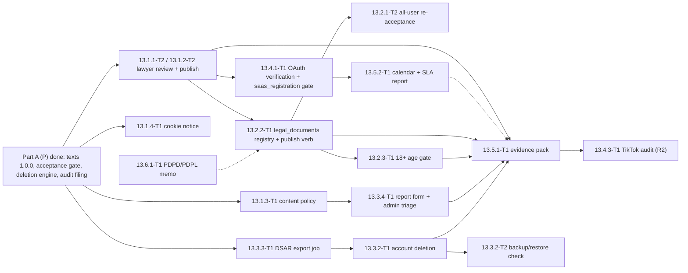

# 13 — Compliance, P slice: Tech Lead review, shared decisions and feature index

> Reviews: `../../13-compliance.md` — **P slice only** (00 §4.1): 13.1.1-T1 (privacy draft), 13.1.2-T1 (terms draft), 13.2.1-T1 (versioned acceptance before the owner's first YouTube connect / autopilot), 13.3.1-T1 (deletion engine for the 7/30-day duties), 13.4.2-T1 (YouTube audit filing in M1). Everything else in plan 13 is S and waits for Gate 2. Detailed together with `../06-youtube-posting/README.md`.
> Not legal advice: the drafts are written by the owner/BA from the checklists; the lawyer review is 13.1.1-T2 / 13.1.2-T2 (S, before any other user).
> Reviewed: 2026-09-25 by the Tech Lead against Developer Policies III.A/III.D/III.E (06 README G13), 09 wave 2 (`IConsentWriter`, `IBlobStore`, audit), 10 wave 1 (D12 legal pages) and 11.6.1-T1 (restore re-apply).
> Verdict: **approve with changes** (F-list below). Status: **ready for implementation with conditions** (DoR 2026-09-25) — see §11.
> Legend: ✅ · ⚠️ · [DECISION] · [OPEN] · [INFERENCE].

## 0. Folders

```
plans/features/13-compliance/
  README.md
  13.1-legal-acceptance/     ← 13.1.1-T1, 13.1.2-T1, 13.2.1-T1
  13.3.1-deletion-engine/    ← 13.3.1-T1
  13.4.2-audit-filing/       ← 13.4.2-T1
```

## 1. Facts

| Id | Fact | Source |
|---|---|---|
| K1 | Legal texts are build-time repo files `web/src/content/legal/<prefix>.<version>.<lang>.md` + `manifest.json` `{ "<doc>": { "version", "effectiveDate" } }`, with the manifest key mapped to the file prefix `tos -> terms`, `privacy -> privacy` (the files stay `terms.*`, the key stays `tos`), converted at build (no raw HTML), rendered by 10.3.1-T1; the page version must equal the version recorded in `user_consents` | 10 README D12; 10.3.1-T1:57, 70 ✅ (file-prefix map added by 13 CR-34) |
| K2 | `IConsentWriter.RecordAsync(Guid userId, LegalDocument document, string version, IPAddress? ip, ct)`, `LegalDocument { Tos, Privacy }`, config `LegalDocuments:Current:Tos` / `:Privacy` (1–32 chars); rows commit in the caller's transaction; history kept (no unique index) | 09.3.1-T1:29, 47-50, 92, 146, 186 ✅ |
| K3 | III.A.1 terms link + binding clause; III.A.2 privacy policy before features, "uses YouTube API Services", Google Privacy Policy link, revoke link; III.D.2 7/30 days; III.E.4 30-day refresh; user deletion ≤ 7 days | 06 README G13 ✅ |
| K4 | `data_deletion_requests(user_id, scope account/channel/episode, reason user_request/in_app_revoke/google_revoke/account_delete, requested_at, due_at, completed_at)`; `legal_documents(kind, version, locale, effective_at, content_url)` | 00 §6 ✅ |
| K5 | Deletion engine consumers: 02 CR-22 (episode scope deletes `research/{userId}/{episodeId}/`), 06.4.1-T1/06.4.3-T1 (channel scope), 11.6.1-T1 (a restore re-applies requests with `completed_at` after the backup's PITR point before reopening), 09.7.2-T1 (`IBlobStore.DeleteAsync`, prefix deletes, no new bucket), 09.7.3-T1 ("13.3.1-T1 owns the hard delete") | 02 README:675; 11.6.1-T1:15, 81; 09.7.2-T1:161; 09.7.3-T1:86, 166 ✅ |
| K6 | Audit filing needs the 06.5.1-T1 pack; quota asked from the owner's cadence and daily cap at the M1 filing | 13 §4 13.4.2; 06 §4 06.5.1 ✅ |

## 2. Findings

| # | Sev | Finding | Resolution |
|---|---|---|---|
| F1 | H | `legal_documents` has no P writer or reader: texts are repo files (K1) and versions are config (K2) | D1: `legal_documents` is **not** created in P (S admin publishing); the single source of a version is `manifest.json`, and `LegalDocuments:Current:*` must equal it (a CI check in 13.2.1-T1) (13 CR-1 to 00 §6) |
| F2 | H | 10 classifies the consent dialog as S, 13 says P | D3: P = the owner's acceptance before the first YouTube connect and before enabling autopilot (13.2.1-T1); the S "blocking re-acceptance at every login after a material change for all users" becomes 13.2.1-T2 (S, XS) |
| F3 | M | The deletion engine has four independent scope owners; a single job that knows every table would couple 13 to 02/06 internals | D4: `IDeletionScopeHandler` per scope, registered by the owning plan; the engine owns rows, scheduling, alerts, audit and the restore re-apply |
| F4 | M | Episode deletion vs `DELETE /episodes/{id}` (soft cancel, 09.5.1) | D4: episode scope runs only for user-requested hard deletes and account deletion (S); in P the engine has handlers for `channel` (06.4.3-T1) and `episode` (02 CR-22 research prefix + 09.7.3-T1 assets) and is idle for `account` until 13.3.2 (S) |
| F5 | M | Policy text vs behaviour drift before filing | D5: 13.4.2-T1 starts with a behaviour walkthrough checklist mapping each III.x clause and each policy sentence to a test or screenshot |

## 3. Shared decisions

**D1 Legal texts and versions [DECISION] (F1).** Files per K1, authored by 13.1.1-T1 / 13.1.2-T1; versions semver-like `1.0.0`; `manifest.json` is the **page** source; the API's source of truth is the max `legal_documents` row per (kind, locale) for the deployed environment (Part B D6); equality checked at API startup and in CI (`tools/ci/check-legal-versions.py`, owned by 13.2.2-T1) (13 CR-12, CR-30). Required clauses: privacy — every §5.1 checklist item + III.A.2 items (YouTube API Services statement, Google Privacy Policy link, revoke link, contact) + the retention/deletion table (7/30 days, 30-day backups) + the consent model (per-video, autopilot veto window); terms — III.A.1 link to https://www.youtube.com/t/terms and the binding sentence, AI-disclosure duty, no monetisation guarantee, user is publisher of record, credit expiry (purchased + bonus 12 months, trial 30 days, promo per code), the 14-day refund window for unused purchased credits, and that bonus credits of a refunded payment already spent are deducted from the refund (FR-12-14, 12 CR-6). Personal version: the owner is the only user; …

**D2 Consent text for uploads.** The publication consent text `pc.v1` is owned by 06 (06 README D7); the privacy policy describes it; 13.1.1-T1 cites the file.

**D3 Acceptance [DECISION] (F2).** `ILegalAcceptance.EnsureCurrentAsync(userId, ct) → ErrorOr<Success>` (409 `legal_acceptance_required` with `errors.documents = ["privacy","tos"]`, sorted; 06 YR15); called by 06.1.2-T1 (connect) and by 02.8.3-T2 when enabling autopilot (13 CR-2); `GET /me/legal` → `{ documents: [{ document, currentVersion, acceptedVersion, acceptedAt }] }`; `POST /me/legal/accept { tos, privacy }` (versions must equal current, else 409 `legal_version_outdated`) → `IConsentWriter.RecordAsync` per document with the request IP; audit `account.legal_accepted`. FE: `LegalAcceptanceDialog` in `web/src/app/features/account/` (reuses 10.1.3-T1 `ConfirmDialog`, links to `/vi|en/privacy|terms` in a new tab), opened by the 409 handler (10.2.2-T1 maps `legal_acceptance_required` to an action, not a plain error).

**D4 Deletion engine [DECISION] (F3, F4).** `IDeletionRequests.CreateAsync(userId, DeletionScope scope, Guid? targetId, DeletionReason reason, ct)` computes `due_at` (7 d for `in_app_revoke`, `user_request`, `account_delete`; 30 d for `google_revoke`) and is idempotent per `(scope, target_id, reason)` while open (partial unique index; `target_id uuid` column added, 13 CR-1). `IDeletionScopeHandler { DeletionScope Scope; Task<ErrorOr<DeletionResult>> ExecuteAsync(DeletionRequest r, ct) }` registered by owners (06.4.3-T1 `channel`, 13.3.1-T1 ships the `episode` handler composing 09.7.3-T1's asset delete + the 02 CR-22 research prefix delete). `DataDeletionJob` hourly (allow-listed system job, batch ≤ 20, `FOR UPDATE SKIP LOCKED`, per-row `SystemContext(user)`) executes due-first, idempotently; success → `completed_at`, audit `account.data_deleted` (`support`, `user`), metric `deletion_requests_open`, `deletion_request_overdue_total`; alert when any open request has `due_at − now < 24 h` (11.6.2-T1 rule). Restore re-apply: `nts-worker deletions reapply --since <PITR timestamp>` re-executes every request completed after that point (idempotent handlers), used by 11.6.1-T1's runbook before reopening.

**D5 Audit filing [DECISION] (F5).** 13.4.2-T1 = walkthrough checklist → form answers drafted in `docs/compliance/youtube-audit-<date>.md` (answers, quota justification from the owner's cadence and daily cap, links, pack index) → filing via the form → calendar entry (re-audit cadence ⚠️) → appeal path documented. No secrets or personal data in the repo copy.

## 4. Change requests

| CR | Target | Change |
|---|---|---|
| 13 CR-1 | `plans/00-overview.md` §6, `features/09-backend-api/README.md` table-ownership row, `09.2.2-core-schema-migrations/plan.md` §1 | `legal_documents` marked S (not created in P); `data_deletion_requests.target_id uuid` + partial unique `(scope, target_id, reason) WHERE completed_at IS NULL` |
| 13 CR-2 | `features/02-story-writing/02.8.3-cadence-publishing/02.8.3-T2-…` | enabling autopilot also calls `ILegalAcceptance.EnsureCurrentAsync` (409 `legal_acceptance_required`) |
| 13 CR-3 | `plans/09-backend-api.md` §5.4 | codes `legal_acceptance_required` 409, `legal_version_outdated` 409 |
| 13 CR-4 | `plans/13-compliance.md` §6/§11, 00 §4.1 | 13.2.1-T1 S → M in P; new 13.2.1-T2 (S, XS) for all-user re-acceptance |
| 13 CR-5 | `features/*` task headers | Blocks back-edges (§8.1) |
| 13 CR-6 | `features/09-backend-api/09.7-video-review-storage/09.7.2-T1-…` | `IBlobStore.ListKeysAsync(bucket, prefix, ct)` for prefix sweeps |

## 5–7. Sequencing, template, gates

13.1.1-T1 / 13.1.2-T1 start immediately (no dependency) and unblock 10.3.1-T1; 13.2.1-T1 follows; 13.3.1-T1 is independent (after 09.7.2-T1); 13.4.2-T1 is last. Template: `../02-story-writing/README.md` §6. Gate **13-P-ready**: pages live with the manifest versions, owner acceptance recorded before connect, deletion job live on staging with a channel request completed before `due_at`, filing done.

## 8. Feature index

| Folder | Tasks (size) |
|---|---|
| `13.1-legal-acceptance/` | 13.1.1-T1 (M), 13.1.2-T1 (M), 13.2.1-T1 (M) |
| `13.3.1-deletion-engine/` | 13.3.1-T1 (M) |
| `13.4.2-audit-filing/` | 13.4.2-T1 (M) |

### 8.1 Canonical task dependencies

| Task | Size | Area | Phase | Depends on | Blocks |
|---|---|---|---|---|---|
| 13.1.1-T1 | M (1.0) | Legal/BA | P · M1 | — | 13.2.1-T1, 06.5.1-T1, 10.3.1-T1, 06.1.1-T1 (soft), 13.1.1-T2, 13.6.1-T1, 10.3.1-T0, 07.4.1-T1 (13 CR-17), 13.1.3-T1, 07.1.1-T1 |
| 13.1.2-T1 | M (1.0) | Legal/BA | P · M1 | — | 13.2.1-T1, 06.5.1-T1, 10.3.1-T1, 06.1.1-T1 (soft), 13.1.2-T2, 13.6.1-T1, 10.3.1-T0, 07.4.1-T1, 12.6.2-T1 (13 CR-17), 07.1.1-T1 |
| 13.2.1-T1 | M (1.0) | BE/FE | P · M1 | 13.1.1-T1, 13.1.2-T1, 09.3.1-T1, 10.2.6-T1 | 06.1.2-T1, 06.5.1-T1, 10.7.1-T1 (10 CR-15), 13.2.1-T2, 10.8.2-T1, 07.1.2-T1 (13 CR-17) |
| 13.3.1-T1 | M (1.0) | BE | P · M1 | 09.2.2-T1, 09.2.6-T1, 09.7.2-T1 | 06.4.1-T1, 06.4.3-T1, 11.6.1-T1 (soft), 13.3.2-T1, 08.2.2-T1 (13 CR-17, 08 CR-16) |
| 13.4.2-T1 | M (1.0) | BA | P · M1 | 06.5.1-T1 | — |

## 9. Re-estimate

| Task | High-level | Detailed | Why |
|---|---|---|---|
| 13.1.1-T1, 13.1.2-T1, 13.3.1-T1, 13.4.2-T1 | 4.0 | 4.0 | unchanged |
| 13.2.1-T1 | 0.5 | 1.0 | BE gate + endpoints + FE dialog + version CI check (F2) |
| **P slice** | **4.5** | **5.0** | +0.5 |
| S | 7.0 | 7.25 | + 13.2.1-T2 (XS) |
| Plan 13 total | 11.5 | **12.25** | buffered 14.7 |

## 10. Owner decisions and TL rulings

| # | Decision | Outcome |
|---|---|---|
| O1 | Personal-version legal drafts published without lawyer review while the owner is the only user (lawyer review before any other user, 13.1.x-T2, S) | Accepted |
| O2 | Re-estimate P 4.5 → 5.0 | Accepted |

**TL rulings.**

| # | Topic | Ruling |
|---|---|---|

## 11. Definition-of-Ready review (2026-09-25)

- Script (`verify_plan.py … 13-compliance`): 3 `plan.md` files with sections 1–11; 5 task files with the H1, header, 9 headings; headers equal §8.1; total 5.0 d = §9 = `13-compliance.md` P rows = `00-overview.md` §4.1 after 13 CR-4; graph 0 cycles.
- Reviewed in the same three passes as 06 (security: deletion uniqueness, restore re-apply of open requests, foreign-target handling, document order, audit-pack redaction; contract: `DeletionResult` shape); resolved by 06 YR7, YR12–YR15 and the writers' fix rounds; checked on disk (four-column partial unique, `reapply` covers open rows, sorted `["privacy","tos"]`, extended redaction grep).
- CRs 13 CR-1…CR-6 applied (00 §6/§8, 02.8.3-T2, 09 §5.4, 09 README/09.2.2 table ownership, 09.7.2-T1 `ListKeysAsync`, 11.6.1-T1 drill, 11.6.2-T1 rule 17, `13-compliance.md`).

| DoR item | Status |
|---|---|
| User value, acceptance, estimate | ✅ |
| Dependencies known | ✅ §8.1 (13.4.2-T1 after 06.5.1-T1) |
| Contract linked | ✅ D1–D5, K1–K6 |
| Reviewed | ✅ TL + three review passes |

**Verdict: ready for implementation with conditions** (accepted 2026-09-25 under the owner's standing approval).

**Conditions.** (1) The drafts are the personal version (O1); the lawyer review 13.1.x-T2 (S) happens before any other user. (2) 13.4.2-T1 files only after 06.5.1-T1's pack and the gate `06-audit-ready`. (3) Second human reader for 13.3.1-T1 (deletion engine) before merge.

---

# Part B — S slice: SaaS compliance (lawyer review, legal publishing, data rights, verification)

> Scope: plan 13 **minus the P slice** — `13.1.1-T1`, `13.1.2-T1`, `13.2.1-T1`, `13.3.1-T1`, `13.4.2-T1` (DoR'd in Part A §11, 2026-09-25). 16 tasks in 4 folders (§B8). Milestone **S · M2** (after Gate 2) except `13.4.3-T1` (**R2**).
> Owner approval: every O-n, re-estimate and CR below is **accepted under the owner's standing approval (2026-09-25)**; no further sign-off is requested.
> Reviewed 2026-09-25 by the Tech Lead against Part A (D1–D5, K1–K6, F1–F5), `00-overview.md` §4.1/§6/§7/§8/§11, 09 BD1–BD16 + `features/09-backend-api/09.3.4-me-limits-audit/plan.md:224`, 10 README D12 + `10-web-ui.md:310`, `11.6.1-T1`, 06.4.x, 07.4.1, the 12 credit/refund rules, and the official pages cited in K15/K16 (read 2026-09-25).
> Verdict: **approve with changes** (F6–F18); every fix is folded into D6–D18, §B4 and the task set. Status: **ready for implementation with conditions** — DoR §B11 2026-09-25, accepted under the owner's standing approval.
> Legend: ✅ · ⚠️ · [DECISION] · [OPEN] · [INFERENCE].

## B0. Folders (S slice)

```
plans/features/13-compliance/
  13.1-legal-publication/        ← 13.1.1-T2, 13.1.2-T2, 13.1.3-T1, 13.1.4-T1, 13.6.1-T1
  13.2-legal-versioning-consent/ ← 13.2.1-T2, 13.2.2-T1, 13.2.3-T1
  13.3-data-rights/              ← 13.3.2-T1, 13.3.2-T2, 13.3.3-T1, 13.3.4-T1
  13.4-verification-evidence/    ← 13.4.1-T1, 13.4.3-T1, 13.5.1-T1, 13.5.2-T1
```

**`13.1-legal-publication/` (5 tasks).** Turns the Part A drafts into lawyer-reviewed, published, versioned texts and adds the two missing legal surfaces (content policy, cookie notice — the notice is UI and hard-depends on the 10 design gate `10.3.1-T0`, D19), plus the Vietnamese-law consultation that can force a version bump. Implements D6 (publish path), D13 (cookie inventory), D16 (PDD/PDPL program). Traps: the texts are the *page* source and the DB row is the *API* source — the two must stay equal (D6/F10); every published version ships vi **and** en; the lawyer review is external time and must not be estimated as dev days; the content policy's prohibited/restricted sections are the report form's reason list (D11).

**`13.2-legal-versioning-consent/` (3 tasks).** Creates the `legal_documents` registry + operator publish verb and makes it the runtime version source (13.2.2-T1, a **new id**: no plan task owned the table, F6), adds the all-user blocking re-acceptance (13.2.1-T2) and the 18+ age gate (13.2.3-T1, a **new id**: the 18+ rule existed only as a sentence, F11). Implements D6–D8. Traps: `IConsentWriter`/`ILegalAcceptance` are P-signed contracts — extend the enum and the options key, never the method shape (CR-11); a version whose static file is not deployed must be refused (409 `legal_content_missing`); acceptance of a scheduled (`effective_at > now()`) version is not required before its instant.

**`13.3-data-rights/` (4 tasks).** DSAR export (13.3.3-T1), account deletion + backup/restore proof (13.3.2-T1/T2) and the public report/triage **endpoints** (13.3.4-T1, whose page likewise waits on `10.3.1-T0`; the admin *screens* are 10.9.1-T1/T2's, read-only for 13; `CaptchaWidget` comes from 10's `features/public`). Implements D9–D11. Traps: system jobs must use the pinned system-query member + `ISystemContext.For(userId)` or `IUserOwned` reads silently return 0 rows; account scope needs per-table batched deletes, not EF row loading; `POST /reports` must answer 202 for any well-formed target (no existence oracle) and needs the `anon` rate policy (09) + CAPTCHA (09.3.3-T2); the export archive keeps **only** the allow-list (no tokens/secrets/other tenants) and expires in 7 days.

**`13.4-verification-evidence/` (4 tasks).** Google OAuth verification filing + the SaaS launch gate (13.4.1-T1), the TikTok audit for R2 (13.4.3-T1), the reusable evidence pack (13.5.1-T1) and the compliance calendar with the SLA report (13.5.2-T1). Implements D12, D14, D15. Traps: brand verification precedes data-access verification and the demo video must be Unlisted and in English (K15); registration stays behind `saas_registration` until verification is granted (100-user cap, K17); evidence binaries never enter the repo (D14); `docs/compliance-calendar.md` is this folder's file — 13.4.2-T1 deliberately keeps its rows inline (K13).

## B1. Facts (S slice)

| Id | Fact | Source |
|---|---|---|
| K7 | Part A is DoR'd: P = 5 tasks / 5.0 d, D1–D5, CR-1…CR-6 applied (00 §6 `legal_documents` marked S-only, `data_deletion_requests.target_id`, 09 §5.4 codes) | Part A §11, §3, §4 ✅ |
| K8 | `legal_documents(kind tos/privacy/content_policy, version, locale, effective_at, content_url)` exists in the contract as **S only**; `reports(reporter_email, target_type, target_id, reason, status, resolved_at)`; `user_consents.document` = `tos`/`privacy` | `00-overview.md` §6:323, :324, :274 ✅ |
| K9 | Routes already contracted: `POST /me/export`, `GET /me/exports/{id}` (*fresh short-lived media links*), `POST /me/delete`, `GET /me/legal`, `POST /me/legal/accept`, `POST /reports` (*public, rate-limited*), `GET /admin/reports`, `GET /admin/moderation` | `00-overview.md` §8:355–367 ✅ |
| K10 | `POST /reports` has **no** in-process rate-limit policy: BD14 defines only `auth`/`paid`/`hub`, and 09.3.4 explicitly flags anonymous traffic outside `/auth/*` (naming `POST /reports`) | 09 README BD14:698; `09.3.4-me-limits-audit/plan.md:224` ✅ |
| K11 | `/report` is a public prerendered page built by 13.3.4-T1 with CAPTCHA + rate limit, and prerender makes **no** API call — legal texts are build-time repo files (`manifest.json`) rendered by `LegalDocumentPage` | `10-web-ui.md:310`; 10 README D12:170 ✅ |
| K12 | The S owner surfaces are named but unwritten: `POST /me/delete`, `GET /me/deletion-requests`, admin retry; 13.3.1-T1 deliberately ships **no route** in P | `13.3.1-deletion-engine/plan.md:181`, `:206`, `:21`, `:28` ✅ |
| K13 | `docs/compliance-calendar.md` belongs to 13.5.2-T1; 13.4.2-T1 keeps its calendar rows inline in its own §6 as a ready-to-copy row | `13.4.2-audit-filing/plan.md:17`, `:192`, `:225` ✅ |
| K14 | The P slice explicitly defers: `13.1.1-T2` / `13.1.2-T2` (lawyer review + publish), `13.1.3` (content policy), `13.1.4` (cookie notice), `13.2.1-T2` (all-user re-acceptance), plus the web surfaces owned by 10 | `13.1-legal-acceptance/plan.md:17` ✅ |
| K15 | Google: `youtube.upload` is a **sensitive** scope → brand verification first, then data-access verification; required before submitting: a demo video (Unlisted on YouTube, English, showing the consent grant) and homepage/privacy/ToS links on a **verified domain**; the app must be in production | `developers.google.com/identity/protocols/oauth2/production-readiness/sensitive-scope-verification`; `support.google.com/cloud/answer/15549049`, `/15549135`, `/13464321`, `/13804565` (read 2026-09-25) ✅ |
| K16 | Vietnam: **Law 91/2025/QH15** (Personal Data Protection Law, in force 2026-01-01), **Decree 356/2025/ND-CP** (guidance) and sanctions **Decree 330/2026/ND-CP**; **Decree 13/2023/ND-CP** is the superseded instrument | `vanban.chinhphu.vn` docid 214590 / 216387 / 219266 / 207759 (read 2026-09-25) ✅ instrument numbers/titles; ⚠️ enacted 2025-06-26 / in force 2026-01-01 (secondary only: DLA Piper, EY, read 2026-09-25 — the gazette pages expose metadata, not the date text); ⚠️ obligation list (lawyer, 13.6.1-T1). 13.6.1-T1 must not promote those dates to ✅ on this evidence. |
| K17 | An OAuth app in **Testing** is capped at 100 test users and its refresh tokens expire after 7 days; the owner's app runs production-but-unverified, which shows the warning screen to every user | `00-overview.md` §4.1:97–98 ✅ (`support.google.com/cloud/answer/15549945`) |
| K18 | Reusable S building blocks: `ISystemWorkQuery.PendingAsync<T>` (pinned, one signed member, never extended) + `ISystemContext.For(userId)`; `IBlobStore` (+`ListKeysAsync`, Part A CR-6), buckets `nt-media-<env>`; `RequireFeature("…")` → 404 `feature_disabled` (09.9.2-T2, P); operator verbs `nts-worker <noun> <verb>` (`deletions reapply --since`, `incident clear <id>`, `flags set <key> on` / `off`); metrics `deletion_requests_open`, `deletion_request_overdue_total`; audit `account.data_deleted` | 09.2.3-T1:36; 06.2.3-T3:58; 09 README BD10:690, BD13:698; 06.4.3-T1:13; 08.4 plan:105 ✅ |

## B2. Findings (S slice)

| # | Sev | Finding | Fix |
|---|---|---|---|
| F6 | H | `legal_documents` has **no owning task in either phase**: 00 §6:323 marks it S-only and Part A F1/CR-1 says "S admin publishing", but plan 13 §6 schedules nothing — after Gate 2 there is no way to publish a policy version, and `ILegalAcceptance`/`IConsentWriter` keep reading the `LegalDocuments:Current:*` config (K2), so a policy change needs a redeploy | New task **13.2.2-T1** (M) + D6 + CR-7/CR-16; folder brief in §B0 |
| F7 | H | `POST /reports` is public and unauthenticated with **no rate-limit policy** (K10); CAPTCHA exists only in the web plan (K11). It also accepts any `target_id` — returning 404 for an unknown target would be an existence oracle for other users' episodes | D11: `anon` policy (CR-10) + CAPTCHA dependency (09.3.3-T2) + 202 for every well-formed report, never 404/409 about the target |
| F8 | H | `reports` (00 §6:324) has `resolved_at` but no `created_at`, `ip_hash`, `resolution_note` or index, and 00 §8 has only `GET /admin/reports` — the 72-hour response target (13 §4 FR-13-5) cannot be measured or worked | CR-7 (columns + `(status, created_at)` index) + CR-8 (`PATCH /admin/reports/{id}`) + 13.3.4-T1 |
| F9 | H | OAuth verification is a **launch gate**: until it is granted every external user sees the unverified-app screen, and an app left in Testing is capped at 100 users (K17/K15). No plan pins a gate or the filing pre-conditions, so a SaaS launch can exceed the cap or ship without the demo video | D12: pre-conditions owned by 13.4.1-T1, registration behind `RequireFeature("saas_registration")` (09.9.2-T2), status tracked in 13.5.2-T1; `13.4.1-T1` phase carries the flag |
| F10 | M | Version drift: 10's pages are built from `manifest.json` (K11) while S makes the DB the runtime source, so the page can show v1.1.0 while `user_consents` records v1.0.0. Part A's CI check compares config, not the table | D6: table = runtime source, manifest = page artifact, equality checked at startup **and** in CI; `nts-worker legal publish` refuses a version whose static file is not deployed (409 `legal_content_missing`) |
| F11 | M | The age gate exists nowhere (no task, route, column or copy) although 13 §5.1/§5.2 mandate 18+ as a [DECISION] ⚠️ and the PDPL has child-data duties (K16) | New task **13.2.3-T1** (XS) + D8 + CR-11 (`user_consents.document` + `age_18`, `LegalDocument.Age18`, `LegalDocuments:Current:Age18`), 400 `age_attestation_required` |
| F12 | M | DSAR export is undefined beyond "machine-readable archive within 7 days" (13 §4 FR-13-3): no system-scope rule (an `IUserOwned` read with no ambient user silently returns 0 rows), no archive retention, no per-user cap, no cleanup job, no content allow-list | D9 + 13.3.3-T1: pinned system-query member + `ISystemContext.For`, `exports/{userId}/{exportId}.zip`, 7-day retention + `ExportCleanupJob`, ≤ 1 per 24 h, explicit allow-list |
| F13 | M | Account deletion is unpinned where it matters: freeze semantics, idempotency, Identity's unique e-mail vs anonymisation, the ledger/payment retention rule (⚠️ 12), and per-table deletes for a scope that can span hundreds of thousands of rows | D10 + 13.3.2-T1: `users.status` `suspended` → `deleted`, `deleted+<hash>@invalid`, 12's pseudonymisation rule (CR-14), batched set-based `DELETE` per table, hourly retry, audit `account.data_deleted` |
| F14 | M | Users cannot see their deletion state: 13.3.1 ships no route in P and names `GET /me/deletion-requests` as S (K12), but 00 §8 does not contain it; the owner has no SLA queue view either | CR-8 (`GET /me/deletion-requests`, `GET /admin/deletion-requests`) + D10 |
| F15 | M | A cookie notice without an inventory is unverifiable: 13 §4 13.1.4 promises "essential cookies only", yet the platform already sets cookies beyond a bare auth set and nothing asserts the set | D13: repo inventory + a test that fails when a cookie is set outside it + the rule that the first non-essential cookie turns the notice into a consent wall before it may be set |
| F16 | M | The evidence pack (13.5.1-T1) has no storage or redaction rule: screenshots/screencasts of live flows can leak user data, tokens or e-mail addresses, and binaries must not enter the repo | D14: in-repo `index.md` + sha256, binaries in `~/.nts/compliance/<date>/`, redaction grep, demo videos Unlisted |
| F17 | M | 13.6.1 still calls the local instrument unverified ⚠️ (13 §2 C6, §10) although it is now identifiable (K16) — a writer could chase the repealed Decree 13/2023 and miss the PDPL duties (impact-assessment dossier, cross-border transfer, breach notice, children) | D16 + 13.6.1-T1 names Law 91/2025/QH15 + Decree 356/2025/ND-CP (obligations ⚠️) + CR-9 to `plans/13-compliance.md` §2/§10/§11 |
| F19 | M | The export surface had no bookkeeping: 00 §6/§8 name `POST /me/export` + `GET /me/exports/{id}` but no table, no event and no response field list, and 00 §8:360's "fresh short-lived media links" had no carrier | D9 + CR-19 (`data_export_requests`, `export_requested.v1`, `{ downloadUrl, mediaLinks[] }` minted per request) + T3/T12 |
| F20 | M | §B8.1 cited ids that do not exist (`10.7 (soft)`, bare `07.4.1`, `10's CaptchaWidget`) and the three FE-area tasks carried **no** owner design gate, although every UI task must have an approved design before implementation | real ids `10.7.2-T1`, `07.4.1-T1` (plan 07 §6:121), `10.3.3-T2`; hard `10.3.1-T0` edges on 13.1.4-T1/13.2.3-T1/13.3.4-T1 (D19) + CR-24 |
| F21 | M | Three ownership holes: `nts-worker deletions retry` had no owner (P ships only `export`/`reapply`), deletion cancellation inside the 7-day window was undefined, and `tools/ci/check-legal-versions.py` had two owners (13.2.1-T1 per the P files, 13.2.2-T1 per CR-12) | CR-25 (`retry`/`cancel` → 13.3.2-T1), T11 (no user cancel route), CR-30 (re-point the P files) |
| F18 | L | `/report` (`10-web-ui.md:310`) breaks the vi/en route convention (`/vi/privacy`, `/en/privacy`; 10 D12) and the report form's copy must be bilingual | 10 CR-24 fixes the route to `/vi/report` + `/en/report` (Lead10S 2026-09-25); 13.3.4-T1 owns the page and its vi+en copy, CR-13 records the dependency |

## B3. Shared decisions (S slice) — numbering continues Part A's D1–D5

**D6 Legal-document registry and publish path [DECISION] (F6, F10).**
- P is unchanged: texts stay repo files `web/src/content/legal/<prefix>.<version>.<lang>.md` (manifest key -> file prefix: `tos -> terms`, `privacy -> privacy`; 13 CR-34) + `manifest.json`, rendered by 10.3.1-T1 (K1), and the page still makes no API call at build time (10 D12).
- S: `legal_documents` (00 §6:323) is created by 13.2.2-T1 and becomes the **runtime** source of the current version per (kind, locale): `ILegalAcceptance.GetPendingAsync` / `EnsureCurrentAsync` and `IConsentWriter` validate against the row with `MAX(version) WHERE kind = @k AND locale = @l AND effective_at <= now()`.
- Publish = operator verb `nts-worker legal publish --doc privacy|tos|content_policy --version 1.1.0 --locale vi --effective-at <ISO> --content-url /content/legal/privacy.1.1.0.vi.md`; it validates that the served file for that locale and version exists (`IBlobStore.ExistsAsync` / HTTP HEAD on the static path) → otherwise 409 `legal_content_missing`, no row written; on success audit `legal.document_published` (`support`, `internal`) and the version appears on the page only after the web deploy.
- `effective_at > now()` is allowed (scheduled version); re-acceptance for it starts at `effective_at` (D7), not when the row is written.
- Equality invariant (supersedes Part A D1's "manifest.json is the one source" for the API side → CR-12): `manifest.json` (page artifact) equals the max `legal_documents` row per (kind, locale) **for the deployed environment** — checked at API startup (fail fast) and in CI by `tools/ci/check-legal-versions.py` (owner moves from 13.2.1-T1 to 13.2.2-T1, CR-30).
- `checksum` is computed by 13.2.2-T1's verb from the bytes it fetches (CR-7), so a hand-edited deployed file is caught by re-running the verb (`legal_version_conflict`) and by the equality check; `published_by` = the operator id; audit `legal.document_published` (`support`, `internal`).
- `content_url` is always a path under the deployed static site, never an external URL.
- After 13.2.2-T1, `LegalDocuments:Current:*` is only the **seed/bootstrap** value for a (kind, locale) with no `legal_documents` row yet (first boot before the seed runs); the startup check asserts `manifest.json` == max row (the config is **never** updated after seeding and no task owns updating it — resolves folder O-6), and `IConsentWriter` records the version returned by that same resolver — so `user_consents.version` and the served page cannot diverge except through a deploy that fails the CI check.

**D7 Re-acceptance [DECISION] (F2 Part A / 13.2.1-T2).**
- Command-level gate is unchanged: `ILegalAcceptance.EnsureCurrentAsync(userId, ct) → ErrorOr<Success>`, 409 `legal_acceptance_required` with `errors.documents = ["privacy","tos"]` sorted (Part A D3; called by 06.1.2-T1 and 02.8.3-T2).
- S adds the login-level surface: `POST /auth/login` (success), `POST /auth/refresh` and `GET /me/legal` responses gain `pendingAcceptance: { documents: [{ document, currentVersion }] }` (empty array when up to date) so the SPA can block before routing; no new error code, no forced re-auth, tokens stay valid.
- A version whose `effective_at > now()` never appears in `pendingAcceptance` before its instant.
- Carrier (CR-28): `pendingAcceptance` rides `LoginResult` (`09.3.2-T1:146`) and a `RefreshResult` wrapper on the refresh body (`:148`) — never the token record.
- Materiality (O10): only **material** versions enter `pendingAcceptance`; the publish verb takes `--material` (default `false`) and a patch-level editorial bump (`1.0.1`) recorded without it never blocks a login.
- Accepted versions are per (`document`, `version`) — accepting the current version satisfies it until the next material version.

**D8 Age gate (18+) [DECISION] (F11).**
- MVP = mandatory 18+ **self-attestation** at registration, recorded as evidence; **no** identity verification in S ([DECISION]: cost, no third-party service), revisited if the 13.6.1-T1 memo requires more.
- Mechanism: a `user_consents` row with `document = 'age_18'` written through `IConsentWriter.RecordAsync(userId, LegalDocument.Age18, LegalDocuments:Current:Age18, ip, ct)`; the attestation text `age-gate.1.0.0.vi|en.md` lives in the same content directory and is published by the same path as the other texts (D6).
- Registration rejects an unchecked box with 400 `age_attestation_required` (CR-10); the Privacy Policy and ToS state 18+ and the children section (13 §5.1/§5.2).
- `legal_documents.kind` gains the fourth value `age_gate` (CR-26) and `manifest.json` gains the `age_gate` entry in the same change (file, manifest entry and config key move together).
- Web owner: 10's S slice — the register page `10.3.2-T1` (checkbox + blocking error copy, CR-27) and `10.3.1-T0` for the design of that state (D19); the attestation text gets **no** page of its own (CR-27).

**D9 DSAR export [DECISION] (F12).**
- `POST /me/export` (202, `Idempotency-Key`) creates one export; polite cap ≤ 1 per user per 24 h (429 `rate_limited` + `Retry-After`), job side ≤ 2 concurrent exports.
- The job runs as `system:operator`: the candidate query uses a **pinned** system-query member (never extends `ISystemWorkQuery`), and every subsequent read/write runs under `ISystemContext.For(userId)` — an `IUserOwned` read with no ambient user silently returns 0 rows.
- Artifact `exports/{userId}/{exportId}.zip` in `nt-media-<env>`: `profile.json`, `series-episodes.json`, `story-versions.json`, `publications.json`, `consents.json`, `audit-activity.json`, `usage-ledger.json`, `media.json`, `README.txt`. media links are pre-signed **at download time** (TTL ≤ 15 min). Never included: tokens/refresh families, `system_settings`/secrets, `data_protection_keys`, `platform_payload` raw bodies, other tenants' rows, staff-only audit rows (`visibility = internal`).
- Bookkeeping (CR-19): the `data_export_requests` row is the state machine (`queued → running → ready|failed|expired`, `attempts`, `claimed_at`, `expires_at`, `deleted_at`, `storage_key`); `POST /me/export` writes the row and the outbox event `export_requested.v1` (the Api never enqueues).
- Status: `GET /me/exports/{id}` → `{ status: queued|running|ready|failed|expired, createdAt, expiresAt, downloadUrl, mediaLinks[], errorCode }` where `downloadUrl` is the pre-signed archive (TTL ≤ 15 min) and `mediaLinks` are fresh per-asset links minted **per request** from `media.json`'s keys (TTL ≤ 15 min, ≤ 100/page with `?cursor=`) — this is what `00 §8:360` means by "fresh short-lived media links"; the archive itself carries keys, never expiring URLs; the "ready" e-mail (09.2.6-T3) contains **no** link and **no** attachment, only "sign in to download" (an e-mail link would be a second, weaker auth path).
- Retention: object deleted by `ExportCleanupJob` (daily, allow-listed system job, ≤ 50 per run) 7 days after creation, and immediately by the account-scope deletion (D10); after deletion `GET /me/exports/{id}` → `expired`.
- Streaming: the Worker writes the zip to a temp file then `IBlobStore.PutAsync` (never buffer a whole archive in memory); each table read is `AsNoTracking` + keyset paging.

**D10 Account deletion [DECISION] (F13, F14).**
- `POST /me/delete` (password re-auth + `Idempotency-Key`) → revoke every refresh family and trusted device, `IDeletionRequests.CreateAsync(userId, DeletionScope.Account, null, DeletionReason.AccountDelete)` (7-day `due_at`), `users.status = 'suspended'` (the open account-scope row is the reason of record — no new status value), 202 `{ requestId, dueAt }`. **Admin-initiated deletion** (`POST /admin/users/{id}/delete`, owned by 09.10.5-T1) uses the same command and row; 09.10.5-T1 soft-depends on 13.3.2-T1 (CR-18).
- `IDeletionScopeHandler` for `account`, registered by 13.3.2-T1, composes existing owners instead of re-implementing: sessions/devices (09.3.x), channels (06.4.1 / 06.4.3 handler reuse), publications (06.2.6 cancel/refund rules), series/episodes/story versions (02), assets + storage prefixes `media/{userId}/`, `research/{userId}/` (09.7.3-T1 / 02 CR-22), `exports/{userId}/` (D9).
- Per table: batched set-based `DELETE … WHERE user_id = @id` (≤ 5 000 rows per batch) — never load entities per row via EF.
- Anonymisation: `email` → `deleted+<first16 of sha256(userId)>@invalid` (Identity needs a unique address), `display_name` → `deleted user`, MFA secrets/recovery codes removed, `users.status = 'deleted'`. Kept pseudonymised with the id: `payments` + credit ledger (12's retention rule → CR-14), `audit_logs` (subject/actor id kept, `data` redacted of e-mail/IP), `data_deletion_requests` (evidence; no FK to `users` by design, 00 §6:306), `user_consents` (acceptance/attestation evidence — document, version, accepted_at, ip; no contact data; CR-9 extends 13 §5.4's *Kept* column). Ledger/payment rows carry a **random pseudonym UUID** in place of `user_id` (T21) so they are no longer joinable to `audit_logs`.
- Idempotent and resumable: a completed request never runs twice; a failed attempt stays open and the hourly `DataDeletionJob` retries; completion writes `completed_at` + audit `account.data_deleted` and updates `deletion_requests_open` / `deletion_request_overdue_total` (P metrics, 06.4.3-T1 precedent).
- Visibility: `GET /me/deletion-requests` (own rows; `{ scope, reason, requestedAt, dueAt, completedAt, status }`), `GET /admin/deletion-requests?status=open|overdue` (read-only, CR-8, rendered by 10.9.1-T2), retry via `nts-worker deletions retry <requestId>`; export failures add `dsar_export_failed_total`. Cancellation: **no user-facing cancel route** (T11) — a mistaken request is undone by the owner with `nts-worker deletions cancel <requestId>` while `completed_at IS NULL` (row deleted, `users.status` → `active`, audit `account.deletion_cancelled`, CR-25).
- Backups: 13.3.2-T2 proves the 30-day retention and the restore re-apply (11.6.1-T1); the confirmation e-mail and the Privacy Policy state the 30-day backup window (13 §5.1).

**D11 Reports and abuse [DECISION] (F7, F8).**
- `POST /reports` (public, anonymous) body: `{ reporterEmail?, targetType: 'episode'|'user'|'publication', targetId, reason: 'copyright'|'privacy'|'defamation'|'abuse'|'other', details?, locale }`; CAPTCHA verification by 09.3.3-T2 (+ its `captcha` settings integration); the page-side widget is 10's `CaptchaWidget` (`features/public`, `public/index.ts`), mounted on `/vi/report` + `/en/report` (widget task `10.3.3-T2`, field names per CR-22, design per D19); rate policy `anon` owned by 09.3.5-T1 (CR-10).
- Always **202** `{ reportId }` for a well-formed request, whatever the target resolves to: never 404/409/403 about the target and never echo target details (no existence oracle, no cross-tenant disclosure).
- Effects: one `reports` row (CR-7 columns), outbox `report_received.v1` → e-mail to the owner (`report-to` setting) + audit `abuse.report_received` (`support`, `internal`); no automatic content change.
- Triage: `GET /admin/reports?status=open|in_review|resolved|rejected` (keyset, ≤ 100/page, one projection query) + `PATCH /admin/reports/{id}` `{ status, resolutionNote? }` (CR-8) → audit `abuse.report_resolved`; the screens rendering these two endpoints are 10.9.1-T1/T2's (Lead10S 2026-09-25) — 13 owns the endpoints, the audit rows and the i18n keys; the 72-hour target (13 §4 FR-13-5) is measured on `created_at`; the monthly report (D15) includes the oldest open report.
- The form's `reason` list is generated from the Content Policy's prohibited/restricted sections (13.1.3-T1); suspensions and other user actions stay in 09.9.1 / 08.2 — 13.3.4-T1 only links to them.

**D12 OAuth verification and the SaaS launch gate [DECISION] (F9).**
- Filing pre-conditions for 13.4.1-T1: verified domain + live homepage, Privacy Policy and ToS URLs (13.1.1-T2 / 13.1.2-T2 published), app in **production**, the narrowest scope set 06 actually uses (each scope justified by a code path), and an **English demo video, Unlisted on YouTube**, showing the consent grant (K15).
- Artifacts: `docs/compliance/google-oauth-verification-<yyyy-mm-dd>.md` (answers, links, scope table, video id/visibility, brand-verification status) and `docs/compliance-calendar.md` rows: filing date, expected reply, re-file/appeal path (`https://support.google.com/youtube/contact/yt_api_appeals`, from 13.4.2 plan:17).
- Launch gate: while verification is pending, registration stays closed behind `RequireFeature("saas_registration")` (09.9.2-T2, P) — flipped only with `nts-worker flags set saas_registration on` after verification, which also keeps the app inside the 100-user Testing cap (K17). The flag is named in the calendar row and in the 08.3 runbook.
- Verification ≠ the YouTube API **audit** (P 13.4.2-T1, re-filed for the SaaS case in M2, 13 §9).

**D13 Cookie notice [DECISION] (F15).**
- `docs/compliance/cookies.md` is the single inventory (name, host, purpose, category `essential`|`analytics`|`marketing`, lifetime, set by whom) and the notice page renders from it; the initial set is taken from 09's cookie table (BD3) + the SPA language cookie at writing time — no name is invented here.
- Assertion: a test fails CI when a `Set-Cookie` name is not in the inventory (API: response-cookie test; SPA: unit test over the cookie helpers).
- Rule: while the inventory contains only `essential` entries the platform shows a **notice** (no wall, dismissible, keyboard reachable, links to `/vi/privacy`); adding the first non-essential entry is only allowed together with a consent banner obtained **before** that cookie is set — this rule is a check in the inventory test, and the change is a Gate 2+ decision.

**D14 Evidence pack and audit artifacts [DECISION] (F16).**
- 13.5.1-T1 delivers `docs/compliance/evidence-<yyyy-mm-dd>/index.md` in-repo (what each artifact proves, date, app version, sha256) and the binaries in `~/.nts/compliance/evidence-<yyyy-mm-dd>/` (FileVault disk, never the repo or the USB volume — same rule as 01/11 runtime state).
- Content rules: synthetic tenants only (`demo+<n>@invalid`), no real e-mail, IP, token or API key, no story text from a real user; the redaction grep (06.5.1-T1's VP7 pattern) runs over every text artifact before the pack is referenced.
- Google demo videos are Unlisted; the video id + visibility are recorded in the index and in the D12 submission doc.
- Retention: kept until the next successful re-audit, at least 24 months [DECISION].

**D15 Calendar, SLA reporting and operations [DECISION] (F14, F17).**
- `docs/compliance-calendar.md` (13.5.2-T1) rows: OAuth verification (D12), YouTube re-audit cadence ⚠️, policy review every 6 months, TikTok audit (R2), restore drill (11.6.1-T1, monthly), key rotation, and the monthly deletion-SLA + DSAR report.
- Monthly report = `deletion_requests_open`, `deletion_request_overdue_total` (P) + `dsar_export_failed_total`, `reports_open_total` and the oldest open report age, read from the monitoring stack (08.1) and appended to the calendar file's log section. **Emitters (T13):** `dsar_export_failed_total` ← 13.3.3-T1 (`DataExportJob` + `ExportCleanupJob`); `reports_open_total` + oldest-open age ← 13.3.4-T1 (`POST /reports`, resolve); no other task emits them.
- Alert rules to add to 11.6.2-T1's list: deletion overdue (already P: `due_at − now < 24 h`), export failed twice for the same request, oldest open report > 72 h.

**D16 Vietnamese data-protection program [DECISION] (F17).**
- Instruments: Law 91/2025/QH15 (in force 2026-01-01), Decree 356/2025/ND-CP, sanctions Decree 330/2026/ND-CP; Decree 13/2023/ND-CP superseded (K16). Named as such in the memo; the **obligation list stays ⚠️** until the lawyer confirms it.
- 13.6.1-T1 deliverable: `docs/compliance/pdpd-memo-<yyyy-mm-dd>.md` — instruments, duties, the product/process change each implies (consent wording, notices, records of processing, impact-assessment dossier, cross-border transfer to OpenAI, breach notification, children, DPO/contact), and what is **not** met yet; plus one backlog row per required change, and, where a text changes, a version bump through D6 (re-acceptance).
- No claim of PDPL compliance appears in any user-facing text or audit answer before this memo lands.

**D17 Baseline rules for every S task [DECISION].**
- i18n: every S surface ships vi + en copy in the same change; `legal publish` refuses a locale whose file is not deployed (409 `legal_content_missing`).
- a11y: WCAG 2.1 AA for the cookie notice, age checkbox, report form, export/deletion status pages and the re-acceptance dialog (10 §5.4 review gate).
- Security (OWASP ASVS L2): tenant filters everywhere except the pinned system scopes (D9/D10); 404 for other users' resources; no secret, token, e-mail or IP in logs (hash/redact only, as in 09 BD16); CAPTCHA + `anon` rate limit on the public report path; `Idempotency-Key` on export/delete; re-auth on delete; existing Data Protection purposes unchanged.
- Performance: report submit = 1 insert + 1 outbox row; admin lists keyset-paginated; export/deletion work is batched (D9/D10); no N+1 in the admin report list.

**D19 Owner design gate for FE-area tasks [DECISION] (F20).** Any 13 task that ships a user-visible surface hard-depends on the 10 design task that covers it: **`10.3.1-T0`** for the cookie notice (13.1.4-T1), the 18+ register checkbox (13.2.3-T1) and the `/vi|/en/report` page incl. its CAPTCHA states (13.3.4-T1); no implementation starts before that design is owner-approved (owner rule 2026-09-25). `10.3.1-T0`'s scope must be extended to those two non-auth surfaces by CR-24, and its `Blocks` cell gains the three back-edges. A task that ships only content/labels (13.1.3-T1) or an invisible BE surface needs no design task.

**D18 Reuse rule [DECISION].**
- No second deletion path (`IDeletionScopeHandler`), consent store (`user_consents`/`IConsentWriter`), audit path (`[Audited]`/`IAuditWriter`), e-mail path (`IEmailSender`, 09.2.6-T3), flag path (`RequireFeature`, 09.9.2-T2), blob path (`IBlobStore`) or operator CLI (`nts-worker`).
- 13.4.x / 13.5.x are documents and filings; the only new code in this slice is 13.2.2-T1's publish verb + startup check, 13.2.1-T2's `pendingAcceptance`, 13.2.3-T1's age attestation, and the 13.3.x endpoints/jobs named in D9–D11.

## B4. Change requests (S slice)

All accepted under the owner's standing approval (2026-09-25); the TL applies them to the target files (this part only *proposes*).

| CR | Target | Change |
|---|---|---|
| 13 CR-7 | `plans/00-overview.md` §6 | `user_consents.document` → `tos`/`privacy`/`age_18`; `legal_documents` + `published_by uuid`, `checksum text` (sha256 of the served file); `reports` + `created_at timestamptz NOT NULL DEFAULT now()`, `ip_hash bytea`, `handled_by uuid`, `resolution_note text`, index `(status, created_at)` |
| 13 CR-8 | `plans/00-overview.md` §8 | Me row: + `GET /me/deletion-requests`; Admin row: + `GET /admin/deletion-requests?status=` and `PATCH /admin/reports/{id}`; Reports row: `POST /reports` note "public, CAPTCHA (09.3.3-T2), `anon` rate policy (09.3.5-T1), always 202" |
| 13 CR-9 | `plans/13-compliance.md` §2 C6, §4 13.6.1, §5.4, §6, §10, §11 + `plans/00-overview.md` §4.1 (:119-123) and §13 (:463-464) | instrument §10 names Law 91/2025/QH15 + Decree 356/2025/ND-CP (obligations ⚠️); 13.6.1 = memo + backlog; §5.4 *Kept* column += `user_consents`; §6: `13.1.1-T2` is the shared 0.5 d engagement split with `13.1.2-T2` (0.25 each); estimate carriers: plan 13 S **7.25 → 8.5** (buffered 10.2, total 13.5 / 16.2), `00` §4.1 13 row “5.0 / 6.0 / 8.5 / 10.2”, Total row S **79.75 / 95.7 → 81.0 / 97.2** and all **270.0 / 324.0 → 271.25 / 325.5** (same CR-annotation convention), §4.1:123 prose "≈ 96 person-days more (95.7)" → 97.2, §13:463-464 13 row `12.25 / 14.7 / S 7.25` → `13.5 / 16.2 / S 8.5` and the Total row likewise |
| 13 CR-10 | `features/09-backend-api/09.3.5-*/09.3.5-T1-*.md` (signed) + `plans/09-backend-api.md` §5.4 + `features/09-backend-api/README.md` BD14 | rate-limit policy `anon` = 60 req/min per **resolved** IP (fixed window), applied to public endpoints incl. `POST /reports` (owner: 09.3.5-T1 — agreed with Lead09S, no new 09 task); new codes `age_attestation_required` 400, `legal_content_missing` 409, `report_target_invalid` 400 |
| 13 CR-11 | `features/09-backend-api/09.3.1-sessions/09.3.1-T1-*.md` (signed; agreed with Lead09S) | `LegalDocument` enum + `Age18`; config key `LegalDocuments:Current:Age18` (1–32 chars); `IConsentWriter.RecordAsync` already accepts any document — no signature change |
| 13 CR-12 | `features/13-compliance/README.md` Part A **D1** (this file) | D1's "`manifest.json` is the one source" → "`manifest.json` is the **page** source; the API's source of truth is the max `legal_documents` row per (kind, locale) for the deployed environment (Part B D6); equality checked at API startup and in CI" |
| 13 CR-13 | `features/10-web-ui/README.md` §B8.1 (10's ids) | record the S UI surfaces 13 depends on: `10.3.2-T1` ← 13.2.3-T1 + 13.2.1-T2; `10.8.2-T1` ← 13.3.3-T1 + 13.3.2-T1; `10.9.1-T1`/`10.9.1-T2` ← 13.3.4-T1 (report endpoints) + 13.3.2-T1 (`GET /admin/deletion-requests`); `10.2.6-T1` ← 13.1.4-T1 (cookie notice). The `/report` → `/vi/report`,`/en/report` fix is **10 CR-24** (`10-web-ui.md:310`) — not duplicated here; confirmed with Lead10S 2026-09-25 |
| 13 CR-14 | `plans/12-billing.md` §5.7/§6 + the 12 feature folder plan | pin the account-deletion ledger rule (payments/credit rows kept, `user_id` replaced by a pseudonym, amounts/dates retained for accounting) + the ToS credit-expiry/refund wording refs (12.6.2, 12.7.5) |
| 13 CR-15 | `features/11-worker-deployment/README.md` D15 + §8.1 | `nt-media-<env>` gains the prefix `exports/` with a 7-day expiry lifecycle rule; evidence binaries live in `~/.nts` (no new bucket, no 11 task) |
| 13 CR-16 | `features/09-backend-api/README.md` §B5 ownership rows (240/242) + `09.2.2-core-schema-migrations/plan.md` §1 | S migrations: `legal_documents` owned by 13.2.2-T1, `reports` owned by 13.3.4-T1, written to 09.2.2 migration conventions (agreed with Lead09S) |
| 13 CR-17 | `features/*` task headers (`Depends on`/`Blocks` back-edges; P-signed files get an in-repo edit, S-slice files in other plans get a CR to their owner; merged with the former CR-31, 2026-09-25) | `06.4.1-T1`, `06.4.3-T1`, `09.2.2-T1`, `09.2.3-T1`, `09.3.5-T1`, `09.9.2-T2`, `09.3.3-T2`, `10.2.2-T1`, `10.3.1-T1`, `11.6.1-T1`, `07.4.1-T1` gain "Blocks 13.2.2-T1 / 13.3.2-T1 / 13.3.3-T1 / 13.3.4-T1 / 13.4.1-T1 / 13.4.3-T1 / 13.3.2-T2" where §B8.1 shows the edge; additionally: `13.1.1-T1` Blocks += `13.1.1-T2, 13.6.1-T1, 10.3.1-T0, 07.4.1-T1`; `13.1.2-T1` Blocks += `13.1.2-T2, 13.6.1-T1, 10.3.1-T0, 07.4.1-T1, 12.6.2-T1`; `13.2.1-T1` Blocks += `13.2.1-T2, 10.8.2-T1, 07.1.2-T1`; `13.3.1-T1` Blocks += `13.3.2-T1, 08.2.2-T1` (08.2.2-T1 is a Part A gap, carried here); `09.3.1-T1` Blocks += `13.2.3-T1`; `06.1.1-T1` Blocks += `13.4.1-T1`; `06.2.6-T1` Blocks += `13.3.2-T1`; `09.7.2-T1` Blocks += `13.3.3-T1`; `10.3.2-T1` `Depends on` += `13.2.1-T2`; `07.4.1-T2` `Depends on` += `13.4.3-T1` (13.4.3-T1's own Blocks cell already carries `07.4.1-T2`, applied directly, §B8.1). `10.2.6-T1` (Blocks += `13.1.4-T1`) and `10.9.1-T1`/`10.9.1-T2` (Depends += `13.3.4-T1`) are **already applied** on 10's side (Lead10S, 2026-09-25) — no action needed. |
| 13 CR-18 | `features/09-backend-api/09.10-*/09.10.5-T1-*.md` (owner: Lead09S) | `POST /admin/users/{id}/delete` starts the account-scope deletion through the **same** command/row as `POST /me/delete` (13.3.2-T1) and its `Depends on` gains 13.3.2-T1 (soft) |
| 13 CR-19 | `plans/00-overview.md` §6 + §8 | new S table **`data_export_requests`** (`id uuid PK` UUIDv7, `user_id`, `status` (`queued`/`running`/`ready`/`failed`/`expired`), `requested_at`, `claimed_at`, `completed_at`, `expires_at`, `deleted_at`, `storage_key`, `error_code`, `attempts`, `last_attempt_at`; indexes `(user_id, requested_at DESC)`, `(status, expires_at)`; `IUserOwned`), the outbox event **`export_requested.v1`**, and the `GET /me/exports/{id}` body `{ status, createdAt, expiresAt, downloadUrl, mediaLinks[], errorCode }` (`downloadUrl` = pre-signed archive; `mediaLinks` = fresh per-asset links minted per request, TTL ≤ 15 min, ≤ 100/page with `?cursor=`) — 00 §6/§8 name the routes with no table, no event and no field list (:306-324, :360) |
| 13 CR-20 | `features/09-backend-api/09.1.2-T1` allow-list | name `ExportCleanupJob` and `AccountDeletionScopeHandler` in the `IgnoreQueryFilters` allow-list in addition to the P `DataDeletionJob` entry |
| 13 CR-21 | `features/11-worker-deployment/README.md` §8.1 + `11.6.1-T1` runbook + `11.6.2-T1` rules | register recurring job `export_cleanup` (daily, `0 3 * * *`), the two new alert rules (export failed twice for one request; oldest open report > 72 h), and wire 13.6.1-T1's `tools/ci/check-compliance-claims.py` into the backend workflow |
| 13 CR-22 | `features/09-backend-api/09.3.3-T2` | confirm the CAPTCHA request/response field names (`captchaToken`, 10 SD5) and the failure code used by `POST /reports` |
| 13 CR-23 | `features/06-youtube-posting` `06.2.6-T1` contract | the account-scope handler cancels publications in `awaiting_consent\|scheduled` only; an `uploaded` publication is not cancelable (409 `publication_invalid_state`, copy `publication.cancel.uploaded_use_studio`, `06.2.6-T1:30`) → unlink/hide instead, and the deletion row records which branch ran |
| 13 CR-24 | `features/10-web-ui/README.md` §B8.1 + `10.3.1-T0-ui-design.md` | pin `10.3.3-T2` (not a bare "CaptchaWidget") as 13.3.4-T1's CAPTCHA-widget dependency; extend `10.3.1-T0`'s design scope to the cookie notice and the `/vi\|en/report` page (form, submitting, submitted, rate-limited, CAPTCHA-failed) and add `Blocks: 13.1.4-T1, 13.2.3-T1, 13.3.4-T1` (owner design gate, D19) |
| 13 CR-25 | the P folder `13.3.1-deletion-engine/` + 11's operator-CLI list | the verbs `nts-worker deletions retry <requestId>` and `nts-worker deletions cancel <requestId>` have **no** owner: P ships only `deletions export` / `deletions reapply` (`13.3.1-T1:104,148`) — assign both to **13.3.2-T1** (retry re-enqueues an open row; cancel deletes an open row while `completed_at IS NULL`, re-activates the user, audits `account.deletion_cancelled`) |
| 13 CR-26 | `plans/00-overview.md` §6:323 | `legal_documents.kind` gains the fourth value **`age_gate`** (D8); `checksum` stays as CR-7 added it and is written by the publish verb only |
| 13 CR-27 | `features/10-web-ui` (`10.3.1-T1`, `10.3.2-T1`) | add the **`/vi\|en/content-policy`** prerendered route (13.1.3-T1 publishes file + manifest + row; 10 README D12 pins only `/vi\|en/privacy` and `/vi\|en/terms`); put the 18+ checkbox + `age_attestation_required` copy on `10.3.2-T1`; the attestation text gets no page of its own |
| 13 CR-28 | `features/09-backend-api/09.3-auth/09.3.2-T1-*.md` (P-signed) | `LoginResult` gains `PendingAcceptanceDto PendingAcceptance` (`:146`) and the `POST /auth/refresh` body is wrapped in `RefreshResult { IssuedAccessToken Access; PendingAcceptanceDto PendingAcceptance }` (`:148`) — never a field on `IssuedAccessToken` (`:29`) |
| 13 CR-29 | `features/09-backend-api/09.3-auth/09.3.1-T1-*.md` + `09.3.1-T3-*.md` (P-signed) | `user_consents` CHECK `document IN ('tos','privacy','age_18')` + `HasEnumCheck<LegalDocument>` (assertion `09.3.1-T1:154`); `RegisterValidator` (`09.3.1-T3:40`) requires the `age_18` entry and the registration flow (`:27-29`, recording `:59`) calls the attestation guard before the recording loop → 400 `age_attestation_required` |
| 13 CR-30 | `features/13-compliance/13.1-legal-acceptance/13.1.1-T1-…md:176` + `13.2.1-T1-…md:13-14,112-113` (P-signed) | `tools/ci/check-legal-versions.py` + the equality check move to **13.2.2-T1** (CR-12); the P task files still assert "13.2.1-T1's CI script" and must be re-pointed so exactly one task owns the check |
| 13 CR-32 | `13.3-data-rights/13.3.3-T1-dsar-export.md` + `13.3-data-rights/plan.md` | the ≤ 1 export/24 h cap was a bare read-then-insert whose failure table cited a partial unique index that CR-19 never created — under READ COMMITTED two concurrent requests could both pass. Mechanism is now `pg_try_advisory_xact_lock(hashtext('nts:dsar_export:' || userId))` inside the command transaction (the 12 D13 pattern; `false` → 429 `rate_limited`, `Retry-After: 5`), then the 24 h read + insert; no index is added or relied on |
| 13 CR-33 | `13.2-legal-versioning-consent/13.2.2-T1-…md` + `13.2-legal-versioning-consent/plan.md` (I1, UC4, §7) | "the max row" in the startup equality check and the CI `--db` comparison is qualified to the **current** row — max `version` over `effective_at <= now()` (I1/I5) — so a future-dated scheduled version no longer fails the boot check; a future-row acceptance case is added |
| 13 CR-34 | this file K1 + §B3 D6, `13.1-legal-acceptance/plan.md` (K1, I1) + `13.1.1-T1-…md`, `13.1-legal-publication/plan.md` (K1) + `13.1.3-T1-…md:18`, `13.2-legal-versioning-consent/13.2.2-T1-…md:33`, `06-youtube-posting/06.1-connect/06.1.1-T1-…md:15`, `features/10-web-ui/README.md` (D12, SC16), `10.3-auth-legal/plan.md:200` + `10.3.1-T1-privacy-terms-pages.md:53` + `10.3.3-T0-ui-design.md:17`, `10.3-public-signup/plan.md:43,107` + `10.3.1-T0-ui-design.md:16` + `10.3.2-T1-register-verify.md:18` | QA-13-01 naming: record the explicit manifest-key -> file-prefix map `tos -> terms`, `privacy -> privacy` — the files stay `terms.<version>.<lang>.md` exactly as 13.1.2-T1 §Design specifies and the manifest key stays `tos`, so no reader expects a `tos.<version>.<lang>.md` file. Every `<doc>.<version>.<lang>.md` placeholder under `plans/` is renamed to `<prefix>.<version>.<lang>.md` with the map on the spot, and the 10-side edits carry the `(13 CR-34)` tag |

## B5. Sequencing (S slice)



- **W1 (no new dependencies):** 13.1.1-T2, 13.1.2-T2, 13.1.3-T1, 13.6.1-T1, 13.3.3-T1.
- **W2:** 13.2.2-T1 (after the lawyer review is published), 13.1.4-T1, 13.3.2-T1, 13.3.4-T1.
- **W3:** 13.2.1-T2, 13.2.3-T1, 13.3.2-T2, 13.4.1-T1, 13.5.1-T1.
- **W4:** 13.5.2-T1; 13.4.3-T1 last (R2, after 07's slice and the evidence pack).

## B6. Task template

`../02-story-writing/README.md` §6 (Part A §5–7 uses the same template): H1 with the id and title, header lines (`Size`, `Area`, `Phase`, `Depends on`, `Blocks`, `Flag`), then the 9 headings — target files, context/contract, change steps, data/migrations, API/i18n, tests and evidence, gates, risks/traps, out of scope.

## B7. Gates (S slice)

- **13-S-legal:** `nts-worker legal publish` for privacy `1.1.0` (vi+en) → the page shows `1.1.0`, `GET /me/legal` returns `pendingAcceptance` for a non-owner user, accepting clears it, the CI/startup equality check stays green, and a publish of an undeployed version fails closed with `legal_content_missing`.
- **13-S-rights:** a synthetic user runs an export → archive matches the allow-list, contains no token/secret/other-tenant row, links expire ≤ 15 min, the object is gone after 7 days (fake clock); then account deletion → all rows/objects for the user gone before `due_at`, `users.status = 'deleted'`, ledger rows pseudonymised, `GET /me/deletion-requests` shows `completed`; then a restore drill re-applies the request (11.6.1-T1).
- **13-S-trust:** report form (vi/en, CAPTCHA, `anon` limit) → 202 for a bogus target id, exactly one owner notification, admin resolve with a note; cookie notice matches the inventory (test red when a new cookie is added); the 18+ checkbox blocks registration with 400 `age_attestation_required`; OAuth verification is filed only with D12's pre-conditions proven (runbook check), and registration stays closed until the flag is flipped.
- **13-S-R2:** TikTok audit filed with 07's required UX items and the evidence pack (R2).

## B8. Feature index and task mapping (S slice)

| Folder | Tasks (size) |
|---|---|
| `13.1-legal-publication/` | 13.1.1-T2 (XS), 13.1.2-T2 (XS), 13.1.3-T1 (S), 13.1.4-T1 (S), 13.6.1-T1 (S) |
| `13.2-legal-versioning-consent/` | 13.2.1-T2 (XS), 13.2.2-T1 (M), 13.2.3-T1 (XS) |
| `13.3-data-rights/` | 13.3.2-T1 (M), 13.3.2-T2 (XS), 13.3.3-T1 (M), 13.3.4-T1 (S) |
| `13.4-verification-evidence/` | 13.4.1-T1 (M), 13.4.3-T1 (S), 13.5.1-T1 (S), 13.5.2-T1 (XS) |

Ids: `13.2.2-T1` and `13.2.3-T1` are **new** (13 §6 has no task for the `legal_documents` registry or the age gate, F6/F11); every other id is the one plan 13 §6 defines, and `13.1.2-T2` is the id Part A names for the terms lawyer review (K14). No id in this table has a task file yet (the only existing `13.*` files are the five P ones).

### B8.1 Canonical task dependencies

| Task | Size | Area | Phase | Depends on | Blocks |
|---|---|---|---|---|---|
| 13.1.1-T2 | XS (0.25) | Legal | S · M2 | 13.1.1-T1, 09.3.1-T1 (soft) | 13.4.1-T1, 13.5.1-T1, 13.2.2-T1 |
| 13.1.2-T2 | XS (0.25) | Legal | S · M2 | 13.1.2-T1, 12 §6 credit/refund wording (soft) | 13.3.2-T1 (soft), 13.4.1-T1, 13.5.1-T1, 13.2.2-T1 |
| 13.1.3-T1 | S (0.5) | BA | S · M2 | 13.1.1-T1 (soft), 02/03 content rules (soft) | 13.3.4-T1, 10.3.1-T2 (13 CR-27) |
| 13.1.4-T1 | S (0.5) | FE | S · M2 | 10.3.1-T0, 10.2.6-T1, 10.3.1-T1 (soft) | 13.5.1-T1 |
| 13.6.1-T1 | S (0.5) | Legal | S · M2 | 13.1.1-T1, 13.1.2-T1 (soft) | 13.2.2-T1 (soft) |
| 13.2.1-T2 | XS (0.25) | BE/FE | S · M2 | 13.2.1-T1, 13.2.2-T1, 10.2.2-T1 | 10.3.2-T1 |
| 13.2.2-T1 | M (1.0) | BE/Ops | S · M2 | 13.1.1-T2 (soft), 13.1.2-T2 (soft), 13.6.1-T1 (soft), 09.2.2-T1 | 13.2.1-T2, 13.2.3-T1 (soft), 13.5.2-T1 (soft) |
| 13.2.3-T1 | XS (0.25) | BE/FE | S · M2 | 10.3.1-T0, 13.2.2-T1 (soft), 09.3.1-T1 | 10.3.2-T1, 13.5.1-T1 |
| 13.3.2-T1 | M (1.0) | BE | S · M2 | 13.3.1-T1, 13.1.2-T2 (soft), 06.4.1-T1, 06.2.6-T1, 12 CR-14 rule (soft) | 13.3.2-T2, 13.5.1-T1, 10.8.2-T1, 09.10.5-T1 (soft), 10.9.1-T1, 10.9.1-T2 (10/08 CR-hand-off) |
| 13.3.2-T2 | XS (0.25) | BE/Ops | S · M2 | 13.3.2-T1, 11.6.1-T1 | — |
| 13.3.3-T1 | M (1.0) | BE | S · M2 | 09.2.3-T1, 09.7.2-T1 | 10.8.2-T1, 13.5.1-T1 |
| 13.3.4-T1 | S (0.5) | BE/FE | S · M2 | 10.3.1-T0, 10.3.3-T2 (soft), 13.1.3-T1, 09.3.5-T1 (soft), 09.3.3-T2 (soft), 09.9.1 (soft) | 10.9.1-T1, 10.9.1-T2, 13.5.1-T1 |
| 13.4.1-T1 | M (1.0) | BA | S · M2 · flag `saas_registration` | 13.1.1-T2, 13.1.2-T2, 06.1.1-T1, 09.9.2-T2 (soft) | 13.5.2-T1 |
| 13.4.3-T1 | S (0.5) | BA | R2 | 07.4.1-T1, 13.5.1-T1 (soft) | 07.4.1-T2 |
| 13.5.1-T1 | S (0.5) | BA | S · M2 | 13.1.1-T2, 13.1.2-T2, 13.1.4-T1, 13.2.3-T1, 13.3.2-T1, 13.3.3-T1, 13.3.4-T1, 10.7.2-T1 (soft) | 13.4.3-T1 (soft) |
| 13.5.2-T1 | XS (0.25) | BA/Ops | S · M2 | 13.2.2-T1 (soft), 13.4.1-T1 | — |

Milestones follow `00-overview.md` §4.1 ("where a plan names M1 for an S item, read M2"): every task above is M2 except `13.4.3-T1` (R2). `13.6.1-T1` delivers the memo in M2 and closes its backlog items by M3 (13 §9 exit criteria) — no M3 task is created here, the items land in the owning plan.

Sizes: 16 tasks; raw **8.5 d** of which **0.5 d is R2** (`13.4.3-T1`). External edges appear above and in §B4 (CR-17/CR-18) for the back-edges on the other plans' headers. `(soft)` = can start against a contract-true fake. `10.3.1-T0` is the owner's design gate (D19) and a **hard** edge on the three FE-area tasks (13.1.4-T1, 13.2.3-T1, 13.3.4-T1); `07.4.1-T1` is plan 07 §6:121 (plan 07 has no detailed files yet). The priced 0.5 d of `plans/13-compliance.md` §6 (`13.1.1-T2 Lawyer review + publish`) is **one** joint lawyer-engagement effort, split evenly across the two document ids Part A names (13.1.1-T2 privacy, 13.1.2-T2 terms → 0.25 each); 13.1.2-T2 is not an extra 0.5 d.

## B9. Re-estimate (S slice)

| Task | High-level (§6) | Detailed | Why |
|---|---|---|---|
| 13.1.1-T2 | 0.5 | 0.25 | the priced joint review is split with 13.1.2-T2 (Part A names two reviews, §6 prices one) |
| 13.1.2-T2 | — | 0.25 | Part A names the terms review (K14); unpriced in §6 — shares 13.1.1-T2's 0.5, no extra day |
| 13.1.3-T1 | 0.5 | 0.5 | unchanged |
| 13.1.4-T1 | 0.5 | 0.5 | unchanged (inventory + assertion + copy) |
| 13.6.1-T1 | 0.5 | 0.5 | unchanged |
| 13.2.1-T2 | 0.25 | 0.25 | unchanged |
| 13.2.2-T1 | — | 1.0 | **new** (F6): migration + registry + `nts-worker legal publish` + startup/CI equality check |
| 13.2.3-T1 | — | 0.25 | **new** (F11): attestation record + 400 code + enum/config key + copy |
| 13.3.2-T1 | 1.0 | 1.0 | unchanged |
| 13.3.2-T2 | 0.25 | 0.25 | unchanged |
| 13.3.3-T1 | 1.0 | 1.0 | unchanged |
| 13.3.4-T1 | 0.5 | 0.5 | unchanged |
| 13.4.1-T1 | 1.0 | 1.0 | unchanged |
| 13.4.3-T1 | 0.5 | 0.5 | unchanged (R2) |
| 13.5.1-T1 | 0.5 | 0.5 | unchanged |
| 13.5.2-T1 | 0.25 | 0.25 | unchanged |
| **S slice** | **7.25** | **8.5** | +1.25 (13.2.2-T1 1.0, 13.2.3-T1 0.25); with buffer 10.2 |

- Epic roll-up (plan 13 §11): 13.1 3.5 (unchanged), 13.2 1.25 → 2.5, 13.3 3.75 (unchanged), 13.4 2.5, 13.5 0.75, 13.6 0.5 → plan total **12.25 → 13.5** raw (buffered **16.2**); P slice unchanged at 5.0 (Part A §9).
- `00-overview.md` §4.1 comparison: 13 row **S 7.25 / 8.7 → 8.5 / 10.2**; S column total **79.75 / 95.7 → 81.0 / 97.2**; grand total **270.0 / 324.0 → 271.25 / 325.5**. → **CR-10** (applied by the TL).
- The R2 item (0.5 d) is *inside* the 8.5 — the S column already contained it before this pass, so it is not added again.
- External lawyer/consultant time (13.1.x-T2, 13.6.1-T1) is a cost line, not a dev-day line [DECISION].

## B10. Owner decisions and TL rulings (S slice)

| # | Decision | Outcome |
|---|---|---|
| O3 | S slice re-estimate 7.25 → **8.5 raw** (+1.25: 13.2.2-T1 1.0, 13.2.3-T1 0.25) | Accepted under the owner's standing approval (2026-09-25) |
| O4 | The lawyer review runs as two tasks (13.1.1-T2 privacy, 13.1.2-T2 terms), each XS (0.25) — one priced 0.5 d engagement split in two — plus external lawyer cost; while the owner is the only user the unreviewed drafts stay live (Part A O1) | Accepted (standing approval) |
| O5 | Age gate = mandatory 18+ **self-attestation** recorded in `user_consents`; no identity verification in S | Accepted (standing approval) |
| O6 | Legal publishing = operator verb + `legal_documents` registry; the public pages stay build-time from the repo files (no admin UI, no new public route) | Accepted (standing approval) |
| O7 | Evidence-pack binaries live outside the repo (`~/.nts/compliance/`) with sha256 in the in-repo index | Accepted (standing approval) |
| O8 | The R2 item (13.4.3-T1, 0.5 d) is inside the 8.5, not additive | Accepted (standing approval) |
| O9 | Registration stays behind `saas_registration` until OAuth verification is granted (unverified-app screen + the 100-user Testing cap) | Accepted (standing approval) |
| O10 | Patch-level legal bumps that change nothing material are published without re-acceptance (publish verb `--material` defaults to `false`) | Accepted under the owner's standing approval (2026-09-25) |

**TL rulings.**

| # | Topic | Ruling |
|---|---|---|
| T1 | Report target handling | `POST /reports` answers **202 for every well-formed request** (any `targetId`, even a well-formed but unknown uuid): never 404/409/403 about the target and never echo target details — no existence oracle, no cross-tenant disclosure (13.3.4-T1) |
| T2 | Account-deletion freeze | `users.status` moves `active → suspended → deleted`; no new status value and no new column — the open `data_deletion_requests` row is the reason of record (13.3.2-T1) |
| T3 | Export limits | ≤ 1 export per user per 24 h; artifact `exports/{userId}/{exportId}.zip`; 7-day retention via `ExportCleanupJob`; the "ready" e-mail carries no link (13.3.3-T1) |
| T4 | Rate limiting | The `anon` policy (60 req/min per **resolved** IP) is 09's, owned by `09.3.5-T1` (agreed with Lead09S 2026-09-25); 13.3.4-T1 soft-depends on it via CR-10 and adds no limiter of its own |
| T5 | Storage | No new bucket: `exports/` prefix in `nt-media-<env>` with a 7-day lifecycle rule (CR-15); evidence binaries in `~/.nts` (CR-15/D14) |
| T6 | `content_url` | Always a path under the deployed static site; `nts-worker legal publish` validates it and fails closed with 409 `legal_content_missing` (13.2.2-T1) |
| T7 | P contracts | The P slice is not reopened: 13.2.2-T1 changes D1's version source via CR-12 and 13.2.3-T1 extends the signed 09.3.1-T1 enum via CR-11 (Lead09S confirmed it does not touch that contract) |
| T8 | Admin-initiated deletion | `POST /admin/users/{id}/delete` (09.10.5-T1) starts the same command and the same `data_deletion_requests` row as `POST /me/delete`; the edge is soft in both directions (CR-18) |
| T10 | Report page, CAPTCHA widget and admin screens | The `/vi/report` and `/en/report` pages (form + 10's `CaptchaWidget` from `public/index.ts`) and its copy are 13.3.4-T1's; CAPTCHA **verification** is 09.3.3-T2's; the admin screens (reports, deletions, moderation, quota) are 10.9.1-T1/T2's and only consume 13's endpoints (agreed with Lead10S 2026-09-25) |
| T11 | Deletion cancellation | No user-facing cancel route: `POST /me/delete` is final for accounts (the open row is the evidence). A mistake is undone by the owner with `nts-worker deletions cancel <requestId>` while `completed_at IS NULL` — row deleted, `users.status` back to `active`, audit `account.deletion_cancelled` (CR-25, 13.3.2-T1) |
| T12 | Export link semantics | The archive carries **keys**, never URLs; usable links come only from `GET /me/exports/{id}` (`downloadUrl` for the zip, `mediaLinks[]` minted per request, ≤ 15 min, ≤ 100/page) — satisfies 13 §4 FR-13-3 and `00 §8:360` without a new route (CR-19) |
| T13 | Metric emitters | `dsar_export_failed_total` ← 13.3.3-T1; `reports_open_total` + oldest-open-report age ← 13.3.4-T1; both consumed by 13.5.2-T1's monthly report and 08.1; no other task emits them |
| T14 | Design gate | `10.3.1-T0` is a **hard** dependency of 13.1.4-T1, 13.2.3-T1 and 13.3.4-T1 (D19); its scope is extended to the cookie notice and the report page by CR-24 |
| T15 | `legal_documents` hygiene | `kind` gains `age_gate` (CR-26); `checksum` is written by the publish verb only; `LegalDocuments:Current:*` is a seed value no task updates after the first seed (folder O-6) |
| T16 | Content Policy page | File + manifest entry + row are 13.1.3-T1's; the prerendered `/vi\|en/content-policy` route is 10's (CR-27) — the writer's `10.3.1-T2` guess is wrong (`10.3.1-T2` is landing/pricing) |
| T17 | TikTok filing artifact | `docs/compliance/tiktok-audit-<yyyy-mm-dd>.md` is **13.4.3-T1's** single filing copy; `07.4.1-T1` links to it instead of keeping its own (resolves the folder's `[OPEN]`) |
| T18 | Patch-level legal bumps | A non-material bump (`1.0.1`) is published without `--material` and never appears in `pendingAcceptance`; only material versions re-accept (O10) |
| T19 | P account and `age_18` | `age_18` is registration-time only and never appears in `pendingAcceptance` for accounts created earlier (the owner's P account included); revisited only if 13.6.1-T1's memo demands re-attestation |
| T20 | Compliance-claims check | `tools/ci/check-compliance-claims.py` is 13.6.1-T1's, runs in the backend workflow (CR-21), and its forbidden-word list is a repo artifact, not a contract |
| T21 | Ledger pseudonymisation | On account deletion the payment/credit rows get a **random pseudonym UUID** in place of `user_id` and no mapping is retained, so they are not joinable to `audit_logs`; accounting keeps amounts, dates and order codes (CR-14); 13.6.1-T1's memo revisits |
| T22 | `user_consents` survives deletion | Acceptance and attestation rows are **kept** (tos/privacy/age_18 with version, time, ip — no contact data) and the Privacy Policy's kept-rows table says so (CR-9) |
| T23 | Login/refresh `pendingAcceptance` failure mode | Advisory read only: a resolver/DB failure logs `legal.pending.failed` and returns `{ documents: [] }`, never a 500, never a new config flag — login/refresh succeed on their own merits. The **enforcing** gate stays unchanged P `EnsureCurrentAsync` → 409 `legal_acceptance_required`, which still fails closed (13.2.1-T2) |
| T9 | 09 e-mail/audit reuse | Export/report notifications use `IEmailSender` (09.2.6-T3) and `[Audited]`/`IAuditWriter`; no new notification path, no user-visible copy that promises a deadline the job cannot meet (72 h report target is a target, not an SLA on the page) |

## B11. Definition-of-Ready review (S slice)

- Script (`verify_plan.py … 13-compliance "### B8.1"`, 2026-09-25): 16 S tasks in 4 folders, 8.5 raw d = §B9 = `00-overview.md` §4.1's 13 S column (13 CR-9/CR-10 applied); headers equal §B8.1; 0 ERR, 0 cycles.
- Review (RevS07, verified on disk): the DSAR 24 h cap relied on a partial unique index CR-19 never defined — now a `pg_try_advisory_xact_lock` + read-then-insert in one transaction (13 CR-32); the legal-document startup check compared config with the literal max row — now qualified to `effective_at <= now()` so a future-dated scheduled version cannot fail the boot check (13 CR-33).

| DoR item | Status |
|---|---|
| User value, acceptance, estimate | ✅ |
| Dependencies known | ✅ §B8.1 (lawyer review external; 13.4.1-T1 after 06.5.1-T1) |
| Contract linked | ✅ D6–D18, §B4 CRs |
| Reviewed | ✅ TL + review pass |

**Verdict: ready for implementation with conditions** (accepted 2026-09-25 under the owner's standing approval). **Conditions:** (1) the lawyer review of the published legal texts precedes any non-owner user (Part A condition, unchanged); (2) the DSAR export blob retention and the deletion-engine keep-list are re-verified against 00 §6 at implementation; (3) second human reader for 13.3.2-T1 (deletion) and 13.3.3-T1 (export).
